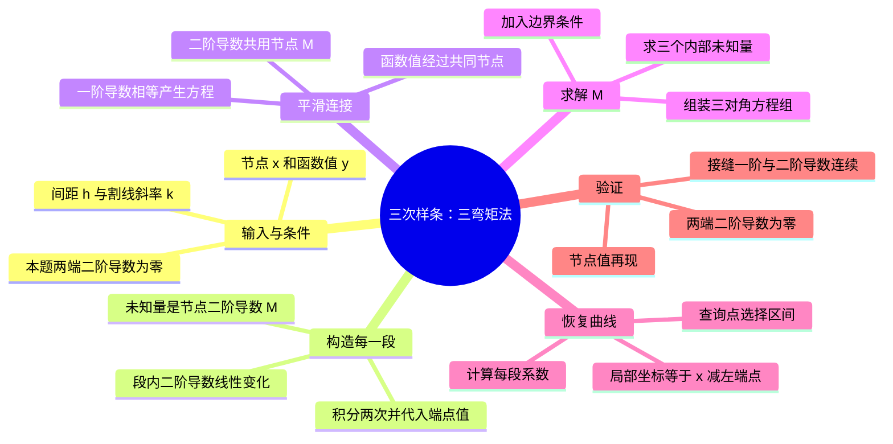

# 教材 2.8.3：三弯矩法思维导图

助手按李庆扬、王能超、易大义《数值分析》第 5 版整理，2026-11-10。主线来自 [2.8.3 三弯矩方程](../../local_books/numerical-analysis/verified/sections/2.8.3.md)，书页 39—40；已回看[书页 39](../../local_books/numerical-analysis/source-images/pdf-052.jpeg)和[书页 40](../../local_books/numerical-analysis/source-images/pdf-053.jpeg)。本题为书页 44 的第 24 题第（2）问，数据和来源见 [README](README.md)。

以下是助手归纳及编程改写，不是教材逐字转录。教材 2.8.4 的算法示例采用一阶导数 m 和给定两端一阶导数的条件；本图固定采用 2.8.3 的二阶导数 M，并代入本题的自然边界条件。

## 从教材公式到本次写法

设节点为 $x_0<\cdots<x_n$，共 $n+1$ 个节点、$n$ 个区间。定义

$$h_i=x_{i+1}-x_i,\qquad k_i=\frac{y_{i+1}-y_i}{h_i},\qquad M_i=S''(x_i).$$

其中 $k_i$ 就是教材的一阶差商 $f[x_i,x_{i+1}]$。

每段 $S$ 是三次多项式，所以 $S''$ 是一次函数；用两端的 $M_i,M_{i+1}$ 插值，得到教材式（2.8.16）。积分两次、代入两端函数值，得到式（2.8.17）。令内部节点的左右一阶导数相等，得到三弯矩方程（2.8.19）。

教材式（2.8.19）乘以 $h_{i-1}+h_i$ 后，就是本次手算使用的等价形式：

$$h_{i-1}M_{i-1}+2(h_{i-1}+h_i)M_i+h_iM_{i+1}=6(k_i-k_{i-1}),\qquad i=1,\ldots,n-1.$$

本题自然边界为 $M_0=M_4=0$，剩下 $M_1,M_2,M_3$ 三个内部未知量。教材采用追赶法；本次编程先用已经学过的 `np.linalg.solve` 求解同一线性系统。

为方便编程，将式（2.8.17）改写成局部坐标形式：

$$t=x-x_i,\qquad S_i(x)=y_i+b_i t+c_i t^2+d_i t^3,$$

$$b_i=k_i-\frac{h_i}{6}(2M_i+M_{i+1}),\qquad c_i=\frac{M_i}{2},\qquad d_i=\frac{M_{i+1}-M_i}{6h_i}.$$

这里的 $d_i$ 是局部多项式的三次项系数；教材式（2.8.19）右端也用字母 $d_i$，含义不同。代码中将方程右端命名为 `rhs`。

## 编程对应关系

| 步骤 | 要得到的对象 | 本题形状/数量 |
|---|---|---|
| 从 CSV 读取 | `data`，以及两列 `x, y` | `(5, 2)`；各 `(5,)` |
| 计算间距与割线斜率 | `h, k` | 各 `(4,)` |
| 组装内部线性系统 | `A, rhs` | `(3, 3)`、`(3,)` |
| 求解并补两端零值 | `M_inner, M` | `(3,)`、`(5,)` |
| 恢复每段系数 | `b, c, d` | 各 `(4,)` |
| 选区间、计算并画图 | 查询点与 `S` 值 | 数量相同 |
| 检查结果 | 节点、接缝及边界的残差 | 接近零 |

求值先限定在 $[0.25,0.53]$ 内；最右端点归入最后一段。用未舍入的计算结果继续运算，展示时再取小数位。具体编码随学习进度逐段完成。
