# 《数值线性代数》中文阅读版

Lloyd N. Trefethen、David Bau III 著，SIAM，1997。

> 状态：全书增量翻译稿。当前已纳入书前材料、第 1–40 讲的中文阅读版、公式、习题和插图，并已补入附录、注释、参考文献与索引；第 1–5 讲为本次从原书页面重新核对并接入的正文。所有内容仍应以各部分 QA 记录和最终回归检查为准。

## 书前部分

> 对应目标 PDF 前置页 1–17，包括封底简介、记号表、版权页、献词、目录、前言、致谢和 Part I 分隔页。书目信息与人名保留英文形式，中文内容按读者阅读习惯优化。

### 封底简介与作者信息

#### 读者评价

> “我曾在研究生入门课程中使用《Numerical Linear Algebra》，发现它几乎是向数学专业研究生介绍这一主题的理想教材。我喜欢它的选题和形式：全书由一系列讲次组成，每一讲都在前面材料的基础上清晰地建立新概念。讲末习题既巩固概念，有时也引入新的思想……本书强调算法背后的数学，以及理解算法为什么有效……书中穿插着例子和解释，使学生始终保持专注。”
>
> ——Daniel B. Szyld，Temple University 数学系

> “这是一本写得极其优美的教材，对数值线性代数有独到而新颖的处理方式。无论是讲授还是学习这门课，它都很有价值。”
>
> ——Nicholas J. Higham，Manchester 大学应用数学教授

> “这本书非常适合作为数学系或计算机系的研究生数值线性代数课程教材；它以一种让背景材料自然随课程出现的方式组织主题……下次授课时我还会再次使用它！”
>
> ——Suely Oliveira，Texas A&M University

#### 出版方简介

这是一本简洁、深刻而优雅的数值线性代数入门书。它面向一学期的研究生课程设计为独立教材，已经在 MIT 和 Cornell 面向来自数学、工程和物理科学各领域的研究生试用。作者清晰而亲切的文风、对这门学科的热爱，以及对最基本思想的流畅呈现，使本书受到教师和学生的欢迎。

《Numerical Linear Algebra》旨在拓宽读者对这一领域的视野，并以新颖的方式呈现核心标准内容。因此，它也可以作为 Golub 与 Van Loan 经典著作《Matrix Computations》的配套读物。书中覆盖了这一领域最重要的主题，包括方程组和特征值问题的迭代方法，以及条件性和稳定性的基本原理；Trefethen 与 Bau 还从全新的角度讨论了若干主题，例如强调数值线性代数与复平面上的多项式逼近之间的联系。

全书由 40 讲组成，每一讲集中讨论一两个核心思想。作者始终强调不同主题之间的统一性，同时避免让读者迷失在细节和技术性问题中。本书打破了从高斯消去法开始的传统，而是从 QR 分解开始：对学生而言，QR 分解更重要、更清爽，也更有新鲜感。QR 分解是贯穿大多数数值线性代数算法的一条主线，连接着最小二乘、特征值、奇异值问题的算法，以及这些问题和方程组的迭代方法。

#### 作者简介

Lloyd N. Trefethen 是 Cornell University 计算机科学教授，曾在 MIT 和 Cornell 获得教学奖。他还担任过 SIAM Journal on Numerical Analysis、Journal of Computational and Applied Mathematics、Numerische Mathematik 和 SIAM Review 等期刊的编辑，并曾在二十多个国际会议上作特邀报告。

David Bau III 曾是 Trefethen 在 Cornell 的学生，目前是 Microsoft Corporation 的软件开发者，任职于 Internet Division。

出版者：Society for Industrial and Applied Mathematics（SIAM）  
地址：3600 University City Science Center，Philadelphia，PA 19104-2688  
ISBN：0-89871-361-7  
网站：siam.org

### 记号表

对 \(A\in\mathbb C^{m\times n}\) 且 \(m>n\) 的方阵或矩形矩阵，本书使用以下记号：

$$
\begin{array}{rcl}
\text{QR 分解} &:& A=QR,\\
\text{约化 QR 分解} &:& A=\widehat Q\,\widehat R,\\
\text{SVD} &:& A=U\Sigma V^*,\\
\text{约化 SVD} &:& A=\widehat U\,\widehat\Sigma V^*.
\end{array}
$$

对方阵 \(A\in\mathbb C^{m\times m}\)，还使用：

$$
\begin{array}{rcl}
\text{LU 分解} &:& PA=LU,\\
\text{Cholesky 分解} &:& A=R^*R,\\
\text{特征值分解} &:& A=X\Lambda X^{-1},\\
\text{Schur 分解} &:& A=UTU^*,\\
\text{正交投影} &:& P=QQ^*,\\
\text{Householder 反射} &:& F=I-2\dfrac{vv^*}{v^*v},\\
\text{QR 算法} &:& A^{(k)}=Q^{(k)}R^{(k)},\quad
A^{(k+1)}=(Q^{(k)})^*A^{(k)}Q^{(k)},\\
\text{Arnoldi 迭代} &:& AQ_n=Q_{n+1}\underline H_n,\quad
H_n=Q_n^*AQ_n,\\
\text{Lanczos 迭代} &:& AQ_n=Q_{n+1}\underline T_n,\quad
T_n=Q_n^*AQ_n.
\end{array}
$$

其中带帽的符号表示约化分解，\(\underline H_n,\underline T_n\) 表示带有额外一行的上 Hessenberg 或三对角结构。

### 版权与版本信息

版权 © 1997 Society for Industrial and Applied Mathematics。版权所有。未经出版者书面许可，不得以任何方式复制、存储或传输本书的任何部分；相关信息可向 SIAM（3600 University City Science Center，Philadelphia，PA 19104-2688）咨询。

书中出现的商标名称有时未附商标符号；这些名称只是在编辑语境中使用，并不表示有任何侵权意图。

美国国会图书馆编目资料：

- Trefethen，Lloyd N.，《Numerical Linear Algebra》/ Lloyd N. Trefethen、David Bau III 著；
- 含参考文献与索引；
- 主题：线性代数；数值计算；
- ISBN：0-89871-361-7（平装）；
- 分类号：QA184.T74，1997。

封面图说明：四条类似水滴的曲线，是与 Arnoldi 迭代第 5、6、7、8 步相关的复平面多项式 Lemniscate。小点是底层矩阵 \(A\) 的特征值，大点是 Arnoldi 迭代的 Ritz 值。随着迭代进行，曲线先向外伸展并包住某个特征值 \(\lambda\)，随后收缩并逐渐缩成一点；位于其中的 Ritz 值于是以几何速度收敛到 \(\lambda\)。参见原书第 263 页图 34.3。

### 献词

谨献给我们的父母：

Florence 与 Lloyd MacG. Trefethen，  
以及  
Rachel 与 Paul Bau。

### 前言

自 20 世纪 80 年代初以来，第一作者一直在 MIT 和 Cornell 为研究生讲授数值线性代数课程。这门课的校友如今已有数百人，来自工程和物理科学的各个领域。本书就是把这门课程写下来的尝试。

在数值线性代数领域，市面上已经有一本百科全书式的著作：Golub 与 Van Loan 的《Matrix Computations》，当时已出版到第三版。本书完全无意复制那部著作；它的规模被控制在一所大学一学期课程能够覆盖的范围内，目标是尽可能优雅地呈现基本思想。我们希望每一位读者都能同时接触 Golub 与 Van Loan 的书，以便追寻更详细的内容、额外主题以及丰富的研究文献参考。另有两本重要的新书是 Higham 和 Demmel 的著作，书末注释（原书第 329 页）对此有所介绍。

数值线性代数这个名字听起来也许有些乏味，但这门学科比名字暗示的更加美丽、更加基础。说它美丽，是因为其中充满了数学系线性代数课程通常不会重点强调的强大思想；学期结束时，学生往往会感叹，这门课的内容远比他们原先想象的丰富。说它基础，则是因为历史上的一个巧合：“数值”线性代数其实就是应用线性代数。数学科学工作者要有效处理向量和矩阵，就必须掌握这里的基本思想。

事实上，我们研究的不只是向量和矩阵，因为几乎所有内容都可以推广到函数和算子。数值线性代数本质上也是泛函分析，只不过始终更强调实用的算法思想，而不是数学技术细节。

本书分为 40 讲。我们努力让每一讲围绕一两个核心思想展开，强调主题之间的统一性，并避免陷入细节。很多地方的处理并不遵循通常套路；这里不逐一列举（参见书末注释），但可以提到一个不寻常之处：我们没有从高斯消去法开始。高斯消去法并不典型，分析起来格外困难，却又是每个初次学习这门课程的学生都已经耳熟能详的算法。相反，我们从 QR 分解开始；它更重要、更简单，对多数学生也更新鲜。QR 分解连接着数值线性代数的大多数算法，包括最小二乘、特征值和奇异值问题的算法，以及这些问题和方程组的迭代方法。

自 20 世纪 70 年代以来，迭代方法已经走到科学计算的中心位置，因此本书最后一部分专门讨论它们。

我们希望读者最终会认同这样的看法：如果除了微积分和微分方程之外，还有一个同样基础、同样属于数学科学核心的主题，那就是数值线性代数。

### 致谢

没有许多人的帮助，我们不可能写成这本书。首先要感谢 MIT（Math 335）和 Cornell（CS 621）的数百名研究生。他们十年来的热情和建议，指导了选题与写作风格。Cornell 的大约七十名学生直接使用本书草稿学习，并提出了大量建议；仅 Keith Sollers 一人找出的排版错误数量就令人惊叹。

写作期间，Trefethen 的大多数研究生都从头到尾读过书稿——有时是在很短的期限内、在相当大的压力下完成的。Jeff Baggett、Toby Driscoll、Vicki Howle、Gudbjorn Jonsson、Kim Toh 和 Divakar Viswanath 提供了许多建设性意见。拥有这样既是学生、后来又成为同事的人，是一种荣幸。

与 SIAM 出版团队合作是一段愉快的经历。很少有机构能同时具备 SIAM 的灵活性和专业性。感谢 SIAM 六位左右的编辑、制作和设计人员；正是他们共同的努力使这本书变得美观。特别感谢 Beth Gallagher：她不仅完成了一流的文字编辑，还做了远超文字编辑范围的大量工作。

在支持数值线性代数、出版相关著作方面，地球上没有哪个机构比 Cornell 计算机科学系更积极。系里另外三位研究数值线性代数的教师是 Tom Coleman、Charlie Van Loan 和 Steve Vavasis；感谢他们把 Cornell 建设成如此吸引人的科学计算中心。Vavasis 通读了整部书稿并提出许多宝贵意见，Van Loan 则是最初把 Trefethen 带到 Cornell 的人。

在非数值方向的同事中，感谢 Dexter Kozen，他为本书提供了写作模式：同样由 40 个短讲组成的《The Design and Analysis of Algorithms》。系里的行政支持人员中，我们尤其依赖 Rebekah Personius 的专业、勤奋和良好精神。

在 Cornell 之外，Anne Greenbaum 也是一位经常来访、令人欣喜的同事，她对书稿提出了大量建议。她是我们所认识的数值线性代数思想家中最深刻的一位。

从 1995 年 9 月到 1996 年 12 月，一些同事曾使用本书草稿授课，并贡献了他们自己以及学生的意见，包括：Gene Golub（Stanford）、Bob Lynch（Purdue）、Suely Oliveira（Texas A&M）、Michael Overton（New York University）、Haesun Park 和 Ahmed Sameh（University of Minnesota）、Irwin Pressmann（Carleton University）、Bob Russell 和 Manfred Trummer（Simon Fraser University）、Peter Schmid（University of Washington）、Daniel Szyld（Temple University），以及 Hong Zhang 和 Bill Moss（Clemson University）。

其中 Lynch 和 Overton 提供的详细建议清单最长。我们原本急于给每一个字母都加上最后一点，但他们的意见实在太合理，不能忽略；如今书中有数百处说明因为他们而变得更好。

说到对本书实质内容的帮助，最重要的当属 Manchester University 的 Nick Higham——这份感激无法偿还，因为他拒绝接受任何回报。他的创造力和对细节一贯严谨的学术关注，激励了年龄从他一半到两倍的数值分析学者。在很短时间内，Higham 以一贯的善意仔细阅读了书稿，提出了许多技术性建议，其中一些显著改变了本书。

数十年来，数值线性代数一直是一个友好且凝聚力很强的领域。Trefethen 特别想感谢三位“父辈人物”：Gene Golub、Cleve Moler 和 Jim Wilkinson；正是他们课堂上的讲授，最初吸引他进入这个领域。

不过，让生活值得过下去的并不只有数值线性代数。对此，第一作者感谢 Anne、Emma（5 岁）和 Jacob（3 岁）Trefethen；第二作者感谢 Heidi Yeh。

### Part I　基础

以下进入第一部分“基础”，从第 1 讲开始。

## 全书目录

### 第一部分：基础

1. 矩阵与向量相乘
2. 正交向量与矩阵
3. 范数
4. 奇异值分解
5. SVD 的更多讨论

### 第二部分：QR 分解与最小二乘

6. 投影算子
7. QR 分解
8. Gram–Schmidt 正交化
9. MATLAB
10. Householder 三角化
11. 最小二乘问题

### 第三部分：良态性与稳定性

12. 良态性与条件数 · 13. 浮点运算 · 14. 稳定性 · 15. 稳定性漫谈 · 16. Householder 三角化的稳定性 · 17. 回代法的稳定性 · 18. 最小二乘问题的良态性 · 19. 最小二乘算法的稳定性

### 第四至第六部分

20–23. 线性方程组；24–31. 特征值；32–40. 迭代法。

附录、注释、参考文献与索引均已并入本文档末尾。

---

<a id="lecture-1"></a>

## 第 1 讲　矩阵–向量乘法

> 原书页 3–10；目标 PDF 页 18–25。公式编号沿用原书。矩阵、向量默认取复数；需要几何解释时，读者可把它们暂时看成实数对象。

你已经熟悉矩阵–向量乘法的公式。不过，本讲的目的，是介绍一种也许不那么熟悉、却对后续数值线性代数至关重要的理解方式：

> 如果 \(b=Ax\)，那么 \(b\) 是 \(A\) 的列向量的线性组合。

### 熟悉的定义

设 \(x\) 是 \(n\) 维列向量，\(A\) 是一个 \(m\times n\) 矩阵（\(m\) 行、\(n\) 列）。矩阵–向量乘积 \(b=Ax\) 是一个 \(m\) 维列向量，其第 \(i\) 个分量为

$$
b_i=\sum_{j=1}^{n}a_{ij}x_j,\qquad i=1,\ldots,m. \tag{1.1}
$$

这里 \(b_i\) 表示 \(b\) 的第 \(i\) 个分量，\(a_{ij}\) 表示 \(A\) 的第 \(i\) 行第 \(j\) 列元素，\(x_j\) 表示 \(x\) 的第 \(j\) 个分量。除少数特殊场合外，本书中的量都属于复数域 \(\mathbb C\)；\(m\) 维向量空间记为 \(\mathbb C^m\)，\(m\times n\) 矩阵空间记为 \(\mathbb C^{m\times n}\)。

映射 \(x\mapsto Ax\) 是线性的，即对任意 \(x,y\in\mathbb C^n\) 和 \(\alpha\in\mathbb C\)，都有

$$
A(x+y)=Ax+Ay,\qquad A(\alpha x)=\alpha Ax.
$$

反过来，从 \(\mathbb C^n\) 到 \(\mathbb C^m\) 的每一个线性映射，都可以表示为左乘某个 \(m\times n\) 矩阵。

### 矩阵乘向量

记 \(a_j\) 为 \(A\) 的第 \(j\) 列，它是一个 \(m\) 维向量。于是，(1.1) 可以改写为

$$
b=Ax=\sum_{j=1}^{n}x_j a_j. \tag{1.2}
$$

也就是说，

$$
A=\begin{bmatrix}a_1&a_2&\cdots&a_n\end{bmatrix},\qquad
x=\begin{bmatrix}x_1\\x_2\\\vdots\\x_n\end{bmatrix},
\qquad
b=x_1a_1+x_2a_2+\cdots+x_na_n.
$$

在 (1.2) 中，\(b\) 被表示成 \(A\) 的列向量的线性组合。从 (1.1) 到 (1.2) 只是记号略有改变，但这种观点对理解数值线性代数算法非常重要。我们通常把 \(Ax=b\) 读作“\(A\) 作用于 \(x\)，产生 \(b\)”；而 (1.2) 则提示了另一种读法：“\(x\) 作用于 \(A\)，产生 \(b\)”，其中 \(x\) 给出了各列的组合系数。

#### 例 1.1　范德蒙德矩阵

固定一列数 \(x_1,\ldots,x_m\)。若 \(p,q\) 是次数小于 \(n\) 的多项式，\(\alpha\) 是一个标量，则 \(p+q\) 和 \(\alpha p\) 仍是次数小于 \(n\) 的多项式，并且

$$
(p+q)(x_i)=p(x_i)+q(x_i),\qquad
(\alpha p)(x_i)=\alpha p(x_i).
$$

因此，从次数小于 \(n\) 的多项式系数向量，到采样值向量
\[
(p(x_1),p(x_2),\ldots,p(x_m))^{\mathsf T}
\]
的映射是线性的。任何线性映射都可以写成矩阵乘法；这里得到的正是一个 \(m\times n\) 的范德蒙德矩阵：

$$
A=
\begin{bmatrix}
1&x_1&x_1^2&\cdots&x_1^{n-1}\\
1&x_2&x_2^2&\cdots&x_2^{n-1}\\
\vdots&\vdots&\vdots&&\vdots\\
1&x_m&x_m^2&\cdots&x_m^{n-1}
\end{bmatrix}.
$$

若 \(c\) 是多项式
\[
p(x)=c_0+c_1x+c_2x^2+\cdots+c_{n-1}x^{n-1}
\]
的系数列向量，那么 \(Ac\) 就是多项式在这些点上的采样值。对 \(i=1,\ldots,m\)，

$$
(Ac)_i=c_0+c_1x_i+c_2x_i^2+\cdots+c_{n-1}x_i^{n-1}=p(x_i). \tag{1.3}
$$

在这个例子里，不必把 \(Ac\) 理解成 \(m\) 个彼此独立的标量求和。更自然的方式是把 \(A\) 看成由各个单项式的采样向量组成的列矩阵：

$$
A=\begin{bmatrix}\boldsymbol 1&\boldsymbol x&\boldsymbol x^2&\cdots&
\boldsymbol x^{\,n-1}\end{bmatrix}, \tag{1.4}
$$

其中 \(\boldsymbol x=(x_1,\ldots,x_m)^{\mathsf T}\)，幂按分量计算。于是

$$
Ac=c_0\boldsymbol 1+c_1\boldsymbol x+c_2\boldsymbol x^2+\cdots+
c_{n-1}\boldsymbol x^{\,n-1}=p(\boldsymbol x).
$$

这就是 (1.2) 所表达的“列向量线性组合”观点。下面将从这个角度回顾一些基本线性代数概念。

### 矩阵乘矩阵

对于矩阵乘积 \(B=AC\)，\(B\) 的每一列都是 \(A\) 的列向量的线性组合。设 \(A\in\mathbb C^{\ell\times m}\)，\(C\in\mathbb C^{m\times n}\)，则 \(B\in\mathbb C^{\ell\times n}\)，其元素为

$$
b_{ij}=\sum_{k=1}^{m}a_{ik}c_{kj}. \tag{1.5}
$$

若 \(c_j\) 和 \(b_j\) 分别表示 \(C\) 与 \(B\) 的第 \(j\) 列，则

$$
b_j=Ac_j=\sum_{k=1}^{m}c_{kj}a_k. \tag{1.6}
$$

所以 \(b_j\) 是 \(A\) 的列向量 \(a_k\) 的线性组合，组合系数是 \(C\) 的第 \(j\) 列中的元素。

#### 例 1.2　外积

外积是矩阵–矩阵乘法的一个简单例子。令 \(u\) 为 \(m\) 维列向量，\(v^*\) 为 \(n\) 维行向量，则

$$
uv^*=
\begin{bmatrix}u_1\\u_2\\\vdots\\u_m\end{bmatrix}
\begin{bmatrix}v_1&v_2&\cdots&v_n\end{bmatrix}
=
\begin{bmatrix}
v_1u_1&v_2u_1&\cdots&v_nu_1\\
v_1u_2&v_2u_2&\cdots&v_nu_2\\
\vdots&\vdots&&\vdots\\
v_1u_m&v_2u_m&\cdots&v_nu_m
\end{bmatrix}.
$$

结果是一个秩为 1 的 \(m\times n\) 矩阵（除非 \(u\) 或 \(v\) 为零）。它的每一列都是同一个向量 \(u\) 的倍数；同样，每一行都是同一个行向量 \(v^*\) 的倍数。

#### 例 1.3　离散不定积分

考虑 \(B=AR\)，其中 \(R\) 是 \(n\times n\) 的上三角矩阵，满足 \(r_{ij}=1\)（\(i\le j\)），\(r_{ij}=0\)（\(i>j\)）。由列公式 (1.6)，

$$
b_j=Ar_j=\sum_{k=1}^{j}a_k. \tag{1.7}
$$

因此，\(B\) 的第 \(j\) 列等于 \(A\) 的前 \(j\) 列之和。矩阵 \(R\) 可以看成“不定积分算子”的离散版本。

### 值域与零空间

矩阵 \(A\) 的值域记为 \(\operatorname{range}(A)\)，它由所有可以写成 \(Ax\) 的向量组成。由 (1.2) 立即得到：

#### 定理 1.1

\[
\operatorname{range}(A)=\operatorname{span}\{A\text{ 的各列}\}.
\]

**证明。** 由 (1.2)，任意 \(Ax\) 都是 \(A\) 的列向量的线性组合，因此属于列空间。反过来，若 \(y\) 属于这些列向量张成的空间，则存在系数 \(x_1,\ldots,x_n\)，使
\[
y=\sum_{j=1}^{n}x_ja_j.
\]
把这些系数组成向量 \(x\)，就有 \(y=Ax\)，所以 \(y\in\operatorname{range}(A)\)。证毕。

因此，矩阵的值域也称为它的**列空间**。

矩阵 \(A\in\mathbb C^{m\times n}\) 的零空间记为
\[
\operatorname{null}(A)=\{x\in\mathbb C^n:Ax=0\},
\]
其中 \(0\) 是 \(\mathbb C^m\) 中的零向量。零空间中每个向量 \(x\) 的分量，正好是一个“以 \(A\) 的列为向量、结果为零”的线性组合的系数：
\[
0=x_1a_1+x_2a_2+\cdots+x_na_n.
\]

### 秩

矩阵的**列秩**是其列空间的维数；类似地，**行秩**是其行向量张成空间的维数。行秩总等于列秩（本书第 4、5 讲的奇异值分解也会给出这一事实的推论），因此我们把这个共同的数简称为矩阵的**秩**。

一个 \(m\times n\) 矩阵满秩，是指它的秩达到可能的最大值 \(\min(m,n)\)。特别地，当 \(m>n\) 时，满秩意味着 \(n\) 个列向量线性无关；等价地，它定义的线性映射是一一映射。

#### 定理 1.2

设 \(A\in\mathbb C^{m\times n}\)，且 \(m>n\)。那么，\(A\) 满秩，当且仅当它不会把两个不同的向量映射到同一个向量。

**证明。** 若 \(A\) 满秩，则它的列向量线性无关，并构成 \(\operatorname{range}(A)\) 的一组基。因此，\(\operatorname{range}(A)\) 中每个 \(b\) 在这组基下都有唯一的线性展开，也就是说，对每个 \(b\in\operatorname{range}(A)\)，方程 \(b=Ax\) 都有唯一的 \(x\)。

反过来，若 \(A\) 不满秩，则其列向量线性相关，存在不全为零的系数 \(c_j\)，使
\[
\sum_{j=1}^{n}c_ja_j=0.
\]
令 \(c\) 为这些系数组成的非零向量，则 \(Ac=0\)。于是对任意 \(x\)，都有
\[
Ax=A(x+c),
\]
而 \(x\ne x+c\)。所以 \(A\) 会把不同向量映射到同一个向量。证毕。

### 逆矩阵

非奇异矩阵（或可逆矩阵）是一个满秩方阵。非奇异的 \(m\times m\) 矩阵 \(A\) 的 \(m\) 个列向量构成整个空间 \(\mathbb C^m\) 的一组基，因此每个向量都能被唯一表示。特别地，第 \(j\) 个标准基向量 \(e_j\) 可以写成

$$
e_j=\sum_{i=1}^{m}z_{ij}a_i. \tag{1.8}
$$

令 \(Z=[z_{ij}]\)，并记 \(z_j\) 为 \(Z\) 的第 \(j\) 列，则 (1.8) 等价于 \(e_j=Az_j\)。把所有这些等式并列起来，得到

$$
I=\begin{bmatrix}e_1&e_2&\cdots&e_m\end{bmatrix}=AZ,
$$

其中 \(I\) 是 \(m\times m\) 单位矩阵。因此 \(Z\) 就是 \(A\) 的逆矩阵，记为 \(A^{-1}\)，并满足

$$
AA^{-1}=A^{-1}A=I.
$$

#### 定理 1.3

对 \(A\in\mathbb C^{m\times m}\)，下列条件彼此等价：

1. \(A\) 有逆矩阵 \(A^{-1}\)；
2. \(\operatorname{rank}(A)=m\)；
3. \(\operatorname{range}(A)=\mathbb C^m\)；
4. \(\operatorname{null}(A)=\{0\}\)；
5. \(0\) 不是 \(A\) 的特征值；
6. \(0\) 不是 \(A\) 的奇异值；
7. \(\det(A)\ne0\)。

行列式在理论上很方便，但在数值算法中很少真正发挥作用。

### 逆矩阵乘向量

写下
\[
x=A^{-1}b
\]
时，不要让“逆矩阵”这个记号掩盖实际发生的事情。与其把 \(x\) 想成 \(A^{-1}\) 作用于 \(b\) 的结果，不如把它理解为满足
\[
Ax=b
\]
的唯一向量。根据 (1.2)，\(x\) 是 \(b\) 在 \(A\) 的列向量基下的展开系数：

> \(A^{-1}b\) 是 \(b\) 在 \(A\) 的列向量基下的坐标向量。

因此，乘以 \(A^{-1}\) 本质上是一次换基操作。可以把它概括为

$$
\begin{array}{c@{\quad\overset{A^{-1}}{\longrightarrow}\quad}c}
b:\ \text{在标准基 }\{e_1,\ldots,e_m\}\text{ 下的坐标}
&
A^{-1}b:\ \text{在列向量基 }\{a_1,\ldots,a_m\}\text{ 下的坐标}
\end{array}
$$

乘以 \(A\) 则沿相反方向把列向量基下的坐标还原为标准基下的坐标。这里略去了一个常见的语言混用：同一个符号 \(b\)，有时表示一个 \(m\) 元数组，有时表示抽象向量空间中的一个向量。理解这两种含义的区别，对后续内容很有帮助。

### 关于 \(m\) 与 \(n\) 的约定

数值线性代数通常把矩形矩阵写成 \(m\times n\) 的形式，本书也遵循这一约定。若矩阵是方阵，通常有人写成 \(n\times n\)，但本书一般写成 \(m\times m\)。原因是：许多算法需要从方阵中选取若干列组成矩形子矩阵；如果子矩阵写成 \(m\times n\)，那么原方阵最好写成 \(m\times m\)。

### 习题

**1.1** 设 \(B\) 是一个 \(4\times4\) 矩阵，依次进行以下操作：

1. 将第 1 列乘以 2；
2. 将第 3 行除以 2；
3. 把第 3 行加到第 1 行；
4. 交换第 1 列与第 4 列；
5. 从其余每一行中减去第 2 行；
6. 用第 3 列替换第 4 列；
7. 删除第 1 列（因此列数减少 1）。

(a) 把最终结果写成八个矩阵的乘积。

(b) 对同一个 \(B\)，再把结果写成三个矩阵 \(ABC\) 的乘积。

**1.2** 设质量 \(m_1,m_2,m_3,m_4\) 位于一条直线上的位置 \(x_1,x_2,x_3,x_4\)，相邻质量之间由弹簧连接。弹簧常数分别为 \(k_{12},k_{23},k_{34}\)，自然伸长分别为 \(\ell_{12},\ell_{23},\ell_{34}\)。记 \(f_i\) 为作用在第 \(i\) 个质量上的向右力，例如
\[
f_1=k_{12}(x_2-x_1-\ell_{12}).
\]

(a) 写出联系列向量 \(f\) 与 \(x\) 的 \(4\times4\) 矩阵方程，并将其中的矩阵记为 \(K\)。

(b) 从物理量纲角度说明 \(K\) 中各元素的量纲（例如质量乘时间、距离除以质量等）。

(c) 从物理量纲角度说明 \(\det(K)\) 的量纲。

(d) 假设 \(K\) 的数值是以米、千克、秒为单位给出的。若改用厘米、克、秒，并得到矩阵 \(K'\)，那么 \(K'\) 与 \(K\) 有什么关系？\(\det(K')\) 与 \(\det(K)\) 有什么关系？

**1.3** 如果方阵或矩形矩阵 \(R=[r_{ij}]\) 在 \(i>j\) 时满足 \(r_{ij}=0\)，就称为上三角矩阵。考虑 \(R\) 的前 \(n\) 列所张成的空间，并利用 (1.8) 证明：若 \(R\) 是非奇异的 \(m\times m\) 上三角矩阵，则 \(R^{-1}\) 也是上三角矩阵。（下三角矩阵也有完全类似的结论。）

**1.4** 设 \(f_1,\ldots,f_8\) 是定义在区间 \([1,8]\) 上的一组函数，满足：对任意数 \(d_1,\ldots,d_8\)，都存在系数 \(c_1,\ldots,c_8\)，使

$$
\sum_{j=1}^{8}c_jf_j(i)=d_i,\qquad i=1,\ldots,8.
$$

(a) 利用本讲的定理证明，数据 \(d_1,\ldots,d_8\) 能唯一确定系数 \(c_1,\ldots,c_8\)。

(b) 令 \(A\) 为把数据 \(d_1,\ldots,d_8\) 映射到系数 \(c_1,\ldots,c_8\) 的 \(8\times8\) 矩阵。问 \(A^{-1}\) 的第 \(i,j\) 个元素是什么？

---

<a id="lecture-2"></a>

## 第 2 讲　正交向量与矩阵

> 原书页 11–16；目标 PDF 页 26–31。复数记号沿用原书：共轭转置记为上标 \(^*\)，实数情形下它就是转置 \(^T\)。

自 20 世纪 60 年代以来，许多数值线性代数中最好的算法，都以某种方式建立在正交性之上。本讲介绍这些算法所需的基本工具：正交向量与正交（酉）矩阵。

### 共轭转置

标量 \(z\) 的复共轭记为 \(\overline z\)，它通过把 \(z\) 的虚部取反得到。若 \(z\) 为实数，则 \(\overline z=z\)。

\(m\times n\) 矩阵 \(A\) 的厄米共轭（也称伴随或共轭转置）记为 \(A^*\)，它是一个 \(n\times m\) 矩阵，满足

$$
(A^*)_{ij}=\overline{a_{ji}}.
$$

例如，

$$
A=
\begin{bmatrix}
a_{11}&a_{12}\\
a_{21}&a_{22}\\
a_{31}&a_{32}
\end{bmatrix}
\quad\Longrightarrow\quad
A^*=
\begin{bmatrix}
\overline{a_{11}}&\overline{a_{21}}&\overline{a_{31}}\\
\overline{a_{12}}&\overline{a_{22}}&\overline{a_{32}}
\end{bmatrix}.
$$

若 \(A=A^*\)，则称 \(A\) 为**厄米矩阵**；按定义，厄米矩阵必须是方阵。若 \(A\) 是实矩阵，伴随就是交换行与列，此时也称为转置，记为 \(A^T\)。实矩阵若满足 \(A=A^T\)，则称为**对称矩阵**。

许多数值线性代数教材只讨论实矩阵，因此主要使用 \(T\) 而不是 \(^*\)。本书选择更一般的复数记号，因为后面的大多数思想并不局限于实数。于是，一个行向量通常写成 \(a^*\)，而不是 \(a^T\)。如果读者愿意把所有量都想成实数，把 \(^*\) 当成 \(^T\)，通常也不会遇到问题。

### 内积

两个列向量 \(x,y\in\mathbb C^m\) 的内积定义为 \(x\) 的伴随乘以 \(y\)：

$$
x^*y=\sum_{j=1}^{m}\overline{x_j}\,y_j. \tag{2.1}
$$

向量 \(x\) 的欧几里得长度为

$$
\|x\|_2=(x^*x)^{1/2}
=\left(\sum_{j=1}^{m}|x_j|^2\right)^{1/2}. \tag{2.2}
$$

在实向量的几何解释中，\(x\) 与 \(y\) 的夹角 \(\alpha\) 满足

$$
\cos\alpha=\frac{x^*y}{\|x\|_2\|y\|_2}. \tag{2.3}
$$

本书有时会给出代数公式的几何解释。此时应把向量暂时看成实向量；多数解释也可以以适当方式推广到复数情形。

需要注意复内积的线性性质：它对第二个变量线性、对第一个变量共轭线性。于是

$$
(x_1+x_2)^*y=x_1^*y+x_2^*y,\qquad
x^*(y_1+y_2)=x^*y_1+x^*y_2,
$$

以及

$$
(\alpha x)^*(\beta y)=\overline{\alpha}\,\beta\,x^*y.
$$

在实数域中，共轭不起作用，这些公式就退化为通常的双线性关系。

对任意维数相容的矩阵或向量 \(A,B\)，经常使用下面这个容易验证的性质：

$$
(AB)^*=B^*A^*. \tag{2.4}
$$

它类似于可逆方阵乘积的公式

$$
(AB)^{-1}=B^{-1}A^{-1}. \tag{2.5}
$$

记号
\[
A^{-*}
\]
是 \((A^*)^{-1}\) 的简写；它也等于 \((A^{-1})^*\)。把 (2.4) 应用于 \(B=A^{-1}\) 即可验证这一点。

### 正交向量

若 \(x^*y=0\)，则称向量 \(x\) 与 \(y\) **正交**。在实数情形，这表示它们在 \(\mathbb R^m\) 中互相垂直。若向量集合 \(X\) 中每个向量都与集合 \(Y\) 中每个向量正交，则称 \(X\) 与 \(Y\) 正交，也称“\(X\) 正交于 \(Y\)”。

非零向量集合 \(S\) 若其中任意两个不同元素都正交，即
\[
x,y\in S,\ x\ne y\quad\Longrightarrow\quad x^*y=0,
\]
则称 \(S\) 是正交集。若正交集中的每个向量还都满足 \(\|x\|_2=1\)，则称其为**标准正交集**（orthonormal set）。

#### 定理 2.1

正交集 \(S\) 中的向量线性无关。

**证明。** 假设这些向量线性相关，则某个 \(v_k\in S\) 可以表示为其余元素的线性组合：
\[
v_k=\sum_{i\ne k}c_i v_i.
\]
由于 \(v_k\ne0\)，有
\[
v_k^*v_k=\|v_k\|_2^2>0.
\]
另一方面，利用内积的线性性质和正交性，
\[
v_k^*v_k=\sum_{i\ne k}c_i\,v_k^*v_i=0,
\]
矛盾。证毕。

作为推论，若 \(S\subset\mathbb C^m\) 是包含 \(m\) 个向量的正交集，那么 \(S\) 就是 \(\mathbb C^m\) 的一组基。

### 向量的正交分量

内积与正交性最重要的用途，是把任意向量分解成相互正交的分量。

设 \(\{q_1,\ldots,q_n\}\) 是一个标准正交集，\(v\) 是任意向量。令

$$
r=v-\sum_{j=1}^{n}(q_j^*v)q_j. \tag{2.6}
$$

则 \(r\) 与 \(\{q_1,\ldots,q_n\}\) 正交。事实上，对任意 \(i\)，

$$
q_i^*r=q_i^*v-\sum_{j=1}^{n}(q_j^*v)\,q_i^*q_j
=q_i^*v-(q_i^*v)=0,
$$

因为 \(q_i^*q_j=0\)（当 \(i\ne j\)），而 \(q_i^*q_i=1\)。

因此 \(v\) 可以分解为 \(n+1\) 个互相正交的分量：

$$
v=r+\sum_{j=1}^{n}(q_j^*v)q_j
=r+\sum_{j=1}^{n}(q_jq_j^*)v. \tag{2.7}
$$

这里 \(r\) 是 \(v\) 在 \(\operatorname{span}\{q_1,\ldots,q_n\}\) 的正交补分量，而 \((q_j^*v)q_j\) 是 \(v\) 沿 \(q_j\) 方向的分量。

若 \(\{q_j\}\) 本身是 \(\mathbb C^m\) 的一组基，则 \(n=m\)，并且 \(r=0\)，从而

$$
v=\sum_{j=1}^{m}(q_j^*v)q_j
=\sum_{j=1}^{m}(q_jq_j^*)v. \tag{2.8}
$$

(2.7) 和 (2.8) 写了同一个事实的两种形式，但解释不同。第一种形式把 \(v\) 看成“系数乘向量”的和；第二种形式把 \(v\) 看成若干个正交投影的和。第 \(j\) 个投影由特殊的秩一矩阵 \(q_jq_j^*\) 实现。第 6 讲将系统讨论这种投影以及其他投影过程。

### 酉矩阵

方阵 \(Q\in\mathbb C^{m\times m}\) 若满足

$$
Q^*=Q^{-1},\qquad\text{等价地}\qquad Q^*Q=I,
$$

则称 \(Q\) 为**酉矩阵**；在实数情形称为**正交矩阵**。若 \(Q=[q_1\ \cdots\ q_m]\)，则

$$
q_i^*q_j=\delta_{ij},
$$

其中 \(\delta_{ij}\) 是克罗内克 delta：当 \(i=j\) 时为 1，否则为 0。换言之，酉矩阵的列向量构成 \(\mathbb C^m\) 的一组标准正交基。

### 酉矩阵的乘法

上一讲讨论了 \(Ax\) 与 \(A^{-1}b\) 的含义。若 \(A=Q\) 是酉矩阵，这些乘积变为 \(Qx\) 和 \(Q^*b\)，解释仍然相同：

- \(Qx\) 是 \(Q\) 的列向量以 \(x\) 为系数的线性组合；
- \(Q^*b\) 是 \(b\) 在 \(Q\) 的列向量基下的坐标。

可以把这两个过程写成换基关系：

$$
\begin{array}{c@{\quad\overset{Q^*}{\longrightarrow}\quad}c}
b:\ \text{在 }\{e_1,\ldots,e_m\}\text{ 下的坐标}
&
Q^*b:\ \text{在 }\{q_1,\ldots,q_m\}\text{ 下的坐标}
\end{array}
$$

再乘以 \(Q\)，便把右侧坐标还原成标准坐标。

酉矩阵及其伴随的乘法保持欧几里得几何结构，因为内积保持不变：

$$
(Qx)^*(Qy)=x^*Q^*Qy=x^*y. \tag{2.9}
$$

因此向量间的角度和长度都保持不变：

$$
\|Qx\|_2=\|x\|_2. \tag{2.10}
$$

在实数情形，正交矩阵对应于向量空间的刚性运动：当 \(\det Q=1\) 时是旋转，当 \(\det Q=-1\) 时是反射。

### 习题

**2.1** 证明：若矩阵 \(A\) 既是三角矩阵又是酉矩阵，则 \(A\) 必为对角矩阵。

**2.2** 勾股定理断言，对于一组正交向量 \(\{x_i\}_{i=1}^{n}\)，有

$$
\left\|\sum_{i=1}^{n}x_i\right\|_2^2
=\sum_{i=1}^{n}\|x_i\|_2^2.
$$

(a) 对 \(n=2\)，直接计算 \(\|x_1+x_2\|_2^2\) 证明它。

(b) 证明这个计算可以通过归纳法得到一般情形。

**2.3** 设 \(A\in\mathbb C^{m\times m}\) 为厄米矩阵。若非零向量 \(x\in\mathbb C^m\) 满足 \(Ax=\lambda x\)，则称 \(x\) 为 \(A\) 的特征向量，\(\lambda\in\mathbb C\) 为对应特征值。

(a) 证明 \(A\) 的所有特征值都是实数。

(b) 证明对应不同特征值的特征向量互相正交。

**2.4** 酉矩阵的特征值具有什么性质？

**2.5** 设 \(S\in\mathbb C^{n\times n}\) 为斜厄米矩阵，即 \(S^*=-S\)。

(a) 利用习题 2.1 证明 \(S\) 的特征值都是纯虚数。

(b) 证明 \(I-S\) 非奇异。

(c) 证明
\[
Q=(I-S)^{-1}(I+S)
\]
是酉矩阵。这个 \(Q\) 称为 \(S\) 的 Cayley 变换；它是标量线性分式变换 \((1+s)/(1-s)\) 的矩阵类比，后者把复平面的左半平面共形地映射到单位圆盘。

**2.6** 若 \(u,v\) 是 \(m\) 维向量，矩阵
\[
A=I+uv^*
\]
称为单位矩阵的秩一扰动。证明：若 \(A\) 非奇异，则其逆矩阵具有
\[
A^{-1}=I+\alpha uv^*
\]
的形式，其中 \(\alpha\) 是某个标量，并求出 \(\alpha\) 的表达式。对什么样的 \(u,v\)，\(A\) 会奇异？若 \(A\) 奇异，\(\operatorname{null}(A)\) 是什么？

**2.7** Hadamard 矩阵是这样一种矩阵：所有元素都为 \(\pm1\)，并且其转置等于其逆矩阵乘以某个常数因子。已知当 Hadamard 矩阵的维数 \(m>2\) 时，\(m\) 必须是 4 的倍数；但对于每一个这样的 \(m\) 是否都存在 Hadamard 矩阵，目前并不清楚，不过 \(m<424\) 的所有情形都已经找到了例子。

证明下面的递归构造，对每个 \(m=2^k\)（\(k=0,1,2,\ldots\)）都给出一个 Hadamard 矩阵：

$$
H_0=[1],\qquad
H_{k+1}=
\begin{bmatrix}
H_k&H_k\\
H_k&-H_k
\end{bmatrix}.
$$

---

<a id="lecture-3"></a>

## 第 3 讲　范数

> 原书页 17–24；目标 PDF 页 32–39。原书图 3.1 已保留为本地插图；范数下标 \(\infty\) 和 \(p\) 按原页面视觉核对，避免 OCR 将 \(\infty\) 误识别为数字。

向量空间中“大小”和“距离”的基本概念由范数刻画。整个数值线性代数中，我们都用范数来衡量近似误差和收敛性。

### 向量范数

范数是一个函数
\[
\|\cdot\|:\mathbb C^m\longrightarrow\mathbb R,
\]
它为每个向量赋予一个实数长度。为了符合合理的长度概念，对任意向量 \(x,y\) 和标量 \(\alpha\in\mathbb C\)，范数必须满足：

1. \(\|x\|\ge0\)，且 \(\|x\|=0\) 当且仅当 \(x=0\)；
2. \(\|x+y\|\le\|x\|+\|y\|\)（三角不等式）；
3. \(\|\alpha x\|=|\alpha|\,\|x\|\)。

这三条分别表达了：非零向量的长度为正；整体长度不超过各部分长度之和；缩放向量时长度按同样的倍数缩放。

上一讲使用的 \(\|\cdot\|_2\) 是欧几里得长度，即各分量平方和的平方根。但 (3.1) 允许我们使用许多不同的“长度”，而在不同问题中选择合适的范数往往很有用。

### \(p\)-范数

最重要的一类向量范数是 \(p\)-范数：

$$
\begin{aligned}
\|x\|_1&=\sum_{i=1}^{m}|x_i|,\\
\|x\|_2&=\left(\sum_{i=1}^{m}|x_i|^2\right)^{1/2},\\
\|x\|_\infty&=\max_{1\le i\le m}|x_i|,\\
\|x\|_p&=\left(\sum_{i=1}^{m}|x_i|^p\right)^{1/p},
\qquad 1\le p<\infty .
\end{aligned} \tag{3.2}
$$

\(2\)-范数就是欧几里得长度，其单位球是通常的球面。\(1\)-范数曾被航空公司用来规定行李箱允许的最大“尺寸”。瑞典斯德哥尔摩的 Sergel 广场具有 \(\infty\)-范数单位球的形状；丹麦诗人 Piet Hein 将这种“超椭圆”推广为会议桌等物品的优美造型。

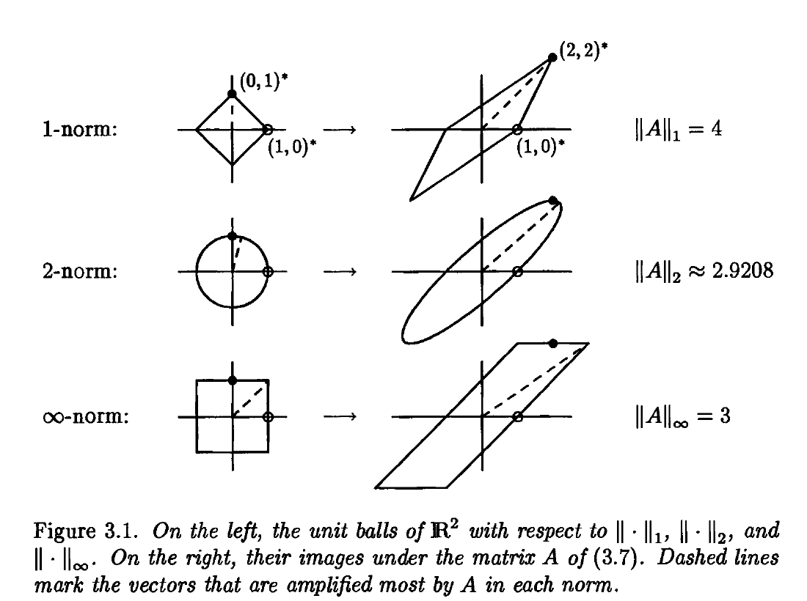

除 \(p\)-范数外，最常用的是**加权 \(p\)-范数**，也就是给向量空间的不同坐标分配不同权重。给定任意范数 \(\|\cdot\|\)，可定义

$$
\|x\|_w=\|Wx\|, \tag{3.3}
$$

其中 \(W\) 是对角矩阵，第 \(i\) 个对角元素为非零权重 \(w_i\)。例如，加权 \(2\)-范数为

$$
\|x\|_w=\left(\sum_{i=1}^{m}|w_ix_i|^2\right)^{1/2}. \tag{3.4}
$$

还可以把 \(W\) 推广为任意非奇异矩阵，而不要求它是对角矩阵（见习题 3.1）。本书最重要的是未加权 \(2\)-范数及其诱导的矩阵范数。

### 由向量范数诱导的矩阵范数

一个 \(m\times n\) 矩阵也可以看成 \(mn\) 维空间中的一个向量：矩阵的 \(mn\) 个元素就是 \(mn\) 个独立坐标。因此，任何 \(mn\) 维向量范数都可以用来衡量矩阵的“大小”。

不过，在矩阵空间中，还有一类由矩阵作为算子时的行为定义的范数更为有用。设 \(\|\cdot\|_{(n)}\) 和 \(\|\cdot\|_{(m)}\) 分别是定义在 \(A\) 的定义域与值域上的向量范数。由它们诱导的矩阵范数，是满足

$$
\|Ax\|_{(m)}\le C\|x\|_{(n)}
\qquad\text{对所有 }x\in\mathbb C^n \tag{3.5}
$$

的最小常数 \(C\)，记为 \(\|A\|_{(m,n)}\)。换言之，

$$
\|A\|_{(m,n)}
=\sup_{x\ne0}\frac{\|Ax\|_{(m)}}{\|x\|_{(n)}}
=\sup_{\|x\|_{(n)}=1}\|Ax\|_{(m)}. \tag{3.6}
$$

它表示 \(A\) 能把向量放大的最大倍数。由于范数具有齐次性，只需考察单位向量的像。

### 例子

#### 例 3.1

考虑矩阵

$$
A=\begin{bmatrix}1&2\\0&2\end{bmatrix}. \tag{3.7}
$$

它把 \(\mathbb C^2\) 映射到 \(\mathbb C^2\)，也把 \(\mathbb R^2\) 映射到 \(\mathbb R^2\)。为了画图，后者更方便；而且由于 \(A\) 的系数是实数，考察实向量已经足以确定这些矩阵 \(p\)-范数。

图 3.1 展示了 \(A\) 对 \(1\)-、\(2\)-和 \(\infty\)-范数单位球的作用。无论使用哪种范数，\(e_1=(1,0)^{\mathsf T}\) 都被映射为 \(A\) 的第一列 \((1,0)^{\mathsf T}\)，而 \(e_2=(0,1)^{\mathsf T}\) 被映射为第二列 \((2,2)^{\mathsf T}\)。

在 \(1\)-范数下，放大倍数最大的单位向量是 \((0,1)^{\mathsf T}\)（或其相反数），放大倍数为 4。在 \(\infty\)-范数下，放大倍数最大的单位向量是 \((1,1)^{\mathsf T}\)（或其相反数），放大倍数为 3。在 \(2\)-范数下，放大倍数最大的向量是图中虚线所示的方向（或其相反方向），放大倍数约为 2.9208。这个数至少应为
\[
\|(2,2)^{\mathsf T}\|_2=\sqrt8\approx2.8284,
\]
因为 \(e_2\) 被映射为 \((2,2)^{\mathsf T}\)。第 5 讲将讨论如何计算这样的 \(2\)-范数结果。

#### 例 3.2　对角矩阵的 \(p\)-范数

令

$$
D=\operatorname{diag}(d_1,d_2,\ldots,d_m).
$$

如图 3.1 的第二行所示，\(2\)-范数单位球经 \(D\) 映射后成为一个 \(m\) 维椭球，其半轴长度为 \(|d_i|\)。被 \(D\) 放大最多的单位向量，正是被映射到最长半轴方向的向量；最长半轴的长度为 \(\max_i|d_i|\)。因此

$$
\|D\|_2=\max_{1\le i\le m}|d_i|.
$$

下一讲将证明，每个矩阵都把 \(2\)-范数单位球映射为椭球；当 \(m>2\) 时，更准确地说是超椭球，只是轴的方向可以任意。上面的结论实际上对任意 \(p\) 都成立：

$$
\|D\|_p=\max_{1\le i\le m}|d_i|.
$$

#### 例 3.3　矩阵的 \(1\)-范数

若 \(A\) 是任意 \(m\times n\) 矩阵，\(\|A\|_1\) 等于 \(A\) 的“最大列和”。将 \(A\) 写成

$$
A=\begin{bmatrix}a_1&a_2&\cdots&a_n\end{bmatrix}, \tag{3.8}
$$

其中 \(a_j\) 为第 \(j\) 列。\(1\)-范数单位球为
\[
\left\{x\in\mathbb C^n:\sum_{j=1}^{n}|x_j|\le1\right\}.
\]
若 \(x\) 属于这个单位球，则

$$
\|Ax\|_1
=\left\|\sum_{j=1}^{n}x_ja_j\right\|_1
\le\sum_{j=1}^{n}|x_j|\,\|a_j\|_1
\le\max_{1\le j\le n}\|a_j\|_1.
$$

所以 \(\|A\|_1\le\max_j\|a_j\|_1\)。选择使列范数最大的 \(j\)，并令 \(x=e_j\)，即可达到这个上界，从而

$$
\|A\|_1=\max_{1\le j\le n}\|a_j\|_1. \tag{3.9}
$$

#### 例 3.4　矩阵的 \(\infty\)-范数

用几乎完全相同的论证，可以证明 \(m\times n\) 矩阵的 \(\infty\)-范数等于最大行和：

$$
\|A\|_\infty=\max_{1\le i\le m}\|a_{i,:}\|_1
=\max_{1\le i\le m}\sum_{j=1}^{n}|a_{ij}|, \tag{3.10}
$$

其中 \(a_{i,:}\) 表示 \(A\) 的第 \(i\) 行。

### 柯西–施瓦茨不等式与 Hölder 不等式

计算 \(p\ne1,\infty\) 的矩阵 \(p\)-范数更困难。处理这类问题时，可以先用 \(p\)-范数控制内积。若 \(p,q\) 满足
\[
\frac1p+\frac1q=1,\qquad1<p,q<\infty,
\]
则 Hölder 不等式给出

$$
|x^*y|\le\|x\|_p\|y\|_q. \tag{3.11}
$$

柯西–施瓦茨不等式是 \(p=q=2\) 时的特例：

$$
|x^*y|\le\|x\|_2\|y\|_2. \tag{3.12}
$$

这两个上界都是紧的：对某些 \(x,y\)，不等式可以取等号。

#### 例 3.5　行向量的 \(2\)-范数

考虑只有一行的矩阵 \(A\)，写成
\[
A=a^*,
\]
其中 \(a\) 是列向量。由柯西–施瓦茨不等式，对任意 \(x\) 有

$$
\|Ax\|_2=|a^*x|\le\|a\|_2\|x\|_2.
$$

令 \(x=a\)（或取与 \(a\) 同方向的向量）即可达到这个界。因此

$$
\|A\|_2=\sup_{x\ne0}\frac{\|Ax\|_2}{\|x\|_2}=\|a\|_2.
$$

#### 例 3.6　外积的 \(2\)-范数

更一般地，令 \(A=uv^*\)，其中 \(u\) 是 \(m\) 维向量，\(v\) 是 \(n\) 维向量。对任意 \(n\) 维向量 \(x\)，

$$
\|Ax\|_2=\|uv^*x\|_2
=\|u\|_2\,|v^*x|
\le\|u\|_2\|v\|_2\|x\|_2. \tag{3.13}
$$

因此 \(\|A\|_2\le\|u\|_2\|v\|_2\)。令 \(x=v\)（再按需要归一化）即可达到等号，所以

$$
\|uv^*\|_2=\|u\|_2\|v\|_2.
$$

### 诱导矩阵范数下的乘积界

设 \(\|\cdot\|_{(\ell)}\)、\(\|\cdot\|_{(m)}\)、\(\|\cdot\|_{(n)}\) 分别是定义在 \(\mathbb C^\ell,\mathbb C^m,\mathbb C^n\) 上的范数，\(A\) 为 \(\ell\times m\) 矩阵，\(B\) 为 \(m\times n\) 矩阵。对任意 \(x\in\mathbb C^n\)，

$$
\|ABx\|_{(\ell)}
\le\|A\|_{(\ell,m)}\|Bx\|_{(m)}
\le\|A\|_{(\ell,m)}\|B\|_{(m,n)}\|x\|_{(n)}.
$$

所以

$$
\|AB\|_{(\ell,n)}
\le\|A\|_{(\ell,m)}\|B\|_{(m,n)}. \tag{3.14}
$$

一般来说这个不等式不是等式。例如，对任意由向量范数诱导的方阵范数，都有
\[
\|A^k\|\le\|A\|^k,
\]
但当 \(k>1\) 时通常并不满足等号。

### 一般矩阵范数

如前所述，矩阵范数不一定要由向量范数诱导。一般矩阵范数只需在 \(mn\) 维矩阵空间中满足向量范数的三条性质：

1. \(\|A\|\ge0\)，且 \(\|A\|=0\) 当且仅当 \(A=0\)；
2. \(\|A+B\|\le\|A\|+\|B\|\)；
3. \(\|\alpha A\|=|\alpha|\,\|A\|\)。 \(\tag{3.15}\)

最重要的非诱导矩阵范数是 Hilbert–Schmidt 范数，也称**弗罗贝尼乌斯范数**：

$$
\|A\|_F=\left(\sum_{i=1}^{m}\sum_{j=1}^{n}|a_{ij}|^2\right)^{1/2}. \tag{3.16}
$$

把矩阵看成 \(mn\) 维向量时，它正是该向量的 \(2\)-范数。若 \(a_j\) 表示 \(A\) 的第 \(j\) 列，则

$$
\|A\|_F=\left(\sum_{j=1}^{n}\|a_j\|_2^2\right)^{1/2}. \tag{3.17}
$$

用行向量也有完全类似的表达式。把它们写成紧凑的迹公式，就是

$$
\|A\|_F=\sqrt{\operatorname{tr}(A^*A)}
=\sqrt{\operatorname{tr}(AA^*)}, \tag{3.18}
$$

其中 \(\operatorname{tr}(B)\) 表示矩阵 \(B\) 的迹，即对角元素之和。

弗罗贝尼乌斯范数同样可以用来控制矩阵乘积。若 \(C=AB\)，\(a_i^*\) 是 \(A\) 的第 \(i\) 行，\(b_j\) 是 \(B\) 的第 \(j\) 列，则 \(c_{ij}=a_i^*b_j\)。由柯西–施瓦茨不等式，
\[
|c_{ij}|\le\|a_i\|_2\|b_j\|_2.
\]
两边平方并对 \(i,j\) 求和，得到

$$
\|AB\|_F^2\le
\left(\sum_i\|a_i\|_2^2\right)
\left(\sum_j\|b_j\|_2^2\right)
=\|A\|_F^2\|B\|_F^2,
$$

即
\[
\|AB\|_F\le\|A\|_F\|B\|_F.
\]

### 酉乘法下的不变性

矩阵 \(2\)-范数与向量 \(2\)-范数一样，在左乘酉矩阵时保持不变；弗罗贝尼乌斯范数也有同样性质。

#### 定理 3.1

对任意 \(A\in\mathbb C^{m\times n}\) 和酉矩阵 \(Q\in\mathbb C^{m\times m}\)，有

$$
\|QA\|_2=\|A\|_2,\qquad
\|QA\|_F=\|A\|_F.
$$

**证明。** 由于对所有 \(x\) 都有 \(\|Qx\|_2=\|x\|_2\)，由 (3.6) 立即得到 \(2\)-范数不变性。弗罗贝尼乌斯范数的不变性可由迹公式 (3.18) 得到。证毕。

定理 3.1 仍然适用于具有标准正交列的矩形矩阵 \(Q\in\mathbb C^{p\times m}\)（\(p>m\)）。右乘酉矩阵时也有类似结论；更一般地，右乘具有标准正交行的矩形矩阵时也成立。

### 习题

**3.1** 证明：若 \(W\) 是任意非奇异矩阵，则由 (3.3) 定义的函数 \(\|\cdot\|_w\) 是一个向量范数。

**3.2** 设 \(\|\cdot\|\) 是 \(\mathbb C^m\) 上的任意范数，同时用它表示相应的诱导矩阵范数。证明
\[
\rho(A)\le\|A\|,
\]
其中 \(\rho(A)\) 是谱半径，即 \(A\) 的特征值 \(\lambda\) 的最大绝对值。

**3.3** 向量 \(p\)-范数和矩阵 \(p\)-范数之间存在许多不等式，且通常涉及维数 \(m,n\)。对下面每一条不等式进行验证，并对一般的 \(m,n\) 给出一个取等号的非零向量或矩阵。这里 \(x\) 是 \(m\) 维向量，\(A\) 是 \(m\times n\) 矩阵。

(a)
\[
\|x\|_\infty\le\|x\|_2;
\]

(b)
\[
\|x\|_2\le\sqrt m\,\|x\|_\infty;
\]

(c)
\[
\|A\|_2\le\sqrt n\,\|A\|_1;
\]

(d)
\[
\|A\|_2\le\sqrt m\,\|A\|_\infty.
\]

**3.4** 设 \(A\) 是 \(m\times n\) 矩阵，\(B\) 是 \(A\) 的一个子矩阵，即通过选取若干行和列得到的 \(p\times q\) 矩阵（\(p\le m,\ q\le n\)）。

(a) 说明如何像习题 1.1 的第 7 步那样，通过某些行、列“删除矩阵”左乘和右乘 \(A\)，得到 \(B\)。

(b) 利用这个乘积表示证明，对任意 \(1\le p\le\infty\)，都有
\[
\|B\|_p\le\|A\|_p.
\]

**3.5** 例 3.6 表明，若 \(E=uv^*\) 是外积，则 \(\|E\|_2=\|u\|_2\|v\|_2\)。弗罗贝尼乌斯范数是否也满足
\[
\|E\|_F=\|u\|_F\|v\|_F?
\]
证明它，或给出反例。

**3.6** 设 \(\|\cdot\|\) 是 \(\mathbb C^m\) 上的任意范数。相应的对偶范数定义为

$$
\|x\|'=\sup_{\|y\|=1}|y^*x|.
$$

(a) 证明 \(\|\cdot\|'\) 是一个范数。

(b) 给定 \(x,y\in\mathbb C^m\)，且 \(\|x\|=\|y\|=1\)。证明存在秩一矩阵 \(B=yz^*\)，使 \(Bx=y\)，并且 \(\|B\|=1\)，其中 \(\|B\|\) 是由 \(\|\cdot\|\) 诱导的矩阵范数。可使用以下引理而无需证明：对任意非零 \(x\in\mathbb C^m\)，存在非零 \(z\in\mathbb C^m\)，使
\[
|z^*x|=\|x\|\,\|z\|'.
\]

---

<a id="lecture-4"></a>

## 第 4 讲　奇异值分解

> 原书页 25–31；目标 PDF 页 40–46。原书图 4.1 已保留；“约化 SVD”和“完整 SVD”的帽号、矩阵尺寸及零行按原书定义统一核对。

奇异值分解（singular value decomposition，简称 **SVD**）是一种矩阵分解形式，它的计算是许多算法中的一个步骤。同样重要的是，SVD 还是一个强有力的概念工具：许多线性代数问题，先问一句“如果我们先取 SVD，会发生什么？”就会更容易理解。

### 一个几何观察

SVD 的动机来自下面的几何事实：

> 任意 \(m\times n\) 矩阵把单位球面映射为一个超椭球面。

SVD 同时适用于实矩阵和复矩阵。不过，在解释几何图像时，仍按惯例把矩阵看成实矩阵。

“超椭球”这个词也许不熟悉；它只是椭圆在更高维空间中的推广。可以把 \(\mathbb R^n\) 中的单位球面沿若干互相正交的方向 \(u_1,\ldots,u_n\in\mathbb R^m\)，分别拉伸 \(\sigma_1,\ldots,\sigma_n\) 倍（某些拉伸因子可以为零），由此得到 \(\mathbb R^m\) 中的超椭球面。向量 \(\sigma_i u_i\) 是它的主半轴，长度为 \(\sigma_i\)。若 \(A\) 的秩为 \(r\)，则恰有 \(r\) 个主半轴长度非零；特别地，当 \(m>n\) 时，至多有 \(n\) 个非零半轴。

记 \(\mathbb R^n\) 中的欧几里得单位球面为 \(S\)。则 \(AS\)，即 \(S\) 在映射 \(A\) 下的像，正是上面定义的超椭球面。这个事实并不显然；本讲后面将用线性代数语言重新表述并证明它。暂时先接受这个几何观察。

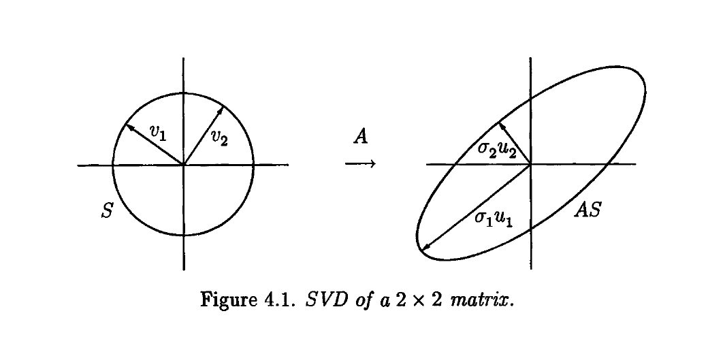

设 \(S\) 是 \(\mathbb R^n\) 中的单位球面，取任意 \(A\in\mathbb R^{m\times n}\)，并假设 \(m\ge n\)。先为简单起见，假设 \(A\) 满列秩 \(n\)，于是 \(AS\) 是 \(\mathbb R^m\) 中的超椭球面。

首先定义 \(A\) 的 \(n\) 个**奇异值**。它们是 \(AS\) 的 \(n\) 个主半轴长度，记为
\[
\sigma_1,\sigma_2,\ldots,\sigma_n,
\]
并约定按非增顺序排列：
\[
\sigma_1\ge\sigma_2\ge\cdots\ge\sigma_n>0.
\]

接着定义 \(A\) 的 \(n\) 个**左奇异向量**。它们是沿 \(AS\) 的主半轴方向取定的单位向量
\[
\{u_1,u_2,\ldots,u_n\},
\]
编号与奇异值对应。因此，\(\sigma_i u_i\) 是 \(AS\) 的第 \(i\) 长主半轴。

最后定义 \(A\) 的 \(n\) 个**右奇异向量**。它们是单位球面 \(S\) 中的单位向量
\[
\{v_1,v_2,\ldots,v_n\},
\]
这些向量是上述主半轴的原像，并按

$$
Av_i=\sigma_i u_i \tag{4.1}
$$

编号。

“左”和“右”这两个名称其实有些别扭。它们来自 (4.2)、(4.3) 中因子 \(U\) 与 \(V\) 的位置。更有趣的是，在图 4.1 这种画法里，左奇异向量对应右侧的值域空间，而右奇异向量对应左侧的定义域空间。把图的两半交换、让 \(A\) 从右指向左当然可以解决这个问题，但那会违背线性代数中已经根深蒂固的记号习惯。

### 约化 SVD

把 (4.1) 对所有 \(j\) 组合起来。令
\[
V=\begin{bmatrix}v_1&\cdots&v_n\end{bmatrix},\qquad
\widehat U=\begin{bmatrix}u_1&\cdots&u_n\end{bmatrix},
\]
以及
\[
\widehat\Sigma=\operatorname{diag}(\sigma_1,\ldots,\sigma_n).
\]
则

$$
AV=\widehat U\widehat\Sigma.
$$

这里 \(\widehat\Sigma\) 是正对角元的 \(n\times n\) 对角矩阵，\(\widehat U\) 是列标准正交的 \(m\times n\) 矩阵，\(V\) 是列标准正交的 \(n\times n\) 矩阵，因此 \(V\) 是酉矩阵。右乘 \(V^*=V^{-1}\)，得到

$$
A=\widehat U\widehat\Sigma V^*. \tag{4.2}
$$

这个分解称为 **约化奇异值分解**（reduced SVD）。

### 完整 SVD

在大多数应用中，实际使用的正是上面的约化形式。不过，教材通常采用另一种标准表述。为了把 (4.2) 与后者区分开来，我们给 \(\widehat U,\widehat\Sigma\) 加上帽号，并把后者称为**完整 SVD**。本书以后也会对约化 QR 分解和完整 QR 分解作相同区分。

\(\widehat U\) 的列是 \(\mathbb C^m\) 中的 \(n\) 个标准正交向量。除非 \(m=n\)，它们不是 \(\mathbb C^m\) 的一组基，\(\widehat U\) 也不是方酉矩阵。不过，可以任意补上 \(m-n\) 个标准正交列，把它扩充为酉矩阵 \(U\)。

为了使乘积不变，必须让新增加的列被零乘掉。于是令 \(\Sigma\) 为 \(m\times n\) 矩阵：左上角的 \(n\times n\) 块是 \(\widehat\Sigma\)，下面再补 \(m-n\) 个零行。于是得到完整 SVD：

$$
A=U\Sigma V^*. \tag{4.3}
$$

其中 \(U\) 是 \(m\times m\) 酉矩阵，\(V\) 是 \(n\times n\) 酉矩阵，\(\Sigma\) 是 \(m\times n\) 的矩形对角矩阵。将 (4.3) 约化为 (4.2) 时，\(U\) 的最后 \(m-n\) 个“静默”列和 \(\Sigma\) 的对应零行被丢弃。

现在去掉 \(A\) 满秩的假设。若 \(A\) 秩亏，(4.3) 仍然成立，只是由几何形状确定的左奇异向量不再有 \(n\) 个，而只有 \(r=\operatorname{rank}(A)\) 个。为了构造 \(U\)，需要补上 \(m-r\) 个任意的标准正交列；为了构造 \(V\)，需要补上 \(n-r\) 个任意的标准正交列。此时 \(\Sigma\) 的对角线上只有 \(r\) 个正数，其余 \(n-r\) 个元素为零。

同理，约化 SVD 对秩亏矩阵也有意义：可以令 \(\widehat U\) 为 \(m\times n\)，\(\widehat\Sigma\) 为带有若干零对角元的 \(n\times n\) 矩阵；也可以进一步压缩为
\[
\widehat U\in\mathbb C^{m\times r},\qquad
\widehat\Sigma\in\mathbb R^{r\times r},
\]
其中 \(\widehat\Sigma\) 的对角元严格为正。

### 形式化定义

现在令 \(m,n\) 任意，不再要求 \(m>n\)。对任意 \(A\in\mathbb C^{m\times n}\)，即使 \(A\) 不满秩，也称

$$
A=U\Sigma V^* \tag{4.4}
$$

为 \(A\) 的一个奇异值分解，其中

$$
U\in\mathbb C^{m\times m}\ \text{为酉矩阵},\qquad
V\in\mathbb C^{n\times n}\ \text{为酉矩阵},\qquad
\Sigma\in\mathbb R^{m\times n}\ \text{为矩形对角矩阵}.
$$

\(\Sigma\) 的对角元 \(\sigma_i\) 非负并按非增顺序排列：

$$
\sigma_1\ge\sigma_2\ge\cdots\ge\sigma_p\ge0,
\qquad p=\min(m,n).
$$

即使 \(A\) 不是方阵，\(\Sigma\) 也与 \(A\) 具有相同尺寸；只有 \(U\) 与 \(V\) 始终是方形酉矩阵。

从 \(A=U\Sigma V^*\) 立刻可以看出，单位球面经过 \(A\) 后必为超椭球：\(V^*\) 是保持单位球面的酉变换，\(\Sigma\) 把球面沿标准基方向拉伸为轴对齐的超椭球，最后的 \(U\) 只旋转或反射这个超椭球而不改变其形状。因此，一旦证明每个矩阵都有 SVD，也就证明了开头的几何观察。

### 存在性与唯一性

#### 定理 4.1

每个 \(A\in\mathbb C^{m\times n}\) 都存在奇异值分解 (4.4)。此外，奇异值集合 \(\{\sigma_j\}\) 唯一确定；若 \(A\) 为方阵且奇异值互不相同，则左右奇异向量 \(\{u_j\}\)、\(\{v_j\}\) 除了模为 1 的复数因子外也唯一确定（实数情形即除正负号外唯一）。

**证明：存在性。** 先取
\[
\sigma_1=\|A\|_2.
\]
由于单位球面是紧集，存在单位向量 \(v_1\in\mathbb C^n\)，使
\[
\|v_1\|_2=1,\qquad
\|Av_1\|_2=\sigma_1.
\]
令 \(u_1=Av_1/\sigma_1\)（若 \(A=0\)，结论显然）。把 \(v_1\) 扩充为 \(\mathbb C^n\) 的标准正交基，把 \(u_1\) 扩充为 \(\mathbb C^m\) 的标准正交基；令 \(V_1,U_1\) 分别为以这些基向量为列的酉矩阵。于是

$$
S=U_1^*AV_1=
\begin{bmatrix}
\sigma_1&w^*\\
0&B
\end{bmatrix}, \tag{4.5}
$$

其中 \(0\) 是 \(m-1\) 维列向量，\(w^*\) 是 \(n-1\) 维行向量，\(B\) 为 \((m-1)\times(n-1)\) 矩阵。

由 \(S\) 的第一行可得
\[
\|S\|_2\ge\sqrt{\sigma_1^2+\|w\|_2^2}.
\]
另一方面，\(U_1,V_1\) 都是酉矩阵，所以
\[
\|S\|_2=\|A\|_2=\sigma_1.
\]
因此 \(w=0\)。若 \(m=1\) 或 \(n=1\)，证明已经完成；否则，\(B\) 描述了 \(A\) 在 \(v_1\) 正交补上的作用。对 \(B\) 使用归纳假设，写成
\[
B=U_2\Sigma_2V_2^*.
\]
将 \(u_1,v_1\) 与 \(U_2,V_2\) 拼接，就得到 \(A\) 的 SVD。这完成存在性证明。

**证明：唯一性。** 几何上，如果超椭球的半轴长度互不相同，那么这些半轴（方向上允许取反或乘单位复数）由几何形状唯一决定。代数上，首先由
\[
\sigma_1=\|A\|_2
\]
可知最大奇异值唯一确定。

若除了 \(v_1\) 之外，还存在一个与它线性无关的单位向量 \(w\)，满足 \(\|Aw\|_2=\sigma_1\)，则对 \(w\) 做一次 Gram–Schmidt 正交化：

$$
v_2=
\frac{w-(v_1^*w)v_1}
{\|w-(v_1^*w)v_1\|_2}.
$$

\(v_2\) 是与 \(v_1\) 正交的单位向量。由于 \(\|A\|_2=\sigma_1\)，有 \(\|Av_2\|_2\le\sigma_1\)；但这个不等式必须取等号，否则写成 \(w=cv_1+sv_2\)（其中 \(|c|^2+|s|^2=1\)）会推出 \(\|Aw\|_2<\sigma_1\)，矛盾。因此 \(v_2\) 也是对应于 \(\sigma_1\) 的右奇异向量，并说明 \(\sigma_1\) 不是单重奇异值。

所以，只要奇异向量 \(v_1\) 不唯一，对应的奇异值 \(\sigma_1\) 就必然有重数。反之，当奇异值互异时，\(v_1\) 只在相位因子意义下唯一，\(u_1=Av_1/\sigma_1\) 也随之确定；在 \(v_1\) 的正交补上对剩余块 \(B\) 归纳应用同样论证，即可得到所有剩余奇异值和奇异向量的唯一性。证毕。

### 习题

**4.1** 手算下列矩阵的 SVD：

$$
\text{(a)}\quad
\begin{bmatrix}3&0\\0&-2\end{bmatrix},
\qquad
\text{(b)}\quad
\begin{bmatrix}2&0\\0&3\end{bmatrix},
\qquad
\text{(c)}\quad
\begin{bmatrix}0&2\\0&0\\0&0\end{bmatrix},
$$

$$
\text{(d)}\quad
\begin{bmatrix}1&1\\0&0\end{bmatrix},
\qquad
\text{(e)}\quad
\begin{bmatrix}1&1\\1&1\end{bmatrix}.
$$

**4.2** 设 \(A\) 是 \(m\times n\) 矩阵，\(B\) 是把 \(A\) 在纸面上顺时针旋转 \(90^\circ\) 得到的 \(n\times m\) 矩阵（这并不完全等同于一个标准的数学变换）。\(A\) 与 \(B\) 是否具有相同的奇异值？证明“是”，或给出反例。

**4.3** 编写一个 MATLAB 程序（见第 9 讲）：给定实 \(2\times2\) 矩阵 \(A\)，在单位圆中画出右奇异向量 \(v_1,v_2\)，并在相应椭圆中画出左奇异向量 \(u_1,u_2\)，如图 4.1 所示。将程序应用于矩阵 (3.7) 以及习题 4.1 中的 \(2\times2\) 矩阵。

**4.4** 若存在酉矩阵 \(Q\in\mathbb C^{m\times m}\)，使
\[
A=QBQ^*,
\]
则称 \(A,B\in\mathbb C^{m\times m}\) 酉相似。命题“\(A,B\) 酉相似，当且仅当它们具有相同的奇异值”是真还是假？

**4.5** 定理 4.1 断言每个 \(A\in\mathbb C^{m\times n}\) 都有
\[
A=U\Sigma V^*.
\]
证明：若 \(A\) 是实矩阵，则它存在实 SVD，即 \(U\in\mathbb R^{m\times m}\)、\(V\in\mathbb R^{n\times n}\)。

---

<a id="lecture-5"></a>

## 第 5 讲　SVD 的更多内容

> 原书页 32–38；目标 PDF 页 47–54。继续讨论奇异值分解，并重点说明它与矩阵低秩近似、\(2\)-范数和弗罗贝尼乌斯范数之间的联系。

### 换基

SVD 使我们能够说：只要选取合适的定义域和值域基，每一个矩阵都可以看成对角矩阵。

设 \(A=U\Sigma V^*\) 是完整 SVD。任意 \(b\in\mathbb C^m\) 都可以在 \(U\) 的列（左奇异向量）构成的基下展开，任意 \(x\in\mathbb C^n\) 都可以在 \(V\) 的列（右奇异向量）构成的基下展开。相应的坐标向量是

$$
b'=U^*b,\qquad x'=V^*x.
$$

由 (4.3)，关系 \(b=Ax\) 等价于

$$
b=Ax
\quad\Longleftrightarrow\quad
U^*b=U^*Ax=U^*U\Sigma V^*x
\quad\Longleftrightarrow\quad
b'=\Sigma x'.
$$

因此，当值域用 \(U\) 的列向量表示、定义域用 \(V\) 的列向量表示时，\(A\) 就被化成了对角矩阵 \(\Sigma\)。

### SVD 与特征值分解

用新基把矩阵对角化的思想，也贯穿于特征值的研究。若方阵 \(A\) 非缺陷（具有一组线性无关的特征向量），则它可以写成

$$
A=X\Lambda X^{-1}, \tag{5.1}
$$

其中 \(X\in\mathbb C^{m\times m}\) 的列是 \(A\) 的线性无关特征向量，\(\Lambda\) 是以 \(A\) 的特征值为对角元的对角矩阵。若 \(b=Ax\)，定义

$$
b'=X^{-1}b,\qquad x'=X^{-1}x,
$$

则同样有 \(b'=\Lambda x'\)。特征值将在第 24 讲系统讨论。

SVD 与特征值分解有几个根本差别：

1. SVD 使用两组基——左奇异向量和右奇异向量；特征值分解只使用一组基，即特征向量；
2. SVD 使用标准正交基，而特征值分解使用的基一般并不正交；
3. 并非所有矩阵（甚至并非所有方阵）都有特征值分解，但所有矩阵（包括矩形矩阵）都有奇异值分解。

在应用中，特征值通常与 \(A\) 的迭代形式有关，例如矩阵幂 \(A^k\) 或矩阵指数 \(e^A\)；而奇异向量通常与 \(A\) 本身或 \(A^{-1}\) 的行为有关。

### 用 SVD 描述矩阵性质

以下设 \(A\) 是 \(m\times n\) 矩阵，\(p=\min(m,n)\)，\(r\le p\) 是 \(A\) 的非零奇异值个数。记
\[
\operatorname{span}(x,y,\ldots,z)
\]
为由向量 \(x,y,\ldots,z\) 张成的空间。

#### 定理 5.1

\[
\operatorname{rank}(A)=r,
\]
即 \(A\) 的秩等于非零奇异值的个数。

**证明。** 对角矩阵的秩等于其非零对角元的个数。在 \(A=U\Sigma V^*\) 中，\(U,V\) 都满秩，因此
\[
\operatorname{rank}(A)=\operatorname{rank}(\Sigma)=r.
\]
证毕。

#### 定理 5.2

$$
\operatorname{range}(A)=\operatorname{span}(u_1,\ldots,u_r),
\qquad
\operatorname{null}(A)=\operatorname{span}(v_{r+1},\ldots,v_n).
$$

**证明。** \(\Sigma\) 的值域是 \(\operatorname{span}(e_1,\ldots,e_r)\subset\mathbb C^m\)，零空间是 \(\operatorname{span}(e_{r+1},\ldots,e_n)\subset\mathbb C^n\)。左乘 \(U\)、右乘 \(V^*\) 只是在相应的标准正交基之间换基，故结论成立。证毕。

#### 定理 5.3

$$
\|A\|_2=\sigma_1,\qquad
\|A\|_F=\left(\sigma_1^2+\sigma_2^2+\cdots+\sigma_p^2\right)^{1/2}.
$$

**证明。** 在定理 4.1 的存在性证明中已经得到
\[
\|A\|_2=\|\Sigma\|_2=\max_i\sigma_i=\sigma_1,
\]
这里使用了酉乘法下 \(2\)-范数的不变性。由同样的不变性和 (3.16)，
\[
\|A\|_F=\|\Sigma\|_F
=\left(\sigma_1^2+\cdots+\sigma_p^2\right)^{1/2}.
\]
证毕。

#### 定理 5.4

\(A\) 的非零奇异值，是 \(A^*A\) 或 \(AA^*\) 的非零特征值的平方根；这两个矩阵具有相同的非零特征值。

**证明。** 由 SVD，

$$
A^*A=(U\Sigma V^*)^*(U\Sigma V^*)
=V\Sigma^*U^*U\Sigma V^*
=V(\Sigma^*\Sigma)V^*.
$$

所以 \(A^*A\) 与 \(\Sigma^*\Sigma\) 酉相似，具有相同的 \(n\) 个特征值。后者的对角元为
\[
\sigma_1^2,\ldots,\sigma_p^2
\]
以及（当 \(n>p\) 时）若干个额外的零。对 \(AA^*\) 做完全类似的计算即可得到同样的结论。证毕。

#### 定理 5.5

若 \(A=A^*\)，则 \(A\) 的奇异值等于其特征值的绝对值。

**证明。** 厄米矩阵有一组完整的正交特征向量，且所有特征值都为实数。因此可写成
\[
A=Q\Lambda Q^*,
\]
其中 \(Q\) 酉，\(\Lambda\) 为实对角矩阵。令 \(|\Lambda|\) 的对角元为 \(|\lambda_i|\)，令 \(\operatorname{sign}(\Lambda)\) 的对角元为 \(\operatorname{sign}(\lambda_i)\)，则

$$
A=Q\,|\Lambda|\,\operatorname{sign}(\Lambda)\,Q^*.
$$

\(\operatorname{sign}(\Lambda)Q^*\) 仍为酉矩阵，所以这已经是一个 SVD，只是奇异值还未必按非增顺序排列。必要时插入置换矩阵重新排序即可。故奇异值为 \(|\lambda_i|\)。证毕。

#### 定理 5.6

若 \(A\in\mathbb C^{m\times m}\)，则

$$
|\det(A)|=\prod_{i=1}^{m}\sigma_i.
$$

**证明。** 方阵乘积的行列式等于各因子行列式之积。酉矩阵 \(U\) 满足 \(U^*U=I\)，所以 \(|\det U|=1\)；同理 \(|\det V^*|=1\)。于是

$$
|\det(A)|
=|\det(U\Sigma V^*)|
=|\det(U)|\,|\det(\Sigma)|\,|\det(V^*)|
=|\det(\Sigma)|
=\prod_{i=1}^{m}\sigma_i.
$$

证毕。

### 低秩近似

理解 SVD 的另一条路径，是研究如何把矩阵 \(A\) 表示成若干秩一矩阵之和。

#### 定理 5.7

\(A\) 可以写成 \(r\) 个秩一矩阵之和：

$$
A=\sum_{j=1}^{r}\sigma_j u_jv_j^*. \tag{5.3}
$$

**证明。** 把 \(\Sigma\) 写成 \(r\) 个矩阵 \(\Sigma_j\) 之和，其中 \(\Sigma_j\) 只有第 \(j\) 个对角元为 \(\sigma_j\)，其余元素为零。代入 \(A=U\Sigma V^*\) 即得 (5.3)。证毕。

把 \(m\times n\) 矩阵写成秩一矩阵之和有很多方式：可以按行相加、按列相加，也可以把每个元素分别写成一个秩一矩阵。高斯消元还会把 \(A\) 写成一系列秩一矩阵之和，其中后一个矩阵的前几行和前几列逐渐为零。

不过，(5.3) 有一个更深的性质：它的第 \(\nu\) 个部分和，在 \(2\)-范数或弗罗贝尼乌斯范数意义下，尽可能多地保留了 \(A\) 的“能量”。把这个说法写成低秩最佳逼近定理，就是下面的结果。

#### 定理 5.8

对任意 \(0\le\nu\le r\)，定义

$$
A_\nu=\sum_{j=1}^{\nu}\sigma_j u_jv_j^*. \tag{5.4}
$$

当 \(\nu=p=\min(m,n)\) 时，约定 \(\sigma_{\nu+1}=0\)。则

$$
\|A-A_\nu\|_2
=\inf_{\substack{B\in\mathbb C^{m\times n}\\\operatorname{rank}(B)\le\nu}}
\|A-B\|_2
=\sigma_{\nu+1}.
$$

**证明。** 假设存在某个 \(\operatorname{rank}(B)\le\nu\) 的矩阵，使
\[
\|A-B\|_2<\|A-A_\nu\|_2=\sigma_{\nu+1}.
\]
由于 \(B\) 的秩至多为 \(\nu\)，存在一个维数为 \(n-\nu\) 的子空间 \(W\subset\mathbb C^n\)，使得对所有 \(w\in W\)，都有 \(Bw=0\)。因此
\[
Aw=(A-B)w,
\]
并且

$$
\|Aw\|_2=\|(A-B)w\|_2
\le\|A-B\|_2\|w\|_2
<\sigma_{\nu+1}\|w\|_2.
$$

另一方面，由 \(A\) 的前 \(\nu+1\) 个右奇异向量张成的子空间维数为 \(\nu+1\)，其中每个向量 \(w\) 都满足
\[
\|Aw\|_2\ge\sigma_{\nu+1}\|w\|_2.
\]
这两个子空间的维数之和为 \(n+1\)，因此必有非零向量同时属于它们，矛盾。故不存在这样的 \(B\)，而 \(A_\nu\) 已经达到该下界。证毕。

定理 5.8 的几何含义是：用线段逼近超椭球时，最佳线段应取最长轴；用二维椭圆逼近时，应取由最长轴和第二长轴张成的椭圆；依此类推，每一步都加入尚未选取的最长轴。取完 \(r\) 个轴后，就完全恢复了 \(A\) 的作用。这一思想应用于图像压缩（见习题 9.3）、泛函分析等许多领域。

弗罗贝尼乌斯范数也有完全对应的结论。

#### 定理 5.9

对任意 \(0\le\nu\le r\)，由 (5.4) 定义的 \(A_\nu\) 满足

$$
\|A-A_\nu\|_F
=\inf_{\substack{B\in\mathbb C^{m\times n}\\\operatorname{rank}(B)\le\nu}}
\|A-B\|_F
=\left(\sigma_{\nu+1}^2+\cdots+\sigma_p^2\right)^{1/2}.
$$

### SVD 的计算

前两讲研究了 SVD 的性质，但还没有说明如何计算它。事实上，SVD 的计算是一个很有趣的主题；最好的方法是特征值算法的变体，本书将在第 31 讲讨论。

一旦能够计算 SVD，它就可以作为处理各种问题的工具。前面的大多数定理都有直接的计算后果：

- 确定矩阵秩的最佳方法，是统计大于合理容差的奇异值个数（定理 5.1）；
- 求值域或零空间的标准正交基，最准确的方法是使用定理 5.2（QR 分解提供更快但不总是同样准确的替代算法）；
- 定理 5.3 给出了计算 \(\|A\|_2\) 的标准方法；
- 定理 5.8 和 5.9 给出了分别关于 \(2\)-范数和弗罗贝尼乌斯范数的低秩逼近标准；
- SVD 还是稳健最小二乘拟合、子空间交、正则化以及许多其他问题的算法组成部分。

### 习题

**5.1** 例 3.1 中考虑了矩阵 (3.7)，并指出它的 \(2\)-范数约为 2.9208。利用 SVD，在纸上求出这个矩阵的 \(\sigma_{\min}(A)\) 和 \(\sigma_{\max}(A)\) 的精确值。

**5.2** 利用 SVD 证明：\(\mathbb C^{m\times n}\) 中的任意矩阵都是一列满秩矩阵的极限。换言之，证明满秩矩阵集合是 \(\mathbb C^{m\times n}\) 的稠密子集。证明中使用 \(2\)-范数。（使用哪一种范数并不重要，因为有限维空间上的所有范数都等价。）

**5.3** 考虑矩阵

$$
A=\begin{bmatrix}-2&11\\-10&5\end{bmatrix}.
$$

(a) 手算一个实 SVD \(A=U\Sigma V^{\mathsf T}\)。SVD 并不唯一，请找出 \(U,V\) 中负号最少的那个版本。

(b) 列出 \(A\) 的奇异值、左奇异向量和右奇异向量。仔细画出 \(\mathbb R^2\) 单位球及其在 \(A\) 下的像，并画出奇异向量，同时标出各顶点坐标。

(c) 求 \(A\) 的 \(1\)-范数、\(2\)-范数、\(\infty\)-范数和弗罗贝尼乌斯范数。

(d) 不要直接求逆，利用 SVD 求 \(A^{-1}\)。

(e) 求 \(A\) 的特征值 \(\lambda_1,\lambda_2\)。

(f) 验证
\[
\det A=\lambda_1\lambda_2,\qquad
|\det A|=\sigma_1\sigma_2.
\]

(g) \(A\) 把 \(\mathbb R^2\) 的单位球映射到一个椭圆。求这个椭圆的面积。

**5.4** 设 \(A\in\mathbb C^{m\times m}\) 有 SVD \(A=U\Sigma V^*\)。对 Hermitian 矩阵

$$
H=
\begin{bmatrix}
0&A^*\\
A&0
\end{bmatrix}\in\mathbb C^{2m\times2m},
$$

求其特征值分解 (5.1)。

---

<a id="lecture-6"></a>

## 第 6 讲　投影算子

> 原书页 41–47；目标 PDF 页 56–62。公式编号沿用原书。图中 `range(P)`、`Pv` 等数学标记保留原图形式，中文解释见图注。

我们现在进入全书第二部分，主题是正交性。本讲从投影矩阵（也称投影算子）这一基本工具开始，同时讨论正交投影与非正交投影。

### 投影算子

投影算子是满足

$$
P^2=P. \tag{6.1}
$$

的方阵。这样的矩阵也称为**幂等矩阵**。这个定义既包含下面将讨论的正交投影，也包含非正交投影。为了避免混淆，非正交情形也可以称为**斜投影算子**。

“投影”这个术语可以这样理解：设想从恰当的方向把光照向子空间 $\operatorname{range}(P)$，那么向量 $v$ 在这个子空间上的投影 $Pv$ 就像是它投下的影子。下面暂时沿用这个物理图像。

如果 $v\in\operatorname{range}(P)$，那么 $v$ 恰好位于自己的影子上，应用投影算子后仍得到 $v$。确实，若 $v=Px$，则

$$Pv=P^2x=Px=v.$$

当 $v\ne Pv$ 时，光线从什么方向照来？一般而言，答案取决于 $v$；但对给定的 $v$，只需画出从 $v$ 指向 $Pv$ 的线段，其方向由 $Pv-v$ 给出（图 6.1）。把投影算子作用到这个方向上，可得

$$P(Pv-v)=P^2v-Pv=0.$$

因此

$$Pv-v\in\operatorname{null}(P).$$

换言之，对不同的 $v$，光线方向可能不同，但它总由 $\operatorname{null}(P)$ 中的向量描述。

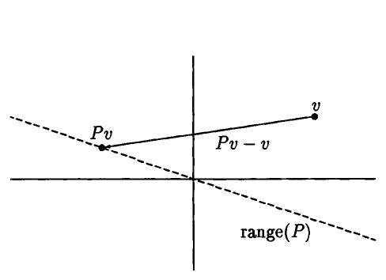

### 互补投影算子

如果 $P$ 是投影算子，那么 $I-P$ 也是投影算子，因为它同样幂等：

$$
(I-P)^2=I-2P+P^2=I-P.
$$

矩阵 $I-P$ 称为 $P$ 的**互补投影算子**。

$I-P$ 投影到哪个空间？正好是 $P$ 的零空间。首先，如果 $Pv=0$，那么 $(I-P)v=v$，所以 $\operatorname{range}(I-P)\supseteq\operatorname{null}(P)$。反过来，对任意 $v$，都有 $(I-P)v=v-Pv\in\operatorname{null}(P)$，因此 $\operatorname{range}(I-P)\subseteq\operatorname{null}(P)$。于是

$$
\operatorname{range}(I-P)=\operatorname{null}(P). \tag{6.2}
$$

把 $P$ 写成 $P=I-(I-P)$，可得到互补结论

$$
\operatorname{null}(I-P)=\operatorname{range}(P). \tag{6.3}
$$

我们还可以看出

$$\operatorname{null}(I-P)\cap\operatorname{null}(P)=\{0\},$$

因为同时属于这两个空间的向量 $v$ 满足 $v=v-Pv=(I-P)v=0$。等价地，

$$
\operatorname{range}(P)\cap\operatorname{null}(P)=\{0\}. \tag{6.4}
$$

这些计算说明，投影算子把 $\mathbb C^m$ 分解为两个空间。反过来，设 $S_1$ 和 $S_2$ 是 $\mathbb C^m$ 的两个子空间，满足

$$S_1\cap S_2=\{0\},\qquad S_1+S_2=\mathbb C^m,$$

其中 $S_1+S_2$ 表示所有形如 $s_1+s_2$（$s_1\in S_1$、$s_2\in S_2$）的向量组成的空间。这样的一对空间称为**互补子空间**。此时存在投影算子 $P$，使得 $\operatorname{range}(P)=S_1$、$\operatorname{null}(P)=S_2$。我们称 $P$ 为沿着 $S_2$ 投影到 $S_1$ 的投影算子。

这个投影算子及其互补投影可以看作下列问题的唯一解：给定 $v$，求 $v_1\in S_1$ 与 $v_2\in S_2$，使得 $v_1+v_2=v$。投影 $Pv$ 给出 $v_1$，互补投影 $(I-P)v$ 给出 $v_2$。这两个向量之所以唯一，是因为所有解都可写成

$$
(Pv+v_3)+((I-P)v-v_3)=v,
$$

而 $v_3$ 必须同时属于 $S_1$ 与 $S_2$，所以只能有 $v_3=0$。

投影算子及其互补投影的一个熟悉应用来自特征向量展开。设 $m\times m$ 矩阵 $A$ 有一组完备的特征向量 $\{v_j\}$，也就是说它们构成 $\mathbb C^m$ 的一组基。给定 $x\in\mathbb C^m$，若要取出它沿某个特定特征向量 $v$ 的分量，答案是 $Px$，其中 $P$ 是某个秩一投影算子。本讲暂不展开这一细节，转而讨论本书主要关注的一类投影算子。

### 正交投影算子

正交投影（图 6.2）是沿着子空间 $S_2$ 投影到子空间 $S_1$，且 $S_1$ 与 $S_2$ 正交的投影算子。注意：正交投影算子不是正交矩阵！

正交投影还有一个代数定义：它是同时满足 $P^2=P$ 与 $P^*=P$ 的厄米投影算子。当然，我们需要证明这两个定义等价。

**定理 6.1**　投影算子 $P$ 是正交投影算子，当且仅当 $P=P^*$。

**证明。** 若 $P=P^*$，则取 $Px\in S_1$ 与 $(I-P)y\in S_2$，有

$$x^*P^*(I-P)y=x^*(P-P^2)y=0.$$

所以这两个空间正交，投影算子确实是正交的。

下面证明“只有当”方向。设 $P$ 沿 $S_2$ 投影到 $S_1$，其中 $S_1\perp S_2$，且 $S_1$ 的维数为 $n$。取 $\mathbb C^m$ 的一组标准正交基 $\{q_1,\ldots,q_m\}$，其中前 $n$ 个向量构成 $S_1$ 的基，后面的向量构成 $S_2$ 的基。对 $j\le n$，有 $Pq_j=q_j$；对 $j>n$，有 $Pq_j=0$。

令 $Q$ 为以 $q_j$ 为第 $j$ 列的酉矩阵，则

$$Q^*PQ=\Sigma=\operatorname{diag}(I_n,0),$$

其中 $\Sigma$ 的前 $n$ 个对角元为 1，其余为 0。因此

$$P=Q\Sigma Q^*. \tag{6.5}$$

这同时也是特征值分解。于是

$$P^*=(Q\Sigma Q^*)^*=Q\Sigma^*Q^*=Q\Sigma Q^*=P,$$

因为 $\Sigma$ 是实对角矩阵。证毕。

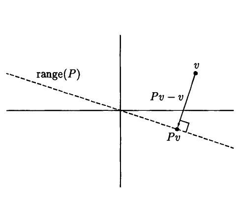

### 用标准正交基进行投影

除平凡情形 $P=I$ 外，正交投影都有一些等于零的奇异值。因此，自然的做法是删去式 (6.5) 中 $Q$ 的“沉默列”，使用约化 SVD 而不是完整 SVD。于是得到

$$P=\widehat Q\widehat Q^*. \tag{6.6}$$

其中 $\widehat Q$ 的列向量是标准正交的。

在式 (6.6) 中，矩阵 $\widehat Q$ 不一定来自 SVD。设 $\{q_1,\ldots,q_n\}$ 是 $\mathbb C^m$ 中任意一组标准正交向量，$\widehat Q$ 是以它们为列的 $m\times n$ 矩阵。任意 $v\in\mathbb C^m$ 都可以分解为列空间分量与正交分量：

$$v=r+\sum_{i=1}^n(q_iq_i^*)v.$$

因此映射

$$v\longmapsto\sum_{i=1}^n(q_iq_i^*)v \tag{6.7}$$

是到 $\operatorname{range}(\widehat Q)$ 上的正交投影，用矩阵写就是 $y=\widehat Q\widehat Q^*v$。只要 $\widehat Q$ 的列是标准正交的，乘积 $\widehat Q\widehat Q^*$ 就一定是到其列空间上的投影算子，与 $\widehat Q$ 是如何得到的无关。

正交投影的互补投影仍是正交投影，因为 $I-\widehat Q\widehat Q^*$ 是厄米矩阵。这个互补投影投影到与 $\operatorname{range}(\widehat Q)$ 正交的空间。

正交投影的一个重要特例，是提取单个方向分量的秩一正交投影。对单位向量 $q$，

$$P_q=qq^*. \tag{6.8}$$

其互补投影消去 $q$ 方向上的分量：

$$P_{\perp q}=I-qq^*. \tag{6.9}$$

对任意非零向量 $a$，相应公式为

$$P_a=\frac{aa^*}{a^*a}, \tag{6.10}$$

以及

$$P_{\perp a}=I-\frac{aa^*}{a^*a}. \tag{6.11}$$

### 用任意基进行投影

从任意基出发，即使基向量不正交，也可以构造 $\mathbb C^m$ 的某个子空间上的正交投影。设子空间由线性无关向量 $\{a_1,\ldots,a_n\}$ 张成，令 $A$ 为以这些向量为列的 $m\times n$ 矩阵。

把 $v$ 正交投影到 $\operatorname{range}(A)$ 得到 $y$ 时，差向量 $y-v$ 必须与 $\operatorname{range}(A)$ 正交。因此对每个 $j$，都有 $a_j^*(y-v)=0$。由于 $y\in\operatorname{range}(A)$，可写成 $y=Ax$，于是

$$A^*(Ax-v)=0,\qquad A^*Ax=A^*v.$$

因为 $A$ 满列秩，$A^*A$ 非奇异（见习题 6.3），所以

$$x=(A^*A)^{-1}A^*v. \tag{6.12}$$

最后，投影向量 $y=Ax$ 为 $y=A(A^*A)^{-1}A^*v$。因此到 $\operatorname{range}(A)$ 上的正交投影为

$$P=A(A^*A)^{-1}A^*. \tag{6.13}$$

这是式 (6.10) 的多维推广。当 $A=\widehat Q$ 且列向量标准正交时，括号中的项退化为单位矩阵，从而恢复式 (6.6)。

### 习题

**6.1**　若 $P$ 是正交投影算子，证明 $I-2P$ 是酉矩阵，并给出一个几何解释。

**6.2**　设 $E$ 是提取 $m$ 维向量“偶部”的 $m\times m$ 矩阵：

$$Ex=\frac{x+Fx}{2},$$

其中 $F$ 是把 $(x_1,\ldots,x_m)^*$ 翻转为 $(x_m,\ldots,x_1)^*$ 的 $m\times m$ 矩阵。$E$ 是正交投影、斜投影，还是根本不是投影？它的元素是什么？

**6.3**　给定 $A\in\mathbb C^{m\times n}$ 且 $m\ge n$，证明 $A^*A$ 非奇异，当且仅当 $A$ 满秩。

**6.4**　考虑

$$
A=\begin{bmatrix}1&0\\0&1\\1&0\end{bmatrix},
\qquad
B=\begin{bmatrix}1&2\\0&1\\1&0\end{bmatrix}.
$$

请手算回答：

（a）到 $\operatorname{range}(A)$ 上的正交投影 $P$ 是什么？向量 $(1,2,3)^*$ 在 $P$ 下的像是什么？

（b）对 $B$ 回答同样的问题。

**6.5**　设 $P\in\mathbb C^{m\times m}$ 是非零投影算子。证明 $\lVert P\rVert_2\ge 1$，且等号成立当且仅当 $P$ 是正交投影算子。

---

<a id="lecture-7"></a>

## 第 7 讲　QR 分解

> 原书页 48–55；目标 PDF 页 63–70。公式编号沿用原书。约化 QR 与完整 QR 的结构图，以及 Legendre 多项式图，均保留在 `assets/` 中。

上一讲介绍了投影算子。本讲转向一种构造正交基的基本算法：QR 分解。它把一个矩阵写成正交（或酉）矩阵与上三角矩阵的乘积，是正交化、最小二乘和许多数值算法的共同入口。

### QR 分解

设 $A=[a_1\ \cdots\ a_n]\in\mathbb C^{m\times n}$，且 $m\ge n$。如果 $A$ 满列秩，则它的列向量依次生成一串嵌套子空间：

$$
\langle a_1\rangle\subseteq\langle a_1,a_2\rangle\subseteq\langle a_1,a_2,a_3\rangle\subseteq\cdots.
$$

我们的目标是构造单位向量 $q_1,\ldots,q_n$，使得对 $j=1,\ldots,n$，都有

$$
\langle q_1,\ldots,q_j\rangle=\langle a_1,\ldots,a_j\rangle. \tag{7.1}
$$

如果这些向量还彼此正交，那么每个 $a_j$ 都可以在前 $j$ 个 $q_i$ 的基础上展开。于是有

$$
A=[a_1\ \cdots\ a_n]
=[q_1\ \cdots\ q_n]
\begin{bmatrix}
 r_{11}&r_{12}&\cdots&r_{1n}\\
 0&r_{22}&\cdots&r_{2n}\\
 \vdots&\ddots&\ddots&\vdots\\
 0&\cdots&0&r_{nn}
\end{bmatrix}
=\widehat Q\widehat R. \tag{7.2}
$$

其中 $\widehat Q=[q_1\ \cdots\ q_n]$ 是列标准正交的 $m\times n$ 矩阵，$\widehat R$ 是 $n\times n$ 上三角矩阵。对每一列逐项写开，就是

$$
\begin{aligned}
a_1&=r_{11}q_1,\\
a_2&=r_{12}q_1+r_{22}q_2,\\
a_3&=r_{13}q_1+r_{23}q_2+r_{33}q_3,\\
&\ \vdots\\
a_n&=r_{1n}q_1+r_{2n}q_2+\cdots+r_{nn}q_n.
\end{aligned} \tag{7.3}
$$

式 (7.2) 称为 $A$ 的**约化 QR 分解**。在满列秩情形中，所有对角元 $r_{kk}$ 都非零。

还可以把 $\widehat Q$ 补成一个 $m\times m$ 的酉矩阵 $Q$，并在 $\widehat R$ 的底部补上 $m-n$ 行零，从而得到一个 $m\times n$ 的上三角矩阵 $R$。这给出完整 QR 分解

$$A=QR. \tag{7.4}$$

完整分解中，$Q$ 的后 $m-n$ 列乘上 $R$ 中对应的零行，因此它们不会改变乘积。当 $A$ 满列秩时，这些列构成 $\operatorname{range}(A)^\perp=\operatorname{null}(A^*)$ 的一组标准正交基。

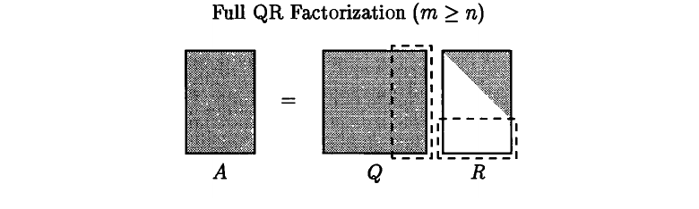

在约化 QR 分解中，删去完整分解中不参与乘积的列和行，得到 $\widehat Q\in\mathbb C^{m\times n}$、$\widehat R\in\mathbb C^{n\times n}$。$\widehat R$ 的行不必包含零行。

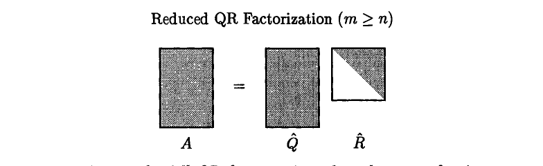

### Gram–Schmidt 正交化

第 $j$ 步需要在 $\langle a_1,\ldots,a_j\rangle$ 中找到一个单位向量 $q_j$，使它与已经得到的 $q_1,\ldots,q_{j-1}$ 正交。先从 $a_j$ 中减去其在这些方向上的分量：

$$
v_j=a_j-(q_1^*a_j)q_1-(q_2^*a_j)q_2-\cdots-(q_{j-1}^*a_j)q_{j-1}. \tag{7.5}
$$

然后令 $q_j=v_j/\|v_j\|_2$。逐步写出前几步和最后一步，可得

$$
\begin{aligned}
q_1&=a_1/r_{11},\\
q_2&=(a_2-r_{12}q_1)/r_{22},\\
q_3&=(a_3-r_{13}q_1-r_{23}q_2)/r_{33},\\
&\ \vdots\\
q_n&=(a_n-\sum_{i=1}^{n-1}r_{in}q_i)/r_{nn}.
\end{aligned} \tag{7.6}
$$

其中，对于 $i<j$，

$$r_{ij}=q_i^*a_j. \tag{7.7}$$

而对角元的模满足

$$
|r_{jj}|=\left\|a_j-\sum_{i=1}^{j-1}r_{ij}q_i\right\|_2. \tag{7.8}
$$

$r_{jj}$ 的相位（实数情形就是符号）尚未确定。通常取 $r_{jj}>0$，于是得到对角元为正的约化 QR 分解。

#### 算法 7.1：经典 Gram–Schmidt

```text
for j = 1, ..., n
    v_j = a_j
    for i = 1, ..., j-1
        r_ij = q_i^* a_j
        v_j = v_j - r_ij q_i
    r_jj = ||v_j||_2
    q_j = v_j / r_jj
```

经典 Gram–Schmidt 的数学推导很直接，但在浮点计算中可能数值不稳定。下一讲将讨论修改后的 Gram–Schmidt 方法。

### 存在性与唯一性

**定理 7.1**　每个 $A\in\mathbb C^{m\times n}$（$m\ge n$）都有一个完整 QR 分解，因此也有约化 QR 分解。

**证明。** 先考虑 $A$ 满列秩的情形。按式 (7.5) 对列向量执行 Gram–Schmidt 正交化。如果某一步出现 $v_j=0$，就说明 $a_j$ 属于前面列向量张成的空间，从而 $A$ 不满列秩，矛盾。因此每一步都可以归一化，得到约化 QR 分解。再补入 $m-n$ 个与前面向量正交的单位向量，就得到完整分解。

如果 $A$ 秩亏，那么在某些步骤中可能出现 $v_j=0$。此时从前面向量的正交补中任取一个单位向量作为 $q_j$，然后继续进行。为了得到完整的 $m\times n$ 分解，在约化过程结束后还可以继续补入所需的正交单位向量。

QR 分解一般不唯一。例如，对任意满足 $|z|=1$ 的复数 $z$，把 $\widehat Q$ 的第 $i$ 列乘以 $z$，同时把 $\widehat R$ 的第 $i$ 行乘以 $z^{-1}$，乘积 $\widehat Q\widehat R$ 不变。满列秩时，这正是约化 QR 分解产生不同结果的唯一自由度。

**定理 7.2**　每个满列秩的 $A\in\mathbb C^{m\times n}$（$m\ge n$）都有唯一的约化 QR 分解 $A=\widehat Q\widehat R$，其中 $\widehat R$ 的对角元为正。

**证明。** 任意约化 QR 分解都必须满足式 (7.6)–(7.8)。由于 $A$ 满列秩，式 (7.6) 中的每个分母都非零。因此 $q_j$ 与 $|r_{jj}|$ 都由前面的列唯一确定，唯一没有确定的是 $r_{jj}$ 的相位。规定 $r_{jj}>0$ 后，这个自由度也被消除，分解因而唯一。

### 当向量变成连续函数

有限维向量空间中的上述思想也可以应用到函数空间。把 $\mathbb C^m$ 换成区间 $[-1,1]$ 上的平方可积复函数空间 $L^2[-1,1]$，并定义内积

$$
(f,g)=\int_{-1}^{1}\overline{f(x)}g(x)\,dx. \tag{7.9}
$$

把 $L^2[-1,1]$ 中的函数看成矩阵的“列”，考虑由单项式组成的矩阵

$$A=[1\ \ x\ \ x^2\ \ \cdots\ \ x^{n-1}]. \tag{7.10}$$

对这个矩阵做连续版本的 QR 分解，可以写成

$$A=QR=[q_0(x)\ \cdots\ q_{n-1}(x)]R.$$

这里的函数 $q_j$ 两两正交且都已归一化：

$$
\int_{-1}^{1}\overline{q_i(x)}q_j(x)\,dx=\delta_{ij}
=\begin{cases}
1,&i=j,\\
0,&i\ne j.
\end{cases}
$$

由于 $q_j$ 是次数为 $j$ 的多项式，它们除了归一化因子外，正是 Legendre 多项式 $P_j$。取 $P_j(1)=1$，前四个多项式为

$$
P_0(x)=1,\qquad P_1(x)=x,\qquad
P_2(x)=\frac{3}{2}x^2-\frac{1}{2},\qquad
P_3(x)=\frac{5}{2}x^3-\frac{3}{2}x. \tag{7.11}
$$

![图 7.1：前四个 Legendre 多项式。除去比例因子后，它们可以看作区间 $[-1,1]$ 上矩阵 $[1,x,x^2,x^3]$ 的约化 QR 分解中 $\widehat Q$ 的列。](assets/figure-7-1.png)

Legendre 多项式构成多项式空间的一组正交基，因此也常用于谱方法。对应的正交投影为

$$
f(\mathord\cdot)\longmapsto
\sum_{j=0}^{n-1}q_j(\mathord\cdot)
\int_{-1}^{1}\overline{q_j(x)}f(x)\,dx. \tag{7.12}
$$

### 用 QR 分解求解 $Ax=b$

最后暂时回到离散的有限矩阵。设 $A\in\mathbb C^{m\times m}$ 非奇异，并且 $A=QR$。若要解 $Ax=b$，左乘 $Q^*$，利用 $Q^*Q=I$ 可得

$$Rx=Q^*b. \tag{7.13}$$

因此可以按以下三步计算：

1. 计算 $A=QR$。
2. 计算 $y=Q^*b$。
3. 回代求解上三角方程 $Rx=y$。

这是一个很好的数值方法。第 16 讲将证明其性质。不过在实际计算中，高斯消元仍然更常用，因为它大约只需要一半的浮点运算。

### 习题

**7.1**　对习题 6.4 中的矩阵 $A$ 和 $B$，分别求出约化 QR 分解 $A=\widehat Q\widehat R$ 与完整 QR 分解 $A=QR$，并对 $B$ 做同样的计算。

**7.2**　假设矩阵 $A$ 的第 $1,3,5,7,\ldots$ 列与第 $2,4,6,8,\ldots$ 列彼此正交。在约化 QR 分解 $A=\widehat Q\widehat R$ 中，$\widehat R$ 具有什么特殊结构？

**7.3**　设 $A$ 是 $m\times m$ 矩阵，$a_j$ 是它的第 $j$ 列。证明 Hadamard 不等式

$$|\det A|\le\prod_{j=1}^{m}\|a_j\|_2,$$

并给出它关于平行多面体体积的几何解释。

**7.4**　设 $x^{(1)},y^{(1)},x^{(2)},y^{(2)}\in\mathbb R^3$ 都是非零向量，且 $x^{(1)},y^{(1)}$ 线性无关，$x^{(2)},y^{(2)}$ 也线性无关。令

$$
P^{(1)}=\langle x^{(1)},y^{(1)}\rangle,\qquad
P^{(2)}=\langle x^{(2)},y^{(2)}\rangle.
$$

通过把问题化为三个 $3\times2$ 矩阵的 QR 分解，求出平面 $P=P^{(1)}\cap P^{(2)}$ 中的一个非零向量 $v\in\mathbb R^3$。

**7.5**　设 $A$ 是 $m\times n$ 矩阵（$m\ge n$），且 $A=\widehat Q\widehat R$ 是约化 QR 分解。

（a）证明 $A$ 的秩为 $n$ 当且仅当 $\widehat R$ 的所有对角元都非零。

（b）如果 $\widehat R$ 有 $k$ 个非零对角元，其中 $0\le k<n$，这对 $\operatorname{rank}(A)$ 有什么精确含义？它给出的是相等、下界还是上界？请给出精确答案与证明。

---

<a id="lecture-8"></a>

## 第 8 讲　Gram–Schmidt 正交化

> 原书页 56–62；目标 PDF 页 71–77。公式编号沿用原书。图 8.1–8.2 保留在 `assets/` 中。

Gram–Schmidt 迭代是计算 QR 分解的两种主要数值算法之一。它通过一系列矩阵运算把矩阵的列变成标准正交列。这些运算还可以理解为在矩阵右侧乘以上三角矩阵，因此本讲也把它称为**三角正交化**。

### Gram–Schmidt 投影

上一讲以经典形式介绍了 Gram–Schmidt 迭代。现在我们用正交投影重新描述同一个算法。设 $A\in\mathbb C^{m\times n}$，$m\ge n$，$A$ 满列秩，列向量为 $\{a_j\}$。定义一列正交投影 $P_j$，并令

$$
q_1=\frac{P_1a_1}{\|P_1a_1\|_2},\qquad
q_2=\frac{P_2a_2}{\|P_2a_2\|_2},\qquad\cdots\qquad
q_n=\frac{P_na_n}{\|P_na_n\|_2}. \tag{8.1}
$$

其中，$P_j$ 是秩为 $m-(j-1)$ 的 $m\times m$ 正交投影，把 $\mathbb C^m$ 正交投影到与 $q_1,\ldots,q_{j-1}$ 都正交的空间。当 $j=1$ 时，这个定义就是单位矩阵 $P_1=I$。

按式 (8.1) 定义的 $q_j$ 与 $q_1,\ldots,q_{j-1}$ 正交，属于 $\langle a_1,\ldots,a_j\rangle$，且范数为 1。因此，式 (8.1) 与式 (7.6)–(7.8) 等价，也就与算法 7.1 等价。

正交投影 $P_j$ 可以显式写出。令 $\widehat Q_{j-1}$ 表示包含 $Q$ 前 $j-1$ 列的 $m\times(j-1)$ 矩阵：

$$\widehat Q_{j-1}=[q_1\ \ q_2\ \ \cdots\ \ q_{j-1}]. \tag{8.2}$$

那么

$$P_j=I-\widehat Q_{j-1}\widehat Q_{j-1}^*. \tag{8.3}$$

读者现在应该可以直接看出，式 (8.3) 正是式 (7.5) 中作用于 $a_j$ 的算子。

### 修改后的 Gram–Schmidt 算法

实际计算中，我们不会像算法 7.1 和式 (8.1) 那样直接应用 Gram–Schmidt 公式，因为这样的计算顺序数值上不稳定。幸运的是，只需做一个简单修改就能改善这一点。这里先把“稳定”理解为：算法对计算机舍入误差的影响不太敏感；数值稳定性将在下一讲以及第 14 讲开始系统讨论。

对每个 $j$，算法 7.1 计算一次秩为 $m-(j-1)$ 的正交投影：

$$v_j=P_ja_j. \tag{8.4}$$

相比之下，修改后的 Gram–Schmidt 算法用 $j-1$ 次秩为 $m-1$ 的投影得到同一个结果。回忆式 (6.9)：对非零向量 $q\in\mathbb C^m$，$P_{\perp q}$ 表示投影到 $q$ 的正交补上的秩 $m-1$ 正交投影。根据 $P_j$ 的定义，有

$$P_j=P_{\perp q_{j-1}}\cdots P_{\perp q_2}P_{\perp q_1}. \tag{8.5}$$

其中仍约定 $P_1=I$。因此，式 (8.4) 等价于

$$v_j=P_{\perp q_{j-1}}\cdots P_{\perp q_2}P_{\perp q_1}a_j. \tag{8.6}$$

修改后的 Gram–Schmidt 算法正是用式 (8.6) 代替式 (8.4)。

从数学上看，式 (8.6) 与式 (8.4) 等价；但它们对应的算术运算顺序不同。修改后的算法按顺序计算

$$
\begin{aligned}
v_j^{(1)}&=a_j,\\
v_j^{(2)}&=P_{\perp q_1}v_j^{(1)}=v_j^{(1)}-q_1q_1^*v_j^{(1)},\\
v_j^{(3)}&=P_{\perp q_2}v_j^{(2)}=v_j^{(2)}-q_2q_2^*v_j^{(2)},\\
&\ \vdots\\
v_j=v_j^{(j)}&=P_{\perp q_{j-1}}v_j^{(j-1)}=v_j^{(j-1)}-q_{j-1}q_{j-1}^*v_j^{(j-1)}.
\end{aligned} \tag{8.7}
$$

在有限精度的计算机算术中，式 (8.7) 产生的误差比式 (8.4) 更小。实现时，一旦 $q_i$ 已知，就可以对所有 $j>i$ 立即把投影 $P_{\perp q_i}$ 作用到 $v_j^{(i)}$ 上。

#### 算法 8.1：修改后的 Gram–Schmidt

```text
for i = 1 to n
    v_i = a_i
for i = 1 to n
    r_ii = ||v_i||_2
    q_i = v_i / r_ii
    for j = i+1 to n
        r_ij = q_i^* v_j
        v_j = v_j - r_ij q_i
```

实践中通常让 $v_i$ 覆盖原来的 $a_i$，让 $q_i$ 覆盖原来的 $v_i$，以节省存储空间。读者可以对照算法 7.1 和算法 8.1，直到确信它们等价为止。

### 运算量

Gram–Schmidt 算法是本书介绍的第一个算法。对于任何算法，评估其代价都很重要。本书采用经典方式，计算算法需要的浮点运算次数（**flops**）。每次加、减、乘、除或平方根都计为一次 flop。这里不区分实数和复数运算，尽管在大多数计算机上两者的实际代价差别很大。

此外，算法代价不只由运算次数决定。单处理器上，执行时间还受数据在存储层次各部分之间移动以及其他任务竞争的影响；多处理器上，处理器之间的通信有时比实际计算更重要。本书有意保持经典风格，聚焦算法基础，暂时忽略这些因素。

对于两种 Gram–Schmidt 迭代，有如下经典结果。

**定理 8.1**　算法 7.1 和算法 8.1 计算一个 $m\times n$ 矩阵的 QR 分解时，所需浮点运算次数的主项为 $\sim 2mn^2$ flops。

这里的定理只表达 flops 计数的主导项。符号 $\sim$ 的通常渐近含义是

$$
\lim_{m,n\to\infty}\frac{\text{浮点运算次数}}{2mn^2}=1.
$$

讨论算法运算量时，通常会像这里一样舍弃低阶项；除非 $m,n$ 很小，否则它们往往不重要。

下面以修改后的 Gram–Schmidt 算法为例说明。当 $m,n$ 很大时，运算量主要来自内层循环：

$$r_{ij}=q_i^*v_j,\qquad v_j=v_j-r_{ij}q_i.$$

第一行计算内积 $q_i^*v_j$，需要 $m$ 次乘法和 $m-1$ 次加法；第二行计算 $v_j-r_{ij}q_i$，需要 $m$ 次乘法和 $m$ 次减法。所以每次内层迭代约需 $4m$ flops，即每个列向量元素需要 4 次 flop。总运算量渐近为

$$
\sum_{i=1}^{n}\sum_{j=i+1}^{n}4m
=\sum_{i=1}^{n}(n-i)4m
\sim 2mn^2. \tag{8.8}
$$

### 从几何图形计算运算量

运算量当然可以像式 (8.8) 那样代数计算，这也是数值分析文献中的标准做法。不过，换一条几何路径得到同样结论也很有启发性。

在算法 8.1 外层循环的第一步，算法作用于整个矩阵，从其他列中减去列 1 的倍数；第二步作用于一个子矩阵，从第 3 列到第 $n$ 列中减去列 2 的倍数。如此继续，每一步的列维数都减少 1，直到最后一步只修改第 $n$ 列。下图把这个过程表示为一组逐层变窄的矩形。

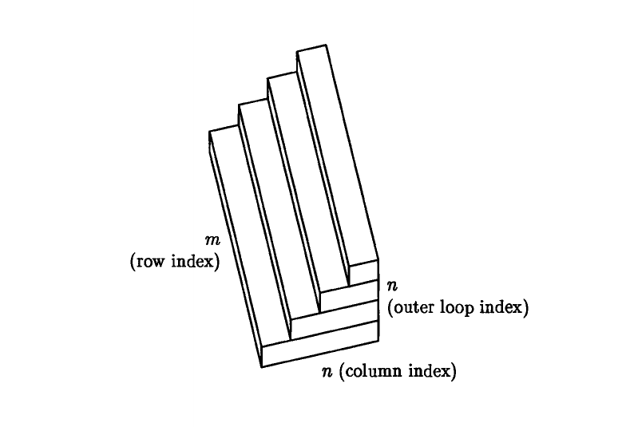

当 $m,n\to\infty$ 时，Gram–Schmidt 正交化的运算量与上图体积成正比。比例常数为 4 flops，因为内层循环的两步在每个矩阵位置各贡献约两次运算。图形趋近于体积为 $mn^2/2$ 的直三棱柱，因此再次得到

$$\text{Gram–Schmidt 正交化的工作量}\sim 2mn^2\ \text{flops}. \tag{8.9}$$

本书通常像式 (8.9) 这样记录运算量，而不把它们都写成定理。这类图除了帮助计算运算量，也提醒我们算法的结构。不同结构的算法图见原书第 75 页和第 176 页。

### 作为三角正交化的 Gram–Schmidt

修改后的 Gram–Schmidt 算法的每一个外层步骤，都可以理解为在右侧乘一个方的上三角矩阵。例如，从 $A$ 开始，第一次迭代先把第一列 $a_1$ 乘以 $1/r_{11}$，再从其余各列 $a_j$ 中减去 $r_{1j}$ 倍的结果。这等价于右乘一个上三角矩阵 $R_1$；相应的原书结构图保留在下面。

一般而言，算法 8.1 的第 $i$ 步从当前矩阵的第 $j>i$ 列中减去 $r_{ij}/r_{ii}$ 倍的第 $i$ 列，并把第 $i$ 列替换为其 $1/r_{ii}$ 倍。这对应于右乘一个上三角矩阵 $R_i$。前几个矩阵的结构如下图所示。

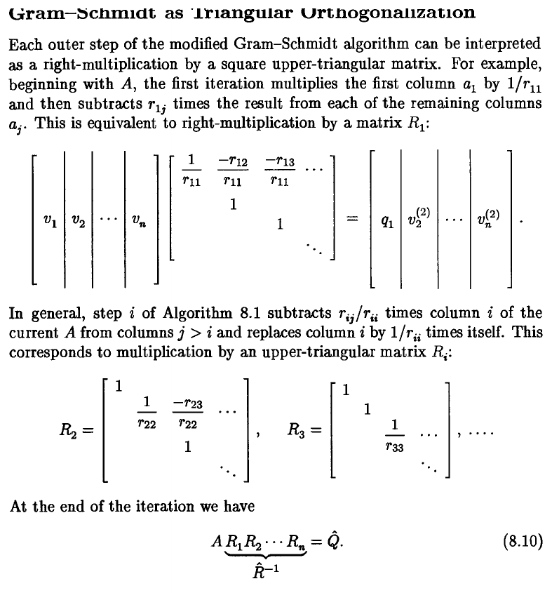

迭代结束时有

$$
AR_1R_2\cdots R_n=\widehat Q,
\qquad R_1R_2\cdots R_n=\widehat R^{-1}. \tag{8.10}
$$

这说明 Gram–Schmidt 算法确实是一种**三角正交化**。它在矩阵右侧施加三角运算，把矩阵化为列标准正交的矩阵。实际计算中我们当然不会显式形成 $R_i$ 并把它们相乘；引入这些矩阵的目的，是帮助理解算法结构。第 20 讲将看到，它与高斯消元的结构有密切相似之处。

### 习题

**8.1**　设 $A$ 是 $m\times n$ 矩阵。确定算法 8.1 计算 QR 分解 $A=\widehat Q\widehat R$ 时，浮点加法、减法、乘法和除法的精确次数。

**8.2**　编写 MATLAB 函数 `[Q,R]=mgs(A)`（见下一讲），用修改后的 Gram–Schmidt 正交化计算 $m\times n$ 矩阵 $A$ 的约化 QR 分解 $A=QR$，其中 $m\ge n$。输出变量是列标准正交的 $Q\in\mathbb C^{m\times n}$ 和三角矩阵 $R\in\mathbb C^{n\times n}$。

**8.3**　原书第 61 页的每个上三角矩阵 $R_i$ 都可以解释为一个对角矩阵与一个单位上三角矩阵（即对角元全为 1 的上三角矩阵）的乘积。准确说明这两个因子是什么，以及算法 8.1 的哪一行对应每个因子。

---

<a id="lecture-9"></a>

## 第 9 讲　MATLAB 数值实验

> 原书页 63–68；目标 PDF 页 78–83。公式编号沿用原书。图 9.1 和习题 9.3 的稀疏矩阵图保留在 `assets/` 中。

要学好数值线性代数，必须养成在计算机上做实验的习惯。MATLAB® 是进行这类实验的优秀问题求解环境。本讲通过三个例子展示 MATLAB 实验，同时观察 Gram–Schmidt 正交化的稳定性。

### MATLAB

MATLAB 是一种用于数学计算的语言，基本数据类型是向量和矩阵。它与 Fortran、C 等语言的区别之一，是工作在更高的数学抽象层次上：矩阵求逆、奇异值分解、快速 Fourier 变换等数百种操作都以内置命令提供。它同时也是一个问题求解环境，由解释器处理顶层命令而不是由编译器先编译，并且可以直接访问二维和三维图形功能。

自 20 世纪 80 年代以来，MATLAB 已成为全世界数值分析人员和工程师广泛使用的工具。对于大规模科学计算中的许多问题，以及数值线性代数中几乎所有小型和中型实验，MATLAB 都是首选语言。

本书会不时使用 MATLAB 展示数值实验，也会在习题中使用它。由于实验数量有限，而且读者只需具备阅读 MATLAB 代码的能力就能跟上，本书不系统介绍这门语言。

> 商标注：MATLAB 是 The MathWorks, Inc. 的注册商标，地址为 24 Prime Park Way, Natick, MA 01760, USA；原书还列出电话 508-647-7000、传真 508-647-7001、电子邮箱 `info@mathworks.com` 和网址 `http://wsrv.mathworks.com`。

### 实验 1：离散 Legendre 多项式

第 7 讲考察了定义在区间 $[-1,1]$ 上、列由单项式 $1,x,x^2,x^3$ 组成的 Vandermonde “矩阵”。现在把 $[-1,1]$ 离散成 257 个等距点，就得到真正的 Vandermonde 矩阵。下面的 MATLAB 代码构造该矩阵并计算其约化 QR 分解。

```matlab
x = (-128:128)'/128;        % Set x to a discretization of [-1,1].
A = [x.^0 x.^1 x.^2 x.^3]; % Construct Vandermonde matrix.
[Q,R] = qr(A,0);            % Find its reduced QR factorization.
```

逐行看这些命令。第一行的撇号把行向量 $(-128:128)$ 转成列向量。第二行的点号乘方运算符表示逐元素乘方。第三行的 `qr` 是 MATLAB 中计算 QR 分解的内置函数，参数 0 表示需要约化分解而不是完整分解。这里使用的并不是 Gram–Schmidt 正交化，而是下一讲讨论的 Householder 三角化；不过对于当前实验，这一差别不影响目的。三行末尾的分号会抑制原本会打印出的 $x,A,Q,R$。

矩阵 $Q$ 的列与图 7.1 中前四个 Legendre 多项式基本一致。由于定义 Legendre 多项式的 $[-1,1]$ 连续内积被离散内积替代，两者会有接近绘图精度的细微差异；此外归一化方式也不同，因为 Legendre 多项式应满足 $P_k(1)=1$。可以把 $Q$ 的每一列除以该列最后一个元素来修正这一点：

```matlab
scale = Q(257,:);              % Select last row of Q.
Q = Q*diag(1 ./scale);         % Rescale columns by these numbers.
plot(Q)                        % Plot columns of rescaled Q.
```

计算结果是一幅与图 7.1 很相似的图（原书没有重复展示）。如果用 Fortran 或 C 完成同样的工作，通常需要几十行代码，其中包含许多循环和嵌套循环。而在这里的六行 MATLAB 代码中，没有一个循环显式出现，尽管每一行至少隐含了一个循环。

### 实验 2：经典 Gram–Schmidt 与修改后的 Gram–Schmidt

第二个例子包含更多算法内容，目的是探索经典 Gram–Schmidt 与修改后的 Gram–Schmidt 在数值稳定性上的差异。

首先构造一个方阵 $A$，其左右奇异向量随机生成，奇异值从 $2^{-1}$ 到 $2^{-80}$，相邻奇异值相差一个因子 2：

```matlab
[U,X] = qr(randn(80));       % Set U to a random orthogonal matrix.
[V,X] = qr(randn(80));       % Set V to a random orthogonal matrix.
S = diag(2.^(-1:-1:-80));    % Set S to exponentially graded entries.
A = U*S*V;                   % Set A to have these singular values.
```

这里的实正交矩阵 $U,V$ 使 $A$ 具有所需的奇异值；右侧矩阵写成 $V$ 或等价地重新命名右奇异向量都不影响这个实验的目的。

接下来用算法 7.1 和算法 8.1 计算 $A$ 的 QR 分解。其中 `clgs` 和 `mgs` 是分别实现这两个算法的 MATLAB 程序，本讲不列出其完整代码：

```matlab
[QC,RC] = clgs(A);           % Classical Gram--Schmidt.
[QM,RM] = mgs(A);            % Modified Gram--Schmidt.
```

最后比较两次计算得到的对角元 $r_{jj}$（MATLAB 绘图代码略）。由于

$$r_{jj}=\|P_ja_j\|_2,$$

这些数描绘了每一步投影的大小。结果用对数坐标画在图 9.1 中。

首先可以看到，$r_{jj}$ 随 $j$ 稳定下降，和直线 $2^{-j}$ 很接近。当然，$r_{jj}$ 并不严格等于 $A$ 的第 $j$ 个奇异值，但它是一个相当好的近似。对此可以做如下粗略解释。按式 (5.3)，$A$ 的 SVD 可以写成

$$
A=2^{-1}u_1v_1^*+2^{-2}u_2v_2^*+2^{-3}u_3v_3^*+\cdots+2^{-80}u_{80}v_{80}^*.
$$

其中 $\{u_j\}$ 与 $\{v_j\}$ 分别是 $A$ 的左右奇异向量。因此，$A$ 的第 $j$ 列形如

$$
a_j=2^{-1}\overline{v_{j1}}u_1+2^{-2}\overline{v_{j2}}u_2+2^{-3}\overline{v_{j3}}u_3+\cdots+2^{-80}\overline{v_{j,80}}u_{80}.
$$

由于奇异向量是随机的，可以预计这些数 $v_{ji}$ 的量级大致相同，约为 $80^{-1/2}\approx0.1$。做 QR 分解时，第一个向量 $q_1$ 很可能近似 $u_1$，而 $r_{11}$ 的量级约为 $2^{-1}\times80^{-1/2}$。下一步正交化得到的 $q_2$ 很可能近似 $u_2$，$r_{22}$ 的量级约为 $2^{-2}\times80^{-1/2}$，依此类推。

图 9.1 的第二个现象是，$r_{jj}$ 的几何下降不会一直持续到 $j=80$。这是计算机舍入误差的结果。对于经典 Gram–Schmidt，数值不会低于约 $10^{-8}$；对于修改后的 Gram–Schmidt，它们还会继续下降约 8 个数量级，达到 $10^{-16}$ 的量级，也就是本次计算所用计算机的机器 epsilon 水平。机器 epsilon 将在第 13 讲定义。

显然，不同算法的稳定性可能不同。经典 Gram–Schmidt 已被充分证明属于不稳定算法，因此很少使用；有时它会在并行计算机上出现，因为通信方面的优势可能抵消其不稳定性的缺点。

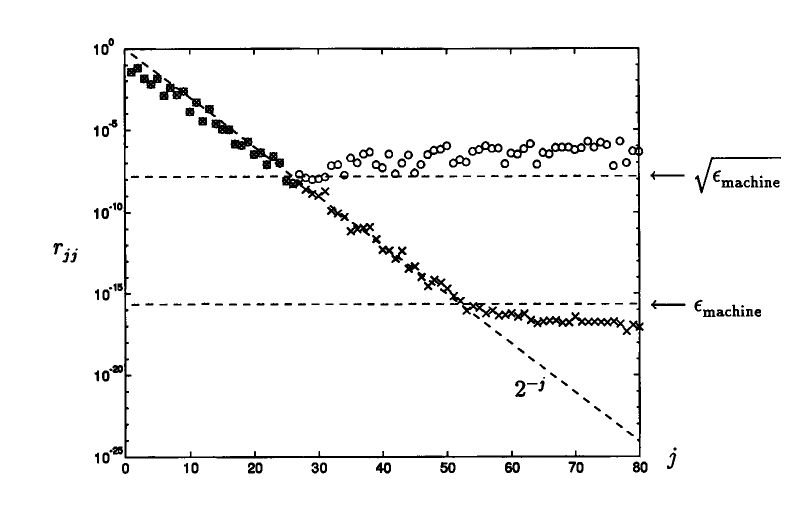

### 实验 3：正交性的数值丢失

连续介绍两个不稳定现象可能会让读者有些混乱，但本讲最后再展示一种不同的现象：经典和修改后的 Gram–Schmidt 都可能产生彼此远非正交的向量 $q_i$。当 $A$ 接近秩亏时，正交性会丢失；和许多数值不稳定性一样，它甚至可以在很低的维数中出现。

先在纸上考虑矩阵

$$
A=\begin{bmatrix}
0.70000&0.70711\\
0.70001&0.70711
\end{bmatrix}. \tag{9.1}
$$

假设计算机把所有计算结果舍入到五位有效数字（第 13 讲将讨论浮点运算）。在 $2\times2$ 情形中，经典与修改后的算法相同。第 $j=1$ 步归一化第一列，得到

$$
r_{11}=0.98996,\qquad
q_1=a_1/r_{11}
=\begin{bmatrix}0.70000/0.98996\\0.70001/0.98996\end{bmatrix}
=\begin{bmatrix}0.70710\\0.70711\end{bmatrix}.
$$

（均按五位有效数字计算。）第 $j=2$ 步计算并减去 $a_2$ 在 $q_1$ 方向上的分量：

$$r_{12}=q_1^*a_2=0.70710\times0.70711+0.70711\times0.70711=1.0000,$$

$$
v_2=a_2-r_{12}q_1
=\begin{bmatrix}0.70711\\0.70711\end{bmatrix}
-\begin{bmatrix}0.70710\\0.70711\end{bmatrix}
=\begin{bmatrix}0.00001\\0.00000\end{bmatrix}.
$$

这个计算得到的 $v_2$ 几乎完全由误差支配。最终得到的 $Q$ 为

$$Q=\begin{bmatrix}0.70710&1.0000\\0.70711&0.0000\end{bmatrix},$$

它与任何正交矩阵都不接近。

即使使用十六位有效数字，把修改后的 Gram–Schmidt 用在式 (9.1) 上仍会损失大约 5 位正交性。下面给出 MATLAB 证据；`eye` 函数生成指定维数的单位矩阵：

```matlab
A = [.70000 .70711       % Define A.
     .70001 .70711];
[Q,R] = qr(A);            % Compute factor Q by Householder.
norm(Q'*Q-eye(2))        % Test orthogonality of Q.
[Q,R] = mgs(A);           % Compute factor Q by modified G-S.
norm(Q'*Q-eye(2))        % Test orthogonality of Q.
```

不带分号的行会打印

$$\texttt{ans = 2.3515e-16},\qquad \texttt{ans = 2.3014e-11}.$$

### 习题

**9.1**

（a）运行实验 1 的六行 MATLAB 程序，生成近似的 Legendre 多项式图。

（b）对 $k=0,1,2,3$，在 257 点网格上画出这些近似多项式与精确多项式 (7.11) 的差。误差有多大？如何分布？

（c）将这些结果与网格间距 $\Delta x=2^{-\nu}$、不同 $\nu$ 的结果比较。看起来是哪一个 $\Delta x$ 的幂控制收敛速度？

**9.2**　在实验 2 中，$A$ 的奇异值与 QR 因子 $R$ 的对角元近似相等。现在考虑一个很不同的例子。设 $Q=I$、$A=R$，其中 $A$ 是 $m\times m$ Toeplitz 矩阵：主对角线全为 1，第一条上对角线全为 2，其余元素为 0。

（a）$A$ 的特征值、行列式和秩分别是什么？

（b）$A^{-1}$ 是什么？

（c）给出 $\sigma_m$（$A$ 的第 $m$ 个奇异值）的一个非平凡上界。可以用 MATLAB 获取直觉，但上界必须给出解析证明。提示：使用（b）。

这个问题说明，不能总是从矩阵的特征值或 QR 因子 $R$ 的对角元推断其奇异值的详细信息。

**9.3**

（a）编写 MATLAB 程序，建立一个 $15\times40$ 的矩阵，除下图所示位置为 1 外其余元素全为 0。最左上角的 1 位于 $(2,2)$，最右下角的 1 位于 $(13,39)$。该图由命令 `spy(A)` 生成。


（b）调用 `svd` 计算 $A$ 的奇异值并打印结果。同时用 `plot` 和 `semilogy` 画出这些数。$A$ 的数学精确秩是多少？它如何反映在计算得到的奇异值中？

（c）对每个 $i=1,\ldots,\operatorname{rank}(A)$，构造 2-范数下 $A$ 的最佳秩 $i$ 近似矩阵 $B$。使用命令 `pcolor(B)` 和 `colormap(gray)`，绘制这些近似矩阵的图像。

---

<a id="lecture-10"></a>

## 第 10 讲　Householder 三角化

> 原书页 69–76；目标 PDF 页 84–91。公式编号沿用原书。图示保留在 assets/ 中；式 (10.1) 的零元素结构图、两个反射几何图和运算量立体图均由源页裁切得到。

计算 QR 分解的另一种主要方法是 Householder 三角化。它在数值上比 Gram–Schmidt 正交化更稳定，不过不像后者那样适合作为迭代方法的基础。Householder 算法通过一系列酉矩阵运算把矩阵变成三角形，因此也可以看成**正交三角化**。

### Householder 与 Gram–Schmidt

在第 8 讲中，我们看到 Gram–Schmidt 迭代在 $A$ 的右侧依次乘上一些初等三角矩阵 $R_k$，从而得到

$$
A R_1R_2\cdots R_n=\widehat Q,
\qquad
R_1R_2\cdots R_n=\widehat R^{-1},
$$

其中 $\widehat Q$ 的列是标准正交的。因此

$$
\widehat R=R_n^{-1}\cdots R_2^{-1}R_1^{-1}
$$

仍是上三角矩阵，于是 $A=\widehat Q\widehat R$ 是 $A$ 的约化 QR 分解。

相比之下，Householder 方法在 $A$ 的左侧依次乘上初等酉矩阵 $Q_k$，使得

$$
Q_n\cdots Q_2Q_1A=R,
\qquad
Q^*=Q_n\cdots Q_2Q_1,
$$

其中 $R$ 是上三角矩阵。乘积

$$
Q=Q_1^*Q_2^*\cdots Q_n^*
$$

也是酉矩阵，因此 $A=QR$ 是一个**完整** QR 分解。

所以，这两种方法可以概括为：

$$
\begin{array}{ll}
\text{Gram--Schmidt:}&\text{三角正交化（triangular orthogonalization）},\\
\text{Householder:}&\text{正交三角化（orthogonal triangularization）}.
\end{array}
$$

### 通过引入零元素进行三角化

Householder 方法的核心思想最初由 Alston Householder 于 1958 年提出。它巧妙地设计酉矩阵 $Q_k$，使

$$
Q_n\cdots Q_2Q_1A
$$

成为上三角矩阵。

矩阵 $Q_k$ 的作用，是在第 $k$ 列主对角线下方引入零元素，同时保留此前已经引入的所有零元素。例如，对 $5\times3$ 矩阵，依次应用三个运算 $Q_k$，结构如下。图中 $\times$ 表示不一定为零的元素；黑体元素表示刚刚被改变的元素；空白位置表示零。

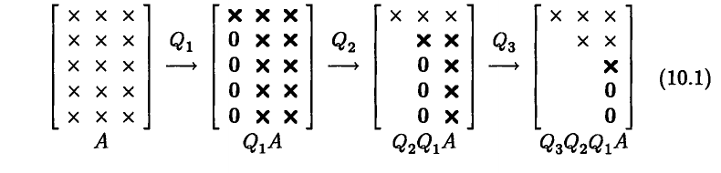

首先，$Q_1$ 作用于第 $1,\ldots,5$ 行，在位置 $(2,1),(3,1),(4,1),(5,1)$ 引入零元素。接着，$Q_2$ 作用于第 $2,\ldots,5$ 行，在位置 $(3,2),(4,2),(5,2)$ 引入零元素，同时不会破坏 $Q_1$ 引入的零元素。最后，$Q_3$ 作用于第 $3,\ldots,5$ 行，在位置 $(4,3),(5,3)$ 引入零元素，也不会破坏前面已经引入的零元素。

一般地，$Q_k$ 作用于第 $k,\ldots,m$ 行。在第 $k$ 步开始时，这些行的前 $k-1$ 列已经形成一个零块。$Q_k$ 对这些行做线性组合，而零元素的线性组合仍然为零。经过 $n$ 步，主对角线下方的所有元素都被消去，$Q_n\cdots Q_2Q_1A=R$ 成为上三角矩阵。

### Householder 反射器

如何构造能够实现上述零元素结构的酉矩阵 $Q_k$？标准做法是把每个 $Q_k$ 取为

$$
Q_k=
\begin{bmatrix}
I&0\\
0&F
\end{bmatrix}, \tag{10.2}
$$

其中 $I$ 是 $(k-1)\times(k-1)$ 单位矩阵，$F$ 是 $(m-k+1)\times(m-k+1)$ 的酉矩阵。矩阵 $F$ 的乘法必须在第 $k$ 列中引入所需的零元素。Householder 算法取 $F$ 为一种称为 Householder 反射器的特殊矩阵。

假设在第 $k$ 步开始时，第 $k$ 列的第 $k,\ldots,m$ 个元素组成向量

$$
x\in\mathbb C^{m-k+1}.
$$

为了在第 $k$ 列引入正确的零元素，Householder 反射器 $F$ 应实现如下映射：

$$
x=
\begin{bmatrix}
\times\\
\times\\
\vdots\\
\times
\end{bmatrix}
\ \xrightarrow{\quad F\quad}\
Fx=
\begin{bmatrix}
\|x\|_2\\
0\\
\vdots\\
0
\end{bmatrix}
=\|x\|_2e_1. \tag{10.3}
$$

稍后我们会在这个想法上加入一个 $\pm$ 号。

图示中的反射器 $F$ 把空间 $\mathbb C^{m-k+1}$ 关于与

$$
v=\|x\|_2e_1-x
$$

正交的超平面 $H$ 进行反射。超平面是二维平面在高维空间中的推广：它可以是四维空间中的三维子空间，也可以是五维空间中的四维子空间，依此类推。一般而言，超平面可以刻画为与某个非零固定向量正交的全部点组成的集合。图中，这个固定向量就是 $v=\|x\|_2e_1-x$；虚线可以理解为从“侧面”观察超平面 $H$ 得到的示意。

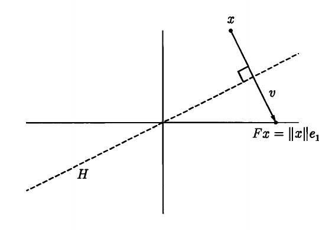

施加反射后，超平面 $H$ 一侧的每个点都会被映到另一侧的镜像点。特别地，$x$ 被映到 $\|x\|_2e_1$。反射公式可以这样推导。第 6 讲的式 (6.11) 告诉我们，对任意 $y\in\mathbb C^m$，向量

$$
Py=
\left(I-\frac{vv^*}{v^*v}\right)y
=y-v\left(\frac{v^*y}{v^*v}\right)
$$

是 $y$ 在超平面 $H$ 上的正交投影。如果要把 $y$ 关于 $H$ 反射，就不能停在投影点，而要沿同一方向再走同样的距离。因此

$$
Fy=
\left(I-2\frac{vv^*}{v^*v}\right)y
=y-2v\left(\frac{v^*y}{v^*v}\right).
$$

于是反射矩阵为

$$
F=I-2\frac{vv^*}{v^*v}. \tag{10.4}
$$

注意，投影矩阵 $P$ 的秩为 $m-1$，而反射器 $F$ 满秩且酉；二者的公式只差一个因子 2。

### 两个反射器中更好的一个

式 (10.3) 和图 10.1 把问题简化了。事实上，有许多 Householder 反射都能引入所需的零元素。向量 $x$ 可以被反射到

$$
z\|x\|_2e_1,\qquad |z|=1.
$$

在复数情形中，这些可能的反射形成一个圆；即使在实数情形中，也有两个选择，分别对应关于不同超平面 $H^+$ 与 $H^-$ 的反射，如图 10.2 所示。

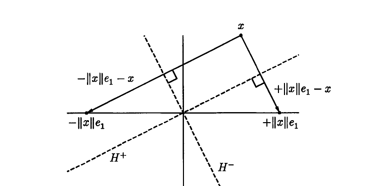

从数学上说，选择哪一个符号都没有问题。但是，数值稳定性的目标——也就是对舍入误差不敏感——要求我们固定采用其中一个选择。为了稳定，最好把 $x$ 反射到不太接近 $x$ 本身的向量 $z\|x\|_2e_1$。为此，取

$$
z=-\operatorname{sign}(x_1),
$$

其中 $x_1$ 是 $x$ 的第一个分量。此时反射向量为

$$
v=-\operatorname{sign}(x_1)\|x\|_2e_1-x.
$$

把整体因子 $-1$ 消去，得到更方便的表达式

$$
v=\operatorname{sign}(x_1)\|x\|_2e_1+x. \tag{10.5}
$$

为了使这成为完整的规定，可以约定 $x_1=0$ 时 $\operatorname{sign}(x_1)=1$。

这个符号选择为何影响稳定性并不难看出。假设图 10.2 中 $H^+$ 与 $e_1$ 轴的夹角非常小。那么

$$
v=\|x\|_2e_1-x
$$

会比 $x$ 或 $\|x\|_2e_1$ 小得多。计算 $v$ 时要把两个很接近的量相减，因此容易发生消去误差。采用式 (10.5) 中的符号，可以保证 $\|v\|_2$ 不会小于 $\|x\|_2$，从而避免这种效应。

### 算法

现在给出完整的 Householder 算法。先介绍一种新的 MATLAB 风格记号。若 $A$ 是一个矩阵，记

$$
A_{i:i',\,j:j'}
$$

为 $A$ 的子矩阵：其左上角为 $a_{i,j}$，右下角为 $a_{i',j'}$，尺寸为 $(i'-i+1)\times(j'-j+1)$。当子矩阵退化为单行或单列的子向量时，分别写作 $A_{i,\,j:j'}$ 或 $A_{i:i',\,j}$。

下面的算法计算 $m\times n$ 矩阵 $A$ 的 QR 分解中的 $R$ 因子，其中 $m\ge n$；算法直接在 $A$ 原位置上写回结果。同时，它把 $n$ 个反射向量 $v_1,\ldots,v_n$ 保存下来，以便后续使用。

#### 算法 10.1：Householder QR 分解

    for k = 1 to n
        x = A(k:m,k)
        v_k = sign(x_1)||x||_2 e_1 + x
        v_k = v_k/||v_k||_2
        A(k:m,k:n) = A(k:m,k:n) - 2v_k(v_k^*A(k:m,k:n))

### 应用或构造 $Q$

算法 10.1 完成后，$A$ 已经被化为上三角形式；这就是 QR 分解 $A=QR$ 中的 $R$。不过，酉矩阵 $Q$ 尚未构造出来，与约化 QR 分解对应的 $n$ 列子矩阵 $\widehat Q$ 也尚未构造。这是有意的：显式构造 $Q$ 或 $\widehat Q$ 需要额外工作，而许多应用可以直接使用

$$
Q^*=Q_n\cdots Q_2Q_1 \tag{10.6}
$$

或它的共轭

$$
Q=Q_1Q_2\cdots Q_n. \tag{10.7}
$$

这里没有漏写星号；回忆一下，每个 $Q_j$ 都是 Hermitian 矩阵。

例如，第 7 讲说明了如何通过 QR 分解求解方程组 $Ax=b$。在这个过程中，使用 $Q$ 的唯一地方是计算 $Q^*b$。根据式 (10.6)，可以对 $b$ 依次施加 $n$ 个运算来计算 $Q^*b$；这些运算与把 $A$ 化为三角矩阵时所做的运算完全相同。

#### 算法 10.2：隐式计算 $Q^*b$

    for k = 1 to n
        b(k:m) = b(k:m) - 2v_k(v_k^*b(k:m))

类似地，计算 $Qx$ 只需按相反顺序执行同样的过程。

#### 算法 10.3：隐式计算 $Qx$

    for k = n downto 1
        x(k:m) = x(k:m) - 2v_k(v_k^*x(k:m))

上述两个算法的工作量都是 $O(mn)$，而不是算法 10.1 的 $O(mn^2)$（见下文）。

当然，有时我们确实希望显式构造矩阵 $Q$。一种办法是使用算法 10.3，分别计算

$$
Qe_1,\ Qe_2,\ \ldots,\ Qe_m
$$

作为 $Q$ 的各列。另一种办法是使用算法 10.2 构造 $Q^*$，然后取共轭转置。还可以在每一步都取共轭，而不是最后才处理整个乘积：按照式 (10.7) 的启发，计算

$$
e_1^*Q,\ e_2^*Q,\ \ldots,\ e_m^*Q
$$

作为 $Q$ 的各行。在这些方法中，最好的通常是第一种，即基于算法 10.3 的方法。原因是它从涉及 $Q_n,Q_{n-1},\ldots$ 的运算开始，而这些运算只会修改所作用向量的一小部分；利用这种稀疏性可以加速。

如果只需要 $\widehat Q$ 而不需要完整的 $Q$，只需计算前 $n$ 列

$$
Qe_1,\ Qe_2,\ \ldots,\ Qe_n.
$$

### 运算量

算法 10.1 的工作量主要由内层更新决定：

$$
A_{k:m,j}
=
A_{k:m,j}-2v_k\bigl(v_k^*A_{k:m,j}\bigr). \tag{10.8}
$$

若向量长度为 $\ell=m-k+1$，这次计算需要 $4\ell-1\approx4\ell$ 次标量运算：减法 1 次，标量乘法 1 次，内积需要 $2\ell-1$ 次。也就是说，每个被处理的矩阵元素约对应 4 次浮点运算。

像第 8 讲那样，可以用几何方法把每个元素的 4 次 flop 加总。外层循环的每个后续步骤都作用于更少的行，因为第 $k$ 步不会改变第 $1,\ldots,k-1$ 行。同时，每一步也作用于更少的列，因为被处理行的第 $1,\ldots,k-1$ 列已经是零，会被跳过。因此，一个外层步骤的工作量可以表示为下面立体图的一个横层。

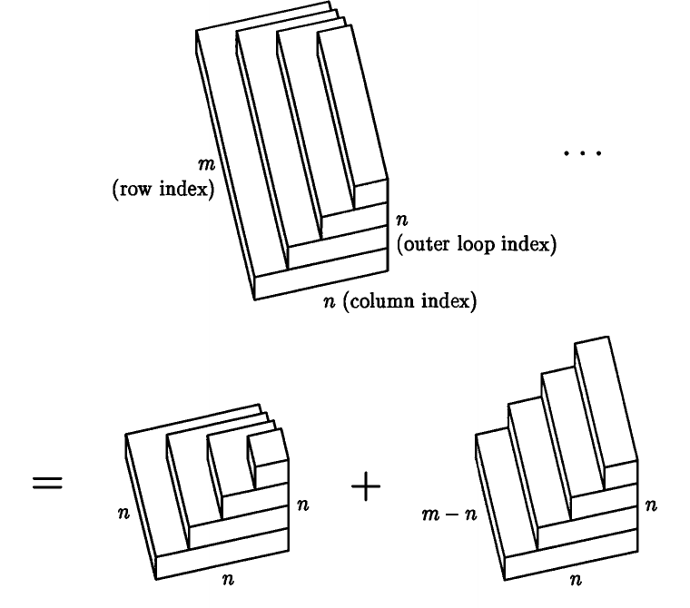

总运算次数等于该立体体积的 4 倍。为了从图形上确定体积，可以把立体分成两部分。左侧立体呈锯齿形；当 $n\to\infty$ 时趋近于一个体积为 $\frac13n^3$ 的棱锥。右侧立体呈阶梯形；当 $m,n\to\infty$ 时趋近于一个体积为

$$
\frac12(m-n)n^2
$$

的棱柱。合并两部分，体积为

$$
\sim \frac12mn^2-\frac16n^3.
$$

再乘以每单位体积 4 次 flop，得到

$$
\text{Householder 正交化的工作量}
\sim 2mn^2-\frac23n^3\ \text{flops}. \tag{10.9}
$$

### 习题

**10.1**　确定一个 Householder 反射器的：(a) 特征值；(b) 行列式；(c) 奇异值。对于特征值，请同时给出几何论证和代数证明。

**10.2**

（a）编写 MATLAB 函数 [W,R] = house(A)。它使用 Householder 反射，为 $m\times n$ 矩阵 $A$（$m\ge n$）的完整 QR 分解 $A=QR$ 计算一个隐式表示。输出变量是 $W\in\mathbb C^{m\times n}$ 的下三角矩阵，其列是定义各次 Householder 反射的向量 $v_k$，以及三角矩阵 $R\in\mathbb C^{n\times n}$。

（b）编写 MATLAB 函数 Q = formQ(W)。它以 house 产生的矩阵 $W$ 为输入，生成相应的 $m\times m$ 正交矩阵 $Q$。

**10.3**　令

$$
Z=
\begin{bmatrix}
1&2&3\\
4&5&6\\
7&8&7\\
4&2&3\\
4&2&2
\end{bmatrix}.
$$

在 MATLAB 中计算 $Z$ 的三种约化 QR 分解：使用习题 8.2 的 Gram–Schmidt 程序 mgs；使用习题 10.2 的 Householder 程序 house 和 formQ；以及 MATLAB 内置命令 [Q,R] = qr(Z,0)。比较这三种结果，并说明你观察到的差异。

**10.4**　考虑两个 $2\times2$ 正交矩阵

$$
F=
\begin{bmatrix}
-c&s\\
s&c
\end{bmatrix},
\qquad
J=
\begin{bmatrix}
c&s\\
-s&c
\end{bmatrix},
\qquad
s=\sin\theta,\quad c=\cos\theta. \tag{10.10}
$$

第一个矩阵满足 $\det F=-1$，是一个反射器——二维 Householder 反射器的特殊情形。第二个矩阵满足 $\det J=1$，执行的是旋转而不是反射；这样的矩阵称为 Givens 旋转。

（a）准确描述左乘 $F$ 和 $J$ 对平面 $\mathbb R^2$ 的几何作用。例如，$J$ 把平面旋转 $\theta$ 角，但旋转是顺时针还是逆时针？

（b）描述一种基于 Givens 旋转的 QR 分解算法，使其对应于算法 10.1，但用 Givens 旋转代替 Householder 反射。

（c）证明你的算法每个被处理元素需要 6 次 flop，而不是 4 次，因此渐近运算量比式 (10.9) 大 50%。

---

<a id="lecture-11"></a>

## 第 11 讲　最小二乘问题

> 原书页 77–85；目标 PDF 页 92–100。公式编号沿用原书。图 11.1–11.3 保留在 assets/ 中。

自高斯和勒让德在 1800 年前后发明最小二乘法以来，最小二乘数据拟合一直是不可或缺的工具，并且影响遍及数学科学的许多领域。用线性代数的语言说，本讲要处理的是超定方程组 $Ax=b$：矩阵是长方形的，行数多于列数。最小二乘的思想，是通过最小化残差 $b-Ax$ 的 2-范数来“求解”这样的系统。

### 问题

考虑一个含有 $n$ 个未知数、但有 $m>n$ 个方程的线性方程组。我们希望找到满足 $Ax=b$ 的向量 $x\in\mathbb C^n$，其中

$$
A\in\mathbb C^{m\times n},\qquad b\in\mathbb C^m.
$$

一般而言，这样的方程组没有解。只有当 $b\in\operatorname{range}(A)$ 时才存在合适的 $x$；而 $b$ 是 $m$ 维向量，$\operatorname{range}(A)$ 的维数至多为 $n$，所以这只会对特殊的 $b$ 发生。当 $m>n$ 时，这样的长方形方程组称为**超定**方程组。

把

$$
r=b-Ax\in\mathbb C^m \tag{11.1}
$$

称为**残差**。通过选择合适的 $x$，残差通常可以变得很小，但一般无法严格变成零。

如果一个没有解的问题仍要谈“求解”，这意味着什么？对超定方程组，一个自然的答案是：既然不能让残差 $r$ 等于零，就让它尽可能小。要衡量“小”，需要先选择范数。如果选择 2-范数，问题就成为：

$$
\begin{aligned}
&\text{给定 }A\in\mathbb C^{m\times n},\quad m\ge n,\quad b\in\mathbb C^m,\\
&\text{寻找 }x\in\mathbb C^n,\quad\text{使 }\|b-Ax\|_2\text{ 最小}.
\end{aligned}
\tag{11.2}
$$

这就是一般的（线性）最小二乘问题。选择 2-范数可以由几何和统计方面的多种理由来支持；正如后面将看到的，它还会导出简单的算法，根本原因在于：二次函数的导数是线性的，而求极小值必须令导数为零。

2-范数对应欧氏距离，因此式 (11.2) 有一个直观的几何解释：寻找 $x\in\mathbb C^n$，使得 $Ax\in\mathbb C^m$ 是 $\operatorname{range}(A)$ 中距离 $b$ 最近的点。

### 例：多项式数据拟合

下面比较两种做法：多项式插值会导出方阵方程组；最小二乘多项式数据拟合则使用长方形方程组。

#### 例 11.1：多项式插值

设给定 $m$ 个互异的点 $x_1,\ldots,x_m\in\mathbb C$，以及这些点上的数据 $y_1,\ldots,y_m\in\mathbb C$。存在唯一的多项式插值函数，即次数至多为 $m-1$ 的多项式

$$
p(x)=c_0+c_1x+\cdots+c_{m-1}x^{m-1}. \tag{11.3}
$$

它满足每个 $x_i$ 都有 $p(x_i)=y_i$。数据 $\{x_i\},\{y_i\}$ 与系数 $\{c_i\}$ 的关系，可由例 1.1 中已经见过的方形 Vandermonde 系统表示：

$$
\begin{bmatrix}
1&x_1&x_1^2&\cdots&x_1^{m-1}\\
1&x_2&x_2^2&\cdots&x_2^{m-1}\\
1&x_3&x_3^2&\cdots&x_3^{m-1}\\
\vdots&\vdots&\vdots&&\vdots\\
1&x_m&x_m^2&\cdots&x_m^{m-1}
\end{bmatrix}
\begin{bmatrix}
c_0\\c_1\\c_2\\\vdots\\c_{m-1}
\end{bmatrix}
=
\begin{bmatrix}
y_1\\y_2\\y_3\\\vdots\\y_m
\end{bmatrix}. \tag{11.4}
$$

只要点 $\{x_i\}$ 互异，这个方程组就保证非奇异，因此可以求出给定数据对应的系数（见习题 37.3）。

图 11.1 给出了一个多项式插值的例子：有 11 个数据点，它们构成一个离散的方波，用叉号表示；曲线 $p(x)$ 必须经过所有这些点。但这个拟合并不令人满意。在区间两端，$p(x)$ 出现很大的振荡，这显然是插值过程产生的伪影，而不是数据的合理反映。

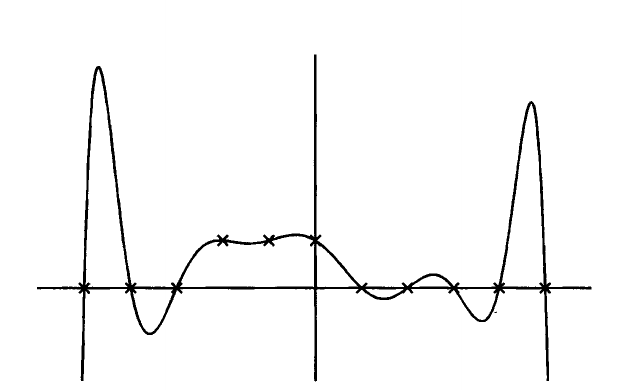

这种不理想的行为是多项式插值的典型特征。它产生的拟合往往很差；使用更多数据时，情况还可能变得更糟。即使拟合看起来不错，插值过程也可能是病态的，也就是对数据扰动敏感（下一讲会讨论）。为了避免这些问题，可以在区间 $[-1,1]$ 中使用非均匀的插值点，例如 Chebyshev 点。但是在实际应用中，我们未必能随意选择插值点。

#### 例 11.2：多项式最小二乘拟合

不改变数据点，只降低多项式的次数，通常就能得到更好的结果。仍给定 $x_1,\ldots,x_m$ 和 $y_1,\ldots,y_m$，现在考虑某个 $n<m$ 的 $n-1$ 次多项式

$$
p(x)=c_0+c_1x+\cdots+c_{n-1}x^{n-1}. \tag{11.5}
$$

如果它能使数据偏差平方和

$$
\sum_{i=1}^{m}|p(x_i)-y_i|^2 \tag{11.6}
$$

最小，那么这个多项式就是数据的最小二乘拟合。

这个平方和等于长方形 Vandermonde 系统残差 2-范数的平方：

$$
\begin{bmatrix}
1&x_1&\cdots&x_1^{n-1}\\
1&x_2&\cdots&x_2^{n-1}\\
1&x_3&\cdots&x_3^{n-1}\\
\vdots&\vdots&&\vdots\\
1&x_m&\cdots&x_m^{n-1}
\end{bmatrix}
\begin{bmatrix}
c_0\\c_1\\\vdots\\c_{n-1}
\end{bmatrix}
\approx
\begin{bmatrix}
y_1\\y_2\\y_3\\\vdots\\y_m
\end{bmatrix}. \tag{11.7}
$$

图 11.2 展示了把上一个例子的 11 个数据点用 7 次多项式拟合时的结果。新的多项式不再插值通过每个数据点，但例 11.1 的多项式更好地捕捉了数据的整体趋势。虽然图中看不出来，它对扰动也更不敏感。

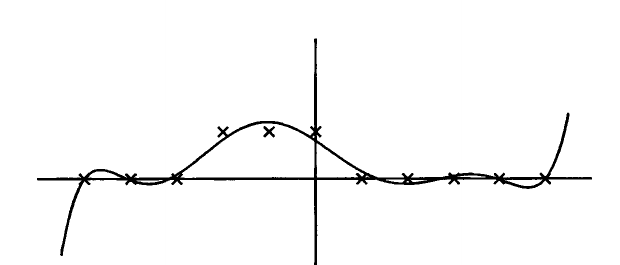

### 正交投影与正规方程

图 11.3 说明了式 (11.2) 的几何含义。我们的目标是在 $\operatorname{range}(A)$ 中寻找距离 $b$ 最近的点 $Ax$，使残差 $r=b-Ax$ 的范数最小。从几何上看，只要

$$
Ax=Pb,
$$

其中 $P\in\mathbb C^{m\times m}$ 是把 $\mathbb C^m$ 映到 $\operatorname{range}(A)$ 的正交投影，就能达到这个目标。换言之，残差 $r=b-Ax$ 必须与 $\operatorname{range}(A)$ 正交。

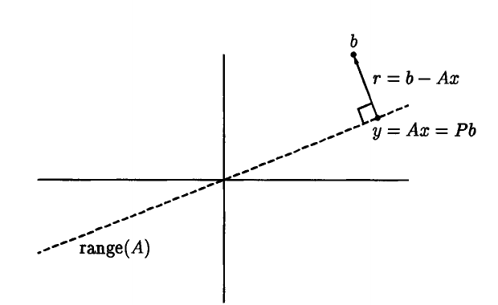

**定理 11.1**　设 $A\in\mathbb C^{m\times n}$（$m\ge n$）和 $b\in\mathbb C^m$ 给定。向量 $x\in\mathbb C^n$ 最小化残差范数

$$
\|r\|_2=\|b-Ax\|_2,
$$

从而解决最小二乘问题 (11.2)，当且仅当 $r\perp\operatorname{range}(A)$，也就是

$$
A^*r=0. \tag{11.8}
$$

等价地，

$$
A^*Ax=A^*b, \tag{11.9}
$$

或者

$$
Pb=Ax, \tag{11.10}
$$

其中 $P\in\mathbb C^{m\times m}$ 是到 $\operatorname{range}(A)$ 上的正交投影。式 (11.9) 所对应的 $n\times n$ 方程组称为**正规方程**。它非奇异，当且仅当 $A$ 满列秩。因此，最小二乘解唯一，当且仅当 $A$ 满列秩。

**证明。**式 (11.8) 与式 (11.10) 的等价性来自第 6 讲讨论的正交投影性质；式 (11.8) 与式 (11.9) 的等价性来自残差 $r$ 的定义。

要说明 $y=Pb$ 是 $\operatorname{range}(A)$ 中唯一的最小化 $\|b-y\|_2$ 的点，设 $z\ne y$ 是其中的另一个点。由于 $z-y$ 与 $b-y$ 正交，勾股定理（习题 2.2）给出

$$
\|b-z\|_2^2=\|b-y\|_2^2+\|y-z\|_2^2>\|b-y\|_2^2,
$$

这正是所需结论。

最后，如果 $A^*A$ 奇异，那么存在非零 $x$ 使 $A^*Ax=0$。左乘 $x^*$ 得

$$
x^*A^*Ax=\|Ax\|_2^2=0,
$$

因此 $Ax=0$，说明 $A$ 秩亏。反过来，如果 $A$ 秩亏，那么存在非零 $x$ 使 $Ax=0$，于是也有 $A^*Ax=0$，所以 $A^*A$ 奇异。结合式 (11.9)，就得到关于 $A^*A$ 非奇异性与最小二乘解唯一性的结论。

### 伪逆

刚才已经看到，如果 $A$ 满列秩，那么最小二乘问题 (11.2) 的解唯一，并且

$$
x=(A^*A)^{-1}A^*b.
$$

矩阵

$$
A^+=(A^*A)^{-1}A^*\in\mathbb C^{n\times m} \tag{11.11}
$$

称为 $A$ 的**伪逆**。它把 $b\in\mathbb C^m$ 映射为 $x\in\mathbb C^n$，这也解释了为什么它的尺寸是 $n\times m$，即列数多于行数。

满列秩线性最小二乘问题 (11.2) 可以概括为：要计算下面两个向量中的一个或两个：

$$
x=A^+b,\qquad y=Pb. \tag{11.12}
$$

其中 $A^+$ 是 $A$ 的伪逆，$P$ 是到 $\operatorname{range}(A)$ 上的正交投影。下面介绍计算它们的三种主要算法。

### 正规方程

求解最小二乘问题的经典方法，是直接求解正规方程 (11.9)。如果 $A$ 满列秩，这是一组 $n\times n$ 的 Hermitian 正定方程。求解这类系统的标准方法是 Cholesky 分解，第 23 讲将讨论它。该方法构造

$$
A^*A=R^*R,
$$

其中 $R$ 是上三角矩阵，从而把式 (11.9) 化为

$$
R^*Rx=A^*b. \tag{11.13}
$$

#### 算法 11.1：通过正规方程求解最小二乘问题

1. 构造矩阵 $A^*A$ 和向量 $A^*b$。
2. 计算 Cholesky 分解 $A^*A=R^*R$。
3. 对 $w$ 求解下三角方程组 $R^*w=A^*b$。
4. 对 $x$ 求解上三角方程组 $Rx=w$。

这个计算中占主要工作量的是前两步（第 17 讲讨论第 3、4 步）。利用对称性，计算 $A^*A$ 只需要 $mn^2$ 次 flop；如果 $A$ 和 $A^*$ 是尺寸相同但任意的矩阵，这个代价将是两倍。Cholesky 分解也利用了对称性，需要 $n^3/3$ 次 flop。因此，用正规方程求解最小二乘问题的总运算量为

$$
\text{算法 11.1 的工作量}\sim mn^2+\frac13n^3\ \text{flops}. \tag{11.14}
$$

### QR 分解

求解最小二乘问题的“现代经典”方法自 20 世纪 60 年代起广泛使用，它基于约化 QR 分解。通过 Gram–Schmidt 正交化，或者更常用的 Householder 三角化，可以构造

$$
A=\widehat Q\widehat R.
$$

正交投影 $P$ 可以写成（式 (6.6)）

$$
P=\widehat Q\widehat Q^*,
$$

因此

$$
y=Pb=\widehat Q\widehat Q^*b. \tag{11.15}
$$

由于 $y\in\operatorname{range}(A)$，方程 $Ax=y$ 有精确解。把 QR 分解与式 (11.15) 合并，得到

$$
\widehat Q\widehat R x=\widehat Q\widehat Q^*b. \tag{11.16}
$$

左乘 $\widehat Q^*$ 后得到

$$
\widehat R x=\widehat Q^*b. \tag{11.17}
$$

（再乘以 $\widehat R^{-1}$，就得到伪逆公式 $A^+=\widehat R^{-1}\widehat Q^*$。）式 (11.17) 是上三角方程组；当 $A$ 满列秩时它非奇异，可以方便地通过回代求解（第 17 讲）。

#### 算法 11.2：通过 QR 分解求解最小二乘问题

1. 计算约化 QR 分解 $A=\widehat Q\widehat R$。
2. 计算向量 $\widehat Q^*b$。
3. 对 $x$ 求解上三角方程组 $\widehat R x=\widehat Q^*b$。

注意，式 (11.17) 也可以从正规方程推出。如果 $A^*Ax=A^*b$，那么

$$
\widehat R^*\widehat Q^*\widehat Q\widehat R x
=\widehat R^*\widehat Q^*b,
$$

这就推出 $\widehat R x=\widehat Q^*b$。

算法 11.2 的工作量主要来自 QR 分解。如果这一步使用 Householder 反射，那么由式 (10.9) 可得

$$
\text{算法 11.2 的工作量}\sim 2mn^2-\frac23n^3\ \text{flops}. \tag{11.18}
$$

### SVD

第 31 讲将介绍计算约化奇异值分解的算法：

$$
A=\widehat U\widehat\Sigma V^*.
$$

这提示了另一种求解最小二乘问题的方法。此时

$$
P=\widehat U\widehat U^*,
$$

从而

$$
y=Pb=\widehat U\widehat U^*b. \tag{11.19}
$$

式 (11.16) 和式 (11.17) 的对应形式为

$$
\widehat U\widehat\Sigma V^*x=\widehat U\widehat U^*b, \tag{11.20}
$$

以及

$$
\widehat\Sigma V^*x=\widehat U^*b. \tag{11.21}
$$

（左乘 $\widehat V\widehat\Sigma^{-1}$，得到 $A^+=V\widehat\Sigma^{-1}\widehat U^*$。）算法如下。

#### 算法 11.3：通过 SVD 求解最小二乘问题

1. 计算约化 SVD $A=\widehat U\widehat\Sigma V^*$。
2. 计算向量 $\widehat U^*b$。
3. 对 $w$ 求解对角方程组 $\widehat\Sigma w=\widehat U^*b$。
4. 令 $x=Vw$。

QR 分解把最小二乘问题化为三角方程组，而 SVD 把它化为对角方程组，后者当然可以直接求解。如果 $A$ 满列秩，对角方程组非奇异。

和前面一样，式 (11.21) 也可以由正规方程推出。如果 $A^*Ax=A^*b$，那么

$$
V\widehat\Sigma^*\widehat U^*\widehat U\widehat\Sigma V^*x
=V\widehat\Sigma^*\widehat U^*b,
$$

从而得到 $\widehat\Sigma V^*x=\widehat U^*b$。

算法 11.3 的运算量主要来自 SVD 的计算。第 31 讲将看到，当 $m\gg n$ 时，其代价与 QR 分解大致相同；但当 $m\approx n$ 时，SVD 更昂贵。一个典型估计是

$$
\text{算法 11.3 的工作量}\sim 2mn^2+11n^3\ \text{flops}, \tag{11.22}
$$

不过这个估计的适用条件和修正将在第 31 讲讨论。

### 算法比较

上述每种方法都有适合自己的情形。如果唯一目标是速度，算法 11.1 可能是最好的。但是，在舍入误差存在时，正规方程并不总是稳定；因此多年来数值分析家一直把算法 11.2 推荐为最小二乘问题的标准方法。算法 11.2 自然而优雅，适合日常使用。

不过，如果 $A$ 接近秩亏，算法 11.2 本身的稳定性也不够理想；在这种情况下，转向基于 SVD 的算法 11.3 有充分理由。究竟是什么稳定性因素使某种算法在一种情况下更好、在另一种情况下却不一定更好？现在正是系统讨论这些问题的时候。第 18、19 讲将回到最小二乘算法的研究。

### 习题

**11.1**　设 $m\times n$ 矩阵 $A$ 具有如下形式：

$$
A=
\begin{bmatrix}
A_1\\
A_2
\end{bmatrix},
$$

其中 $A_1$ 是 $n\times n$ 非奇异矩阵，$A_2$ 是任意的 $(m-n)\times n$ 矩阵。证明

$$
\|A^+\|_2\le \|A_1^{-1}\|_2.
$$

**11.2**

（a）在区间 $[1,2]$ 上用 $L^2$ 范数衡量，函数 $f(x)=x^{-1}$ 能被函数 $e^x$、$\sin x$ 和 $\Gamma(x)$ 的线性组合拟合到多接近？其中 $\Gamma(x)$ 是 MATLAB 的内置 gamma 函数。编写程序，把 $[1,2]$ 离散化并建立离散最小二乘问题，以至少两位有效数字的相对精度确定答案。写出答案以及最优线性组合的系数估计，并画出最优近似。

（b）重复上述过程，但把区间 $[1,2]$ 换成 $[0,1]$。下面的事实可能有帮助：若 $g(x)=1/\Gamma(x)$，则 $g'(0)=1$。

**11.3**　取 $m=50,n=12$。使用 MATLAB 的 linspace，定义 $t$ 为从 0 到 1 等距网格对应的 $m$ 维向量。使用 MATLAB 的 vander 和 fliplr，定义 $A$ 为这个网格上用次数 $n-1$ 多项式做最小二乘拟合所对应的 $m\times n$ 矩阵。令 $b$ 为在网格上计算的函数 $\cos(4t)$。现在用以下六种方法计算并打印（精确到 16 位）最小二乘系数向量 $x$：

（a）建立并求解正规方程，使用 MATLAB 的左除运算符反斜杠。

（b）使用 mgs 计算 QR 分解（修改后的 Gram–Schmidt，习题 8.2）。

（c）使用 house 计算 QR 分解（Householder 三角化，习题 10.2）。

（d）使用 MATLAB 的 qr 计算 QR 分解（同样基于 Householder 三角化）。

（e）在 MATLAB 中使用 x = A\b（同样基于 QR 分解）。

（f）使用 MATLAB 的 svd 计算 SVD。

（g）以上计算会产生六组、每组十二个系数。在每组中，用红笔标出看起来错误（受到舍入误差影响）的数字。评论你观察到的差异。正规方程是否表现出不稳定性？不必解释你的观察。

---

<a id="lecture-12"></a>

## 第 12 讲　良态性与条件数

> 原书页 89–96；目标 PDF 页 104–111。公式编号沿用原书。图形优先保留源页裁切；本讲没有使用 Matplotlib 重绘。

从本讲开始进入本书第三部分，系统讨论数值分析中两个此前只略有涉及的基本问题。良态性（conditioning）描述数学问题对扰动的反应；稳定性（stability）描述计算机上求解该问题的算法对扰动的反应。

### 问题的良态性

抽象地看，可以把一个问题视为从数据所在的赋范向量空间 $X$ 到解所在的赋范向量空间 $Y$ 的函数

$$
f:X\to Y.
$$

这个函数通常是非线性的（即使在线性代数中也是如此），但大多数时候至少是连续的。

我们通常关心问题 $f$ 在某个特定数据点 $x\in X$ 处的行为；这种行为可能随数据点而显著变化。把问题 $f$ 与规定的数据 $x$ 结合起来，可以称为一个问题实例，但通常也会直接把这个实例称为问题。

一个良态问题（实例）具有这样的性质：$x$ 的所有小扰动只会导致 $f(x)$ 的小变化。一个病态问题则具有这样的性质：某些很小的 $x$ 的扰动会导致 $f(x)$ 发生很大的变化。

这里“小”和“大”的含义取决于应用。有时，最合适的是用绝对尺度衡量扰动；有时，更适合相对于被扰动对象的范数来衡量。

### 绝对条件数

设 $\delta x$ 表示 $x$ 的一个小扰动，并记

$$
\delta f=f(x+\delta x)-f(x).
$$

问题 $f$ 在 $x$ 处的绝对条件数 $\widehat\kappa=\widehat\kappa(x)$ 定义为

$$
\widehat\kappa
=\lim_{\delta\to0}
\sup_{\|\delta x\|\le\delta}
\frac{\|\delta f\|}{\|\delta x\|}.
\tag{12.1}
$$

对大多数问题，这个上确界的极限可以理解为对所有无穷小扰动 $\delta x$ 取上确界。为便于阅读，下面通常直接写成

$$
\widehat\kappa=\sup_{\delta x}\frac{\|\delta f\|}{\|\delta x\|},
\tag{12.2}
$$

并默认 $\delta x$ 和 $\delta f$ 是无穷小量。

如果 $f$ 可微，就可以通过 $f$ 的导数计算条件数。令 $J(x)$ 为矩阵，其第 $i,j$ 个元素是

$$
\left.\frac{\partial f_i}{\partial x_j}\right|_x,
$$

它称为 $f$ 在 $x$ 处的 Jacobian。由导数定义，

$$
\delta f\approx J(x)\delta x,
$$

且当 $\|\delta x\|\to0$ 时等式在极限意义下成立。于是绝对条件数为

$$
\widehat\kappa=\|J(x)\|,
\tag{12.3}
$$

其中 $\|J(x)\|$ 表示由 $X,Y$ 上的范数诱导出的矩阵范数。

### 相对条件数

如果关心的是相对变化，就需要相对条件的概念。问题 $f$ 在 $x$ 处的相对条件数 $\kappa=\kappa(x)$ 定义为

$$
\kappa
=\lim_{\delta\to0}
\sup_{\|\delta x\|\le\delta}
\left(
\frac{\|\delta f\|}{\|f(x)\|}
\bigg/
\frac{\|\delta x\|}{\|x\|}
\right).
\tag{12.4}
$$

同样，在默认 $\delta x$ 和 $\delta f$ 为无穷小量时，可以写成

$$
\kappa
=\sup_{\delta x}
\left(
\frac{\|\delta f\|}{\|f(x)\|}
\bigg/
\frac{\|\delta x\|}{\|x\|}
\right).
\tag{12.5}
$$

如果 $f$ 可微，则

$$
\kappa=\frac{\|J(x)\|}{\|f(x)\|/\|x\|}.
\tag{12.6}
$$

绝对和相对条件数都有用，但后者在数值分析中更重要。根本原因是计算机使用的浮点运算通常引入相对误差，而不是绝对误差；下一讲将讨论这一点。当 $\kappa$ 较小时（例如 $1,10,10^2$），问题称为良态；当 $\kappa$ 很大时（例如 $10^6,10^{16}$），问题称为病态。

### 例子

#### 例 12.1

考虑从 $x\in\mathbb C$ 计算标量 $x/2$ 这一平凡问题。函数 $f:x\mapsto x/2$ 的 Jacobian 就是导数 $J=f'=1/2$。由式 (12.6)，

$$
\kappa
=\frac{\|J\|}{\|f(x)\|/\|x\|}
=\frac{1/2}{(x/2)/x}
=1.
$$

按任何通常标准，这都是良态问题。

#### 例 12.2

考虑在 $x>0$ 时计算 $\sqrt{x}$ 的问题。函数 $f:x\mapsto\sqrt{x}$ 的 Jacobian 为

$$
J=f'=\frac{1}{2\sqrt{x}}.
$$

因此

$$
\kappa
=\frac{\|J\|}{\|f(x)\|/\|x\|}
=\frac{1/(2\sqrt{x})}{\sqrt{x}/x}
=\frac12.
$$

这同样是良态问题。

#### 例 12.3

考虑从向量 $x=(x_1,x_2)^*\in\mathbb C^2$ 计算标量

$$
f(x)=x_1-x_2
$$

的问题。为简单起见，在数据空间 $\mathbb C^2$ 上使用 $\infty$-范数。$f$ 的 Jacobian 是

$$
J=
\begin{bmatrix}
\dfrac{\partial f}{\partial x_1}&
\dfrac{\partial f}{\partial x_2}
\end{bmatrix}
=
\begin{bmatrix}1&-1\end{bmatrix},
\qquad \|J\|_\infty=2.
$$

所以条件数为

$$
\kappa
=\frac{\|J\|_\infty}{\|f(x)\|/\|x\|_\infty}
=\frac{2}{|x_1-x_2|/\max\{|x_1|,|x_2|\}}.
$$

当 $|x_1-x_2|\approx0$ 时，这个量很大。因此，当 $x_1\approx x_2$ 时问题是病态的，这与我们对“消去误差”危险性的直觉一致。

#### 例 12.4

考虑在 $x$ 接近 $10^{100}$ 时计算 $f(x)=\tan x$。在这个问题中，$x$ 的极小相对扰动也可能导致 $\tan x$ 发生任意大的变化。结果是：在大多数计算机上，$\tan(10^{100})$ 实际上不可计算。同样的微小扰动也会导致 $\tan x$ 的导数发生任意变化，因此除了观察到导数并不小之外，试图计算 Jacobian 没有多大意义。想了解一个结局依赖于 $\tan(10^{100})$ 这种病态性的故事，可以参阅 Richard Feynman 的《别闹了，费曼先生》中的 “Lucky Numbers”。

#### 例 12.5

给定多项式系数后求根，是病态问题的经典例子。考虑

$$
x^2-2x+1=(x-1)^2,
$$

它在 $x=1$ 处有一个二重根。系数的一个小扰动可能导致根发生更大的变化；例如

$$
x^2-2x+0.9999=(x-0.99)(x-1.01).
$$

事实上，在这里根的变化量可以与系数变化量的平方根成正比。因此 Jacobian 是无穷大（问题不可微），并且 $\kappa=\infty$。

即使不涉及多重根，多项式求根通常也很病态。如果多项式 $p(x)$ 的第 $i$ 个系数 $a_i$ 受到无穷小扰动 $\delta a_i$，第 $j$ 个根 $x_j$ 的扰动满足一阶关系

$$
\delta x_j\approx-\frac{\delta a_i\,x_j^i}{p'(x_j)},
$$

其中 $p'$ 表示 $p$ 的导数。因此，相对于单个系数 $a_i$ 的扰动，根 $x_j$ 的条件数为

$$
\kappa
=\frac{|\delta x_j|/|x_j|}{|\delta a_i|/|a_i|}
\approx\frac{|a_i x_j^{i-1}|}{|p'(x_j)|}.
\tag{12.7}
$$

这个数往往非常大。考虑“Wilkinson 多项式”

$$
p(x)=\prod_{i=1}^{20}(x-i)
=a_0+a_1x+\cdots+a_{19}x^{19}+x^{20}.
\tag{12.8}
$$

这个多项式最敏感的根是 $x=15$，它对系数 $a_{15}\approx1.67\times10^9$ 的变化最敏感。相应的条件数为

$$
\kappa
\approx
\frac{1.67\times10^9\cdot15^{14}}{5!\,14!}
\approx5.1\times10^{13}.
$$

图 12.1 从图形上展示了这种病态性。

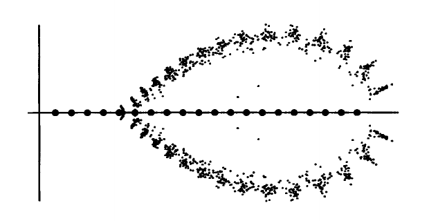

图 12.1：Wilkinson 多项式的经典病态性例子。大黑点是未扰动多项式 (12.8) 的根；小点是 100 个随机扰动多项式在复平面中的根叠加图。扰动系数为 $\widetilde a_k=a_k(1+10^{-10}r_k)$，其中 $r_k$ 来自均值为 0、方差为 1 的正态分布。

#### 例 12.6

计算非对称矩阵的特征值也常常是病态的。比较下面两个矩阵：

$$
\begin{bmatrix}1&1000\\0&1\end{bmatrix},
\qquad
\begin{bmatrix}1&1000\\0.001&1\end{bmatrix}.
$$

它们的特征值分别是 $\{1,1\}$ 和 $\{0,2\}$。另一方面，如果矩阵 $A$ 是对称的（更一般地，如果 $A$ 是正规矩阵），那么它的特征值是良态的。可以证明：若 $\lambda$ 与 $\lambda+\delta\lambda$ 分别是 $A$ 与 $A+\delta A$ 的对应特征值，则

$$
|\delta\lambda|\le\|\delta A\|_2,
$$

当 $\delta A$ 是单位矩阵的倍数时取等号（见习题 26.3）。因此，用 2-范数衡量扰动时，对称特征值问题的绝对条件数是 $\widehat\kappa=1$，相对条件数为

$$
\kappa=\frac{\|A\|_2}{|\lambda|}.
$$

### 矩阵—向量乘法的条件

现在讨论数值线性代数中一个极其重要的条件数。固定 $A\in\mathbb C^{m\times n}$，考虑从输入 $x$ 计算 $Ax$ 的问题；也就是说，只扰动 $x$ 而不扰动 $A$，并求相应的条件数。设 $\|\cdot\|$ 是任意向量范数，矩阵范数取相应的诱导范数。直接从 $\kappa$ 的定义出发，可得

$$
\begin{aligned}
\kappa
&=\sup_{\delta x}
\left(
\frac{\|A(x+\delta x)-Ax\|}{\|Ax\|}
\bigg/
\frac{\|\delta x\|}{\|x\|}
\right)\\
&=\sup_{\delta x}
\frac{\|A\delta x\|}{\|\delta x\|}
\bigg/
\frac{\|Ax\|}{\|x\|}.
\end{aligned}
$$

因此

$$
\kappa=\|A\|\frac{\|x\|}{\|Ax\|}.
\tag{12.9}
$$

这是式 (12.6) 的一个特殊情形，也是一个同时依赖于 $A$ 和 $x$ 的精确公式。

假设 $A$ 恰好是方阵且非奇异。由于

$$
\frac{\|x\|}{\|Ax\|}\le\|A^{-1}\|,
$$

式 (12.9) 可放宽为与 $x$ 无关的界：

$$
\kappa\le\|A\|\|A^{-1}\|.
\tag{12.10}
$$

也可以写成

$$
\kappa=\alpha\|A\|\|A^{-1}\|,
\tag{12.11}
$$

其中

$$
\alpha=\frac{\|x\|/\|Ax\|}{\|A^{-1}\|}.
\tag{12.12}
$$

对某些 $x$，有 $\alpha=1$，从而 $\kappa=\|A\|\|A^{-1}\|$。如果使用 2-范数，当 $x$ 是 $A$ 的最小右奇异向量的倍数时就会发生这种情况。

事实上，$A$ 不必是方阵。如果 $A\in\mathbb C^{m\times n}$、$m\ge n$ 且满列秩，那么式 (12.10)–(12.12) 仍成立，只需把 $A^{-1}$ 换成第 11 讲定义的伪逆 $A^+$。

那么逆问题如何处理：给定 $A$，从输入 $b$ 计算 $A^{-1}b$？从数学上说，这与刚才的问题完全相同，只是把其中的 $A$ 换成了 $A^{-1}$。于是可以得到下面的定理。

### 定理 12.1

设 $A\in\mathbb C^{m\times m}$ 非奇异，并考虑方程 $Ax=b$。相对于 $x$ 的扰动，从 $x$ 计算 $b$ 的问题的条件数为

$$
\kappa=\|A\|\frac{\|x\|}{\|b\|}
\le\|A\|\|A^{-1}\|.
\tag{12.13}
$$

相对于 $b$ 的扰动，从 $b$ 计算 $x$ 的问题的条件数为

$$
\kappa=\|A^{-1}\|\frac{\|b\|}{\|x\|}
\le\|A\|\|A^{-1}\|.
\tag{12.14}
$$

如果 $\|\cdot\|=\|\cdot\|_2$，那么在式 (12.13) 中，当 $x$ 是对应于最小奇异值 $\sigma_m$ 的右奇异向量的倍数时取等号；在式 (12.14) 中，当 $b$ 是对应于最大奇异值 $\sigma_1$ 的左奇异向量的倍数时取等号。

### 矩阵的条件数

乘积

$$
\|A\|\|A^{-1}\|
$$

出现得如此频繁，以至于它有了自己的名字：矩阵 $A$（相对于范数 $\|\cdot\|$）的条件数，记为

$$
\kappa(A)=\|A\|\|A^{-1}\|.
\tag{12.15}
$$

此时，“条件数”一词指的是矩阵，而不是某个具体问题。如果 $\kappa(A)$ 小，称 $A$ 良态；如果 $\kappa(A)$ 大，称 $A$ 病态。如果 $A$ 奇异，通常约定 $\kappa(A)=\infty$。

注意，如果 $\|\cdot\|=\|\cdot\|_2$，则

$$
\|A\|_2=\sigma_1,\qquad \|A^{-1}\|_2=\frac1{\sigma_m}.
$$

因此在 2-范数下

$$
\kappa(A)=\frac{\sigma_1}{\sigma_m}.
\tag{12.16}
$$

这正是计算矩阵 2-范数条件数时通常使用的公式。对于 $A$ 的单位球，线性映像是一个超椭球，$\sigma_1/\sigma_m$ 可以理解为它的偏心程度（图 4.1）。

对于满列秩的长方形矩阵 $A\in\mathbb C^{m\times n}$、$m\ge n$，条件数用伪逆定义：

$$
\kappa(A)=\|A\|\|A^+\|.
$$

由于伪逆的定义源于最小二乘问题，这个定义在 $\|\cdot\|=\|\cdot\|_2$ 时最有用，此时

$$
\kappa(A)=\frac{\sigma_1}{\sigma_n}.
\tag{12.17}
$$

### 方程组的条件

在定理 12.1 中，我们固定 $A$，扰动 $x$ 或 $b$。如果扰动 $A$，情况会怎样？具体地，固定 $b$，考虑问题

$$
A\mapsto x=A^{-1}b
$$

在 $A$ 受到无穷小扰动 $\delta A$ 时的行为。此时 $x$ 必须发生无穷小变化 $\delta x$，并满足

$$
(A+\delta A)(x+\delta x)=b.
$$

利用 $Ax=b$，并舍去二阶无穷小项 $(\delta A)(\delta x)$，得到

$$
(\delta A)x+A(\delta x)=0,
\qquad
\delta x=-A^{-1}(\delta A)x.
$$

因此

$$
\|\delta x\|\le\|A^{-1}\|\|\delta A\|\|x\|,
$$

或者等价地，

$$
\frac{\|\delta x\|/\|x\|}{\|\delta A\|/\|A\|}
\le\|A^{-1}\|\|A\|=\kappa(A).
$$

当 $\delta A$ 满足

$$
\|A^{-1}(\delta A)x\|
=\|A^{-1}\|\|\delta A\|\|x\|
$$

时，这个界取等号。利用对偶范数（习题 3.6）可以证明，对任意 $A,b$ 和范数 $\|\cdot\|$，都存在这样的扰动 $\delta A$。于是得到下面的结果。

### 定理 12.2

设 $b$ 固定，考虑计算 $x=A^{-1}b$ 的问题，其中 $A$ 是方阵且非奇异。相对于 $A$ 的扰动，该问题的条件数为

$$
\kappa=\|A\|\|A^{-1}\|=\kappa(A).
\tag{12.18}
$$

定理 12.1 和定理 12.2 对数值线性代数极其重要，因为它们决定了解线性方程组时可能达到的准确度。如果一个方程组 $Ax=b$ 包含病态矩阵 $A$，除非有非常特殊的情况，否则计算解时总应预期“损失 $\log_{10}\kappa(A)$ 位数字”。后面还会回到这一现象；第 18 讲将讨论最小二乘问题的类似结果。

### 习题

**12.1**　设 $A$ 是一个 $202\times202$ 矩阵，满足 $\|A\|_2=100$ 且 $\|A\|_F=101$。给出矩阵 2-范数条件数 $\kappa(A)$ 的最精确可能下界。

**12.2**　第 11 讲例 11.1 提到，等距点上的多项式插值是病态的。为了说明这一现象，设 $x_1,\ldots,x_n$ 和 $y_1,\ldots,y_m$ 分别是从 $-1$ 到 1 的 $n$ 个、$m$ 个等距点。

(a) 推导一个 $m\times n$ 矩阵 $A$ 的公式，使它把在 $\{x_i\}$ 上给定的 $n$ 维数据向量映射为采样值 $\{p(y_j)\}$ 组成的 $m$ 维向量，其中 $p$ 是这些数据的 $n-1$ 次多项式插值（见例 1.1）。

(b) 编写程序，在 $n=1,2,\ldots,30$、$m=2n-1$ 时计算 $A$，并在半对数坐标下绘制 $\|A\|_\infty$。当 $m\to\infty$ 时，$\|A\|_\infty$ 的连续极限称为等距插值的 Lebesgue 常数；当 $n\to\infty$ 时，它渐近于

$$
\frac{2^n}{e(n-1)\log n}.
$$

(c) 对 $n=1,2,\ldots,30$、$m=2n-1$，插值常数函数 1 的问题的 $\infty$-范数条件数 $\kappa$ 是多少？使用式 (12.6)。

(d) 当 $n=11$ 时，你的结果与图 11.1 所隐含的界有多接近？

**12.3**　本题的目标是探索随机矩阵的一些性质。你的任务是像实验室科学家一样进行实验，从实验中提出猜想，再设计更细致的实验。不要尝试证明任何结论，但要制作精心设计的图；一幅好图胜过千言万语。

定义随机矩阵为 $m\times m$ 矩阵，其元素是独立同分布的实正态随机变量，均值为 0、标准差为 $m^{-1/2}$。在 MATLAB 中可写为

$$
A=\operatorname{randn}(m,m)/\sqrt m.
$$

引入因子 $\sqrt m$ 是为了使 $m\to\infty$ 时的极限行为更整洁。

(a) 随机矩阵的特征值看起来是什么样？如果取 100 个随机矩阵，把它们的全部特征值叠加在一张图上，会发生什么？当 $m=8,16,32,64,\ldots$ 时进行这项实验，会暗示什么模式？当 $m\to\infty$ 时，谱半径 $\rho(A)$ 如何变化（见习题 3.2）？

(b) 范数会怎样？当 $m\to\infty$ 时，随机矩阵的 2-范数如何变化？当然必须有 $\rho(A)\le\|A\|$（习题 3.2）。当 $m\to\infty$ 时，这个不等式看起来是否趋于等式？

(c) 条件数，或者更简单地说，最小奇异值 $\sigma_{\min}$ 如何变化？即使固定 $m$，这个问题也很有趣。在 $\mathbb R^{m\times m}$ 的随机矩阵中，似乎有多大比例满足 $\sigma_{\min}\le2^{-1},4^{-1},8^{-1},\ldots$？换言之，最小奇异值概率分布的尾部是什么样？当 $m$ 变化时，这一切的尺度如何变化？

(d) 如果考虑随机三角矩阵而不是完整矩阵，即元素来自同一分布的上三角矩阵，(a)–(c) 的答案如何变化？


---

<a id="lecture-13"></a>

## 第 13 讲　浮点运算

> 原书页 97–101；目标 PDF 页 112–116。公式编号沿用原书。本讲源页没有插图。

计算机发明后不久，人们就对数字设备表示实数的正确方式形成了共识。秘密就在于浮点运算：它是科学记数法在硬件中的对应物。在开始研究数值线性代数算法的准确性之前，必须先考察这一主题。

### 数字表示的局限

由于数字计算机使用有限个比特表示实数，它们只能表示实数（或者复数；本讲末尾会讨论复数）的一个有限子集。这一局限带来两个困难。第一，被表示的数不可能任意大或任意小。第二，相邻表示数之间必然存在间隔。

现代计算机能够表示足够大和足够小的数，因此第一个限制很少造成困难。例如，广泛使用的 IEEE 双精度运算允许表示最大约为 $1.79\times10^{308}$、最小约为 $2.23\times10^{-308}$ 的数；对本书讨论的大多数问题而言，这个范围已经足够大。换言之，溢出和下溢通常不是严重风险（但如果有人要求你计算行列式，就要特别小心）。

相反，表示数之间的间隔在科学计算中始终值得关注。例如，在 IEEE 双精度运算中，区间 $[1,2]$ 表示为离散子集

$$
1,\quad 1+2^{-52},\quad 1+2\cdot2^{-52},\quad
1+3\cdot2^{-52},\quad\ldots,\quad 2.
\tag{13.1}
$$

区间 $[2,4]$ 则由同一组数乘以 2 得到：

$$
2,\quad 2+2^{-51},\quad 2+2\cdot2^{-51},\quad
2+3\cdot2^{-51},\quad\ldots,\quad 4.
$$

一般地，区间 $[2^j,2^{j+1}]$ 由式 (13.1) 中的数乘以 $2^j$ 得到。因此，在 IEEE 双精度运算中，相邻表示数之间的间隔从相对意义上看从不会大于

$$
2^{-52}\approx2.22\times10^{-16}.
$$

如果使用稳定算法，这个量对大多数目的而言确实小得可以忽略（见下一讲）。但令人意外的是，有多少粗心设计的算法最终会表现出不稳定性！

### 浮点数

IEEE 运算是以浮点表示实数的一种运算系统。如今，通用计算机普遍采用这种做法。在浮点数系统中，小数点（或二进制点）的位置与数字本身分开存储；相邻表示数之间的间隔会随数的大小成比例变化。这与定点表示不同，后者的间隔始终相同。

具体地，考虑如下理想化的浮点数系统。令 $\mathbb F$ 是实数 $\mathbb R$ 的一个离散子集，它由整数 $\beta\ge2$ 和整数 $t\ge1$ 决定；$\beta$ 称为基数或底（通常取 2），$t$ 称为精度（IEEE 单精度和双精度分别对应 24 和 53）。$\mathbb F$ 中包含数字 0，以及所有形如

$$
x=\pm\left(\frac{m}{\beta^t}\right)\beta^e
\tag{13.2}
$$

的数，其中 $m$ 是满足 $1\le m\le\beta^t$ 的整数，$e$ 是任意整数。

等价地，也可以限制

$$
\beta^{t-1}\le m\le\beta^t-1,
$$

这样 $m$ 的选择就是唯一的。此时 $\pm(m/\beta^t)$ 称为 $x$ 的小数部分或尾数，$e$ 称为指数。

上述浮点数系统是理想化的，因为它忽略了上溢和下溢。因此，$\mathbb F$ 是一个可数无穷集，并且具有自相似性：

$$
\mathbb F=\beta\mathbb F.
$$

### 机器 epsilon

$\mathbb F$ 的分辨率通常用一个称为机器 epsilon（machine epsilon）的数来概括。暂时定义

$$
\varepsilon_{\mathrm{machine}}=\frac12\beta^{1-t}.
\tag{13.3}
$$

（在式 (13.7) 之后我们会修改这个定义。）这个数是 1 与下一个更大的浮点数之间距离的一半。从相对意义上看，浮点数之间的间隔最大也就是这个量。也就是说，$\varepsilon_{\mathrm{machine}}$ 具有如下性质：

$$
\text{对所有 }x\in\mathbb R,\ \text{存在 }x'\in\mathbb F,\quad
|x-x'|\le\varepsilon_{\mathrm{machine}}|x|.
\tag{13.4}
$$

对于各种计算机上常见的 $\beta$ 和 $t$，$\varepsilon_{\mathrm{machine}}$ 通常位于 $10^{-6}$ 与 $10^{-35}$ 之间。在 IEEE 单精度和双精度运算中，分别规定

$$
\varepsilon_{\mathrm{machine}}=2^{-24}\approx5.96\times10^{-8},
\qquad
\varepsilon_{\mathrm{machine}}=2^{-53}\approx1.11\times10^{-16}.
$$

令 $\operatorname{fl}:\mathbb R\to\mathbb F$ 表示把实数取为浮点系统中最近浮点数的函数，即舍入后的等价值（平局情形可以任意处理；如何处理平局以避免统计偏差，本身也是一个有趣的问题）。式 (13.4) 可以用 $\operatorname{fl}$ 表述为：

$$
\text{对所有 }x\in\mathbb R,\ \text{存在 }\delta,\ |\delta|\le\varepsilon_{\mathrm{machine}},
\quad \operatorname{fl}(x)=x(1+\delta).
\tag{13.5}
$$

也就是说，实数与其最近浮点近似之间的差，从相对意义上看总小于 $\varepsilon_{\mathrm{machine}}$。

### 浮点运算

当然，仅仅表示实数是不够的；还必须对它们进行计算。在计算机上，所有数学计算都归结为若干基本算术运算，经典的运算集合是 $+$、$-$、$\times$ 和 $\div$。从数学上说，这些符号表示 $\mathbb R$ 上的运算。在计算机上，它们有作用于 $\mathbb F$ 的对应运算。通常把这些浮点运算记为 $\oplus$、$\ominus$、$\otimes$ 和 $\oslash$。

计算机可以按照下面的设计原则构造。令 $x,y\in\mathbb F$ 为任意浮点数。令 $*$ 为 $+$、$-$、$\times$ 或 $\div$ 中的一个运算，并令 $\circledast$ 为它对应的浮点运算。那么要求

$$
x\circledast y=\operatorname{fl}(x*y).
\tag{13.6}
$$

如果这一性质成立，那么由式 (13.5) 和 (13.6) 可以得到一个简单而有力的性质。

> **浮点运算基本公理**
>
> 对所有 $x,y\in\mathbb F$，存在 $\delta$ 满足 $|\delta|\le\varepsilon_{\mathrm{machine}}$，使得
>
> $$
> x\circledast y=(x*y)(1+\delta).
> \tag{13.7}
> $$

换言之，每一次浮点运算都精确到一个至多为 $\varepsilon_{\mathrm{machine}}$ 的相对误差。

### 再次讨论机器 epsilon

本书的舍入误差分析建立在式 (13.5) 和 (13.7) 上，而不是建立在前面描述的浮点运算其他细节上。这意味着，我们可以宽容地考虑一些并不完全按照式 (13.6) 完美执行浮点计算的硬件实现。对于这样的机器，只要把 $\varepsilon_{\mathrm{machine}}$ 换成一个稍大的值，式 (13.5) 和 (13.7) 仍可能成立。例如，在中间量采用截断而不是舍入的计算机上，式 (13.7) 可能需要把 $\varepsilon_{\mathrm{machine}}$ 换成 $2\varepsilon_{\mathrm{machine}}$。

处理这类复杂情况的最简单方式，是保留式 (13.5) 和 (13.7) 的形式，但修改 $\varepsilon_{\mathrm{machine}}$ 的定义。从现在开始，假设 $\varepsilon_{\mathrm{machine}}$ 定义为使式 (13.5) 和 (13.7) 成立的最小数。对于包括所有采用 IEEE 运算的计算机在内的大多数计算机，这一修改不会显著改变其数值。

有时，为使式 (13.7) 成立，可能需要一个出乎意料地大的 $\varepsilon_{\mathrm{machine}}$。1994 年底，Intel Pentium™ 微处理器曾因 IEEE 双精度标准实现中的查表错误而声名狼藉；其有效精度粗糙了 11 个数量级，$\varepsilon_{\mathrm{machine}}\approx6.1\times10^{-5}$（这个错误很快得到纠正）。事实上，有些机器上式 (13.7) 只有在 $\varepsilon_{\mathrm{machine}}=1$ 时才成立。例如，直到 20 世纪 90 年代中期，Cray 计算机上的浮点减法都具有这一性质，因为减法实现时没有“保护数字”（guard digit）。这些计算机并非毫无用处，但它们要求采用不同于本书的误差分析方式。

幸运的是，式 (13.7) 公理的优点，以及采用统一计算机算术标准的好处，近年来已经被计算机制造商广泛接受。市场上不满足“小 $\varepsilon_{\mathrm{machine}}$”版本式 (13.7) 的机器正在减少。事实上，IEEE 运算本身正在迅速成为各种规模计算机的标准；截至 1996 年，它已经用于所有 IBM 兼容个人计算机，以及 SUN、DEC、Hewlett–Packard 和 IBM 制造的所有工作站。

### 复数浮点运算

浮点复数通常表示为一对浮点实数，作用于它们的基本运算则归结为对实部和虚部进行运算。结果是，式 (13.7) 对复浮点数同样成立，但乘法和除法例外：对于 $\otimes$ 和 $\oslash$，必须把式 (13.3) 中的 $\varepsilon_{\mathrm{machine}}$ 分别放大到原来量级的

$$
2^{3/2}\qquad\text{和}\qquad 2^{5/2}.
$$

一旦按这种方式调整 $\varepsilon_{\mathrm{machine}}$，复数的舍入误差分析就可以像实数一样进行。

### 习题

**13.1**　在一对相邻的非零 IEEE 单精度实数之间，有多少个 IEEE 双精度数？

**13.2**　式 (13.2) 定义的浮点数系统 $\mathbb F$ 包含许多整数，但并不包含全部整数。

(a) 给出不属于 $\mathbb F$ 的最小正整数 $n$ 的精确公式。

(b) 对 IEEE 单精度和双精度运算，$n$ 的值分别是多少？

(c) 设法在自己的计算机上验证这一结果。具体地，设计并运行一个程序，给出证据说明 $n-3$、$n-2$ 和 $n-1$ 属于 $\mathbb F$，而 $n$ 不属于 $\mathbb F$。$n+1$、$n+2$ 和 $n+3$ 呢？

**13.3**　考虑多项式

$$
\begin{aligned}
p(x)&=(x-2)^9\\
&=x^9-18x^8+144x^7-672x^6+2016x^5\\
&\quad-4032x^4+5376x^3-4608x^2+2304x-512.
\end{aligned}
$$

(a) 对 $x=-1.920,-1.919,-1.918,\ldots,2.080$ 作图；通过系数 $1,-18,144,\ldots$ 计算 $p(x)$。

(b) 再作一次同样的图，但这次使用表达式 $(x-2)^9$ 计算 $p(x)$。

**13.4**　多项式

$$
p(x)=x^5-2x^4-3x^3+3x^2-2x-1
$$

有三个实零点。对 $p$ 使用初值 $x_0=0$ 的 Newton 方法，会产生快速收敛到某个零点 $x_*\approx-0.315$ 的估计序列 $x_1,x_2,x_3,\ldots$。

(a) 在 $\varepsilon_{\mathrm{machine}}\approx10^{-16}$ 的浮点运算中计算 $x_1,\ldots,x_6$。估计这些数中每一个有多少位数字正确？

(b) 借助 MAPLE 或 MATHEMATICA 等符号代数系统，再次精确计算 $x_1,\ldots,x_6$。每个 $x_j$ 都是有理数。对于每个 $j$，分子和分母各有多少位数字？
---

<a id="lecture-14"></a>

## 第 14 讲　稳定性

> 原书页 102–107；目标 PDF 页 117–122。公式编号沿用原书。本讲源页没有插图。

如果数值算法能够为数值问题提供精确解，那当然是很理想的事情。然而，问题是连续的，而数字计算机是离散的，因此这通常不可能实现。稳定性是刻画“能够做到什么”的标准方式，也是数值分析家理解“得到正确答案”的方式，即使这个答案并不精确。

### 算法

在第 12 讲中，我们把数学问题定义为从数据向量空间 $X$ 到解向量空间 $Y$ 的函数

$$
f:X\to Y.
$$

算法可以看作同两个空间之间的另一个映射 $\widetilde f:X\to Y$。下面给出这一说法的精确定义。固定一个问题 $f$、一个浮点系统满足式 (13.7)（但不一定满足式 (13.6)）的计算机、一个求解 $f$ 的算法（这里以宽泛意义使用“算法”一词），以及该算法在计算机程序中的实现。

给定数据 $x\in X$，先按照满足式 (13.5) 的方式把数据舍入为浮点数，再将其输入计算机程序。运行程序后，得到一组属于向量空间 $Y$ 的浮点数（因为算法的设计目标就是求解 $f$）。把这个计算结果记为 $\widetilde f(x)$。

这个情形可能非常复杂！至少，$\widetilde f(x)$ 会受到舍入误差的影响。根据具体情况，它还可能受到收敛容差，甚至计算机上同时运行的其他任务等各种因素的影响；例如，当计算分配给处理器的方式直到运行时才确定时，就会出现这种情况。因此，所谓的“函数” $\widetilde f(x)$ 甚至可能在两次运行之间取不同的值；它可能是多值的。（事实上，问题 $f$ 本身也应允许是多值的，这样就能处理允许非唯一解的情形，例如复数的两个平方根都可以接受。）然而，尽管有这些复杂性，我们仍将看到：只依靠式 (13.5) 和 (13.7) 这两个基本公理，就可以对 $\widetilde f(x)$，进而对数值线性代数算法的准确性，作出出人意料地简洁的陈述。

波浪号 $\widetilde{\ }$ 记号非常方便。正如 $\widetilde f$ 是 $f$ 的计算机计算对应物一样，本书中其他计算得到的量也经常用波浪号标记。例如，方程组 $Ax=b$ 的计算解可以记为 $\widetilde x$。

### 准确性

除非是平凡情形，$\widetilde f$ 不可能连续。不过，一个好的算法应当逼近相应的数学问题 $f$。为了定量描述这一点，可以考虑计算的绝对误差

$$
\|\widetilde f(x)-f(x)\|,
$$

或者相对误差

$$
\frac{\|\widetilde f(x)-f(x)\|}{\|f(x)\|}.
\tag{14.1}
$$

本书主要使用相对量，因此式 (14.1) 将作为标准误差度量。

如果 $\widetilde f$ 是一个好的算法，自然会希望相对误差很小，量级为 $\varepsilon_{\mathrm{machine}}$。对于每个 $x\in X$，如果算法 $\widetilde f$ 满足

$$
\frac{\|\widetilde f(x)-f(x)\|}{\|f(x)\|}
=O(\varepsilon_{\mathrm{machine}}),
\tag{14.2}
$$

就称它对问题 $f$ 是准确的。

粗略地说，式 (14.2) 中的 $O(\varepsilon_{\mathrm{machine}})$ 表示“机器 epsilon 的量级”。不过，$O(\varepsilon_{\mathrm{machine}})$ 也有精确定义，我们马上讨论这一点；这也会说明当分母为零时，类似式 (14.2) 的公式应如何理解。

### 稳定性

如果问题 $f$ 是病态的，那么式 (14.2) 所定义的准确性目标就过于苛刻了。在数字计算机上，输入数据的舍入不可避免；即使后续所有计算都能完美进行，这一扰动本身也可能导致结果发生显著变化。因此，一般情况下最适合追求的不是处处准确，而是稳定性。

如果对每个 $x\in X$，都存在某个 $\widetilde x$，使得下面两式同时成立：

$$
\frac{\|\widetilde f(x)-f(\widetilde x)\|}
     {\|f(\widetilde x)\|}
=O(\varepsilon_{\mathrm{machine}}),
\tag{14.3}
$$

$$
\frac{\|\widetilde x-x\|}{\|x\|}
=O(\varepsilon_{\mathrm{machine}}),
\tag{14.4}
$$

那么称算法 $\widetilde f$ 对问题 $f$ 是稳定的。

用一句话说：

> 稳定算法对一个几乎正确的问题给出几乎正确的答案。

这一讲定义的动机将在下一讲以及本书后面的应用中逐渐清楚。需要提醒读者的是：这里给出的稳定性定义在数值线性代数的许多部分都很有用，但条件 $O(\varepsilon_{\mathrm{machine}})$ 对微分方程等其他领域的全部数值问题而言可能过于严格。

### 后向稳定性

许多数值线性代数算法满足一个比稳定性更强、也更简单的条件。如果对每个 $x\in X$，都有

$$
\widetilde f(x)=f(\widetilde x)
\quad\text{对某个 }\widetilde x\text{ 满足}\quad
\frac{\|\widetilde x-x\|}{\|x\|}
=O(\varepsilon_{\mathrm{machine}}),
\tag{14.5}
$$

则称算法 $\widetilde f$ 对问题 $f$ 是后向稳定的。

这是对稳定性定义的加强：式 (14.3) 中的 $O(\varepsilon_{\mathrm{machine}})$ 被替换成了零。换句话说：

> 后向稳定算法对一个几乎正确的问题给出完全正确的答案。

例子将在下一讲给出。

### $O(\varepsilon_{\mathrm{machine}})$ 的含义

现在解释式 (14.2)–(14.5) 中“$O(\varepsilon_{\mathrm{machine}})$”的精确含义。记号

$$
\varphi(t)=O(\psi(t))
\tag{14.6}
$$

是数学中的标准记号，并且有精确定义。它断言存在某个正数 $C$，使得当 $t$ 足够接近某个默认的极限（例如 $t\to0$ 或 $t\to\infty$）时，

$$
|\varphi(t)|\le C\psi(t).
\tag{14.7}
$$

例如，陈述 $\sin^2t=O(t^2)$（当 $t\to0$）意味着存在常数 $C$，使得对所有充分小的 $t$，都有 $|\sin^2t|\le Ct^2$。

数学中还有形如

$$
\varphi(s,t)=O(\psi(t))\quad\text{关于 }s\text{ 一致成立}
\tag{14.8}
$$

的陈述，其中 $\varphi$ 不仅依赖于 $t$，还依赖于另一个变量 $s$。“一致”表示式 (14.7) 中的同一个常数 $C$ 对 $s$ 的所有取值都成立。例如，

$$
(\sin^2t)(\sin^2s)=O(t^2)
$$

在 $t\to0$ 时关于 $s$ 一致成立；但如果把正弦换成 $s^2$，这种一致性就会丢失。

本书对符号 $O$ 的使用遵循这些标准定义。具体地，我们经常陈述如下形式的结果：

$$
\|\text{计算得到的量}\|=O(\varepsilon_{\mathrm{machine}}).
\tag{14.9}
$$

式 (14.9) 的含义如下。首先，“计算得到的量”表示由问题 $f$ 的算法 $\widetilde f$ 所确定的某个数或数的集合的范数，它同时依赖于问题 $f$ 的数据 $x\in X$ 和 $\varepsilon_{\mathrm{machine}}$。相对误差 (14.1) 就是一个例子。其次，隐含的极限过程是 $\varepsilon_{\mathrm{machine}}\to0$（即 $\varepsilon_{\mathrm{machine}}$ 是式 (14.8) 中对应于 $t$ 的变量）。第三，符号 $O$ 对所有数据 $x\in X$ 一致成立（即 $x$ 是对应于 $s$ 的变量）。我们很少专门说明关于 $x\in X$ 的一致性，但它总是隐含的。

在任何一台具体的机器上，$\varepsilon_{\mathrm{machine}}$ 都是固定量。谈论极限 $\varepsilon_{\mathrm{machine}}\to0$ 时，我们是在考虑计算机，或者更准确地说，计算机族的理想化。式 (14.9) 的意思是：如果把有关算法放到一系列满足式 (13.5) 和 (13.7)、且 $\varepsilon_{\mathrm{machine}}$ 逐渐减小到零的计算机上运行，那么 $\|\text{计算得到的量}\|$ 就保证按 $\varepsilon_{\mathrm{machine}}$ 的比例或更快地减小。这些理想计算机只要求满足式 (13.5) 和 (13.7)，没有其他要求。

### 依赖于 $m,n$，而不是 $A,b$

我们还可以进一步说明式 (14.2)–(14.5) 中 $O(\varepsilon_{\mathrm{machine}})$ 的含义。隐含常数的一致性可以通过下面的例子说明。假设我们正在研究一个算法，它对非奇异 $m\times m$ 方程组 $Ax=b$ 求解 $x$，并且断言该算法的计算结果 $\widetilde x$ 满足

$$
\frac{\|\widetilde x-x\|}{\|x\|}
=O\bigl(\kappa(A)\varepsilon_{\mathrm{machine}}\bigr).
\tag{14.10}
$$

这一断言意味着：存在一个与矩阵 $A$ 和右端 $b$ 都无关的单一常数 $C$，使得对所有充分小的 $\varepsilon_{\mathrm{machine}}$，

$$
\frac{\|\widetilde x-x\|}{\|x\|}
\le C\kappa(A)\varepsilon_{\mathrm{machine}}.
\tag{14.11}
$$

如果类似式 (14.11) 的公式中分母为零，则采用如下约定。我们真正想表达的是

$$
\|\widetilde x-x\|
\le C\kappa(A)\varepsilon_{\mathrm{machine}}\|x\|.
\tag{14.12}
$$

当 $\|x\|\ne0$ 时，两种写法没有区别；但当 $\|x\|=0$ 时，式 (14.12) 清楚地表明，式 (14.10) 的精确含义是：对所有充分小的 $\varepsilon_{\mathrm{machine}}$，都有 $\|\widetilde x-x\|=0$。

虽然式 (14.11) 或 (14.12) 中的常数 $C$ 不依赖于 $A$ 或 $b$，但一般会依赖于维数 $m$。从形式上说，这是第 12 讲问题定义的结果。如果定义问题 $f$ 的维数（例如 $m$ 或 $n$）发生变化，那么向量空间 $X$ 和 $Y$ 也必须变化，于是我们实际上得到了一个新问题 $f'$。

从实际角度看，数值线性代数算法中的舍入误差影响通常也会随 $m$ 和 $n$ 增长。不过，这种增长通常足够慢，不会造成严重问题。在最坏情况下，对 $m$ 或 $n$ 的依赖通常是线性、二次或三次的（指数取决于所选范数以及所选算法）；而由于统计抵消，大多数数据的误差远小于最坏情况。

原则上，类似式 (14.9) 的陈述可能隐藏一个 $2^m$ 这样的维数相关因子，使界在实践中毫无用处。然而，本书中只有一个地方会出现这种情况，即带部分选主元的高斯消去法；届时我们会充分提醒读者，避免误解。一般而言，当本书印出 $O(\varepsilon_{\mathrm{machine}})$ 时，在真实机器上进行真实计算时，相关量通常至多是 $\varepsilon_{\mathrm{machine}}$ 的 100 倍，或者也许 1000 倍。

### 与范数的独立性

涉及 $O(\varepsilon_{\mathrm{machine}})$ 的定义有一个方便的性质：只要 $X$ 和 $Y$ 是有限维空间，这些定义就与范数的选择无关。

### 定理 14.1

对于定义在有限维空间 $X$ 和 $Y$ 上的问题 $f$ 及算法 $\widetilde f$，准确性、稳定性和后向稳定性这三个性质是否成立，都独立于 $X$ 和 $Y$ 中范数的选择。

**证明。** 众所周知（也很容易证明），在有限维向量空间中，所有范数都是等价的。也就是说，如果 $\|\cdot\|$ 和 $\|\cdot\|'$ 是同一空间上的两个范数，那么存在正数 $C_1,C_2$，使得对该空间中的所有 $x$，

$$
C_1\|x\|\le\|x\|'\le C_2\|x\|.
$$

因此，改变范数可能改变 $O(\varepsilon_{\mathrm{machine}})$ 陈述中隐含常数 $C$ 的大小，但不会改变这样一个常数是否存在。

### 习题

**14.1**　判断正误。

(a) $\sin x=O(1)$，当 $x\to\infty$。

(b) $\sin x=O(1)$，当 $x\to0$。

(c) $\log x=O(x^{1/100})$，当 $x\to\infty$。

(d) $n!=O((n/e)^n)$，当 $n\to\infty$。

(e) $A=O(V^{2/3})$，当 $V\to\infty$；其中 $A$ 和 $V$ 分别是球的表面积和体积，度量单位分别为平方英里和立方微米。

(f) $\operatorname{fl}(\pi)-\pi=O(\varepsilon_{\mathrm{machine}})$。（这里没有写出极限 $\varepsilon_{\mathrm{machine}}\to0$，因为本书所有 $O(\varepsilon_{\mathrm{machine}})$ 表达式都默认这一点。）

(g) $\operatorname{fl}(n\pi)-n\pi=O(\varepsilon_{\mathrm{machine}})$，对所有整数 $n$ 一致成立。（这里的 $n\pi$ 表示精确的数学量，而不是浮点计算的结果。）

**14.2**

(a) 证明

$$
(1+O(\varepsilon_{\mathrm{machine}}))(1+O(\varepsilon_{\mathrm{machine}}))
=1+O(\varepsilon_{\mathrm{machine}}).
$$

这一陈述的精确含义是：如果函数 $f$ 满足

$$
f(\varepsilon_{\mathrm{machine}})
=(1+O(\varepsilon_{\mathrm{machine}}))(1+O(\varepsilon_{\mathrm{machine}}))
\quad\text{当 }\varepsilon_{\mathrm{machine}}\to0,
$$

那么也有

$$
f(\varepsilon_{\mathrm{machine}})
=1+O(\varepsilon_{\mathrm{machine}})
\quad\text{当 }\varepsilon_{\mathrm{machine}}\to0.
$$

(b) 证明

$$
(1+O(\varepsilon_{\mathrm{machine}}))^{-1}
=1+O(\varepsilon_{\mathrm{machine}}).
$$

---

<a id="lecture-15"></a>

## 第 15 讲　稳定性漫谈

> 原书页 108–113；目标 PDF 页 123–128。公式编号沿用原书。本讲源页没有插图。

我们继续讨论稳定性，考察稳定与不稳定算法的例子。随后将讨论一个把良态性和稳定性联系起来的基本思想：后向误差分析。自 20 世纪 50 年代以来，它的力量已经在无数应用中得到证明。

### 浮点运算的稳定性

最简单的四个计算问题是 $+$、$-$、$\times$ 和 $\div$。在算法选择方面没有太多可说的！当然，我们通常会使用计算机提供的浮点运算 $\oplus$、$\ominus$、$\otimes$ 和 $\oslash$。事实证明，公理 (13.5) 和 (13.7) 蕴含：这四个典型算法都是后向稳定的。

下面以减法为例说明，因为这是人们最容易担心不稳定的基本运算。与例 12.3 一样，数据空间 $X$ 是二维向量空间 $\mathbb C^2$，解空间 $Y$ 是标量空间 $\mathbb C$。由定理 14.1，我们无需指定这些空间上的范数。

对数据 $x=(x_1,x_2)^*\in X$，减法问题对应于函数

$$
f(x_1,x_2)=x_1-x_2,
$$

所考虑的算法可以写成

$$
\widetilde f(x_1,x_2)=\operatorname{fl}(x_1)\ominus\operatorname{fl}(x_2).
$$

这个等式表示：先把 $x_1$ 和 $x_2$ 舍入为浮点数，再应用浮点减法。由式 (13.5)，有

$$
\operatorname{fl}(x_1)=x_1(1+\epsilon_1),
\qquad
\operatorname{fl}(x_2)=x_2(1+\epsilon_2),
\qquad
|\epsilon_1|,|\epsilon_2|\le\varepsilon_{\mathrm{machine}}.
$$

由式 (13.7)，有

$$
\operatorname{fl}(x_1)\ominus\operatorname{fl}(x_2)
=\bigl(\operatorname{fl}(x_1)-\operatorname{fl}(x_2)\bigr)(1+\epsilon_3),
\qquad
|\epsilon_3|\le\varepsilon_{\mathrm{machine}}.
$$

合并这些等式得到

$$
\begin{aligned}
\operatorname{fl}(x_1)\ominus\operatorname{fl}(x_2)
&=[x_1(1+\epsilon_1)-x_2(1+\epsilon_2)](1+\epsilon_3)\\
&=x_1(1+\epsilon_1)(1+\epsilon_3)
-x_2(1+\epsilon_2)(1+\epsilon_3)\\
&=x_1(1+\epsilon_4)-x_2(1+\epsilon_5),
\end{aligned}
$$

其中

$$
|\epsilon_4|,|\epsilon_5|
\le2\varepsilon_{\mathrm{machine}}
+O(\varepsilon_{\mathrm{machine}}^2)
$$

（见习题 14.2）。换句话说，计算结果

$$
\widetilde f(x)=\operatorname{fl}(x_1)\ominus\operatorname{fl}(x_2)
$$

恰好等于 $\widetilde x_1-\widetilde x_2$，其中 $\widetilde x_1,\widetilde x_2$ 满足

$$
\frac{|\widetilde x_1-x_1|}{|x_1|}
=O(\varepsilon_{\mathrm{machine}}),
\qquad
\frac{|\widetilde x_2-x_2|}{|x_2|}
=O(\varepsilon_{\mathrm{machine}}).
$$

隐含常数取任意 $C>2$ 都足够。对 $\mathbb C^2$ 上的任意范数，这就推出式 (14.5)。

### 更多例子

#### 例 15.1：内积

给定向量 $x,y\in\mathbb C^m$，希望计算内积

$$
\alpha=x^*y.
$$

显然的算法是：使用 $\otimes$ 计算逐项乘积 $\widetilde x_i\otimes\widetilde y_i$，再使用 $\oplus$ 将它们相加，得到计算结果 $\widetilde\alpha$。可以证明，这个算法是后向稳定的；第 17 讲会隐含地完成这一证明。

#### 例 15.2：外积

另一方面，设希望对向量 $x\in\mathbb C^m$、$y\in\mathbb C^n$ 计算秩一外积

$$
A=xy^*.
$$

显然的算法是：使用 $\otimes$ 计算 $mn$ 个乘积 $\widetilde x_i\otimes\widetilde y_j$，并将它们收集为矩阵 $\widetilde A$。这个算法是稳定的，但不是后向稳定的。原因在于，矩阵 $\widetilde A$ 极不可能恰好具有秩 1，因此一般不能写成

$$
\widetilde A=(x+\delta x)(y+\delta y)^*.
$$

一般而言，对于解空间 $Y$ 的维数大于问题空间 $X$ 维数的问题，后向稳定性是罕见的。

#### 例 15.3

假设使用 $\oplus$ 计算 $x+1$，其中 $x\in\mathbb C$：

$$
\widetilde f(x)=\operatorname{fl}(x)\oplus1.
$$

这个算法稳定，但不是后向稳定的。原因是，当 $x\approx0$ 时，加法 $\oplus$ 会引入大小为 $O(\varepsilon_{\mathrm{machine}})$ 的绝对误差。相对于 $x$ 的大小，这些误差是无界的，因此不能解释为数据发生了小的相对扰动。这个例子说明，后向稳定性是一种相当特殊的性质：在某些情形下它是合理目标，在另一些情形下则不是。注意，如果问题是对数据 $x,y$ 计算 $x+y$，那么对应算法就是后向稳定的。

#### 例 15.4

对于计算 $\sin x$ 或 $\cos x$ 的计算机程序或计算器，合理的期待是什么？答案仍然是稳定性，而不是后向稳定性。对于 $\cos x$，这来自前一个例子中的事实 $\cos0\ne0$。对于 $\sin x$ 和 $\cos x$ 二者，函数在某些点导数为零这一事实也排除了后向稳定性。

例如，设计算机计算

$$
f(x)=\sin x,\qquad x=\frac{\pi}{2}-\delta,\qquad 0<\delta\ll1.
$$

假设我们足够幸运，得到的计算结果正好是正确答案在浮点系统中的舍入值：

$$
\widetilde f(x)=\operatorname{fl}(\sin x).
$$

由于

$$
f'(x)=\cos x\approx\delta,
$$

所以存在某个 $\widetilde x$ 使 $\widetilde f(x)=f(\widetilde x)$，并且

$$
\widetilde x-x
\approx\frac{\widetilde f(x)-f(x)}{\delta}
=O\left(\frac{\varepsilon_{\mathrm{machine}}}{\delta}\right).
$$

由于 $\delta$ 可以任意小，这个后向误差不可能具有 $O(\varepsilon_{\mathrm{machine}})$ 的量级。

### 一个不稳定算法

以上都是玩具例子。下面给出一个更实质的例子：使用特征多项式求矩阵的特征值。

由于 $z$ 是 $A$ 的特征值当且仅当 $p(z)=0$，其中

$$
p(z)=\det(zI-A)
$$

是特征多项式，所以 $p$ 的根就是 $A$ 的特征值（第 24 讲）。这启发出如下的特征值计算方法：

1. 求出特征多项式的系数；
2. 求这个多项式的根。

这个算法不仅后向不稳定，而且是不稳定的，因此不应使用。即使求特征值本身是良态问题，它也可能产生远大于 $\varepsilon_{\mathrm{machine}}$ 的相对误差。

不稳定性出现在第二步的求根过程中。正如例 12.5 所见，给定多项式系数后求根通常是病态问题。因此，特征多项式系数中的小误差在求根时往往会被放大，即使求根过程本身可以做到完全精确。

例如，设 $A=I$ 是 $2\times2$ 单位矩阵。$A$ 的特征值对矩阵元素的扰动不敏感，稳定算法应当能够以 $O(\varepsilon_{\mathrm{machine}})$ 的误差计算它们。然而，上述算法产生的误差量级是 $\sqrt{\varepsilon_{\mathrm{machine}}}$。原因是特征多项式

$$
p(x)=x^2-2x+1,
$$

正如例 12.5 所示，其系数计算预计会产生 $O(\varepsilon_{\mathrm{machine}})$ 量级的误差，而这些误差会使根发生 $\sqrt{\varepsilon_{\mathrm{machine}}}$ 量级的变化。例如，如果 $\varepsilon_{\mathrm{machine}}=10^{-16}$，计算得到的特征多项式的根可能偏离真实特征值约 $10^{-8}$，也就是损失 8 位准确数字。

在亲自尝试这个计算之前，还需要更诚实地说明一点。如果直接用上述算法计算 $2\times2$ 单位矩阵的特征值，你很可能发现完全没有误差，因为 $x^2-2x+1$ 的系数和根都是计算机能够精确表示的小整数。但是，如果对一个略有扰动的矩阵进行实验，例如

$$
A=
\begin{bmatrix}
1+10^{-14}&0\\
0&1
\end{bmatrix},
$$

计算得到的特征值就会与真实特征值相差预期的 $\sqrt{\varepsilon_{\mathrm{machine}}}$ 量级。试试看！

### 后向稳定算法的准确性

设我们有一个用于问题 $f:X\to Y$ 的后向稳定算法 $\widetilde f$。它给出的结果会准确吗？答案取决于问题的条件数 $\kappa=\kappa(x)$。如果 $\kappa(x)$ 较小，结果在相对意义下会很准确；但如果 $\kappa(x)$ 很大，准确性就会按比例下降。

### 定理 15.1

设后向稳定算法用于求解问题 $f:X\to Y$，问题在数据 $x$ 处的条件数为 $\kappa=\kappa(x)$。假设计算机满足公理 (13.5) 和 (13.7)，则相对误差满足

$$
\frac{\|\widetilde f(x)-f(x)\|}{\|f(x)\|}
=O\bigl(\kappa(x)\varepsilon_{\mathrm{machine}}\bigr).
\tag{15.1}
$$

**证明。** 由后向稳定性的定义 (14.5)，存在某个 $\widetilde x\in X$，使得

$$
\widetilde f(x)=f(\widetilde x),
\qquad
\frac{\|\widetilde x-x\|}{\|x\|}
=O(\varepsilon_{\mathrm{machine}}).
$$

由 $\kappa(x)$ 的定义 (12.5)，这意味着

$$
\frac{\|\widetilde f(x)-f(x)\|}{\|f(x)\|}
\le
\bigl(\kappa(x)+o(1)\bigr)
\frac{\|\widetilde x-x\|}{\|x\|},
\tag{15.2}
$$

其中 $o(1)$ 表示当 $\varepsilon_{\mathrm{machine}}\to0$ 时趋于零的量。合并这两个界就得到式 (15.1)。

### 后向误差分析

刚才证明定理 15.1 的过程称为后向误差分析。我们通过两个步骤得到准确度估计。一步是研究问题的条件性，另一步是研究算法的稳定性。结论是：如果算法稳定，那么最终准确度就会反映问题的条件数。

从数学上说，这个过程很直接，但如果让一个没有准备的人分析数值算法，这当然不会是他首先想到的办法。第一个想法通常是前向误差分析：估计计算每一步引入的舍入误差，并设法累计这些误差在各步之间如何复合。

经验表明，对于数值线性代数中的大多数算法，前向误差分析比后向误差分析更难。事后看来，原因并不难解释。假设在计算机上使用一个久经检验的算法，例如求解 $Ax=b$。已知当 $A$ 病态时，得到的结果会始终不那么准确（见第 22 讲）。那么，前向误差分析如何捕捉这一现象呢？$A$ 的条件数是一个非常全局的性质，在求解 $Ax=b$ 时所涉及的单次浮点运算层面上几乎不可见。（下一讲会通过一个例子把这一点表现得更明显。）然而，前向分析无论如何都必须检测到这个条件数，才能最终得到正确结果。

简言之，对于大多数问题，最好的算法一般也不会做得比“对略有扰动的数据计算精确解”更好。后向误差分析正是一种与这种后向现实相适应的推理方法。

### 习题

**15.1**　下面每个问题都描述了一个在满足公理 (13.5) 和 (13.7) 的计算机上实现的算法。对每一个问题，判断算法是后向稳定、稳定但非后向稳定，还是不稳定，并证明结论，或者至少给出有说服力的理由。务必遵循正文中的定义。

(a) 数据：$x\in\mathbb C$。解：$2x$，计算为 $x\oplus x$。

(b) 数据：$x\in\mathbb C$。解：$x^2$，计算为 $x\otimes x$。

(c) 数据：$x\in\mathbb C\setminus\{0\}$。解：$1$，计算为 $x\oslash x$。（满足式 (13.6) 的机器会给出完全正确的答案，但我们的定义基于较弱的条件 (13.7)。）

(d) 数据：$x\in\mathbb C$。解：$0$，计算为 $x\ominus x$。（同样，真实机器可能比基于式 (13.7) 的定义表现得更好。）

(e) 无数据。解：$e$，从左到右使用 $\otimes$ 和 $\oplus$ 对

$$
\sum_{k=0}^{\infty}\frac1{k!}
$$

求和，直到某一项的大小小于 $\varepsilon_{\mathrm{machine}}$ 时停止。

(f) 无数据。解：$e$，使用上述同一算法，但从右到左对级数求和。

(g) 无数据。解：$\pi$，穷举搜索区间 $[3,4]$ 中最小的浮点数 $x$，使得

$$
s(x)\otimes s(x')<0.
$$

这里 $s(x)$ 是在给定区间内稳定计算 $\sin(x)$ 的算法，$x'$ 表示浮点系统中紧随 $x$ 之后的下一个浮点数。

**15.2**　考虑计算矩阵完整 SVD 的算法。该问题的数据是矩阵 $A$，解是三个矩阵 $U$（酉矩阵）、$\Sigma$（对角矩阵）和 $V$（酉矩阵），满足

$$
A=U\Sigma V^*.
$$

这里说的是显式矩阵 $U$ 和 $V$，而不是由反射器乘积给出的隐式表示。

(a) 解释这个算法后向稳定意味着什么。

(b) 事实上，由一个简单原因，这个算法不可能后向稳定。解释原因。

(c) 幸运的是，计算 SVD 的标准算法（第 31 讲）是稳定的。解释对于这类算法，稳定性意味着什么。

---

<a id="lecture-16"></a>

## 第 16 讲　Householder 三角化的稳定性

> 原书页 114–120；目标 PDF 页 129–135。公式编号沿用原书。本讲源页没有独立插图；MATLAB 实验代码和算法框均予以保留。

本讲将看到后向误差分析如何真正发挥作用。首先，通过一个 MATLAB 实验观察 Householder 三角化具有后向稳定性这一令人惊讶的现象；随后讨论如何把三角化步骤与其他后向稳定的步骤结合起来，从而得到求解 $Ax=b$ 的稳定算法。

### 实验

Householder 分解是计算 QR 分解的后向稳定算法。可以在 IEEE 双精度算术中进行如下 MATLAB 实验，其中

$$
\varepsilon_{\mathrm{machine}}\approx1.11\times10^{-16}.
$$

```matlab
R = triu(randn(50));
[Q,X] = qr(randn(50));
A = Q*R;
[Q2,R2] = qr(A);
```

这里的 `[Q,X]` 是 MATLAB 的原书写法：第二个输出在这一步并不使用。四行代码的目的，是构造一个已知 QR 分解的矩阵 $A=QR$，再把它与通过 Householder 三角化计算出的 QR 分解 $A\approx Q_2R_2$ 进行比较。实际上，由于舍入误差，计算矩阵 $A$ 的 QR 因子并不恰好是 $Q$ 和 $R$，不过对于这个实验已经足够接近。如果在更高精度算术中计算 $A=QR$，使 $A$ 恰好等于 $QR$，下面的结果也不会有显著不同。

然而，$Q_2$ 和 $R_2$ 本身却远非精确：

```text
norm(Q2-Q)                       How accurate is Q2?
    ans = 0.00889

norm(R2-R)/norm(R)               How accurate is R2?
    ans = 0.00071
```

这些误差很大！计算使用了 16 位精度，但最终结果只有两三位是准确的；单次舍入误差被放大了约 $10^{13}$ 倍。注意，计算得到的 $Q_2$ 已经足够接近 $Q$，这说明列符号的改变不可能解释这些误差。如果自己尝试实验后得到完全不同的结果，可能需要给 $Q$ 的列和 $R$ 的行乘上适当的因子 $\pm1$。

看起来我们损失了 12 位准确数字。但是，当把这些不准确的矩阵 $Q_2$ 和 $R_2$ 相乘时，奇妙的事情发生了：

```text
norm(A-Q2*R2)/norm(A)           How accurate is Q2*R2?
    ans = 1.432e-15
```

乘积 $Q_2R_2$ 达到了整整 15 位的准确度！正如 Wilkinson 所说，$Q_2$ 和 $R_2$ 中的误差一定“有魔鬼般的相关性”：在 $10^{12}$ 分之一的精度上，它们在乘积 $Q_2R_2$ 中相互抵消。

为了突出 $Q_2R_2$ 的这种特殊准确性，再构造一对同样接近 $Q,R$ 的矩阵 $Q_3,R_3$，并将它们相乘：

```matlab
Q3 = Q+1e-4*randn(50);
R3 = R+1e-4*randn(50);
norm(A-Q3*R3)/norm(A)
    ans = 0.00088
```

这一次，乘积中的误差很大。$Q_2$ 并不比 $Q_3$ 更好，$R_2$ 也不比 $R_3$ 更好，但 $Q_2R_2$ 比 $Q_3R_3$ 好 12 个数量级。在这个实验中，我们没有费心让 $R_3$ 变成上三角矩阵，也没有费心让 $Q_3$ 变成正交矩阵；即使这样做，结果也不会有太大差别。

$Q_2$ 和 $R_2$ 中的误差是前向误差。一般而言，大的前向误差可能来自病态问题，也可能来自不稳定算法（定理 15.1）。在本实验中，误差来自前者：通常，随机三角矩阵的列空间序列作为矩阵元素的函数是极其病态的。$Q_2R_2$ 中的误差是后向误差或残差。这一误差很小，说明 Householder 三角化是后向稳定的。

### 定理

事实上，对所有矩阵 $A$ 以及满足公理 (13.5)、(13.7) 的所有计算机，Householder 三角化都是后向稳定的。结果的形式为

$$
\widetilde Q\widetilde R=A+\delta A,
\tag{16.1}
$$

其中 $\delta A$ 很小。用文字说，计算得到的 $Q$ 乘以计算得到的 $R$，等于给定矩阵 $A$ 的一个小扰动。

对于 $\widetilde R$，含义正如人们所预期：它是在浮点算术中通过 Householder 三角化构造出的上三角矩阵。但是，对于 $\widetilde Q$，我们指的是一个恰好酉的矩阵。回忆第 10 讲，精确的 $Q$ 是乘积

$$
Q=Q_1Q_2\cdots Q_n,
$$

其中 $Q_k$ 是由第 $k$ 步算法 10.1 中确定的向量 $v_k$ 按式 (10.4) 定义的 Householder 反射器。在浮点计算中，我们得到的是向量序列 $\widetilde v_k$。令 $\widetilde Q_k$ 表示由浮点向量 $\widetilde v_k$ 定义的、在数学上而不是在计算机上恰好酉的反射器。现在定义

$$
\widetilde Q=\widetilde Q_1\widetilde Q_2\cdots\widetilde Q_n.
\tag{16.2}
$$

这个恰好酉的矩阵 $\widetilde Q$ 将扮演“计算得到的 $Q$”的角色。这个定义初看可能有些奇怪，但它是自然的：在应用中通常根本不会显式形成矩阵 $Q$，真正显式形成的是这些反射器向量，而它们正是式 (16.2) 中所使用的对象。

**定理 16.1**　设矩阵 $A\in\mathbb C^{m\times n}$ 的 QR 分解 $A=QR$ 通过 Householder 三角化（算法 10.1）在满足公理 (13.5)、(13.7) 的计算机上计算得到，并令计算因子 $\widetilde Q,\widetilde R$ 按上述方式定义。那么存在 $\delta A\in\mathbb C^{m\times n}$，使得

$$
\widetilde Q\widetilde R=A+\delta A,
\qquad
\frac{\|\delta A\|}{\|A\|}
=O(\varepsilon_{\mathrm{machine}}).
\tag{16.3}
$$

和本书一贯的用法一样，式 (16.3) 中的 $O(\varepsilon_{\mathrm{machine}})$ 具有第 14 讲所说的精确定义。当 $\varepsilon_{\mathrm{machine}}\to0$ 时，这个界对任意固定维数 $m,n$ 的所有矩阵 $A$ 一致成立，但不对 $m,n$ 一致。由于有限维向量空间上的所有范数都等价，无需指定范数（定理 14.1）。

### 分析求解 $Ax=b$ 的算法

Householder 三角化是后向稳定的，但并不总是在前向意义下准确。QR 分解通常不是最终目的，而是求解方程组、最小二乘问题或特征值问题等其他任务的手段。它的后向稳定性足以使它成为更大算法中的合格组件吗？换句话说，QR 乘积的准确性是否足够，还是还需要分别保证 $Q$ 和 $R$ 的准确性？令人欣慰的答案是：对大多数目的而言，QR 乘积的准确性确实足够。

考虑使用 Householder 三角化求解非奇异 $m\times m$ 线性系统 $Ax=b$。这一思想在第 7 讲结尾已经讨论过，下面给出更完整的算法陈述。

**算法 16.1　用 QR 分解求解 $Ax=b$**

$$
\begin{array}{rcll}
QR&=&A,&\text{按算法 10.1 将 $A$ 分解为 $QR$，其中 $Q$ 用反射器乘积表示；}\\
y&=&Q^*b,&\text{按算法 10.2 构造 $Q^*b$；}\\
x&=&R^{-1}y,&\text{用回代法求解三角系统 $Rx=y$（算法 17.1）。}
\end{array}
$$

这个算法是后向稳定的。由于其中三个步骤各自都是后向稳定的，证明并不困难。第一步的后向稳定性已经由式 (16.3) 表达。第二步用算法 10.2 计算 $\widetilde Q^*b$ 时会产生舍入误差，因此结果不会恰好等于 $\widetilde Q^*b$，而是某个向量 $\widetilde y$，并满足

$$
(\widetilde Q+\delta Q)\widetilde y=b,
\qquad
\|\delta Q\|=O(\varepsilon_{\mathrm{machine}}).
\tag{16.4}
$$

这个等式是精确的；换句话说，在浮点算术中应用 Householder 反射器，完全等价于用略有扰动的矩阵 $(\widetilde Q+\delta Q)^{-1}$ 乘以 $b$。

最后一步是计算 $\widetilde R^{-1}\widetilde y$ 的回代过程。计算仍然是后向稳定的：

$$
(\widetilde R+\delta R)\widetilde x=\widetilde y,
\qquad
\frac{\|\delta R\|}{\|\widetilde R\|}
=O(\varepsilon_{\mathrm{machine}}).
\tag{16.5}
$$

左侧等式是精确的，说明浮点计算结果 $\widetilde x$ 正好是扰动系统的精确解。下一讲将完整推导式 (16.5)，并在定理 17.1 中陈述。

现在把式 (16.3)–(16.5) 作为已知条件，就可以得到下面的定理。

**定理 16.2**　算法 16.1 是后向稳定的，满足

$$
(A+\Delta A)\widetilde x=b,
\qquad
\frac{\|\Delta A\|}{\|A\|}
=O(\varepsilon_{\mathrm{machine}}),
\tag{16.6}
$$

其中 $\Delta A\in\mathbb C^{m\times m}$。

**证明。** 合并式 (16.4) 和 (16.5)，得到

$$
\begin{aligned}
b
&=(\widetilde Q+\delta Q)(\widetilde R+\delta R)\widetilde x\\
&=[\widetilde Q\widetilde R+(\delta Q)\widetilde R
  +\widetilde Q(\delta R)+(\delta Q)(\delta R)]\widetilde x.
\end{aligned}
$$

因此，由式 (16.3)，

$$
b=[A+\delta A+(\delta Q)\widetilde R
+\widetilde Q(\delta R)+(\delta Q)(\delta R)]\widetilde x.
$$

这个等式具有 $b=(A+\Delta A)\widetilde x$ 的形式，其中 $\Delta A$ 是四项之和。由于 $\widetilde Q\widetilde R=A+\delta A$ 且 $\widetilde Q$ 酉，有

$$
\frac{\|\widetilde R\|}{\|A\|}
\le \|\widetilde Q^*\|\frac{\|A+\delta A\|}{\|A\|}=O(1).
$$

由此以及式 (16.4)、(16.5)，前三项分别给出 $O(\varepsilon_{\mathrm{machine}})$ 的相对扰动，最后一项为 $O(\varepsilon_{\mathrm{machine}}^2)$。因此

$$
\begin{aligned}
\frac{\|\Delta A\|}{\|A\|}
&\le\frac{\|\delta A\|}{\|A\|}
+\frac{\|(\delta Q)\widetilde R\|}{\|A\|}
+\frac{\|\widetilde Q(\delta R)\|}{\|A\|}
+\frac{\|(\delta Q)(\delta R)\|}{\|A\|}\\
&=O(\varepsilon_{\mathrm{machine}}),
\end{aligned}
$$

证毕。

结合定理 12.2、15.1 和 16.2，可以得到关于 $Ax=b$ 解的准确度的如下结果。

**定理 16.3**　算法 16.1 计算得到的解 $\widetilde x$ 满足

$$
\frac{\|\widetilde x-x\|}{\|x\|}
=O\bigl(\kappa(A)\varepsilon_{\mathrm{machine}}\bigr).
\tag{16.7}
$$

### 习题

**16.1**

(a) 令固定的酉矩阵 $Q_1,\ldots,Q_k\in\mathbb C^{m\times m}$，考虑对 $A\in\mathbb C^{m\times n}$ 计算乘积

$$
B=Q_k\cdots Q_1A.
$$

假设计算从右到左进行，使用满足公理 (13.5)、(13.7) 的计算机上的直接浮点运算。证明该算法是后向稳定的。（这里把 $A$ 看作可以扰动的数据；矩阵 $Q_j$ 固定且不允许扰动。）

(b) 给出一个例子，说明如果把酉矩阵 $Q_j$ 换成任意矩阵 $X_j\in\mathbb C^{m\times m}$，上述结论就不再成立。

**16.2**　本题旨在进行一个与本讲 QR 分解实验类似的 SVD 实验。

(a) 编写 MATLAB 程序，构造 $50\times50$ 矩阵

$$
A=USV^*,
$$

其中 $U,V$ 是随机正交矩阵，$S$ 是对角矩阵，其对角元素是 $[0,1]$ 中均匀分布的随机数，并按非增顺序排列。让程序计算

$$
[U_2,S_2,V_2]=\operatorname{svd}(A)
$$

以及 $\|U-U_2\|$、$\|V-V_2\|$、$\|S-S_2\|$ 和 $\|A-U_2S_2V_2^*\|$。对五个矩阵 $A$ 做这项实验并评论结果。（提示：绘制 $\operatorname{diag}(U_2^*U)$ 和 $\operatorname{diag}(V_2^*V)$ 可能会有所帮助。）

(b) 固定所计算 SVD 中的符号，使 (a) 中的困难消失。对五个随机矩阵重新运行程序，并评论各种范数。它们与 $\operatorname{cond}(A)$ 有联系吗？

(c) 把 $S$ 的对角元素替换成它们的六次方，重复 (b)。将本实验的结果与 QR 分解实验的结果相比，是否看到了显著差异？

---

<a id="lecture-17"></a>

## 第 17 讲　回代法的稳定性

> 原书页 121–128；目标 PDF 页 136–143。公式编号沿用原书。本讲源页没有独立插图；算法框、误差模式和习题均保留。

数值线性代数中最容易的问题之一，是求解三角形方程组。标准算法是逐次代入；当系统为上三角系统时，称为回代。本讲将完整说明这一算法是后向稳定的，并定量界定舍入误差的影响，而不只写成 $O(\varepsilon_{\mathrm{machine}})$。

### 三角系统

我们已经看到，一般方程组 $Ax=b$ 可以通过 QR 分解化为上三角系统 $Rx=y$。下三角和上三角系统还会出现在高斯消去、Cholesky 分解以及数值线性代数的许多其他计算中。这些系统可以通过逐次代入轻松求解：下三角系统使用前代，上三角系统使用回代。虽然这两种情形在数学上完全相同，但为明确起见，本讲只讨论回代。

设我们希望求解 $Rx=b$，即

$$
\begin{bmatrix}
r_{11}&r_{12}&\cdots&r_{1m}\\
&r_{22}&\cdots&r_{2m}\\
&&\ddots&\vdots\\
&&&r_{mm}
\end{bmatrix}
\begin{bmatrix}x_1\\x_2\\\vdots\\x_m\end{bmatrix}
=\begin{bmatrix}b_1\\b_2\\\vdots\\b_m\end{bmatrix}。
\tag{17.1}
$$

其中 $b\in\mathbb C^m$，$R\in\mathbb C^{m\times m}$ 是非奇异上三角矩阵，未知量 $x\in\mathbb C^m$。我们可以逐个求出 $x$ 的分量，从 $x_m$ 开始，最后得到 $x_1$。为方便起见，下面把算法写成公式序列，而不是循环。

**算法 17.1　回代**

$$
\begin{aligned}
x_m&=b_m/r_{mm},\\
x_{m-1}&=(b_{m-1}-x_mr_{m-1,m})/r_{m-1,m-1},\\
x_{m-2}&=(b_{m-2}-x_{m-1}r_{m-2,m-1}-x_mr_{m-2,m})/r_{m-2,m-2},\\
&\ \vdots\\
x_j&=\left(b_j-\sum_{k=j+1}^{m}x_kr_{jk}\right)/r_{jj}。
\end{aligned}
$$

这个结构是三角形的，每个位置都进行一次减法和一次乘法。因此，运算量等于一个 $m\times m$ 三角形面积的两倍：

$$
\text{回代的运算量}\;\sim m^2\ \text{flops}。
\tag{17.2}
$$

### 后向稳定性定理

上一讲中，回代是用 QR 分解求解 $Ax=b$ 的三个步骤之一。在式 (16.3)–(16.5) 中，我们断言这三个步骤都后向稳定，但没有证明。本讲将填补其中一个缺口，推导一个能推出式 (16.5) 的界。这一论证也展示了后向稳定性证明通常如何组织；本书只有这一处会把这类证明的全部细节都写出来。

不过，在证明算法 17.1 后向稳定之前，必须明确公式中尚未规定的一个细节。我们任意约定：上面的括号表达式中，减法从左到右进行。其他顺序同样稳定，只是估计的细节不同。现在可以陈述定理。

**定理 17.1**　将算法 17.1 应用于问题 (17.1)，其中数据是满足公理 (13.7) 的计算机上的浮点数。则该算法后向稳定，即计算得到的解 $\widetilde x\in\mathbb C^m$ 满足

$$
(R+\delta R)\widetilde x=b
\tag{17.3}
$$

其中 $\delta R\in\mathbb C^{m\times m}$ 为上三角矩阵，并且

$$
\frac{\|\delta R\|}{\|R\|}=O(\varepsilon_{\mathrm{machine}})。
\tag{17.4}
$$

更具体地，对每个 $i,j$，有

$$
\left|\frac{\delta r_{ij}}{r_{ij}}\right|
\le m\varepsilon_{\mathrm{machine}}+O(\varepsilon_{\mathrm{machine}}^2)。
\tag{17.5}
$$

在式 (17.5) 以及本讲全文中，我们沿用式 (14.12) 的约定：如果分母为零，则隐含断言分子也为零（对所有充分小的 $\varepsilon_{\mathrm{machine}}$ 都成立）。为使思想清晰而又不失趣味，下面用较舒缓的节奏给出证明。

#### $m=1$

根据式 (17.3)，我们的任务是把每一个浮点误差表达为输入的扰动。先考虑最简单的情形：$R$ 是 $1\times1$ 矩阵。此时回代只有一步，且记 $\oplus,\otimes,\ominus,\oslash$ 为浮点运算：

$$
\widetilde x_1=b_1\oslash r_{11}。
$$

由公理 (13.7)，计算得到的解满足

$$
\widetilde x_1=\frac{b_1}{r_{11}}(1+\epsilon_1),
\qquad |\epsilon_1|\le\varepsilon_{\mathrm{machine}}。
$$

但是，我们希望把误差表示为 $R$ 的扰动。令

$$
\epsilon'_1=-\frac{\epsilon_1}{1+\epsilon_1},
$$

则

$$
\widetilde x_1=\frac{b_1}{r_{11}(1+\epsilon'_1)},
\qquad |\epsilon'_1|\le\varepsilon_{\mathrm{machine}}+O(\varepsilon_{\mathrm{machine}}^2)。
\tag{17.6}
$$

注意，$\epsilon'_1$ 等于 $-\epsilon_1$ 加上一个二阶项。我们可以自由地把分子中的小相对扰动移到分母，或反过来移动；结果只会改变 $O(\varepsilon_{\mathrm{machine}}^2)$ 的项（习题 14.2(b)）。

式 (17.6) 中的等号是精确等号，除法是数学除法而非浮点除法。它说明 $1\times1$ 的回代是后向稳定的：$\widetilde x_1$ 正好是扰动问题的精确解，即

$$
(r_{11}+\delta r_{11})\widetilde x_1=b_1,
\qquad \delta r_{11}=\epsilon'_1r_{11},
$$

因而

$$
\left|\frac{\delta r_{11}}{r_{11}}\right|
\le\varepsilon_{\mathrm{machine}}+O(\varepsilon_{\mathrm{machine}}^2)。
$$

#### $m=2$

$2\times2$ 的情形稍微不那么简单。设 $R\in\mathbb C^{2\times2}$ 是上三角矩阵，$b\in\mathbb C^2$。计算 $\widetilde x\in\mathbb C^2$ 分两步进行。第一步与 $1\times1$ 情形相同：

$$
\widetilde x_2=b_2\oslash r_{22}
=\frac{b_2}{r_{22}(1+\epsilon'_1)},
\qquad |\epsilon'_1|\le\varepsilon_{\mathrm{machine}}+O(\varepsilon_{\mathrm{machine}}^2)。
\tag{17.7}
$$

第二步为

$$
\widetilde x_1=(b_1\ominus(\widetilde x_2\otimes r_{12}))\oslash r_{11}。
$$

要证明后向稳定性，必须把这三个浮点运算中的误差表达为条目 $r_{ij}$ 的扰动。

乘法很简单，直接使用公理 (13.7)，把浮点乘法解释为 $r_{12}$ 的扰动：

$$
\widetilde x_1=(b_1\ominus\widetilde x_2r_{12}(1+\epsilon_2))\oslash r_{11},
\qquad |\epsilon_2|\le\varepsilon_{\mathrm{machine}}。
$$

除法和减法更微妙。先按公理 (13.7) 用精确数学运算写出公式：

$$
\widetilde x_1=(b_1-\widetilde x_2r_{12}(1+\epsilon_2))(1+\epsilon_3)\oslash r_{11},
\tag{17.8}
$$

$$
\widetilde x_1=\frac{(b_1-\widetilde x_2r_{12}(1+\epsilon_2))(1+\epsilon_3)}{r_{11}(1+\epsilon_4)}。
\tag{17.9}
$$

这里 $|\epsilon_3|,|\epsilon_4|\le\varepsilon_{\mathrm{machine}}$。像前面一样，把 $\epsilon_3,\epsilon_4$ 从分子移到分母，得到

$$
\widetilde x_1
=\frac{b_1-\widetilde x_2r_{12}(1+\epsilon_2)}{r_{11}(1+\epsilon'_3)(1+\epsilon'_4)},
$$

其中 $|\epsilon'_3|,|\epsilon'_4|\le\varepsilon_{\mathrm{machine}}+O(\varepsilon_{\mathrm{machine}}^2)$。等价地，

$$
\widetilde x_1
=\frac{b_1-\widetilde x_2r_{12}(1+\epsilon_2)}{r_{11}(1+2\epsilon_5)},
\qquad |\epsilon_5|\le\varepsilon_{\mathrm{machine}}+O(\varepsilon_{\mathrm{machine}}^2)。
\tag{17.10}
$$

这个公式说明：如果 $r_{22},r_{12},r_{11}$ 分别被因子 $(1+\epsilon'_1)$、$(1+\epsilon_2)$、$(1+2\epsilon_5)$ 扰动，那么 $\widetilde x$ 就是精确解。这些扰动可以总结为

$$
(R+\delta R)\widetilde x=b,
$$

其中 $\delta R$ 的条目满足（不等式按逐项理解）

$$
\begin{bmatrix}
|\delta r_{11}|/|r_{11}|&|\delta r_{12}|/|r_{12}|\\
&|\delta r_{22}|/|r_{22}|
\end{bmatrix}
=\begin{bmatrix}2|\epsilon_5|&|\epsilon_2|\\&|\epsilon'_1|\end{bmatrix}
\le
\begin{bmatrix}2&1\\&1\end{bmatrix}\varepsilon_{\mathrm{machine}}+O(\varepsilon_{\mathrm{machine}}^2)。
$$

这就保证了在任意矩阵范数下 $\|\delta R\|/\|R\|=O(\varepsilon_{\mathrm{machine}})$，从而 $2\times2$ 回代是后向稳定的。

#### $m=3$

$3\times3$ 的分析包含一般情形所需的全部推理。前两步与上面相同：

$$
\widetilde x_3
=b_3\oslash r_{33}=\frac{b_3}{r_{33}(1+\epsilon'_1)},
\tag{17.11}
$$

$$
\widetilde x_2
=(b_2\ominus(\widetilde x_3\otimes r_{23}))\oslash r_{22}
=\frac{b_2-\widetilde x_3r_{23}(1+\epsilon_2)}{r_{22}(1+2\epsilon'_3)}。
\tag{17.12}
$$

其中

$$
\begin{bmatrix}2|\epsilon'_3|&|\epsilon_2|\\&|\epsilon'_1|\end{bmatrix}
\le
\begin{bmatrix}2&1\\&1\end{bmatrix}\varepsilon_{\mathrm{machine}}+O(\varepsilon_{\mathrm{machine}}^2)。
$$

第三步计算

$$
\widetilde x_1=[(b_1\ominus(\widetilde x_2\otimes r_{12}))
\ominus(\widetilde x_3\otimes r_{13})]\oslash r_{11}。
\tag{17.13}
$$

我们通过引入扰动 $\epsilon_4,\epsilon_5$，把式 (17.13) 中的两个乘法转化为数学乘法：

$$
\widetilde x_1=[(b_1\ominus\widetilde x_2r_{12}(1+\epsilon_4))
\ominus\widetilde x_3r_{13}(1+\epsilon_5)]\oslash r_{11}。
$$

再用 $\epsilon_6,\epsilon_7$ 把减法转化为数学减法：

$$
\widetilde x_1=
\bigl[(b_1-\widetilde x_2r_{12}(1+\epsilon_4))(1+\epsilon_6)
-\widetilde x_3r_{13}(1+\epsilon_5)\bigr](1+\epsilon_7)\oslash r_{11}。
$$

最后用 $\epsilon'_8$ 消去除法，其中 $|\epsilon'_8|\le\varepsilon_{\mathrm{machine}}+O(\varepsilon_{\mathrm{machine}}^2)$，并把结果放入分母：

$$
\widetilde x_1=
\frac{\bigl[(b_1-\widetilde x_2r_{12}(1+\epsilon_4))(1+\epsilon_6)
-\widetilde x_3r_{13}(1+\epsilon_5)\bigr](1+\epsilon_7)}
{r_{11}(1+\epsilon'_8)}。
$$

上式已经包含我们需要的所有内容，除了 $\epsilon_6,\epsilon_7$ 来自减法；它们若直接展开会影响 $b_1$，而我们的目标只允许扰动条目 $r_{ij}$。含 $\epsilon_7$ 的项容易处理：把它改写为 $\epsilon'_7$ 并像往常一样移入分母。含 $\epsilon_6$ 的项需要一个新技巧：也把它移入分母，但为了保持等式成立，同时在 $r_{13}$ 项中补上新因子 $(1+\epsilon'_6)$。于是

$$
\widetilde x_1=
\frac{b_1-\widetilde x_2r_{12}(1+\epsilon_4)
-\widetilde x_3r_{13}(1+\epsilon_5)(1+\epsilon'_6)}
{r_{11}(1+\epsilon'_6)(1+\epsilon'_7)(1+\epsilon'_8)}。
$$

现在 $r_{13}$ 有两个至多为 $\varepsilon_{\mathrm{machine}}$ 的扰动因子，而 $r_{11}$ 有三个。在这个公式中，计算的全部误差都已经表示为 $R$ 的条目扰动。

结果可以总结为 $(R+\delta R)\widetilde x=b$，其中条目满足

$$
\begin{bmatrix}
|\delta r_{11}|/|r_{11}|&|\delta r_{12}|/|r_{12}|&|\delta r_{13}|/|r_{13}|\\
&|\delta r_{22}|/|r_{22}|&|\delta r_{23}|/|r_{23}|\\
&&|\delta r_{33}|/|r_{33}|
\end{bmatrix}
\le
\begin{bmatrix}3&1&2\\&2&1\\&&1\end{bmatrix}\varepsilon_{\mathrm{machine}}+O(\varepsilon_{\mathrm{machine}}^2)。
$$

### 一般的 $m$

高维情形的分析类似。例如，对 $5\times5$ 矩阵可以得到逐项界

$$
\frac{|\delta R|}{|R|}\le
\begin{bmatrix}
5&1&2&3&4\\
&4&1&2&3\\
&&3&1&2\\
&&&2&1\\
&&&&1
\end{bmatrix}\varepsilon_{\mathrm{machine}}+O(\varepsilon_{\mathrm{machine}}^2)。
\tag{17.14}
$$

这个矩阵中的条目来自三个部分。乘法 $\widetilde x_kr_{jk}$ 在如下模式的位置引入 $\varepsilon_{\mathrm{machine}}$ 级扰动：

$$
\otimes:\quad
\begin{bmatrix}
0&1&1&1&1\\
&0&1&1&1\\
&&0&1&1\\
&&&0&1\\
&&&&0
\end{bmatrix}。
\tag{17.15}
$$

除以 $r_{kk}$ 在如下模式的位置引入扰动：

$$
\oslash:\quad
\begin{bmatrix}
1&&&&\\
&1&&&\\
&&1&&\\
&&&1&\\
&&&&1
\end{bmatrix}。
\tag{17.16}
$$

最后，减法也发生在式 (17.15) 的模式中；由于约定从左到右计算，每次减法都会在对角线以及其右侧的每个位置引入扰动。累加后得到模式

$$
\ominus:\quad
\begin{bmatrix}
4&0&1&2&3\\
&3&0&1&2\\
&&2&0&1\\
&&&1&0\\
&&&&0
\end{bmatrix}。
\tag{17.17}
$$

将式 (17.15)、(17.16) 和 (17.17) 相加，就得到式 (17.14)。定理 17.1 得证。

### 备注

导出式 (17.14) 的分析，是所有浮点计算后向误差分析的典型例子。唯一的原始工具是浮点公理 (13.7)：它保证每个运算 $\oplus,\ominus,\otimes,\oslash$（有时还包括浮点平方根）引入一个小的相对误差。我们反复而谨慎地使用这一公理，把计算过程中的每个误差解释为初始数据中的误差。由于差异只达到 $O(\varepsilon_{\mathrm{machine}}^2)$，$\varepsilon_{\mathrm{machine}}$ 量级的扰动可以相加，也可以自由地在分子和分母之间移动。

对同一个算法，可以导出不止一种误差界。在本例中，也可以同时扰动 $b_j$ 和 $r_{ij}$，这样就不必使用式 (17.17) 所代表的技巧。另一方面，最终只扰动 $R$ 的结果看起来更简洁。

式 (17.5) 是一个逐项后向误差界：每个条目 $r_{ij}$ 都按照相对于自身的大小发生小扰动，而不只是相对于 $R$ 的范数发生扰动。例如，如果 $r_{ij}=0$，这个条目完全不发生扰动；$\delta R$ 与 $R$ 具有相同的稀疏模式。数值线性代数中的一些算法满足分量级后向误差估计，另一些则不满足；后一种情形必须采用式 (17.4) 那样较弱的范数级估计。第二次世界大战后数值分析的早期年代，大多数误差估计都是范数级的；近几十年，研究逐渐转向分量级分析，因为这类结果更尖锐，而且满足分量级界的算法对变量缩放不那么敏感。本书不再展开这些问题。

最后说明式 (17.5) 或 (17.14) 这样的定量界，与用 $O(\varepsilon_{\mathrm{machine}})$ 记号表达的式 (17.4) 之间的关系。为什么不干脆省略式 (17.4) 这样的粗略陈述？原因是定量界必须包含 $\sqrt m$ 或 $m$ 等因子，而且依赖于范数，难以记忆；由于统计性的抵消，在实践中它们往往还过于保守。因此，我们更喜欢用 $O(\varepsilon_{\mathrm{machine}})$ 表达大多数结果；这也是数值分析家最容易记住的形式。

### 习题

**17.1**　对任意给定的范数 $\|\cdot\|$，界 (17.5) 都比 (17.4) 给出更定量的范数级界。分别对下列范数推导这样的界：

(a) $\|\cdot\|_1$；

(b) $\|\cdot\|_2$；

(c) $\|\cdot\|_\infty$。

**17.2**　三角系统 (17.1) 使用回代求解。定理 17.1 对误差 $\|\widetilde x-x\|$ 究竟意味着什么？

**17.3**　设 $L\in\mathbb C^{m\times m}$ 是单位下三角矩阵（即对角线元素都等于 1）。为方便起见，将 $L$ 写成

$$
L=\begin{bmatrix}
1&&&&\\
-\ell_{2,1}&1&&&\\
-\ell_{3,1}&-\ell_{3,2}&1&&\\
\vdots&\vdots&\ddots&\ddots&\\
-\ell_{m,1}&-\ell_{m,2}&-\ell_{m,3}&\cdots&1
\end{bmatrix},
$$

并定义 $M=L^{-1}$。

(a) 推导 $m_{ij}$ 的公式（公式中可以包含 $M$ 的其他条目）。$m_{ij}$ 依赖 $L$ 的哪些条目？

(b) 假设 $L$ 的次对角线条目是相互独立、等概率取 $\pm1$ 的随机数。固定 $k$，定义 $\mu_1=m_{k,k}$、$\mu_2=m_{k+1,k}$、$\mu_3=m_{k+2,k}$、$\ldots$。为这些 $\mu_j$ 写出带随机系数的递推关系组。

(c) 实验表明，条目为 $\pm1$ 的随机三角矩阵按指数速度病态：若 $\kappa_m$ 表示这类 $m\times m$ 矩阵的 2-范数条件数，则

$$
\lim_{m\to\infty}(\kappa_m)^{1/m}=C
$$

对某个 $1<C<1.5$ 的常数 $C$ 成立。（这个极限可以用多种方式更精确地表述，但这里不讨论技术细节；可以把它理解为“以概率 1 成立”。）对不同维数的随机矩阵进行数值实验，将 $C$ 的估计精确到 10\% 以内，或达到更高精度。

(d) 如果把 (c) 中的随机矩阵替换成 (b) 中的随机序列 $\mu_1,\mu_2,\mu_3,\ldots$，就可以进行更大规模的实验。解释（不要求证明）为什么也可以通过研究这些序列得到常数 $C$，并进行数值实验，将 $C$ 的估计精确到 1\% 以内，或达到更高精度。

---

<a id="lecture-18"></a>

## 第 18 讲　最小二乘问题的良态性

> 原书页 129–136；目标 PDF 页 144–151。公式编号沿用原书。图 18.1 和图 18.2 已从源页可靠裁切并保留数学标记。

最小二乘问题的良态性是一个微妙的主题，它把方程组的良态性与正交投影的几何联系在一起。这一主题之所以重要，是因为它对最小二乘算法的稳定性有并不显然的影响。

### 四个良态性问题

本讲回到线性最小二乘问题 (11.2)，并再次用图 18.1 说明。假设定义问题的矩阵满秩，并且本讲始终使用 2-范数：

$$
\begin{gathered}
\text{给定满秩矩阵 }A\in\mathbb C^{m\times n},\ m\ge n,\ b\in\mathbb C^m,\\
\text{求 }x\in\mathbb C^n\text{，使 }\|b-Ax\|\text{ 最小}。
\end{gathered}
\tag{18.1}
$$

解 $x$ 以及 range$(A)$ 中距离 $b$ 最近的对应点 $y=Ax$ 为

$$
x=A^+b,\qquad y=Pb,
\tag{18.2}
$$

其中 $A^+\in\mathbb C^{n\times m}$ 是 $A$ 的伪逆 (11.11)，$P=AA^+\in\mathbb C^{m\times m}$ 是到 range$(A)$ 上的正交投影。我们将研究问题 (18.1) 对扰动的敏感性。正如上一讲给出了本书最详细的稳定性分析，本讲给出了本书最详细的良态性分析。之所以选择最小二乘问题，是因为其中的细节有趣，而且它有一个重要的实际后果：下一讲将讨论，把正规方程作为通用最小二乘算法会导致不稳定。

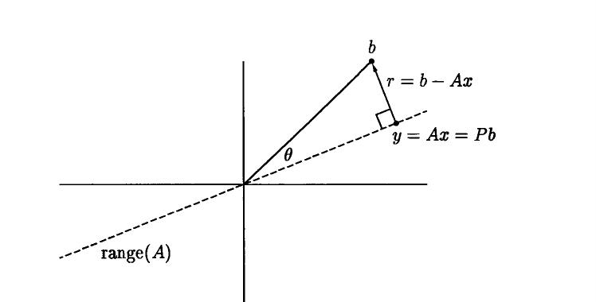

*图 18.1　最小二乘问题的几何图示（重复第 11 讲图 11.3）。*

良态性描述解对数据扰动的敏感程度。对问题 (18.1)，数据是 $m\times n$ 矩阵 $A$ 和 $m$-向量 $b$；解或者是系数向量 $x$，或者是对应的点 $y=Ax$。因此有两组选择：

$$
\text{数据： }A,b,\qquad \text{解： }x,y。
$$

这两组选择组合起来，就给出了下面将要考虑的四个良态性问题；它们在不同场景中都有应用。

### 定理

本讲的核心是定理 18.1，它回答了上述问题。结论用三个在最小二乘分析中反复出现的无量纲参数表示。

第一个参数是 $A$ 的条件数。对方阵，它是 $\kappa(A)=\|A\|\|A^{-1}\|$；对矩形矩阵，定义推广为 (12.17)：

$$
\kappa(A)=\|A\|\|A^+\|=\frac{\sigma_1}{\sigma_n}。
\tag{18.3}
$$

第二个参数是图 18.1 中标出的角 $\theta$，它衡量拟合的接近程度：

$$
\theta=\cos^{-1}\frac{\|y\|}{\|b\|}。
\tag{18.4}
$$

第三个参数衡量在给定 $\|A\|$ 和 $\|x\|$ 时，$\|y\|$ 距离最大可能值有多远：

$$
\eta=\frac{\|A\|\|x\|}{\|y\|}=\frac{\|A\|\|x\|}{\|Ax\|}。
\tag{18.5}
$$

这些参数满足

$$
1\le\kappa(A)<\infty,\qquad 0\le\theta\le\frac{\pi}{2},\qquad 1\le\eta\le\kappa(A)。
\tag{18.6}
$$

**定理 18.1**　固定满秩的 $b\in\mathbb C^m$ 和 $A\in\mathbb C^{m\times n}$。最小二乘问题 (18.1) 中，描述 $b$ 和 $A$ 的扰动对 $y$ 和 $x$ 敏感性的 2-范数相对条件数如下：

| 数据扰动 | 解 $y$ | 解 $x$ |
| --- | ---: | ---: |
| $b$ | $\displaystyle\frac{1}{\cos\theta}$ | $\displaystyle\frac{\kappa(A)}{\eta\cos\theta}$ |
| $A$ | $\displaystyle\frac{\kappa(A)}{\cos\theta}$ | $\displaystyle\kappa(A)+\frac{\kappa(A)^2\tan\theta}{\eta}$ |

第一行的结果是精确的：对某些扰动 $\delta b$ 可以达到；第二行的结果是上界。

在特殊情形 $m=n$ 时，问题 (18.1) 退化为方阵非奇异线性系统，此时 $\theta=0$。定理第二列中的数分别化为 $\kappa(A)/\eta$ 和 $\kappa(A)$，正是此前推导的结果 (12.14) 和 (12.18)；左下角的数还可以替换为 0（习题 18.4）。

### 化为对角矩阵

证明定理 18.1 的第一步，是换到一组方便的基，使最小二乘问题更容易分析。设 $A$ 的 SVD 为

$$
A=U\Sigma V^*,
$$

其中 $\Sigma$ 是对角线元素为正的 $m\times n$ 矩阵。由于扰动用 2-范数度量，酉基变换不会改变扰动大小，因此 $A$ 的扰动性质与 $\Sigma$ 相同。所以不妨直接处理 $\Sigma$。以下均假设 $A=\Sigma$，并写成

$$
A=\begin{bmatrix}A_1\\0\end{bmatrix},
\qquad
A_1=\operatorname{diag}(\sigma_1,\ldots,\sigma_n)。
\tag{18.7}
$$

其中 $A_1$ 是 $n\times n$ 对角矩阵，$A$ 的其余部分为零。现在，把 $b$ 写成

$$
b=\begin{bmatrix}b_1\\b_2\end{bmatrix},
$$

其中 $b_1$ 包含 $b$ 的前 $n$ 个分量。此时，将 $b$ 投影到 range$(A)$ 上非常简单：

$$
y=Pb=\begin{bmatrix}b_1\\0\end{bmatrix}。
$$

要找对应的 $x$，将 $Ax=y$ 写为

$$
\begin{bmatrix}A_1\\0\end{bmatrix}x
=\begin{bmatrix}b_1\\0\end{bmatrix},
$$

于是

$$
x=A_1^{-1}b_1。
\tag{18.8}
$$

由此可见，正交投影和伪逆分别是如下 $2\times2$ 块矩阵和 $1\times2$ 块矩阵（见习题 11.1）：

$$
P=\begin{bmatrix}I&0\\0&0\end{bmatrix},
\qquad
A^+=\begin{bmatrix}A_1^{-1}&0\end{bmatrix}。
\tag{18.9}
$$

### $b$ 的扰动对 $y$ 的敏感性

先看四个良态性结果中最简单的一个。由式 (18.2)，$b$ 与 $y$ 的关系就是线性方程 $y=Pb$。这个映射的 Jacobian 就是 $P$ 本身，由式 (18.9) 有 $\|P\|=1$。因此由式 (12.6) 和 (18.4)，$b$ 的扰动对 $y$ 的条件数为

$$
\kappa_{b\to y}
=\frac{\|P\|}{\|y\|/\|b\|}
=\frac{1}{\cos\theta}。
$$

这就得到定理 18.1 左上角的结果。当 $\delta b$ 除前 $n$ 个分量外均为零时，$\|P(\delta b)\|=\|\delta b\|$，因而这个条件数可以由相应扰动达到。

### $b$ 的扰动对 $x$ 的敏感性

$b$ 与 $x$ 的关系同样是线性的，即 $x=A^+b$，其 Jacobian 为 $A^+$。由式 (12.6)、(18.4) 和 (18.5)，$b$ 的扰动对 $x$ 的条件数为

$$
\begin{aligned}
\kappa_{b\to x}
&=\frac{\|A^+\|}{\|x\|/\|b\|}
=\|A^+\|\frac{\|b\|}{\|y\|}\frac{\|y\|}{\|x\|}\\
&=\|A^+\|\frac{1}{\cos\theta}\frac{\|A\|}{\eta}
=\frac{\kappa(A)}{\eta\cos\theta}。
\end{aligned}
$$

这就得到定理 18.1 右上角的结果。当 $\delta b$ 满足 $\|A^+(\delta b)\|=\|A^+\|\|\delta b\|=\|\delta b\|/\sigma_n$ 时可以达到这个条件数；这在 $\delta b$ 除第 $n$ 个分量外均为零时发生（如果 $A$ 有多个等于 $\sigma_n$ 的奇异值，也可能有其他分量）。

### 倾斜 $A$ 的值域

对 $A$ 的扰动是非线性的，也更微妙。我们可以用代数方式计算 Jacobian，但这里采用几何观点。注意，$A$ 的扰动会以两种方式影响最小二乘问题：它会扭曲从 $\mathbb C^n$ 到 range$(A)$ 的映射，也会改变 range$(A)$ 本身。先考察后一种影响。

我们可以把 range$(A)$ 的微小变化想象成这个空间的轻微“倾斜”。问题是：一个小扰动 $\delta A$ 最多能让这个空间倾斜多大的角度 $\delta\alpha$？单位 $n$-球面在 $A$ 下的像是一个平放在 range$(A)$ 中的超椭圆。为了尽可能有效地改变 range$(A)$，我们在超椭圆上取一点 $p=Av$（所以 $\|v\|=1$），并把它沿着正交于 range$(A)$ 的方向推移 $\delta p$。最有效的矩阵扰动是

$$
\delta A=(\delta p)v^*，
$$

因为 $(\delta A)v=\delta p$ 且 $\|\delta A\|=\|\delta p\|$（例 3.6）。显然，在给定 $\|\delta p\|$ 时，要获得最大倾斜，应使 $p$ 尽可能靠近原点。也就是说，取

$$
p=\sigma_nu_n，
$$

其中 $\sigma_n$ 是 $A$ 的最小奇异值，$u_n$ 是对应的左奇异向量。在对角形式 (18.7) 下，$p$ 就是 $A$ 的最后一列，$v^*$ 是 $n$-向量 $(0,0,\ldots,0,1)$，而 $\delta A$ 是这一列对角线下方条目的扰动。这种扰动使 range$(A)$ 倾斜一个角度 $\delta\alpha$，满足

$$
\tan(\delta\alpha)=\frac{\|\delta p\|}{\sigma_n}。
$$

由于 $\|\delta p\|=\|\delta A\|$ 且 $\delta\alpha\le\tan(\delta\alpha)$，有

$$
\delta\alpha\le\frac{\|\delta A\|}{\sigma_n}
=\frac{\|\delta A\|}{\|A\|}\kappa(A)。
\tag{18.10}
$$

对于上述形式的 $\delta A$，只要扰动是无穷小的（从而 $\delta\alpha=\tan(\delta\alpha)$），就能达到等号。

### $A$ 的扰动对 $y$ 的敏感性

现在可以推导定理 18.1 表格的第二行。先看左侧。由于 $y$ 是 $b$ 到 range$(A)$ 的正交投影，它只由 $b$ 和 range$(A)$ 决定。因此，要研究 $A$ 的扰动对 $y$ 的敏感性，只需研究 range$(A)$ 倾斜某个角度 $\delta\alpha$ 时 $y$ 的变化。

固定 $b$，观察 range$(A)$ 倾斜时 $y$ 的变化，可以看到一个漂亮的几何性质（图 18.2）。无论 range$(A)$ 怎样倾斜，处于其中的向量 $y$ 都必须始终正交于 $y-b$。也就是说，直线 $b-y$ 必须与直线 $0-y$ 垂直。换句话说，调整 range$(A)$ 时，$y$ 会沿着一个球面移动；这个球面的半径是 $\|b\|/2$，球心为 $b/2$。

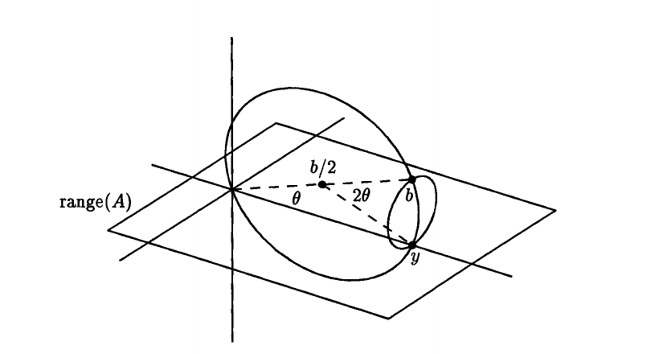

*图 18.2　当 range$(A)$ 变化时，$y$ 在球面上移动的两个圆。大圆半径为 $\|b\|/2$，对应于在平面 $0$–$b$–$y$ 中倾斜 range$(A)$；小圆半径为 $(\|b\|/2)\sin\theta$，对应于沿正交方向倾斜。无论 range$(A)$ 如何倾斜，$y$ 都留在以 $b/2$ 为球心、半径 $\|b\|/2$ 的球面上。*

如果在平面 $0$–$b$–$y$ 中将 range$(A)$ 倾斜 $\delta\alpha$，球心 $b/2$ 处的中心角 $2\theta$ 就改变 $2\delta\alpha$。因此，相应的 $\delta y$ 是一个等腰三角形的底边，中心角为 $2\delta\alpha$，两腰长度为 $\|b\|/2$。这说明

$$
\|\delta y\|=\|b\|\sin(\delta\alpha)。
$$

沿其他方向倾斜时，几何关系类似，但扰动至少会小一个 $\sin\theta$ 因子。所以对角度为 $\delta\alpha$ 的任意扰动都有

$$
\|\delta y\|\le\|b\|\sin(\delta\alpha)\le\|b\|\delta\alpha。
\tag{18.11}
$$

由式 (18.4) 和 (18.10)，得到 $\|\delta y\|\le\|\delta A\|\kappa(A)\|y\|/(\|A\|\cos\theta)$，即

$$
\frac{\|\delta y\|/\|y\|}{\|\delta A\|/\|A\|}
\le\frac{\kappa(A)}{\cos\theta}。
\tag{18.12}
$$

这就得到了定理 18.1 左下角的结果。

### $A$ 的扰动对 $x$ 的敏感性

现在分析定理 18.1 中最有趣的关系：$A$ 的扰动对 $x$ 的敏感性。

将扰动 $\delta A$ 自然地分成两部分：$A$ 的前 $n$ 行中的 $\delta A_1$，以及剩余 $m-n$ 行中的 $\delta A_2$：

$$
\delta A=\begin{bmatrix}\delta A_1\\\delta A_2\end{bmatrix}
=\begin{bmatrix}\delta A_1\\0\end{bmatrix}
+\begin{bmatrix}0\\\delta A_2\end{bmatrix}。
$$

先考虑扰动 $\delta A_1$。它改变 $A$ 在其值域中的映射，但不改变 range$(A)$ 本身，也不改变 $y$。它在方阵系统 (18.8) 中通过 $\delta A_1$ 扰动 $A_1$，而 $b_1$ 不变。由式 (12.18)，这类扰动的条件数为

$$
\frac{\|\delta x\|/\|x\|}{\|\delta A_1\|/\|A_1\|}
\le\kappa(A_1)=\kappa(A)。
\tag{18.13}
$$

接着考虑（无穷小）扰动 $\delta A_2$。它使 range$(A)$ 倾斜，却不改变该空间内 $A$ 的映射。点 $y$ 以及相应的向量 $b_1$ 会发生扰动，但 $A_1$ 不变。这对应于在 (18.8) 中扰动 $b_1$ 而不改变 $A_1$。由式 (12.14)，这类扰动的条件数为

$$
\frac{\|\delta x\|/\|x\|}{\|\delta b_1\|/\|b_1\|}
\le\frac{\kappa(A_1)}{\eta(A_1;x)}
=\frac{\kappa(A)}{\eta}。
\tag{18.14}
$$

还需要把 $\delta b_1$ 与 $\delta A_2$ 联系起来。向量 $b_1$ 是用 range$(A)$ 的坐标表示的 $y$。因此，只有平行于 range$(A)$ 的 $y$ 的变化，才会表现为 $b_1$ 的变化；正交变化不起作用。特别地，如果在平面 $0$–$b$–$y$ 中把 range$(A)$ 倾斜角度 $\delta\alpha$，那么产生的 $\delta y$ 不平行于 range$(A)$，而是与之成 $\pi/2-\theta$ 角。所以

$$
\|\delta b_1\|=\sin\theta\,\|\delta y\|。
$$

由式 (18.11)，有

$$
\|\delta b_1\|\le(\|b\|\delta\alpha)\sin\theta。
\tag{18.15}
$$

有趣的是，如果沿着正交于平面 $0$–$b$–$y$ 的方向倾斜 range$(A)$，仍可得到相同的界，只是原因不同。此时 $\delta y$ 平行于 range$(A)$，但如图 18.2 附近所述，它会小一个 $\sin\theta$ 因子。于是仍有 $\|\delta y\|\le(\|b\|\delta\alpha)\sin\theta$；又因为 $\|\delta b_1\|\le\|\delta y\|$，仍得到式 (18.15)。

现在所有部分都已就绪。由于 $\|b_1\|=\|b\|\cos\theta$，式 (18.15) 可以写成

$$
\frac{\|\delta b_1\|}{\|b_1\|}\le(\delta\alpha)\tan\theta。
\tag{18.16}
$$

由式 (18.10) 联系 $\delta\alpha$ 与 $\|\delta A_2\|$，再把式 (18.14) 与 (18.16) 合并，得到

$$
\frac{\|\delta x\|/\|x\|}{\|\delta A_2\|/\|A\|}
\le\frac{\kappa(A)^2\tan\theta}{\eta}。
$$

将这个界与式 (18.13) 相加，就得到定理 18.1 右下角的结果。

### 习题

**18.1**　考虑例子

$$
A=\begin{bmatrix}1&1\\1&1.0001\\1&1.0001\end{bmatrix},
\qquad
b=\begin{bmatrix}2\\0.0001\\4.0001\end{bmatrix}。
$$

(a) 求这个例子的矩阵 $A^+$ 和 $P$。给出精确答案。

(b) 求最小二乘问题 $Ax\approx b$ 的精确解 $x$ 和 $y=Ax$。

(c) 求 $\kappa(A)$、$\theta$ 和 $\eta$。从这里开始，数值答案即可。

(d) 求定理 18.1 中的四个条件数。

(e) 给出扰动 $\delta b$ 和 $\delta A$ 的例子，使它们近似达到这四个条件数。

**18.2**　社会科学家依赖回归技术：用其他向量的线性组合，以最小二乘意义近似某个量的观测向量。拟合系数随后被解释为 IQ、受教育年限、父母受教育年限和父母收入等因素对年收入的影响。人们可能以为，在模型中加入越多变量，就能获得越多信息，但事实并不总是如此。请从良态性的角度解释这一现象，并明确联系定理 18.1 的结果。

**18.3**　假设你隔着 Cayuga 湖看向对岸房屋发出的灯光。如果湖面有波纹，反射光会呈现一条很长的竖直光带。雨天道路上前车的尾灯，或者打蜡地板上走廊灯的反射，也会出现同样的现象。这是真实的几何效应，而不是视觉错觉。

(a) 建立一个解释这一现象的定量理论。具体地，假设你和湖对岸的房屋都在水面上方 50 米处，湖宽为 1 千米。在你的视野中，光带的长宽比是多少？

(b) 描述这个问题与本讲某个几何论证之间的联系。

**18.4**　解释为什么正如定理 18.1 后所述，当 $m=n$ 时，$y$ 对 $A$ 扰动的条件数变为 0。

---

<a id="lecture-19"></a>

## 第 19 讲　最小二乘算法的稳定性

正如第 11 讲所述，最小二乘问题可以用多种方法求解，包括正规方程、Householder 三角化、Gram–Schmidt 正交化和奇异值分解（SVD）。本讲比较这些方法，并说明为什么正规方程通常是不稳定的。

### 例子

为了说明各种算法的行为，考虑 $m=100,\ n=15$ 的数值例子。下面是 MATLAB 设置：

    m = 100; n = 15;
    t = (0:m-1)'/(m-1);                 Set t to a discretization of [0, 1].
    A = []; for i=1:n,                  Construct Vandermonde matrix.
      A = [A t.^(i-1)]; end
    b = exp(sin(4*t));                  Right-hand side.
    b = b/2006.787453080206;            Normalization (see text).

这个例子的思想是在区间 $[0,1]$ 上用 14 次多项式对函数 $\exp(\sin(4t))$ 做最小二乘拟合。首先将 $[0,1]$ 离散化，定义由 100 个等距点组成的向量 $t$。矩阵 $A$ 是 $100\times15$ 的 Vandermonde 矩阵，其列是在这些点处采样的 $1,t,\ldots,t^{14}$；右端 $b$ 是在同一点采样的函数 $\exp(\sin(4t))$。

代码最后一行看起来很奇怪，原因如下。为简单起见，我们只比较不同算法计算出的系数 $x_{15}$。如果没有最后一行，$x_{15}$ 的正确值是

$$
2006.787453080206\ldots,
$$

这个数由扩展精度算术包得到。将 $b$ 除以它之后，问题的解满足 $x_{15}=1$，比较就容易得多。

为了解释观察结果，需要使用式 (18.3)–(18.5) 中的量。可以用 MATLAB 的反斜杠运算符数值求解最小二乘问题，从而得到足够准确的估计：

    x = A\b; y = A*x;                        Solve least squares problem.
    kappa = cond(A)
        kappa = 2.2718e+10                   kappa(A)
    theta = asin(norm(b-y)/norm(b))
        theta = 3.7461e-06                   theta
    eta = norm(A)*norm(x)/norm(y)
        eta = 2.1036e+05                     eta

结果 $\kappa(A)\approx10^{10}$ 表明单项式 $1,t,\ldots,t^{14}$ 构成了一个高度病态的基。结果 $\theta\approx10^{-6}$ 表明 $\exp(\sin(4t))$ 可以被 14 次多项式非常精确地拟合。拟合如此接近，以至于为避免消去误差，我们用

$$
\theta=\sin^{-1}\left(\frac{\|b-y\|}{\|b\|}\right)
$$

而不是式 (18.4) 来计算 $\theta$。至于 $\eta$，它约为 $10^5$，大致位于式 (18.6) 允许的两个极端值 1 和 $\kappa(A)$ 的中间。

将这些数代入定理 18.1，可知在本例中，$b$ 和 $A$ 的扰动对 $y$ 和 $x$ 的条件数近似为

$$
\begin{array}{c|cc}
 & y & x\\
\hline
b&1.0&1.1\times10^5\\
A&2.3\times10^{10}&3.2\times10^{10}
\end{array}
$$

### Householder 三角化

正如第 11 讲所述，求解最小二乘问题的标准算法，是通过 Householder 三角化进行 QR 分解（算法 11.2）。下面是 MATLAB 实验：

    [Q,R] = qr(A,0);                    Householder triang. of A.
    x = R\(Q'*b);                       Solve for x.
    x(15)
        ans = 1.00000031528723

如何理解这个结果？由于我们做了归一化，正确答案应为 $x_{15}=1$，所以相对误差约为 $3\times10^{-7}$。计算使用 IEEE 双精度算术，$\varepsilon_{\rm machine}\approx10^{-16}$，这意味着舍入误差被放大了约 $10^9$ 倍。乍看之下这似乎很糟，但上面的表提醒我们，$A$ 的扰动对 $x$ 的条件数约为 $10^{10}$。因此，$x_{15}$ 的不准确完全可以由病态性解释，而不是由不稳定性解释。算法 11.2 看起来是后向稳定的。

上面显式形成了 $Q$，但正如第 10、16 讲强调的，这并非必要。只需存储算法 10.1 每一步确定的向量 $v_k$（式 (10.5)），再用算法 10.2 计算 $Q^*b$。在 MATLAB 中，可以不只对 $A$ 做 QR 分解，而是对 $m\times(n+1)$ 的增广矩阵 $[A\ b]$ 做 QR 分解。在这个过程中，使 $A$ 变为上三角的 $n$ 个 Householder 反射器也会作用于 $b$，把向量 $Q^*b$ 留在第 $n+1$ 列的前 $n$ 个位置。随后应用第 $n+1$ 个反射器，将该列的第 $n+2$ 到第 $m$ 个条目变为零；这不会改变我们关心的前 $n$ 个条目。因此：

    [Q2,R2] = qr([A b],0);              Householder triang. of [A b].
    R2 = R2(1:n,1:n);                   Extract R ...
    Qb = R2(1:n,n+1);                   ... and Q'*b.
    x = R2\Qb;                          Solve for x.
    x(15)
        ans = 1.00000031529465

这个答案与前一个几乎相同，说明 QR 分解 $A$ 引入的误差淹没了计算 $Q^*b$ 引入的误差。

还有第三种通过 Householder 三角化求解最小二乘问题的 MATLAB 方法：使用内置反斜杠运算符，正如前面计算 $\kappa(A)$、$\theta$ 和 $\eta$ 时所做的那样：

    x = A\b;                            Solve for x.
    x(15)
        ans = 0.99999994311087

这个结果明显不同，而且准确了一个数量级。原因是 MATLAB 的反斜杠运算符使用带列选主元的 QR 分解，其形式为 $AP=QR$，其中 $P$ 是置换矩阵。本书不讨论列选主元。

从范数级稳定性分析的角度看，这三种 QR 分解变体是等价的；可以证明它们全部后向稳定。

**定理 19.1**　设满秩最小二乘问题 (11.2) 在满足公理 (13.5)、(13.7) 的计算机上通过 Householder 三角化（算法 11.2）求解。则该算法后向稳定，即计算得到的解 $\widetilde{x}$ 满足

$$
\|(A+\delta A)\widetilde{x}-b\|=\min,
\qquad
\frac{\|\delta A\|}{\|A\|}=O(\varepsilon_{\rm machine}),
\qquad \delta A\in\mathbb{C}^{m\times n}.
\tag{19.1}
$$

无论 $Q^*b$ 是通过显式形成 $Q$ 计算，还是由算法 10.2 隐式计算，结论都成立；对任意列选主元的 Householder 三角化也成立。

### Gram–Schmidt 正交化

求解最小二乘问题的另一种方法是改进的 Gram–Schmidt 正交化（算法 8.1）。当 $m\approx n$ 时，它比 Householder 方法需要稍多的运算；但当 $m\gg n$ 时，两种算法的运算量都渐近为 $2mn^2$。

下面的 MATLAB 序列以直接方式实现该算法。函数 mgs 是算法 8.1 的一个实现（此处不展示），与第 9 讲实验 2 中的实现相同：

    [Q,R] = mgs(A);                      Gram-Schmidt orthog. of A.
    x = R\(Q'*b);                        Solve for x.
    x(15)
        ans = 1.02926594532672

这个结果很差。舍入误差被放大了约 $10^{14}$ 倍，远大于问题的条件数。事实上，该算法是不稳定的，原因很容易找出：正如第 9 讲末尾所述，Gram–Schmidt 正交化通常产生列并不准确正交的矩阵 $\widetilde{Q}$。上面的算法依赖这种正交性，因此会受到相应影响。

可以通过改写算法避免不稳定性。即使 $\widetilde{Q}$ 的列不准确正交，Gram–Schmidt 迭代仍会给出准确的乘积 $\widetilde{Q}\widetilde{R}$。一种办法是为向量 $\widetilde{R}x$ 建立正规方程

$$
\widetilde{R}x=(\widetilde{Q}^*\widetilde{Q})^{-1}\widetilde{Q}^*b,
$$

然后回代求 $x$。只要计算得到的 $\widetilde{Q}$ 至少是良态的，这种方法就不会遭受下面讨论的、将正规方程应用于任意矩阵时的那些不稳定性。不过它包含不必要的额外工作，实践中不应使用。

稳定 Gram–Schmidt 方法的更好办法，是像前面的第二个 Householder 实验一样使用增广方程组：

    [Q2,R2] = mgs([A b]);                Gram-Schmidt orthog. of [A b].
    R2 = R2(1:n,1:n);                    Extract R ...
    Qb = R2(1:n,n+1);                    ... and Q'*b.
    x = R2\Qb;                           Solve for x.
    x(15)
        ans = 1.00000005653399

现在结果与 Householder 三角化一样好。可以证明这总是成立。

**定理 19.2**　满秩最小二乘问题 (11.2) 通过 Gram–Schmidt 正交化求得的解也后向稳定，满足式 (19.1)，前提是像上面的代码片段那样隐式形成 $\widetilde{Q}^*b$。

### 正规方程

求解最小二乘问题的另一种根本不同的方法，是求解正规方程（算法 11.1），通常使用 Cholesky 分解（第 23 讲）。当 $m\gg n$ 时，这种方法比依赖显式正交化的方法快一倍，渐近只需要 $mn^2$ 次浮点运算（式 (11.14)）。在下面的实验中，用一行 MATLAB 反斜杠命令求解：

    x = (A'*A)\(A'*b);                    Form and solve normal equations.
    x(15)
        ans = 0.39339069870283

这个结果非常糟糕！这是我们得到的最差结果，甚至没有一位正确数字。显然，使用正规方程求解最小二乘问题是不稳定的。下面解释这一现象；这正是良态性和稳定性相互作用的典型例子。另外，正规方程的使用非常普遍，因此理解其中的风险十分重要。

假设我们有一个求解满秩问题 (11.2) 的后向稳定算法，得到的解 $\widetilde{x}$ 满足

$$
\|(A+\delta A)\widetilde{x}-b\|=\min,
\qquad
\frac{\|\delta A\|}{\|A\|}=O(\varepsilon_{\rm machine}).
$$

（允许 $b$ 也发生扰动，或者考虑稳定性而非后向稳定性，都不会改变主要结论。）由定理 15.1 和 18.1，有

$$
\frac{\|\widetilde{x}-x\|}{\|x\|}
=O\left(\left(\kappa+\frac{\kappa^2\tan\theta}{\eta}\right)
\varepsilon_{\rm machine}\right),
\qquad
\kappa=\kappa(A).
\tag{19.2}
$$

现在假设 $A$ 病态，即 $\kappa\gg1$，且 $\theta$ 远离 $\pi/2$。根据不同参数的取值，可能出现两种完全不同的情形。如果 $\tan\theta$ 是 1 的量级（即拟合并不特别接近），且 $\eta\ll\kappa$，则式 (19.2) 右端为 $O(\kappa^2\varepsilon_{\rm machine})$。另一方面，如果 $\tan\theta$ 接近零（拟合非常接近），或者 $\eta$ 接近 $\kappa$，则界为 $O(\kappa\varepsilon_{\rm machine})$。最小二乘问题的条件数可能处于从 $\kappa$ 到 $\kappa^2$ 的任意位置。

现在考察用正规方程求解 (11.2) 的情形：

$$
(A^*A)x=A^*b.
$$

Cholesky 分解对这个方程组是稳定算法，即它得到的解 $\widetilde{x}$ 满足

$$
(A^*A+\delta H)\widetilde{x}=A^*b,
\qquad
\frac{\|\delta H\|}{\|A^*A\|}=O(\varepsilon_{\rm machine})
$$

（定理 23.3）。但是矩阵 $A^*A$ 的条件数是 $\kappa^2$，而不是 $\kappa$。因此正规方程所能期待的最好结果是

$$
\frac{\|\widetilde{x}-x\|}{\|x\|}
=O(\kappa^2\varepsilon_{\rm machine}).
\tag{19.3}
$$

正规方程的行为由 $\kappa^2$ 而不是 $\kappa$ 控制。

结论已经很清楚。如果 $\tan\theta$ 为 1 的量级且 $\eta\ll\kappa$，或者 $\kappa$ 为 1 的量级，那么式 (19.2) 和 (19.3) 同阶，正规方程是稳定的。但如果 $\kappa$ 很大，且 $\tan\theta$ 接近零或 $\eta$ 接近 $\kappa$，式 (19.3) 就会远大于式 (19.2)，正规方程是不稳定的。对于包含很接近拟合的病态问题，正规方程通常是不稳定的。在本例中，$\kappa^2\approx10^{20}$，因此 Cholesky 分解得不到任何正确数字并不令人意外。

按我们的定义，只有在所考虑的全部问题上都一致表现良好的算法才是稳定的。因此，可以用下面的结果把刚才的观察正式化。

**定理 19.3**　满秩最小二乘问题 (11.2) 通过正规方程（算法 11.1）得到的解是不稳定的。不过，如果把问题限制在如下某一类中，则可以获得稳定性：$\kappa(A)$ 有统一的上界，或者 $(\tan\theta)/\eta$ 有统一的正下界。

### SVD

第 11 讲还提到过一种最小二乘算法：使用 SVD（算法 11.3）。像大多数基于 SVD 的计算一样，这个方法是稳定的：

    [U,S,V] = svd(A,0);                   Reduced SVD of A.
    x = V*(S\(U'*b));                     Solve for x.
    x(15)
        ans = 0.99999998230471

事实上，这是所有实验结果中最准确的，比带列选主元的 Householder 三角化（MATLAB 的反斜杠）还准确约 3 倍。可以证明通常形式的定理。

**定理 19.4**　满秩最小二乘问题 (11.2) 通过 SVD（算法 11.3）得到的解后向稳定，满足估计式 (19.1)。

### 秩亏最小二乘问题

本讲确定了四种用于满秩线性最小二乘问题的后向稳定算法：Householder 三角化、带列选主元的 Householder 三角化、隐式计算 $\widetilde{Q}^*b$ 的改进 Gram–Schmidt，以及 SVD。从满秩问题 (11.2) 的经典范数级稳定性分析角度看，这些算法之间的差异很小，因此不妨采用最简单、最便宜的不带列选主元的 Householder 三角化。

不过，还有其他类型的最小二乘问题，其中列选主元和 SVD 具有特殊重要性。这类问题满足 $\operatorname{rank}(A)<n$，甚至可能有 $m<n$，因而方程组是不定的。除非增加额外条件（通常要求 $x$ 的范数尽可能小），否则这类问题没有唯一解。另一个困难是，正确解依赖于 $A$ 的秩，而在存在舍入误差时数值确定秩从来都不是小事。

因此，秩亏最小二乘问题不是最小二乘问题的一个简单子类，而是根本不同的问题。既然解的定义已经改变，就没有理由认为对满秩问题稳定的算法在秩亏情形也稳定。事实上，对秩亏问题完全稳定的算法只有基于 SVD 的算法。另一种选择是带列选主元的 Householder 三角化，它对几乎所有问题都稳定。本书不展开细节。

### 习题

**19.1**　设 $A\in\mathbb{C}^{m\times n}$ 满秩（秩为 $n$），$b\in\mathbb{C}^m$。考虑块 $2\times2$ 方程组

$$
\begin{bmatrix}I&A\\A^*&0\end{bmatrix}
\begin{bmatrix}r\\x\end{bmatrix}
=\begin{bmatrix}b\\0\end{bmatrix}。
\tag{19.4}
$$

其中 $I$ 是 $m\times m$ 单位矩阵。证明这个系统有唯一解 $(r,x)^T$，并证明向量 $r$ 和 $x$ 分别是最小二乘问题 (18.1) 的残差和解。

**19.2**　下面是 MATLAB 某个内置 m 文件的精简版本：

    [U,S,V] = svd(A);
    S = diag(S);
    tol = max(size(A))*S(1)*eps;
    r = sum(S > tol);
    S = diag(ones(r,1)./S(1:r));
    X = V(:,1:r)*S*U(:,1:r)';

这个程序计算什么？

---

<a id="lecture-20"></a>

## 第 20 讲　高斯消去法

高斯消去法对读者来说想必并不陌生。它是手算线性方程组最简单的方法，也是计算机求解线性方程组的标准方法。本讲先介绍不带主元选取的纯粹高斯消去法；下一讲再加入对稳定性至关重要的行选主元操作。

### LU 分解

高斯消去法通过在左侧施加简单的线性变换，把一个完整的线性方程组变成上三角方程组。这一点与用 Householder 三角化计算 QR 分解相似；区别在于，高斯消去法使用的变换不是酉变换。

设 $A\in\mathbb{C}^{m\times m}$ 为方阵。（该算法也可用于矩形矩阵，但实践中很少这样做，所以本讲只讨论方阵。）我们的目标是通过在对角线下方逐列引入零元，把 $A$ 化为一个 $m\times m$ 上三角矩阵 $U$；先处理第 1 列，再处理第 2 列，依此类推，这与 Householder 三角化完全类似。具体做法是从后续各行中减去当前行的适当倍数。这个“消去”过程等价于在左侧依次乘以下三角矩阵 $L_k$：

$$
\underbrace{L_{m-1}\cdots L_2L_1}_{L^{-1}}A=U。
\tag{20.1}
$$

令

$$
L=L_1^{-1}L_2^{-1}\cdots L_{m-1}^{-1},
$$

就得到 $A=LU$，即

$$
A=LU。
\tag{20.2}
$$

其中 $U$ 是上三角矩阵，$L$ 是下三角矩阵。事实上，$L$ 是单位下三角矩阵，也就是说它的所有对角元都等于 1。

例如，从一个 $4\times4$ 矩阵开始时，算法分三步进行（可与式 (10.1) 对照）：

$$
\begin{bmatrix}
\times&\times&\times&\times\\
\times&\times&\times&\times\\
\times&\times&\times&\times\\
\times&\times&\times&\times
\end{bmatrix}
\xrightarrow{L_1}
\begin{bmatrix}
\times&\times&\times&\times\\
0&\times&\times&\times\\
0&\times&\times&\times\\
0&\times&\times&\times
\end{bmatrix}
\xrightarrow{L_2}
\begin{bmatrix}
\times&\times&\times&\times\\
0&\times&\times&\times\\
0&0&\times&\times\\
0&0&\times&\times
\end{bmatrix}
\xrightarrow{L_3}
\begin{bmatrix}
\times&\times&\times&\times\\
0&\times&\times&\times\\
0&0&\times&\times\\
0&0&0&\times
\end{bmatrix}。
$$

（和第 10 讲一样，加粗表示刚刚操作过的条目，空白条目表示零。）第 $k$ 个变换 $L_k$ 通过从第 $k+1,\ldots,m$ 行中减去第 $k$ 行的适当倍数，在第 $k$ 列对角线下方引入零。由于第 $k$ 行前 $k-1$ 个条目已经是零，这一操作不会破坏之前引入的零。

因此，高斯消去法扩充了我们对矩阵分解算法的分类：

$$
\begin{aligned}
\text{Gram--Schmidt:}\quad&A=QR,\quad \text{通过三角正交化},\\
\text{Householder:}\quad&A=QR,\quad \text{通过正交三角化},\\
\text{高斯消去法:}\quad&A=LU,\quad \text{通过三角三角化}.
\end{aligned}
$$

### 例子

讨论细节之前，先看一个数值例子。设

$$
A=
\begin{bmatrix}
2&1&1&0\\
4&3&3&1\\
8&7&9&5\\
6&7&9&8
\end{bmatrix}。
\tag{20.3}
$$

$A$ 中的数字并非随机选择；它们被特意选取为能产生简单的 LU 分解。高斯消去的第一步为

$$
L_1A=
\begin{bmatrix}
1&0&0&0\\
-2&1&0&0\\
-4&0&1&0\\
-3&0&0&1
\end{bmatrix}
\begin{bmatrix}
2&1&1&0\\
4&3&3&1\\
8&7&9&5\\
6&7&9&8
\end{bmatrix}
=
\begin{bmatrix}
2&1&1&0\\
0&1&1&1\\
0&3&5&5\\
0&4&6&8
\end{bmatrix}。
$$

也就是说，我们从第二行减去第一行的 2 倍，从第三行减去第一行的 4 倍，从第四行减去第一行的 3 倍。第二步为

$$
L_2L_1A=
\begin{bmatrix}
1&0&0&0\\
0&1&0&0\\
0&-3&1&0\\
0&-4&0&1
\end{bmatrix}
\begin{bmatrix}
2&1&1&0\\
0&1&1&1\\
0&3&5&5\\
0&4&6&8
\end{bmatrix}
=
\begin{bmatrix}
2&1&1&0\\
0&1&1&1\\
0&0&2&2\\
0&0&2&4
\end{bmatrix}。
$$

这一次，我们从第三行减去第二行的 3 倍，从第四行减去第二行的 4 倍。最后，在第三步中从第四行减去第三行：

$$
L_3L_2L_1A=
\begin{bmatrix}
1&0&0&0\\
0&1&0&0\\
0&0&1&0\\
0&0&-1&1
\end{bmatrix}
\begin{bmatrix}
2&1&1&0\\
0&1&1&1\\
0&0&2&2\\
0&0&2&4
\end{bmatrix}
=
\begin{bmatrix}
2&1&1&0\\
0&1&1&1\\
0&0&2&2\\
0&0&0&2
\end{bmatrix}
=U。
$$

现在，为了写出完整的分解 $A=LU$，需要计算

$$
L=L_1^{-1}L_2^{-1}L_3^{-1}。
$$

出人意料的是，这一步非常简单。$L_1$ 的逆矩阵就是把其对角线下方的每个条目变号：

$$
\begin{bmatrix}
1&0&0&0\\
-2&1&0&0\\
-4&0&1&0\\
-3&0&0&1
\end{bmatrix}^{-1}
=
\begin{bmatrix}
1&0&0&0\\
2&1&0&0\\
4&0&1&0\\
3&0&0&1
\end{bmatrix}。
\tag{20.4}
$$

同样，$L_2$ 和 $L_3$ 的逆矩阵也只需将其次对角线条目变号。最后，$L_1^{-1}L_2^{-1}L_3^{-1}$ 正好是一个单位下三角矩阵：把 $L_1^{-1}$、$L_2^{-1}$ 和 $L_3^{-1}$ 的非零次对角线条目放到适当的位置即可。因此

$$
\begin{bmatrix}
2&1&1&0\\
4&3&3&1\\
8&7&9&5\\
6&7&9&8
\end{bmatrix}
=
\begin{bmatrix}
1&0&0&0\\
2&1&0&0\\
4&3&1&0\\
3&4&1&1
\end{bmatrix}
\begin{bmatrix}
2&1&1&0\\
0&1&1&1\\
0&0&2&2\\
0&0&0&2
\end{bmatrix}。
\tag{20.5}
$$

### 一般公式与两次“幸运”

下面给出 $m\times m$ 矩阵的一般公式。设 $x_k$ 表示第 $k$ 步开始时矩阵的第 $k$ 列。那么变换 $L_k$ 必须满足

$$
x_k=
\begin{bmatrix}
x_{1k}\\
\vdots\\
x_{kk}\\
x_{k+1,k}\\
\vdots\\
x_{mk}
\end{bmatrix}
\xrightarrow{L_k}
L_kx_k=
\begin{bmatrix}
x_{1k}\\
\vdots\\
x_{kk}\\
0\\
\vdots\\
0
\end{bmatrix}。
$$

为此，我们希望从第 $j$ 行减去第 $k$ 行的 $\ell_{jk}$ 倍，其中乘子为

$$
\ell_{jk}=\frac{x_{jk}}{x_{kk}},
\qquad k<j\le m。
\tag{20.6}
$$

矩阵 $L_k$ 的形式为

$$
L_k=
\begin{bmatrix}
1&&&&\\
&\ddots&&&\\
&&1&&\\
&&-\ell_{k+1,k}&1&\\
&&\vdots&&\ddots\\
&&-\ell_{mk}&&1
\end{bmatrix}，
$$

其中非零的次对角线条目位于第 $k$ 列。这与 Householder 三角化中的式 (10.2) 相似。

在上面的数值例子中，我们看到了两次“幸运”：$L_k$ 可以通过将其次对角线条目变号来求逆（式 (20.4)），而 $L$ 可以通过把这些 $\ell_{jk}$ 放到适当位置来构造（式 (20.5)）。下面解释为什么会这样。定义

$$
\ell_k=
\begin{bmatrix}
0\\
\vdots\\
0\\
\ell_{k+1,k}\\
\vdots\\
\ell_{mk}
\end{bmatrix}。
$$

于是

$$
L_k=I-\ell_ke_k^*，
$$

其中 $e_k$ 是第 $k$ 个分量为 1、其余分量为 0 的列向量。由于 $\ell_k$ 的稀疏结构，有 $e_k^*\ell_k=0$，因此

$$
(I-\ell_ke_k^*)(I+\ell_ke_k^*)
=I-\ell_ke_k^*\ell_ke_k^*
=I。
$$

换句话说，

$$
L_k^{-1}=I+\ell_ke_k^*，
$$

这正是式 (20.4) 的形式。

第二次“幸运”可以这样说明。考虑相邻两个因子的乘积。由 $\ell_{k+1}$ 的稀疏结构，有 $e_k^*\ell_{k+1}=0$，因此

$$
\begin{aligned}
L_k^{-1}L_{k+1}^{-1}
&=(I+\ell_ke_k^*)(I+\ell_{k+1}e_{k+1}^*)\\
&=I+\ell_ke_k^*+\ell_{k+1}e_{k+1}^*。
\end{aligned}
$$

所以 $L_k^{-1}L_{k+1}^{-1}$ 只是一个单位下三角矩阵，其中包含 $L_k^{-1}$ 与 $L_{k+1}^{-1}$ 的条目，并且这些条目位于各自通常的下三角位置。把所有矩阵相乘形成 $L$ 时，整个对角线下方都具有同样的便利结构：

$$
L=L_1^{-1}L_2^{-1}\cdots L_{m-1}^{-1}
=
\begin{bmatrix}
1&&&\\
\ell_{21}&1&&\\
\ell_{31}&\ell_{32}&1&\\
\vdots&\vdots&\ddots&\ddots\\
\ell_{m1}&\ell_{m2}&\cdots&\ell_{m,m-1}&1
\end{bmatrix}。
\tag{20.7}
$$

第 8 讲没有提到，导致式 (20.7) 的稀疏性考察，其实也出现在式 (8.10) 对改进 Gram–Schmidt 过程的解释中：那里是一系列右乘三角矩阵 $R_k$。

在实际高斯消去法中，从来不会显式形成并相乘矩阵 $L_k$。乘子 $\ell_{jk}$ 会直接计算并存储到 $L$ 中，然后隐式应用变换 $L_k$。

### 算法 20.1　不带主元的高斯消去法

    U = A, L = I
    for k = 1 to m - 1
        for j = k + 1 to m
            l_jk = u_jk/u_kk
            u_j,k:m = u_j,k:m - l_jk u_k,k:m

（实际上不需要三个矩阵 $A,L,U$；为了节省计算机内存，$L$ 和 $U$ 可以写入与 $A$ 相同的数组中。）习题 20.4 给出了高斯消去法的另一种“外积”形式：它只包含一个显式循环，而不是两个。

### 运算量

和往常一样，可以从几何上推导这个算法的渐近运算量。主要工作是内层循环中的向量操作

$$
u_{j,k:m}=u_{j,k:m}-\ell_{jk}u_{k,k:m}，
$$

它执行一次标量–向量乘法和一次向量减法。若 $l=m-k+1$ 表示正在处理的行向量长度，则每个条目的浮点运算次数为 2，因此这一行需要 $2l$ 次浮点运算。

对每个 $k$，内层循环要处理第 $k+1,\ldots,m$ 行。相应的工作量是下图立体的一层：

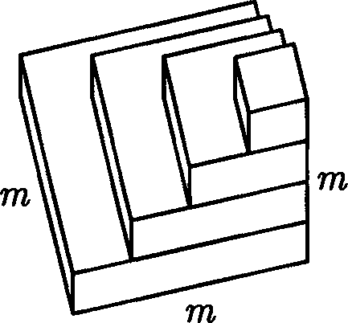

这与第 10 讲中用来表示 Householder 三角化工作量的图相同（这里假设 $m=n$）。不过在那里，每个单位立方体代表 4 次浮点运算，而不是 2 次。和之前一样，当 $m\to\infty$ 时，这个立体趋近于一个体积为 $\frac13m^3$ 的棱锥。每单位体积包含 2 次浮点运算，所以

$$
\text{高斯消去法的运算量}\ \sim\ \frac23m^3\ \text{次浮点运算}。
\tag{20.8}
$$

### 用 LU 分解求解 $Ax=b$

如果 $A$ 已分解为 $L$ 和 $U$，方程组 $Ax=b$ 就化为

$$
LUx=b。
$$

因此可以分两步求解两个三角系统：先求未知向量 $y$，解 $Ly=b$（前代）；再求未知向量 $x$，解 $Ux=y$（回代）。第一步，即分解阶段，需要约 $\frac23m^3$ 次浮点运算；第二、三步各需要约 $m^2$ 次浮点运算。因此总运算量约为 $\frac23m^3$ 次浮点运算，是用 Householder 三角化（算法 16.1）求解时约 $\frac43m^3$ 次浮点运算（式 (10.9)）的一半。

为什么求解方阵方程组时通常使用高斯消去法，而不是 QR 分解？运算量约为一半当然是原因之一。不过，同样重要的可能还有历史因素：消去法已经存在了几个世纪，而矩阵的 QR 分解直到计算机发明之后才出现。若要取代高斯消去法成为首选方法，QR 分解必须具有非常有说服力的优势。

### 不带主元高斯消去法的不稳定性

遗憾的是，到目前为止介绍的高斯消去法不能用于求解一般线性方程组，因为它不是后向稳定的。这种不稳定性还关联着一个更明显的困难：对某些矩阵，高斯消去法会因为尝试除以零而完全失败。

例如，考虑

$$
A=\begin{bmatrix}0&1\\1&1\end{bmatrix}。
$$

这个矩阵满秩且良态，其 2-范数条件数为

$$
\kappa_2(A)=\frac{3+\sqrt5}{2}\approx2.618。
$$

然而，高斯消去法在第一步就会失败。

对同一个矩阵做一个微小扰动，可以看出更一般的问题。设

$$
A=
\begin{bmatrix}
10^{-20}&1\\
1&1
\end{bmatrix}。
\tag{20.9}
$$

这一次过程不会失败。相反，需要从第二行中减去第一行的 $10^{20}$ 倍，得到以下因子：

$$
L=\begin{bmatrix}1&0\\10^{20}&1\end{bmatrix},
\qquad
U=\begin{bmatrix}10^{-20}&1\\0&1-10^{20}\end{bmatrix}。
$$

现在假设计算在浮点算术中进行，且 $\varepsilon_{\rm machine}\approx10^{-16}$。数 $1-10^{20}$ 无法被精确表示，会被舍入到最近的浮点数。为简单起见，假设它恰好被舍入为 $-10^{20}$。于是算法产生的浮点矩阵为

$$
\widetilde L=\begin{bmatrix}1&0\\10^{20}&1\end{bmatrix},
\qquad
\widetilde U=\begin{bmatrix}10^{-20}&1\\0&-10^{20}\end{bmatrix}。
$$

一开始，这种程度的舍入似乎还可以接受。毕竟，相对于 $\|\widetilde U\|$ 而言，矩阵 $\widetilde U$ 与正确的 $U$ 很接近。然而，当我们计算乘积 $\widetilde L\widetilde U$ 时，问题就暴露出来了：

$$
\widetilde L\widetilde U=
\begin{bmatrix}
10^{-20}&1\\
1&0
\end{bmatrix}。
$$

这个矩阵与 $A$ 完全不接近，因为 $(2,2)$ 位置的 1 被替换成了 0。如果现在求解系统 $\widetilde L\widetilde U\widetilde x=b$，结果将与 $Ax=b$ 的解完全不同。例如取 $b=(1,0)^T$，得到

$$
\widetilde x=(0,1)^T，
$$

而正确解为 $x\approx(-1,1)^T$。

仔细考察这个例子，可以得到如下结论。高斯消去法稳定地计算出了 LU 分解：$\widetilde L$ 和 $\widetilde U$ 是某个接近 $A$ 的矩阵的精确因子（事实上，这个矩阵就是 $A$ 本身附近的矩阵）。然而，它并没有稳定地求解 $Ax=b$。原因在于：LU 分解虽然是稳定的，却不是后向稳定的。一般而言，如果一个算法的某一步是稳定但不是后向稳定的子问题求解算法，那么整个计算的稳定性就可能受到威胁。

事实上，对于一般的 $m\times m$ 矩阵 $A$，情况还要更糟。不带主元的高斯消去法作为 LU 分解的一般算法，既不是后向稳定的，也不是稳定的。此外，它生成的三角矩阵的条件数可能任意大于 $A$ 的条件数，从而在求解 $Ax=b$ 的前代和回代阶段引入额外的不稳定来源。

### 习题

**20.1**　设 $A\in\mathbb{C}^{m\times m}$ 非奇异。证明：$A$ 存在 LU 分解，当且仅当对每个 $1\le k\le m$，其左上角 $k\times k$ 子块 $A_{1:k,1:k}$ 非奇异。（提示：高斯消去的行操作不改变 $\det(A_{1:k,1:k})$。）证明这个 LU 分解是唯一的。

**20.2**　假设 $A\in\mathbb{C}^{m\times m}$ 满足习题 20.1 的条件，并且带宽为 $2p+1$，即当 $|i-j|>p$ 时有 $a_{ij}=0$。关于 $A$ 的因子 $L$ 和 $U$ 的稀疏结构，你能得到什么结论？

**20.3**　设一个 $m\times m$ 矩阵 $A$ 写成分块形式

$$
A=\begin{bmatrix}A_{11}&A_{12}\\A_{21}&A_{22}\end{bmatrix},
$$

其中 $A_{11}$ 是 $n\times n$，$A_{22}$ 是 $(m-n)\times(m-n)$。假设 $A$ 满足习题 20.1 的条件。

(a) 验证公式

$$
\begin{bmatrix}
I&0\\
-A_{21}A_{11}^{-1}&I
\end{bmatrix}
\begin{bmatrix}
A_{11}&A_{12}\\
A_{21}&A_{22}
\end{bmatrix}
=
\begin{bmatrix}
A_{11}&A_{12}\\
0&A_{22}-A_{21}A_{11}^{-1}A_{12}
\end{bmatrix},
$$

这相当于“消去”分块 $A_{21}$。矩阵 $A_{22}-A_{21}A_{11}^{-1}A_{12}$ 称为 $A$ 中 $A_{11}$ 的 Schur 补。

(b) 假设通过 $n$ 步高斯消去逐行消去 $A_{21}$。证明所得结果右下角的 $(m-n)\times(m-n)$ 分块仍然是 $A_{22}-A_{21}A_{11}^{-1}A_{12}$。

**20.4**　和本书中的大多数算法一样，高斯消去法包含三重嵌套循环。在算法 20.1 中，有两个显式的 for 循环，第三个循环则隐含在向量 $u_{j,k:m}$ 和 $u_{k,k:m}$ 中。将该算法改写为只用一个按 $k$ 索引的显式 for 循环。在这个循环内部，每一步都通过某个秩一外积更新 $U$。如果想优化计算机性能，这种高斯消去的“外积”形式可能比算法 20.1 更适合作为起点。

**20.5**　我们已经看到，高斯消去得到 $A=LU$，其中 $L$ 的对角线为 1，而 $U$ 不一定如此。若按以下方式改变这个过程，请在高层次上描述所得的分解：

(a) 从左到右按列消去，而不是从上到下按行消去，使 $A$ 变成下三角矩阵。

(b) 先用对角矩阵 $D$ 对 $A$ 的列做缩放，再进行高斯消去。在这种重新缩放下，方程组 $Ax=b$ 变成什么形式？由 $D$ 重新缩放的是方程还是未知量？

(c) 继续进行高斯消去：在把 $A$（假设非奇异）化为上三角矩阵之后，再进行额外的列操作，使这个上三角矩阵变成对角矩阵。

---

<a id="lecture-21"></a>

## 第 21 讲　选主元

上一讲我们看到，纯粹形式的高斯消去法是不稳定的。通过置换正在操作的矩阵的行顺序，可以控制这种不稳定性；这种操作称为选主元（pivoting）。自 20 世纪 50 年代以来，选主元一直是高斯消去计算的标准组成部分。

### 主元

在高斯消去的第 $k$ 步，为了把第 $k+1,\ldots,m$ 行第 $k$ 列的条目化为零，需要从这些行中减去第 $k$ 行的适当倍数。在这个操作中，第 $k$ 行、第 $k$ 列，尤其是条目 $x_{kk}$ 扮演特殊角色。我们称 $x_{kk}$ 为主元。工作矩阵 $X$ 的子矩阵 $X_{k+1:m,k:m}$ 中的每个条目，都要减去“第 $k$ 行中的一个数乘以第 $k$ 列中的一个数，再除以 $x_{kk}$”所得的乘积：

$$
\begin{bmatrix}
\times&\times&\times&\times&\times\\
&x_{kk}&\bm{\times}&\bm{\times}&\bm{\times}\\
&\times&\times&\times&\times\\
&\times&\times&\times&\times\\
&\times&\times&\times&\times
\end{bmatrix}
\longrightarrow
\begin{bmatrix}
\times&\times&\times&\times&\times\\
&x_{kk}&\bm{\times}&\bm{\times}&\bm{\times}\\
&0&\bm{\times}&\bm{\times}&\bm{\times}\\
&0&\bm{\times}&\bm{\times}&\bm{\times}\\
&0&\bm{\times}&\bm{\times}&\bm{\times}
\end{bmatrix}。
$$

不过，没有理由一定要选择第 $k$ 行和第 $k$ 列来做消去。例如，也可以把第 $k$ 列中的零元通过将某个满足 $k<i\le m$ 的第 $i$ 行的倍数加到其他行中来引入；此时 $x_{ik}$ 将成为主元。以 $k=2,\ i=4$ 为例：

$$
\begin{bmatrix}
\times&\times&\times&\times&\times\\
&\times&\times&\times&\times\\
&\times&\times&\times&\times\\
&x_{ik}&\bm{\times}&\bm{\times}&\bm{\times}\\
&\times&\times&\times&\times
\end{bmatrix}
\longrightarrow
\begin{bmatrix}
\times&\times&\times&\times&\times\\
&0&\bm{\times}&\bm{\times}&\bm{\times}\\
&0&\bm{\times}&\bm{\times}&\bm{\times}\\
&x_{ik}&\bm{\times}&\bm{\times}&\bm{\times}\\
&0&\bm{\times}&\bm{\times}&\bm{\times}
\end{bmatrix}。
$$

同样，也可以引入第 $j$ 列而不是第 $k$ 列的零元。以 $k=2,\ i=4,\ j=3$ 为例：

$$
\begin{bmatrix}
\times&\times&\times&\times&\times\\
&\times&\times&\times&\times\\
&\times&\times&\times&\times\\
&\bm{\times}&x_{ij}&\bm{\times}&\bm{\times}\\
&\times&\times&\times&\times
\end{bmatrix}
\longrightarrow
\begin{bmatrix}
\times&\times&\times&\times&\times\\
&\bm{\times}&0&\bm{\times}&\bm{\times}\\
&\bm{\times}&0&\bm{\times}&\bm{\times}\\
&\times&x_{ij}&\bm{\times}&\bm{\times}\\
&\bm{\times}&0&\bm{\times}&\bm{\times}
\end{bmatrix}。
$$

总之，只要非零，我们可以自由选择 $X_{k:m,k:m}$ 中的任意条目作为主元。$x_{kk}=0$ 的可能性意味着，即使从纯数学角度看，有时也必须灵活选择主元。不过从数值稳定性的角度看，即使 $x_{kk}\ne0$，只要有更大的元素可用，也最好进行选主元。在实践中，通常会在候选条目中选择绝对值最大的数作为主元。

如果允许矩阵中出现任意模式的零元，消去过程的结构很快就会变得混乱。为了保留上一讲所描述的三角结构，有一个简单办法：我们不把主元 $x_{ij}$ 看作留在原位置，而是假设在第 $k$ 步将工作矩阵的行和列置换，把 $x_{ij}$ 移到 $(k,k)$ 位置。消去完成后，就像不带主元的高斯消去一样，把第 $k$ 列的第 $k+1,\ldots,m$ 个条目化为零。这种行置换以及可能伴随的列置换，就是通常所说的选主元。

从概念上说，行和列被置换这一点不可或缺。至于在计算机上是否真的物理交换它们，则不那么明确。在某些实现中，内存中的数据确实在每一步选主元时交换；在另一些实现中，则通过带置换索引向量的间接寻址实现等价效果。哪一种方法最好，取决于机器和许多其他因素。

### 部分主元选取

如果第 $k$ 步把 $X_{k:m,k:m}$ 中的每个条目都作为可能的主元，就需要检查 $O((m-k)^2)$ 个条目来找出最大者。对各步求和，选择主元的总成本为 $O(m^3)$ 次运算，这会显著增加高斯消去本身的成本，还可能带来在矩阵所有条目之间进行不可预测的全局通信的困难。这种昂贵的策略称为完全选主元（complete pivoting）。

实践中，只需考察少得多的条目，也能找到同样好的主元。标准方法是部分选主元（partial pivoting）。在这种方法中，只交换行。每一步选择第 $k$ 列中 $m-k+1$ 个次对角线条目里绝对值最大的一个作为主元；每步选取主元只需 $O(m-k)$ 次运算，总成本因而为 $O(m^2)$。为了把第 $k$ 个主元移到 $(k,k)$ 位置，不需要置换列，只需把第 $k$ 行与包含主元的那一行交换。

$$
\begin{bmatrix}
\times&\times&\times&\times&\times\\
&\times&\times&\times&\times\\
&\times&\times&\times&\times\\
&x_{ik}&\bm{\times}&\bm{\times}&\bm{\times}\\
&\times&\times&\times&\times
\end{bmatrix}
\xrightarrow{P_k}
\begin{bmatrix}
\times&\times&\times&\times&\times\\
x_{ik}&\bm{\times}&\bm{\times}&\bm{\times}&\bm{\times}\\
&\times&\times&\times&\times\\
&\times&\times&\times&\times\\
&\times&\times&\times&\times
\end{bmatrix}
\xrightarrow{L_k}
\begin{bmatrix}
x_{ik}&\bm{\times}&\bm{\times}&\bm{\times}&\bm{\times}\\
0&\bm{\times}&\bm{\times}&\bm{\times}&\bm{\times}\\
0&\bm{\times}&\bm{\times}&\bm{\times}&\bm{\times}\\
0&\bm{\times}&\bm{\times}&\bm{\times}&\bm{\times}\\
0&\bm{\times}&\bm{\times}&\bm{\times}&\bm{\times}
\end{bmatrix}。
$$

和往常一样，可以把这个算法写成矩阵乘积。上一讲我们看到，一步消去对应于在左侧乘以一个初等下三角矩阵 $L_k$。部分选主元在每一步消元前，还要在工作矩阵左侧乘以一个置换矩阵 $P_k$。（置换矩阵是除了每行每列各有一个 1 之外其余元素全为 0 的矩阵；也就是说，它可以由单位矩阵置换行或列得到。）经过 $m-1$ 步后，$A$ 变成上三角矩阵 $U$：

$$
L_{m-1}P_{m-1}\cdots L_2P_2L_1P_1A=U。
\tag{21.1}
$$

### 例子

为了看清楚其中发生了什么，回到上一讲的数值例子 (20.3)：

$$
A=
\begin{bmatrix}
2&1&1&0\\
4&3&3&1\\
8&7&9&5\\
6&7&9&8
\end{bmatrix}。
\tag{21.2}
$$

使用部分选主元时，第一步交换第一行和第三行（即在左侧乘以 $P_1$）：

$$
P_1A=
\begin{bmatrix}
0&0&1&0\\
0&1&0&0\\
1&0&0&0\\
0&0&0&1
\end{bmatrix}
\begin{bmatrix}
2&1&1&0\\
4&3&3&1\\
8&7&9&5\\
6&7&9&8
\end{bmatrix}
=
\begin{bmatrix}
8&7&9&5\\
4&3&3&1\\
2&1&1&0\\
6&7&9&8
\end{bmatrix}。
$$

现在第一步消去（即在左侧乘以 $L_1$）为

$$
L_1P_1A=
\begin{bmatrix}
1&0&0&0\\
-\frac12&1&0&0\\
-\frac14&0&1&0\\
-\frac34&0&0&1
\end{bmatrix}
\begin{bmatrix}
8&7&9&5\\
4&3&3&1\\
2&1&1&0\\
6&7&9&8
\end{bmatrix}
=
\begin{bmatrix}
8&7&9&5\\
0&-\frac12&-\frac32&-\frac32\\
0&-\frac34&-\frac54&-\frac54\\
0&\frac74&\frac94&\frac{17}4
\end{bmatrix}。
$$

然后交换第二行和第四行（乘以 $P_2$）：

$$
P_2L_1P_1A=
\begin{bmatrix}
1&0&0&0\\
0&0&0&1\\
0&0&1&0\\
0&1&0&0
\end{bmatrix}
\begin{bmatrix}
8&7&9&5\\
0&-\frac12&-\frac32&-\frac32\\
0&-\frac34&-\frac54&-\frac54\\
0&\frac74&\frac94&\frac{17}4
\end{bmatrix}
=
\begin{bmatrix}
8&7&9&5\\
0&\frac74&\frac94&\frac{17}4\\
0&-\frac34&-\frac54&-\frac54\\
0&-\frac12&-\frac32&-\frac32
\end{bmatrix}。
$$

第二步消去为

$$
L_2P_2L_1P_1A=
\begin{bmatrix}
1&0&0&0\\
0&1&0&0\\
0&-\frac37&1&0\\
0&-\frac27&0&1
\end{bmatrix}
\begin{bmatrix}
8&7&9&5\\
0&\frac74&\frac94&\frac{17}4\\
0&-\frac34&-\frac54&-\frac54\\
0&-\frac12&-\frac32&-\frac32
\end{bmatrix}
=
\begin{bmatrix}
8&7&9&5\\
0&\frac74&\frac94&\frac{17}4\\
0&0&-\frac27&\frac47\\
0&0&-\frac67&-\frac27
\end{bmatrix}。
$$

接着交换第三行和第四行（乘以 $P_3$）：

$$
P_3L_2P_2L_1P_1A=
\begin{bmatrix}
1&0&0&0\\
0&1&0&0\\
0&0&0&1\\
0&0&1&0
\end{bmatrix}
\begin{bmatrix}
8&7&9&5\\
0&\frac74&\frac94&\frac{17}4\\
0&0&-\frac27&\frac47\\
0&0&-\frac67&-\frac27
\end{bmatrix}
=
\begin{bmatrix}
8&7&9&5\\
0&\frac74&\frac94&\frac{17}4\\
0&0&-\frac67&-\frac27\\
0&0&-\frac27&\frac47
\end{bmatrix}。
$$

最后一步消去（乘以 $L_3$）使用乘子 $1/3$：

$$
L_3P_3L_2P_2L_1P_1A=
\begin{bmatrix}
1&0&0&0\\
0&1&0&0\\
0&0&1&0\\
0&0&-\frac13&1
\end{bmatrix}
\begin{bmatrix}
8&7&9&5\\
0&\frac74&\frac94&\frac{17}4\\
0&0&-\frac67&-\frac27\\
0&0&-\frac27&\frac47
\end{bmatrix}
=
\begin{bmatrix}
8&7&9&5\\
0&\frac74&\frac94&\frac{17}4\\
0&0&-\frac67&-\frac27\\
0&0&0&\frac23
\end{bmatrix}。
$$

### $PA=LU$ 分解与第三次“幸运”

我们刚刚计算出了 $A$ 的 LU 分解吗？还不完全是，但已经很接近了。事实上，我们计算的是 $PA$ 的 LU 分解，其中 $P$ 是一个置换矩阵。结果为

$$
PA=LU。
\tag{21.3}
$$

其中

$$
P=P_3P_2P_1=
\begin{bmatrix}
0&0&1&0\\
0&0&0&1\\
0&1&0&0\\
1&0&0&0
\end{bmatrix},
\quad
L=
\begin{bmatrix}
1&0&0&0\\
\frac34&1&0&0\\
\frac12&-\frac27&1&0\\
\frac14&-\frac37&\frac13&1
\end{bmatrix},
\quad
U=
\begin{bmatrix}
8&7&9&5\\
0&\frac74&\frac94&\frac{17}4\\
0&0&-\frac67&-\frac27\\
0&0&0&\frac23
\end{bmatrix}。
$$

这个公式应与式 (20.5) 对照。那里出现整数、这里出现分数，并不是一般性的区别，而是由我们对 $A$ 的选择造成的偶然现象。真正重要的区别是：这里 $L$ 的所有次对角线条目都满足绝对值不超过 1。这是选主元引入的性质

$$
|x_{kk}|=\max_{i\ge k}|x_{ik}|
$$

的结果。

式 (21.3) 的来源并不明显。我们的消去过程是

$$
L_3P_3L_2P_2L_1P_1A=U。
\tag{21.4a}
$$

这看起来完全不像下三角结构。但第三次幸运帮助了我们：这六个初等操作可以重新排列为

$$
L_3P_3L_2P_2L_1P_1
=
L'_3L'_2L'_1P_3P_2P_1。
\tag{21.4}
$$

其中 $L'_k$ 与 $L_k$ 具有相同的结构，只是次对角线条目被重新置换。具体地，定义

$$
L'_3=L_3,\qquad
L'_2=P_3L_2P_3^{-1},\qquad
L'_1=P_3P_2L_1P_2^{-1}P_3^{-1}。
$$

因为每个定义只涉及满足 $j>k$ 的置换 $P_j$，所以很容易验证 $L'_k$ 与 $L_k$ 具有相同的结构。计算这些矩阵的乘积可得

$$
\begin{aligned}
L'_3L'_2L'_1P_3P_2P_1
&=L_3(P_3L_2P_3^{-1})
(P_3P_2L_1P_2^{-1}P_3^{-1})P_3P_2P_1\\
&=L_3P_3L_2P_2L_1P_1,
\end{aligned}
$$

这正是式 (21.4)。

一般地，对 $m\times m$ 矩阵，部分选主元高斯消去给出的式 (21.1) 可以写成

$$
(L'_{m-1}\cdots L'_2L'_1)
(P_{m-1}\cdots P_2P_1)A=U。
\tag{21.5}
$$

其中

$$
L'_k=P_{m-1}\cdots P_{k+1}L_kP_{k+1}^{-1}\cdots P_{m-1}^{-1}。
\tag{21.6}
$$

矩阵 $L'_k$ 的乘积是单位下三角矩阵，只需像不带主元的高斯消去那样将次对角线条目变号即可求逆。令

$$
L=(L'_{m-1}\cdots L'_2L'_1)^{-1},
\qquad
P=P_{m-1}\cdots P_2P_1，
$$

便有

$$
PA=LU。
\tag{21.7}
$$

一般而言，任意方阵 $A$（奇异或非奇异）都有分解 (21.7)：$P$ 是置换矩阵，$L$ 是单位下三角矩阵且其下三角条目绝对值不超过 1，$U$ 是上三角矩阵。部分选主元是如此普遍的做法，以至于这种分解通常就简称为 $A$ 的 LU 分解。

著名的公式 (21.7) 有一个简单解释。带部分选主元的高斯消去等价于以下过程：

1. 按照 $P$ 置换 $A$ 的行；
2. 对 $PA$ 应用不带主元的高斯消去。

当然，实践中并不是这样执行部分选主元，因为事先并不知道 $P$。

### 算法 21.1　带部分选主元的高斯消去法

    U = A, L = I, P = I
    for k = 1 to m - 1
        Select i >= k to maximize |u_ik|
        u_k,k:m <-> u_i,k:m       (interchange two rows)
        l_k,1:k-1 <-> l_i,1:k-1
        p_k,: <-> p_i,:
        for j = k + 1 to m
            l_jk = u_jk/u_kk
            u_j,k:m = u_j,k:m - l_jk u_k,k:m

从最高阶项看，该算法所需的浮点运算次数与不带主元的高斯消去相同，即式 (20.8) 中的 $\frac23m^3$。和算法 20.1 一样，如果需要，可以通过把 $U$ 和 $L$ 覆写到保存 $A$ 的同一个数组中来减少内存使用。

实践中当然不会把 $P$ 显式表示成矩阵。可以在每一步交换行，也可以像前面所说的那样用置换向量取得等价效果。

### 完全选主元

完全选主元需要花费相当多的时间来选择主元。实践中很少使用它，因为稳定性的改进很有限。不过，我们说明一下这种情形下代数形式如何变化。

在矩阵形式中，完全选主元在每一步消去前，先在左侧用置换矩阵 $P_k$ 置换行，同时在右侧用置换矩阵 $Q_k$ 置换列：

$$
L_{m-1}P_{m-1}\cdots L_2P_2L_1P_1
A Q_1Q_2\cdots Q_{m-1}=U。
\tag{21.8}
$$

这同样不是严格意义上 $A$ 的 LU 分解，但已经很接近。如果 $L'_k$ 按式 (21.6) 定义（不涉及列置换），则

$$
(L'_{m-1}\cdots L'_2L'_1)
(P_{m-1}\cdots P_2P_1)A
(Q_1Q_2\cdots Q_{m-1})=U。
\tag{21.9}
$$

令

$$
L=(L'_{m-1}\cdots L'_2L'_1)^{-1},
\qquad
P=P_{m-1}\cdots P_2P_1,
\qquad
Q=Q_1Q_2\cdots Q_{m-1},
$$

就得到

$$
PAQ=LU。
\tag{21.10}
$$

### 习题

**21.1**　设 $A$ 是本讲和上一讲讨论的 $4\times4$ 矩阵 (20.3)。

(a) 由式 (20.5) 求 $\det A$。

(b) 由式 (21.3) 求 $\det A$。

(c) 描述如何利用带部分选主元的高斯消去法求一般方阵的行列式。

**21.2**　假设 $A\in\mathbb{C}^{m\times m}$ 如习题 20.2 一样是带宽为 $2p+1$ 的带状矩阵，并且通过带部分选主元的高斯消去计算得到分解 $PA=LU$。关于 $L$ 和 $U$ 的稀疏结构，你能得到什么结论？

**21.3**　考虑按列而不是按行选主元的高斯消去，得到分解 $AQ=LU$，其中 $Q$ 是置换矩阵。

(a) 证明当 $A$ 非奇异时，这样的分解总是存在。

(b) 证明当 $A$ 奇异时，这样的分解不一定存在。

**21.4**　高斯消去法可以用来计算非奇异矩阵 $A\in\mathbb{C}^{m\times m}$ 的逆 $A^{-1}$，尽管实践中很少真的需要这样做。

(a) 描述一个通过求解 $m$ 个方程组来计算 $A^{-1}$ 的算法，并证明其渐近运算量为 $\frac83m^3$ 次浮点运算。

(b) 利用稀疏性描述该算法的一个变体，使运算量降为 $2m^3$ 次浮点运算。

(c) 假设要解 $n$ 个方程组 $Ax_j=b_j$，或等价地解右端为 $B\in\mathbb{C}^{m\times n}$ 的块方程组 $AX=B$。对于以下两种方法，渐近运算量（关于 $m,n$ 的函数）分别是多少：(i) 直接利用 LU 分解；(ii) 预先计算 $A^{-1}$。

**21.5**　假设 $A\in\mathbb{C}^{m\times m}$ 是 Hermitian 矩阵，或在实数情形下是对称矩阵（但不一定正定）。

(a) 描述一种对称选主元策略，在保持 Hermitian 结构的同时，仍然得到单位下三角矩阵，且其条目满足 $|\ell_{ij}|\le1$。

(b) 你的算法得到的矩阵分解具有什么形式？

(c) 其渐近运算量是多少？

**21.6**　假设 $A\in\mathbb{C}^{m\times m}$ 严格列对角占优，即对每个 $k$，

$$
|a_{kk}|>\sum_{j\ne k}|a_{jk}|。
\tag{21.11}
$$

证明对 $A$ 应用带部分选主元的高斯消去时，不会发生行交换。

**21.7**　在第 20 讲中，我们利用向量 $e_k$ 和 $\ell_k$ 解释了“两次幸运”。请利用这些向量解释本讲中的“第三次幸运”。

<a id="lecture-22"></a>

## 第 22 讲 高斯消去法的稳定性

带部分选主元的高斯消去法对某些矩阵会表现出爆炸性的
不稳定性，但在实践中却通常十分稳定。这个看似矛盾的现象，
可以由统计观点得到解释。

### $L$ 和 $U$ 的大小与稳定性

数值线性代数中大多数算法的稳定性分析都相当直接，尤其是那些
建立在酉变换基础上的算法。可是，带部分选主元的高斯消去法的
稳定性分析要复杂得多；自 20 世纪 50 年代以来，它一直是数值分析
中的困难问题之一。这也是本书把高斯消去法放到后半部分讨论的原因之一。

第 20 讲的公式 (20.9) 给出了一个不带选主元的高斯消去法不稳定的
二阶矩阵例子。在那个例子中，因子 $L$ 含有一个大小为 $10^{20}$ 的
条目。若利用 $L$ 求解方程组，舍入误差的相对量级为
$\varepsilon_{\mathrm{machine}}$，于是绝对误差的量级为
$\varepsilon_{\mathrm{machine}}\times10^{20}$；结果的精度自然会被彻底破坏。

这个例子在某种意义上完全具有一般性。带选主元或不带选主元的
高斯消去法，只有在因子 $L$ 或 $U$ 相对于 $A$ 过大时才可能不稳定。
因此，从稳定性的角度看，选主元的目的就是确保 $L$ 和 $U$ 不会太大。
只要消去过程中出现的所有中间量都处于可控制的范围内，它们产生的
舍入误差就会很小，算法也就是向后稳定的。

下面的定理把这个想法精确化。定理针对不带选主元的高斯消去法表述，
但只要把 $A$ 理解为经过适当行置换和/或列置换的原始矩阵，
它同样适用于带选主元的情形。

**定理 22.1**　设非奇异矩阵 $A\in\mathbb{C}^{m\times m}$ 的分解
$A=LU$ 由算法 20.1 在满足公理 (13.5) 和 (13.7) 的计算机上、
使用不带选主元的高斯消去法计算得到。若 $A$ 存在 $LU$ 分解，
则当 $\varepsilon_{\mathrm{machine}}$ 足够小时，浮点分解能够成功完成
（不会遇到零主元），并且计算得到的矩阵 $\widetilde L$ 和
$\widetilde U$ 满足

$$
\widetilde L\widetilde U=A+\delta A,\qquad
\frac{\|\delta A\|}{\|L\|\,\|U\|}=O(\varepsilon_{\mathrm{machine}}),
\qquad \delta A\in\mathbb{C}^{m\times m}.
\tag{22.1}
$$

和本书中的其他稳定性估计一样，这里不声称
$\widetilde L-L$ 或 $\widetilde U-U$ 很小；我们只关心
$\widetilde L\widetilde U-LU$ 的大小。乍看之下，(22.1) 似乎与
公式 (16.3)、(17.3) 等估计相同，但它的不同之处在于分母是
$\|L\|\,\|U\|$，而不是 $\|A\|$。如果
$\|L\|\,\|U\|=O(\|A\|)$，那么 (22.1) 说明高斯消去法向后稳定；
若不满足这个条件，则应当预期向后不稳定。

不带选主元的高斯消去法可能产生无界大的 $L$ 和 $U$。
这个算法按任何标准都不稳定，本讲不再讨论它；从现在起，
我们只讨论带部分选主元的高斯消去法。

### 增长因子

在带部分选主元的高斯消去法中，每一次选主元都是在一列中取最大值，
因此所得矩阵 $L$ 在对角线下方的条目都满足
$|l_{ij}|\le1$。这意味着在任意范数下都有 $\|L\|=O(1)$。
于是，对于带部分选主元的高斯消去法，(22.1) 化为

$$
\frac{\|\delta A\|}{\|U\|}=O(\varepsilon_{\mathrm{machine}}).
$$

因此，只要 $\|U\|=O(\|A\|)$，算法就是向后稳定的。

这个结论有一种更形象的标准表述。高斯消去法把满矩阵 $A$
化为上三角矩阵 $U$；稳定性所关心的，就是在这个过程中矩阵条目
是否被放大。定义 $A$ 的增长因子为

$$
\rho=
\frac{\displaystyle\max_{i,j}|u_{ij}|}
{\displaystyle\max_{i,j}|a_{ij}|}.
\tag{22.2}
$$

若 $\rho$ 为 $O(1)$，说明条目没有明显增长，消去过程是稳定的；
若 $\rho$ 很大，则应当预期不稳定。具体地，由 $\|L\|=O(1)$
以及 (22.2) 给出的 $\|U\|=O(\rho\|A\|)$，可得下述定理。

**定理 22.2**　设矩阵 $A\in\mathbb{C}^{m\times m}$ 的分解
$PA=LU$ 由算法 21.1 在满足公理 (13.5) 和 (13.7) 的计算机上、
使用带部分选主元的高斯消去法计算得到。则计算所得的矩阵
$\widetilde P$、$\widetilde L$ 和 $\widetilde U$ 满足

$$
\widetilde L\widetilde U=\widetilde P A+\delta A,\qquad
\frac{\|\delta A\|}{\|A\|}=O(\rho\varepsilon_{\mathrm{machine}}),
\qquad \delta A\in\mathbb{C}^{m\times m},
\tag{22.3}
$$

其中 $\rho$ 是 $A$ 的增长因子。如果对每个 $i>j$ 都有
$|l_{ij}|<1$，也就是精确算术中选主元时不存在并列最大值，
那么当 $\varepsilon_{\mathrm{machine}}$ 足够小时，$\widetilde P=P$。

高斯消去法向后稳定吗？根据定理 22.2 和第 14 讲的向后稳定性
定义，如果对给定维数 $m$ 的所有矩阵，$\rho=O(1)$ 且这个界
对矩阵是一致的，答案是肯定的；否则是否定的。

现在，复杂性开始出现。

### 最坏情形的不稳定性

对于某些矩阵 $A$，即使选主元有益，增长因子 $\rho$ 仍然可能很大。
例如，考虑下列形式的矩阵（这里展示 $5\times5$ 情形）：

$$
A=
\begin{bmatrix}
1&0&0&0&1\\
-1&1&0&0&1\\
-1&-1&1&0&1\\
-1&-1&-1&1&1\\
-1&-1&-1&-1&1
\end{bmatrix}.
\tag{22.4}
$$

第一步不需要选主元，但最后一列中的第 $2,3,\ldots,m$ 个条目
会从 $1$ 加倍为 $2$。之后每一次消去都会再发生一次加倍。最后得到

$$
U=
\begin{bmatrix}
1&0&0&0&1\\
0&1&0&0&2\\
0&0&1&0&4\\
0&0&0&1&8\\
0&0&0&0&16
\end{bmatrix}.
\tag{22.5}
$$

对应的 $PA=LU$ 分解在这个例子中为

$$
\begin{bmatrix}
1&0&0&0&1\\
-1&1&0&0&1\\
-1&-1&1&0&1\\
-1&-1&-1&1&1\\
-1&-1&-1&-1&1
\end{bmatrix}
=
\begin{bmatrix}
1&0&0&0&0\\
-1&1&0&0&0\\
-1&-1&1&0&0\\
-1&-1&-1&1&0\\
-1&-1&-1&-1&1
\end{bmatrix}
\begin{bmatrix}
1&0&0&0&1\\
0&1&0&0&2\\
0&0&1&0&4\\
0&0&0&1&8\\
0&0&0&0&16
\end{bmatrix}.
$$

对于这个 $5\times5$ 矩阵，增长因子是 $\rho=16$。
对于同样形式的 $m\times m$ 矩阵，

$$
\rho=2^{m-1}.
$$

这是 $\rho$ 可能达到的最大值，见习题 22.1。

量级为 $2^m$ 的增长因子意味着大约损失 $m$ 个精度比特，
这对实际计算是灾难性的。典型计算机用 64 个比特表示浮点数，
但人们一直在求解几百乃至几千维的矩阵问题；损失 $m$ 个比特
显然是无法接受的。

这把我们带到了一个尴尬的地方。在讨论带选主元的高斯消去法时，
这是全书唯一一次：第 14 讲给出的稳定性定义失效了。根据那些定义，
决定稳定性或向后稳定性的唯一条件，是对每个固定维数 $m$ 的所有矩阵
都存在一个一致适用的界；并不要求这个界关于 $m$ 也一致。
在这里，对每个 $m$ 都有涉及常数 $2^{m-1}$ 的一致界。
所以，按照我们的形式定义，高斯消去法是向后稳定的。

**定理 22.3**　按照第 14 讲的定义，带部分选主元的高斯消去法
是向后稳定的。

然而，鉴于 $2^{m-1}$ 对实际的 $m$ 来说极其巨大，
这个结论显然荒谬。

在本讲剩余部分，请读者暂时放下形式化的稳定性定义，
接受一种更非正式、也更通常的用词方式。对某些矩阵而言，
高斯消去法确实会爆炸性不稳定；使用 MATLAB、UNPACK、LAPACK
或其他可靠软件包进行数值实验即可确认这一点（习题 22.2）。

### 实践中的稳定性

如果高斯消去法会不稳定，它为什么仍然如此著名、如此常用？
这里涉及的并不只是定义造成的假象，而是算法行为的一个基本事实：
尽管存在类似 (22.4) 的矩阵，带部分选主元的高斯消去法在实践中
却几乎总是稳定的。像 (22.5) 那样巨大的因子 $U$ 从未出现在
真实应用中。五十年的计算经验中，人们还没有发现自然环境下产生的
矩阵问题会激发这种爆炸性不稳定。

这确实很奇怪：一个对某些矩阵失效的算法，为什么在实践中能够
完全值得信赖？答案似乎是，虽然某些矩阵会导致不稳定，
但它们在所有矩阵中所占的比例极小；正是统计原因，使它们在实践中
几乎“从不”出现。

考察随机矩阵可以进一步了解这一现象。当然，应用中出现的矩阵
并非通常意义上的随机矩阵，它们具有各种特殊性质。若要把它们描述为
来自某个分布的随机样本，这个分布一定会非常奇特；期待某个特定的
随机矩阵分布在定量意义上准确匹配实际矩阵的行为，是不合理的。

不过，这里要解释的现象并不依赖精确的数值。应用中大增长因子的矩阵
极其罕见；如果能够证明，在某个定义明确的随机矩阵类中它们也极其罕见，
那么背后的机制必定是相同的。这个论证不要求两个“极其罕见”的度量
相差不超过某个固定因子，例如 2、10 或 100。

图 22.1 和图 22.2 展示了习题 12.3 中随机矩阵的实验：
每个条目都是均值为 0、标准差为 $m^{-1/2}$ 的实正态分布独立样本。
图 22.1 中，对不同维数的一组随机矩阵进行分解，并把增长因子画成
散点图；只有两个矩阵的增长因子达到 $m^{1/2}$ 那么大。
图 22.2 中，分别对 $m=8,16,32$ 的一百万个矩阵进行分解，
将增长因子按宽度为 0.2 的区间分箱，再画出概率密度。
增长因子的概率密度似乎随 $\rho$ 指数下降。在这三百万个矩阵中，
尽管理论上增长因子最大可以达到 $2{,}147{,}483{,}648$，
实际遇到的最大值却只有 11.99。

采用其他概率分布也会得到类似结果，例如从 $[-1,1]$ 均匀分布中
抽取条目（习题 22.3）。如果随机抽取十亿个矩阵，几乎肯定也找不到
一个高斯消去法不稳定的矩阵。

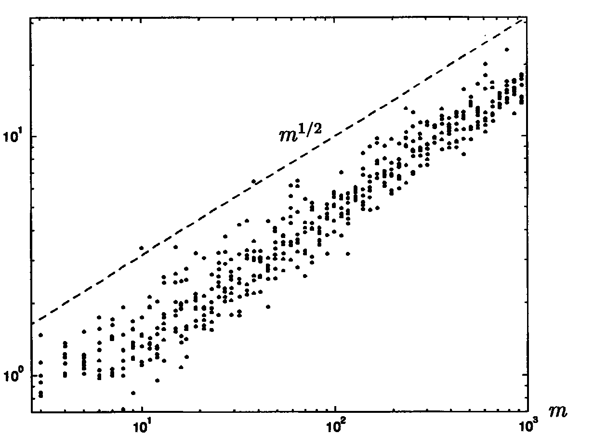

图 22.1　带部分选主元的高斯消去法作用于 496 个随机矩阵时的增长因子散点图。矩阵条目相互独立且服从正态分布。典型的 $\rho$ 量级为 $m^{1/2}$，远小于可能的最大值 $2^{m-1}$。

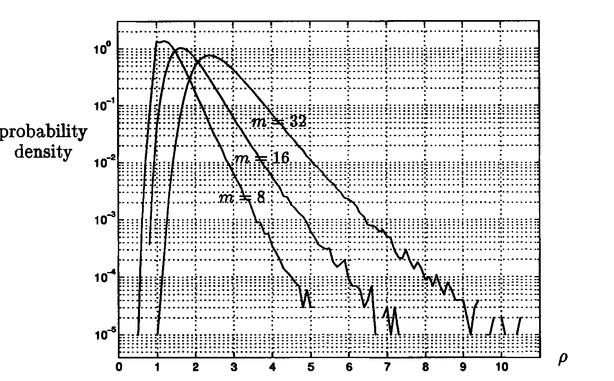

图 22.2　维数 $m=8,16,32$ 的随机矩阵增长因子概率密度。每种维数的样本量均为一百万。密度似乎随 $\rho$ 指数下降；曲线末端的抖动是有限样本量造成的。

### 解释

若 $PA=LU$，则

$$
U=L^{-1}PA.
$$

因此，如果把高斯消去法作用于矩阵 $A$ 时出现不稳定，即增长因子
$\rho$ 很大，那么 $L^{-1}$ 也必定很大。另一方面，随机三角矩阵
往往确实具有很大的逆；其大小随维数 $m$ 指数增长。对习题 12.3(d)
中的随机三角矩阵尤其如此；带部分选主元的高斯消去法产生的、对角线
为 1 且对角线下方条目绝对值不超过 1 的随机三角矩阵也具有这一性质。

然而，把高斯消去法应用于随机矩阵 $A$ 时，所得的因子 $L$ 一点也不像
随机三角矩阵。$L$ 的条目符号之间出现了相关性，使这些矩阵具有异常好的
条件性。$L^{-1}$ 的典型条目并没有指数增长，通常其绝对值还小于 1。
图 22.3 用一个维数 $m=128$ 的典型矩阵给出了这一现象的证据。

于是问题变成：为什么高斯消去法得到的 $L$ 几乎从不具有大的逆？

答案在于列空间。因为 $U$ 是上三角矩阵且 $PA=LU$，
$PA$ 与 $L$ 的列空间相同。这里的意思是：$PA$ 的第一列与 $L$ 的
第一列张成同一个空间，$PA$ 的前两列与 $L$ 的前两列张成同一个空间，
依此类推。如果 $A$ 是随机的，它的列空间具有随机方向；因此
$P^{-1}L$ 的列空间也应当具有随机方向。然而，这个条件与
$L^{-1}$ 很大是不相容的。可以证明，如果 $L^{-1}$ 很大，
那么 $L$ 的列空间，或任意置换矩阵 $P^{-1}L$ 的列空间，
必定以一种远离随机的特殊方式倾斜。

图 22.4 给出了证据。它显示了图 22.3 中同两个矩阵的连续列空间
“能量分布”在哪里。用来显示这一点的工具是 $Q$ 画像，其 MATLAB
命令为

$$
[Q,R]=\operatorname{qr}(A),\qquad
\operatorname{spy}\bigl(\lvert Q\rvert>1/\sqrt{m}\bigr).
\tag{22.6}
$$

这些命令先计算矩阵 $A$ 的 QR 分解，然后在 $Q$ 中每个满足
条目大于标准差 $m^{-1/2}$ 的位置画一个点。图中可以看出：
对于随机矩阵 $A$，即使经过行交换变成 $PA$，列空间仍然近似随机取向；
而对于产生大增长因子的矩阵 $A$，列空间的取向则远离随机。

很可能可以把这个论证定量化，从而证明：在随机矩阵中，
增长因子大于 $m^{1/2}$ 量级的事件是指数罕见的。更具体地，
对任意 $\alpha>1/2$ 和 $M>0$，当 $m$ 足够大时，

$$
\Pr\{\rho>m^\alpha\}<m^{-M}.
$$

不过截至本书写作时，这样的定理还没有被证明。

我们总结带部分选主元的高斯消去法的稳定性。对于某些矩阵 $A$，
这个算法高度不稳定；但要发生不稳定，$A$ 的列空间必须以一种
非常特殊的方式倾斜，而这种方式在至少一类随机矩阵中是指数罕见的。
数十年的计算经验表明，具有这种倾斜列空间的矩阵在实际应用中极少出现。

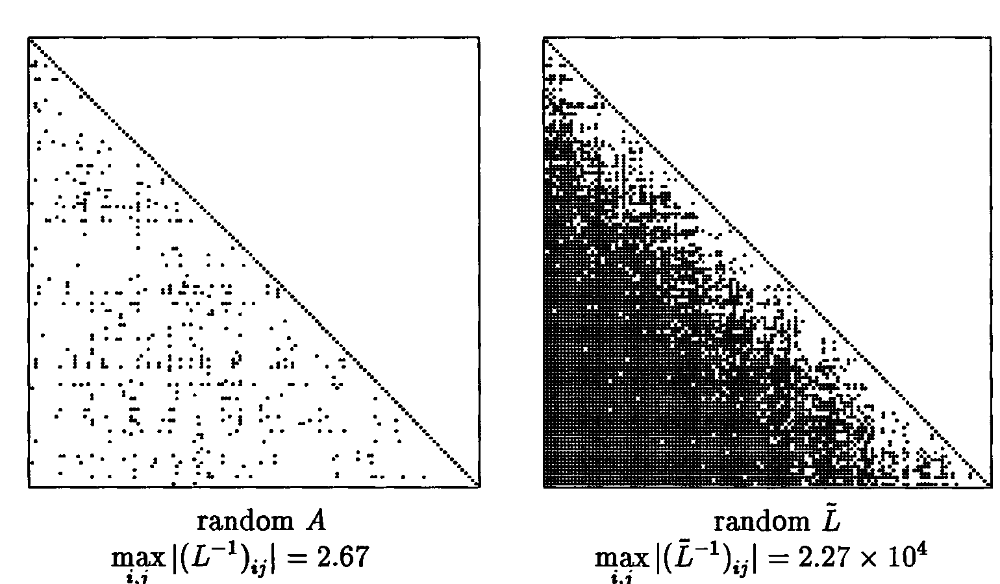

图 22.3　设随机的 $128\times128$ 矩阵 $A$ 满足 $PA=LU$。左图显示 $L^{-1}$，点表示绝对值大于等于 1 的条目；右图显示类似的 $\widetilde L^{-1}$，其中 $\widetilde L$ 与 $L$ 相同，只是其次对角线条目的符号被随机化。高斯消去法倾向于产生条件性异常良好的矩阵 $L$。

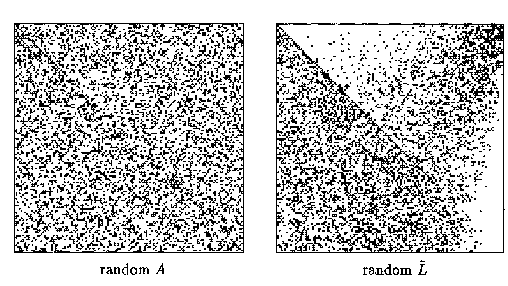

图 22.4　同两个矩阵的 $Q$ 画像 (22.6)。左图是置换为 $PA$ 后的随机矩阵 $A$，或等价地说是因子 $L$；右图是符号被随机化的矩阵 $\widetilde L$。在典型随机矩阵中，$\widetilde L$ 的列空间以图示方式倾斜是指数罕见的。

### 习题

**22.1**　证明：对任意矩阵 $A\in\mathbb{C}^{m\times m}$ 使用带部分选主元的高斯消去法时，增长因子 (22.2) 满足

$$
\rho\le2^{m-1}.
$$

**22.2**　对形如 (22.4) 的 $A$，使用带部分选主元的高斯消去法求解 $60\times60$ 方程组 $Ax=b$。由于增长因子量级为 $2^{60}$，你是否观察到结果毫无用处？第一次尝试时可能观察不到这一点，因为 $A$ 的整数条目会阻止舍入误差出现。如果确实如此，请设法对问题作轻微修改，使增长因子保持相同或近似相同，并真正产生灾难性的舍入误差。

**22.3**　近似地（不必完全复现细节）重现本讲中的图，但使用 $[-1,1]$ 均匀分布的随机矩阵条目，而不是正态分布条目。你是否看到显著差异？

**22.4**

(a) 设 $PA=LU$（带部分选主元的 $LU$ 分解），且 $A=QR$（QR 分解）。描述 $L^{-1}$ 的最后一行与 $Q$ 的最后一列之间的关系。

    (b) 证明：如果 $A$ 是条目相互独立且服从正态分布意义下的随机矩阵，那么它的列空间具有随机方向；特别地，$Q$ 的最后一列是随机单位向量。

    (c) 综合 (a)、(b) 的结果，说明对随机矩阵 $A$ 进行高斯消去时，$L^{-1}$ 的最后一行具有什么性质。

<a id="lecture-23"></a>

## 第 23 讲 Cholesky 分解

Hermitian 正定矩阵可以用三角因子分解，而且运算量只有一般矩阵的一半。
实现这一点的标准算法是 Cholesky 分解。它是高斯消去法的一个变体，
同时在矩阵的左侧和右侧操作，从而保持并利用对称结构。

### Hermitian 正定矩阵

实矩阵 $A\in\mathbb{R}^{m\times m}$ 如果关于主对角线对称，即
$a_{ij}=a_{ji}$，就称为对称矩阵，因而 $A=A^T$。这样的矩阵满足

$$
x^TAy=y^TAx,\qquad x,y\in\mathbb{R}^m.
$$

对复矩阵 $A\in\mathbb{C}^{m\times m}$，相应的性质是 Hermitian 性：
主对角线下方的条目是主对角线上方对应条目的复共轭，
$a_{ij}=\overline{a_{ji}}$，因而 $A=A^*$。注意，Hermitian 矩阵的
对角线条目必为实数。

Hermitian 矩阵满足

$$
x^*Ay=y^*Ax,\qquad x,y\in\mathbb{C}^m.
$$

特别地，对任意 $x\in\mathbb{C}^m$，$x^*Ax$ 都是实数。如果进一步
对所有 $x\ne0$ 都有 $x^*Ax>0$，则称 $A$ 为 Hermitian 正定矩阵，
有时也简称正定矩阵。物理系统中出现的许多矩阵，由于基本物理定律，
都是 Hermitian 正定的。

设 $A$ 是 $m\times m$ 的 Hermitian 正定矩阵，$X$ 是满列秩的
$m\times n$ 矩阵，且 $m\ge n$。那么 $X^*AX$ 也是 Hermitian 正定的。
它是 Hermitian 矩阵，因为

$$
(X^*AX)^*=X^*A^*X=X^*AX.
$$

它是正定的，因为对任意 $x\ne0$，有 $Xx\ne0$，从而

$$
x^*(X^*AX)x=(Xx)^*A(Xx)>0.
$$

取每列只有一个 1、其余元素为 0 的 $X$，可以把 $A$ 的任意主子矩阵
写成 $X^*AX$。因此，$A$ 的任意主子矩阵都必须正定；特别地，
$A$ 的每个对角线条目都是正实数。

Hermitian 正定矩阵的特征值也都是正实数。若
$Ax=\lambda x$ 且 $x\ne0$，则

$$
x^*Ax=\lambda x^*x>0,
$$

所以 $\lambda>0$。反过来，如果 Hermitian 矩阵的全部特征值为正，
则它就是正定的。

Hermitian 矩阵对应于不同特征值的特征向量彼此正交。设
$Ax_1=\lambda_1x_1$、$Ax_2=\lambda_2x_2$ 且 $\lambda_1\ne\lambda_2$，
则

$$
\lambda_2x_1^*x_2=x_1^*Ax_2=x_2^*Ax_1
=\overline{\lambda_1}x_2^*x_1=\lambda_1x_1^*x_2.
$$

于是 $(\lambda_1-\lambda_2)x_1^*x_2=0$，从而 $x_1^*x_2=0$。

### 对称高斯消去

现在讨论如何把 Hermitian 正定矩阵分解为三角因子。先考察一个左上角
为 1 的 Hermitian 矩阵，对它执行一步高斯消去：

$$
A=
\begin{bmatrix}
1&w^*\\
w&K
\end{bmatrix}
=
\begin{bmatrix}
1&0\\
w&I
\end{bmatrix}
\begin{bmatrix}
1&w^*\\
0&K-ww^*
\end{bmatrix}.
$$

左侧的初等下三角操作从后续各行中减去第一行的适当倍数，
从而在矩阵的第一列引入零。

普通高斯消去法接下来会继续在第二列引入零。不过，为了保持对称性，
Cholesky 分解首先在第一行引入与第一列相匹配的零。可以通过右侧的
上三角操作做到这一点：

$$
\begin{bmatrix}
1&w^*\\
0&K-ww^*
\end{bmatrix}
=
\begin{bmatrix}
1&0\\
0&K-ww^*
\end{bmatrix}
\begin{bmatrix}
1&w^*\\
0&I
\end{bmatrix}.
$$

注意，这个上三角操作恰好是前面用来在第一列引入零的下三角操作的伴随。
把两个操作合并，得到

$$
A=
\begin{bmatrix}
1&0\\
w&I
\end{bmatrix}
\begin{bmatrix}
1&0\\
0&K-ww^*
\end{bmatrix}
\begin{bmatrix}
1&w^*\\
0&I
\end{bmatrix}.
\tag{23.1}
$$

Cholesky 分解的思想，就是以这种方式继续进行：对 $A$ 的一列和一行
同时引入零，直到它被化为单位矩阵。

### Cholesky 分解

为了使这种对称三角化对一般情形都有效，需要允许任意 $a_{11}>0$，
而不只是 $a_{11}=1$。令 $\alpha=\sqrt{a_{11}}$，则

$$
\begin{aligned}
A&=
\begin{bmatrix}
a_{11}&w^*\\
w&K
\end{bmatrix}\\
&=
\begin{bmatrix}
\alpha&0\\
w/\alpha&I
\end{bmatrix}
\begin{bmatrix}
1&0\\
0&K-ww^*/a_{11}
\end{bmatrix}
\begin{bmatrix}
\alpha&w^*/\alpha\\
0&I
\end{bmatrix}
=R_1^*A_1R_1.
\end{aligned}
$$

这就是 Cholesky 分解反复使用的基本步骤。如果子矩阵
$K-ww^*/a_{11}$ 的左上角条目为正，就可以对它使用同一个公式。
于是 $A_1=R_2^*A_2R_2$，从而
$A=R_1^*R_2^*A_2R_2R_1$。继续到右下角，最终得到

$$
A=R_1^*R_2^*\cdots R_m^*R_m\cdots R_2R_1.
\tag{23.2}
$$

把前半段记作 $R^*$、后半段记作 $R$，就有

$$
A=R^*R,\qquad r_{jj}>0,
\tag{23.3}
$$

其中 $R$ 是上三角矩阵。Hermitian 正定矩阵的这种分解称为
Cholesky 分解。

为什么子矩阵 $K-ww^*/a_{11}$ 的左上角条目一定为正？
因为 $K-ww^*/a_{11}$ 是正定的，事实上它是正定矩阵
$R_1^{-*}AR_1^{-1}$ 的右下角 $(m-1)\times(m-1)$ 主子矩阵。
用归纳法可以得到，在分解过程中出现的所有子矩阵 $A_i$ 都是正定的，
因此算法不可能中途失败。

**定理 23.1**　每个 Hermitian 正定矩阵
$A\in\mathbb{C}^{m\times m}$ 都有唯一的 Cholesky 分解 (23.3)。

**证明**　存在性正是上面的讨论：算法不可能失败，所以分解一定存在。
事实上，算法也给出了唯一性。在每一步 (23.2) 中，
$\alpha=\sqrt{a_{11}}$ 的值由 $R^*R$ 的形式唯一确定；一旦 $\alpha$
确定，$R_1^*$ 的第一行也唯一确定。每一步都如此，因此整个分解唯一。

### 算法

实现 Cholesky 分解时，只需要显式存储正在操作的矩阵的一半，
因而可以省去一半算术运算。下面给出算法的一种正式写法。
输入矩阵 $A$ 表示待分解的 $m\times m$ Hermitian 正定矩阵的上三角部分；
实际软件可以使用压缩存储，避免浪费方阵数组的一半空间。输出矩阵
$R$ 是满足 $A=R^*R$ 的上三角因子。每次外层迭代对应一次基本分解；
在第 $k$ 步，子矩阵 $R_{k:m,k:m}^*$ 的上三角部分表示当前待分解的
Hermitian 矩阵的上三角部分。

**算法 23.1（Cholesky 分解）**

    R = A
    for k = 1 to m
        for j = k+1 to m
            R(j,j:m) = R(j,j:m) - R(k,j:m)*R(k,j)/R(k,k)
        R(k,k:m) = R(k,k:m)/sqrt(R(k,k))

### 运算量

Cholesky 分解的算术量主要集中在内层循环。内层语句

$$
R_{j,j:m}=R_{j,j:m}-R_{k,j:m}R_{kj}/R_{kk}
$$

每执行一次，需要一次除法、$m-j+1$ 次乘法和 $m-j+1$ 次减法，
总计约 $2(m-j)$ 次浮点运算。对每个 $j=k+1,\ldots,m$ 重复，
再对每个 $k=1,\ldots,m$ 重复。因此

$$
\begin{aligned}
\sum_{k=1}^{m}\sum_{j=k+1}^{m}2(m-j)
&\sim2\sum_{k=1}^{m}\sum_{j=1}^{k}j
\sim\sum_{k=1}^{m}k^2\\
&\sim\frac13m^3\ \mathrm{flops}.
\end{aligned}
$$

所以，Cholesky 分解的运算量只有高斯消去法的一半；对同一个矩阵，
高斯消去法需要约 $\frac23m^3$ 次浮点运算。

运算量也可以用几何方式计算。对每个 $k$，三角层的每个位置进行两次
浮点运算（一次乘法和一次减法）。整个算法相当于堆叠 $m$ 层：

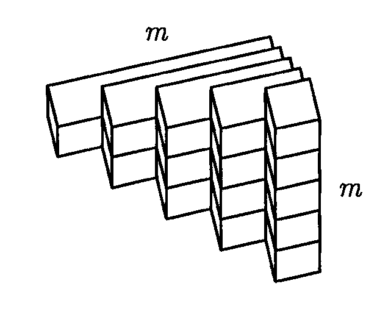

图 23.1　Cholesky 分解运算量的几何示意图。当 $m\to\infty$ 时，
这个实体趋近于体积为 $\frac16m^3$ 的四面体。由于每个单位立方体
对应两次浮点运算，再次得到

$$
\text{Cholesky 分解的工作量}\sim\frac13m^3\ \mathrm{flops}.
\tag{23.4}
$$

### 稳定性

高斯消去法稳定性分析中的所有微妙之处，在 Cholesky 分解中都消失了。
这个算法总是稳定的。直观地说，这是因为因子 $R$ 不可能变得很大。
例如在 2-范数下，

$$
\|R\|=\|R^*\|=\|A\|^{1/2},
$$

其中等式可由奇异值分解证明；对满足 $1\le p\le\infty$ 的其他
$p$-范数，$\|R\|$ 与 $\|A\|^{1/2}$ 的差别也不会超过一个
$\sqrt m$ 的因子。因此，远大于 $A$ 的条目不可能在计算中出现。

注意，Cholesky 分解不需要任何选主元就能保持稳定。直观上，这与
Hermitian 正定矩阵的大部分权重集中在对角线上有关。例如不难证明，
最大条目必定出现在对角线上；而这个性质也会传递给归纳过程 (23.2)
中构造出的正定子矩阵。

**定理 23.2**　设 $A\in\mathbb{C}^{m\times m}$ 是 Hermitian 正定矩阵，
并在满足 (13.5) 和 (13.7) 的计算机上利用算法 23.1 计算其 Cholesky
分解。当 $\varepsilon_{\mathrm{machine}}$ 足够小时，该过程保证完成
（不会出现零或负的角元素 $r_{kk}$），并产生满足下式的计算因子
$\widetilde R$：

$$
\widetilde R^*\widetilde R=A+\delta A,\qquad
\frac{\|\delta A\|}{\|A\|}=O(\varepsilon_{\mathrm{machine}}),
\qquad \delta A\in\mathbb{C}^{m\times m}.
\tag{23.5}
$$

如果 $A$ 病态，$\widetilde R$ 通常不会接近 $R$；我们最多只能说

$$
\frac{\|\widetilde R-R\|}{\|R\|}
=O\bigl(\kappa(A)\varepsilon_{\mathrm{machine}}\bigr).
$$

换句话说，Cholesky 分解一般是一个病态问题。真正满足较好误差界
(23.5) 的是乘积 $\widetilde R^*\widetilde R$。因此，$\widetilde R$
中的舍入误差虽然可能很大，却是“恶魔般相关”的，正如第 16 讲
QR 分解中看到的那样。

### 求解 $Ax=b$

如果 $A$ 是 Hermitian 正定矩阵，求解方程组 $Ax=b$ 的标准方法就是
Cholesky 分解。算法 23.1 把方程组化为

$$
R^*Rx=b,
$$

然后依次求解两个三角方程组：先求未知量 $y$，$R^*y=b$；
再求未知量 $x$，$Rx=y$。每次三角求解只需约 $\frac12m^2$ 次浮点
运算，所以总工作量仍为约 $\frac13m^3$ 次浮点运算。

按照与第 16 讲类似的推理，可以证明这个过程是向后稳定的。

**定理 23.3**　通过 Cholesky 分解（算法 23.1）求解 Hermitian 正定
方程组 $Ax=b$ 是向后稳定的；所得计算解 $\widetilde x$ 满足

$$
(A+\Delta A)\widetilde x=b,\qquad
\frac{\|\Delta A\|}{\|A\|}=O(\varepsilon_{\mathrm{machine}}),
\qquad \Delta A\in\mathbb{C}^{m\times m}.
\tag{23.6}
$$

### 习题

**23.1**　设 $A$ 是非奇异方阵，并设 $A=QR$、$A^*A=U^*U$
分别是 QR 分解和 Cholesky 分解，且采用通常的归一化
$r_{jj},u_{jj}>0$。$R=U$ 是真还是假？

**23.2**　以定理 16.2 的证明为指导，由定理 23.2 和定理 17.1
推导定理 23.3。

**23.3　反向软件工程：MATLAB 的反斜杠。**

下面的 MATLAB 会话记录了在一台 1991 年制造的工作站上，
对若干计算测量耗时的一系列测试。对每一项，尝试解释：
(i) 为什么要进行这个实验；(ii) 为什么会得到这样的结果。
答案应引用正文中的浮点运算量公式。MATLAB 命令 help chol
和 help slash 可能会帮助你完成这项侦探工作。

    (a) m = 200; Z = randn(m,m);
        A = Z'*Z; b = randn(m,1);
        tic; x = A\b; toc;
             elapsed_time = 1.0368

    (b) tic; x = A\b; toc;
             elapsed_time = 1.0303

    (c) A2 = A; A2(m,1) = A2(m,1)/2;
        tic; x = A2\b; toc;
             elapsed_time = 2.0361

    (d) I = eye(m,m); emin = min(eig(A));
        A3 = A - .9*emin*I;
        tic; x = A3\b; toc;
             elapsed_time = 1.0362

    (e) A4 = A - 1.1*emin*I;
        tic; x = A4\b; toc;
             elapsed_time = 2.9624

    (f) A5 = triu(A);
        tic; x = A5\b; toc;
             elapsed_time = 0.1261

    (g) A6 = A5; A6(m,1) = A5(1,m);
        tic; x = A6\b; toc;
             elapsed_time = 2.0012
<a id="lecture-24"></a>

## 第 24 讲 特征值问题

特征值问题在科学计算中尤其有趣，因为寻找特征值的最佳算法虽然
功能强大，却往往非常不直观。本讲回顾特征值与特征向量的数学；
算法将在后面的讲次中讨论。

### 特征值与特征向量

设 $A\in\mathbb{C}^{m\times m}$ 是方阵。若非零向量
$x\in\mathbb{C}^m$ 满足

$$
Ax=\lambda x.
\tag{24.1}
$$

则称 $x$ 是 $A$ 的特征向量，$\lambda\in\mathbb{C}$ 是与之对应的
特征值。

这里的想法是，矩阵 $A$ 作用在 $\mathbb{C}^m$ 的某个子空间 $S$
上时，有时会表现得像标量乘法。发生这种情况时，这个特殊子空间
称为特征子空间，其中任意非零 $x\in S$ 都是特征向量。

矩阵 $A$ 的全部特征值组成 $A$ 的谱，记作
$\Lambda(A)\subset\mathbb{C}$。

特征值问题与前面几讲讨论的方程组问题有很不一样的性质。对方程组而言，
$A$ 的定义域可以是一个空间，值域可以是另一个空间。例如在例 1.1 中，
$A$ 把多项式系数的 $n$-向量映射为采样多项式值的 $m$-向量；
询问这种 $A$ 的特征值没有意义。特征值问题只有在定义域和值域相同的
时候才有意义。这反映了应用中的一个事实：特征值通常用于研究矩阵的
迭代复合，或者研究 $A^k$ 这样的显式幂，或者研究 $e^{tA}$ 这样的
函数形式。

概括地说，特征值和特征向量有两方面用途，一方面是算法上的，另一方面
是物理上的。从算法角度，特征值分析可以把某些耦合问题化简为一组
标量问题。从物理角度，特征值分析能够帮助我们理解线性方程控制的
演化系统的行为。最熟悉的例子包括共振（例如乐器受到敲击、拨动或拉奏
时的响应）和稳定性（例如流体受到微小扰动时的行为）。在这些问题中，
特征值对于分析大时间 $t$ 的行为尤其有用；见习题 24.3。

### 特征值分解

方阵 $A$ 的特征值分解（已经在 (5.1) 中提到）是如下因式分解：

$$
A=X\Lambda X^{-1}.
\tag{24.2}
$$

其中 $X$ 非奇异，$\Lambda$ 为对角矩阵。（如下文所述，这种分解
并不总是存在。）

这个定义可以改写为

$$
AX=X\Lambda.
\tag{24.3}
$$

也就是

$$
A\begin{bmatrix}x_1&x_2&\cdots&x_m\end{bmatrix}
=\begin{bmatrix}x_1&x_2&\cdots&x_m\end{bmatrix}
\begin{bmatrix}
\lambda_1&&&\\
&\lambda_2&&\\
&&\ddots&\\
&&&\lambda_m
\end{bmatrix}.
$$

因此，如果 $x_j$ 是 $X$ 的第 $j$ 列、$\lambda_j$ 是 $\Lambda$ 的
第 $j$ 个对角条目，就有 $Ax_j=\lambda_jx_j$。换句话说，$X$ 的
第 $j$ 列是 $A$ 的特征向量，而 $\Lambda$ 的第 $j$ 个条目是相应的
特征值。

特征值分解把基变换为“特征向量坐标”。如果 $Ax=b$ 且
$A=X\Lambda X^{-1}$，则

$$
X^{-1}b=\Lambda(X^{-1}x).
\tag{24.4}
$$

因此，为了计算 $Ax$，可以先在 $X$ 的列向量构成的基下展开 $x$，
再作用以 $\Lambda$，最后把结果理解为 $X$ 的列向量线性组合的系数。

### 几何重数

对应于同一个特征值的全部特征向量，加上零向量后构成一个子空间，
称为特征子空间。若 $\lambda$ 是 $A$ 的特征值，记相应的特征子空间为
$E_\lambda$。特征子空间是 $A$ 的一个不变子空间，即

$$
AE_\lambda\subseteq E_\lambda.
$$

$E_\lambda$ 的维数可以理解为：对应于同一个特征值 $\lambda$ 的
线性无关特征向量的最大数量。这个数量称为 $\lambda$ 的几何重数。
几何重数也可以描述为

$$
\dim\mathcal{N}(A-\lambda I),
$$

因为这个零空间正是 $E_\lambda$。

### 特征多项式

$A\in\mathbb{C}^{m\times m}$ 的特征多项式，记作 $p_A$，或简写为
$p$，是由下式定义的 $m$ 次多项式：

$$
p_A(z)=\det(zI-A).
\tag{24.5}
$$

由于放置了负号，$p$ 是首一多项式，即 $m$ 次项的系数为 1。

**定理 24.1**　$\lambda$ 是 $A$ 的特征值，当且仅当 $p_A(\lambda)=0$。

**证明**　由特征值的定义，

$$
\begin{aligned}
\lambda\text{ 是 }A\text{ 的特征值}
&\Longleftrightarrow\text{存在非零 }x\text{ 使 }\lambda x-Ax=0\\
&\Longleftrightarrow\lambda I-A\text{ 奇异}\\
&\Longleftrightarrow\det(\lambda I-A)=0.
\end{aligned}
$$

定理 24.1 有一个重要推论：即使矩阵 $A$ 是实矩阵，它的某些特征值
也可能是复数。从物理上说，这与实动力系统既可能振荡，也可能增长或
衰减的现象有关。从算法上说，即使特征值问题的输入是实数，输出也可能
必须使用复数。

### 代数重数

根据代数基本定理，可以把 $p_A$ 写成

$$
p_A(z)=(z-\lambda_1)(z-\lambda_2)\cdots(z-\lambda_m)
\tag{24.6}
$$

的形式，其中 $\lambda_j\in\mathbb{C}$。由定理 24.1，每个 $\lambda_j$
都是 $A$ 的特征值，$A$ 的所有特征值都会出现在这个列表中。一般来说，
一个特征值可能出现多次。特征值 $\lambda$ 的代数重数，定义为它作为
$p_A$ 的根的重数。代数重数为 1 的特征值称为单特征值。

特征多项式给出了计算矩阵特征值数量的简单方法。

**定理 24.2**　若 $A\in\mathbb{C}^{m\times m}$，则 $A$ 有 $m$ 个
特征值，按代数重数计。特别地，如果 $p_A$ 的根都是单根，那么 $A$
有 $m$ 个互不相同的特征值。

特别注意，每个矩阵至少有一个特征值。一个特征值的代数重数总是不小于
它的几何重数。为了证明这一点，需要先了解相似变换。

### 相似变换

如果 $X\in\mathbb{C}^{m\times m}$ 非奇异，那么映射

$$
A\longmapsto X^{-1}AX
$$

称为 $A$ 的相似变换。如果存在非奇异的 $X\in\mathbb{C}^{m\times m}$
使 $B=X^{-1}AX$，就称矩阵 $A$ 和 $B$ 相似。正如特征值分解中的
特殊情形所说明的，相似变换就是一种换基操作。

许多性质会被相似矩阵 $A$ 和 $X^{-1}AX$ 共同保持。

**定理 24.3**　若 $X$ 非奇异，则 $A$ 和 $X^{-1}AX$ 具有相同的
特征多项式、特征值、代数重数和几何重数。

**证明**　特征多项式相同是直接计算的结果：

$$
\begin{aligned}
p_{X^{-1}AX}(z)
&=\det(zI-X^{-1}AX)\\
&=\det\bigl(X^{-1}(zI-A)X\bigr)\\
&=\det(X^{-1})\det(zI-A)\det(X)\\
&=\det(zI-A)=p_A(z).
\end{aligned}
$$

特征多项式相同，立即得到特征值和代数重数相同。最后，若 $E_\lambda$
是 $A$ 的特征子空间，则可以验证 $X^{-1}E_\lambda$ 是
$X^{-1}AX$ 的特征子空间，反之亦然，所以几何重数也相同。

现在可以把几何重数和代数重数联系起来。

**定理 24.4**　特征值的代数重数至少与它的几何重数一样大。

**证明**　设 $\lambda$ 对矩阵 $A$ 的几何重数为 $n$。令 $\widehat V$
为 $m\times n$ 矩阵，其列构成特征子空间

$$
\{x:Ax=\lambda x\}
$$

的一组标准正交基。把 $\widehat V$ 扩充为一个方阵酉矩阵 $V$，则

$$
B=V^*AV=
\begin{bmatrix}
\lambda I&C\\
0&D
\end{bmatrix},
\tag{24.7}
$$

其中 $I$ 是 $n\times n$ 单位矩阵，$C$ 是 $n\times(m-n)$ 矩阵，
$D$ 是 $(m-n)\times(m-n)$ 矩阵。由行列式的定义，

$$
\det(zI-B)=\det(zI-\lambda I)\det(zI-D)
=(z-\lambda)^n\det(zI-D).
$$

因此，$\lambda$ 作为 $B$ 的特征值，其代数重数至少为 $n$。相似变换
保持重数，所以对 $A$ 也成立。

### 缺陷特征值与缺陷矩阵

虽然一般矩阵的代数重数和几何重数通常相等（也就是都为 1），
但这绝不是对所有矩阵都成立。

**例 24.1**　考虑两个矩阵

$$
A=\begin{bmatrix}2&0&0\\0&2&0\\0&0&2\end{bmatrix},
\qquad
B=\begin{bmatrix}2&1&0\\0&2&1\\0&0&2\end{bmatrix}.
$$

$A$ 和 $B$ 的特征多项式都是 $(z-2)^3$，因此二者都只有一个特征值
$\lambda=2$，代数重数为 3。对 $A$，可以选取三个线性无关的特征向量，
例如 $e_1,e_2,e_3$，所以几何重数也是 3。对 $B$，却只能找到一个
线性无关的特征向量（$e_1$ 的数乘），因此几何重数只有 1。

代数重数大于几何重数的特征值称为缺陷特征值；含有一个或多个缺陷
特征值的矩阵称为缺陷矩阵。

任意对角矩阵都是非缺陷的。对这样的矩阵，一个特征值的代数重数和
几何重数都等于它在对角线上出现的次数。

### 可对角化性

非缺陷矩阵恰好就是存在特征值分解 (24.2) 的矩阵类。

**定理 24.5**　$m\times m$ 矩阵 $A$ 非缺陷，当且仅当它有特征值分解

$$
A=X\Lambda X^{-1}.
$$

**证明**　若 $A=X\Lambda X^{-1}$，由定理 24.3，$\Lambda$ 与 $A$ 相似，
所以二者有相同的特征值和重数。由于 $\Lambda$ 是对角矩阵，它是非缺陷的，
从而 $A$ 也是非缺陷的。

反过来，非缺陷矩阵必须有 $m$ 个线性无关的特征向量：不同特征值对应
的特征向量必然线性无关，并且每个特征值能够贡献与其代数重数一样多的
线性无关特征向量。把这 $m$ 个特征向量作为矩阵 $X$ 的列，$X$ 就是
非奇异的，而且 $A=X\Lambda X^{-1}$。

鉴于这个结论，非缺陷矩阵的另一个名称是可对角化矩阵。一个可对角化
矩阵 $A$ 是否在某种意义上“表现得像”它的对角等价矩阵 $\Lambda$？
答案取决于所衡量的行为，以及特征向量矩阵 $X$ 的条件数。如果 $X$
高度病态，那么从 $A$ 转换为 $\Lambda$ 时可能丢失大量信息。
见第 34 讲的“谨慎提示：非正规性”。

### 行列式与迹

$A\in\mathbb{C}^{m\times m}$ 的迹是它的对角线元素之和：

$$
\operatorname{tr}(A)=\sum_{j=1}^{m}a_{jj}.
$$

迹和行列式都与特征值有简单关系。

**定理 24.6**　矩阵 $A$ 的行列式 $\det(A)$ 和迹
$\operatorname{tr}(A)$，分别等于 $A$ 的特征值之积和之和，
特征值按代数重数计：

$$
\det(A)=\prod_{j=1}^{m}\lambda_j,
\qquad
\operatorname{tr}(A)=\sum_{j=1}^{m}\lambda_j.
\tag{24.8}
$$

**证明**　由 (24.5) 和 (24.6)，

$$
\det(A)=(-1)^m\det(-A)=(-1)^mp_A(0)=\prod_{j=1}^{m}\lambda_j.
$$

这证明了第一个公式。对于第二个公式，由 (24.5)，$p_A$ 的
$z^{m-1}$ 项系数是 $A$ 的对角线元素之和的负值，即
$-\operatorname{tr}(A)$；另一方面，由 (24.6)，这个系数也是
$-\sum_{j=1}^{m}\lambda_j$。因此
$\operatorname{tr}(A)=\sum_{j=1}^{m}\lambda_j$。

### 酉对角化

有时，$m\times m$ 矩阵 $A$ 不仅有 $m$ 个线性无关的特征向量，
而且这些特征向量可以选成相互正交的。在这种情况下，称 $A$ 是
酉可对角化的，即存在酉矩阵 $Q$ 使

$$
A=Q\Lambda Q^*.
\tag{24.9}
$$

这个分解既是特征值分解，也是奇异值分解；区别只在于 $\Lambda$
的对角条目可能带有复数符号。

Hermitian 矩阵就是一类已经见过的酉可对角化矩阵。

**定理 24.7**　Hermitian 矩阵是酉可对角化的，而且它的特征值都是实数。

酉可对角化的矩阵不只有 Hermitian 矩阵。其他例子包括反 Hermitian 矩阵、
酉矩阵、循环矩阵，以及这些矩阵加上单位矩阵的数倍。一般地，若

$$
A^*A=AA^*,
$$

就称 $A$ 为正规矩阵。

**定理 24.8**　矩阵酉可对角化，当且仅当它是正规矩阵。

### Schur 分解

还有一种矩阵分解在数值分析中实际上最有用，因为包括缺陷矩阵在内的
所有矩阵都可以进行这种分解。矩阵 $A$ 的 Schur 分解是

$$
A=QTQ^*,
\tag{24.10}
$$

其中 $Q$ 是酉矩阵，$T$ 是上三角矩阵。由于 $A$ 和 $T$ 相似，
$A$ 的特征值必然出现在 $T$ 的对角线上。

**定理 24.9**　每个方阵 $A$ 都有 Schur 分解。

**证明**　对 $A$ 的维数 $m$ 使用归纳法。当 $m=1$ 时结论显然成立；
设 $m\ge2$。取 $A$ 的任意一个特征向量 $x$，对应特征值为 $\lambda$。
将 $x$ 归一化，并令它成为酉矩阵 $U$ 的第一列。容易验证

$$
U^*AU=
\begin{bmatrix}
\lambda&B\\
0&C
\end{bmatrix}.
$$

根据归纳假设，存在矩阵 $V$ 和上三角矩阵 $T$ 使 $C=VTV^*$。
令

$$
Q=U\begin{bmatrix}1&0\\0&V\end{bmatrix}.
$$

这是一个酉矩阵，并且

$$
Q^*AQ=
\begin{bmatrix}
\lambda&BV\\
0&T
\end{bmatrix}.
$$

这就是所需的 Schur 分解。

### 揭示特征值的分解

前面介绍了三种揭示特征值的分解，也就是把矩阵化为能够显式显示
特征值的形式：

- 对角化 $A=X\Lambda X^{-1}$ 当且仅当 $A$ 非缺陷；
- 酉对角化 $A=Q\Lambda Q^*$ 当且仅当 $A$ 正规；
- 酉三角化（Schur 分解）$A=QTQ^*$ 对所有矩阵都存在。

为了计算特征值，我们将构造上述某一种分解。一般而言会使用 Schur
分解，因为它对所有矩阵都适用。此外，由于算法中使用了酉变换，
所得算法通常具有数值稳定性。如果 $A$ 正规，那么 Schur 形式就是
对角的；特别地，如果 $A$ 是 Hermitian 矩阵，我们可以在计算全过程
中利用这种对称性，把 $A$ 化为对角形式，而且运算量至多是一般矩阵
所需运算量的一半。

### 习题

**24.1**　对下列每个命题，证明它为真，或者给出反例说明它为假。
除非另有说明，$A\in\mathbb{C}^{m\times m}$；本题用“ew”表示
eigenvalue（特征值），这个缩写来自德语 Eigenwert，特征向量的
对应缩写“ev”来自 Eigenvektor。

(a) 如果 $\lambda$ 是 $A$ 的特征值且 $\mu\in\mathbb{C}$，那么
$\lambda-\mu$ 是 $A-\mu I$ 的特征值。

(b) 如果 $A$ 是实矩阵且 $\lambda$ 是 $A$ 的特征值，那么 $-\lambda$
也是 $A$ 的特征值。

(c) 如果 $A$ 是实矩阵且 $\lambda$ 是 $A$ 的特征值，那么
$\overline{\lambda}$ 也是 $A$ 的特征值。

(d) 如果 $\lambda$ 是 $A$ 的特征值且 $A$ 非奇异，那么 $\lambda^{-1}$
是 $A^{-1}$ 的特征值。

(e) 如果 $A$ 的所有特征值都是 0，那么 $A=0$。

(f) 如果 $A$ 是 Hermitian 矩阵且 $\lambda$ 是 $A$ 的特征值，那么
$|\lambda|$ 是 $A$ 的一个奇异值。

(g) 如果 $A$ 可对角化且它的所有特征值都相同，那么 $A$ 是对角矩阵。

**24.2**　下面是对任意 $m\times m$ 矩阵 $A$（不论对称与否）成立的
Gerschgorin 定理：$A$ 的每个特征值至少落在复平面上的 $m$ 个圆盘
中的一个内，其中第 $i$ 个圆盘的圆心为 $a_{ii}$，半径为
$\sum_{j\ne i}|a_{ij}|$。此外，如果其中 $n$ 个圆盘构成一个与其余
$m-n$ 个圆盘不相交的连通区域，那么该区域内恰好有 $n$ 个 $A$ 的
特征值。

(a) 证明 Gerschgorin 定理的第一部分。（提示：设 $\lambda$ 是 $A$
的任意特征值，$x$ 是对应特征向量，并把 $x$ 的最大条目归一化为 1。）

(b) 证明第二部分。（提示：把 $A$ 连续变形为对角矩阵，并利用矩阵
特征值是其条目的连续函数这一事实。）

(c) 对下列矩阵的特征值，利用 Gerschgorin 定理给出估计：

$$
A=
\begin{bmatrix}
8&1&0\\
1&4&\varepsilon\\
0&\varepsilon&1
\end{bmatrix},
\qquad |\varepsilon|<1.
$$

(d) 设法证明 $A$ 的最小特征值 $\lambda_3$ 满足更紧的界

$$
|\lambda_3-1|\le\varepsilon^2.
$$

（提示：考虑对角相似变换。）

**24.3**　设 $A$ 是一个 $10\times10$ 随机矩阵，其条目服从标准正态
分布，再减去两倍单位矩阵。编写程序，在对数坐标下绘制
$0\le t\le20$ 时的 $\|e^{tA}\|_2$，并将结果与直线
$e^{t\alpha(A)}$ 比较，其中

$$
\alpha(A)=\max_j\operatorname{Re}(\lambda_j)
$$

是 $A$ 的谱 abscissa。对十个随机矩阵 $A$ 运行程序并评论结果。
什么性质会使矩阵的 $\|e^{tA}\|_2$ 曲线在 $t\to\infty$ 时仍然振荡？

**24.4**　对任意 $A\in\mathbb{C}^{m\times m}$ 和任意范数，利用定理
24.9 证明：

(a)

$$
\lim_{n\to\infty}\|A^n\|=0
\quad\Longleftrightarrow\quad
\rho(A)<1,
$$

其中 $\rho$ 是谱半径（见习题 3.2）。

(b)

$$
\lim_{t\to\infty}\|e^{tA}\|=0
\quad\Longleftrightarrow\quad
\alpha(A)<0,
$$

其中 $\alpha$ 是谱 abscissa。

<a id="lecture-25"></a>

## 第 25 讲　特征值算法概述

> 原书页码：190–195；目标 PDF 页码：205–210。

本讲以及接下来的五讲介绍一些计算特征值与特征向量的经典“直接”
算法，也会提到几种现代变体。大多数算法分成两个阶段：先把满矩阵
直接约化为某种结构化形式，再通过迭代过程使结果最终收敛。本讲先概述
这种两阶段思路，并解释为什么预先结构化是有益的。

### 显而易见的算法为什么不理想

虽然特征值和特征向量的定义简单、刻画优雅，但最好的计算方法并不
显而易见。一个自然的想法是先计算特征多项式的系数，再使用求根器
求出其根。遗憾的是，正如第 15 讲所说，这是一种糟糕的策略：即使
底层的特征值问题是良态的，多项式求根通常也是病态问题。（事实上，
多项式求根几乎从来不是科学计算的主流主题，原因正是它很少是解决
实际问题的最佳方式。）

另一个想法是利用下列序列：

$$
\frac{x}{\lVert x\rVert},\quad
\frac{Ax}{\lVert Ax\rVert},\quad
\frac{A^2x}{\lVert A^2x\rVert},\quad
\frac{A^3x}{\lVert A^3x\rVert},\quad\ldots
$$

在一定假设下，这个序列会收敛到对应于 $A$ 的绝对值最大特征值的
一个特征向量。用这种方法寻找特征向量称为幂迭代（power iteration）。
遗憾的是，幂迭代虽然著名，却绝不是一种适合一般用途的有效工具；除非
矩阵具有特殊结构，否则它会非常慢。

一般用途的优秀特征值算法并不依赖这些想法，而是遵循另一个原则：
计算 $A$ 的一种“揭示特征值的分解”，使特征值直接出现在某个因子中。
上一讲已经见过三种这样的分解：对角化、酉对角化和酉三角化（Schur
分解）。实践中，人们通常通过构造其中一种分解来计算特征值。从概念
上说，需要做的是对 $A$ 施加一系列变换，在适当位置引入零；这与本书
前面各讲中的算法完全相同。因此，寻找特征值最终和求解方程组或最小
二乘问题有着相似的风格。数值线性代数中的算法，主要建立在一个被
反复使用的技巧之上：把矩阵中的某些条目变成零。

### 一个根本困难

不过，计算特征值时会出现一个新的因素。乍看起来，代数方面的原因
似乎会阻止这类算法取得完全成功。

要看清这个困难，注意到正如特征值问题可以化为多项式求根问题，反过来，
任意多项式求根问题也都可以表述为特征值问题。设给定首一多项式

$$
p(z)=z^m+a_{m-1}z^{m-1}+\cdots+a_1z+a_0.
\tag{25.1}
$$

通过按余子式展开不难验证，$p(z)$ 等于 $(-1)^m$ 乘以下列
$m\times m$ 矩阵的行列式：

$$
p(z)=(-1)^m\det
\begin{bmatrix}
-z&0&0&\cdots&-a_0\\
1&-z&0&\cdots&-a_1\\
0&1&-z&\ddots&-a_2\\
\vdots&\ddots&\ddots&\ddots&\vdots\\
0&\cdots&0&1&-z-a_{m-1}
\end{bmatrix}.
\tag{25.2}
$$

因此，$p$ 的根就是矩阵

$$
A=
\begin{bmatrix}
0&0&0&\cdots&-a_0\\
1&0&0&\cdots&-a_1\\
0&1&0&\ddots&-a_2\\
\vdots&\ddots&\ddots&\ddots&\vdots\\
0&\cdots&0&1&-a_{m-1}
\end{bmatrix}.
\tag{25.3}
$$

的特征值。（也可以不经过 (25.2) 直接得到 (25.3)：如果 $z$ 是
$p$ 的根，那么由 (25.1) 可知，$(1,z,z^2,\ldots,z^{m-1})$ 是
$A$ 的特征值为 $z$ 的左特征向量。）矩阵 $A$ 称为对应于 $p$ 的
伴随矩阵（companion matrix）。

现在困难就很明显了。众所周知，不存在一个给定多项式系数、能够用来
表达任意多项式根的通用公式。这一不可能性结果，是 Abel、Galois 等人
在十九世纪完成的一系列数学工作的杰出成果之一。Abel 在 1824 年证明，
对于五次或更高次多项式，不可能存在二次公式的类似物。

**定理 25.1**　对任意 $m\ge5$，都存在一个系数为有理数的 $m$ 次多项式
$p(z)$，它有一个实根 $r$ 满足 $p(r)=0$，并且 $r$ 不能写成只使用
有理数、加法、减法、乘法、除法和 $k$ 次根式的任何表达式。

这个定理意味着，即使允许使用精确算术，也不可能有一个计算机程序
在有限步内产生任意多项式的精确根。因此，对于更一般的矩阵特征值
问题也有同样的结论。

这并不意味着我们不能写出优秀的特征值求解器；但它意味着，这种求解器
不能建立在前面求解线性方程组时所使用的同类技术之上。如果能够在精确
算术中实现，Householder 反射和高斯消去法都可以在有限步内精确求解
线性方程组。相比之下：

$$
\boxed{\text{任何特征值求解器都必须是迭代的}}
$$

特征值求解器的目标，是产生一列快速收敛到特征值的数列。在这一点上，
特征值计算比线性方程组求解更能代表科学计算的典型情形；参见附录。
一开始，“必须迭代”似乎令人沮丧，但这个领域的算法收敛极快。多数
情况下，每一步都能让准确数字的位数增加一倍或三倍。因此，虽然从原则
上说特征值计算是一个“不可解”问题，但在实践中，它与求解线性方程组
的差别通常只体现为一个不大的常数因子，往往更接近 1 而不是 10。从
理论上看，运算量对 $\varepsilon_{\mathrm{machine}}$ 的依赖可以弱到

$$
O\!\left(\log\left|\log\varepsilon_{\mathrm{machine}}\right|\right),
$$

参见习题 25.2。

### Schur 分解与对角化

目前使用的大多数通用特征值算法，都是通过计算 Schur 分解来工作的。
我们通过一系列初等酉相似变换

$$
X\longmapsto Q_j^*XQ_j
$$

变换 $A$，使得

$$
Q_j^*\cdots Q_2^*Q_1^*\,A\,Q_1Q_2\cdots Q_j
\longrightarrow T,\qquad j\to\infty.
\tag{25.4}
$$

其中极限 $T$ 是上三角矩阵。令

$$
Q=Q_1Q_2\cdots,
$$

在收敛意义下就得到 Schur 分解

$$
A=QTQ^*.
$$

如果 $A$ 是实矩阵但不是对称矩阵，那么它一般可能有成共轭对出现的
复特征值；此时它的 Schur 形式也会是复数的。因此，计算 Schur 分解的
算法必须能够从实输入产生复输出。当然这是可以做到的，毕竟实系数
多项式的求根器也具有同样的性质。

另一种选择是在整个计算过程中都使用实数运算，计算所谓的实 Schur
分解。在这种分解中，允许 $T$ 的对角线上出现 $2\times2$ 块，每个
块对应一对复共轭特征值。这个选项在实践中很重要，所有软件库都包含
相应实现；不过本书不在此处给出细节。

另一方面，假设 $A$ 是 Hermitian 矩阵。那么

$$
Q_j^*\cdots Q_2^*Q_1^*AQ_1Q_2\cdots Q_j
$$

仍然是 Hermitian 矩阵。因此，收敛序列的极限既是上三角矩阵又是
Hermitian 矩阵，也就是对角矩阵。这说明：计算一般矩阵酉三角化的同一
类算法，也能计算 Hermitian 矩阵的酉对角化。在实践中，Hermitian 情形
通常就是这样处理的，只是在每一步还会加入若干利用 Hermitian 结构的
修改。

### 特征值计算的两个阶段

不论 $A$ 是否为 Hermitian，序列 (25.4) 通常都分成两个阶段。第一阶段
使用直接方法得到上 Hessenberg 矩阵 $H$，即第一条次对角线以下的
所有条目都为零的矩阵。第二阶段进行迭代，生成一个形式上无限的
Hessenberg 矩阵序列，使其收敛到上三角形式。这个过程可以概括为：

$$
\begin{array}{c@{\quad\xrightarrow{\ \text{第一阶段}\ }\quad}c@{\quad\xrightarrow{\ \text{第二阶段}\ }\quad}c}
\underbrace{\begin{bmatrix}
\times&\times&\times&\times&\times\\
\times&\times&\times&\times&\times\\
\times&\times&\times&\times&\times\\
\times&\times&\times&\times&\times\\
\times&\times&\times&\times&\times
\end{bmatrix}}_{A\ne A^*}
&
\begin{bmatrix}
\times&\times&\times&\times&\times\\
\times&\times&\times&\times&\times\\
0&\times&\times&\times&\times\\
0&0&\times&\times&\times\\
0&0&0&\times&\times
\end{bmatrix}_{H}
&
\begin{bmatrix}
\times&\times&\times&\times&\times\\
0&\times&\times&\times&\times\\
0&0&\times&\times&\times\\
0&0&0&\times&\times\\
0&0&0&0&\times
\end{bmatrix}_{T}.
\end{array}
$$

第一阶段的直接约化需要 $O(m^3)$ 次浮点运算。第二阶段在原则上永远
不会终止；如果让它无限运行，就需要无限多次运算。但在实际中，通常
只需 $O(m)$ 次迭代就能达到机器精度。每次迭代需要 $O(m^2)$ 次浮点
运算，所以总工作量仍为 $O(m^3)$。这些数量级解释了第一阶段的重要性：
如果没有预处理这一步，第二阶段的每次迭代都要处理满矩阵，需要
$O(m^3)$ 次运算，总量就会达到 $O(m^4)$，甚至更高，因为收敛有时也
可能需要超过 $O(m)$ 次迭代。

如果 $A$ 是 Hermitian，两阶段方法还会更快。此时中间矩阵是 Hermitian
Hessenberg 矩阵，也就是三对角矩阵；最终结果是 Hermitian 上三角矩阵，
也就是对角矩阵。示意如下：

$$
\begin{array}{c@{\quad\xrightarrow{\ \text{第一阶段}\ }\quad}c@{\quad\xrightarrow{\ \text{第二阶段}\ }\quad}c}
\underbrace{\begin{bmatrix}
\times&\times&0&0&0\\
\times&\times&\times&0&0\\
0&\times&\times&\times&0\\
0&0&\times&\times&\times\\
0&0&0&\times&\times
\end{bmatrix}}_{A=A^*}
&
\begin{bmatrix}
\times&\times&0&0&0\\
\times&\times&\times&0&0\\
0&\times&\times&\times&0\\
0&0&\times&\times&\times\\
0&0&0&\times&\times
\end{bmatrix}_{H}
&
\begin{bmatrix}
\times&0&0&0&0\\
0&\times&0&0&0\\
0&0&\times&0&0\\
0&0&0&\times&0\\
0&0&0&0&\times
\end{bmatrix}_{D}.
\end{array}
$$

在 Hermitian 情形，如果只需要特征值而不需要特征向量，那么第二阶段
的每一步只需 $O(m)$ 次浮点运算，因而第二阶段的总工作量为 $O(m^2)$。
所以，对于 Hermitian 特征值问题，我们处于一个有些反直觉的情形：
算法中“无限”的部分在实践中不仅不比“有限”的第一阶段慢，反而快了
一个数量级。

### 习题

**25.1**

(a) 设 $A\in\mathbb{C}^{m\times m}$ 是三对角 Hermitian 矩阵，且所有
次对角线和超次对角线条目都非零。证明 $A$ 的特征值互不相同。
（提示：证明对任意 $\lambda\in\mathbb{C}$，矩阵 $A-\lambda I$ 的秩
至少为 $m-1$。）

(b) 另一方面，设 $A$ 是上 Hessenberg 矩阵，且所有次对角线条目
都非零。给出一个例子，说明 $A$ 的特征值不一定互不相同。

**25.2**

设 $e_1,e_2,e_3,\ldots$ 是一列非负数，表示某个迭代过程中的误差，
并且该序列收敛到零。假设存在常数 $C$ 和指数 $\alpha$，使得对所有
充分大的 $k$ 都有

$$
e_{k+1}\le C(e_k)^\alpha.
$$

特征值计算第二阶段的各种算法会表现出三次收敛（$\alpha=3$）、二次
收敛（$\alpha=2$）或线性收敛（$\alpha=1$ 且 $C<1$）。线性收敛也
可能被称为几何收敛，这个称呼有时会造成混淆。

(a) 假设我们希望得到精度为 $O(\varepsilon_{\mathrm{machine}})$ 的答案，
并且每一步的工作量为 $O(1)$。在线性收敛的情形，证明总工作量为
$O\bigl(|\log\varepsilon_{\mathrm{machine}}|\bigr)$。常数 $C$ 如何进入
你的工作量估计？

(b) 证明在超线性收敛，即 $\alpha>1$ 的情形，总工作量变为
$O\!\left(\log\left|\log\varepsilon_{\mathrm{machine}}\right|\right)$。
提示：定义新的误差量

$$
f_k=C^{1/(\alpha-1)}e_k.
$$

这样可以简化问题。指数 $\alpha$ 如何进入你的工作量估计？

这里把工作量写成 $|\log\varepsilon_{\mathrm{machine}}|$，是因为实际的
机器精度满足 $0<\varepsilon_{\mathrm{machine}}<1$；这只是把原书中简写
的对数数量级写成了显式的正数。

**25.3**

设有一个 $3\times3$ 矩阵，希望通过左乘和/或右乘酉矩阵 $Q_j$
（例如 Householder 反射或 Givens 旋转）来引入零。考虑下列三种
矩阵结构：

$$
\begin{array}{c@{\qquad}c@{\qquad}c}
\text{(a)}\ \begin{bmatrix}
\times&\times&0\\
0&\times&\times\\
0&0&\times
\end{bmatrix}
&
\text{(b)}\ \begin{bmatrix}
\times&\times&0\\
\times&0&\times\\
0&\times&\times
\end{bmatrix}
&
\text{(c)}\ \begin{bmatrix}
\times&\times&0\\
0&0&\times\\
0&0&\times
\end{bmatrix}.
\end{array}
$$

对每一种结构，判断下列哪一种情况成立，并说明理由：

(i) 能否通过一系列左乘矩阵 $Q_j$ 得到？

(ii) 如果不能满足 (i)，能否通过一系列左乘和右乘矩阵 $Q_j$ 得到？

(iii) 是否不可能通过任何一系列左乘和右乘矩阵 $Q_j$ 得到？

---

<a id="lecture-26"></a>

## 第 26 讲　化为 Hessenberg 型与三对角型

> 原书页 196–201；目标 PDF 页 211–216。原书中的矩阵零结构已重排为
> Markdown 数学图示；两幅运算量立体图在无法直接可靠提取的情况下用
> Matplotlib 重绘，并保存在 `assets/` 中。

本讲讨论上一讲所概述的两个计算阶段中的第一个：通过一系列酉相似变换，
把满矩阵约化为 Hessenberg 形式。如果原始矩阵是 Hermitian 矩阵，所得
结果就是三对角形式。

### 一个坏主意

为了计算 Schur 分解 $A=QTQ^*$，我们希望对 $A$ 施加酉相似变换，
在对角线下方引入零。一个自然的想法是使用 Householder 反射，直接把
矩阵三角化。

第一个 Householder 反射 $Q_1^*$ 左乘 $A$，可以把 $A$ 第一列的对角线
下方条目变成零。然而，这个左乘会改变 $A$ 的所有行：

$$
\begin{array}{c@{\qquad\xrightarrow{\ Q_1^*\ }\qquad}c}
\begin{bmatrix}
\times&\times&\times&\times&\times\\
\times&\times&\times&\times&\times\\
\times&\times&\times&\times&\times\\
\times&\times&\times&\times&\times\\
\times&\times&\times&\times&\times
\end{bmatrix}_{A}
&
\begin{bmatrix}
\mathbf{\times}&\mathbf{\times}&\mathbf{\times}&\mathbf{\times}&\mathbf{\times}\\
\mathbf{0}&\mathbf{\times}&\mathbf{\times}&\mathbf{\times}&\mathbf{\times}\\
\mathbf{0}&\mathbf{\times}&\mathbf{\times}&\mathbf{\times}&\mathbf{\times}\\
\mathbf{0}&\mathbf{\times}&\mathbf{\times}&\mathbf{\times}&\mathbf{\times}\\
\mathbf{0}&\mathbf{\times}&\mathbf{\times}&\mathbf{\times}&\mathbf{\times}
\end{bmatrix}_{Q_1^*A}.
\end{array}
$$

为了完成相似变换，还必须在右侧乘以 $Q_1$：

$$
\begin{array}{c@{\qquad\xrightarrow{\ \cdot Q_1\ }\qquad}c}
\begin{bmatrix}
\times&\times&\times&\times&\times\\
0&\times&\times&\times&\times\\
0&\times&\times&\times&\times\\
0&\times&\times&\times&\times\\
0&\times&\times&\times&\times
\end{bmatrix}_{Q_1^*A}
&
\begin{bmatrix}
\mathbf{\times}&\mathbf{\times}&\mathbf{\times}&\mathbf{\times}&\mathbf{\times}\\
\mathbf{\times}&\mathbf{\times}&\mathbf{\times}&\mathbf{\times}&\mathbf{\times}\\
\mathbf{\times}&\mathbf{\times}&\mathbf{\times}&\mathbf{\times}&\mathbf{\times}\\
\mathbf{\times}&\mathbf{\times}&\mathbf{\times}&\mathbf{\times}&\mathbf{\times}\\
\mathbf{\times}&\mathbf{\times}&\mathbf{\times}&\mathbf{\times}&\mathbf{\times}
\end{bmatrix}_{Q_1^*AQ_1}.
\end{array}
$$

这会把矩阵的每一列替换为所有列的线性组合。结果是，刚才引入的零
被破坏了；我们并没有比开始时更进一步。

回头看，这个想法失败并不奇怪：上一讲所说的“根本困难”表明，不存在
一个有限过程能够精确揭示 $A$ 的全部特征值。有趣的是，这个看似徒劳的
策略通常仍会减小对角线下方条目的大小，只是不会把它们变成零。讨论 QR
算法时，我们还会回到这个“坏主意”。

### 一个好主意

正确的策略是降低目标，只操作矩阵中更少的条目，先守住那些确信能够保留
的零。

第一步选择一个保持第一行不变的 Householder 反射 $Q_1^*$。它左乘 $A$
时，只对第 $2,\ldots,m$ 行形成线性组合，从而把第一列的第
$3,\ldots,m$ 行变成零。随后右乘 $Q_1$ 时，第一列保持不变；它只对
第 $2,\ldots,m$ 列形成线性组合，因此不会破坏已经引入的零：

$$
\begin{array}{c@{\quad\xrightarrow{\ Q_1^*\ }\quad}c@{\quad\xrightarrow{\ \cdot Q_1\ }\quad}c}
\begin{bmatrix}
\times&\times&\times&\times&\times\\
\times&\times&\times&\times&\times\\
\times&\times&\times&\times&\times\\
\times&\times&\times&\times&\times\\
\times&\times&\times&\times&\times
\end{bmatrix}_{A}
&
\begin{bmatrix}
\times&\times&\times&\times&\times\\
\mathbf{\times}&\mathbf{\times}&\mathbf{\times}&\mathbf{\times}&\mathbf{\times}\\
\mathbf{0}&\mathbf{\times}&\mathbf{\times}&\mathbf{\times}&\mathbf{\times}\\
\mathbf{0}&\mathbf{\times}&\mathbf{\times}&\mathbf{\times}&\mathbf{\times}\\
\mathbf{0}&\mathbf{\times}&\mathbf{\times}&\mathbf{\times}&\mathbf{\times}
\end{bmatrix}_{Q_1^*A}
&
\begin{bmatrix}
\times&\mathbf{\times}&\mathbf{\times}&\mathbf{\times}&\mathbf{\times}\\
\times&\mathbf{\times}&\mathbf{\times}&\mathbf{\times}&\mathbf{\times}\\
0&\mathbf{\times}&\mathbf{\times}&\mathbf{\times}&\mathbf{\times}\\
0&\mathbf{\times}&\mathbf{\times}&\mathbf{\times}&\mathbf{\times}\\
0&\mathbf{\times}&\mathbf{\times}&\mathbf{\times}&\mathbf{\times}
\end{bmatrix}_{Q_1^*AQ_1}.
\end{array}
$$

重复这个想法，可以在后续列中引入零。例如，第二个 Householder 反射
$Q_2$ 保持第一、第二行和第一、第二列不变：

$$
\begin{array}{c@{\quad\xrightarrow{\ Q_2^*\ }\quad}c@{\quad\xrightarrow{\ \cdot Q_2\ }\quad}c}
\begin{bmatrix}
\times&\times&\times&\times&\times\\
\times&\times&\times&\times&\times\\
0&0&\times&\times&\times\\
0&0&\times&\times&\times\\
0&0&\times&\times&\times
\end{bmatrix}_{Q_1^*AQ_1}
&
\begin{bmatrix}
\times&\times&\times&\times&\times\\
\times&\times&\times&\times&\times\\
0&0&\mathbf{\times}&\mathbf{\times}&\mathbf{\times}\\
0&0&\mathbf{0}&\mathbf{\times}&\mathbf{\times}\\
0&0&\mathbf{0}&\mathbf{\times}&\mathbf{\times}
\end{bmatrix}_{Q_2^*Q_1^*AQ_1}
&
\begin{bmatrix}
\times&\times&\mathbf{\times}&\mathbf{\times}&\mathbf{\times}\\
\times&\times&\mathbf{\times}&\mathbf{\times}&\mathbf{\times}\\
0&0&\mathbf{\times}&\mathbf{\times}&\mathbf{\times}\\
0&0&\mathbf{0}&\mathbf{\times}&\mathbf{\times}\\
0&0&\mathbf{0}&\mathbf{\times}&\mathbf{\times}
\end{bmatrix}_{Q_2^*Q_1^*AQ_1Q_2}.
\end{array}
$$

重复这个过程 $m-2$ 次后，就得到 Hessenberg 形式：

$$
Q_{m-2}^*\cdots Q_2^*Q_1^*\,A\,Q_1Q_2\cdots Q_{m-2}=H.
$$

这里 $H$ 的第一条次对角线以下全部为零。

### 算法 26.1

下面的算法从不显式构造矩阵 $Q=Q_1Q_2\cdots Q_{m-2}$，而是保存反射
向量 $v_k$；需要时可以利用这些向量乘以 $Q$，或者重构 $Q$。

    for k = 1 to m-2
        x = A(k+1:m,k)
        v_k = sign(x_1)*||x||_2*e_1 + x
        v_k = v_k / ||v_k||_2
        A(k+1:m,k:m) = A(k+1:m,k:m) - 2*v_k*(v_k^* A(k+1:m,k:m))
        A(1:m,k+1:m) = A(1:m,k+1:m) - 2*(A(1:m,k+1:m)*v_k)*v_k^*

这与算法 10.1 的思想相同，具体细节可参见第 10 讲。

### 运算量

算法 26.1 的运算量可以用前面使用过的几何推理来计算。一个经验规则是：
酉变换对每个被操作的元素需要约 4 次浮点运算。

运算量主要来自对 $A$ 的两个子矩阵更新。第一个循环从左侧施加
Householder 反射。第 $k$ 个反射作用在最后 $m-k$ 行上。由于反射施加
时这些行的前 $k-1$ 列已经是零，所以每一行只需计算最后 $m-k+1$ 个
条目。对应的阶梯状体积趋于 $\frac13m^3$：

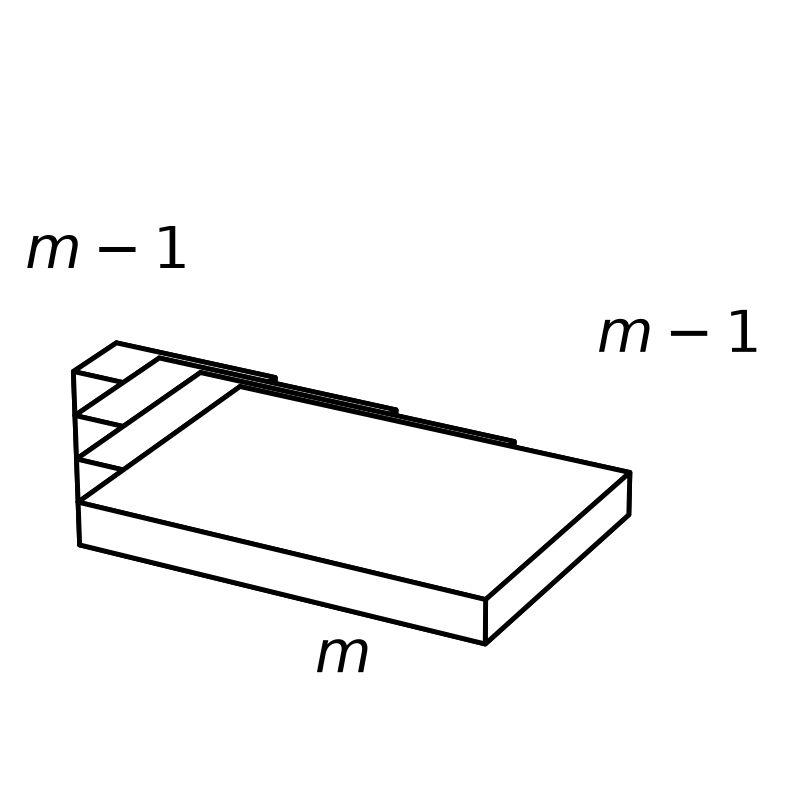

因此这个循环需要约 $\frac43m^3$ 次浮点运算。

第二个循环从右侧施加 Householder 反射。第 $k$ 步通过形成最后 $m-k$
列的线性组合来完成。这个循环没有可以忽略的零：被操作的每一列的全部
$m$ 个元素都要计算，对固定 $k$ 共涉及 $m(m-k)$ 个元素。对应的体积趋于
$\frac12m^3$：

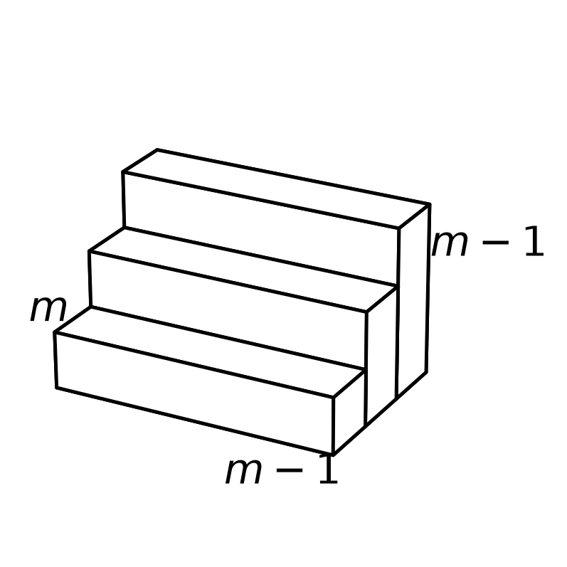

因此这个循环需要约 $2m^3$ 次浮点运算。两部分相加，一个 $m\times m$
矩阵酉约化为 Hessenberg 形式的总工作量为

$$
\text{Hessenberg 约化的工作量}\sim\frac{10}{3}m^3\ \text{flops}.
\tag{26.1}
$$

### Hermitian 情形：化为三对角形式

如果 $A$ 是 Hermitian 矩阵，上述算法会把 $A$ 约化为三对角形式（至少在
没有舍入误差时如此）。原因是 $Q^*AQ$ 仍然是 Hermitian，而任意
Hermitian Hessenberg 矩阵都是三对角矩阵。

由于现在行和列中都会引入零，因此可以忽略这些额外的零，进一步节省运算。
经过这种优化，右侧 Householder 反射的总成本从 $2m^3$ 降为
$\frac43m^3$。此时相加的是两个金字塔，总运算量降为 $\frac83m^3$。
不过，这一节省只利用了稀疏性，没有利用 Hermitian 对称结构。再利用该
结构还可以节省一个因子 2，得到

$$
\text{三对角约化的工作量}\sim\frac43m^3\ \text{flops}.
\tag{26.2}
$$

### 稳定性

和 QR 分解的 Householder 算法一样，刚才描述的算法是向后稳定的。回忆
定理 16.1：QR 分解的 Householder 算法计算出的反射向量等价于一个隐式的、
精确酉的因子 $\widetilde Q$，以及一个显式的上三角因子
$\widetilde R$，满足

$$
\widetilde Q\widetilde R=A+\delta A,\qquad
\frac{\|\delta A\|}{\|A\|}=O(\varepsilon_{\mathrm{machine}}).
$$

算法 26.1 也可以建立同样的误差估计。令 $\widetilde H$ 表示浮点运算中
实际计算出的 Hessenberg 矩阵；令 $\widetilde Q$ 表示与浮点计算出的反射
向量相对应的、精确酉的矩阵。可以证明：

**定理 26.1**　设矩阵 $A\in\mathbb{C}^{m\times m}$ 的 Hessenberg
约化 $A=QHQ^*$ 由算法 26.1 在满足公理 (13.5) 和 (13.7) 的计算机上
完成，并按上述方式定义计算因子 $\widetilde Q$ 和 $\widetilde H$。则
存在 $\delta A\in\mathbb{C}^{m\times m}$，使得

$$
\widetilde Q\widetilde H\widetilde Q^*=A+\delta A,\qquad
\frac{\|\delta A\|}{\|A\|}=O(\varepsilon_{\mathrm{machine}}).
\tag{26.3}
$$

### 习题

**26.1**

定理 26.1 及其后面各讲中的类似定理表明，我们可以数值计算 $A$ 的
特征值 $\{\widetilde\lambda_k\}$；这些数值正好是矩阵 $A+\delta A$ 的
精确特征值，其中 $\|\delta A\|/\|A\|=O(\varepsilon_{\mathrm{machine}})$。
这是否意味着它们接近 $A$ 的精确特征值 $\{\lambda_k\}$？这是特征值
扰动理论的问题。

给定 $A\in\mathbb{C}^{m\times m}$、其谱 $\Lambda(A)\subset\mathbb{C}$
以及 $\epsilon>0$，定义 $A$ 的 2-范数 $\epsilon$-伪谱
$\Lambda_\epsilon(A)$ 为满足以下任一条件的复数 $z$ 的集合：

1. $z$ 是某个 $A+\delta A$ 的特征值，其中 $\|\delta A\|_2\le\epsilon$。
2. 存在 $u\in\mathbb{C}^m$，使 $\|(A-zI)u\|_2\le\epsilon$ 且
   $\|u\|_2=1$。
3. $\sigma_m(zI-A)\le\epsilon$。
4. $\|(zI-A)^{-1}\|_2\ge\epsilon^{-1}$。

条件 4 中的矩阵 $(zI-A)^{-1}$ 称为 $A$ 在 $z$ 处的预解算子
（resolvent）；如果 $z$ 是 $A$ 的特征值，约定
$\|(zI-A)^{-1}\|_2=\infty$。条件 3 中的 $\sigma_m$ 表示最小奇异值。
证明这四个条件等价。

**26.2**

设 $A$ 是一个 $32\times32$ 矩阵：主对角线上的条目为 $-1$，第一条和
第二条超对角线上的条目为 1，其余条目为 0。

(a) 使用内置的 SVD 算法以及等高线绘图软件，绘制 $A$ 在

$$
\epsilon=10^{-1},10^{-2},\ldots,10^{-8}
$$

时的 2-范数 $\epsilon$-伪谱边界。

(b) 对 $0\le t\le50$ 绘制 $\|e^{tA}\|_2$ 关于 $t$ 的半对数图。在最终衰减
出现以前，曲线的初始增长率是多少？能否把它与伪谱图联系起来？（与习题
24.3 对照。）

**26.3**

特征值扰动理论中最著名的结果之一是 Bauer–Fike 定理。设
$A\in\mathbb{C}^{m\times m}$ 可对角化，即 $A=V\Lambda V^{-1}$，并令
$\delta A\in\mathbb{C}^{m\times m}$ 任意。那么 $A+\delta A$ 的每个特征值，
至少落在复平面上 $m$ 个圆盘中的一个内；这些圆盘的圆心是 $A$ 的特征值，
半径为 $\kappa(V)\|\delta A\|_2$，其中 $\kappa$ 是 2-范数条件数。
（与习题 24.2 对照。）

(a) 利用习题 26.1 中条件 1 和条件 4 的等价性，证明 Bauer–Fike 定理。

(b) 假设 $A$ 是正规矩阵。证明：对 $A+\delta A$ 的每个特征值
$\widetilde\lambda_j$，都存在 $A$ 的一个特征值 $\lambda_j$，使得

$$
|\widetilde\lambda_j-\lambda_j|\le\|\delta A\|_2.
\tag{26.4}
$$

---

<a id="lecture-27"></a>

## 第 27 讲　Rayleigh 商与逆迭代

> 原书页 202–210；目标 PDF 页 217–225。保留图 27.1 的单位球面示意和
> Rayleigh 商迭代闭环图；图像文件位于 `assets/`。

本讲介绍几个经典的特征值算法。它们各自在特定场景下很有用，尤其是逆迭代：
当某个特征值已经知道时，逆迭代是计算对应特征向量的标准方法。把这些工具
组合起来，就得到著名的 QR 算法；QR 算法将在接下来的两讲中讨论。

### 限制到实对称矩阵

在数值线性代数中，大多数算法思想既适用于一般矩阵，也适用于经过一些简化
的 Hermitian 矩阵。对于本讲以及接下来的三讲，这种情形仍然成立，但一般矩阵
与 Hermitian 矩阵之间的差异会比较明显。因此，本四讲暂时只考虑实对称矩阵，
并且始终假设所用范数为 2-范数：

$$
A=A^T\in\mathbb{R}^{m\times m},\qquad
x\in\mathbb{R}^m,\qquad x^*=x^T,\qquad
\|x\|=\sqrt{x^Tx}.
$$

特别地，$A$ 的特征值都是实数，并且存在一组完备的正交特征向量。记

$$
\text{实特征值：}\ \lambda_1,\ldots,\lambda_m,
\qquad
\text{标准正交特征向量：}\ q_1,\ldots,q_m.
$$

特征向量按 $\|q_j\|=1$ 归一化；特征值的排序将在需要时具体说明。

接下来几讲的大多数思想属于第 25 讲介绍的两个阶段中的第二阶段。也就是说，
真正应用这些思想时，$A$ 不仅是实对称矩阵，通常还已经是三对角矩阵。三对角
结构有时具有数学上的重要性，例如可以帮助选择 QR 算法的移位；它始终具有
算法上的重要性，因为它可以把许多步骤的工作量从 $O(m^3)$ 降到 $O(m)$。

### Rayleigh 商

向量 $x\in\mathbb{R}^m$ 的 Rayleigh 商定义为标量

$$
r(x)=\frac{x^TAx}{x^Tx}.
\tag{27.1}
$$

如果 $x$ 是特征向量，那么 $r(x)=\lambda$，其中 $\lambda$ 是对应的特征值。
这个公式的一种动机是：给定 $x$，什么标量 $\alpha$ 最像 $x$ 对应的“特征值”，
使得 $\|Ax-\alpha x\|_2$ 最小？这是一个形如 $x\alpha\approx Ax$ 的
$m\times1$ 最小二乘问题，其中 $\alpha$ 是未知标量，而 $Ax$ 是右端项。
对这个系统写出正规方程（式 (11.9)），就得到 $\alpha=r(x)$。因此，如果
$x$ 接近但不一定等于特征向量，$r(x)$ 是一个自然的特征值估计。

为了定量研究这个想法，把 $x\in\mathbb{R}^m$ 看作变量，于是 $r$ 是从
$\mathbb{R}^m$ 到 $\mathbb{R}$ 的函数。对坐标 $x_j$ 求偏导：

$$
\frac{\partial r(x)}{\partial x_j}
=\frac{2(Ax)_j}{x^Tx}-\frac{2(x^TAx)x_j}{(x^Tx)^2}
=\frac{2}{x^Tx}\bigl(Ax-r(x)x\bigr)_j.
$$

把这些偏导数组成一个 $m$-向量，就得到 $r(x)$ 的梯度：

$$
\nabla r(x)=\frac{2}{x^Tx}\bigl(Ax-r(x)x\bigr).
\tag{27.2}
$$

由此可见，在 $A$ 的特征向量处，$r(x)$ 的梯度为零。反过来，如果 $x\ne0$
且 $\nabla r(x)=0$，那么 $x$ 就是特征向量，$r(x)$ 是对应的特征值。

从几何上看，$A$ 的特征向量是函数 $r(x)$ 的驻点，而特征值是 $r(x)$ 在这些
驻点处的函数值。由于 $r(x)$ 与 $x$ 的尺度无关，驻点实际上位于经过原点的
直线上。若把 $x$ 限制在单位球面 $\|x\|=1$ 上，那么在特征值互异时，这些
驻点就成为彼此孤立的点：

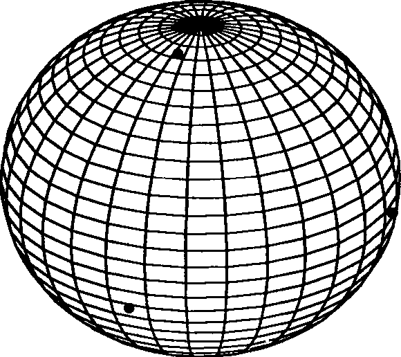

令 $q_j$ 是 $A$ 的一个特征向量。由 $\nabla r(q_j)=0$ 以及 $r(x)$ 的光滑性
（除了原点 $x=0$ 外处处光滑），可得一个重要结论：

$$
r(x)-r(q_j)=O\bigl(\|x-q_j\|^2\bigr),\qquad x\to q_j.
\tag{27.3}
$$

因此，Rayleigh 商是特征值的二阶精度估计；这正是它强大的地方。

还可以更直接地推导 (27.3)。把 $x$ 展开为 $A$ 的特征向量
$q_1,\ldots,q_m$ 的线性组合。若 $x=\sum_{j=1}^m a_jq_j$，则

$$
r(x)=\frac{\sum_{j=1}^m a_j^2\lambda_j}{\sum_{j=1}^m a_j^2}.
$$

所以 $r(x)$ 是 $A$ 的特征值的加权平均，权重是 $x$ 在特征向量基下坐标的平方。
正因为坐标被平方，如果对所有 $j\ne J$ 都有 $|a_j/a_J|\le\epsilon$，那么
$r(x)-r(q_J)=O(\epsilon^2)$。

### 幂迭代

现在换一个方向。设 $v^{(0)}$ 是满足 $\|v^{(0)}\|=1$ 的向量。下面的过程
称为幂迭代；第 25 讲开头曾把它作为一个不太好的想法提到过。幂迭代有望
产生一个序列 $v^{(k)}$，使其收敛到对应于 $A$ 的最大特征值的特征向量。

**算法 27.1（幂迭代）**

    v^(0) = some vector with ||v^(0)|| = 1
    for k = 1, 2, ...
          w = A v^(k-1)                         apply A
          v^(k) = w / ||w||                      normalize
          lambda^(k) = (v^(k))^T A v^(k)         Rayleigh quotient

本讲以及后续算法都不讨论终止条件，只用“for $k=1,2,\ldots$”这一提示性表达式
描述循环。实际计算中，终止条件当然非常重要；这也是 LAPACK 或 MATLAB 中的
高质量软件通常优于个人临时编写程序的地方之一。

幂迭代很容易分析。把 $v^{(0)}$ 写成标准正交特征向量的线性组合：

$$
v^{(0)}=a_1q_1+a_2q_2+\cdots+a_mq_m.
$$

因为 $v^{(k)}$ 是 $A^kv^{(0)}$ 的倍数，所以存在常数 $c_k$，使得

$$
\begin{aligned}
v^{(k)}
 &=c_kA^kv^{(0)}\\
 &=c_k\bigl(a_1\lambda_1^kq_1+a_2\lambda_2^kq_2+\cdots+a_m\lambda_m^kq_m\bigr)\\
 &=c_k\lambda_1^k\bigl(a_1q_1+a_2(\lambda_2/\lambda_1)^kq_2
 +\cdots+a_m(\lambda_m/\lambda_1)^kq_m\bigr).
\end{aligned}
\tag{27.4}
$$

由此得到以下结论。

**定理 27.1**　假设 $|\lambda_1|>|\lambda_2|\ge\cdots\ge|\lambda_m|\ge0$，
并且 $q_1^Tv^{(0)}\ne0$。那么算法 27.1 的迭代满足

$$
\|v^{(k)}-(\pm q_1)\|
 =O\left(\left|\frac{\lambda_2}{\lambda_1}\right|^k\right),
\qquad
|\lambda^{(k)}-\lambda_1|
 =O\left(\left|\frac{\lambda_2}{\lambda_1}\right|^{2k}\right),
\tag{27.5}
$$

当 $k\to\infty$ 时成立。这里的 $\pm$ 表示：对每个 $k$，应选取两个符号中的
一个，然后相应的界成立。证明很直接：第一个结论由 (27.4) 得到，因为
$a_1=q_1^Tv^{(0)}\ne0$；第二个结论由第一个结论和 (27.3) 得到。如果
$\lambda_1>0$，每一步的符号要么全为 $+$，要么全为 $-$；如果 $\lambda_1<0$，
符号则交替出现。

(27.5) 以及下面类似公式中的 $\pm$ 符号并不十分美观。一个优雅的办法是
讨论子空间而不是向量，例如说 $(v^{(k)})$ 收敛到 $(q_1)$。不过，为了避免
引入子空间收敛的精确定义，本书不采用这种写法。

幂迭代单独使用时用途有限，原因有几个。首先，它只能找到对应于最大特征值的
特征向量。其次，它只有线性收敛，每次迭代只把误差缩小约 $|\lambda_2/\lambda_1|$
倍。最后，这个因子的质量取决于最大特征值是否明显大于其他特征值；如果最大
的两个特征值模很接近，收敛就会很慢。幸运的是，有办法放大特征值之间的差异。

### 逆迭代

对任意不是 $A$ 的特征值的实数 $\mu$，矩阵 $(A-\mu I)^{-1}$ 与 $A$ 具有相同
的特征向量，对应的特征值为 $\{(\lambda_j-\mu)^{-1}\}$。这启发了一个想法：
假设 $\mu$ 接近 $A$ 的某个特征值 $\lambda_J$，那么
$(\lambda_J-\mu)^{-1}$ 的模可能远大于对所有 $j\ne J$ 的
$(\lambda_j-\mu)^{-1}$。于是，对 $(A-\mu I)^{-1}$ 应用幂迭代，过程就会
快速收敛到 $q_J$。这个想法称为逆迭代。

**算法 27.2（逆迭代）**

    v^(0) = some vector with ||v^(0)|| = 1
    for k = 1, 2, ...
          Solve (A - mu I) w = v^(k-1) for w    apply (A - mu I)^(-1)
          v^(k) = w / ||w||                     normalize
          lambda^(k) = (v^(k))^T A v^(k)        Rayleigh quotient

如果 $\mu$ 是 $A$ 的特征值，$A-\mu I$ 就是奇异的；如果 $\mu$ 非常接近特征值，
$A-\mu I$ 可能病态到无法准确求解 $(A-\mu I)w=v^{(k-1)}$。这些看似严重的
陷阱实际上不会造成问题，见习题 27.5。

和幂迭代一样，逆迭代只有线性收敛。但与幂迭代不同，我们可以通过提供特征值估计
$\mu$ 来选择最终找到的特征向量。而且，线性收敛速率可以控制，因为它取决于
$\mu$ 的质量：如果 $\mu$ 比其他特征值都更接近某一个特征值，那么
$(A-\mu I)^{-1}$ 的最大特征值就会远大于其余特征值。沿用幂迭代的推理可得
以下定理。

**定理 27.2**　假设 $\lambda_J$ 是离 $\mu$ 最近的特征值，$\lambda_K$ 是第二
近的特征值，即

$$
|\mu-\lambda_J|<|\mu-\lambda_K|\le|\mu-\lambda_j|,
\qquad j\ne J,
$$

并且 $q_J^Tv^{(0)}\ne0$。那么算法 27.2 的迭代满足

$$
\|v^{(k)}-(\pm q_J)\|
 =O\left(\left|\frac{\mu-\lambda_J}{\mu-\lambda_K}\right|^k\right),
\qquad
|\lambda^{(k)}-\lambda_J|
 =O\left(\left|\frac{\mu-\lambda_J}{\mu-\lambda_K}\right|^{2k}\right),
$$

当 $k\to\infty$ 时成立，其中 $\pm$ 的含义与定理 27.1 相同。

如果特征值已经知道，逆迭代是数值线性代数中最有价值的工具之一：它是计算
一个或多个特征向量的标准方法。此时直接按算法 27.2 执行，但不再计算
Rayleigh 商即可。

### Rayleigh 商迭代

到目前为止，本讲给出了两种互补的办法：由特征向量估计得到特征值估计
（Rayleigh 商），以及由特征值估计得到特征向量估计（逆迭代）。把二者结合起来
是很自然的：

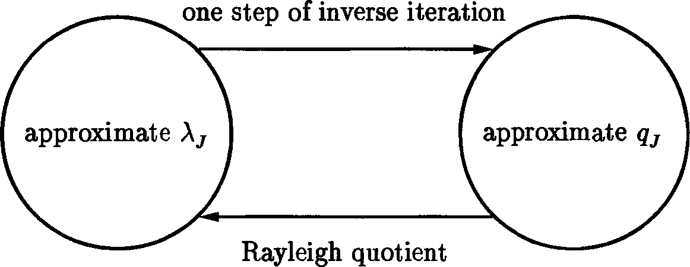

从近似 $\lambda_J$ 得到近似 $q_J$ 还需要一个初始的 $q_J$ 近似。不断改进
特征值估计，就能在每一步提高逆迭代的收敛速率；所得算法称为 Rayleigh 商迭代。

**算法 27.3（Rayleigh 商迭代）**

    v^(0) = some vector with ||v^(0)|| = 1
    lambda^(0) = (v^(0))^T A v^(0) = corresponding Rayleigh quotient
    for k = 1, 2, ...
          Solve (A - lambda^(k-1) I) w = v^(k-1) for w
              apply (A - lambda^(k-1) I)^(-1)
          v^(k) = w / ||w||                       normalize
          lambda^(k) = (v^(k))^T A v^(k)          Rayleigh quotient

这个算法的收敛速度极其惊人：每次迭代都会把准确数字的数量大致提高到原来的三倍。

**定理 27.3**　Rayleigh 商迭代对除一个测度为零的初始向量集合之外的所有
$v^{(0)}$，都收敛到一个特征值/特征向量对。若它收敛，并且 $\lambda_J$ 是
$A$ 的特征值、$v^{(0)}$ 足够接近特征向量 $q_J$，则最终具有三次收敛性：

$$
\|v^{(k+1)}-(\pm q_J)\|
 =O\left(\|v^{(k)}-(\pm q_J)\|^3\right),
\tag{27.6}
$$

以及

$$
|\lambda^{(k+1)}-\lambda_J|
 =O\left(|\lambda^{(k)}-\lambda_J|^3\right),
\tag{27.7}
$$

当 $k\to\infty$ 时成立。式 (27.6) 两侧的 $\pm$ 不一定相同。

这里不证明“几乎所有初始向量都会收敛”的断言，只证明一旦收敛就最终三次收敛。
为简单起见，假设 $\lambda_J$ 是单特征值。由 (27.3)，如果
$\|v^{(k)}-q_J\|<\epsilon$ 且 $\epsilon$ 足够小，那么 Rayleigh 商给出
$|\lambda^{(k)}-\lambda_J|=O(\epsilon^2)$ 的特征值估计。随后从 $v^{(k)}$
和 $\lambda^{(k)}$ 出发做一步逆迭代，得到新的 $v^{(k+1)}$，于是

$$
\|v^{(k+1)}-q_J\|
 =O\bigl(|\lambda^{(k)}-\lambda_J|\,\|v^{(k)}-q_J\|\bigr)
 =O(\epsilon^3).
$$

$O$ 符号中的常数在 $\lambda_J$ 和 $q_J$ 的充分小邻域内是一致的。因此误差会
按照下面的模式推进：

$$
\begin{array}{c@{\qquad}c}
\|v^{(k)}-(\pm q_J)\| & |\lambda^{(k)}-\lambda_J|\\
\epsilon & O(\epsilon^2)\\
\downarrow\searrow & \\[-2pt]
O(\epsilon^3) & O(\epsilon^6)\\
\downarrow\searrow & \\[-2pt]
O(\epsilon^9) & O(\epsilon^{18})\\
\vdots & \vdots
\end{array}
$$

式 (27.6)–(27.7) 就由上述一致性得到。

**例 27.1（三次收敛的数值例子）**　考虑对称矩阵

$$
A=\begin{bmatrix}
2&1&1\\
1&3&1\\
1&1&4
\end{bmatrix},
\qquad
v^{(0)}=\frac{(1,1,1)^T}{\sqrt3}.
$$

对 $A$ 使用 Rayleigh 商迭代，前三次迭代得到

$$
\lambda^{(0)}=5,\qquad
\lambda^{(1)}=5.2131\ldots,\qquad
\lambda^{(2)}=5.214319743184\ldots.
$$

与 $v^{(0)}$ 最接近的特征向量对应的真实特征值为
$\lambda=5.214319743377$。只经过三次迭代，Rayleigh 商迭代就得到了约十位
有效数字；如果机器精度足够高，再进行三次迭代，准确数字大约会增加到 270 位。

### 运算量

先设 $A\in\mathbb{R}^{m\times m}$ 是满矩阵。幂迭代的每一步包含一次矩阵--向量
乘法，需要 $O(m^2)$ 次浮点运算。逆迭代的每一步需要解一个线性系统，表面上
似乎需要 $O(m^3)$ 次运算；但如果事先用 LU 分解、QR 分解或其他方法处理矩阵，
这个工作量可以降到 $O(m^2)$。Rayleigh 商迭代中每一步待求逆的矩阵都会改变，
因此要把每步的工作量降到 $O(m^3)$ 以下并不直接。

如果 $A$ 是三对角矩阵，情况会大大改善：现在三种迭代每一步都只需要 $O(m)$ 次
浮点运算。对于涉及非对称矩阵的相应迭代，我们要处理的是 Hessenberg 结构而
不是三对角结构，工作量会增加到 $O(m^2)$。

### 习题

**27.1**　设 $A\in\mathbb{C}^{m\times m}$，不一定是 Hermitian 矩阵。证明：
复数 $z\in\mathbb{C}$ 是 $A$ 的某个 Rayleigh 商，当且仅当它是某个酉矩阵
$Q$ 变换后的矩阵 $Q^*AQ$ 的一个对角条目。也就是说，只要把坐标系正交地
变换到合适的位置，Rayleigh 商正好就是矩阵的对角条目。

**27.2**　仍设 $A\in\mathbb{C}^{m\times m}$ 任意。所有非零向量
$x\in\mathbb{C}^m$ 对应的 Rayleigh 商组成的集合称为 $A$ 的值域或数值域，
记为 $W(A)$，它是复平面的一个子集。

(a) 证明 $W(A)$ 包含 $A$ 的特征值的凸包。

(b) 证明如果 $A$ 是正规矩阵，那么 $W(A)$ 等于 $A$ 的特征值的凸包。

**27.3**　证明：对于非 Hermitian 矩阵 $A\in\mathbb{C}^{m\times m}$，Rayleigh
商 $r(x)$ 给出的特征值估计通常只有线性精度，而不是二次精度。说明这会暗示
Rayleigh 商迭代具有怎样的收敛速率。

**27.4**　每个实对称方阵都可以正交对角化，而且本讲的推导在正交坐标变换下
保持不变。因此，原本可以一开始就假设 $A$ 是一个对角矩阵，并且对角条目按
绝对值递减排列。在这个假设下，描述式 (27.4)、(27.5) 和算法 27.3 的具体形式。

**27.5**　如正文所述，逆迭代依赖于求解一个可能极度病态的线性系统，其条件数
可能达到 $\varepsilon_{\mathrm{machine}}^{-1}$ 的量级。我们知道，一般不可能
准确求解病态系统；这难道不是算法的致命缺陷吗？

证明答案是否定的：病态性并不是逆迭代的问题。设 $A$ 是实对称矩阵，并且有一个
特征值的绝对值远小于其余特征值（不妨取 $\mu=0$）。设 $v$ 在 $A$ 的所有特征
向量 $q_1,\ldots,q_m$ 的方向上都有分量，并且 $Aw=v$ 采用后向稳定方法求解，
得到计算向量 $\widetilde w$。利用第 95 页的计算，证明虽然 $\widetilde w$ 可能
与 $w$ 相差很远，但 $\widetilde w/\|\widetilde w\|$ 不会与
$w/\|w\|$ 相差很远。

**27.6**　如果 $A$ 的两个特征值相等，图 27.1 会发生什么变化？

---

<a id="lecture-28"></a>

## 第 28 讲　无移位 QR 算法

> 原书页 211–218；目标 PDF 页 226–233。本讲没有需要单独提取的插图；算法框、矩阵关系和公式均按原书结构重建。

QR 算法诞生于 20 世纪 60 年代初，是数值分析中的瑰宝之一。本讲说明，在最简单的形式下，它可以看成一个稳定地计算矩阵幂
$A,A^2,A^3,\ldots$ 的 QR 分解的过程。

### QR 算法

QR 算法最基本的版本简单得近乎不可思议。

**算法 28.1（“纯” QR 算法）**

    A^(0) = A
    for k = 1, 2, ...
          Q^(k) R^(k) = A^(k-1)       QR factorization of A^(k-1)
          A^(k) = R^(k) Q^(k)         recombine factors in reverse order

我们所做的全部事情，就是对当前矩阵作一次 QR 分解，把得到的因子 $Q$ 和 $R$ 反向相乘为 $RQ$，然后重复。尽管如此，在适当假设下，这个简单算法仍会收敛到矩阵 $A$ 的 Schur 形式：一般矩阵的 Schur 形式是上三角矩阵，Hermitian 矩阵的 Schur 形式是对角矩阵。为使讨论简单，本讲继续沿用上一讲的假设：$A$ 是实对称矩阵，特征值为实数 $\lambda_j$，特征向量 $q_j$ 标准正交。因此，我们关心的是矩阵 $A^{(k)}$ 向对角形式的收敛。

为了让收敛到对角形式真正能够用于求特征值，所进行的操作当然必须是相似变换。这一点很容易验证：QR 算法先通过

$$
R^{(k)}=(Q^{(k)})^TA^{(k-1)}
$$

把 $A^{(k-1)}$ 三角化，再在右侧乘以 $Q^{(k)}$，从而得到

$$
A^{(k)}=(Q^{(k)})^TA^{(k-1)}Q^{(k)}.
$$

事实上，我们在第 26 讲已经见过这个相似变换：它就是“坏主意”中讨论的变换。试图用一步操作把 $A$ 约化为三角形式时它确实是坏主意，但作为迭代的基础，它却非常强大。

和 Rayleigh 商迭代一样，实对称矩阵的 QR 算法具有三次收敛潜力。不过，要达到这种性能，必须在每一步引入移位。把算法变成实用算法还需要三项修改：

1. 开始迭代前，先把 $A$ 约化为三对角形式（第 26 讲）。
2. 每一步分解的不是 $A^{(k)}$，而是移位矩阵 $A^{(k)}-\mu^{(k)}I$，其中 $\mu^{(k)}$ 是某个特征值估计。
3. 只要可能，尤其是在发现一个特征值时，就把问题“降阶”（deflate），将 $A^{(k)}$ 拆成更小的子矩阵。

包含这些修改的 QR 算法可以概括为：

**算法 28.2（“实用” QR 算法）**

    (Q^(0))^T A^(0) Q^(0) = A       A^(0) is a tridiagonalization of A
    for k = 1, 2, ...
          Pick a shift mu^(k)        e.g., choose mu^(k) = A^(k-1)_{m,m}
          Q^(k)R^(k) = A^(k-1) - mu^(k)I
                                      QR factorization
          A^(k) = R^(k)Q^(k) + mu^(k)I
                                      recombine factors
          If any off-diagonal element A^(k)_{j+1,j} is close to zero,
              set A^(k)_{j,j+1} = A^(k)_{j+1,j} = 0 and obtain
              A^(k) = [ A_1  0 ; 0  A_2 ]
              then apply the QR algorithm to A_1 and A_2

这个带有良好移位的 QR 算法，自 20 世纪 60 年代初以来一直是计算矩阵全部特征值的标准方法。直到 20 世纪 90 年代，才出现一个竞争者：第 30 讲介绍的分治算法。三对角化已在第 26 讲讨论，移位将在下一讲讨论，而降阶在本书中不再展开。下面先把注意力限制到“纯” QR 算法，解释它如何找到特征值。

### 未归一化的同时迭代

我们的办法是把 QR 算法联系到另一个行为更直观的方法：同时迭代。同时迭代就是一次对多个向量应用幂迭代，也称为块幂迭代。设从一组线性无关的向量 $v_1^{(0)},\ldots,v_n^{(0)}$ 出发。直观上，正如在适当假设下 $A^kv_1^{(0)}$ 会趋近于对应于最大模特征值的特征向量，空间

$$
\operatorname{span}\{A^kv_1^{(0)},\ldots,A^kv_n^{(0)}\}
$$

也应趋近于由 $A$ 的 $n$ 个最大模特征值对应的特征向量 $q_1,\ldots,q_n$ 张成的空间。

用矩阵表示，定义 $m\times n$ 的初始矩阵

$$
V^{(0)}=\begin{bmatrix}v_1^{(0)}&\cdots&v_n^{(0)}\end{bmatrix}.
\tag{28.1}
$$

定义应用 $A$ 共 $k$ 次后的结果

$$
V^{(k)}=A^kV^{(0)}
=\begin{bmatrix}v_1^{(k)}&\cdots&v_n^{(k)}\end{bmatrix}.
\tag{28.2}
$$

我们真正关心的是 $V^{(k)}$ 的列空间，因此对它作约化 QR 分解，为该空间提取一个条件良好的基：

$$
\widehat Q^{(k)}\widehat R^{(k)}=V^{(k)}.
\tag{28.3}
$$

其中 $\widehat Q^{(k)}$ 的尺寸为 $m\times n$，$\widehat R^{(k)}$ 的尺寸为 $n\times n$。在适当假设下，直观上可以期待 $\widehat Q^{(k)}$ 的各列收敛到特征向量 $\pm q_1,\pm q_2,\ldots,\pm q_n$。

为了分析这一点，把 $v_j^{(0)}$ 和 $v_j^{(k)}$ 在 $A$ 的特征向量基下展开：

$$
v_j^{(0)}=a_{1j}q_1+\cdots+a_{mj}q_m,
\qquad
v_j^{(k)}=\lambda_1^ka_{1j}q_1+\cdots+\lambda_m^ka_{mj}q_m.
$$

和上一节一样，只要满足两个条件，就能得到简单的收敛结果。第一个条件是前 $n+1$ 个特征值的模彼此满足所需的间隔：

$$
|\lambda_1|>|\lambda_2|>\cdots>|\lambda_n|
>|\lambda_{n+1}|\ge|\lambda_{n+2}|\ge\cdots\ge|\lambda_m|.
\tag{28.4}
$$

第二个条件要求展开系数在适当意义下非奇异。令 $\widehat Q$ 为列向量 $q_1,\ldots,q_n$ 组成的 $m\times n$ 矩阵。注意，这里的 $\widehat Q$ 是特征向量矩阵，与约化 QR 分解中的 $\widehat Q^{(k)}$ 完全不同。我们假设

$$
\widehat Q^TV^{(0)}\text{ 的所有顺序主子式都非奇异}.
\tag{28.5}
$$

这里的“所有顺序主子式”是指左上角的 $1\times1,2\times2,\ldots,n\times n$ 方形子矩阵的行列式。条件 (28.5) 恰好等价于 $\widehat Q^TV^{(0)}$ 存在 LU 分解，见习题 20.1。

**定理 28.1**　假设迭代 (28.1)–(28.3) 被执行，并且假设 (28.4)、(28.5) 均满足。那么当 $k\to\infty$ 时，矩阵 $\widehat Q^{(k)}$ 的各列线性收敛到 $A$ 的特征向量：对 $1\le j\le n$，

$$
\|\widehat q_j^{(k)}\mp q_j\|=O(C^k),
\qquad
C=\max_{1\le j\le n}\left|\frac{\lambda_{j+1}}{\lambda_j}\right|<1.
\tag{28.6}
$$

和上一讲的定理一样，$\pm$ 表示每一步选择两个符号中的一个，然后相应的界成立。

**证明**　把 $\widehat Q$ 扩展成由 $A$ 的特征向量组成的完整 $m\times m$ 正交矩阵 $Q$，令 $\Lambda$ 为相应的特征值对角矩阵，于是

$$
A=Q\Lambda Q^T.
$$

正如 $\widehat Q$ 是 $Q$ 的前 $n$ 列，令 $\widehat\Lambda$ 为 $\Lambda$ 的左上角 $n\times n$ 对角子矩阵。于是，当 $k\to\infty$ 时，

$$
\begin{aligned}
V^{(k)}=A^kV^{(0)}
 &=Q\Lambda^kQ^TV^{(0)}\\
 &=\widehat Q\widehat\Lambda^k\widehat Q^TV^{(0)}
   +O\bigl(|\lambda_{n+1}|^k\bigr).
\end{aligned}
$$

如果 (28.5) 成立，那么特别地 $\widehat Q^TV^{(0)}$ 非奇异。将误差项右乘 $(\widehat Q^TV^{(0)})^{-1}\widehat Q^TV^{(0)}$，可以把上式改写为

$$
V^{(k)}=
\bigl(\widehat Q\widehat\Lambda^k+O(|\lambda_{n+1}|^k)\bigr)
\widehat Q^TV^{(0)}.
$$

由于 $\widehat Q^TV^{(0)}$ 非奇异，这个矩阵的列空间与

$$
\widehat Q\widehat\Lambda^k+O(|\lambda_{n+1}|^k)
$$

的列空间相同。由 $\widehat Q\widehat\Lambda^k$ 的形式和假设 (28.4)，可知该列空间线性收敛到 $\widehat Q$ 的列空间。

实际上，我们假设的不只是 $\widehat Q^TV^{(0)}$ 非奇异，而是它的所有顺序主子式都非奇异。因此，上面的论证也适用于 $V^{(k)}$ 和 $\widehat Q$ 的各个前导列子集：第一列、前两列、前三列，依此类推。对于每个这样的列空间，都得到线性收敛。再结合约化 QR 分解 (28.3) 的定义，就得到 (28.6)。

### 同时迭代

当 $k\to\infty$ 时，算法 (28.1)–(28.3) 中的向量 $v_1^{(k)},\ldots,v_n^{(k)}$ 都会趋近于同一个主导特征向量 $q_1$ 的倍数。因此，虽然它们张成的空间趋近于有用的空间，但这些向量会构成该空间的高度病态基。如果直接在浮点运算中执行上述同时迭代，所需信息很快会被舍入误差抹去。

补救办法很简单：每一步都正交归一化，而不是只在开始时归一化。因此不再构造上面定义的 $V^{(k)}$，而构造具有相同列空间的另一列矩阵序列 $Z^{(k)}$。

**算法 28.3（同时迭代）**

    Pick Qhat^(0) in R^(m x n) with orthonormal columns.
    for k = 1, 2, ...
          Z = A Qhat^(k-1)
          Qhat^(k) Rhat^(k) = Z       reduced QR factorization of Z

从算法形式立刻可以看出，$\widehat Q^{(k)}$ 和 $Z^{(k)}$ 的列空间相同，二者都等于 $A^k\widehat Q^{(0)}$ 的列空间。因此，从数学上说，这个新的同时迭代形式与旧形式具有相同的收敛条件。

**定理 28.2**　算法 28.3 生成的矩阵 $\widehat Q^{(k)}$ 与定理 28.1 中迭代 (28.1)–(28.3) 生成的矩阵相同（假设初始矩阵 $\widehat Q^{(0)}$ 相同）。在同样的假设 (28.4)、(28.5) 下，它按照定理 28.1 所述方式收敛。

### 同时迭代与 QR 算法

现在可以解释 QR 算法了。它等价于对一整组 $n=m$ 个初始向量进行同时迭代，这组向量就是单位矩阵的列，即 $\widehat Q^{(0)}=I$。由于此时矩阵是方阵，我们处理的是完整 QR 分解，可以去掉 $\widehat Q^{(k)}$ 和 $\widehat R^{(k)}$ 上的帽号。下文用 $Q^{(k)}$ 表示 QR 算法中的矩阵；用 $\widehat Q^{(k)}$ 表示同时迭代中的矩阵，以免混淆。

同时迭代（$\widehat Q^{(0)}=I$）由下列公式定义：

$$
\begin{aligned}
\widehat Q^{(0)}&=I, &\tag{28.7}\\
Z&=A\widehat Q^{(k-1)}, &\tag{28.8}\\
Z&=\widehat Q^{(k)}R^{(k)}, &\tag{28.9}\\
A^{(k)}&=(\widehat Q^{(k)})^TA\widehat Q^{(k)}. &\tag{28.10}
\end{aligned}
$$

纯 QR 算法由下列公式定义，并额外定义一个 $m\times m$ 矩阵 $Q^{(k)}$：

$$
\begin{aligned}
A^{(0)}&=A, &\tag{28.11}\\
A^{(k-1)}&=Q^{(k)}R^{(k)}, &\tag{28.12}\\
A^{(k)}&=R^{(k)}Q^{(k)}, &\tag{28.13}\\
Q^{(k)}&=Q^{(1)}Q^{(2)}\cdots Q^{(k)}. &\tag{28.14}
\end{aligned}
$$

此外，对两种算法都定义累计的上三角因子

$$
\mathcal R^{(k)}=R^{(k)}R^{(k-1)}\cdots R^{(1)}.
\tag{28.15}
$$

这里用 $\mathcal R^{(k)}$ 区分累计乘积和第 $k$ 步的因子 $R^{(k)}$。

**定理 28.3**　同时迭代 (28.7)–(28.10) 与纯 QR 算法 (28.11)–(28.14) 生成相同的 $\mathcal R^{(k)}$、$Q^{(k)}$ 和 $A^{(k)}$。它们由 $A$ 的 $k$ 次幂的 QR 分解及相应的相似变换定义：

$$
A^k=Q^{(k)}\mathcal R^{(k)},
\tag{28.16}
$$

以及

$$
A^{(k)}=(Q^{(k)})^TAQ^{(k)}.
\tag{28.17}
$$

**证明**　对 $k$ 作归纳。$k=0$ 时结论显然：两种算法的公式都给出 $A^0=Q^{(0)}=\mathcal R^{(0)}=I$ 以及 $A^{(0)}=A$，所以 (28.16)、(28.17) 立即成立。

先考虑同时迭代的 $k\ge1$。由定义 (28.10)，(28.17) 自动成立；只需验证 (28.16)：

$$
\begin{aligned}
A^k
 &=A\widehat Q^{(k-1)}\mathcal R^{(k-1)}\\
 &=\widehat Q^{(k)}R^{(k)}\mathcal R^{(k-1)}\\
 &=\widehat Q^{(k)}\mathcal R^{(k)}.
\end{aligned}
$$

第一步使用归纳假设 (28.16)，第二步使用 (28.8)、(28.9)，第三步使用 (28.15)。

再考虑 QR 算法的 $k\ge1$。利用

$$
\begin{aligned}
A^k
 &=AQ^{(k-1)}\mathcal R^{(k-1)}\\
 &=Q^{(k-1)}A^{(k-1)}\mathcal R^{(k-1)}\\
 &=Q^{(k)}\mathcal R^{(k)}.
\end{aligned}
$$

第一步来自归纳假设 (28.16)，第二步来自归纳假设 (28.17)，第三步使用 (28.12)、(28.14)、(28.15)。最后，

$$
A^{(k)}=(Q^{(k)})^TA^{(k-1)}Q^{(k)}
        =(Q^{(k)})^TAQ^{(k)},
$$

第一步由 (28.12)、(28.13) 得到，第二步由归纳假设 (28.17) 得到。

### QR 算法的收敛

现在已经具备了分析无移位 QR 算法收敛所需的全部工具。

先看定性理解。式 (28.16)、(28.17) 是关键。前者说明 QR 算法为什么能够找到特征向量：它为矩阵幂 $A^k$ 的列空间构造标准正交基。后者说明它为什么能够找到特征值：由 (28.17)，$A^{(k)}$ 的对角条目是对应于 $Q^{(k)}$ 各列的 Rayleigh 商（见习题 27.1）。随着这些列收敛到特征向量，Rayleigh 商也收敛到相应特征值，并且根据 (27.3) 速度快一倍。同时，(28.17) 表明 $A^{(k)}$ 的非对角条目是广义 Rayleigh 商，它们分别涉及 $A$ 的不同特征向量的左、右近似。随着这些近似收敛到不同的特征向量，它们必须变得正交，因此 $A^{(k)}$ 的非对角条目必然趋于零。

需要特别强调，式 (28.16)、(28.17) 对理解无移位 QR 算法极其基础。记住它们，几乎所有重要结论都可以由此推出。

定量地说，由定理 28.2 可得以下结果。

**定理 28.4**　设纯 QR 算法（算法 28.1）作用于实对称矩阵 $A$。假设其特征值满足

$$
|\lambda_1|>|\lambda_2|>\cdots>|\lambda_m|,
$$

且对应的特征向量矩阵 $Q$ 的所有顺序主子式都非奇异。那么当 $k\to\infty$ 时，$A^{(k)}$ 以线性速率、收敛常数

$$
\max_{1\le j<m}\left|\frac{\lambda_{j+1}}{\lambda_j}\right|
$$

收敛到 $\operatorname{diag}(\lambda_1,\ldots,\lambda_m)$；对 $Q^{(k)}$ 的各列作必要的符号调整后，$Q^{(k)}$ 也以相同速率收敛到 $Q$。

### 习题

**28.1**　把无移位 QR 算法应用于正交矩阵会发生什么？先找出答案，再解释它与定理 28.4 的关系。

**28.2**　如果 QR 算法的每一步不能保持三对角结构，那么事先约化为三对角形式就几乎没有用处。幸运的是，它确实保持这一结构。

(a) 对三对角矩阵 $A$ 的 QR 分解 $A=QR$，$R$ 的哪些条目一般非零？$Q$ 的哪些条目一般非零？（实际计算中不显式构造 $Q$。）

(b) 证明形成乘积 $RQ$ 后会恢复三对角结构。

(c) 说明如何在三对角矩阵的 QR 分解中使用 Givens 旋转或 $2\times2$ Householder 反射，从而把运算量大幅降到满矩阵所需运算量以下。

**28.3**　实对称矩阵 $A$ 有一个重数为 8 的特征值 1，而其余特征值的绝对值都不超过 0.1。描述一个求出对应于主导特征值的 8 维特征子空间标准正交基的算法。

**28.4**　考虑算法 28.1 作用于三对角实对称矩阵 $A\in\mathbb{R}^{m\times m}$ 的一步。

(a) 如果只需要特征值，那么第 $k$ 步只需要 $A^{(k)}$，不需要 $Q^{(k)}$。使用本书介绍的标准方法，确定从 $A^{(k-1)}$ 得到 $A^{(k)}$ 需要多少次浮点运算。

(b) 如果需要全部特征向量，还必须累积矩阵 $Q^{(k)}=Q^{(1)}Q^{(2)}\cdots Q^{(k)}$。确定从第 $k-1$ 步到第 $k$ 步现在需要多少次浮点运算。

---

<a id="lecture-29"></a>

## 第 29 讲　移位 QR 算法

> 原书页 219–224；目标 PDF 页 234–239。本讲没有独立插图；矩阵示意、算法和公式均按原书结构重建。

让 QR 迭代真正“飞起来”的关键，是在每一步引入移位 $A\mathbin{\mapsto}A-\mu I$。本讲解释这一思想如何通过与 Rayleigh 商迭代的隐含联系带来三次收敛。

### 与逆迭代的联系

继续假设 $A\in\mathbb{R}^{m\times m}$ 是实对称矩阵，特征值为实数 $\{\lambda_j\}$，特征向量 $\{q_j\}$ 标准正交。

我们已经看到，“纯” QR 算法（算法 28.1）等价于把同时迭代应用于单位矩阵；特别地，结果的第一列按照从 $e_1$ 出发的幂迭代演化。这个观察有一个对偶版本：算法 28.1 也等价于把同时逆迭代应用于一个“翻转后的”单位矩阵 $P$，因此结果的第 $m$ 列按照从 $e_m$ 出发的逆迭代演化。

下面建立这个结论。为避免原书的下划线记号在纯文本中产生歧义，本文用 $Q^{(j)}$ 表示第 $j$ 步 QR 分解得到的正交因子，并用

$$
\mathcal Q^{(k)}=Q^{(1)}Q^{(2)}\cdots Q^{(k)}
$$

表示累计的正交因子；相应的累计上三角因子记为 $\mathcal R^{(k)}$。上一讲的式 (28.14) 说明

$$
\mathcal Q^{(k)}=\prod_{j=1}^{k}Q^{(j)}
 =\begin{bmatrix}q_1^{(k)}&q_2^{(k)}&\cdots&q_m^{(k)}\end{bmatrix},
$$

它正是同时迭代在第 $k$ 步（式 (28.9)）出现的正交矩阵。换一种说法，$\mathcal Q^{(k)}$ 是 QR 分解

$$
A^k=\mathcal Q^{(k)}\mathcal R^{(k)}
$$

中的正交因子。

现在把这个公式求逆。由于 $A^{-1}$ 仍然是对称矩阵，有

$$
A^{-k}=\bigl(\mathcal R^{(k)}\bigr)^{-1}
          \bigl(\mathcal Q^{(k)}\bigr)^T
        =\mathcal Q^{(k)}\bigl(\mathcal R^{(k)}\bigr)^{-T}.
\tag{29.1}
$$

令 $P$ 为把行或列的顺序完全翻转的 $m\times m$ 置换矩阵：

$$
P=\begin{bmatrix}
0&\cdots&0&1\\
\vdots&\ddots&1&0\\
0&1&\ddots&\vdots\\
1&0&\cdots&0
\end{bmatrix},
\qquad P^2=I.
$$

于是 (29.1) 可以改写为

$$
A^{-k}P
 =\bigl[\mathcal Q^{(k)}P\bigr]
  \bigl[P\bigl(\mathcal R^{(k)}\bigr)^{-T}P\bigr].
\tag{29.2}
$$

乘积中的第一个因子 $\mathcal Q^{(k)}P$ 是正交矩阵。第二个因子 $P(\mathcal R^{(k)})^{-T}P$ 是上三角矩阵：先从下三角矩阵 $(\mathcal R^{(k)})^{-T}$ 出发，上下翻转一次，再左右翻转一次即可看到这一点。因此，(29.2) 可以解释为 $A^{-k}P$ 的 QR 分解。换句话说，我们实际上是在对 $A^{-1}$ 做初始矩阵为 $P$ 的同时迭代，也就是对 $A$ 做同时逆迭代。特别地，$\mathcal Q^{(k)}P$ 的第一列——也就是 $\mathcal Q^{(k)}$ 的最后一列——正是对向量 $e_m$ 做 $k$ 步逆迭代所得的结果。

### 与移位逆迭代的联系

因此，QR 算法同时具有同时迭代和同时逆迭代两种解释；这两个视角完全对称。但是，正如第 27 讲所见，幂迭代和逆迭代之间有一个巨大差异：逆迭代可以通过移位任意加速。我们越能准确估计某个特征值 $\mu\approx\lambda_j$，用移位矩阵 $A-\mu I$ 做一步逆迭代时得到的效果就越好。算法 28.2 说明了如何在 QR 的一步迭代中引入移位；这恰好对应于同时迭代和同时逆迭代中的移位，因此它们的有利效果也完全相同。

令 $\mu^{(k)}$ 表示 QR 算法第 $k$ 步选取的特征值估计。由算法 28.2，从第 $k-1$ 步到第 $k$ 步的移位 QR 关系为

$$
A^{(k-1)}-\mu^{(k)}I=Q^{(k)}R^{(k)},
\qquad
A^{(k)}=R^{(k)}Q^{(k)}+\mu^{(k)}I.
$$

这意味着

$$
A^{(k)}=(Q^{(k)})^TA^{(k-1)}Q^{(k)},
\tag{29.3}
$$

并且通过归纳得到

$$
A^{(k)}=(\mathcal Q^{(k)})^TA\mathcal Q^{(k)},
$$

这与式 (28.17) 没有变化。不过，式 (28.16) 不再成立。现在得到的分解是

$$
\begin{aligned}
&(A-\mu^{(k)}I)(A-\mu^{(k-1)}I)\cdots(A-\mu^{(1)}I)\\
&\hspace{4cm}=\mathcal Q^{(k)}\mathcal R^{(k)}.
\end{aligned}
\tag{29.4}
$$

这是同时迭代的一个移位版本（证明略）。换句话说，$\mathcal Q^{(k)}=\prod_{j=1}^kQ^{(j)}$ 是乘积 $\prod_{j=1}^k(A-\mu^{(j)}I)$ 的正交化结果。$\mathcal Q^{(k)}$ 的第一列是使用这些移位从 $e_1$ 出发的移位幂迭代结果；最后一列则是使用同一组移位从 $e_m$ 出发做 $k$ 步移位逆迭代的结果。如果移位是足够好的特征值估计，最后一列就会快速收敛到一个特征向量。

### 与 Rayleigh 商迭代的联系

我们已经在移位 QR 算法中发现了一个强大的工具：移位逆迭代。要使 QR 算法最后一列快速收敛，还需要解决如何选择移位的问题。

Rayleigh 商是一个自然的起点。若要估计 $\mathcal Q^{(k)}$ 最后一列所近似的特征向量对应的特征值，最自然的做法就是对这一列使用 Rayleigh 商。这给出

$$
\mu^{(k)}
 =\frac{(q_m^{(k)})^TAq_m^{(k)}}{(q_m^{(k)})^Tq_m^{(k)}}
 =(q_m^{(k)})^TAq_m^{(k)}.
\tag{29.5}
$$

如果每一步都把这个数选作移位，那么特征值估计 $\mu^{(k)}$ 和特征向量估计 $q_m^{(k)}$ 就与从 $e_m$ 出发执行 Rayleigh 商迭代所得到的结果完全相同。因此，QR 算法具有三次收敛性，具体说是 $q_m^{(k)}$ 三次收敛到一个特征向量。

注意，在 QR 算法中，$q_m^{(k)}$ 的 Rayleigh 商就是 $A^{(k)}$ 的 $(m,m)$ 条目，因此这个移位几乎不需要额外计算。上一讲结尾已经提到过这一点，这里再明确推导一次。从 (29.3) 出发，有

$$
A_{mm}^{(k)}=e_m^TA^{(k)}e_m
 =e_m^T(\mathcal Q^{(k)})^TA\mathcal Q^{(k)}e_m
 =(q_m^{(k)})^TAq_m^{(k)}.
\tag{29.6}
$$

因此，(29.5) 等价于简单地取 $\mu^{(k)}=A_{mm}^{(k)}$。这称为 Rayleigh 商移位。

### Wilkinson 移位

Rayleigh 商移位在一般情形下给出三次收敛，但并不能保证所有初始条件都收敛。用一个简单例子即可看出这一点。考虑矩阵

$$
A=\begin{bmatrix}0&1\\1&0\end{bmatrix}.
\tag{29.7}
$$

无移位 QR 算法完全不收敛：

$$
A=Q^{(1)}R^{(1)}
 =\begin{bmatrix}0&1\\1&0\end{bmatrix}
  \begin{bmatrix}1&0\\0&1\end{bmatrix},
$$

而

$$
A^{(1)}=R^{(1)}Q^{(1)}
 =\begin{bmatrix}1&0\\0&1\end{bmatrix}
  \begin{bmatrix}0&1\\1&0\end{bmatrix}=A.
$$

不过，Rayleigh 商移位 $\mu=A_{mm}$ 也没有作用，因为 $A_{mm}=0$。因此在最坏情形下，带 Rayleigh 商移位的 QR 算法可能失败。

问题来自特征值的对称性：一个特征值为 $+1$，另一个为 $-1$。当我们试图改进特征值估计 0 时，算法偏向两个特征值的倾向完全相同，因而估计不会改进。我们需要一种能够打破这种对称性的特征值估计。下面给出一种选择。令 $B$ 表示 $A^{(k)}$ 右下角的 $2\times2$ 子矩阵：

$$
B=\begin{bmatrix}
a_{m-1}&b_{m-1}\\
b_{m-1}&a_m
\end{bmatrix}.
$$

Wilkinson 移位定义为 $B$ 中距离 $a_m$ 更近的那个特征值；如果两个特征值距离相同，则任意选取其中一个。Wilkinson 移位的一个数值稳定公式是

$$
\mu=a_m-\operatorname{sign}(\delta)\,
\frac{b_{m-1}^2}{|\delta|+\sqrt{\delta^2+b_{m-1}^2}},
\qquad
\delta=\frac{a_{m-1}-a_m}{2}.
\tag{29.8}
$$

如果 $\delta=0$，$\operatorname{sign}(\delta)$ 可以任意设为 $1$ 或 $-1$。

和 Rayleigh 商移位一样，Wilkinson 移位在一般情形下达到三次收敛；此外可以证明，在最坏情形下它至少达到二次收敛。特别地，带 Wilkinson 移位的 QR 算法在精确算术中总会收敛。

在例 (29.7) 中，Wilkinson 移位为 $+1$ 或 $-1$。因此对称性被打破，算法一步就会收敛。

### 稳定性与精度

至此，我们完成了对 QR 算法机制的讨论；许多实际细节仍被省略，例如降阶条件以及移位的“隐式”实现策略。最后说明一下稳定性和精度。

QR 算法使用正交矩阵，因此它后向稳定并不令人意外。和前面各讲一样，最简单的表述方式是：令 $\widetilde\Lambda$ 表示浮点运算中计算得到的 $A$ 的对角化，令 $\widetilde Q$ 表示所有数值计算得到的 Householder 反射（或 Givens 旋转）之积所对应的、严格正交的矩阵。可以证明如下结果。

**定理 29.1**　设实对称三对角矩阵 $A\in\mathbb{R}^{m\times m}$ 在满足 (13.5)、(13.7) 的计算机上由 QR 算法（算法 28.2）对角化，并按上述方式定义 $\widetilde\Lambda$ 和 $\widetilde Q$。则存在某个 $\delta A\in\mathbb{C}^{m\times m}$，使得

$$
\widetilde Q\,\widetilde\Lambda\,\widetilde Q^*
 =A+\delta A,
\qquad
\frac{\|\delta A\|}{\|A\|}=O(\varepsilon_{\mathrm{machine}}).
\tag{29.9}
$$

和本书中的大多数算法一样，QR 算法给出了一个略有扰动的问题的精确解。结合定理 26.1 和定理 29.1，可以看到，三对角化之后再执行 QR 算法，是一个计算矩阵特征值的后向稳定算法。再把这个结论与式 (26.4) 关于实对称矩阵（正规矩阵的特殊情形）特征值扰动的结果结合起来，就得到计算特征值 $\widetilde\lambda_j$ 满足

$$
\frac{|\widetilde\lambda_j-\lambda_j|}{\|A\|}
 =O(\varepsilon_{\mathrm{machine}}).
\tag{29.10}
$$

对于一个只需要约 $\frac{4}{3}m^3$ 次浮点运算的算法来说，这个结果相当不错；它只相当于计算两个 $m\times m$ 矩阵乘积所需运算量的三分之二。

### 习题

**29.1**　这道五部分习题要求只使用基本构件编写一个 MATLAB 程序，求出实对称矩阵的全部特征值。不必通过最优地利用对称性或零结构来追求最优常数；整个问题可以用大约 50 行程序解决。

(a) 编写函数 $T=\texttt{tridiag}(A)$，通过正交相似变换把实对称 $m\times m$ 矩阵约化为三对角形式。程序只能使用 MATLAB 的基本操作，不能使用内置函数 `hess` 等。除舍入误差外，输出矩阵 $T$ 应当对称且为三对角矩阵；如果愿意，可以在最后加一行强制 $T$ 精确对称且精确三对角。以 $A=\texttt{hilb}(4)$ 为例运行程序。

(b) 编写函数 $T_{\mathrm{new}}=\texttt{qralg}(T)$，对实三对角矩阵 $T$ 执行无移位 QR 算法。每一步的 QR 分解可以使用习题 10.2 中的程序 $[W,R]=\texttt{house}(A)$ 和 $Q=\texttt{formQ}(W)$（如果已经有），也可以使用 MATLAB 命令 `qr`；为了提高效率，还可以编写使用 Givens 旋转或 $2\times2$ Householder 反射的新程序，避免 $m\times m$ 运算。也可以在每一步强制对称性和三对角结构。当

$$
|t_{m,m-1}|<10^{-12}
$$

时停止，并将当前三对角矩阵 $T$ 作为 $T_{\mathrm{new}}$ 返回（这还远算不上工业级的收敛判据）。同样对 $A=\texttt{hilb}(4)$ 运行。

(c) 编写驱动程序：(i) 调用 `tridiag`；(ii) 调用 `qralg` 得到一个特征值；(iii) 对更小的矩阵调用 `qralg` 得到另一个特征值；如此继续，直到得到 $A$ 的全部特征值。设置程序，使其把每一次 QR 迭代中的 $|t_{m,m-1}|$ 存入一个向量，并在最后生成这些数值相对于 QR 分解次数的 `semilogy` 图。随着降阶进行，$m$ 会从 `length(A)` 逐步变为 `length(A)-1`，一直到 3，最后到 2，因此图形会呈现锯齿状。对 $A=\texttt{hilb}(4)$ 运行程序；输出应包括一组特征值和一幅“锯齿图”。

(d) 修改 `qralg`，使其在每一步使用 Wilkinson 移位。对同一例子提交新的锯齿图。

 (e) 对矩阵

$$
A=\operatorname{diag}(15:-1:1)+\operatorname{ones}(15,15)
$$

重新运行程序，并分别生成使用移位和不使用移位的两幅锯齿图。讨论在这个矩阵和前一个矩阵上观察到的收敛速率：它是线性的、超线性的、二次的、三次的，还是其他类型？谈论“每个特征值需要多少次 QR 迭代”有意义吗？
---

<a id="lecture-30"></a>

## 第 30 讲　其他特征值算法

> 原书页 225–233；目标 PDF 页 240–248。保留图 30.1、图 30.2；图片文件位于 `assets/`。

特征值的计算并不只有 QR 算法。本讲简要介绍实对称特征值问题的三个著名替代方法：适用于满矩阵的 Jacobi 算法，以及适用于三对角矩阵的二分法和分治算法。

### Jacobi 算法

计算矩阵特征值的最古老思想之一是 Jacobi 算法，它由 Jacobi 于 1845 年提出。整个计算机时代，这个方法一直受到关注，尤其是在并行计算出现以后；不过它始终没有完全取代其他方法。

想法如下。对于维数至少为 5 的矩阵，我们知道特征值只能通过迭代得到（第 25 讲）。但更小的矩阵可以一步处理。既然如此，为什么不先对 $A$ 的一个小子矩阵对角化，再对另一个小子矩阵对角化，如此反复，希望最终得到整个矩阵的对角化呢？

有人尝试过使用 $4\times4$ 子矩阵，但标准方法基于 $2\times2$ 子矩阵。一个 $2\times2$ 实对称矩阵可以写成

$$
J^T
\begin{bmatrix}
a&d\\
d&b
\end{bmatrix}
J
=
\begin{bmatrix}
*&0\\
0&*
\end{bmatrix},
\qquad J\text{ 为正交矩阵}.
\tag{30.1}
$$

选择 $J$ 有几种方式。一种方式是取 $2\times2$ Householder 反射

$$
F=
\begin{bmatrix}
-c&s\\
s&c
\end{bmatrix},
\qquad s=\sin\theta,\quad c=\cos\theta.
\tag{30.2}
$$

注意 $\det F=-1$，这正是反射的标志。另一种方式是不使用反射，而使用旋转

$$
J=
\begin{bmatrix}
c&s\\
-s&c
\end{bmatrix},
\qquad \det J=1.
\tag{30.3}
$$

Jacobi 算法采用后一种标准做法。可以证明，只要 $\theta$ 满足

$$
\tan(2\theta)=\frac{2d}{b-a},
\tag{30.4}
$$

就能实现 (30.1) 的对角化。按此选择构造的矩阵 $J$ 称为 Jacobi 旋转。它与 Givens 旋转（习题 10.4）的形式相同；唯一差别是，$\theta$ 的选择目标是使 $J^TAJ$ 对角，而不是使 $J^TA$ 三角化。

现在令 $A\in\mathbb{R}^{m\times m}$ 为对称矩阵。Jacobi 算法就是反复应用基于 (30.3)、(30.4) 构造的变换 (30.1)。此时把 $J$ 扩展为 $m\times m$ 矩阵，除四个条目外其余部分都是单位矩阵，而那四个条目构成 (30.3)。左乘 $J^T$ 会修改 $A$ 的两行，右乘 $J$ 会修改 $A$ 的两列。每一步都会在矩阵中引入一对对称位置的零，但之前的零也会被破坏。不过，和 QR 算法一样，这些非零条目的绝对值通常会持续缩小。

每一步应该把哪个非对角条目 $a_{ij}$ 消成零？最适合手算的做法是每次选择绝对值最大的非对角条目。这样收敛分析几乎是直接的：可以证明，每一步非对角条目平方和至少缩小为原来的

$$
1-\frac{2}{m^2-m}
$$

（见习题 30.3）。经过 $O(m^2)$ 步、每步需要 $O(m)$ 次运算后，平方和必然缩小一个常数因子；因此要达到 $\varepsilon_{\mathrm{machine}}$ 的精度，需要

$$
O\!\left(m^3\log\frac{1}{\varepsilon_{\mathrm{machine}}}\right)
$$

次运算。事实上，已知其收敛性比这个估计更好，最终是二次收敛而不是线性收敛，所以实际运算量为

$$
O\!\left(m^3\log\left|\log\varepsilon_{\mathrm{machine}}\right|\right)
$$

（见习题 25.2）。

在计算机上，通常按循环顺序消去非对角条目，从而避免 $O(m^2)$ 的“寻找最大值”操作。例如，若按行顺序从 $a_{12},a_{13},\ldots$ 开始消去 $m(m-1)/2$ 个上三角非对角条目，就仍能保证快速的渐近收敛。对全部 $m(m-1)/2$ 对非对角条目完成一轮 $2\times2$ 操作后，精度通常已经提高了一个超过常数因子的幅度；而且收敛最终仍为二次。

Jacobi 方法很有吸引力，因为每次只处理一对行和一对列，因而很容易并行化（见习题 30.4）。它不需要预先把矩阵约化为三对角形式；事实上，Jacobi 旋转会破坏三对角结构。对于 $m\le1000$ 的矩阵，通常不到十轮扫描就能收敛，最终的逐元素精度一般甚至优于 QR 算法。不过，即使在并行计算机上，Jacobi 算法通常也不如“三对角化再接 QR 或分治算法”（下文讨论）快，但通常只慢一个数量级以内（见习题 30.2）。

### 二分法

下一个特征值算法二分法具有很大的实际意义。对称矩阵完成三对角化后，如果不需要全部特征值而只需要其中一部分，二分法就是标准的后续步骤。例如，它可以找出最大的 $10\%$ 特征值、最小的 30 个特征值，或者区间 $[1,2]$ 中的全部特征值。找到所需特征值后，可以用一次逆迭代（算法 27.2）得到相应的特征向量。

出发点很初等。由于实对称矩阵的特征值都是实数，我们可以在实轴上寻找多项式

$$
p(x)=\det(A-xI)
$$

的根。这听起来像一个坏主意：第 15 讲和第 25 讲不是说过，从多项式系数出发求根是计算特征值的高度不稳定过程吗？区别在于，前面的批评针对的是“从多项式系数求根”。现在的想法是在不同的点 $x$ 直接计算 $p(x)$，完全不接触它的系数，然后对这个非线性函数应用通常的二分过程。例如，可以通过带主元的高斯消去法（习题 21.1）完成函数值计算；所得算法会具有很高的稳定性。

这听起来已经很有用，但还不算特别令人兴奋。二分法真正强大且吸引人的地方，是特征值和行列式还具有一些不那么直接的额外性质。

令对称矩阵 $A\in\mathbb{R}^{m\times m}$ 的 $A^{(1)},\ldots,A^{(m)}$ 表示其维数分别为 $1,\ldots,m$ 的主子矩阵（即左上角方形子矩阵）。可以证明这些矩阵的特征值彼此交错。在定义这一性质前，先作一个更强的假设：$A$ 是三对角矩阵，并且不可约，即所有非对角线条目都非零：

$$
A=
\begin{bmatrix}
a_1&b_1&&&\\
b_1&a_2&b_2&&\\
&b_2&a_3&\ddots&\\
&&\ddots&\ddots&b_{m-1}\\
&&&b_{m-1}&a_m
\end{bmatrix},
\qquad b_j\ne0.
\tag{30.5}
$$

（如果下对角线上存在零元，就可以像算法 28.2 那样把特征值问题降阶。）由习题 25.1，$A^{(k)}$ 的特征值互异；记它们为

$$
\lambda_1^{(k)}<\lambda_2^{(k)}<\cdots<\lambda_k^{(k)}.
$$

二分法之所以强大，关键就在于这些特征值严格交错，满足

$$
\lambda_j^{(k+1)}<\lambda_j^{(k)}<\lambda_{j+1}^{(k+1)},
\qquad k=1,2,\ldots,m-1,\quad j=1,2,\ldots,k.
\tag{30.6}
$$

这一行为见图 30.1。

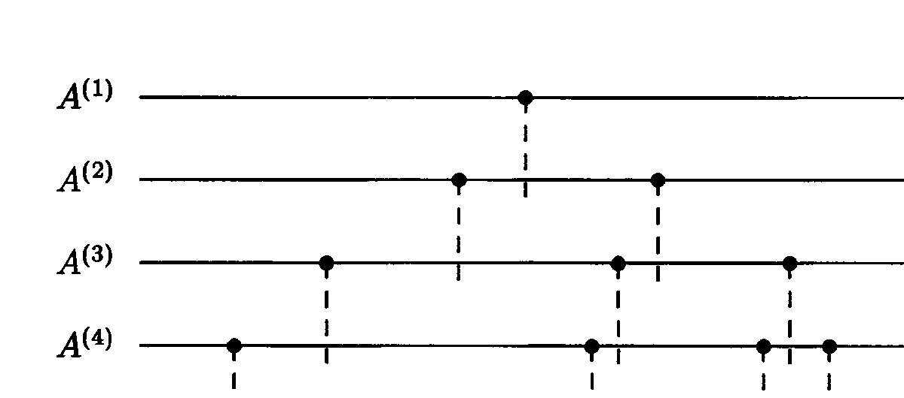

图 30.1. 不可约三对角实对称矩阵 $A$ 的主子矩阵 $\{A^{(k)}\}$ 所满足的严格特征值交错性质 (30.6) 示意图。$A^{(k)}$ 的特征值交错于 $A^{(k+1)}$ 的特征值之间；二分法利用了这一性质。

正是交错性质使我们能够计算矩阵在指定区间内的特征值个数。例如，考虑三对角矩阵

$$
A=
\begin{bmatrix}
1&1&0&0\\
1&0&1&0\\
0&1&2&1\\
0&0&1&-1
\end{bmatrix}.
$$

由

$$
\det(A^{(1)})=1,\qquad
\det(A^{(2)})=-1,\qquad
\det(A^{(3)})=-3,\qquad
\det(A^{(4)})=4,
$$

可知 $A^{(1)}$ 没有负特征值，$A^{(2)}$ 有一个负特征值，$A^{(3)}$ 有一个负特征值，而 $A^{(4)}$ 有两个负特征值。

一般地，对任意对称三对角矩阵 $A\in\mathbb{R}^{m\times m}$，负特征值的个数等于序列

$$
1,\ \det(A^{(1)}),\ \det(A^{(2)}),\ \ldots,\ \det(A^{(m)})
\tag{30.7}
$$

中的符号变化次数；这个序列称为 Sturm 序列。即使中途出现零行列式，这个规则仍然成立，只要把“符号变化”定义为从正数或 0 变为负数，或从负数或 0 变为正数，但不把从正数或负数变为 0 计作符号变化。把 $A$ 平移一个单位矩阵的倍数，就可以确定任意区间 $[a,b)$ 中的特征值个数：它等于 $(-\infty,b)$ 中的个数减去 $(-\infty,a)$ 中的个数。

再观察一点，二分法的描述就完整了：对三对角矩阵，矩阵 $\{A^{(k)}\}$ 的行列式满足三项递推关系。根据 (30.5)，沿第 $k$ 行对 $\det(A^{(k)})$ 关于 $b_{k-1}$、$a_k$ 的条目作余子式展开，可得

$$
\det(A^{(k)})
 =a_k\det(A^{(k-1)})-b_{k-1}^2\det(A^{(k-2)}).
\tag{30.8}
$$

引入移位 $xI$，并记

$$
p^{(k)}(x)=\det(A^{(k)}-xI),
$$

得到

$$
p^{(k)}(x)=(a_k-x)p^{(k-1)}(x)-b_{k-1}^2p^{(k-2)}(x).
\tag{30.9}
$$

若定义 $p^{(-1)}(x)=0$、$p^{(0)}(x)=1$，那么这个递推对所有 $k=1,2,\ldots,m$ 都成立。

对一系列 $x$ 应用 (30.9)，并沿递推过程统计符号变化，二分法就能把特征值定位到任意小的区间内。每次计算整个序列需要 $O(m)$ 次浮点运算，因此把一个特征值求到相对精度 $\varepsilon_{\mathrm{machine}}$ 的总成本为

$$
O\!\left(m\log\frac{1}{\varepsilon_{\mathrm{machine}}}\right)
$$

次浮点运算。如果只需要少量特征值，这相对于 QR 算法的 $O(m^2)$ 运算量是明显的改进。在多处理器计算机上，还可以让不同处理器独立寻找不同的特征值。

### 分治算法

分治算法通过把对称三对角特征值问题递归地划分为更小维数的问题，代表了自 20 世纪 60 年代以来矩阵特征值算法最重要的进展。这个方法由 Cuppen 于 1981 年首次提出；如果既需要特征值又需要特征向量，它的速度超过 QR 算法的一倍。

下面只给出核心思想，省略所有细节。不过需要提醒读者：在这个问题中，细节尤其重要。只有把细节处理正确，算法才是完全稳定的；Cuppen 的原始论文发表后，这一点甚至十年间都没有被充分理解。

令 $T\in\mathbb{R}^{m\times m}$，$m\ge2$，是实对称、三对角且不可约的矩阵，即其下对角线只有非零元（否则可以降阶）。对于任意 $1\le n<m$，令 $T_1$ 为 $T$ 左上角的 $n\times n$ 主子矩阵，$T_2$ 为右下角的 $(m-n)\times(m-n)$ 主子矩阵，并令

$$
\beta=t_{n+1,n}=t_{n,n+1}\ne0.
$$

记 $e_n$ 为 $\mathbb{R}^n$ 的最后一个标准基向量，记 $e_1$ 为 $\mathbb{R}^{m-n}$ 的第一个标准基向量。将 $T_1$ 的右下角条目替换为 $t_{nn}-\beta$，得到 $\widehat T_1$；将 $T_2$ 的左上角条目替换为 $t_{n+1,n+1}-\beta$，得到 $\widehat T_2$。于是有分裂公式

$$
T=
\begin{bmatrix}
T_1&\beta e_ne_1^T\\
\beta e_1e_n^T&T_2
\end{bmatrix}
=
\begin{bmatrix}
\widehat T_1&0\\
0&\widehat T_2
\end{bmatrix}
+\beta
\begin{bmatrix}
e_n\\
e_1
\end{bmatrix}
\begin{bmatrix}
e_n\\
e_1
\end{bmatrix}^{T}.
\tag{30.10}
$$

也就是说，三对角矩阵可以写成一个带三对角块的 $2\times2$ 分块对角矩阵，加上一个秩一修正。

分治算法把 $n$ 取为约 $m/2$，按 (30.10) 分裂矩阵 $T$。假设 $\widehat T_1$、$\widehat T_2$ 的特征值已经知道，由于修正矩阵是秩一的，就可以用一个非线性但很快的计算，从这两个矩阵的特征值得到 $T$ 的特征值。随后递归应用这一想法，通过带秩一修正的进一步分裂来求出 $\widehat T_1$、$\widehat T_2$ 的特征值，如此继续。这样，一个 $m\times m$ 特征值问题就被化为一组 $1\times1$ 特征值问题和一系列秩一修正。（在实际中，为了获得最大效率，当子矩阵维数足够小时，通常会切换到 QR 算法，而不会把递归一直进行到底。）

这个过程中有一个关键的数学点：如果 $\widehat T_1$、$\widehat T_2$ 的特征值已经知道，如何得到 $T$ 的特征值？假设已经计算出对角化

$$
\widehat T_1=Q_1D_1Q_1^T,
\qquad
\widehat T_2=Q_2D_2Q_2^T.
$$

由 (30.10) 可得

$$
T=
\begin{bmatrix}
Q_1&0\\
0&Q_2
\end{bmatrix}
\left(
\begin{bmatrix}
D_1&0\\
0&D_2
\end{bmatrix}
+\beta zz^T
\right)
\begin{bmatrix}
Q_1^T&0\\
0&Q_2^T
\end{bmatrix}.
\tag{30.11}
$$

其中 $z^T=(q_1^T,q_2^T)$，$q_1^T$ 是 $Q_1$ 的最后一行，$q_2^T$ 是 $Q_2$ 的第一行。由于这是一个相似变换，问题已经被化为求一个对角矩阵加秩一修正的特征值。

为说明这一点，简化记号。设要寻找 $D+ww^T$ 的特征值，其中 $D\in\mathbb{R}^{m\times m}$ 是对角矩阵，对角条目 $\{d_j\}$ 互异，$w\in\mathbb{R}^m$ 是向量。（上面的 $\beta>0$ 时取加号；若 $\beta<0$，则考虑 $D-ww^T$。）可以假设所有 $w_j\ne0$，否则问题是可约的。那么 $D+ww^T$ 的特征值是有理函数

$$
f(\lambda)=1+\sum_{j=1}^{m}\frac{w_j^2}{d_j-\lambda}
\tag{30.12}
$$

的根，如图 30.2 所示。

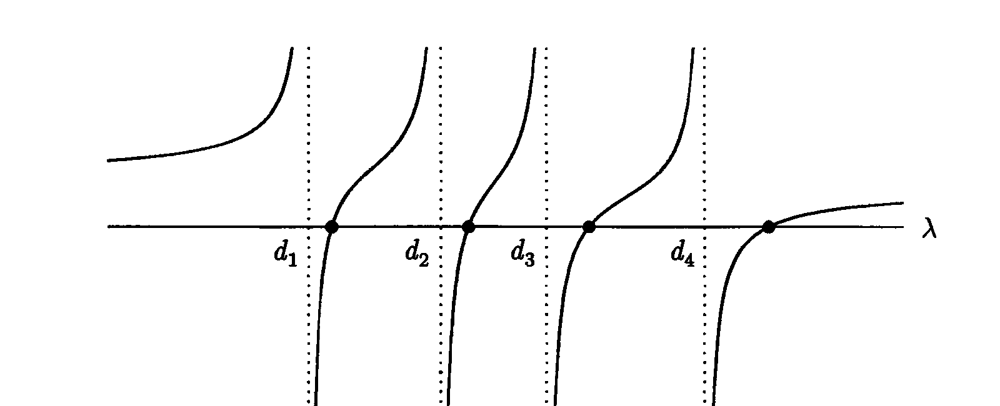

图 30.2. 维数为 4 的问题中式 (30.12) 的函数 $f(\lambda)$。$f(\lambda)$ 的极点是 $D$ 的特征值 $\{d_j\}$，而 $f(\lambda)$ 的根（实心点）是 $D+ww^T$ 的特征值。快速求出这些根，是分治算法每个递归步骤的基础。

证明这一点。若对某个 $q\ne0$ 有 $(D+ww^T)q=\lambda q$，则

$$
(D-\lambda I)q+w(w^Tq)=0,
$$

从而

$$
q+(D-\lambda I)^{-1}w(w^Tq)=0.
$$

左乘 $w^T$，得到

$$
w^Tq+w^T(D-\lambda I)^{-1}w(w^Tq)=0,
$$

也就是 $f(\lambda)(w^Tq)=0$。其中 $w^Tq$ 必须非零；否则 $q$ 会成为 $D$ 的特征向量，即只有一个位置非零，这反过来又会推出 $w^Tq\ne0$。因此，如果 $q$ 是 $D+ww^T$ 的特征值为 $\lambda$ 的特征向量，那么必有 $f(\lambda)=0$。反过来，由 $f$ 的形式可知它恰有 $m$ 个根，所以结论也成立。方程 $f(\lambda)=0$ 称为 secular 方程。

在分治算法的每个递归步骤中，使用与 Newton 方法有关的快速迭代过程求出 (30.12) 的根。每个根只需要 $O(1)$ 次迭代（如果把 $\varepsilon_{\mathrm{machine}}$ 视为变量，则为 $O(\log|\log\varepsilon_{\mathrm{machine}}|)$ 次），因此对一个 $m\times m$ 矩阵，每个根需要 $O(m)$ 次浮点运算，全部根需要 $O(m^2)$ 次。

$$
O\!\left(
m^2+2\left(\frac m2\right)^2
+4\left(\frac m4\right)^2
+8\left(\frac m8\right)^2
+\cdots+m\left(\frac m m\right)^2
\right).
\tag{30.13}
$$

这个级数由于分母中的平方而收敛到 $O(m^2)$，而不是 $O(m^2\log m)$。因此，表面上看，分治算法与 QR 算法的运算量是同阶的 $O(m^2)$。

到这里，分治算法为什么有优势还不明显。因为把满矩阵约化为三对角形式（第 25 讲称为“第一阶段”）需要 $4m^3/3$ 次浮点运算（式 (26.2)），看起来即使改进三对角矩阵对角化（“第二阶段”）的 $O(m^2)$ 运算量，意义也不大。然而，如果同时计算特征向量，经济性就发生了变化。此时第一阶段需要 $8m^3/3$ 次浮点运算，而第二阶段也需要 $O(m^3)$ 次：对 QR 算法约为 $6m^3$。分治算法之所以能降低这个数，根本原因是它的非线性迭代只涉及标量函数 (30.12)，而不涉及正交矩阵 $Q_j$；QR 算法却必须在每次迭代中处理矩阵 $Q_j$。

运算量分析给出如下结果。分治计算中 $O(m^3)$ 的部分来自 (30.11) 中与 $Q_j$ 和 $Q_j^T$ 的乘法。把递归所有层次加起来，总运算量为 $4m^3/3$，相较于约 $6m^3$ 有很大改进。再加上第一阶段的 $8m^3/3$，总运算量从约 $9m^3$ 降到 $4m^3$。

实际上，分治算法通常还能做得更好，原因并不初等。对大多数矩阵 $A$，(30.11) 中出现的许多向量 $z$ 和矩阵 $Q_j$ 都会呈现数值稀疏性，即许多条目的相对大小小于机器精度。这种稀疏性允许进行数值降阶，把接连出现的三对角特征值问题化为彼此解耦的更小问题。在典型情况下，这会把第二阶段的运算量降到低于 $m^3$ 的量级，从而使第一、第二阶段合计为 $8m^3/3$。如果只计算特征值，(30.13) 还是一个高估，第二阶段的运算量会降到低于 $m^2$ 的量级。这个迷人现象的根源——本讲不再展开——是大多数三对角矩阵的大多数特征向量都具有“指数局部化”性质（习题 30.7）；物理学家还把这一事实与玻璃透明的现象联系起来。

我们前面仿佛在谈论一个唯一的分治算法，但实际上存在许多变体。出于稳定性原因，常常使用更复杂的秩一更新，有时也使用秩二更新；求 $f(\lambda)$ 的根有各种方法；当 $m$ 很大时，用多极展开来完成与 $Q_j$ 的乘法会比直接算法快。LAPACK 库中提供了高质量的分治算法实现。

### 习题

**30.1**　推导公式 (30.4)，并给出基于该 $\theta$ 选择的变换 (30.1) 的精确几何解释。

**30.2**　Jacobi 算法的一步 (30.1) 需要多少次浮点运算？$m(m-1)/2$ 步，即一轮扫描，需要多少次浮点运算？这一轮扫描的运算量与先把实对称矩阵三对角化、再用 QR 算法求其特征值的总运算量相比如何？

**30.3**　证明：如果 Jacobi 算法每一步都消去绝对值最大的非对角条目，那么非对角条目平方和每一步至少缩小为原来的

$$
1-\frac{2}{m^2-m}.
$$

**30.4**　设 $m$ 为偶数，且计算机有 $m/2$ 个处理器。若所用的行/列对为互不相交的

$$
(1,2),(3,4),(5,6),\ldots,(m-1,m),
$$

说明如何并行执行 $m/2$ 个变换 (30.1)。

**30.5**　编写程序，用标准的按行顺序 Jacobi 算法求 $m\times m$ 实对称矩阵的特征值，并在对数尺度上绘制非对角条目平方和随扫描轮数变化的曲线。对维数为 20、40、80 的随机矩阵运行程序。

**30.6**　矩阵

$$
A=
\begin{bmatrix}
1&1&0&0\\
1&1&1&0\\
0&1&2&1\\
0&0&1&3
\end{bmatrix}
$$

在区间 $[1,2]$ 内有多少个特征值？利用递推式 (30.9)，在纸上通过二分法求出答案。

**30.7**　构造一个维数为 100 的随机实对称三对角矩阵 $T$，并计算其特征值分解 $T=QDQ^T$。在对数尺度上绘制几个特征向量（即 $Q$ 的若干列的绝对值），观察局部化现象。$Q$ 的 10,000 个条目中，有多大比例的绝对值大于 $10^{-10}$？如果不用随机矩阵，而使用条目为 $1,-2,1$ 的离散 Laplacian，答案又是什么？
---

<a id="lecture-31"></a>

## 第 31 讲　奇异值分解的计算

> 原书页 234–240；目标 PDF 页 249–255。保留本讲的两阶段流程、Golub–Kahan、LHC、三步双对角化和运算量曲线等插图，图片文件位于 assets/。

任意矩阵的奇异值分解（SVD）可以归结为一个 Hermitian 方阵的特征值分解，但最直接的做法并不稳定。标准的 SVD 算法隐式地采用了另一种约化到 Hermitian 形式的方法。为了提高速度，矩阵首先通过左右酉变换约化为双对角形式。

### $A$ 的 SVD 与 $A^*A$ 的特征值

如定理 5.4 所述，对于 $m\times n$ 矩阵 $A$（$m\ge n$），若

$$
A=U\Sigma V^*,
$$

则它的 SVD 与矩阵 $A^*A$ 的特征值分解有关：

$$
A^*A=V\Sigma^*\Sigma V^*.
$$

因此，从数学上看，我们可以按下面的步骤计算 $A$ 的 SVD：

1. 构造 $A^*A$；
2. 计算特征值分解 $A^*A=V\Lambda V^*$；
3. 取 $\Sigma$ 为 $\Lambda$ 的非负对角平方根，并将其视为 $m\times n$ 矩形对角矩阵；
4. 求解矩阵方程 $U\Sigma=AV$，得到酉矩阵 $U$（例如通过 QR 分解）。

这个算法经常被使用，甚至有人在独立重新发现 SVD 时也会采用它。矩阵 $A^*A$ 称为 $A$ 的协方差矩阵，在统计学和其他领域中有熟悉的解释。然而，该算法并不稳定，因为它把 SVD 问题约化成了一个可能对扰动更加敏感的特征值问题。

困难可以这样说明。我们已经知道，当 Hermitian 矩阵 $A^*A$ 被扰动 $\delta B$ 后，每个特征值的绝对变化量不超过扰动的 2-范数。由习题 26.3(b)，

$$
|\lambda_k(A^*A+\delta B)-\lambda_k(A^*A)|
\le \|\delta B\|_2.
$$

另一方面，如下节的式 (31.2) 所暗示的，$A$ 的奇异值满足类似的界：

$$
|\sigma_k(A+\delta A)-\sigma_k(A)|\le \|\delta A\|_2.
$$

因此，一个后向稳定的奇异值算法会得到满足

$$
\widetilde\sigma_k=\sigma_k(A+\delta A),
\qquad
\frac{\|\delta A\|}{\|A\|}=O(\varepsilon_{\mathrm{machine}}),
\tag{31.1}
$$

的 $\widetilde\sigma_k$，从而有

$$
|\widetilde\sigma_k-\sigma_k|
=O(\varepsilon_{\mathrm{machine}}\|A\|).
$$

现在观察通过计算 $\lambda_k(A^*A)$ 来求奇异值时会发生什么。即使 $\lambda_k(A^*A)$ 被稳定地计算出来，我们也只能期待

$$
|\widetilde\lambda_k-\lambda_k|
=O(\varepsilon_{\mathrm{machine}}\|A^*A\|)
=O(\varepsilon_{\mathrm{machine}}\|A\|^2).
$$

开平方得到 $\sigma_k$ 时，

$$
|\widetilde\sigma_k-\sigma_k|
=O\!\left(\frac{|\widetilde\lambda_k-\lambda_k|}
{\sqrt{\widetilde\lambda_k}}\right)
=O\!\left(\frac{\varepsilon_{\mathrm{machine}}\|A\|^2}{\sigma_k}\right).
$$

与前面的结果相比，这多了一个 $O(\|A\|/\sigma_k)$ 的因子。当 $\sigma_k\approx\|A\|$，即对于最大的奇异值来说，这不是问题；但对于满足 $\sigma_k\ll\|A\|$ 的奇异值，它会造成严重影响。对于最小奇异值 $\sigma_n$，我们必须预期损失大约 $\kappa(A)$ 阶的精度，这就是所谓“条件数平方化”，与某些最小二乘问题中使用正规方程时的情况相同（第 19 讲）。

### 另一种约化到特征值问题的方法

存在一种稳定的替代方法，可以把 SVD 约化为特征值问题。先假设 $A$ 是方阵，即 $m=n$；这并没有实质限制，因为后面会看到，矩形矩阵的奇异值问题也可以约化为方阵问题。考虑 $2m\times2m$ 的 Hermitian 矩阵

$$
H=
\begin{bmatrix}
0&A^*\\
A&0
\end{bmatrix}.
\tag{31.2}
$$

这个矩阵在习题 5.4 中已经出现。由 $A=U\Sigma V^*$，可知 $AV=U\Sigma$ 且 $A^*U=V\Sigma$，因而有如下分块 $2\times2$ 矩阵等式：

$$
\begin{bmatrix}
0&A^*\\
A&0
\end{bmatrix}
\begin{bmatrix}
V&V\\
U&-U
\end{bmatrix}
=
\begin{bmatrix}
V&V\\
U&-U
\end{bmatrix}
\begin{bmatrix}
\Sigma&0\\
0&-\Sigma
\end{bmatrix}.
\tag{31.3}
$$

这实际上就是 $H$ 的一个特征值分解。因此，$A$ 的奇异值是 $H$ 的特征值的绝对值，而 $A$ 的左右奇异向量可以从 $H$ 的特征向量中提取出来。

于是，可以通过构造 $H$ 并计算它的特征值分解来得到方阵 $A$ 的 SVD。与使用 $AA^*$ 或 $A^*A$ 不同，这种方法是稳定的。标准 SVD 算法正是建立在这一想法上，只是以一种不显式构造维数达到 $m+n$ 的矩阵的隐蔽形式实现。要使这个过程足够快，关键步骤是先进行酉约化，把矩阵变成双对角形式。

### 两个阶段

我们已经看到，Hermitian 特征值问题通常分为两个阶段：先把矩阵约化为三对角形式，再对三对角矩阵对角化。从 20 世纪 60 年代 Golub、Kahan 等人的工作开始，SVD 也采用了类似的两阶段方法：先把矩阵变成双对角形式，再对双对角矩阵对角化。

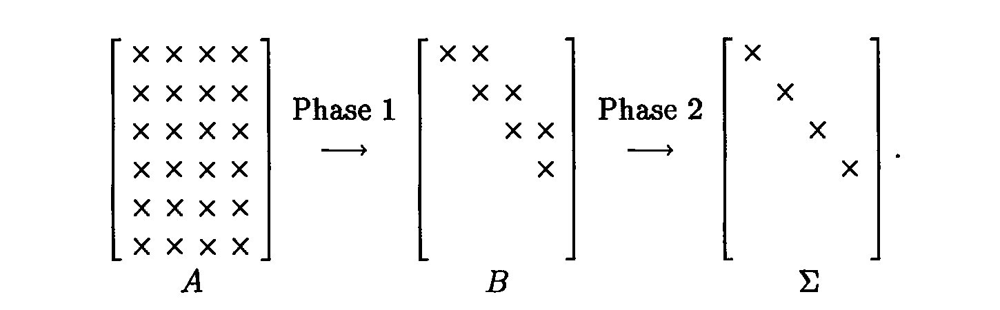

两阶段 SVD 计算的结构示意：第一阶段把稠密矩阵 $A$ 约化为双对角矩阵 $B$，第二阶段再把 $B$ 对角化为 $\Sigma$。

第一阶段需要有限次运算，成本为 $O(mn^2)$ 次浮点运算。第二阶段原则上需要无限次运算，但标准算法超线性收敛，因此只需 $O(n\log|\log(\varepsilon_{\mathrm{machine}})|)$ 次迭代，就能达到 $\varepsilon_{\mathrm{machine}}$ 阶的精度（习题 25.2）。实际中通常把 $\varepsilon_{\mathrm{machine}}$ 当作常数，于是说收敛只需要 $O(n)$ 次迭代。由于操作对象是双对角矩阵，每次迭代只需要 $O(n)$ 次浮点运算。因此，在只要求奇异值而不要求奇异向量时，第二阶段总共需要 $O(n^2)$ 次浮点运算。也就是说，尽管第一阶段是有限过程、第二阶段原则上是无限过程，但实际中后者的代价反而小得多，这与对称特征值问题的情形相同。

### Golub–Kahan 双对角化

在 SVD 计算的第一阶段，通过在左侧和右侧施加不同的酉变换，把 $A$ 约化为双对角形式。这一点不同于特征值计算：特征值算法必须在两侧施加相同的酉变换，以保证每一步都是相似变换。在那里，我们只能在第一条次对角线以下引入零；而在这里，矩阵可以完全三角化，并且还可以在第一条超对角线以上引入零。

最简单的实现方法是 Golub–Kahan 双对角化：在左侧和右侧交替使用 Householder 反射。每次左反射都会把主对角线以下的一列元素变成零；紧接着的右反射会把第一条超对角线右侧的一行元素变成零，同时保留刚刚在该列中引入的零。对于一个 $6\times4$ 矩阵，前两对反射的效果如下图所示。

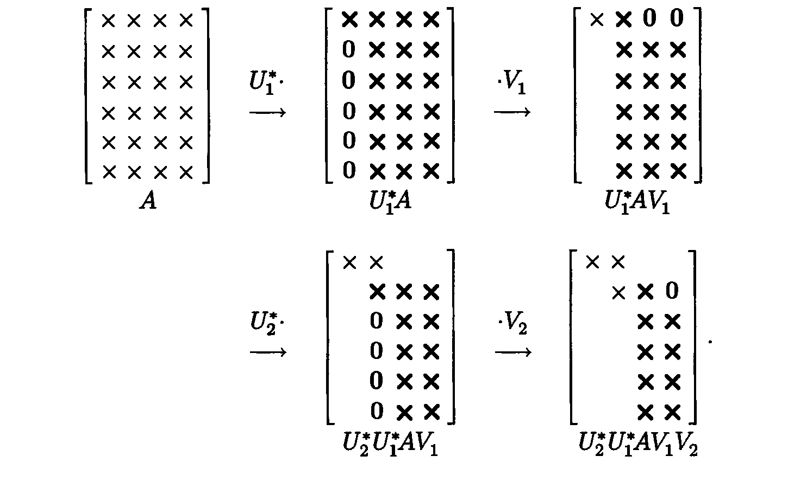

Golub–Kahan 双对角化的前两对左右 Householder 反射：左乘 $U_1^*$、右乘 $V_1$，随后在剩余行列上重复这一过程。

左乘 $U_1^*$ 修改第 1 到第 $m$ 行，在第 1 列主对角线以下引入零。右乘 $V_1$ 修改第 2 到第 $n$ 列，在第 1 行引入零，同时不破坏第 1 列中已有的零。接下来对第 2 到第 $m$ 行操作，再对第 3 到第 $n$ 列操作，如此继续。

整个过程结束时，左侧共施加了 $n$ 个反射，右侧施加了 $n-2$ 个反射。浮点运算模式类似于两个交错进行的 Householder QR 分解：一个作用于 $m\times n$ 矩阵 $A$，另一个作用于 $n\times m$ 矩阵 $A^*$。因此总运算量是 QR 分解 (10.9) 的两倍，即

$$
\text{Golub–Kahan 双对角化的运算量：}\quad
\mathord{\sim}4mn^2-\frac{4}{3}n^3\quad\text{flops}.
\tag{31.4}
$$

### 第一阶段的更快方法

当 $m\gg n$ 时，上面的运算量明显偏大。一次 QR 分解会在对角线以下的绝大多数位置引入零，而 Golub–Kahan 方法的运算量却高出一倍。这一观察启发了另一种双对角化方法：当 $m\gg n$ 时，先做 QR 分解。该方法最初由 Lawson 和 Hanson 提出，后来由 Chan 发展，称为 LHC 双对角化。

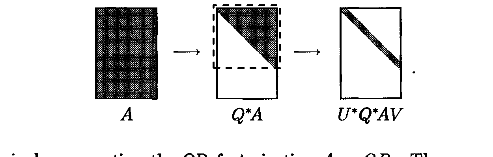

Lawson–Hanson–Chan 双对角化的结构示意：先通过 QR 分解得到 $Q^*A$，再对上方的方阵块作 Golub–Kahan 双对角化。

先计算 QR 分解 $A=QR$，再对 $R$ 作 Golub–Kahan 双对角化 $B=U^*RV$。QR 分解需要 $2mn^2-\frac{2}{3}n^3$ 次浮点运算，而此时 Golub–Kahan 过程只需作用于上方的 $n\times n$ 子矩阵，需要 $\frac{8}{3}n^3$ 次浮点运算。因此总运算量为

$$
\text{LHC 双对角化的运算量：}\quad
\mathord{\sim}2mn^2+2n^3\quad\text{flops}.
\tag{31.5}
$$

当 $m>\frac53n$ 时，这个方法比 Golub–Kahan 双对角化更便宜（习题 31.1）。有趣的是，LHC 过程先产生零，随后又在 $A$ 的上方 $n\times n$ 方块的下三角部分破坏这些零，但总的运算量仍然减少了。

LHC 过程只有在 $m>\frac53n$ 时才有优势，但这个想法可以推广到任意 $m>n$ 的情形。诀窍不是在计算开始时进行 QR 分解，而是在中间某个合适的时刻进行。这是因为在 Golub–Kahan 过程中，$m>n$ 的矩阵会随着双对角化不断变得更“瘦”。例如，初始长宽比为 $m/n=3/2$ 时，它会逐渐增长到 $5/3$、$2$ 乃至更大。第 $k$ 步之后，剩余矩阵的长宽比为 $(m-k)/(n-k)$；当这个比值足够大时，就适合进行 QR 分解，把问题化为一个方阵问题。

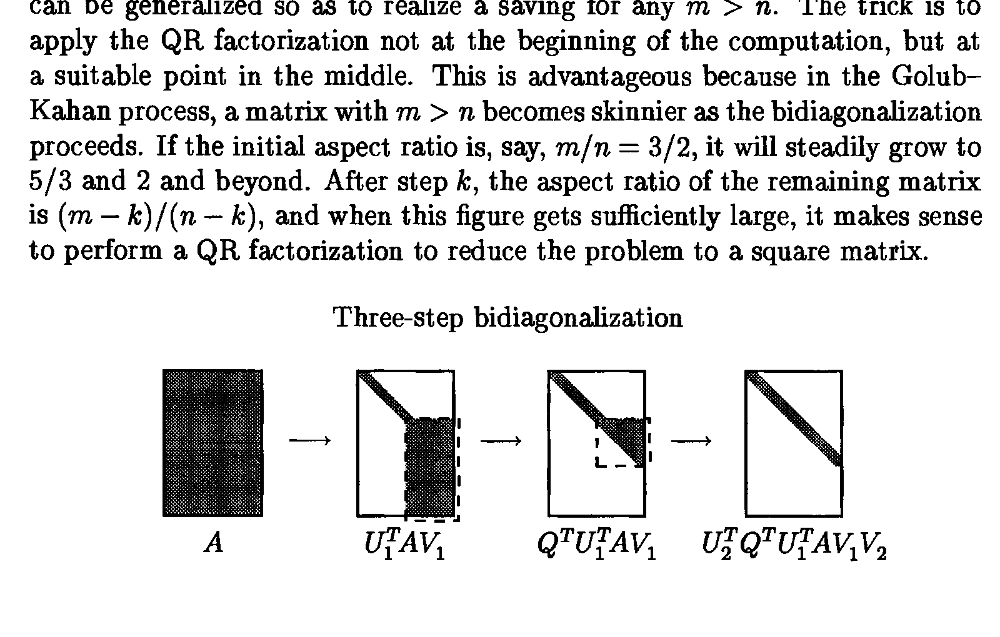

三步双对角化的结构示意：在 Golub–Kahan 过程中途插入一次 QR 分解，再继续对剩余方阵块做双对角化。

什么时候应该进行 QR 分解？如果目标只是使运算量最小，答案很简单：当矩阵达到长宽比

$$
\frac{m-k}{n-k}=2
$$

时（习题 31.2）。这一选择得到

$$
\text{三步双对角化的运算量：}\quad
\mathord{\sim}4mn^2-\frac{4}{3}n^3-\frac{2}{3}(m-n)^3
\quad\text{flops}.
\tag{31.6}
$$

对于 $n<m<2n$，这比另外两种方法都有小幅改进。三种方法的运算量随 $m/n$ 的变化如图 31.1 所示。必须承认，三步方法的改进幅度很小，因此在真实计算机上，除了运算量之外的其他因素也可能决定哪一种方法最好（见第 59 页）。

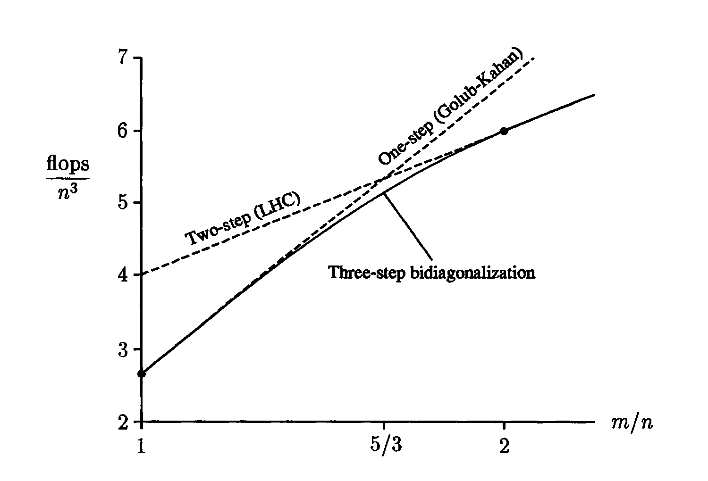

图 31.1. 对 $m\times n$ 矩阵应用三种双对角化算法时的运算量，分别由 (31.4)、(31.5)、(31.6) 给出。三步双对角化在另外两种方法之间提供了平滑的插值，但改进幅度并不大。

### 第二阶段

在计算的第二阶段，需要求出双对角矩阵 $B$ 的 SVD。从 20 世纪 60 年代到 90 年代，标准算法是 QR 算法的一个变体。近些年，分治算法也变得具有竞争力；未来它们很可能成为标准方法。这里不再给出细节。

### 习题

**31.1**　(a) 证明：如正文所述且图 31.1 所示，LHC 双对角化开始优于 Golub–Kahan 双对角化的交叉长宽比为 $m/n=5/3$。

(b) 当 $m/n=5/3$ 时，三步双对角化比另外两种方法快多少比例？

**31.2**　证明：在三步双对角化中，执行 QR 分解的最优时刻，是矩阵达到长宽比 2 时。

**31.3**　证明：如果一个双对角矩阵的两条主对角线上的元素都非零，那么该矩阵的奇异值互异。（参见习题 25.1。）

**31.4**　令 $A$ 为一个 $m\times m$ 上三角矩阵，主对角线上元素均为 0.1，对角线以上所有元素均为 1。编写程序，用两种方法计算 $A$ 的最小奇异值：调用标准 SVD 软件；构造 $A^*A$ 并计算其最小特征值的平方根。令 $1\le m\le30$，在对数尺度上把两种结果画成两条曲线。结果是否符合本讲关于这两种算法的一般讨论？

**31.5**　令 $A$ 为一个 $m\times n$ 矩阵，其元素是来自 $N(0,1)$ 的独立样本，其中 $N(0,1)$ 是均值为 0、方差为 1 的正态分布（参见习题 12.3）。令 $B$ 为如下双对角矩阵：

$$
B=
\begin{bmatrix}
x_m&y_{n-1}&&&\\
&x_{m-1}&y_{n-2}&&\\
&&\ddots&\ddots&\\
&&&x_{m-(n-2)}&y_1\\
&&&&x_{m-(n-1)}
\end{bmatrix}.
$$

其中每个 $x$ 或 $y$ 都是一个独立 $\chi^2$ 分布样本的正平方根，其自由度等于所附的下标。（自由度为 $k$ 的 $\chi^2$ 分布，就是 $k$ 个独立 $N(0,1)$ 变量平方和的分布。）

(a) 证明：$A$ 与 $B$ 的奇异值分布相同。

(b) 通过实验验证这一结果。具体地，取 $m=100$、$n=50$，按上述方式构造随机矩阵 $A$ 和 $B$，并把 $A$ 与 $B$ 的奇异值相互作图比较。

---

<a id="lecture-32"></a>

## 第 32 讲　迭代法概述

> 原书页 243–249；目标 PDF 页 258–264。保留原书图号、公式含义和习题编号；本讲的四幅插图中，黑盒图、Krylov 方法分类表以及两幅历史/收敛图均已作为本地图片保存。

从本讲开始，本书的风格发生变化。我们将从已经相当成熟的经典主题——直接法，转向相对而言仍然充满未知的迭代法领域。迭代法很可能主导未来的大规模计算。

### 为什么要迭代？

线性代数中迭代算法的重要性源于一个简单事实：非迭代的“直接”算法通常需要 $O(m^3)$ 的运算量。这太多了！一方面，当 $m$ 很大时，$m^3$ 的绝对数值本身就非常大；另一方面，大多数矩阵问题的输入只包含 $O(m^2)$ 个数，因此解决问题却必须花费 $O(m^3)$ 次运算，似乎也不合理。

下面的表格给出了多年来矩阵计算规模的大致历史：

| 年份 | 典型维数 | 来源或软件 |
| --- | ---: | --- |
| 1950 | $m=20$ | Wilkinson |
| 1965 | $m=200$ | Forsythe 和 Moler |
| 1980 | $m=2000$ | UNPACK |
| 1995 | $m=20000$ | LAPACK |

这些数字粗略表示，在相应年代，人们可能认为“非常大”的稠密直接矩阵计算问题的维数。在 20 世纪 60 年代中期的“Forsythe 和 Moler 时代”（名称来自一本 1967 年出版的有影响力的教材）中，几百维的矩阵就已经很大，几乎达到当时机器能够在合理时间内处理的极限。

显然，在 45 年间，可处理矩阵问题的维数增加了 $10^3$ 倍。这一进步令人印象深刻，但与同一时期计算机硬件从每秒浮点运算到每秒十亿次浮点运算所带来的 $10^9$ 倍加速相比，仍然相形见绌。由于 $10^9$ 正好是 $(10^3)^3$，历史上已经清楚地展现了直接矩阵算法的 $O(m^3)$ 瓶颈。

换一种说法：如果矩阵问题能够用 $O(m^2)$ 而不是 $O(m^3)$ 次运算解决，那么今天处理的一些矩阵的规模或许还能扩大 10 到 100 倍。这正是矩阵迭代法所追求的目标——对某些矩阵已经实现，对另一些矩阵则未必能够实现。

### 结构、稀疏性与黑盒

当然，$O(m^3)$ 瓶颈并不显然能够被突破；对于“随机”的矩阵问题，答案很可能是否定的。然而，实际出现的大型矩阵远非随机，原因很简单。小矩阵（比如 3 维或 30 维）可能在科学问题中直接产生，条目近似任意，例如表示结构中三个力之间的关系，或化学反应中三十种物质之间的关系。相比之下，大矩阵通常间接产生于微分方程或积分方程的离散化。可以说，如果 $m$ 非常大，它很可能是在逼近无穷维问题。

因此，大多数具有计算意义的大矩阵虽然含有数量庞大的条目，但结构往往比表面上看起来简单得多。它们具有某种结构；随着时间推移，人们也在越来越多的场景中找到了利用这些结构的方法。

大型矩阵最明显的结构是稀疏性，即零条目占绝大多数（稀疏的反义词是稠密）。例如，偏微分方程的有限差分离散可能产生一个维数为 $m=10^5$ 的矩阵，每行只有 $\nu=10$ 个非零条目。这种结构很容易被本书后面讨论的迭代法利用，因为这些算法把矩阵当作一个黑盒：


黑盒只需接收任意向量 $x$，并返回矩阵–向量积 $Ax$。

迭代算法只要求能够对任意 $x$ 确定 $Ax$。在计算机程序中，这由一个过程完成，而该过程的内部实现不需要由迭代算法的设计者了解。（某些迭代算法还需要计算 $A^*x$。）对于稀疏矩阵 $A$，很容易设计一个过程，用仅 $O(\nu m)$ 而不是 $O(m^2)$ 次运算计算 $Ax$。这与直接线性代数算法形成鲜明对比：高斯消去法或 Householder 三角化会显式操作矩阵条目以引入零，但在这一过程中通常又会破坏稀疏性。

从历史上看，稀疏性是迭代矩阵计算中最常被利用的结构。（嵌套剖分、最小度重排序等快速直接法也利用稀疏性，但本书不讨论。）近来人们逐渐认识到，即使矩阵是稠密的，其他类型的结构也可能被利用。例如，用数值方法求解积分方程通常会得到稠密矩阵问题；工程中称之为边界元法或面元法。这些矩阵的系数往往具有很强的规律性，因此如何利用这种规律——例如采用多极展开或小波展开——仍是活跃的研究方向。实现这类方法的黑盒可能包含数千行代码，其背后的思想也只有专家才能完全理解。

### 投影到 Krylov 子空间

本书余下部分的迭代法都建立在这样一个思想上：把一个 $m$ 维问题投影到一个低维 Krylov 子空间中。给定矩阵 $A$ 和向量 $b$，相应的 Krylov 序列是

$$
b,\ Ab,\ A^2b,\ A^3b,\ldots.
$$

这些向量可以通过黑盒按如下方式计算：

$$
b,\ Ab,\ A(Ab),\ A(A(Ab)),\ldots.
$$

相应的 Krylov 子空间就是由这些向量中逐渐增大的向量组张成的空间。

具体来说，本书将讨论的算法可以排列成下表：

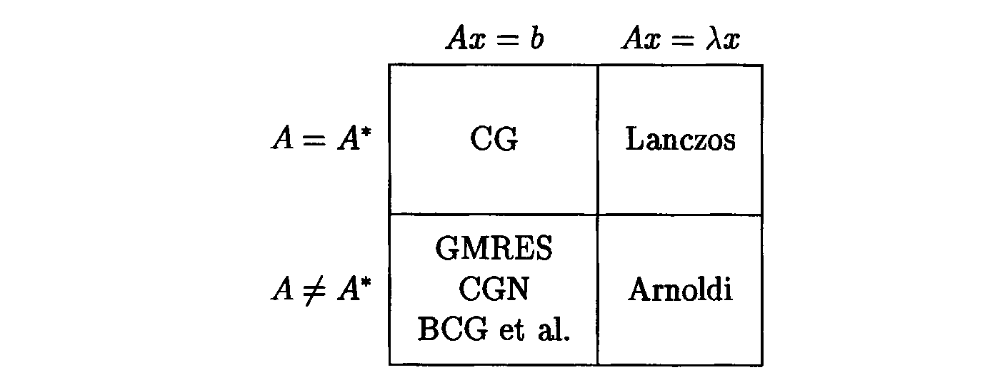

Krylov 投影方法的分类：列区分线性方程组 $Ax=b$ 与特征值问题 $Ax=\lambda x$，行区分 Hermitian 情形 $A=A^*$ 与非 Hermitian 情形 $A\ne A^*$。

（这个领域充满了缩写！例如，CG 表示共轭梯度法；顺便说一句，它不仅要求 $A$ 为 Hermitian，还要求 $A$ 正定。）在每一种方法中，投影到 Krylov 子空间都会把原始矩阵问题约化成一系列维数为 $n=1,2,3,\ldots$ 的矩阵问题。当 $A$ 为 Hermitian 时，约化矩阵是三对角的；当 $A$ 非 Hermitian 时，约化矩阵具有 Hessenberg 形式。

例如，Arnoldi 迭代通过计算一系列维数递增的 Hessenberg 矩阵的特征值，来近似一个大矩阵的特征值。

### 步数、每步运算量与预条件

高斯消去法、QR 分解和稠密线性代数中的大多数其他算法，都符合下面的模式：共有 $O(m)$ 步，每步需要 $O(m^2)$ 次运算，总运算量估计为 $O(m^3)$。（当然，在并行计算机上，尤其是第二个数量级可能发生变化。）迭代法也可以用同样的两个数字描述，但此时它们代表典型的最坏情形。当迭代法成功时，往往能够降低其中一个或两个因素。

我们将看到，迭代法达到满意精度所需的步数，通常取决于矩阵 $A$ 的谱性质，这里“谱”应作广义理解。例如，如果 Hermitian 正定系统 $Ax=b$ 的特征值很好地聚集在远离原点的位置，共轭梯度迭代就能保证快速求解。类似地，如果实 Hermitian 矩阵的某些特征值与其余谱充分分离，并且启动迭代的初始向量足够一般，Lanczos 迭代就能保证快速计算这些特征值。

这些方法的收敛速率分析是一个迷人的研究主题，依赖于逼近论。具体地说，Krylov 子空间迭代算法的收敛性与这样的问题密切相关：在实轴或复平面的某些子集上，用多项式 $p(z)$ 逼近函数 $f(z)$。

每一步矩阵迭代的运算量，主要取决于矩阵的结构，以及黑盒 $x\mapsto Ax$ 利用了多少这种结构。

线性代数中理想的迭代法把步数从 $m$ 降到 $O(1)$，把每步运算量从 $O(m^2)$ 降到 $O(m)$，从而把总运算量从 $O(m^3)$ 降到 $O(m)$。这种惊人的加速确实会在实际问题中出现，但更典型的改进也许是把 $O(m^3)$ 降到 $O(m^2)$。

在 20 世纪 90 年代中期的一次大规模工程计算中，对于迭代法能够成功处理的问题，典型结果或许是比直接法快一个数量级，即大约 10 倍。未来，随着机器变快、$m$ 变大，这一倍数还会增加，迭代法的重要性也会提高。这体现了计算机科学的一条基本规律：计算机越快，算法速度的重要性越大。

### 精确解与近似解

从原则上说，矩阵迭代法是近似的：即使没有舍入误差，只要迭代步数停留在实际感兴趣的范围内，它们也不会给出精确答案。刚接触这些思想的人往往对此感到不安，可能认为迭代是一种缺乏优雅、可靠性可疑的“工程解法”。但随着对这些方法的了解加深，这种不安通常会逐渐消失。

毕竟，直接法在计算机上执行时也并不精确：我们希望得到的是机器精度的答案，而不是比机器精度更高的答案。迭代法同样可以达到机器精度，因此它们在原则上是近似的这一点并不重要。至于优雅性，本书这里出现的思想是数值线性代数中最美的一些思想。

这些观点见图 32.1。

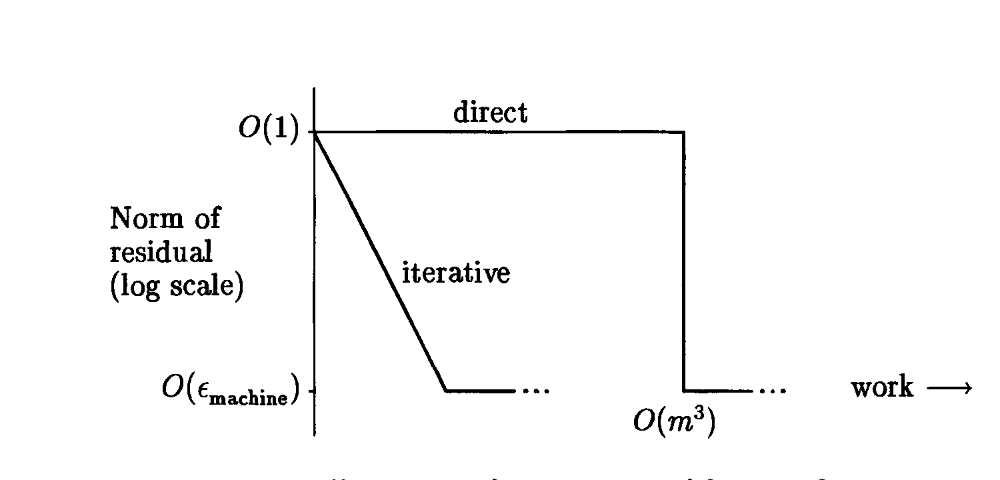

图 32.1. 直接法与迭代法收敛过程的示意图。理想情况下，迭代法沿几何速率收敛，直到残差达到 $\varepsilon_{\mathrm{machine}}$ 阶；直接法在完成 $O(m^3)$ 次运算前几乎没有进展，随后残差也达到 $\varepsilon_{\mathrm{machine}}$ 阶。

### 超越 $O(m^3)$ 的直接法

最后需要提到，确实存在一些直接算法：它们原则上是有限的、精确的，并且能以少于 $O(m^3)$ 的运算量求解 $Ax=b$ 及相关问题。

第一种此类算法由 Volker Strassen 于 1969 年发现。他把 Gauss 的指数 3 降到 $\log_2(7)\approx2.81$；随后，Coppersmith 和 Winograd 的改进又把已知最好指数降到了约 2.376。已知最好指数的历史见图 32.2。

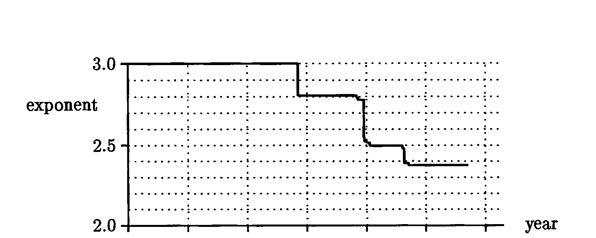

图 32.2. $m\times m$ 矩阵直接求解 $Ax=b$（等价地，计算 $A^{-1}$、$AB$ 或 $\det A$）的已知最好复杂度指数随时间的变化。1968 年以前最好算法的复杂度为 $O(m^3)$；目前已知最好算法为 $O(m^{2.376})$，但常数太大，实际上并不实用。

到目前为止，这些快速算法对实际计算的影响可以忽略，原因有两个。一个原因是人们通常并不清楚它们的稳定性性质。更根本的原因是，尽管快速算法的指数十分引人注目，但它们开始超过标准方法的交叉规模极高。Strassen 的 $m^{2.81}$ 算法在 $m$ 低至约 100 时就可能超过高斯消去法；但由于 2.81 离 3 太近，对于实际规模而言，优势从来不会特别显著。指数远低于这个数的现有方法通常带有很大的常数因子，因此在当前机器能够达到的规模上仍比高斯消去法慢。

但未来会怎样？没有人知道。

也许明天就有人发现一种“快速矩阵求逆”方法，用 $m^2\log m$ 次浮点运算求解 $Ax=b$；也可能是读者今晚就发现了它。这样的发展将引发数值计算史上最剧烈的变革。

### 习题

**32.1**　三维椭圆型偏微分方程通过边界元方法离散化。结果是一个大型稠密线性方程组，其中每个方程对应大球面上的一个三角形面元。为了提高精度，必须把三角形划得更小，从而增加方程的数量；但误差只会随 $h$ 线性缩小，其中 $h$ 是最大三角形的直径。

选定一个 $h$ 后，用高斯消去法求解该系统，得到两位有效数字的解，耗时 1 分钟。现在决定需要三位有效数字。假设存储不是约束，在同一台计算机上重新计算大约需要多长时间？

**32.2**　考虑分块矩阵乘积

$$
\begin{bmatrix}W&X\\\\Y&Z\end{bmatrix}
=
\begin{bmatrix}A&B\\\\C&D\end{bmatrix}
\begin{bmatrix}E&F\\\\G&H\end{bmatrix},
$$

为简单起见，假设矩阵 $A,B,\ldots,Y,Z$ 都是相同维数的方阵。

(a) 已知 $A,B,\ldots,G,H$，用直接算法计算 $W,X,Y,Z$ 需要多少次矩阵加法和多少次矩阵乘法？

(b) Strassen 证明，也可以用下列公式计算 $W,X,Y,Z$：

$$
\begin{aligned}
P_1&=(A+D)(E+H),& P_5&=(A+B)H,\\\\
P_2&=(C+D)E,& P_6&=(C-A)(E+F),\\\\
P_3&=A(F-H),& P_7&=(B-D)(G+H),\\\\
P_4&=D(G-E),&&
\end{aligned}
$$

$$
\begin{aligned}
W&=P_1+P_4-P_5+P_7,&Y&=P_2+P_4,\\\\
X&=P_3+P_5,&Z&=P_1+P_3-P_2+P_6.
\end{aligned}
$$

现在需要计算：这些公式涉及多少次矩阵加法或减法，以及多少次矩阵乘法？

(c) 证明：递归地应用 Strassen 公式，可以得到一个用于相乘 $m=2^k$ 维矩阵的算法；当 $m\to\infty$ 时，其运算量为 $O(m^{\log_2(7)})$。

(d) 编写一个实现这一思想的递归程序，并给出数值证据说明程序确实有效。

---

<a id="lecture-33"></a>

## 第 33 讲　Arnoldi 迭代

> 原书页 250–256；目标 PDF 页 265–271。本讲没有需要单独保存的位图；原书中的算法框、表格、矩阵和投影关系均在 Markdown/LaTeX 中重构，并保留公式编号与习题编号。

尽管 Krylov 子空间矩阵迭代领域已经出现了许多名称和缩写，但这些算法都建立在少数几个共同的基本思想之上。描述这一基础有多种方式；本讲选择 Arnoldi 过程，把它看作一种 Gram–Schmidt 风格的迭代，用来将矩阵化为 Hessenberg 形式。

### Arnoldi 与 Gram–Schmidt 的类比

设想你被困在荒岛上，为了消磨时间，决定从预先指定的第一列 $q_1$ 出发，逐列构造正交相似变换，把一个非 Hermitian 矩阵化为 Hessenberg 形式。令人惊讶的是，你大概一小时就能解决这个问题，剩下的时间还够采些椰子作为晚餐。你构造出的这种方法就叫作 Arnoldi 迭代。如果 $A$ 是 Hermitian 的，Hessenberg 矩阵会变成三对角矩阵，$n$ 项递推关系会变成三项递推关系，而方法的名称也会改为 Lanczos 迭代；第 36 讲将讨论它。

这里有一个类比。对于矩阵 $A$ 的 QR 分解 $A=QR$，本书讨论过两种方法：Householder 反射通过一系列正交操作把 $A$ 三角化；Gram–Schmidt 正交化则通过一系列三角操作把 $A$ 的列正交化。虽然在舍入误差存在时，Householder 反射得到的矩阵 $Q$ 通常更接近正交矩阵，但 Gram–Schmidt 过程有一个优势：它可以中途停止，留下 $A$ 的前 $n$ 列的约化 QR 分解。

对矩阵 $A$ 计算 Hessenberg 约化 $A=QHQ^*$ 的问题完全类似。这里也有两种标准方法：Householder 反射（现在从 $A$ 的左右两侧同时作用）和 Arnoldi 迭代。因此，Arnoldi 是 Gram–Schmidt 在“通过相似变换化为 Hessenberg 形式”这一问题中的对应物，而不是在 QR 分解问题中的对应物。和 Gram–Schmidt 一样，它可以中途停止，留下一个部分 Hessenberg 约化；这个约化可以用多种方式构造特征值或方程组的迭代算法。

因此，本讲之于第 26 讲，正如第 8 讲之于第 10 讲。前面提到的四种算法可以概括为下表：

|  | $A=QR$ | $A=QHQ^*$ |
| --- | --- | --- |
| 正交结构化 | Householder | Householder |
| 结构化正交化 | Gram–Schmidt | Arnoldi |

在本书余下部分，$m$ 和 $n<m$ 为正整数，$A$ 是一个实或复的 $m\times m$ 矩阵，并且 $\lVert\cdot\rVert=\lVert\cdot\rVert_2$。现在还会有一个角色登场：记作 $b$ 的 $m$ 维向量。Arnoldi 过程需要这个向量才能启动。对于特征值问题的应用，通常假设 $b$ 是随机向量；对于后面各讲讨论的方程组问题，$b$ 将是右端向量，或更一般地，是初始残差（见习题 35.5）。

### Arnoldi 迭代的机制

通过正交相似变换把 $A$ 完全化为 Hessenberg 形式，可以写成 $A=QHQ^*$，或者 $AQ=QH$。但在迭代方法中，我们认为 $m$ 很大，甚至可以是无穷大，因此不可能计算完整的约化。我们只考虑 $AQ=QH$ 的前 $n$ 列。令 $Q_n$ 为一个 $m\times n$ 矩阵，其列是 $Q$ 的前 $n$ 列：

$$
Q_n=\begin{bmatrix}q_1&q_2&\cdots&q_n\end{bmatrix}. \tag{33.1}
$$

严格地说，由于 $Q_n$ 是矩形矩阵，按照本书其他地方的记号习惯应在这些符号上加帽子；但为使公式简洁，下面不这样做。

令 $\widetilde H_n$ 为 $H$ 左上角的 $(n+1)\times n$ 部分，它也是一个 Hessenberg 矩阵：

$$
\widetilde H_n=
\begin{bmatrix}
h_{11}&\cdots&h_{1n}\\
h_{21}&h_{22}&\cdots\\
&\ddots&\ddots&\vdots\\
&&h_{n,n-1}&h_{nn}\\
&&&h_{n+1,n}
\end{bmatrix}. \tag{33.2}
$$

于是有

$$
AQ_n=Q_{n+1}\widetilde H_n. \tag{33.3}
$$

这个关系的第 $n$ 列为

$$
Aq_n=h_{1n}q_1+\cdots+h_{nn}q_n+h_{n+1,n}q_{n+1}. \tag{33.4}
$$

换句话说，$q_{n+1}$ 满足一个 $(n+1)$ 项递推关系；该关系涉及它自己以及此前的 Krylov 向量。

Arnoldi 迭代不过是实现式（33.4）的修正 Gram–Schmidt 迭代。下面的算法应当与算法 8.1 对照阅读。

**算法 33.1　Arnoldi 迭代**

    b = 任意向量，q_1 = b / ||b||
    for n = 1, 2, 3, ...
        v = A q_n
        for j = 1 to n
            h_{jn} = q_j^* v
            v = v - h_{jn} q_j
        h_{n+1,n} = ||v||    （关于 h_{n+1,n}=0，见习题 33.2）
        q_{n+1} = v / h_{n+1,n}

Arnoldi 过程非常简单。在 MATLAB 这样的高级语言中，它可以用不到十行代码实现。矩阵 $A$ 只在乘积 $Aq_n$ 中出现，而这个乘积可以像上一讲所述那样，通过黑盒过程计算。

### Krylov 矩阵的 QR 分解

Arnoldi 过程的力量来自可以对它作出的多种解释，以及这些解释所启发的算法。第一种解释从递推式（33.4）出发。由该式显然可知，向量组 $\{q_j\}$ 构成由 $A$ 和 $b$ 生成的连续 Krylov 子空间的基。定义

$$
\mathcal K_n
=\operatorname{span}\{b,Ab,\ldots,A^{n-1}b\}
=\operatorname{span}\{q_1,q_2,\ldots,q_n\}
\subseteq\mathbb C^m. \tag{33.5}
$$

此外，由于 $q_j$ 两两正交归一，这些向量组还是正交归一基。因此，Arnoldi 过程可以描述为：系统地构造连续 Krylov 子空间的正交归一基。

为了用矩阵形式表达这一观察，令 $K_n$ 为 $m\times n$ 的 Krylov 矩阵：

$$
K_n=
\begin{bmatrix}
b&Ab&\cdots&A^{n-1}b
\end{bmatrix}. \tag{33.6}
$$

于是 $K_n$ 必有约化 QR 分解

$$
K_n=Q_nR_n. \tag{33.7}
$$

其中 $Q_n$ 就是前面定义的矩阵。在 Arnoldi 过程中，$K_n$ 和 $R_n$ 都不会被显式构造。这样做会导致不稳定，因为一般而言这两个矩阵的条件数极差：$K_n$ 的各列最终都会趋近于 $A$ 的同一个主特征向量。

不过，式（33.6）和（33.7）直观地解释了 Arnoldi 过程为什么能有效地确定某些特征值。显然，$K_n$ 可能包含关于 $A$ 的最大模特征值的良好信息；而 QR 分解则可能通过逐个剥离近似特征向量来揭示这些信息，最先剥离的将是主特征向量。

上面的解释可能会让读者想起本书前面出现过的类似讨论。式（33.6）–（33.7）与 Arnoldi 算法之间的关系，类似于同时迭代与 QR 算法之间的关系：前者容易理解但不稳定，后者更微妙但更稳定。区别在于，Arnoldi 迭代建立在列为 $b,Ab,\ldots,A^{n-1}b$ 的矩阵的 QR 分解（33.7）上；同时迭代和 QR 算法则建立在列为 $A^ne_1,\ldots,A^ne_m$ 的矩阵的 QR 分解（28.16）上。这个平行关系可概括为：

|  | 准直接 | 迭代 |
| --- | --- | --- |
| 直接但不稳定 | 同时迭代 | （33.6）–（33.7） |
| 微妙但稳定 | QR 算法 | Arnoldi |

### 投影到 Krylov 子空间

还可以把 Arnoldi 过程看作计算到连续 Krylov 子空间上的投影。注意，$Q_n^*Q_{n+1}$ 是一个 $n\times(n+1)$ 的单位矩阵，即主对角线上为 1、其余位置为 0 的矩阵。因此，$Q_n^*Q_{n+1}\widetilde H_n$ 是从 $\widetilde H_n$ 中删去最后一行后得到的 $n\times n$ Hessenberg 矩阵：

$$
H_n=
\begin{bmatrix}
h_{11}&\cdots&h_{1n}\\
h_{21}&h_{22}&\cdots\\
&\ddots&\ddots&\vdots\\
&&h_{n,n-1}&h_{nn}
\end{bmatrix}. \tag{33.8}
$$

由式（33.3）立即得到

$$
H_n=Q_n^*AQ_n. \tag{33.9}
$$

这个矩阵可以理解为：在基 $\{q_1,\ldots,q_n\}$ 下，$A$ 投影到 $\mathcal K_n$ 上的正交投影的表示。这个说法具体是什么意思？考虑线性算子 $\mathcal K_n\to\mathcal K_n$：给定 $v\in\mathcal K_n$，先对它作用 $A$，再把 $Av$ 正交投影回空间 $\mathcal K_n$。从 $\mathbb C^m$ 到 $\mathcal K_n$ 的正交投影算子是 $Q_nQ_n^*$，因此相对于 $\mathbb C^m$ 的标准基，这个算子可以写为 $Q_nQ_n^*A$；相对于由 $Q_n$ 的列构成的基，它就写成 $Q_n^*AQ_n$。

刚才描述的投影在应用数学和数值数学中随处可见。在另一个语境中，它叫作 Rayleigh–Ritz 过程；并非巧合，$H_n$ 的对角元素正是相对于向量 $q_j$ 的 $A$ 的 Rayleigh 商。这种投影过程也是偏微分方程有限元方法及其较新的近亲谱方法的思想基础之一。

既然 $H_n$ 是 $A$ 的一个投影，人们自然会猜想它的特征值可能与 $A$ 的特征值存在有用的关系。记

$$
\{\theta_j\}=\{\text{$H_n$ 的特征值}\}. \tag{33.10}
$$

这 $n$ 个数称为 Arnoldi 特征值估计（第 $n$ 步），或者称为 $A$ 关于 $\mathcal K_n$ 的 Ritz 值。下一讲将看到，即使 $n\ll m$，其中一些数也可能是 $A$ 的某些特征值的极其精确的近似。

### 定理

下面的定理总结本讲的内容；它应当与定理 28.3 对照。

**定理 33.1.** Arnoldi 迭代产生的矩阵 $Q_n$ 是 Krylov 矩阵（33.6）的约化 QR 因子：

$$
K_n=Q_nR_n. \tag{33.11}
$$

Hessenberg 矩阵 $H_n$ 是相应的投影：

$$
H_n=Q_n^*AQ_n. \tag{33.12}
$$

连续迭代量满足

$$
AQ_n=Q_{n+1}\widetilde H_n. \tag{33.13}
$$

### 习题

**33.1**　令 $A\in\mathbb C^{m\times m}$、$b\in\mathbb C^m$ 任意。证明：任意 $x\in\mathcal K_n$ 都可以写成 $x=p(A)b$，其中 $p$ 是次数 $\le n-1$ 的多项式。

**33.2**　设对某个 $A$ 和 $b$ 执行算法 33.1，在第 $n$ 步遇到 $h_{n+1,n}=0$。

(a) 说明此时式（33.13）如何简化。这对完整的 $m\times m$ Hessenberg 约化 $A=QHQ^*$ 的结构意味着什么？

(b) 证明 $\mathcal K_n$ 是 $A$ 的不变子空间，即 $A\mathcal K_n\subseteq\mathcal K_n$。

(c) 如果按式（33.5）将由 $b$ 生成的 Krylov 子空间定义为 $\mathcal K_k=\operatorname{span}\{b,Ab,\ldots,A^{k-1}b\}$，证明 $\mathcal K_n=\mathcal K_{n+1}=\mathcal K_{n+2}=\cdots$。

(d) 证明 $H_n$ 的每一个特征值都是 $A$ 的特征值。

(e) 如果 $A$ 非奇异，证明方程组 $Ax=b$ 的解 $x$ 属于 $\mathcal K_n$。

当出现 $h_{n+1,n}=0$ 时，称 Arnoldi 迭代发生了 breakdown（中止/崩溃），但这是一个良性的 breakdown。对于计算特征值（第 34 讲）或求解方程组（第 35 讲）的应用，由于习题 33.2(d)、(e) 的结论通常意味着已经收敛，所以可以终止迭代。另一种选择是随机选取一个新的正交归一向量 $q_{n+1}$，然后继续迭代。

**33.3**

(a) 假设对某个 $A$ 和 $b$ 执行算法 33.1，直到完成（$n=m$），且没有发生上一道习题所述的 breakdown。证明 $A$ 的最小多项式次数为 $m$。

(b) 反过来，假设 $A$ 的最小多项式次数为 $m$。证明这并不意味着对于某个特定的 $b$，算法 33.1 必然会运行到完成。

(c) 解释为什么 (a) 的结论不与习题 25.1(b) 矛盾。

---

<a id="lecture-34"></a>

## 第 34 讲　Arnoldi 方法如何定位特征值

> 原书页 257–265；目标 PDF 页 272–280。保留原书公式编号、图号与习题编号。本讲的四幅原书图已裁切为本地 PNG，并在图注中补充中文解释。

Arnoldi 迭代有两重身份：它是数值线性代数中许多迭代算法的基础，更具体地说，它还是寻找非 Hermitian 矩阵特征值的一种技术。本讲关注后一种具体作用，并在此过程中介绍它与多项式逼近理论之间的联系；这种联系具有广泛的重要性。

### 用 Arnoldi 迭代计算特征值

用 Arnoldi 迭代计算特征值的过程如下。按照上一讲算法 33.1 的描述执行迭代。在每一步 $n$，或者每隔若干步，使用 QR 算法等标准方法计算 Hessenberg 矩阵 $H_n$ 的特征值（实际计算中，这意味着调用 EISPACK、LAPACK 或 MATLAB 提供的软件）。这些特征值就是 Arnoldi 估计或 Ritz 值（式（33.10））。通常可以观察到其中一些数很快收敛，而且往往是几何收敛的（即线性收敛；见习题 25.2）。一旦它们收敛，就可以有相当把握地认为收敛值是 $A$ 的特征值。

由于可行计算中 $n\ll m$，当然不能期望通过这个过程算出 $A$ 的全部特征值。那么 Arnoldi 迭代会找到哪些特征值？通常是极端特征值，即靠近 $A$ 的谱边缘的特征值。幸运的是，在大多数应用中，恰恰是这些特征值最受关注。

例如，在流体力学稳定性问题中，目标是确定光滑流体流动受到小扰动后是否会不稳定地增长；如果会，流动就可能转变为另一种更复杂的形态，甚至变成湍流。通常的做法是将问题线性化，得到控制小扰动演化的 Jacobian 算子，然后计算该算子在复平面中最右侧的特征值，也就是实部最大的特征值。如果这个特征值位于右半平面，流动是不稳定的；如果它位于左半平面，流动则是稳定的。

人们已经设计了 Arnoldi 方法的许多变体，例如针对复平面上某些区域比其他区域更重要的问题而设计的加速装置。本讲只讨论未经修饰的 Arnoldi 方法，试图说明它为什么收敛、为什么倾向于找到 $A$ 的极端特征值，以及找到这些特征值的速度。

### 一个警告：非正规性

不过首先要提醒读者一个需要谨慎对待的事实：非 Hermitian 矩阵的特征值有时并不像人们想象的那样具有重要的物理意义。如果一个矩阵远非正规，即它的特征向量远不正交，这意味着它的特征值条件很差，那么这些特征值可能与矩阵所控制的物理系统实际如何变化几乎没有关系（见习题 24.3 和 26.2）。

例如，在圆管中的流体流动问题里，线性化方程的 Jacobian 可能所有特征值都在左半平面，似乎说明流动应当稳定。然而，实际中高速管流几乎总是湍流。这个悖论的根源在于：虽然线性化问题的所有特征模态都在衰减，但某些非模态流动扰动仍可能被放大许多个数量级。正规矩阵或算子不会出现这种现象；对称矩阵、Hermitian 矩阵和自伴算子都是例子。

如果一个答案对扰动高度敏感，那么你很可能问错了问题。对于涉及高度敏感特征值的非 Hermitian 特征值计算，我们建议始终牢记这一原则。如果你是数值分析工作者，而问题来自科学或工程领域的同事，不要不加审查地接受“真正具有物理意义的就是这些特征值”这一保证，即使这些特征值相对于矩阵条目扰动的条件数为 $10^4$。当然，也许确实存在高度敏感的非正规算子具有真正物理意义的情形；但相比之下，更多情形是人们在应该进行更深层分析时，误把特征值当成了研究对象。

### Arnoldi 与多项式逼近

设 $x$ 是 Krylov 子空间 $\mathcal K_n$（式（33.5））中的向量。它可以写成 $A$ 的各次幂作用于 $b$ 后所得向量的线性组合：

$$
x=c_0b+c_1Ab+c_2A^2b+\cdots+c_{n-1}A^{n-1}b. \tag{34.1}
$$

这个表达式可以简洁地描述为：它是一个关于 $A$ 的多项式乘以 $b$。也就是说，若

$$
q(z)=c_0+c_1z+\cdots+c_{n-1}z^{n-1},\qquad x=q(A)b, \tag{34.2}
$$

就得到了所需表达式；习题 33.1 已经指出了这一点。由于式（34.1）形式的每个向量都可以写成式（34.2）的形式，Krylov 子空间迭代总可以用矩阵多项式来分析。

分析 Arnoldi 迭代的一种方式如下。定义

$$
\mathcal P^n=\{\text{次数为 $n$ 的首一多项式}\}.
$$

“首一”是指次数为 $n$ 的项的系数为 1。现在考虑下面的逼近问题：

> **Arnoldi/Lanczos 逼近问题**　寻找 $p^n\in\mathcal P^n$，使得
>
> $$
> \lVert p^n(A)b\rVert=\min. \tag{34.3}
> $$

和本书这一部分的其他地方一样，$\lVert\cdot\rVert=\lVert\cdot\rVert_2$。这里在 $\mathcal P^n$ 上使用上标，是因为下一讲将讨论常数项系数 $c_0=1$、而非最高次项系数 $c_n=1$ 的次数为 $n$ 的多项式空间；那里将使用下标。

Arnoldi 迭代有一个惊人的性质：它能够精确地解决式（34.3）。

**定理 34.1.** 只要 Arnoldi 迭代没有发生 breakdown（即 $K_n$ 具有满列秩 $n$），式（34.3）就有唯一解 $p^n$；这个解正是 $H_n$ 的特征多项式。

**证明。** 首先注意，如果 $p\in\mathcal P^n$，那么对某个 $y\in\mathbb C^n$，有

$$
p(A)b=A^nb-Q_ny,
$$

其中 $Q_n$ 由式（33.1）定义。换句话说，式（34.3）等价于一个线性最小二乘问题：寻找 $\mathcal K_n$ 中最接近 $A^nb$ 的点；用矩阵表示，就是寻找 $y$ 使

$$
\lVert A^nb-Q_ny\rVert=\min.
$$

其解由正交条件 $p^n(A)b\perp\mathcal K_n$ 刻画，如图 34.1 所示；等价地，

$$
Q_n^*p^n(A)b=0.
$$

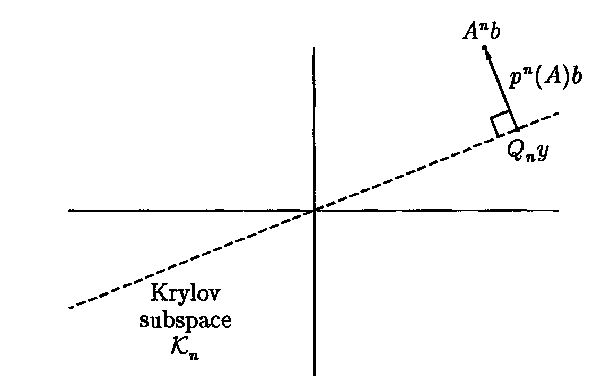

图 34.1. Arnoldi 迭代背后的最小二乘多项式逼近问题：$A^nb$ 到 Krylov 子空间 $\mathcal K_n$ 的正交投影为 $Q_ny$，残差为 $p^n(A)b$。

现在考虑上一讲开头提到的分解 $A=QHQ^*$。在 Arnoldi 过程的第 $n$ 步，我们已经计算出 $Q$ 和 $H$ 的前 $n$ 列；因此存在如下形式的分解：

$$
Q=\begin{bmatrix}Q_n&U\end{bmatrix},\qquad
H=\begin{bmatrix}H_n&X_1\\X_2&X_3\end{bmatrix},
$$

其中 $U$ 是一个 $m\times(m-n)$ 矩阵，其列正交归一且与 $Q_n$ 的列正交；$X_1$、$X_2$、$X_3$ 的尺寸分别为 $n\times(m-n)$、$(m-n)\times n$ 和 $(m-n)\times(m-n)$，并且 $X_2$ 除右上角元素外其余元素全为 0。

正交条件变成

$$
Q_n^*Qp^n(H)Q^*b=0,
$$

这意味着 $p^n(H)$ 第一列的前 $n$ 个元素为 0。由于 $H$ 的结构，这些元素也是 $p^n(H_n)$ 第一列的前 $n$ 个元素。根据 Cayley–Hamilton 定理，当 $p^n$ 是 $H_n$ 的特征多项式时，这些元素为 0。

反过来，假设还有另一个多项式 $p^n$ 满足 $p^n(A)b\perp\mathcal K_n$。两者之差会给出一个次数为 $n-1$ 的非零多项式 $q$，满足 $q(A)b=0$，这与 $K_n$ 满列秩的假设矛盾。

定理 34.1 给出了 Arnoldi 迭代生成的 Ritz 值的一种新解释：它们是最优多项式（34.3）的根。

### 不变性

定理 34.1 提供了一种记忆 Arnoldi 迭代基本性质的简便方式。例如，首一多项式族 $\mathcal P^n$ 对平移 $z\mapsto z+\alpha$ 保持不变，因此 Arnoldi 迭代也具有平移不变性。与稍后将讨论的 GMRES 等求解 $Ax=b$ 的迭代算法不同，它并“不知道原点在哪里”。

下面总结这一点以及其他不变性。定理的每一部分都是定理 34.1 的推论，此处不再给出证明。

**定理 34.2.** 将 Arnoldi 迭代应用于矩阵 $A\in\mathbb C^{m\times m}$，如前文所述。

- **平移不变性。** 若 $A$ 变为 $A+\sigma I$，其中 $\sigma\in\mathbb C$，而 $b$ 保持不变，则每一步的 Ritz 值 $\{\theta_j\}$ 变为 $\{\theta_j+\sigma\}$。
- **尺度不变性。** 若 $A$ 变为 $\sigma A$，其中 $\sigma\in\mathbb C$，而 $b$ 保持不变，则 Ritz 值 $\{\theta_j\}$ 变为 $\{\sigma\theta_j\}$。
- **酉相似变换下的不变性。** 若 $A$ 变为 $UAU^*$，其中 $U$ 为酉矩阵，同时 $b$ 变为 $Ub$，则 Ritz 值 $\{\theta_j\}$ 不变。

在上述三种情形中，Ritz 向量，即与 $H_n$ 的特征向量 $y_j$ 对应的向量 $Q_ny_j$，在相应变换下也保持相应的不变关系。

根据定理 24.9，每个矩阵 $A$ 都酉相似于一个上三角矩阵。因此，酉相似变换下的不变性意味着：原则上，为了理解 Arnoldi 迭代的收敛性质，只需考虑上三角矩阵。不过，只考虑对角矩阵还不够。在非 Hermitian（非正规）情形中，一个矩阵包含的信息并不只有它的特征值。

### Arnoldi 如何定位特征值

现在开始回答本讲标题提出的问题。定理 34.1 说明，Arnoldi 迭代归根结底要解决的是一个多项式逼近问题，或者等价地，一个涉及 Krylov 子空间的最小二乘问题。如果 Arnoldi 迭代倾向于找到特征值，那么这一定是实现上述目标的副产品。

多项式逼近与 $A$ 的特征值有什么关系？稍加思考便可发现，二者之间存在如下联系：如果目标是找到一个使 $p^n(A)$ 很小的多项式 $p^n$，一种有效办法是让 $p^n$ 的零点靠近 $A$ 的特征值。

考虑一个极端情形。假设 $A$ 可对角化，并且只有 $n\ll m$ 个不同的特征值，因此最小多项式次数为 $n$。由定理 34.1 可知，至少当向量 $b$ 在与每个特征值对应的方向上都含有分量时，经过 $n$ 步便会精确找到所有这些特征值。因此，Arnoldi 迭代在 $n$ 步后精确计算出了 $A$ 的最小多项式。

实际应用中也会发生大致相同的现象。不过此时 Ritz 值与特征值的吻合是近似而非精确的；结果不再是最小多项式，而是一个“伪最小多项式”，即满足 $\lVert p^n(A)\rVert$ 很小的多项式 $p^n$。

### Arnoldi 纽结线

可以通过在复平面上绘制纽结线（lemniscate，常译“双纽线”）来图示这一收敛过程。纽结线是一条曲线或一组曲线：

$$
\{z\in\mathbb C:\lvert p(z)\rvert=C\}. \tag{34.4}
$$

其中 $p$ 是多项式，$C$ 是实常数。如果 $p$ 是矩阵 $A$ 的 Arnoldi 迭代在第 $n$ 步得到的多项式 $p^n$，并取

$$
C=\frac{\lVert p^n(A)b\rVert}{\lVert b\rVert}, \tag{34.5}
$$

那么式（34.4）定义的曲线可以称为 Arnoldi 纽结线。随着迭代次数 $n$ 增加，通常会出现包围 $A$ 的极端特征值的纽结线分支，然后这些分支快速收缩到一点，也就是相应的特征值本身。

为说明这些思想，令 $A$ 为一个 $m=100$ 的方阵，其元素是来自均值为 0、标准差为 $m^{-1/2}$ 的实正态分布的独立随机数（习题 12.3）。由于 $A$ 是实矩阵，它的特征值由实数和成对的共轭复数构成。标准差的选择使得这些特征值大致均匀分布在单位圆盘 $\lvert z\rvert\le1$ 内。现在把角元素 $a_{11}$ 改为 1.5，从而制造一个离群特征值；见图 34.2。

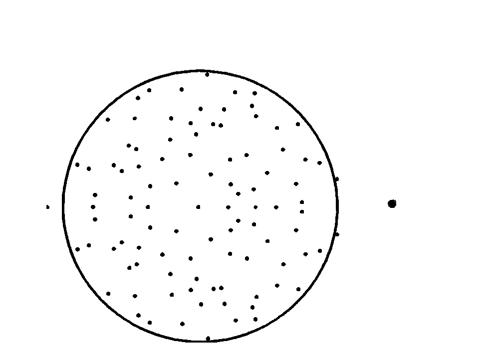

图 34.2. 一个除 $(1,1)$ 位置外均为随机元素的 $100\times100$ 矩阵 $A$ 的特征值。圆为复平面中的单位圆；特征值大致均匀分布在单位圆盘内，离群值约为 $\lambda\approx1.4852$。

从随机向量 $q_1$ 开始，对这个矩阵执行 Arnoldi 迭代。在第 $n$ 步，矩阵 $H_n$ 已经构造出来，其特征多项式反映了迭代当前掌握的谱信息。图 34.3 给出了 $n=5,6,7,8$ 时的 Arnoldi 纽结线。在 $n=1$ 时（图中未画出），纽结线是一个几乎不受离群特征值影响的精确圆。到 $n=5$ 时，圆开始向 $\lambda$ 的方向鼓起；到 $n=6$ 时，鼓起处收缩成颈部，并出现纽结线的新分支。此后，这个分支在每次迭代中继续收缩。

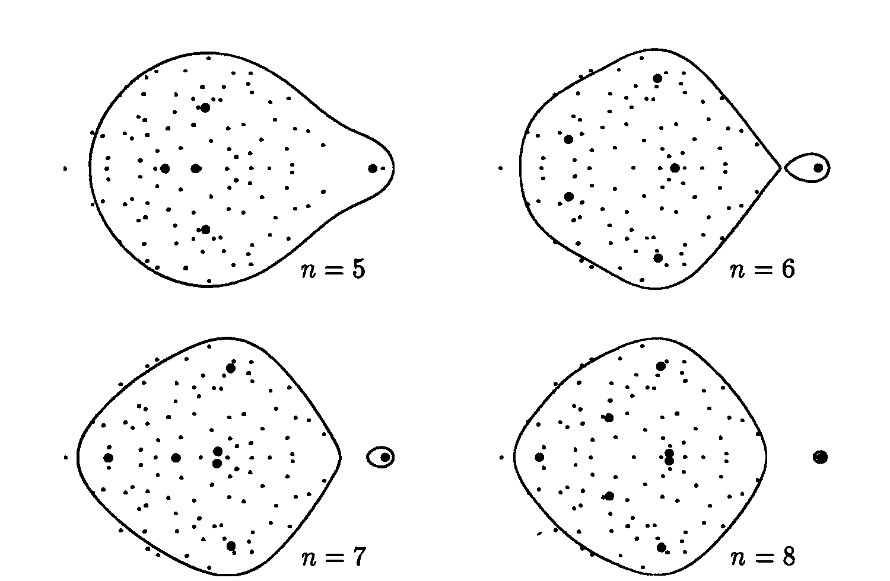

图 34.3. 同一个矩阵 $A$ 在 $n=5,6,7,8$ 步的 Arnoldi 纽结线（式（34.4）–（34.5））。小点是 $A$ 的特征值，大点是 $H_n$ 的特征值，即 Ritz 值。一个纽结线分支先“吞入”离群特征值，随后以几何速率收缩到该点。

### 几何收敛

在某些条件下，一些 Arnoldi 特征值估计会几何地收敛到 $A$ 的特征值。这些问题目前尚未被完全理解，本书不在这里引用理论结果，而只考察上面的数值例子，并给出一个部分解释。

从类似图 34.3 的图形中，无法判断超过一两位数字后的收敛速率。图 34.4 弥补了这一点：对同一个例子，绘制 $\lvert\lambda^{(n)}-\lambda\rvert$ 随 $n$ 的变化，其中 $\lambda^{(n)}$ 是第 $n$ 步中最接近 $\lambda$ 的 Arnoldi 特征值估计。首先注意到，收敛显然是几何的。经过 50 次迭代，我们已经达到 12 位精度；如果 $A$ 的维数是 1000 而不是 100，这幅图也不会有太大差别。

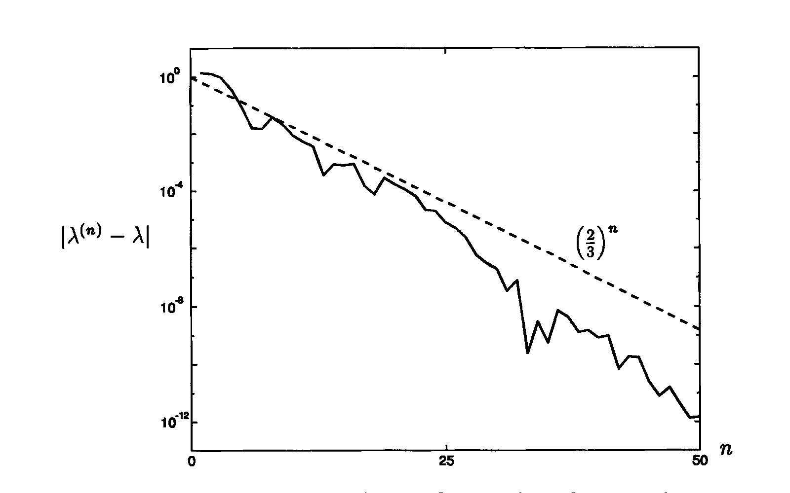

图 34.4. 最右侧 Arnoldi 特征值估计的收敛。实线为误差 $\lvert\lambda^{(n)}-\lambda\rvert$，虚线为参考速率 $(2/3)^n$。

我们可以进行更定量的描述。至少在最初几十次迭代中，图 34.4 的收敛大致满足

$$
\lvert\lambda^{(n)}-\lambda\rvert\approx
\left(\frac23\right)^n. \tag{34.6}
$$

对此行为的一种解释如下。为了最小化式（34.3），$p^n$ 必须在 $A$ 的每一个特征值处都取得大致最小的值。考虑候选多项式

$$
p(z)=z^{n-1}(z-\widetilde\lambda),
$$

其中 $\widetilde\lambda$ 是某个接近 $\lambda$ 的数。在单位圆盘内的每个 $A$ 的特征值处，$\lvert p(z)\rvert$ 都是 1 阶或更小；但在 $z=\lambda$ 处，它的大小为

$$
\lvert p(\lambda)\rvert\approx
\left(\frac32\right)^n\lvert\widetilde\lambda-\lambda\rvert.
$$

如果 $\lambda$ 恰好等于 $3/2$，这里就是等式。当 $n$ 很大时，$(3/2)^n$ 很大。为了使这个数仍为 1 阶，$\lvert\widetilde\lambda-\lambda\rvert$ 必须足够小以抵消它，即为 $(2/3)^n$ 阶，这正是式（34.6）的结果。

图 34.4 还显示了另一个现象：经过最初几十步后，收敛开始加速，这是 Krylov 子空间迭代中常见的现象。这里发生的是，迭代开始分辨 $A$ 的其他外部特征值，即单位圆附近的特征值。如果 $A$ 的维数为 $m=300$，那么特征值云会足够密集地填满单位圆盘，以至于图 34.4 所示的 50 步迭代中不会出现这种加速。

### 习题

**34.1**　给定 $A\in\mathbb C^{m\times m}$、$b\in\mathbb C^m$ 和 $p\in\mathcal P^n$，设我们要计算 $p(A)b$。一个自然的起点是 Horner 法，可写为

$$
p(z)=c_0+z\bigl(c_1+z\bigl(c_2+\cdots+z(c_{n-1}+z)\cdots\bigr)\bigr). \tag{34.7}
$$

(a) 根据式（34.7）写出一个 for 循环（在纸上写，不要上机），先计算 $p(A)$，再把结果作用到 $b$ 上。确定该算法所需的运算量（保留最高阶）。

(b) 另写一个计算 $p(A)b$ 的 for 循环；它要好得多，因为从一开始就把 $b$ 引入计算过程。再次确定最高阶运算量。

(c) 在数值分析入门教材中，推荐用 Horner 法计算多项式，因为它比先计算 $z^k$、再乘以系数 $c_k$ 并求和的直接方法更快。但对于计算 $p(A)$ 或 $p(A)b$，证明 Horner 法并不会比直接方法快很多。

**34.2**　我们已经看到，Arnoldi 多项式 $p^n$ 最小化 $\lVert p^n(A)b\rVert$。另一个可能更清楚地反映特征值信息的多项式是理想 Arnoldi 多项式，也称为 $A$ 的 Chebyshev 多项式。它定义为使 $\lVert p^*(A)\rVert$ 最小的唯一 $p^*\in\mathcal P^n$。（实践中不使用这个多项式，因为没有快速方法计算它。）

(a) 证明 $p^*$ 存在。

(b) 证明只要 $p^*(A)\ne0$，$p^*$ 就是唯一的。（提示：设 $p_1$ 和 $p_2$ 是给定 $A$ 和 $n$ 的两个不同的理想 Arnoldi 多项式，令 $p=(p_1+p_2)/2$，再考虑 $p(A)$ 对应于最大奇异值的奇异向量。这是一道难题。）

**34.3**　令 $A$ 为 $N\times N$ 双对角矩阵，满足

$$
a_{k,k+1}=a_{k,k}=k^{-1/2},\qquad N=64.
$$

（当 $N\to\infty$ 时，$A$ 变成一个非自伴紧算子。）

(a) 作图显示谱 $\Lambda(A)$ 以及 $\varepsilon$-伪谱 $\Lambda_\varepsilon(A)$ 的边界（见习题 26.1 和 26.2），其中 $\varepsilon=10^{-1},10^{-2},10^{-3},10^{-4}$。

(b) 从一个随机初始向量开始，运行 Arnoldi 迭代，并在 $n=1,2,\ldots,30$ 步计算 Ritz 值。作图表示它们向 $A$ 的特征值收敛的速率，并评论结果。

(c) Arnoldi 迭代还可以用 $H_n$ 或 $\widetilde H_n$ 的伪谱来近似 $A$ 的伪谱。在后一种情形中，$\Lambda_\varepsilon(\widetilde H_n)$ 的边界由

$$
\sigma_{\min}(zI-\widetilde H_n)=\varepsilon
$$

定义，等价地，

$$
\lVert(zI-\widetilde H_n)^{-1}\rVert=\varepsilon^{-1},
$$

其中 $I$ 是矩形版本的单位矩阵。尝试对 $n=5,10,15,20$ 绘制 $\widetilde H_n$ 的 $\varepsilon$-伪谱。它们与 $A$ 的对应伪谱有多接近？

<a id="lecture-35"></a>

## 第 35 讲　GMRES

> 原书页 266–275；目标 PDF 页 281–290。保留原书公式编号、图号与习题编号。本讲的五幅原书插图已裁切为本地 PNG；未把任何绘图脚本放入工作区。

上一讲展示了 Arnoldi 过程如何寻找特征值。本讲说明，同一个过程还可以用来求解线性方程组 $Ax=b$。这一类方法中最标准的算法称为 GMRES，是 *generalized minimal residuals*（广义最小残量）的缩写。

### 在 Krylov 子空间中最小化残量

和前两讲一样，设 $A\in\mathbb C^{m\times m}$，$b\in\mathbb C^m$，并令

$$
\mathcal K_n=\operatorname{span}\{b,Ab,\ldots,A^{n-1}b\}
$$

为式（33.5）中的 Krylov 子空间。不过现在假设 $A$ 非奇异，因为我们的目标是求解 $Ax=b$。记精确解为 $x_*=A^{-1}b$。

GMRES 的核心思想可以用一句话概括：在第 $n$ 步，从 $\mathcal K_n$ 中选取使残量

$$
r_n=b-Ax_n
$$

的范数最小的向量 $x_n$，即

$$
x_n\in\mathcal K_n,\qquad
\lVert r_n\rVert=\lVert b-Ax_n\rVert=\min.
$$

这就是一个最小二乘问题，图 35.1 给出了它的几何图像。

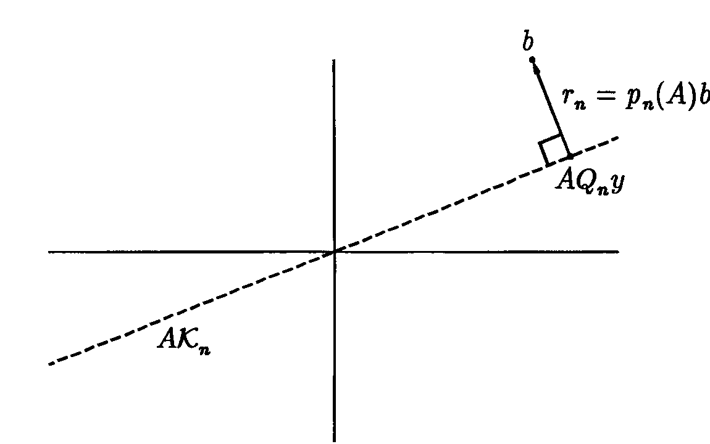

图 35.1. GMRES 背后的最小二乘多项式逼近问题：最小化残量范数 $\lVert r_n\rVert$。图中的 $AQ_ny$ 是可行近似，$r_n=p_n(A)b$ 是正交残量。

一种显然的做法是直接使用 Krylov 矩阵。设 $K_n$ 是 $m\times n$ 的 Krylov 矩阵（式（33.6）），则

$$
AK_n=
\begin{bmatrix}
Ab&A^2b&\cdots&A^nb
\end{bmatrix}. \tag{35.1}
$$

这个矩阵的列空间就是 $A\mathcal K_n$。于是我们需要寻找 $c\in\mathbb C^n$，使得

$$
\lVert AK_nc-b\rVert=\min, \tag{35.2}
$$

其中本书这一部分始终使用二范数。求出 $c$ 后，再令 $x_n=K_nc$ 即可。这个过程可以通过对 $AK_n$ 做 QR 分解来实现。

然而，上述做法在数值上不稳定，而且会构造一个实际上并不需要的因子 $R$。实际算法改用 Arnoldi 迭代（算法 33.1）构造一系列 Krylov 矩阵 $Q_n$，其列向量 $q_1,q_2,\ldots$ 张成相应的 Krylov 子空间。于是写成 $x_n=Q_ny$，而不是 $x_n=K_nc$。最小二乘问题变为寻找 $y\in\mathbb C^n$，使得

$$
\lVert AQ_ny-b\rVert=\min. \tag{35.3}
$$

表面上，式（35.3）似乎是一个 $m\times n$ 的问题；但由于 Krylov 子空间的特殊结构，它实际上只涉及一个 $(n+1)\times n$ 的问题。根据式（33.3），有

$$
\lVert Q_{n+1}\widetilde H_ny-b\rVert=\min. \tag{35.4}
$$

现在，范数中的两个向量都属于 $Q_{n+1}$ 的列空间，因此左乘 $Q_{n+1}^*$ 不会改变范数。于是问题等价于

$$
\lVert \widetilde H_ny-Q_{n+1}^*b\rVert=\min. \tag{35.5}
$$

根据 Krylov 矩阵的构造，

$$
Q_{n+1}^*b=\lVert b\rVert e_1,\qquad e_1=(1,0,0,\ldots)^*.
$$

最终得到 GMRES 的最小二乘形式：

$$
\left\lVert \widetilde H_ny-\lVert b\rVert e_1\right\rVert=\min. \tag{35.6}
$$

第 $n$ 步先解这个问题得到 $y$，再设置 $x_n=Q_ny$。

### GMRES 的算法结构

上面的推导已经完成了 GMRES 算法。其高层描述如下。

> **算法 35.1　GMRES**
>
> $q_1=b/\lVert b\rVert$。
>
> 对 $n=1,2,3,\ldots$：
>
> 1. 执行 Arnoldi 迭代算法 33.1 的第 $n$ 步；
> 2. 求 $y$，使 $\left\lVert \widetilde H_ny-\lVert b\rVert e_1\right\rVert$ 最小（这个最小值就是 $\lVert r_n\rVert$）；
> 3. 令 $x_n=Q_ny$。

在每一步，GMRES 都是在所有 $x_n\in\mathcal K_n$ 中最小化残量 $r_n=b-Ax_n$ 的范数。求解 $y$ 的同时就已经得到 $\lVert r_n\rVert$，不必再根据 $x_n$ 显式计算一次残量。

算法 35.1 中的内部步骤是一个带 Hessenberg 结构的 $(n+1)\times n$ 矩阵最小二乘问题。利用 Lecture 11 中介绍的 QR 分解，可以以 $O(n^2)$ 次浮点运算求解；Hessenberg 结构正是使这个复杂度成立的原因。还可以进一步节省工作量：不必每一步都独立地构造 $\widetilde H_1,\widetilde H_2,\ldots$ 的 QR 分解，而是从上一步的分解更新到这一步。每次只需一个 Givens 旋转（习题 10.4）和 $O(n)$ 的工作量，见习题 35.4。

### GMRES 与多项式逼近

上一讲说明，Arnoldi 迭代计算特征值与如下逼近问题有关：在首一多项式空间 $\mathcal P^n$ 中寻找 $p^n$，使 $\lVert p^n(A)b\rVert$ 最小。GMRES 也在解决一个多项式逼近问题，区别在于现在使用的多项式空间是

$$
\mathcal P_n=
\{p:\ p\text{ 的次数不超过 }n,\ p(0)=1\}. \tag{35.7}
$$

用多项式系数表示时，现在的归一化条件是 $c_0=1$，而不是 $c_n=1$。记号也从上标改为下标，以提醒读者：归一化点已经从 $z=\infty$ 改为 $z=0$。

GMRES 的迭代向量可以写成

$$
x_n=q_n(A)b, \tag{35.8}
$$

其中 $q_n$ 是次数为 $n-1$ 的多项式。相应的残量为

$$
r_n=b-Ax_n=(I-Aq_n(A))b.
$$

令 $p_n(z)=1-zq_n(z)$，就有

$$
r_n=p_n(A)b, \tag{35.9}
$$

且 $p_n\in\mathcal P_n$。GMRES 选择 $p_n$ 的系数来最小化该残量的范数。因此，GMRES 逐步解决如下逼近问题：

> **GMRES 逼近问题**　寻找 $p_n\in\mathcal P_n$，使得
>
> $$
> \lVert p_n(A)b\rVert=\min. \tag{35.10}
> $$

### 不变性

GMRES 和 Arnoldi 迭代一样满足一些不变性。下面的定理直接由式（35.10）得到。

**定理 35.1.** 将 GMRES 迭代应用于 $A\in\mathbb C^{m\times m}$。

- **尺度不变性。** 若 $A$ 变为 $\sigma A$，其中 $\sigma\in\mathbb C$，同时 $b$ 变为 $\sigma b$，则残量序列 $\{r_n\}$ 变为 $\{\sigma r_n\}$。
- **酉相似变换下的不变性。** 若 $A$ 变为 $UAU^*$，其中 $U$ 是酉矩阵，同时 $b$ 变为 $Ub$，则按照残量定义，残量序列变为 $\{Ur_n\}$。

这里第二条按残量的直接变换

$$
Ub-(UAU^*)(Ux_n)=U(b-Ax_n)=Ur_n
$$

写出。原书此处排印为 $\{U^*r_n\}$；这与上述变换及残量定义不一致，本译稿按定义作了校正。

GMRES 不具有平移不变性，因为归一化条件 $p(0)=1$ 依赖于平移相关的点 $0$。换句话说，GMRES 的行为强烈依赖原点的位置；宽泛地说，它依赖于矩阵 $A$ 的条件数。

### GMRES 的收敛

GMRES 收敛得有多快？需要多少步，才能把 $\lVert r_n\rVert/\lVert b\rVert$ 降到 $10^{-3}$ 或 $10^{-16}$ 这样的水平？在实践中，这个问题往往最终转化为如何设计一个好的预条件器（见第 40 讲）。从数学上说，我们要研究的是 $A$ 的哪些性质决定了 $\lVert r_n\rVert$ 的大小。

首先有两个观察。第一，GMRES 单调收敛：

$$
\lVert r_{n+1}\rVert\leq\lVert r_n\rVert. \tag{35.11}
$$

原因是 $\lVert r_n\rVert$ 已经是在 $\mathcal K_n$ 上能够达到的最小值；把 $\mathcal K_n$ 扩大为 $\mathcal K_{n+1}$ 只会使最小残量范数下降，或至多保持不变。注意 $\mathcal P_n\subset\mathcal P_{n+1}$，而首一多项式空间 $\mathcal P^n$ 并不包含于 $\mathcal P^{n+1}$。

第二，在没有舍入误差时，至多经过 $m$ 步，过程必须收敛：

$$
\lVert r_m\rVert=0. \tag{35.12}
$$

对一般的 $A$ 和 $b$，这是因为 $\mathcal K_m=\mathbb C^m$；在特殊情况下，如果 $b$ 在某个 $n<m$ 时就已经属于 $\mathcal K_n$，则会更早收敛。式（35.12）有助于记住 GMRES 的数学性质，但实际意义有限：如果一个 GMRES 迭代要有用，就必须在 $n\ll m$ 的步数内达到满意精度。

要得到更有用的收敛信息，需要回到式（35.10）。由最小性可知

$$
\lVert r_n\rVert=\lVert p_n(A)b\rVert
\leq \lVert p_n(A)\rVert\,\lVert b\rVert
$$

对所有 $p_n\in\mathcal P_n$ 都成立。因此，除非右端项 $b$ 具有与 $A$ 的特殊结构，决定残量大小的关键因素通常是 $\lVert p_n(A)\rVert$。一般有

$$
\frac{\lVert r_n\rVert}{\lVert b\rVert}
\leq
\inf_{p_n\in\mathcal P_n}\lVert p_n(A)\rVert. \tag{35.13}
$$

于是问题变成：给定矩阵 $A$ 和整数 $n$，$\lVert p_n(A)\rVert$ 能够有多小？这正是几乎所有线性方程组 Krylov 子空间迭代收敛分析的基础。

### 在谱上较小的多项式

给定 $A$ 和 $n$，估计 $\lVert p_n(A)\rVert$ 的标准方法，是寻找在 $A$ 的谱 $\Lambda(A)$ 上尽可能小、同时满足 $p(0)=1$ 的多项式。若 $p$ 是多项式、$S$ 是复平面中的集合，定义标量范数

$$
\lVert p\rVert_S=\sup_{z\in S}\lvert p(z)\rvert. \tag{35.14}
$$

假设 $A$ 可对角化，即 $A=V\Lambda V^{-1}$，其中 $V$ 非奇异，$\Lambda$ 为对角矩阵。于是

$$
\begin{aligned}
\lVert p(A)\rVert
&=\lVert Vp(\Lambda)V^{-1}\rVert\\
&\leq \lVert V\rVert\,\lVert p(\Lambda)\rVert\,\lVert V^{-1}\rVert\\
&=\kappa(V)\,\lVert p\rVert_{\Lambda(A)}.
\end{aligned}
\tag{35.15}
$$

结合式（35.13），得到 GMRES 收敛性的基本定理。

**定理 35.2.** 在 GMRES 的第 $n$ 步，残量满足

$$
\frac{\lVert r_n\rVert}{\lVert b\rVert}
\leq
\inf_{p_n\in\mathcal P_n}\lVert p_n(A)\rVert
\leq
\kappa(V)\inf_{p_n\in\mathcal P_n}
\lVert p_n\rVert_{\Lambda(A)}. \tag{35.16}
$$

这里 $\Lambda(A)$ 表示 $A$ 的特征值集合，$V$ 是特征向量矩阵（假设 $A$ 可对角化），$\kappa(V)$ 是 $V$ 的条件数，$\lVert p\rVert_{\Lambda(A)}$ 按式（35.14）定义。

这一定理可以用一句话概括：如果 $A$ 不太偏离正规矩阵，即 $\kappa(V)$ 不太大；并且能够找到在 $\Lambda(A)$ 上迅速变小的、满足 $p(0)=1$ 的次数不超过 $n$ 的多项式，那么 GMRES 就会快速收敛。

### 例 35.1：良好谱分布下的快速收敛

考虑一个 $200\times200$ 的矩阵 $A$，其元素相互独立，服从均值为 $2$、标准差为 $0.5/\sqrt{200}$ 的实正态分布。MATLAB 中可以写成

$$
m=200,\qquad
A=2I+0.5\,\operatorname{randn}(m)/\sqrt m. \tag{35.17}
$$

图 35.2 给出了 $A$ 的特征值。它们大致均匀地分布在以 $z=2$ 为中心、半径为 $1/2$ 的圆盘中。

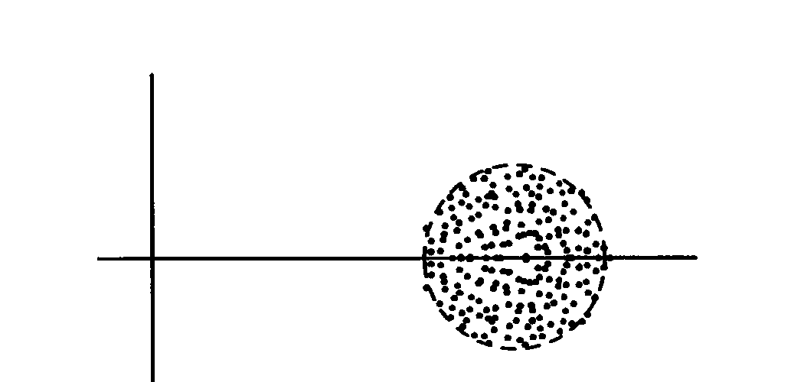

图 35.2. 式（35.17）中 $200\times200$ 矩阵 $A$ 的特征值。虚线圆的中心为复平面中的 $z=2$，半径为 $1/2$；特征值大致均匀分布在圆盘内。

令 $b=(1,1,\ldots,1)^*$，对 $Ax=b$ 应用 GMRES。图 35.3 给出了收敛曲线，其速率近似为 $4^{-n}$。原因并不难看出：既然谱大致填满图 35.2 所示的圆盘，使 $\lVert p(A)\rVert$ 较小的自然选择是

$$
p(z)=\left(1-\frac z2\right)^n.
$$

矩阵 $I-A/2$ 的谱大致填满以原点为中心、半径为 $1/4$ 的圆盘，因此 $\lVert p(A)\rVert$ 大约按 $4^{-n}$ 衰减。这个矩阵条件良好，$\kappa(A)\approx2.03$；它偏离正规矩阵的程度也不大，特征向量矩阵满足 $\kappa(V)\approx141$。

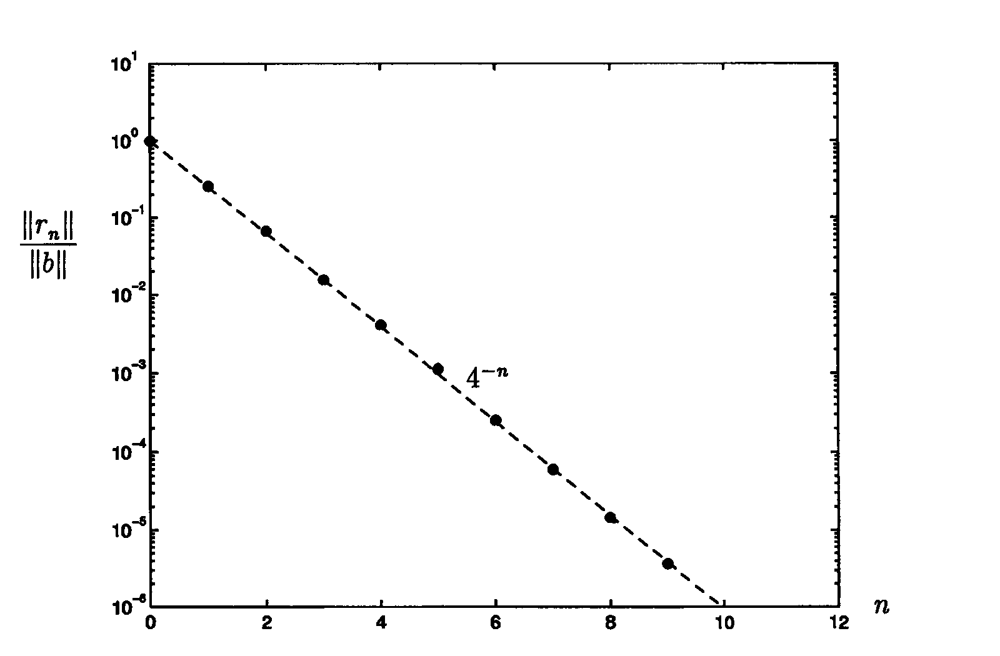

图 35.3. 同一个矩阵 $A$ 的 GMRES 收敛曲线。快速而稳定的收敛说明：当矩阵性质良好（或已经经过良好预条件化）时，Krylov 子空间迭代可以表现得非常理想。

图 35.3 展示了有利条件下的矩阵迭代。十步迭代后即可达到六位数字的精度，代价约为

$$
10\times 2m^2\approx 8.0\times10^5
$$

次浮点运算，因为主要工作是每一步的矩阵--向量乘法。对同一个系统使用高斯消元则约需

$$
\frac23m^3\approx5.3\times10^6
$$

次浮点运算。即使 $A$ 没有可利用的稀疏性、维数也只有 $m=200$，GMRES 仍然带来了接近 $7$ 倍的改进。若 $m=2000$，这个倍数大约会达到 $70$；如果一个 $2000\times2000$ 的矩阵具有相似的谱性质，同时稀疏度为 $90\%$ 或 $99\%$，改进倍数还可能达到约 $700$ 或 $7000$，而 GMRES 所需的存储量也会显著下降。

### 例 35.2：谱包围原点时的停滞

如果矩阵的特征值“包围原点”，就不能期待上述快速收敛。令 $A$ 仍为例 35.1 中的矩阵，定义 $A'=A+D$，其中 $D$ 是对角矩阵，其复对角元为

$$
d_k=(-2+2\sin\theta_k)+\mathrm{i}\cos\theta_k,
\qquad
\theta_k=\frac{k\pi}{m-1},
\quad 0\leq k\leq m-1.
$$

如图 35.4 所示，新的特征值形成一片弯向原点的半圆形谱云。

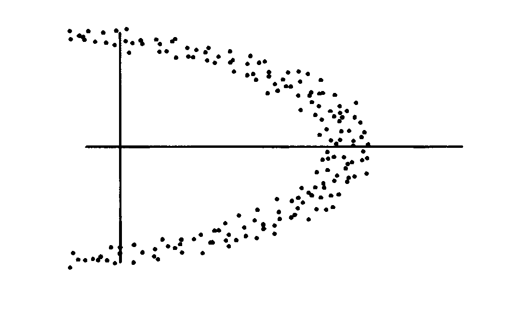

图 35.4. 一个与式（35.17）类似、但修改了对角元的 $200\times200$ 矩阵的特征值。现在特征值在一侧围绕原点分布。

此时 GMRES 的收敛明显变慢，对于这个问题，迭代计算并不比高斯消元更好。条件数现在约为 $\kappa(A)\approx4.32$，$\kappa(V)\approx54.0$。因此，收敛恶化不能只用条件数解释；真正造成困难的是特征值的位置，而不是特征值的大小（也不是奇异值的大小）。如果这段谱弧继续向另一侧延伸、更加包围谱，收敛还会进一步变差。

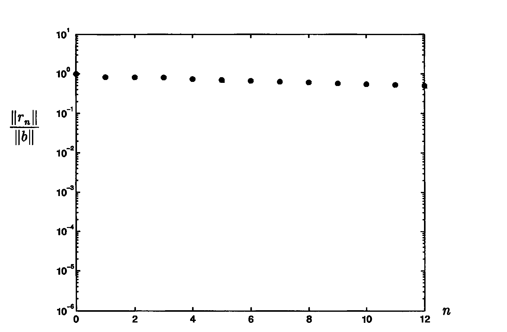

图 35.5. 图 35.4 中矩阵的 GMRES 收敛曲线。收敛速度大幅下降；当迭代方法出现这种停滞时，应当寻找更好的预条件器。

### 习题

**35.1**　证明：如果 $S\subset\mathbb C$ 含有无穷多个点，那么式（35.14）在所有复系数多项式组成的向量空间上定义一个范数。如果 $S$ 只有有限多个点，会出现什么问题？

**35.2**

(a) 设 $S\subset\mathbb C$，其凸包的内部包含 $0$。也就是说，$S$ 不包含于任何与原点不相交的半平面中。证明：不存在 $p\in\mathcal P_1$（即满足 $p(0)=1$ 的一次多项式）使 $\lVert p\rVert_S<1$。

(b) 设 $A$ 是一个不必正规的矩阵，且其谱 $\Lambda(A)$ 满足 (a) 的条件。证明：不存在 $p\in\mathcal P_1$ 使 $\lVert p(A)\rVert<1$。

(c) 尽管图 35.5 中的收敛很慢，显然仍有 $\lVert r_1\rVert<\lVert r_0\rVert$。解释这为何不与 (b) 矛盾，并描述 GMRES 为了实现 $\lVert r_1\rVert<\lVert r_0\rVert$ 可能找到的 $p_1\in\mathcal P_1$ 具有什么性质。

**35.3**　递推式

$$
x_{n+1}=x_n+\alpha r_n=x_n+\alpha(b-Ax_n),
$$

其中 $\alpha$ 是标量常数，称为 Richardson 迭代。

(a) 第 $n$ 步对应的多项式 $p(A)$ 是什么？

(b) 对图 35.2 中的矩阵 $A$，推荐选择什么 $\alpha$？相应的收敛速率预计是多少？

(c) 对图 35.4 中的矩阵，回答同样的问题。

**35.4**

(a) 描述一种基于 Givens 旋转 QR 分解的 $O(n^2)$ 算法，用于求解算法 35.1 中的最小二乘问题（见习题 10.4）。

(b) 如果第 $n-1$ 步的问题已经求解，说明如何像第 268 页所述，将运算量改进到 $O(n)$。

**35.5**　GMRES 算法从初始猜测 $x_0=0$、$r_0=b$ 开始（CG 和 BCG 的算法 38.1、39.1 也是如此）。证明：若希望从任意初始猜测 $x_0$ 开始，只需对右端项 $b$ 做一个简单修改即可。

**35.6**　当 $n$ 较大时，GMRES 的运算量和存储量可能难以承受。这时常用 $k$ 步重启 GMRES，也称 GMRES$(k)$：经过 $k$ 步后，以当前向量 $x_k$ 为初始猜测重新开始 GMRES。

(a) 对固定的 $k$、令 $n$ 增大时，比较 GMRES 与 GMRES$(k)$ 的渐近运算量和存储需求。

(b) 描述一种情形，在该情形中 GMRES$(k)$ 预计只需几乎与 GMRES 一样少的迭代步数，因此运算量会大幅降低。

(c) 再描述一种情形，在该情形中 GMRES$(k)$ 可能无法收敛，而 GMRES 能够收敛。

<a id="lecture-36"></a>

## 第 36 讲　Lanczos 迭代

> 原书页 276–284；目标 PDF 页 291–299。保留原书公式编号、图号与习题编号。本讲的三幅原书插图已从高分辨率源页裁切为本地 PNG；不需要重绘，也没有把任何绘图脚本放入工作区。

前面三讲讨论了非 Hermitian 矩阵问题中的 Krylov 子空间迭代。第 39 讲还会回到非 Hermitian 问题，因为这个主题远不止 Arnoldi 和 GMRES。不过在此之前，本讲以及接下来的两讲专门讨论 Hermitian 情形；这时会出现一个巨大的简化。为简化记号，本讲及后两讲进一步假设 $A$ 是实对称矩阵。

### 三项递推

Lanczos 迭代就是专门用于 Hermitian 情形的 Arnoldi 迭代。前面第 33、34 讲的所有公式仍然成立，只需把每个共轭转置 $^*$ 换成转置 $^T$。

首先，由式（33.12）可知 Ritz 矩阵 $H_n$ 是对称的。因此，它的特征值，也就是 Ritz 值或 Lanczos 估计（式（33.10）），都是实数。这很自然，因为 $A$ 的特征值本来就是实数。

第二个观察更加重要：$H_n$ 既对称又是 Hessenberg 矩阵，所以它必然是三对角矩阵。这意味着，在 Arnoldi 迭代（算法 33.1）的内层循环中，原本从 $1$ 到 $n$ 的求和范围可以缩短为从 $n-1$ 到 $n$。因此，在第 $n$ 步，不再需要式（33.4）的 $(n+1)$ 项递推，而只需一个三项递推。结果是，每一步 Lanczos 迭代都比对应的 Arnoldi 步骤便宜得多。第 38 讲会看到类似现象：求解 $Ax=b$ 时，共轭梯度迭代的每一步也比 GMRES 的相应步骤便宜得多。

值得回顾的是，$H_n$ 为什么会变成三对角矩阵。对实矩阵 $A$、$H_n$ 和 $Q_n$，关键公式（33.12）可以按元素写成

$$
h_{ij}=q_i^TAq_j. \tag{36.1}
$$

由于 $Aq_j\in\operatorname{span}\{q_1,q_2,\ldots,q_{j+1}\}$，且 Krylov 向量彼此正交，当 $i>j+1$ 时有 $h_{ij}=0$。取转置可得

$$
h_{ij}=q_j^TA^Tq_i. \tag{36.2}
$$

如果 $A=A^T$，用同样的推理可知当 $j>i+1$ 时 $h_{ij}=0$。由此得到三项递推关系。这个论证不仅适用于矩阵，也适用于任意自伴算子。

### Lanczos 迭代

对称三对角矩阵只有两组不同的元素，因此通常不再使用一般的 $a_{ij}$ 记号。令

$$
\alpha_n=h_{nn},\qquad
\beta_n=h_{n+1,n}=h_{n,n+1},
$$

于是 $H_n$ 记为

$$
T_n=
\begin{bmatrix}
\alpha_1&\beta_1\\
\beta_1&\alpha_2&\beta_2\\
&\beta_2&\alpha_3&\ddots\\
&&\ddots&\ddots&\beta_{n-1}\\
&&&\beta_{n-1}&\alpha_n
\end{bmatrix}. \tag{36.3}
$$

在这个记号下，算法 33.1 变成：

> **算法 36.1　Lanczos 迭代**
>
> $\beta_0=0,\ q_0=0,\ b$ 任意，$q_1=b/\lVert b\rVert$。
>
> 对 $n=1,2,3,\ldots$：
>
> 1. $v=Aq_n$；
> 2. $\alpha_n=q_n^Tv$；
> 3. $v=v-\beta_{n-1}q_{n-1}-\alpha_nq_n$；
> 4. $\beta_n=\lVert v\rVert$；
> 5. $q_{n+1}=v/\beta_n$。

为了提高稳定性，也可以在第 1 步先用 $v=Aq_n-\beta_{n-1}q_{n-1}$；此时第 3 步应改为只更新 $v\leftarrow v-\alpha_nq_n$，不能再次减去 $\beta_{n-1}q_{n-1}$。这两种写法等价；这里把原书算法框中容易引起重复减法的括号说明展开写明。

每一步只包含一次矩阵--向量乘法、一次内积和少量向量运算。如果 $A$ 足够稀疏，或者具有使矩阵--向量乘法便宜的其他结构，那么即使问题维数达到数万乃至数十万，也可以相对容易地使用这种迭代。

**定理 36.1.** Lanczos 迭代生成的向量矩阵 $Q_n$ 是 Krylov 矩阵（式（33.6））的约化 QR 分解因子：

$$
K_n=Q_nR_n. \tag{36.4}
$$

三对角矩阵 $T_n$ 是对应的投影：

$$
T_n=Q_n^TAQ_n. \tag{36.5}
$$

连续迭代量满足

$$
AQ_n=Q_{n+1}\widetilde T_n, \tag{36.6}
$$

在第 $n$ 步，这可以写成三项递推

$$
Aq_n=\beta_{n-1}q_{n-1}+\alpha_nq_n+\beta_nq_{n+1}. \tag{36.7}
$$

只要 Lanczos 迭代没有发生 breakdown（即 $K_n$ 具有满列秩 $n$），$T_n$ 的特征多项式就是唯一的 $p^n\in\mathcal P^n$，它解决 Arnoldi/Lanczos 逼近问题（式（34.3）），即

$$
\lVert p^n(A)b\rVert=\min. \tag{36.8}
$$

### Lanczos 与电荷分布

在实践中，Lanczos 迭代和 Arnoldi 迭代用于非对称矩阵一样，常用于计算大型对称矩阵的特征值（见第 34 讲）。在每一步 $n$，或者隔若干步，使用标准方法计算不断增大的三对角矩阵 $T_n$ 的特征值。这些特征值就是给定矩阵 $A$ 和初始向量 $q_1$ 的 Ritz 值或 Lanczos 估计（式（33.10））。通常可以观察到其中一些数以几何速度收敛到某些极限；这些极限可以认为是 $A$ 的特征值。

和 Arnoldi 迭代一样，最先得到的通常是 $A$ 的离群特征值。一个实用的经验法则是：

> 如果 $A$ 的特征值比分布在区间上的 Chebyshev 点更加均匀，那么 Lanczos 迭代往往会首先找到离群特征值。

为理解这句话，假设 $A$ 的 $m$ 个特征值 $\{\lambda_j\}$ 在实轴上的某个区间内比较密集地分布。由于 Lanczos 迭代具有尺度不变性和平移不变性（定理 34.2），不妨假设区间是 $[-1,1]$。该区间内的 $m$ 个 Chebyshev 点定义为

$$
x_j=\cos\theta_j,\qquad
\theta_j=\frac{(j-\tfrac12)\pi}{m},
\qquad 1\leq j\leq m. \tag{36.9}
$$

这里精确的定义并不重要，重要的是：这些点在端点附近以二次方式聚集。点在区间内部的间距为 $O(m^{-1})$，而在 $\pm1$ 附近的间距为 $O(m^{-2})$。经验法则断言，如果 $A$ 的特征值比分布更均匀，即在端点附近聚集得更少，那么 Lanczos 迭代计算出的 Ritz 值往往会首先收敛到离群特征值。特别地，近似均匀的特征值分布会使离群值快速收敛。反过来，如果特征值比这更加强烈地聚集在端点附近（实践中不太常见），则可能先收敛到某些“内部值”。

这些观察还可以作物理解释。考虑 $m$ 个可以在区间 $[-1,1]$ 内自由移动的点电荷，假设位于 $x_j$ 和 $x_k$ 的电荷之间的排斥力与 $\lvert x_j-x_k\rvert^{-1}$ 成正比。（在三维空间中，电荷力通常与距离的平方倒数成正比；但在二维中，可以把每个点看成三维中一条无限直线与平面的交点，此时力与 $\lvert x_j-x_k\rvert^{-1}$ 成正比。）让这些电荷在 $[-1,1]$ 内达到最小能量平衡。这个最小能量分布与 Chebyshev 分布近似相同；当 $m\to\infty$ 时，它们都趋于一个连续电荷密度

$$
\rho(x)\propto(1-x^2)^{-1/2}.
$$

把 $A$ 的特征值想象成点电荷。如果它们已经近似处于区间上的最小能量构型，Lanczos 迭代就几乎没有用：在 $n=m$ 之前不会有多少收敛。反之，如果分布与这种平衡状态差异很大，就可能快速收敛到某些特征值，即那些存在“电荷太少”区域中的特征值。这里“电荷太少”的意思是：如果这些点可以自由移动，更多电荷会倾向于聚集到该处。因此，经验法则也可以改写为：

> Lanczos 迭代倾向于收敛到平衡电荷分布中“电荷太少”的区域内的特征值。

这一观察的解释依赖于式（36.8）所体现的 Lanczos 迭代与多项式逼近之间的联系；习题 36.2 会展开其中一些细节。

### 例：离群特征值的快速收敛

Lanczos 迭代的收敛可以用一个数值例子很好地说明。令 $A$ 为如下 $203\times203$ 矩阵：

$$
A=\operatorname{diag}(0,.01,.02,\ldots,1.99,2,2.5,3.0). \tag{36.10}
$$

$A$ 的谱由 $[0,2]$ 上的密集特征值以及两个离群值 $2.5$ 和 $3.0$ 组成。从一个随机初始向量 $q_1$ 开始执行 Lanczos 迭代。

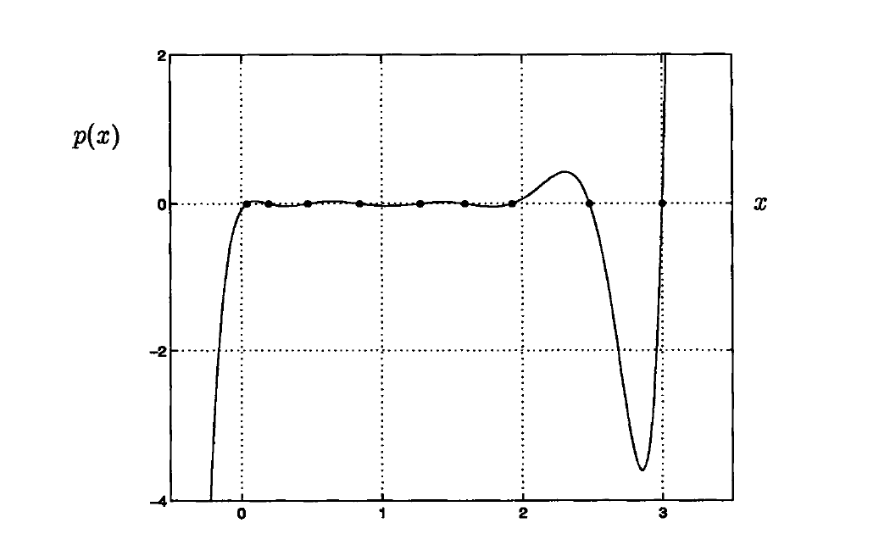

图 36.1. 矩阵（36.10）的 Lanczos 迭代在第 9 步得到的 Lanczos 多项式。根是 Ritz 值，即 Lanczos 特征值估计。多项式在 $[0,2]\cup\{2.5\}\cup\{3.0\}$ 上都很小；因此它必须在 2.5 附近放置一个根，并在 3.0 附近放置另一个极近的根。

图 36.1 给出了第 $n=9$ 步的 Ritz 值及相应的 Lanczos 多项式。其中七个 Ritz 值位于 $[0,2]$ 内，多项式在该区间上几乎处处很小；还可以看出 Ritz 值开始向区间端点聚集。其余两个 Ritz 值分别靠近 $2.5$ 和 $3.0$。最大的三个 Ritz 值为

$$
1.93,\qquad 2.48,\qquad 2.999962.
$$

可见，我们对较小特征值的精度还很低，但最大的特征值已经达到五位数字的精度。这也说明了离群值为什么容易被准确估计：当 $x\approx3$ 时，$p(x)$ 的图像非常陡。如果希望 $p(3)$ 很小，就必须有一个根非常接近 3。这种陡峭性正对应于该点附近“电荷太少”的现象。如果这些电荷可以在 $[0,3]$ 内自由移动以使能量最小，就会有更多点聚集在 $x=3$ 附近，而 $p(x)$ 在那里就不会如此陡峭。

在第 20 步，最大的三个 Ritz 值为

$$
1.9906,\qquad
2.499999999987,\qquad
3.00000000000000.
$$

此时最大的特征值约有 15 位数字的精度，第二个约有 12 位。$p(x)$ 在 2.5 和 3.0 附近也会相应地变得陡峭。注意，第三个特征值也开始收敛；这反映出 $[0,2]$ 内的特征值是均匀分布的，而不是 Chebyshev 分布。

图 36.2 给出了收敛过程的“俯视图”，显示 $n=1$ 到 $n=20$ 的所有 Ritz 值。图中的每一条竖向切片对应一次迭代；连接散点的曲线只是帮助读者追踪变化，没有严格的数学含义。图中显示，最大特征值在大约 $n=5$ 后出现明显收敛，下一个特征值在 $n=10$ 左右开始收敛。在包含其余特征值的区间 $[0,2]$ 内，Ritz 值的密度近似正比于 $(1-x^2)^{-1/2}$，并且在端点附近有明显聚集。

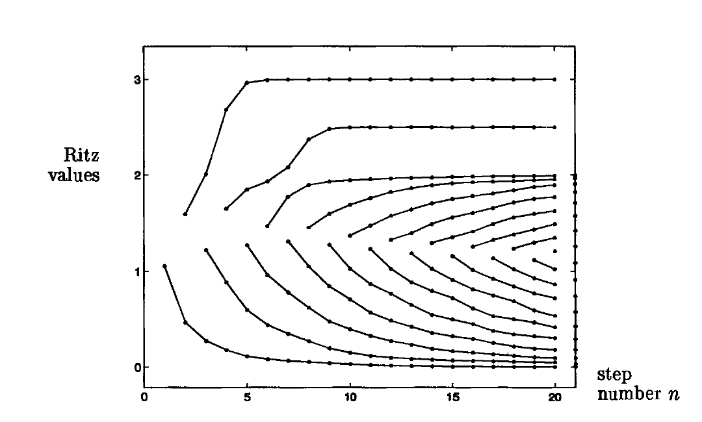

图 36.2. 同一个矩阵上前 20 步 Lanczos 迭代的 Ritz 值。对特征值 2.5 和 3.0 的收敛是几何的；对 $[0,2]$ 中单个特征值的有效收敛很少，Ritz 值反而近似该区间上的 Chebyshev 点。

### 舍入误差与“幽灵”特征值

舍入误差对 Lanczos 迭代以及所有基于三项递推的数值线性代数迭代都有复杂影响。困难的来源很容易辨认：在 Arnoldi 或 GMRES 这样的 $n$ 项递推中，向量 $q_1,q_2,q_3,\ldots$ 通过显式 Gram--Schmidt 运算被强制保持正交。然而，Lanczos 和共轭梯度中的三项递推，依赖一个数学恒等式使向量 $\{q_i\}$ 的正交性“自动”出现。在实践中，舍入误差会使这些恒等式不能被精确保持，经过若干步后，正交性就会丢失。

实践 Lanczos 迭代中正交性的丢失听起来完全是坏事，但实际情况更加微妙。正交性丢失与 Ritz 值收敛到 $A$ 的特征值密切相关。关于这个主题已有大量研究，但还没有给出本书意义下 Lanczos 或共轭梯度迭代稳定性的简单定理。尽管如此，这些迭代在实践中仍然极其有用。图 36.3 展示了这种不稳定性通常如何表现出来，而又不妨碍算法发挥作用。


图 36.3. Lanczos 迭代延续到 120 步。图中数字表示 Ritz 值的重数；可以看到特征值 3.0 出现四个“幽灵”副本，特征值 2.5 出现两个“幽灵”副本。

图 36.3 是图 36.2 的重复版本，只是迭代从 20 步延长到了 120 步。在大约第 30 步之前，一切都符合预期；随后，Ritz 值中出现了特征值 3.0 的第二个副本。大约第 60 步出现第三个副本，第 90 步出现第四个副本，之后还会继续出现。与此同时，特征值 2.5 的额外副本大约在第 40 步和第 80 步出现，并且第 120 步也刚开始显现。这些额外的 Ritz 值称为“幽灵”特征值，与 $A$ 中相应特征值的真实重数没有关系。

严格分析幽灵特征值现象很复杂，但直观解释并不难。一种解释是：在存在舍入误差时，不应把 $A$ 的每个特征值看成一个点，而应看成一个长度大约为 $O(\varepsilon_{\mathrm{mach}}\lVert A\rVert)$ 的小区间。幽灵特征值出现，是因为 $p(z)$ 不仅要在精确的特征值处很小，还要在这些小区间内处处很小。

另一种不同的解释是：Ritz 值收敛到 $A$ 的某个特征值时，会消灭当前运算向量中对应的特征向量分量；但存在舍入误差时，随机噪声会再次轻微激发这个分量。经过足够多次迭代后，这个此前被消灭的分量会被放大到足够大，于是需要另一个 Ritz 值再次把它消灭，然后还会再次、再次发生。

这两种解释都抓住了浮点算术中 Lanczos 迭代行为的部分真相；第二种解释也许在定量上更准确。

### 习题

**36.1**　第 27 讲指出，实对称矩阵 $A\in\mathbb R^{m\times m}$ 的特征值是 Rayleigh 商

$$
r(x)=\frac{x^TAx}{x^Tx},\qquad x\in\mathbb R^m
$$

的驻值。证明：如果把 $x$ 限制在 $\mathcal K_n$ 中，那么 Lanczos 迭代第 $n$ 步的 Ritz 值正好是 $r(x)$ 的驻值。

**36.2**　设 $p\in\mathcal P^n$，即

$$
p(z)=\prod_{k=1}^n(z-z_k),\qquad z_k\in\mathbb C.
$$

(a) 将 $\log|p(z)|$ 写成对应于点 $z_k$ 的 $n$ 项之和。

(b) 解释为什么包含 $z_k$ 的那一项可以看成位于 $z_k$ 的负单位点电荷所产生的势，其中电荷之间的排斥力与距离成反比。由此，$\log|p(z)|$ 可以看成 $n$ 个点电荷在 $z$ 处产生的势。

(c) 将每个电荷 $-1$ 替换为 $-1/n$，并令 $n\to\infty$，得到总积分为 $-1$ 的连续电荷密度 $\mu(\zeta)$。写出表示其势 $\varphi(z)$ 的积分，并解释它与 $|p(z)|$ 的联系。

(d) 设 $S$ 是 $\mathbb C$ 的闭有界子集且没有孤立点。假设我们寻找支撑在 $S$ 上、使 $\max_{z\in S}\varphi(z)$ 最小的分布 $\mu(z)$。给出一个非严格的论证，说明这样的 $\mu(z)$ 应满足 $\varphi(z)$ 在整个 $S$ 上为常数。解释这为何意味着“电荷”处于平衡状态、没有合力。换言之，$S$ 像一个二维导体，电荷总量 $-1$ 自由分布在其上；除一个加性常数外，$\varphi(z)$ 就是 $S$ 的 Green 函数。

(e) 作为解释第 279 页经验法则的一步，设 $A$ 是实对称矩阵，其谱密集分布在 $[a,b]\cup\{c\}\cup[d,e]$，其中 $a<b<c<d<e$。于是对于集合 $S=[a,e]$，$(b,d)$ 是“电荷太少”的区域。解释为什么可以期待 Ritz 值快速收敛到 $c$，并用与集合 $S'=[a,b]\cup[c,d]$ 对应的平衡势 $\varphi(z)$ 估计收敛速率。

**36.3**　设 $A$ 是 $1000\times1000$ 的对称矩阵，除下列元素外均为 0：对角元 $a_{ii}=\sqrt{i}$；次对角线和超对角线上的元素为 1；第 100 条次对角线和超对角线上的元素也为 1，即当 $|i-j|=100$ 时 $a_{ij}=1$。用 Lanczos 迭代将 $A$ 的最小特征值计算到六位有效数字。

**36.4**　作为第 34 讲 Arnoldi 纽结线的特例，可以使用“Lanczos 纽结线”来说明 Lanczos 迭代的收敛。想办法修改习题 36.3 的程序，使它能够在每一步绘制 Lanczos 纽结线。方法不必优雅、高效或数值稳定。对图 36.2 的例子以及一个自行选择的例子，分别绘制 $n=1,2,\ldots,12$ 步的 Lanczos 纽结线。
<a id="lecture-37"></a>

## 第 37 讲　从 Lanczos 迭代到 Gauss 求积

> 原书页码：285–292；目标 PDF 页码：300–307。保留原书公式编号、定理编号和习题编号。本讲原书没有独立图版；算法框、Jacobi 矩阵和示例矩阵均以可读的 LaTeX/Markdown 数学结构重构。

如果把离散向量看成定义在 $[-1,1]$ 上的连续函数，把矩阵 $A$ 取为逐点乘以 $x$ 的算子，那么 Lanczos 迭代就变成了通过三项递推构造正交多项式的标准过程。再向前一步，就得到 Gauss 求积公式；它的节点和权重可以通过求解一个对称三对角矩阵的特征值问题来计算。

### 正交多项式

第 7 讲讨论过 QR 分解的连续类比。现在我们讨论 Lanczos 迭代的连续类比，仍然只考虑实向量（现在是函数）和实对称矩阵（现在是线性算子）。

首先，把 $\mathbb R^m$ 换成 $L^2[-1,1]$，即定义在 $[-1,1]$ 上的实值函数空间。对 $u,v\in L^2[-1,1]$，定义内积

$$
(u,v)=\int_{-1}^{1}u(x)v(x)\,dx.
\tag{37.1}
$$

函数 $u\in L^2[-1,1]$ 的范数为 $\lVert u\rVert=(u,u)^{1/2}$。

在第 7 讲中，$A$ 是一个“$[-1,1]\times n$ 矩阵”，其列为 $x$ 的各次幂。这里为了使用 Lanczos 迭代，$A$ 应当是方的而不是长方的。我们把它取为对应于逐点乘以 $x$ 的“$[-1,1]\times[-1,1]$ 矩阵”，即线性算子

$$
(Au)(x)=xu(x).
\tag{37.2}
$$

对每个 $u\in L^2[-1,1]$ 成立。这个算子类似于一个对角矩阵，只不过“对角线”上连续排列着 $x\in[-1,1]$ 的全部取值。若使用核 $k(x,y)=x\delta(x-y)$（其中 $\delta$ 是 Dirac $\delta$ 函数）的积分算子，也可以把这个“对角矩阵”想法严格化。特别地，$A$ 是对称的，因此 Arnoldi 过程会特化为 Lanczos 过程。

还需要固定初始函数。约定 $b(x)$ 为一个非零常数；相应的归一化初始函数为 $q_1(x)=1/\sqrt{2}$。于是算法 36.1 变成下面的形式。

**算法 37.1　正交多项式的构造**

$$
\beta_0=0,\qquad q_0(x)=0,\qquad q_1(x)=1/\sqrt{2}.
$$

对 $n=1,2,3,\ldots$ 重复：

1. $v(x)=xq_n(x)$；
2. $\alpha_n=(q_n,v)$；
3. $v(x)=v(x)-\beta_{n-1}q_{n-1}(x)-\alpha_nq_n(x)$；
4. $\beta_n=\lVert v\rVert$；
5. $q_{n+1}(x)=v(x)/\beta_n$。

注意，多项式 $q_1,q_2,q_3,\ldots$ 的次数依次为 $0,1,2,\ldots$；因此，该序列中次数为 $n$ 的多项式是 $q_{n+1}$。

算法 37.1 可以在许多表面上与线性代数无关的书中找到。它正是构造区间 $[-1,1]$ 上正交的 Legendre 多项式时使用的通常三项递推。不过，本书的记号和归一化方式比较特殊：通常把次数为 $n$ 的 Legendre 多项式写成 $P_n(x)$，并归一化为 $P_n(1)=1$。因此，本讲的 $q_{n+1}(x)$ 是通常 $P_n(x)$ 的一个标量倍。下文仍称它为 Legendre 多项式。

第 7 讲的式（7.11）和图 7.1 已经讨论过 Legendre 多项式，当时是通过上面提到的“$[-1,1]\times n$ 幂矩阵”做 Gram–Schmidt 分解得到的。这个矩阵正是当前初始向量 $b$ 和算子 $A$ 生成的 Krylov 矩阵（式（33.6））；因此，第 7 讲中的 Gram–Schmidt 过程与这里的 Lanczos 过程产生了相同效果。

我们把算法 37.1 称为“正交多项式的构造”，而不是“Legendre 多项式的构造”，因为它实际上更加一般。如果在式（37.1）的积分中加入非恒定的正权函数 $w(x)$，就会得到其他正交多项式族，例如 Chebyshev 多项式和 Jacobi 多项式。本讲的全部推导都适用于这些更一般的族，但不展开细节。

### Jacobi 矩阵

前面关于 Arnoldi 和 Lanczos 迭代的所有公式，仍然适用于刚才描述的多项式正交化过程。当然，需要正确解释其中的对象：把 $1,2,\ldots,m$ 换成 $[-1,1]$，把通常的向量内积换成式（37.1）。例如，现在有两个“$[-1,1]\times n$ 矩阵”

$$
K_n=\begin{bmatrix}1&x&\cdots&x^{n-1}\end{bmatrix},
\qquad
Q_n=\begin{bmatrix}q_1(x)&q_2(x)&\cdots&q_n(x)\end{bmatrix}.
\tag{37.3}
$$

并且它们满足与式（36.4）完全相同的关系。正如刚才所说，$K_n$ 就是第 7 讲中称为 $A$ 的矩阵。

上一讲描述的三对角矩阵 $\{T_n\}$ 在这里尤其重要。它们仍然是 $n\times n$ 的离散矩阵，并通过式（36.5）和（36.6）与 $Q_n$、$A$ 相关。其元素由式（36.1）的连续类比给出：

$$
t_{ij}=(q_i(x),xq_j(x)).
\tag{37.4}
$$

在正交多项式的语境下，矩阵族 $\{T_n\}$ 称为 Jacobi 矩阵。三项递推（36.7）变成

$$
xq_n(x)=\beta_{n-1}q_{n-1}(x)+\alpha_nq_n(x)+\beta_nq_{n+1}(x).
\tag{37.5}
$$

算法 37.1 的写法可能会造成误解：它看起来似乎每一步都需要进行非平凡计算，包括计算定义 $\alpha_n$ 和 $\beta_n$ 的内积 $(q_n,v)$ 与范数 $\lVert v\rVert$。如果式（37.1）包含任意权函数 $w(x)$，这些计算确实不简单。然而，对与 Legendre 多项式对应的特殊选择 $w(x)=1$，以及其他经典多项式族的一些选择，$\{\alpha_n\}$、$\{\beta_n\}$ 都有解析表达式。在式（36.3）的记号下，Legendre 多项式满足

$$
\alpha_n=0,\qquad
\beta_n=\frac{1}{2}\left(1-(2n)^{-2}\right)^{-1/2}.
\tag{37.6}
$$

使用这些公式后，算法 37.1 就变成了一个机械的三项递推，除此之外不再需要进行数值积分或范数计算。

### 特征多项式

在正交多项式的语境下，Arnoldi/Lanczos 逼近问题（36.8）会变成什么？对于这里特殊选择的 $b$ 和 $A$，有 $p(A)b=p(x)/\sqrt{2}$。因此，式（36.8）可以写成：

**正交多项式逼近问题。** 寻找 $p^n\in\mathcal P^n$，使得

$$
\lVert p^n(x)\rVert=\min.
\tag{37.7}
$$

根据定理 36.1，解就是矩阵 $T_n$ 的特征多项式。

由此很快可以得到一个重要结论。任意 $p\in\mathcal P^n$ 都可以写成

$$
p(x)=Cq_{n+1}(x)+Q_ny,
$$

其中 $C$ 是常数——它等于 $q_{n+1}(x)$ 首项系数的倒数。又由于函数族 $\{q_n(x)\}$ 两两正交，有

$$
\lVert p\rVert=(C^2+\lVert y\rVert^2)^{1/2}.
$$

因此，式（37.7）的最小值在取 $y=0$ 时达到。换句话说，$p^n(x)$ 与 $q_{n+1}(x)$ 只相差一个常数因子。定理 37.1 给出这一结论；定理的最后一个断言将在习题 37.2 中证明。

**定理 37.1.** 设 $\{q_n(x)\}$ 是算法 37.1 生成的正交多项式序列，$\{T_n\}$ 是相应的三对角 Jacobi 矩阵序列，$p^n$ 是 $T_n$ 的特征多项式。那么对 $n=0,1,2,\ldots$，

$$
p^n(x)=C_nq_{n+1}(x),
\tag{37.8}
$$

其中 $C_n$ 是常数。特别地，$q_{n+1}(x)$ 的零点就是 $T_n$ 的特征值。这 $n$ 个零点互异，并且都位于开区间 $(-1,1)$ 内。

这个定理在计算上非常重要。要确定 Legendre 多项式的零点，只需计算相应 Jacobi 矩阵的特征值，而矩阵元素由式（37.6）显式给出。正如前面几讲所见，$n\times n$ 对称三对角矩阵的特征值问题是良态的，并且可以很快求解，只需 $O(n^2)$ 次浮点运算。相比之下，如果从多项式系数出发直接计算 Legendre 多项式的零点，则效率低且数值上不稳定。

### 求积公式

Legendre 多项式的零点具有计算意义，是因为它们正是 Gauss–Legendre 求积公式的节点。

先简要回顾数值求积的思想。设 $f(x)$ 定义在 $[-1,1]$ 上，我们希望计算

$$
I(f)=\int_{-1}^{1}f(x)\,dx.
\tag{37.9}
$$

（如果感兴趣的积分区间不是 $[-1,1]$，可以通过线性变量代换处理。）自然的做法是用有限和近似 $I(f)$：

$$
I_n(f)=\sum_{j=1}^{n}w_jf(x_j).
\tag{37.10}
$$

其中节点（或求积点）$x_j\in[-1,1]$ 以及相应权重 $w_j$ 与 $f$ 无关。这就是 $n$ 点求积公式，这一概念可以追溯到 Newton。今天计算机上进行的大多数数值积分，都以各种此类公式为基础，常与自适应误差估计、区间细分以及阶数控制结合使用。

任意一组节点都可以作为求积公式的候选。下面的结果是 Vandermonde 矩阵非奇异性的一个推论（习题 37.3）。

**定理 37.2.** 设节点 $\{x_j\}$ 是 $[-1,1]$ 中任意 $n$ 个互异点。那么存在唯一一组权重 $\{w_j\}$，使求积公式（37.10）至少具有 $n-1$ 阶精度；也就是说，对任意次数不超过 $n-1$ 的多项式 $f(x)$，该公式都是精确的。

如果节点 $\{x_j\}$ 从 $-1$ 到 $1$ 等距选取，定理给出的求积公式称为 Newton–Cotes 公式，是熟知的梯形公式和 Simpson 公式的 $n$ 点推广。Newton–Cotes 公式具有定理保证的 $n-1$ 阶精度，但没有更高的精度。当 $n$ 较小时，这些公式简单而有用；当 $n$ 较大时，它们的权重 $w_j$ 会出现交替符号，并且振幅很大，量级可达 $2^n$，从而造成数值不稳定。

### Gauss 求积

Gauss 求积的想法是：不仅优化权重 $\{w_j\}$，也优化节点 $\{x_j\}$，尽可能提高式（37.10）的精度阶数。结果表明，存在唯一一组节点和权重能够达到这一目标，所得公式的精度阶数为 $2n-1$。与 $n-1$ 阶相比，这是显著改进：对光滑函数和固定的函数求值次数，通常可以把可获得的准确数字大致翻倍。此外，所有权重 $w_j$ 都为正，因此即使 $n$ 很大，公式仍然稳定。

使 $n$ 点求积公式精度翻倍的神奇节点是什么？它们正是 Legendre 多项式 $q_{n+1}(x)$ 的零点。Gauss（或 Gauss–Legendre）求积公式定义为：取定理 37.2 给出的求积公式，并令节点 $x_1,\ldots,x_n$ 为 $q_{n+1}(x)$ 的零点。

**定理 37.3.** $n$ 点 Gauss–Legendre 求积公式的精度阶数恰为 $2n-1$，并且没有任何求积公式（37.10）的精度阶数能够超过它。

**证明。** 给定任意一组互异节点 $\{x_j\}$，令

$$
f(x)=\prod_{j=1}^{n}(x-x_j)^2,
$$

则 $f$ 是次数为 $2n$ 的多项式，且 $I(f)>0$；但是由于对每个节点都有 $f(x_j)=0$，所以 $I_n(f)=0$。因此，该求积公式不可能对所有次数为 $2n$ 的多项式都精确。

另一方面，设 $f(x)$ 是任意次数不超过 $2n-1$ 的多项式，并取 $\{x_j\}$ 为 Gauss 求积节点，即 $\{q_{n+1}(x)\}$ 的零点。可以因式分解为

$$
f(x)=g(x)q_{n+1}(x)+r(x),
$$

其中 $g(x)$ 的次数不超过 $n-1$，余项 $r(x)$ 也是次数不超过 $n-1$ 的多项式。（事实上，$r(x)$ 是 $f$ 在节点 $\{x_j\}$ 上的次数不超过 $n-1$ 的插值多项式。）由于 $q_{n+1}(x)$ 与所有低次数多项式正交，$I(gq_{n+1})=0$。同时，对每个节点 $x_j$ 都有 $g(x_j)q_{n+1}(x_j)=0$，所以 $I_n(gq_{n+1})=0$。由于 $I$ 和 $I_n$ 都是线性算子，上述两式说明 $I(f)=I(r)$ 且 $I_n(f)=I_n(r)$。而 $r(x)$ 的次数不超过 $n-1$，根据定理 37.2 有 $I(r)=I_n(r)$，合并即得 $I(f)=I_n(f)$。证毕。

### 通过 Jacobi 矩阵实现 Gauss 求积

六页之内，我们从 Lanczos 迭代走到了 Legendre 多项式，又从 Legendre 多项式走到了 Gauss 求积；还得到了一个快速而稳定的 Gauss 求积节点算法：只需构造 Jacobi 矩阵 $\{T_n\}$ 并计算其特征值。

最后一个观察可以把故事补完整：不仅节点，Gauss 求积公式的权重也可以从 $T_n$ 的特征值问题得到。第 $j$ 个 Gauss 权重恰好为 $w_j=2(v_j)_1^2$，也就是 $T_n$ 第 $j$ 个特征向量的第一分量的平方再乘以 2。这里不作证明。对于由带一般权函数 $w(x)$ 的内积（37.1）定义的 Gauss 求积公式，也有完全类似的结果。

**定理 37.4.** 设 $T_n$ 是算法 37.1 或式（36.5）定义的 $n\times n$ Jacobi 矩阵，其条目 $\beta_1,\ldots,\beta_{n-1}$ 由式（37.6）给出。设

$$
T_n=VDV^T
$$

是 $T_n$ 的正交对角化，其中 $V=[v_1|\cdots|v_n]$，$D=\operatorname{diag}(\lambda_1,\ldots,\lambda_n)$。那么 Gauss–Legendre 求积公式的节点和权重为

$$
x_j=\lambda_j,\qquad
w_j=2(v_j)_1^2,\qquad j=1,\ldots,n.
\tag{37.11}
$$

### 例

为了说明 Gauss 求积对光滑函数积分的威力，考虑计算

$$
I(e^x)=\int_{-1}^{1}e^x\,dx=2.35040239.
$$

取 $n=4$，四点 Gauss–Legendre 求积的 Jacobi 矩阵为

$$
T_4=
\begin{bmatrix}
0 & 0.577350269 & 0 & 0\\
0.577350269 & 0 & 0.516397779 & 0\\
0 & 0.516397779 & 0 & 0.507092553\\
0 & 0 & 0.507092553 & 0
\end{bmatrix}.
$$

该矩阵的特征值给出节点

$$
x_1=-x_4=0.861136312,\qquad
x_2=-x_3=0.339981044,
$$

而特征向量的第一分量给出相应权重

$$
w_1=w_4=0.347854845,\qquad
w_2=w_3=0.652145155.
$$

把这些数代入式（37.10），得到

$$
I_4(e^x)=2.35040209,
$$

与精确结果约有 7 位数字一致。相比之下，四点 Newton–Cotes 公式给出 $I_4(e^x)\approx2.3556$，只有约 3 位数字准确。

### 习题

**37.1**　Legendre 多项式的标准递推关系为

$$
P_n(x)=\frac{2n-1}{n}xP_{n-1}(x)
-\frac{n-1}{n}P_{n-2}(x),
\tag{37.12}
$$

初值为 $P_0(x)=1$、$P_1(x)=x$。

(a) 验证式（37.12）给出式（7.11）中的多项式 $P_2(x)$ 和 $P_3(x)$。

(b) 由于 $\{P_n(x)\}$ 与 $\{q_{n+1}(x)\}$ 的归一化方式不同，式（37.12）不是系数为（37.6）的递推式（37.5）。写出分别对应于这两个递推式的两个三对角矩阵，并推导它们之间的关系。

(c) 利用（b）的结果，确定 $q_{n+1}(1)$ 的公式，或等价地，确定 $\lVert P_n\rVert$ 的公式。

**37.2**　根据正交性的定义，证明 $q_{n+1}(x)$ 有 $n$ 个互异零点，且全部位于开区间 $(-1,1)$ 内。（零点互异这一事实也可由习题 25.1 得到，但这里要求使用直接论证。）

**37.3**　在 $n$ 个互异数据点 $\{x_j\}$ 上用次数不超过 $n-1$ 的多项式插值 $n$ 个数据值 $\{y_j\}$ 的问题，在式（11.4）中写成了一个方形 Vandermonde 线性方程组。

(a) 通过论证插值问题至多有一个解，证明这个 Vandermonde 矩阵非奇异。

(b) 写出定理 37.2 中隐含的对应方程组，并利用（a）的结果证明该定理。

**37.4**

(a) 写一个六行的 MATLAB 程序，计算 $n$ 点 Gauss–Legendre 求积公式的节点和权重，并使用这些数计算函数 $f$ 的近似积分。

(b) 取 $f(x)=e^x$、$n=4$，验证正文中的例子。然后在对数坐标下绘制 $n=1,2,\ldots,40$ 时的
$$
\lvert I(e^x)-I_n(e^x)\rvert
$$
并评论结果。

(c) 对 $f(x)=e^{|x|}$ 作类似图像并评论。

**37.5**　习题 37.4 的程序计算 Legendre 多项式的零点，也称为 $[-1,1]$ 中的 Legendre 点。Chebyshev 多项式的零点，即 Chebyshev 点，由式（36.9）的显式公式给出。进行一系列计算，尽可能优雅地生成数值和图像，说明当 $n\to\infty$ 时，Legendre 点和 Chebyshev 点都趋于极限密度分布

$$
\mu(x)=\pi^{-1}(1-x^2)^{-1/2}
$$

（使用习题 36.2 的记号）。进一步绘制图像并给出数值，探索不同 $n$ 下 Legendre 点与 Chebyshev 点究竟有多接近。
<a id="lecture-38"></a>

## 第 38 讲　共轭梯度法

> 原书页码：293–302；目标 PDF 页码：308–317。保留原书公式、定理和习题编号。本讲的图 38.1 已从源页高分辨率裁切并保存在 assets/figure-38-cg-convergence.png；工作区不保存裁切或绘图脚本。

共轭梯度（conjugate gradient，CG）迭代是“最初的”Krylov 子空间迭代，也是这类方法中最著名、最重要的科学计算方法之一。它由 Hestenes 和 Stiefel 于 1952 年发现；当特征值分布良好时，它能够极快地求解对称正定方程组。

### 最小化残量的 2-范数

和前两讲一样，设 $A\in\mathbb R^{m\times m}$ 为实对称矩阵。我们希望求解非奇异方程组 $Ax=b$，其精确解记为 $x_\ast=A^{-1}b$。令 $\mathcal K_n$ 表示由 $b$ 生成的第 $n$ 个 Krylov 子空间：

$$
\mathcal K_n=\operatorname{span}\{b,Ab,\ldots,A^{n-1}b\}.
\tag{38.1}
$$

一种基于这个 Krylov 子空间的方法是 GMRES。按照第 35 讲的描述，在第 $n$ 步，GMRES 选择 $x_n\in\mathcal K_n$，使残量 $r_n=b-Ax_n$ 的 2-范数 $\lVert r_n\rVert_2$ 最小。

不过，通常的 GMRES 算法在最小化 $\lVert r_n\rVert_2$ 时做了超过必要的工作。由于 $A$ 是对称的，可以使用基于三项递推而不是 $(n+1)$ 项递推的更快算法。其中一种方法称为共轭残量法（conjugate residuals）或 MINRES（minimal residuals，最小残量法）。这些方法如果要同时适用于正定和不定矩阵，会带来一些额外复杂性；下面直接转向更简单、也更重要的正定情形。

### 最小化误差的 $A$-范数

现在进一步假设 $A$ 不仅实对称，而且正定。正如第 23 讲所述，这意味着 $A$ 的全部特征值为正，等价地，对任意非零 $x\in\mathbb R^m$ 都有 $x^TAx>0$。在这一假设下，定义

$$
\lVert x\rVert_A=\sqrt{x^TAx}.
\tag{38.2}
$$

它是 $\mathbb R^m$ 上的一个范数，可以直接由范数定义（3.1）验证。如果 $W^TW=A$（例如 $W$ 是 $A$ 的 Cholesky 因子），那么它也就是 $\lVert Wx\rVert_2$。

我们关心的向量是第 $n$ 步的误差 $e_n=x_\ast-x_n$。共轭梯度迭代可以描述为：通过一组递推公式，生成唯一的序列 $\{x_n\in\mathcal K_n\}$，使得每一步的 $\lVert e_n\rVert_A$ 都最小。

### 共轭梯度迭代

下面给出 Hestenes 和 Stiefel 使之闻名的迭代。先不解释动机，之后先推导正交性，再把这些性质转化为最优性结论；最后从非线性优化的角度解释动机。

**算法 38.1　共轭梯度（CG）迭代**

$$
x_0=0,\qquad r_0\leftarrow b,\qquad p_0=r_0.
$$

对 $n=1,2,3,\ldots$ 重复：

$$
\begin{aligned}
\alpha_n&=\frac{r_{n-1}^Tr_{n-1}}{p_{n-1}^TAp_{n-1}}
&&\text{步长},\\
x_n&=x_{n-1}+\alpha_np_{n-1}
&&\text{近似解},\\
r_n&=r_{n-1}-\alpha_nAp_{n-1}
&&\text{残量},\\
\beta_n&=\frac{r_n^Tr_n}{r_{n-1}^Tr_{n-1}}
&&\text{本步的改进系数},\\
p_n&=r_n+\beta_np_{n-1}
&&\text{搜索方向}.
\end{aligned}
$$

在分析这些公式的数学性质之前，先看它们在计算上的含义。CG 迭代非常简单，用几行 MATLAB 就可以编程实现。它只处理 $m$-维向量，而不需要逐个处理矩阵或向量条目，因此甚至比带选主元的高斯消去还简单。唯一没有在这里讨论的实际问题，是如何选择收敛判据。

每一步 CG 迭代包含若干向量运算和一次矩阵–向量乘法；算法列表中 $Ap_{n-1}$ 出现两次，但只需计算一次。如果 $A$ 稠密且没有结构，这次矩阵–向量乘法占主导地位，每步约需 $2m^2$ 次浮点运算。如果 $A$ 稀疏，或存在其他可利用的结构，使得 $Ap_{n-1}$ 只需 $O(m)$ 次运算，那么每步的运算量也可以低至 $O(m)$。

从算法的五行公式可以推出下面的性质。和本书中没有明确提及舍入误差的定理一样，下面的定理假定精确算术。存在舍入误差时，这些性质会失效，而 CG 仍然能保持惊人性能的原因也会变成一个微妙问题。

**定理 38.1.** 将算法 38.1 应用于对称正定问题 $Ax=b$。只要迭代尚未收敛（即 $r_{n-1}\ne0$），算法就不会发生除以零，并且有以下子空间恒等式：

$$
\begin{aligned}
\mathcal K_n
&=\operatorname{span}\{x_1,x_2,\ldots,x_n\}\\
&=\operatorname{span}\{p_0,p_1,\ldots,p_{n-1}\}\\
&=\operatorname{span}\{r_0,r_1,\ldots,r_{n-1}\}\\
&=\operatorname{span}\{b,Ab,\ldots,A^{n-1}b\}.
\end{aligned}
\tag{38.3}
$$

此外，残量彼此正交：

$$
r_n^Tr_j=0\qquad(j<n).
\tag{38.4}
$$

搜索方向是“$A$-共轭”的：

$$
p_n^TAp_j=0\qquad(j<n).
\tag{38.5}
$$

**证明。** 证明按 $n$ 归纳；这里给出非正式的提纲。由初始猜测 $x_0=0$ 以及 $x_n=x_{n-1}+\alpha_np_{n-1}$，归纳可知 $x_n$ 属于 $\operatorname{span}\{p_0,\ldots,p_{n-1}\}$。由 $p_n=r_n+\beta_np_{n-1}$，这个空间也等于 $\operatorname{span}\{r_0,\ldots,r_{n-1}\}$。最后，由 $r_n=r_{n-1}-\alpha_nAp_{n-1}$，它又等于 $\operatorname{span}\{b,Ab,\ldots,A^{n-1}b\}$，于是得到式（38.3）。

为了证明式（38.4），使用 $r_n=r_{n-1}-\alpha_nAp_{n-1}$ 以及 $(Ap_{n-1})^T=p_{n-1}^TA$，得到

$$
r_n^Tr_j=r_{n-1}^Tr_j-\alpha_np_{n-1}^TAr_j.
$$

若 $j<n-1$，右侧两项都由归纳假设为零。若 $j=n-1$，只要取

$$
\alpha_n=
\frac{r_{n-1}^Tr_{n-1}}{p_{n-1}^TAr_{n-1}},
$$

右侧差值就为零。这与算法 38.1 中 $\alpha_n=(r_{n-1}^Tr_{n-1})/(p_{n-1}^TAp_{n-1})$ 相同，只是把分母 $p_{n-1}^TAp_{n-1}$ 换成了 $p_{n-1}^TAr_{n-1}$。由于 $p_{n-1}$ 与 $r_{n-1}$ 相差一个属于 $\mathcal K_{n-2}$ 的向量，这一替换对分母的改变是 $\beta_{n-1}p_{n-1}^TAp_{n-2}$，由归纳假设为零。

为了证明式（38.5），使用 $p_n=r_n+\beta_np_{n-1}$，得到

$$
p_n^TAp_j=r_n^TAp_j+\beta_np_{n-1}^TAp_j.
$$

若 $j<n-1$，归纳可知右侧两项再次都为零（此时式（38.4）已经对第 $n$ 步成立）。若 $j=n-1$，只要

$$
\beta_n=-\frac{r_n^TAp_{n-1}}{p_{n-1}^TAp_{n-1}}
$$

即可使右侧和为零。利用 $r_n=r_{n-1}-\alpha_nAp_{n-1}$，这等价于

$$
\beta_n=
\frac{-\alpha_nr_{n-1}^TAp_{n-1}}
{\alpha_np_{n-1}^TAp_{n-1}}.
$$

这与算法 38.1 中 $\beta_n=(r_n^Tr_n)/(r_{n-1}^Tr_{n-1})$ 相同，只是把分子 $r_n^Tr_n$ 换成 $r_n^T(-\alpha_nAp_{n-1})$，把分母 $r_{n-1}^Tr_{n-1}$ 换成 $p_{n-1}^T(\alpha_nAp_{n-1})$。结合归纳假设以及算法 38.1 的第 3、5 行，可以直接验证这些替换不改变结果。证毕。

### CG 的最优性

推导式（38.4）和（38.5）时，真正困难的工作已经完成。现在只需确认 CG 在每一步确实最小化 $\lVert e\rVert_A$。

**定理 38.2.** 将 CG 迭代应用于对称正定问题 $Ax=b$。如果迭代尚未收敛（即 $r_{n-1}\ne0$），那么 $x_n$ 是 $\mathcal K_n$ 中使 $\lVert e_n\rVert_A$ 最小的唯一点。收敛是单调的：

$$
\lVert e_n\rVert_A\leq\lVert e_{n-1}\rVert_A.
\tag{38.6}
$$

并且对某个 $n\leq m$ 有 $e_n=0$。

**证明。** 由定理 38.1，$x_n\in\mathcal K_n$。为了证明它是 $\mathcal K_n$ 中唯一的最小点，任取 $\widetilde x=x_n-\Delta x\in\mathcal K_n$，并令 $e=x_\ast-\widetilde x=e_n+\Delta x$。于是

$$
\begin{aligned}
\lVert e\rVert_A^2
&=(e_n+\Delta x)^TA(e_n+\Delta x)\\
&=e_n^TAe_n+(\Delta x)^TA(\Delta x)+2e_n^TA(\Delta x).
\end{aligned}
$$

最后一项是 $2r_n^T(\Delta x)$，即 $r_n$ 与 $\mathcal K_n$ 中向量的内积；根据定理 38.1，它为零。因此

$$
\lVert e\rVert_A^2=e_n^TAe_n+(\Delta x)^TA(\Delta x).
$$

只有第二项依赖于 $\Delta x$。又由于 $A$ 正定，这一项非负，且当且仅当 $\Delta x=0$ 时取到 0，即 $\widetilde x=x_n$。所以 $\lVert e\rVert_A$ 在且仅在 $\widetilde x=x_n$ 时达到最小值。

定理剩余的结论也随之得到。式（38.6）的单调性来自 $\mathcal K_n\subseteq\mathcal K_{n+1}$；只要尚未收敛，$\mathcal K_n$ 是 $\mathbb R^m$ 中维数为 $n$ 的子空间，因此至多 $m$ 步必然收敛。证毕。

在浮点算术中，“至多 $m$ 步收敛”的保证是空的。对任意实机上的矩阵 $A$，即使 $n=m$，也不一定观察到 $\lVert e_n\rVert_A$ 有决定性的下降。不过，实践中使用 CG 的对象不是任意矩阵，而是谱性质足够良好的矩阵；这可能得益于预处理，使得在 $n\ll m$ 时就达到所需精度（见第 32 讲）。因此，$n=m$ 时的理论精确收敛与科学计算中实际使用 CG 的目的并不直接相关。

### 把 CG 看成优化算法

我们刚才证明了 CG 的一个最优性：第 $n$ 步在所有 $x\in\mathcal K_n$ 中最小化 $\lVert e_n\rVert_A$。事实上，从“步长”和“搜索方向”这些术语就可以看出，它可以解释为在 $\mathbb R^m$ 上最小化一个非线性函数的标准迭代算法。迭代的核心公式是

$$
x_n=x_{n-1}+\alpha_np_{n-1}.
$$

这正是优化中的熟悉形式：沿搜索方向 $p_{n-1}$ 移动步长 $\alpha_n$，把当前近似 $x_{n-1}$ 更新为 $x_n$。连续执行这样的步骤，就试图找到某个非线性函数的最小点。

是哪一个函数？按照定理 38.2，答案似乎应当是 $\lVert e\rVert_A$，或等价地 $\lVert e\rVert_A^2$。然而，虽然 $\lVert e\rVert_A^2$ 确实是 $x$ 的函数，如果不知道精确解 $x_\ast$，就无法计算它。把 CG 解释成优化一个无法计算的函数，显然不够“标准”。

另一方面，给定 $A$、$b$ 和 $x\in\mathbb R^m$，下列量是可以直接计算的：

$$
\varphi(x)=\frac12x^TAx-x^Tb.
\tag{38.7}
$$

直接计算可得

$$
\begin{aligned}
\lVert e_n\rVert_A^2
&=e_n^TAe_n=(x_\ast-x_n)^TA(x_\ast-x_n)\\
&=x_\ast^TAx_\ast-2x_n^TAx_\ast+x_n^TAx_n\\
&=x_\ast^TAx_\ast-2x_n^Tb+x_n^TAx_n\\
&=2\varphi(x_n)+\text{常数}.
\end{aligned}
$$

所以 $\varphi(x)$ 与 $\lVert e\rVert_A^2$ 只相差因子 2 和未知常数 $x_\ast^Tb$。和 $\lVert e\rVert_A$ 一样，它的唯一最小点也是 $x=x_\ast$。

因此，CG 可以解释为在 $\mathbb R^m$ 上最小化二次函数 $\varphi(x)$ 的迭代过程。每一步计算 $x_n=x_{n-1}+\alpha_np_{n-1}$，使 $\varphi(x)$ 在一维空间 $x_{n-1}+\operatorname{span}\{p_{n-1}\}$ 上达到最小。（容易验证，算法中的 $\alpha_n=(r_{n-1}^Tr_{n-1})/(p_{n-1}^TAp_{n-1})$ 在所有步长中使 $\varphi$ 最小。）CG 的特别之处在于搜索方向 $p_{n-1}$：在该方向上最小化 $\varphi$，实际上就等价于在整个 $\mathcal K_n$ 上最小化它。

CG 求解 $Ax=b$ 与 Lanczos 迭代求特征值之间存在紧密类比。第 27 讲指出，$A$ 的特征值是 $\mathbb R^m$ 上 Rayleigh 商

$$
r(x)=\frac{x^TAx}{x^Tx}
$$

的驻值。习题 36.1 指出，Lanczos 第 $n$ 步的特征值估计（Ritz 值）正是把 $x$ 限制在 Krylov 子空间 $\mathcal K_n$ 后，这个函数的驻值。这与我们刚刚证明的结论完全平行：$Ax=b$ 的解 $x_\ast$ 是 $\mathbb R^m$ 上标量函数 $\varphi(x)$ 的最小点，而 CG 迭代 $x_n$ 是把 $x$ 限制在 $\mathcal K_n$ 后同一函数的最小点。

### CG 与多项式逼近

前四讲反复出现的主题，是 Krylov 子空间迭代与矩阵多项式之间的联系。Arnoldi 和 Lanczos 迭代解决 Arnoldi/Lanczos 逼近问题（34.3），GMRES 解决 GMRES 逼近问题（35.10）。对 CG 来说，相应的逼近问题涉及误差的 $A$-范数：

**CG 逼近问题。** 寻找 $p_n\in\mathcal P_n$，使得

$$
\lVert p_n(A)e_0\rVert_A=\min.
\tag{38.8}
$$

这里 $e_0$ 是初始误差，即 $e_0=x_\ast-x_0=x_\ast$；$\mathcal P_n$ 与式（35.7）中的定义相同，是满足 $p(0)=1$ 且次数不超过 $n$ 的多项式集合。由定理 38.2 可以得到下面的收敛定理。

**定理 38.3.** 如果 CG 在第 $n$ 步之前尚未收敛（即 $r_{n-1}\ne0$），那么式（38.8）有唯一解 $p_n\in\mathcal P_n$，并且第 $n$ 步误差为 $e_n=p_n(A)e_0$。因此

$$
\frac{\lVert e_n\rVert_A}{\lVert e_0\rVert_A}
=\inf_{p\in\mathcal P_n}
\frac{\lVert p(A)e_0\rVert_A}{\lVert e_0\rVert_A}
\leq
\inf_{p\in\mathcal P_n}\max_{\lambda\in\Lambda(A)}|p(\lambda)|.
\tag{38.9}
$$

其中 $\Lambda(A)$ 表示 $A$ 的谱。

**证明。** 由定理 38.1，存在某个 $p\in\mathcal P_n$ 使 $e_n=p(A)e_0$。式（38.9）中的等号由此事实和定理 38.2 得到。对于不等号，设 $e_0=\sum_{j=1}^m a_jv_j$，其中 $v_j$ 是 $A$ 的一组正交归一特征向量，对应特征值 $\lambda_j$。则

$$
p(A)e_0=\sum_{j=1}^m a_jp(\lambda_j)v_j,
$$

从而

$$
\lVert e_0\rVert_A^2=\sum_{j=1}^m a_j^2\lambda_j,\qquad
\lVert p(A)e_0\rVert_A^2
=\sum_{j=1}^m a_j^2\lambda_jp(\lambda_j)^2.
$$

因此

$$
\frac{\lVert p(A)e_0\rVert_A^2}{\lVert e_0\rVert_A^2}
\leq\max_{\lambda\in\Lambda(A)}|p(\lambda)|^2,
$$

这就推出了式（38.9）中的不等式。证毕。

### 收敛速率

定理 38.3 表明，CG 的收敛速率由 $A$ 的谱位置决定。所谓“好”的谱，是指存在 $p_n\in\mathcal P_n$，使其在谱上很小，并且随 $n$ 增大而快速变小。粗略地说，这可能来自两个原因之一，或者二者兼有：特征值聚集成小簇，或者它们整体上与原点保持良好的相对分离。定理 38.3 的两个最著名推论分别讨论这两种情形的极端版本。

先假设特征值完全聚集，但不对这些簇的位置作任何假设。

**定理 38.4.** 如果 $A$ 只有 $n$ 个不同的特征值，那么 CG 至多经过 $n$ 步就收敛。

**证明。** 这是式（38.9）的直接推论：存在

$$
p(x)=\prod_{j=1}^{n}\left(1-\frac{x}{\lambda_j}\right)\in\mathcal P_n,
$$

它在指定的 $n$ 个点 $\{\lambda_j\}$ 上全为零。证毕。

在另一种极端情形下，假设我们对特征值是否聚集一无所知，只知道它们到原点的距离最多相差一个因子 $\kappa>1$。换言之，只知道 $A$ 的 2-范数条件数

$$
\kappa=\frac{\lambda_{\max}}{\lambda_{\min}},
$$

其中 $\lambda_{\max}$、$\lambda_{\min}$ 是 $A$ 的最大和最小特征值。

**定理 38.5.** 设 CG 应用于对称正定问题 $Ax=b$，且 $A$ 的 2-范数条件数为 $\kappa$。则误差的 $A$-范数满足

$$
\frac{\lVert e_n\rVert_A}{\lVert e_0\rVert_A}
\leq
2\left[
\left(\frac{\sqrt\kappa+1}{\sqrt\kappa-1}\right)^n+
\left(\frac{\sqrt\kappa+1}{\sqrt\kappa-1}\right)^{-n}
\right]^{-1}
\leq
2\left(\frac{\sqrt\kappa-1}{\sqrt\kappa+1}\right)^n.
\tag{38.10}
$$

**证明。** 根据定理 38.3，只需寻找一个 $p\in\mathcal P_n$，使它在 $[\lambda_{\min},\lambda_{\max}]$ 上的最大值达到式（38.10）中间的表达式。取缩放平移后的 Chebyshev 多项式

$$
p(x)=
\frac{T_n\!\left(\gamma-\dfrac{2x}{\lambda_{\max}-\lambda_{\min}}\right)}
{T_n(\gamma)},
\qquad
\gamma=\frac{\lambda_{\max}+\lambda_{\min}}
{\lambda_{\max}-\lambda_{\min}}
=\frac{\kappa+1}{\kappa-1}.
$$

当 $x\in[\lambda_{\min},\lambda_{\max}]$ 时，$p(x)$ 分子中的 Chebyshev 多项式自变量位于 $[-1,1]$，所以分子绝对值不超过 1。因此只需证明

$$
T_n(\gamma)
=T_n\!\left(\frac{\kappa+1}{\kappa-1}\right)
=\frac12\left[
\left(\frac{\sqrt\kappa+1}{\sqrt\kappa-1}\right)^n+
\left(\frac{\sqrt\kappa+1}{\sqrt\kappa-1}\right)^{-n}
\right].
\tag{38.11}
$$

令 $x=\frac12(z+z^{-1})$、$T_n(x)=\frac12(z^n+z^{-n})$，这是 Chebyshev 多项式的标准表示。若 $\frac{\kappa+1}{\kappa-1}=\frac12(z+z^{-1})$，则 $z$ 满足

$$
\frac12z^2-\frac{\kappa+1}{\kappa-1}z+\frac12=0.
$$

取大于 1 的根，有

$$
\begin{aligned}
z
&=\frac{\kappa+1}{\kappa-1}
+\sqrt{\left(\frac{\kappa+1}{\kappa-1}\right)^2-1}\\
&=\frac{\kappa+1+\sqrt{(\kappa+1)^2-(\kappa-1)^2}}{\kappa-1}\\
&=\frac{\kappa+1+\sqrt{4\kappa}}{\kappa-1}
=\frac{\sqrt\kappa+1}{\sqrt\kappa-1}.
\end{aligned}
$$

于是 $T_n(\gamma)=\frac12(z^n+z^{-n})$，即式（38.11）。证毕。

定理 38.5 是关于 CG 收敛的最著名结果。由于

$$
\frac{\sqrt\kappa-1}{\sqrt\kappa+1}
\sim1-\frac{2}{\sqrt\kappa}
\qquad(\kappa\to\infty),
$$

它表明：当 $\kappa$ 较大但还没有大到不可接受时，达到给定容差通常只需 $O(\sqrt\kappa)$ 次迭代。不过这只是上界；对特殊右端项（不太常见）或聚集谱（更常见），收敛可能更快。

### 例

考虑如下构造的 $500\times500$ 稀疏矩阵 $A$，作为 CG 收敛的例子。先在每个对角位置放置 1，在每个非对角位置放置一个服从 $[-1,1]$ 均匀分布的随机数，并保持对称性 $A=A^T$。然后对每个满足 $|a_{ij}|>\tau$ 的非对角元素，将其替换为 0，其中 $\tau$ 是参数。当 $\tau$ 接近 0 时，所得矩阵是条件良好的正定矩阵，非零元密度约为 $\tau$。随着 $\tau$ 增大，条件数和非零结构都会恶化。


图 38.1　文中所述 $500\times500$ 稀疏矩阵的 CG 收敛曲线。$\tau=0.01$ 时，CG 比 Cholesky 分解快约 700 倍；$\tau=0.2$ 时，矩阵不是正定的，因此没有收敛。

图 38.1 给出了这类矩阵在 CG 迭代前 20 步中的收敛曲线；右端项 $b$ 取为随机向量。各参数的数值表现如下：

- $\tau=0.01$：$A$ 有 3092 个非零元，$\kappa\approx1.06$；9 步达到机器精度，约需 $6\times10^4$ 次浮点运算。
- $\tau=0.05$：有 13062 个非零元，$\kappa\approx1.83$；19 步收敛，约需 $5\times10^5$ 次浮点运算。
- $\tau=0.1$：有 25526 个非零元，$\kappa\approx10.3$；20 步后只有约 5 位数字收敛，约需 $10^6$ 次浮点运算。
- $\tau=0.2$：有 50834 个非零元，完全没有收敛。此时最低特征值为负，$A$ 不再正定，使用 CG 不合适。（CG 有时也能在不定矩阵上成功，但这里的矩阵不仅不定，而且病态。）

注意，$\tau=0.01$ 的曲线与图 32.1 的理想示意图非常接近。在这个例子中，$6\times10^4$ 次浮点运算比 Cholesky 分解（式（23.4））快约 700 倍。遗憾的是，即使尽力寻找良好的预条件器，实际问题中的矩阵也不一定拥有这样规整的谱。

### 习题

**38.1**　根据正文报告的条件数 $\kappa$，确定定理 38.5 对图 38.1 中 $\tau=0.01,0.05,0.1$ 三个矩阵所预测的收敛速率。在图 38.1 的副本上画出相应直线，说明这些预测与实际收敛速率有多接近。

**38.2**　设 $A$ 是一个实对称 $805\times805$ 矩阵，其特征值为 $1.00,1.01,1.02,\ldots,8.98,8.99,9.00$，此外还有 $10,12,16,24$。为了确保把初始误差 $\lVert e_0\rVert_A$ 降低 $10^6$ 倍，需要进行多少步共轭梯度迭代？

**38.3**　CG 应用于对称正定矩阵 $A$，得到 $\lVert e_0\rVert_A=1$、$\lVert e_1\rVert_A=2\times10^{-16}$。仅根据这些数据：

(a) 能对 $\kappa(A)$ 给出什么上界？

(b) 能对 $\lVert e_{20}\rVert_A$ 给出什么上界？

**38.4**　设 $A$ 是稠密的对称正定 $1000\times1000$ 矩阵，且 $\kappa(A)=100$。粗略估计为了以十位数字的精度求解 $Ax=b$，以下方法分别需要多少次浮点运算：(a) Cholesky 分解；(b) 使用最优参数 $\alpha$ 的 Richardson 迭代（习题 35.3）；(c) CG。

**38.5**　我们把 CG 描述成对式（38.7）的函数 $\varphi(x)$ 做迭代最小化。另一种最小化同一函数的方法是通常更慢的最速下降法。

(a) 推导 $\nabla\varphi(x)=Ax-b=-r$。因此，最速下降迭代相当于在算法 38.1 中取 $p_n=r_n$，而不是 $p_n=r_n+\beta_np_{n-1}$。

(b) 确定最速下降迭代的最优步长 $\alpha_n$ 公式。

(c) 写出完整的最速下降迭代。主循环内共有三个操作。

**38.6**　设 $A$ 是一个 $100\times100$ 的对称三对角矩阵，对角元为 $1,2,\ldots,100$，次对角线和超对角线上的元素为 1，并令 $b=(1,1,\ldots,1)^T$。编写程序，分别进行 100 步 CG 迭代和最速下降迭代，近似求解 $Ax=b$。绘制四条曲线：

(a) CG 的计算残量范数 $\lVert r_n\rVert_2$；

(b) CG 的实际残量范数 $\lVert b-Ax_n\rVert_2$；

(c) 最速下降法的残量范数 $\lVert r_n\rVert_2$；

(d) 定理 38.5 的估计
$$
2\left(\frac{\sqrt\kappa-1}{\sqrt\kappa+1}\right)^n.
$$

评论你的结果。

---

<a id="lecture-39"></a>

## 第 39 讲　双正交化方法

> 原书页 303–312；目标 PDF 页 318–327。公式编号沿用原书；本讲涉及复矩阵，因此保留伴随、复共轭和双 Krylov 子空间的记号。

对于非对称（更一般地，非 Hermitian）线性系统，并不是所有 Krylov 子空间迭代都必须使用长度不断增长、代价不断增加的递推。基于三项递推的方法也已经被构造出来，而且它们是目前最有力的非对称迭代方法。至少对其中一部分方法而言，需要付出的代价是：必须同时处理两个 Krylov 子空间，而不是一个；这两个子空间分别由 $A^*$ 和 $A$ 的乘法生成。

### 我们目前所处的位置

在第 31 讲（原书第 245 页）我们给出过 Krylov 子空间矩阵迭代的分类：

|  | $Ax=b$ | $Ax=\lambda x$ |
|---|---|---|
| $A=A^*$ | CG | Lanczos |
| $A\ne A^*$ | GMRES、CGN、BCG 等 | Arnoldi |

其中三个方框的讨论已经完成；对于左下角的第四个位置 GMRES，我们也已经在前面讲过。本讲先用很短的篇幅介绍 CGN，再转向本讲的主要主题：右下角“BCG 等”所代表的双正交化方法。


图 39.1　Krylov 子空间迭代的分类。若矩阵是 Hermitian 的（上方一行），可以用三项递推关系把它正交化为三对角矩阵；若不是 Hermitian 的，就必须在三对角结构与正交性之间放弃其中一个。图中文字保留原图标注，便于和原书核对。

### CGN：把 CG 应用于正规方程

设 $A\in\mathbb C^{m\times m}$ 非奇异，但不一定是 Hermitian 矩阵。于是对任意 $b\in\mathbb C^m$，方程 $Ax=b$ 都是一个非奇异的方阵系统。求解这类系统的最简单方法之一，是把 CG 迭代应用于正规方程

$$
A^*Ax=A^*b. \tag{39.1}
$$

实际计算时不会显式形成 $A^*A$，因为这样需要 $m^3$ 量级的浮点运算。取而代之，每次计算矩阵–向量乘积 $A^*Av$ 时，分两步先算 $Av$，再算 $A^*(Av)$。由于 $A$ 非奇异，$A^*A$ 是 Hermitian 正定矩阵；若 $A$ 为实矩阵，则它是对称正定矩阵。因此第 38 讲中的定理都可以直接使用：只要 $A^*A$ 的特征值分布良好，就可以期待快速收敛。这一方法称为 CGN（也称 CGNR），大意是“应用于正规方程的 CG”。

由于 CG 的行为已经分析过，理解 CGN 不需要新的理论。若像算法 38.1 那样取初始猜测 $x_0=0$，则由定理 38.1，后续迭代属于由 $A^*A$ 生成的 Krylov 子空间：

$$
x_n\in\operatorname{span}\bigl\{
A^*b,\,(A^*A)A^*b,\,\ldots,\,(A^*A)^{n-1}A^*b
\bigr\}. \tag{39.2}
$$

定理 38.2 告诉我们，在这个子空间上，误差的 $A^*A$-范数在每一步都被最小化。如果 $e_n=x_*-x_n$、$r_n=b-Ax_n$，那么

$$
\lVert e_n\rVert_{A^*A}^2
=e_n^*A^*Ae_n
=\lVert Ae_n\rVert_2^2
=\lVert r_n\rVert_2^2.
$$

所以这也就是说，残量的 2-范数被最小化：

$$
\lVert r_n\rVert_2=\text{最小值}. \tag{39.3}
$$

因此，CGN 和 GMRES 一样，都是最小残量方法。不过，它们所使用的 Krylov 子空间分别是第 33 讲的式（33.5）与式（39.2），两者不同，所以这两个方法绝不等价。

根据定理 38.3，CGN 的收敛由 $A^*A$ 的特征值控制，而这些特征值正好是 $A$ 奇异值的平方。因此，CGN 的收敛由 $A$ 的奇异值决定，原则上与 $A$ 的特征值无关。遗憾的是，这里出现了平方。如果 $A$ 的条件数为 $\kappa$，则 $A^*A$ 的条件数为 $\kappa^2$；将第 38 讲的估计改写为 CGN 的形式，得到

$$
\frac{\lVert r_n\rVert_2}{\lVert r_0\rVert_2}
\leq
2\left(\frac{\kappa-1}{\kappa+1}\right)^n. \tag{39.4}
$$

当 $\kappa$ 很大时，这比第 38 讲的估计糟糕得多：为了达到固定精度，所需迭代步数是 $O(\kappa)$，而不是 $O(\sqrt{\kappa})$。这种“条件数平方化”使 CGN 名声不佳，总体而言这或许是有理由的。不过，对某些问题，CGN 仍然会远胜其他方法，因为其他方法的收敛依赖特征值，而不是奇异值。只要构造一个奇异值表现良好、特征值表现很差的矩阵即可，例如一个条件良好、但谱在复平面原点周围包围原点的矩阵。

一个极端例子是如下 $m\times m$ 循环矩阵：

$$
A=
\begin{bmatrix}
0&1&&&\\
 &0&1&&\\
 &&0&\ddots&\\
 &&&\ddots&1\\
1&&&&0
\end{bmatrix}. \tag{39.5}
$$

这个矩阵的所有奇异值都等于 1，但特征值是 $m$ 次单位根。对于一般的右端项 $b$，GMRES 需要 $m$ 步才能收敛，而 CGN 一步就收敛（见习题 39.1）。

CGN 的另一个优点是：因为它建立在正规方程上，所以可以不加修改地应用于最小二乘问题，此时 $A$ 不再要求是方阵（参见算法 11.1）。另一种做法是使用习题 19.1 中的块系统（19.4）。

### 三对角双正交化

正如第 36 讲所见，Lanczos 迭代是一个三对角正交化过程。如果在精确算术下完整运行 $m$ 步，它会把 Hermitian 矩阵酉相似约化为三对角形式：

$$
A=QTQ^*.
$$

如果 $A$ 不是 Hermitian 的，一般不可能得到这样的约化；我们必须放弃酉变换，或者放弃最终的三对角形式。Arnoldi 迭代是 Hessenberg 正交化过程，它选择放弃后者。完整运行 $m$ 步时，它把任意方阵酉相似约化为 Hessenberg 形式：

$$
A=QHQ^*.
$$

双正交化方法采取相反的选择：坚持得到三对角矩阵，但放弃酉变换。于是得到三对角双正交化：

$$
A=VTV^{-1}.
$$

其中 $V$ 非奇异，但一般不是酉矩阵（见图 39.1）。对上式取伴随可得等价关系

$$
A^*=V^{-*}T^*V^*,
\qquad
V^{-*}=(V^*)^{-1}=(V^{-1})^*.
$$

“双正交”一词指的是：虽然 $V$ 的列向量彼此不一定正交，但它们与 $V^{-*}$ 的列向量正交。这直接来自

$$
(V^{-*})^*V=V^{-1}V=I.
$$

为了把这个想法变成迭代算法，考虑 $n<m$ 的情形。设 $V$ 是满足 $A=VTV^{-1}$ 的非奇异矩阵，且 $T$ 为三对角矩阵；令 $W=V^{-*}$。记 $v_j$ 和 $w_j$ 分别为 $V$ 与 $W$ 的第 $j$ 列。它们满足双正交关系

$$
w_i^*v_j=\delta_{ij}, \tag{39.6}
$$

其中 $\delta_{ij}$ 是 Kronecker $\delta$ 函数。对 $1\leq n\leq m$，定义 $m\times n$ 矩阵

$$
V_n=\begin{bmatrix}v_1&\cdots&v_n\end{bmatrix},
\qquad
W_n=\begin{bmatrix}w_1&\cdots&w_n\end{bmatrix}. \tag{39.7}
$$

双正交条件的矩阵形式为

$$
W_n^*V_n=V_n^*W_n=I_n,
$$

这里 $I_n$ 是 $n$ 阶单位矩阵。

#### 关键矩阵关系与三项递推

双正交化方法的关键公式是

$$
\begin{aligned}
AV_n&=V_{n+1}\widetilde T_n, &&\tag{39.8}\\
A^*W_n&=W_{n+1}\widetilde S_n, &&\tag{39.9}\\
T_n&=S_n^*=W_n^*AV_n. &&\tag{39.10}
\end{aligned}
$$

这里 $V_n$ 和 $W_n$ 的大小为 $m\times n$；$\widetilde T_n$ 和 $\widetilde S_n$ 是大小为 $(n+1)\times n$ 的（非 Hermitian）三对角矩阵。$T_n=S_n^*$ 是 $n\times n$ 矩阵：从 $\widetilde T_n$ 删除最后一行，或从 $\widetilde S_n^*$ 删除最后一列，就得到它。

与第 33 讲和第 36 讲的推导类似，式（39.8）对应的三项递推为

$$
Av_n=\gamma_{n-1}v_{n-1}+\alpha_nv_n+\beta_nv_{n+1}. \tag{39.11}
$$

相应地，式（39.9）为

$$
A^*w_n=\overline{\beta}_{n-1}w_{n-1}
+\overline{\alpha}_nw_n
+\overline{\gamma}_nw_{n+1}. \tag{39.12}
$$

这里出现复共轭符号，是因为本讲不再像前面三讲那样假设 $A$ 为实矩阵。

这两个递推自然给出一个算法。首先取 $v_1,w_1$ 为任意满足 $w_1^*v_1=1$ 的向量，并令

$$
\beta_0=\gamma_0=0,\qquad v_0=w_0=0.
$$

对 $n=1,2,\ldots$，根据式（39.6）和式（39.11）或式（39.12）设置

$$
\alpha_n=w_n^*Av_n.
$$

然后由式（39.11）和式（39.12）确定 $v_{n+1}$、$w_{n+1}$，它们各自只确定到一个标量因子。这个因子可以任意选择，但要满足归一化条件 $w_{n+1}^*v_{n+1}=1$；确定了这个归一化之后，$\beta_{n+1}$ 和 $\gamma_{n+1}$ 就由两个递推关系确定。

上述过程生成的向量属于两个 Krylov 子空间：

$$
\begin{aligned}
v_n&\in\operatorname{span}\{v_1,Av_1,\ldots,A^{n-1}v_1\},\\
w_n&\in\operatorname{span}\{w_1,A^*w_1,\ldots,(A^*)^{n-1}w_1\}.
\end{aligned}
\tag{39.13}
$$

对于一般矩阵，在精确算术下，过程会在 $m$ 步后完成。但对某些特殊矩阵，过程可能提前崩溃。如果某一步出现 $v_n=0$ 或 $w_n=0$，说明已经找到 $A$ 或 $A^*$ 的不变子空间；此时三对角矩阵 $T$ 是可约的。另一种情况是 $v_n\ne0$、$w_n\ne0$，但

$$
w_n^*v_n=0.
$$

这是更严重的双正交化崩溃，几乎所有双正交化方法都可能遇到。和数值分析的其他领域一样，某些问题上精确崩溃是可能的，意味着更多问题上会出现近崩溃；在浮点算术中，这可能带来不利后果。处理这些现象的一些方法会在本讲结尾提到。

### BCG：双共轭梯度法

上述双正交化过程的一种用途是计算特征值：当 $n\to\infty$ 时，$T_n$ 的某些特征值可能快速收敛到 $A$ 的某些特征值。另一种用途是求解非奇异线性系统 $Ax=b$；本节简要介绍的经典算法称为双共轭梯度法（biconjugate gradients，BCG）。

BCG 的基本思想如下。取 $v_1=b$，于是式（39.13）中的第一个 Krylov 子空间变成

$$
\mathcal K_n=\operatorname{span}\{b,Ab,\ldots,A^{n-1}b\}.
$$

回顾 GMRES：它从 $\mathcal K_n$ 中选择 $x_n$，使正交条件

$$
\text{GMRES:}\qquad
r_n\perp\operatorname{span}\{Ab,A^2b,\ldots,A^nb\}
=A\mathcal K_n \tag{39.14}
$$

成立，其中 $r_n=b-Ax_n$ 是对应于 $x_n$ 的残量（见图 35.1）。这一选择使残量 $\lVert r_n\rVert_2$ 最小。BCG 则仍然从同一个子空间中选择 $x_n\in\mathcal K_n$，但强制满足另一组正交条件：

$$
\text{BCG:}\qquad
r_n\perp\operatorname{span}\{w_1,A^*w_1,\ldots,(A^*)^{n-1}w_1\}. \tag{39.15}
$$

这里 $w_1\in\mathbb C^m$ 是任意满足 $w_1^*v_1=1$ 的向量；实际应用中有时取

$$
w_1=\frac{v_1}{\lVert v_1\rVert_2^2}.
$$

与式（39.14）不同，这个选择不保证最小化 $\lVert r_n\rVert_2$，从减少迭代次数的角度看也不是最优的。它的优势在于：可以使用三项递推实现，而不必使用 GMRES 的 $(n+1)$ 项递推。

#### 算法 39.1：BCG 迭代

下面不给出推导，只记录 BCG 的标准形式。应当把它和算法 38.1 的 CG 迭代进行对照：CG 的搜索方向序列 $\{p_n\}$ 变成两组序列 $\{p_n\}$ 和 $\{q_n\}$，残量序列 $\{r_n\}$ 变成两组序列 $\{r_n\}$ 和 $\{s_n\}$。

初值为

$$
x_0=0,\qquad p_0=r_0=b,\qquad q_0=s_0=\text{任意向量}.
$$

对 $n=1,2,3,\ldots$，依次计算

$$
\begin{aligned}
\alpha_n&=\frac{s_{n-1}^*r_{n-1}}{q_{n-1}^*Ap_{n-1}},\\
x_n&=x_{n-1}+\alpha_np_{n-1},\\
r_n&=r_{n-1}-\alpha_nAp_{n-1},\\
s_n&=s_{n-1}-\alpha_nA^*q_{n-1},\\
\beta_n&=\frac{s_n^*r_n}{s_{n-1}^*r_{n-1}},\\
p_n&=r_n+\beta_np_{n-1},\\
q_n&=s_n+\beta_nq_{n-1}.
\end{aligned}
$$

和定理 38.1 一样，可以直接验证，对 $j<n$ 有

$$
s_n^*r_j=0,\qquad q_n^*Ap_j=0.
$$

### 例

图 38.1 说明了一个由参数 $\tau$ 控制的 $500\times500$ 稀疏对称正定矩阵上 CG 迭代的收敛。现在对同一个矩阵只做一处修改：随机改变全部元素的符号。这样得到的矩阵不再是 Hermitian 的；对角线上原本全为 1 的主导元素现在随机取 1 或 $-1$，所以特征值聚集在 1 和 $-1$ 附近，而不再只聚集在 1 附近。

图 39.2 展示了 $\tau=0.01$ 时 GMRES 与 BCG 的收敛。先看 GMRES 曲线：与图 38.1 相比，收敛速度约慢了一半；奇数步几乎没有进展，而偶数步保持稳定下降。这种奇偶步效应来自矩阵近似的 $\pm1$ 对称性：若多项式 $p(z)$ 的次数为 $2k+1$ 且 $p(0)=1$，那么它在 $1$ 和 $-1$ 处不可能同时小于某个相应的 $2k$ 次多项式。

再看 BCG 曲线：从总体趋势看，其收敛速度相当，但不再单调，并且在每个奇数步附近出现幅度最高约为 $10^2$ 的尖峰。最终达到的精度也比 GMRES 少了一位以上。这些都是 BCG 计算中常见的现象。


图 39.2　对图 38.1 中标记为 $\tau=0.01$ 的 $500\times500$ 矩阵随机改变所有元素符号后，GMRES 与 BCG 的比较。图中曲线和坐标标注保留源图形式；正文给出中文解读。

图 39.2 的横轴是迭代步数 $n$，它不等于计算代价。每一步 GMRES 需要一次涉及 $A$ 的矩阵–向量乘法，而 BCG 需要分别涉及 $A$ 和 $A^*$ 的乘法。若矩阵–向量乘法占主要开销且存储空间足够，GMRES 可能因此比 BCG 快一倍甚至更多。不过在本例中，矩阵足够稀疏，长递推关系的维护开销已经不可忽略；事实上，图 39.2 中 BCG 的计算速度比 GMRES 快两倍以上。

### QMR 及其他变体

BCG 相对于 GMRES 的一个重要优点是使用三项递推：即使需要很多步，每一步的工作量和存储需求也能保持在可控范围内。但它有两个缺点。

第一，与 GMRES 随步数通常单调且常常很快的收敛相比，BCG 收敛更慢、也更不规则，有时会比图 39.2 中显示的情况不规则得多。不规则收敛本身就不理想，而且舍入误差可能使最终可达到的精度降低（见习题 39.4）。极端情况下会发生迭代崩溃：某个内积变成零，之后无法继续取得进展，即使原线性系统本身是条件良好的。

第二，BCG 既需要乘以 $A$，也需要乘以 $A^*$。这些乘法在数学上以及计算机体系结构上的实现方式不同，因此额外负担可能从很小到几乎无法承担不等。

针对这两个问题，自 20 世纪 80 年代起，人们提出了十多种 BCG 变体。下面列出几种最著名的方法，相关参考文献见本书注释：

- 前视 Lanczos（Look-ahead Lanczos，Parlett、Taylor 和 Liu，1985）；
- CGS，即共轭梯度平方（conjugate gradients squared，Sonneveld，1989）；
- QMR，即拟最小残量（quasi-minimal residuals，Freund 和 Nachtigal，1991）；
- Bi-CGSTAB，即稳定化 BCG（van der Vorst，1992）；
- TFQMR，即无转置 QMR（transpose-free QMR，Freund，1993）。

这里只作简要说明，不给出细节。

**前视 Lanczos。** 当迭代即将崩溃时，不一次只走一步，而是一次走两步或更多步，就可能避免崩溃。Parlett 等人提出的原始想法后来得到广泛发展，例如被纳入 QMR 作者推荐的算法版本。可以证明，崩溃现象等价于某个函数的 Padé 逼近表中出现相同元素组成的方块；前视思想就是一次跨过这些方块。实际计算中不会只检测精确崩溃，还要用适当容差定义“近崩溃”。

**CGS。** 如果把 BCG 的两步以另一种方式合并为一步，使算法被“平方化”，就可以避免乘以 $A^*$。结果是一个“无转置”方法，有时收敛速度最多可达 BCG 的两倍，但收敛的不规则程度也可能约为两倍。

**QMR、Bi-CGSTAB 与 TFQMR。** 三项递推不能用来最小化 $\lVert r_n\rVert_2$，但可以用来最小化另一种依赖数据的范数；实际中，这个范数通常不会和 $\lVert r_n\rVert_2$ 相差太远。这可能显著改善收敛曲线的平滑性，并降低舍入误差的影响。Bi-CGSTAB 也会显著平滑 BCG 的收敛速度；TFQMR 则是 QMR 的一个变体，在保持平滑收敛的同时避免了对 $A^*$ 的需求。

最近的工作试图把三种优点结合到一起：平滑的收敛曲线、用于避免崩溃的前视机制，以及无转置运算。到目前为止，三者还没有在一个算法中得到完全令人满意的结合；这个研究方向仍然很年轻。

### 习题

**39.1**　考虑矩阵（39.5）给出的 $m$ 维问题 $Ax=b$。

(a) 证明所有奇异值都等于 1，并说明这为什么意味着 CGN 一步收敛。

(b) 证明所有特征值都是 $m$ 次单位根，并说明这为什么意味着对一般的 $b$，GMRES 需要 $m$ 步才能收敛。

(c) 这个矩阵具有很强的结构，不需要借助特征值或奇异值也能理解其收敛行为。特别地，对右端项 $b=(1,0,0,\ldots,0)^T$，用初等论证解释为什么 GMRES 需要 $m$ 步才能收敛。

**39.2**　构造一个任意维数 $m$ 的矩阵，具有与习题 39.1 几乎相反的性质：GMRES 两步收敛，而 CGN 需要 $m$ 步。

**39.3**

(a) 若 $A$ 是 Hermitian 矩阵，并适当地选择 $s_0$，算法 39.1 会退化为算法 38.1。验证这一说法，并确定合适的 $s_0$。

(b) 设 $A$ 是复矩阵，且对称但不是 Hermitian。证明选择另一个 $s_0$ 后，算法 39.1 仍可退化为只包含一个三项递推的迭代。

**39.4**　图 39.2 表明，如果双正交化方法的收敛曲线含有尖峰，那么它可能影响浮点算术中最终可达到的精度。不必追求严格证明，解释为什么会这样，并评论它与高斯消去中增长因子（第 22 讲）的类比。

**39.5**　对于下面的 $m\times m$ 问题 $Ax=b$，你认为 CG、GMRES、CGN、BCG 中哪一个最有效？说明理由。

(a) 稠密的非 Hermitian 矩阵，$m=10^4$，除三个特征值外，其余特征值都近似等于 $-1$。

(b) 与（a）相同，但除三个特征值外，其余特征值散布在区域 $-10\leq\operatorname{Re}(\lambda)\leq10$、$-1\leq\operatorname{Im}(\lambda)\leq1$。

(c) 稀疏的非 Hermitian 矩阵，$m=10^6$，但只有 $10^7$ 个非零元；特征值如（a）。

(d) 稀疏的 Hermitian 矩阵，$m=10^5$，特征值散布在区间 $[1,100]$。

(e) 与（d）相同，但有两个离群特征值 $0.01$ 和 $10000$。

(f) 与（d）相同，但另外还有离群特征值 $-1$、$-10$ 和 $-100$。

(g) 稀疏的正规矩阵，$m=10^5$，特征值是复数，散布在环域 $1\leq|\lambda|\leq2$ 内。

---

<a id="lecture-40"></a>

## 第 40 讲　预处理

> 原书页 313–320；目标 PDF 页 328–335（第 335 页为空白尾页）。公式编号沿用原书。

矩阵迭代的收敛取决于矩阵的性质：特征值、奇异值，有时还取决于其他信息。20 世纪 70、80 年代，迭代方法能够迅速发展的一个重要原因，是人们发现许多问题都可以先做变换，使矩阵的这些性质得到大幅改善。这个过程称为**预处理**（preconditioning），它是绝大多数成功应用迭代方法的关键。

### $Ax=b$ 的预处理器

抽象地说，为线性方程组预处理的想法很简单。设我们希望求解非奇异的 $m\times m$ 方程组

$$
Ax=b. \tag{40.1}
$$

对任意非奇异的 $m\times m$ 矩阵 $M$，方程组

$$
M^{-1}Ax=M^{-1}b \tag{40.2}
$$

与原方程组具有相同的解。但如果迭代求解式（40.2），收敛将取决于 $M^{-1}A$ 的性质，而不是 $A$ 的性质。如果预处理器 $M$ 选择得好，式（40.2）可能比式（40.1）快得多。

当然，要让这个想法有用，就必须能够高效地计算乘积 $M^{-1}A$ 所代表的操作。和数值线性代数中的通常做法一样，这并不意味着显式构造逆矩阵 $M^{-1}$，而是求解形如

$$
My=c. \tag{40.3}
$$

的线性系统。

两个极端情形很容易想到。若 $M=A$，则式（40.3）与原问题（40.1）相同，应用预处理器和直接求解原问题一样困难，什么也没有得到。若 $M=I$，则式（40.2）与式（40.1）相同，应用预处理器虽然是小事，却没有产生任何效果。位于两者之间的有效预处理器，应当具有足够结构，使式（40.3）可以快速求解；同时又要在某种意义上足够接近 $A$，使式（40.2）的迭代比式（40.1）的迭代收敛更快。

那么，$M$“足够接近 $A$”究竟是什么意思？这个问题其实贯穿了本书这一部分。如果 $M^{-1}A$ 的特征值接近 1，并且 $\lVert M^{-1}A-I\rVert_2$ 很小，那么我们讨论过的任何一种迭代都可以期待快速收敛（见习题 40.1）。不过，不满足这样强条件的预处理器也可能表现良好。例如，$M^{-1}A$ 的特征值可以聚集在某个不等于 1 的数附近，同时允许少数远离主体的离群特征值。又例如，如果采用 CGN，只要 $M^{-1}A$ 的奇异值聚集即可，不必要求特征值聚集。

和往常一样，收敛速率的精细分析归结为复平面上的多项式逼近问题。与基本迭代相比，预处理器分析中唯一改变的是：现在关注的不是 $A$ 的性质，而是 $M^{-1}A$ 的性质。对于除 CGN 以外的大多数迭代，一个简单经验法则通常就够用了：

$$
\boxed{\text{若 }M^{-1}A\text{ 不要过分偏离正规矩阵，且其特征值聚集，则 }M\text{ 是好的预处理器。}}
$$

### 左预处理、右预处理与 Hermitian 预处理

上面描述的更准确名称是**左预处理**。另一种做法是把 $Ax=b$ 变换为

$$
AM^{-1}y=b,\qquad x=M^{-1}y,
$$

此时 $M$ 称为**右预处理器**。实际计算中左、右预处理器都会使用，有时还会同时使用两者。为了简化讨论，本讲只考虑左预处理。

如果 $A$ 是 Hermitian 正定矩阵，预处理时通常希望保留这个性质。设 $M$ 也是 Hermitian 正定矩阵，并写成

$$
M=CC^*
$$

的形式。则式（40.1）等价于

$$
\bigl[C^{-1}AC^{-*}\bigr]C^*x=C^{-1}b,
\qquad C^{-*}=(C^*)^{-1}. \tag{40.4}
$$

方括号中的矩阵是 Hermitian 正定的，因此这个方程可以用 CG 或相关迭代求解。同时注意到，$C^{-1}AC^{-*}$ 与

$$
C^{-*}C^{-1}A=M^{-1}A
$$

相似，所以为了研究收敛，只需考察非 Hermitian 矩阵 $M^{-1}A$ 的特征值。

### 例

图 40.1 给出了一个对称正定矩阵上预处理 CG 迭代的例子。矩阵 $A$ 取自习题 36.3 的构造：它是一个 $1000\times1000$ 的对称矩阵，除下列元素外全部为零：

$$
a_{ij}=
\begin{cases}
0.5+\sqrt{i}, & i=j,\\
1, & |i-j|=1,\\
1, & |i-j|=100.
\end{cases}
$$

右端项取为 $b=(1,1,\ldots,1)^T$。如图所示，直接对这个矩阵运行 CG 收敛较慢；迭代 40 步后，残量大约只减少了 5 位数字。由于矩阵非常稀疏，这已经优于直接方法，但我们希望做得更好。

事实证明，一个简单的对角预处理器就能带来显著改进。取

$$
M=\operatorname{diag}(A),
$$

即对角线上元素为 $m_{ii}=0.5+\sqrt{i}$ 的对角矩阵。为了保持对称性，令 $C=M^{1/2}$，并采用式（40.4）中的预处理迭代。图中显示，此时只需 30 步左右就能达到约 15 位数字的精度。


图 40.1　文中所述 $1000\times1000$ 稀疏矩阵 $A$ 上 CG 与预处理 CG 的收敛曲线。矩阵是习题 36.3 的矩阵加上 $0.5I$；预处理后约 30 步达到机器精度，而未预处理曲线在 40 步时仍明显较慢。

### $Ax=b$ 的预处理器概览

实际使用的预处理器有时和上面的对角预处理器一样简单，但往往复杂得多。本节不详细研究一两个例子，而是反过来从较高层次概览这些年来已经证明有用的大量预处理思想；具体细节可参见本书注释中列出的参考文献。

**对角缩放或 Jacobi 预处理。** 也许最重要的预处理器就是刚才例子中的 $M=\operatorname{diag}(A)$，前提是这个矩阵非奇异。对某些问题，仅这一变换就足以把缓慢迭代变成快速迭代。更一般地，也可以取

$$
M=\operatorname{diag}(c),\qquad c\in\mathbb C^m
$$

其中 $c$ 是适当选择的向量。要确定一个使 $\kappa(M^{-1}A)$ 恰好最小的 $c$，这是一个困难的数学问题；幸运的是，实践中不需要达到精确最小值，而且经验法则也说明，预处理不只是最小化条件数。

**不完全 Cholesky 或 LU 分解。** 另一个明星级预处理器正是不完全分解，它在 20 世纪 70 年代使预处理思想声名大振。设 $A$ 稀疏，每行只有少量非零元。高斯消去或 Cholesky 分解的困难在于，它们会破坏零元素：例如若 $A=R^*R$，因子 $R$ 通常就不再稀疏。

但是，可以按照 Cholesky 类似的公式计算一个矩阵 $\widetilde R$，只允许它在 $A$ 已有非零元的位置出现非零元，并定义

$$
M=\widetilde R^*\widetilde R.
$$

这种不完全 Cholesky 预处理器对某些问题非常有效；“不完全 Cholesky 共轭梯度”常缩写为 ICCG。类似地，非对称问题可以使用 ILU（不完全 LU）预处理器。围绕不完全分解的思想，人们还提出并发展了许多变体。

这两个例子都没有利用底层问题 $Ax=b$ 的来源。不过，设计预处理器最有价值的一般建议是：研究问题本身并利用它的结构。可以问：如果问题以某种方式变简单，是否就能快速求解？如果可以，这个更简单的问题版本可能就是有效的预处理器。下面的大多数例子都属于这一类。

**粗网格近似。** 在细网格上离散偏微分方程或积分方程，可能会得到一个巨大的方程组；而在较粗网格上做相同的离散，可能只产生一个容易求解的小系统。如果能找到一种方法（例如插值）在粗网格与细网格之间来回传递解，就可以得到如下示意形式的强大预处理器：

$$
M=(\text{传递到细网格})\circ A_{\text{coarse}}\circ(\text{传递到粗网格}). \tag{40.5}
$$

这类预处理器通常很擅长处理原问题的低频成分，把高频成分留给 Krylov 子空间迭代。如果继续迭代这一技术，构造越来越粗的网格，就得到多重网格迭代的思想。

**局部近似。** 粗网格近似考虑问题的大尺度结构，同时忽略一部分细节。与之相反的一种思想适用于这样的 $Ax=b$：$A$ 表示相互作用，而元素之间既有近距离耦合，也有远距离耦合。这些元素可以是粒子等物理对象，也可以是边界元离散中使用的面板等数值对象。

这时可以考虑构造一个与 $A$ 类似、但删除长程相互作用的算子 $M$，即 $A$ 的短程近似。最简单的情形是，$M$ 只由 $A$ 主对角线附近的几条对角线组成，这就推广了对角预处理器的思想。

**块预处理器与区域分解。** 在数值线性代数中，几乎所有用矩阵标量元素表达的算法，都有块矩阵版本。例如，对角或 Jacobi 预处理器可以推广为块对角或块 Jacobi 形式。这也是一种局部近似：只考虑某些组件内部的局部影响，而忽略它们与其他组件之间的连接。

近些年，这类思想在区域分解领域得到了广泛推广：把针对某些子区域的求解器以灵活方式组合起来，形成全局问题的预处理器。这些方法兼具数学力量和天然的并行性。

**低阶离散。** 微分方程或积分方程常常用四阶有限差分公式或谱方法等高阶方法离散。这样可以提高精度，却会使离散模板更大、矩阵更不稀疏。同一问题的低阶近似具有更稀疏的矩阵，可能成为有效的预处理器。因此，谱离散中常能见到有限差分和有限元预处理器。

**常系数或对称近似。** 对于常系数偏微分方程，有快速 Poisson 求解器等特殊技术。若问题具有变系数，则可以用快速求解器实现一个常系数近似，并把它用作预处理器。类似地，如果某个微分方程不是自伴的，但在某种意义上接近一个更容易求解的自伴方程，后者有时也能充当预处理器。

**多项算子分裂。** 许多应用包含多种物理效应的组合，例如扩散和对流共同构成流体力学中的 Navier–Stokes 方程。在线性代数层面，这可能表现为

$$
A=A_1+A_2
$$

的矩阵问题 $Ax=b$（当然也可能有两个以上的项），并且常常嵌入非线性迭代中。如果 $A_1$ 或 $A_2$ 容易求逆，它就可能成为好的预处理器。

**维度分裂或 ADI。** 另一种分裂利用这样的事实：二维或三维 Laplace 算子可以分解为各个坐标方向上分别作用的类似算子。这一思想可以作为预处理器的基础；它的一种形式称为 ADI，即交替方向隐式（alternating direction implicit）方法。

**经典迭代的一步。** 本书没有讨论 Jacobi、Gauss–Seidel、SOR 或 SSOR 等“经典迭代”，但这些迭代的一步或多步（尤其是 Jacobi 和 SSOR）常常能很好地充当预处理器。这也是多重网格方法背后的关键思想之一。

**周期或卷积近似。** 在数学科学中，边界条件是分析和计算困难的来源。如果没有边界条件、问题定义在周期区域上，情况会简单得多；这个想法有时可以构成一个好的预处理器。

在线性代数最简单的情形中，考虑 Toeplitz 矩阵 $A$，即

$$
a_{ij}=a_{i-j},
$$

用相关的循环矩阵 $M$ 进行预处理，其中

$$
m_{ij}=m_{(i-j)\bmod m}.
$$

循环矩阵可以通过快速 Fourier 变换在 $O(m\log m)$ 次运算中求逆。这是一个特别值得研究的例子：$M^{-1}A$ 在范数意义上可能离单位矩阵很远，但其特征值却高度聚集。

**不稳定的直接方法。** 某些数值方法（如不选主元的高斯消去）由于不稳定会给出不准确的答案。然而，如果这个不稳定方法很快，为什么不把它用作预处理器？这就是数值计算中的“飞线控制”（fly by wire）思想：先粗心但快速地求解问题，再把这个解嵌入一个稳健的控制系统中。这是一个很有力的想法。

**多项式预处理器。** 最后介绍一种与其他方法不同的技术：预处理器本质上近似的不是 $A$，而是 $A^{-1}$。多项式预处理器是一个矩阵多项式

$$
M^{-1}=p(A),
$$

它使 $p(A)A$ 比 $A$ 本身更适合迭代。例如，$p(A)$ 可以取自 Neumann 级数的前几项：

$$
A^{-1}=I+(I-A)+(I-A)^2+\cdots,
$$

也可以来自其他表达式，通常由复平面上的逼近理论启发。它很容易实现，因为可以使用与 Krylov 子空间迭代相同的“黑箱”；预处理器的系数有时还可以自适应确定。

### 特征值问题的预处理器

虽然这一思想发展得较晚，知名度也还不如线性方程组中的预处理，但预处理器同样可以有效地处理特征值问题。这里最著名的一些技术包括：与前面线性方程组中的多项式预处理相对应的多项式加速；使用 $A$ 的有理函数而非多项式的 shift-and-invert Arnoldi 或相关的有理 Krylov 迭代；以及建立在某种对角预处理器基础上的 Davidson 方法和 Jacobi–Davidson 方法。

例如，shift-and-invert 和有理 Krylov 方法利用如下事实：若 $r(z)$ 是有理函数，且 $\{\lambda_j\}$ 是 $A$ 的特征值，那么 $r(A)$ 的特征值就是

$$
\{r(\lambda_j)\}.
$$

如果能够以合理速度计算 $r(A)$，并且其特征值比 $A$ 的特征值更适合迭代，那么这就可能成为快速计算特征值的一条路线。

### 结语

本书以预处理器为主题收尾，我们也就此触及未来科学计算的哲学中心。计算机科学家的传统观点是：一个计算问题是有限的；经过一段或长或短的计算，最终可以精确得到解。然而，多年来，这种观点适用的问题越来越少。大规模计算问题的最佳方法通常是近似方法：在较短时间内得到令人满意的准确解，而不是用更长、甚至无限长的时间得到精确解。

数值分析确实首先是分析的一个分支，而不是代数的分支，即使所求解的问题来自线性代数。附录还会对这一现象作进一步思考。

在下一个世纪的科学计算中，没有什么会比这样的技艺更核心：把看似不可处理的问题变换为另一个可以快速近似求解的问题。对于 Krylov 子空间矩阵迭代，这种技艺就是预处理。对于范围广泛的连续与离散计算问题，我们只能猜测这一思想最终会把我们带向何方。

### 习题

**40.1**　设 $A=M-N$，其中 $M$ 非奇异。假设

$$
\lVert I-M^{-1}N\rVert_2\leq\frac12,
$$

并像式（40.2）那样使用 $M$ 作为预处理器。

(a) 证明对这个预处理问题应用 GMRES 后，20 步迭代的残量范数保证至少缩小六个数量级。

(b) 为得到同样的保证，需要进行多少步 CGN？

**40.2**　证明：如果矩阵 $A$ 和预处理器 $M$ 都是 Hermitian 正定的，那么无论把 $M$ 用作左预处理器还是右预处理器，都能得到相同的 CG 收敛速率。解释为什么对于非 Hermitian 矩阵以及 GMRES、CGN 或 BCG 这样的迭代，这个结论不再成立。

---

## 附录　数值分析的定义

*Lloyd N. Trefethen*

> 本文转载自 1992 年 11 月的 *SIAM News*；此前曾刊于 1993 年 3/4 月的 *Bulletin of the Institute of Mathematics and Its Applications*。

### 一个不够好的定义

什么是数值分析？我认为这不只是一个哲学问题。在数学科学的核心领域中，有一种错误的答案已经同时在圈外人和圈内人之间流传开来，并扭曲了人们对数值分析的认识。先看这个错误答案：

$$
\text{数值分析就是研究舍入误差。}\tag{D1}
$$

读者会同意，很难为一个学科设计出比这更缺乏吸引力的描述。舍入误差当然不可避免，但它们复杂、琐碎，而且并不具有基础性。如果（D1）真是人们的普遍印象，那么数值分析长期被视为缺乏光彩的学科，也就不足为奇了。事实上，数学家、物理学家和计算机科学家多年来都倾向于低估数值分析的地位——这是一个罕见的共识。

当然，没有人会像（D1）那样直白地断言这种说法。不过，可以看看一些标准数值分析教材的开篇章节标题：

- Isaacson 与 Keller（1966）：1. 范数、算术与适定计算；
- Hamming（1971）：1. 舍入与函数求值；
- Dahlquist 与 Björck（1974）：1. 数值计算的一般原则；2. 如何获得并估计精度……；
- Stoer 与 Bulirsch（1980）：1. 误差分析；
- Conte 与 de Boor（1980）：1. 数系与误差；
- Atkinson（1987）：1. 误差：来源、传播与分析；
- Kahaner、Moler 与 Nash（1989）：1. 引言；2. 计算机算术与计算误差。

“误差”……“舍入”……“计算机算术”——这些词不断出现。一个好奇的大学生翻开这类书时，会得到怎样的印象？再看看几本词典对数值分析的定义：

- *Webster's New Collegiate Dictionary*（1973）：“研究数学问题解的定量近似，同时考虑所涉及的误差及误差界。”
- *Chambers 20th Century Dictionary*（1983）：“研究近似方法及其精度，等等。”
- *The American Heritage Dictionary*（1992）：“研究数学问题的近似解，同时考虑可能误差的程度。”

“近似”……“精度”……又是“误差”。在我看来，这些定义最有效的作用，恐怕是劝退那些本来可能对这个领域感兴趣的人。

奇异值分解（SVD）也说明了人们为何会把数值分析理解成舍入误差科学。SVD 的根源可以追溯到一百多年前，但它之所以达到今天的地位，主要是因为 20 世纪 60 年代 Gene Golub 及其他数值分析学家所做的工作。SVD 与特征值分解一样，是一个基础性概念；当我们讨论非对称矩阵或算子所涉及的各种范数与极值问题时，它正是自然的语言。然而，三十年后的今天，大多数数学科学家，甚至许多应用数学家，仍然没有真正掌握 SVD。他们大多听说过它，但一种普遍印象似乎是：SVD 只不过是用来对付舍入误差的工具。翻看几本数值分析教材，就能理解这种印象从何而来：SVD 往往被埋在全书很靠后的地方，通常位于关于秩亏最小二乘问题的高级章节中，主要因为其稳定性性质而被推荐。

我确信，许多人有意无意地认为（D1）至少有一半是对的。实际上，它只触及事实的一小部分。过去确实存在一些历史原因，使（D1）影响深远；但对今天而言，这个定义已经不够合适，未来它还会越来越不合适。

我建议用下面这个替代定义进入新的世纪：

$$
\text{数值分析就是研究连续数学问题的算法。}\tag{D2}
$$

学科边界总是模糊的，不可能有完美定义。但在大多数领域中，我认为（D2）已经是相当尖锐的刻画。

关键字是“算法”。这些章节标题和词典定义里，算法一词在哪里？至多只是隐藏在字里行间；然而，算法显然才是数值分析的中心：为一类问题设计算法，并分析这些算法。

这些问题属于连续数学。“连续”意味着变量取实数或复数；它的反面是“离散”。撇开十几个需要补充的限定，数值分析家广泛关注连续问题，而离散问题的算法则主要属于其他计算机科学家的领域。

### 定义（D2）的含义

先看（D2）带来的直接含义：由于实数和复数无法在计算机上精确表示，数值分析的一部分工作必然是对它们进行近似，舍入误差也正是在这里出现的。对于某一类问题——也就是那些能由有限步算法解决的问题——这几乎就是全部内容。解线性方程组 $Ax=b$ 的高斯消去是典型例子。理解高斯消去，需要理解操作计数、机器体系结构等计算机科学问题，也需要理解舍入误差如何传播，也就是稳定性问题。到这里就结束了；如果有人说（D2）只是（D1）更委婉的说法，那么仅凭高斯消去确实很难证明他或她错了。

但是，大多数连续数学问题不能由有限算法求解！与 $Ax=b$ 不同，也与计算机科学中的离散问题不同，即使可以使用精确算术，大多数数值分析问题也不能被精确解决。数值分析家知道这一点；他们在讲授矩阵特征值算法时，常会顺带提到 Abel 和 Galois，却往往忘记说明：凡是含有非线性项或导数的问题，几乎都具有同样结论——求零点、求积、微分方程、积分方程、优化，等等。

即使舍入误差消失，数值分析仍然存在。近似已知的数（这是浮点算术的任务）确实是一个相当小、甚至可能有些乏味的主题；数值分析更深层的工作，是近似未知量，而不是近似已知量。目标是让近似快速收敛，而这个领域真正值得自豪之处在于：对于许多问题，我们已经发明了收敛极快的算法。

有些符号计算的热心者，尤其是近年才转向这一方向的人，有时忽视了这一点。他们容易认为，既然有了 Maple 或 Mathematica，Matlab 和 Fortran 就已经过时。的确，从原则上说，借助适当的符号运算，可以让任意有限长的代数运算序列在计算机上精确表示，从而消除舍入误差。但除非待解问题本身是有限的，否则这只是把不可避免的近似推迟到计算末尾；到那时，中间量可能已经变得极其庞大。浮点算术体现的是数值分析家的习惯：在计算过程中每一步都进行适度“修剪”，而不是最后一次性修剪。无论采用浮点方式还是符号方式，寻找快速收敛算法这一核心问题并没有改变。

总之，（D2）的一个推论是：数值分析既关心舍入误差，也关心与近似收敛有关的更深层误差，它们有各种名称，如截断误差、离散化误差和迭代误差。当然，也可以把（D2）写得更具体，把这些近似和误差逐一加进去；但一旦开始添加，就很难知道在哪里停下，因为（D2）还没有提到许多同样重要的事情：这些算法要在计算机上实现，计算机体系结构可能本身就是问题的一部分；可靠性和效率是首要目标；有些数值分析家编写程序，有些数值分析家证明定理；更重要的是，所有这些工作都是应用性的——每天都在全世界数以百万计的计算机上，成功地服务于数以千计的应用。

“连续数学问题”正是科学与工程建立其上的问题；没有数值方法，今天的科学和工程实践很快就会停摆。它们也是从 Newton 到 20 世纪的大多数数学家一直在思考的问题。数值分析家和纯数学家一样，都是 Euler、Lagrange、Gauss 等人伟大传统的继承者。如果 Euler 活在今天，他不会去证明存在性定理。

### 十年之后

十年前，我大概会在这里停笔。但过去十年计算技术的演化，使（D1）与（D2）之间的差异重新具有了现实意义。

回到 $Ax=b$。自数值计算诞生之初，大量计算就依赖线性代数；这个高度发展的学科一直是数值分析的核心。数值线性代数为稳定性、条件数和后向误差分析等如今已成为标准的概念提供了定义和磨砺这些概念的环境。从 20 世纪 50 年代到 1986 年去世，Jim Wilkinson 是这些发展的核心人物。

前面提到，$Ax=b$ 有一个不寻常的特点：它可以通过有限次运算求解。实际上，它比这还要不寻常，因为求解它的标准算法——高斯消去——具有极其复杂的稳定性性质。von Neumann 曾为此写下 180 页数学论述；Turing 写过一篇重要论文；Wilkinson 则建立起一套理论，最终发展成两部著作和一段学术生涯。然而，对于某些 $n\times n$ 矩阵，带部分主元选取的高斯消去会把舍入误差放大到 $2^n$ 量级，在最坏情形下因此成为无用算法。高斯消去之所以在实践中有效，似乎是因为具有这种行为的矩阵集合极其稀薄；但直到今天，也没有人能令人信服地解释为什么会这样。*

因此，高斯消去在许多方面都是不典型的。很少有数值算法具有如此微妙的稳定性性质，也没有其他算法曾被 von Neumann、Turing 和 Wilkinson 以如此深度审视。结果是：本应只是配角的高斯消去，在数值分析尚年轻时长期占据聚光灯，最终成长为数值分析的经典算法。高斯消去设定了议程，Wilkinson 定下了基调，而令人遗憾的结果就是（D1）。

当然，（D1）流行起来还有更多历史原因。在计算机发展的早期，算术问题必然得到集中关注。定点计算需要谨慎的思考和新颖的硬件；几年之后，浮点计算又带来第二次革命。在这些问题尚未被充分理解之前，算术问题成为数值分析的中心主题是自然的。此外，还有另一股力量在起作用。计算领域有一条似乎没有名字的一般规律：计算机越快，算法速度就越重要。早期计算机的稳定性风险几乎和今天一样严重，只是人们远不熟悉；但快算法与慢算法之间的差距却更小。

*本段写于第 22 讲中的结果建立之前。*

近年来出现的一种发展，反映了我们已经走了多远：越来越多的实例表明，即使某个问题存在有限算法，无限算法也可能更好。从逻辑角度看似乎绝对的区别，在实践中却没有那么重要；尽管 Abel 和 Galois 的结论仍然成立，大规模矩阵特征值问题在实践中已经几乎和线性方程组一样容易求解。对于 $Ax=b$，随着计算机变快、矩阵变大并且变得更不稀疏（二维模拟转向三维模拟的结果），常规直接算法（也就是有限算法）的 $O(N^3)$ 运算量越来越难以承受，迭代方法越来越常成为首选。新的游戏规则是“带预处理的迭代”：不再试图一次精确求解，而是先近似求解，再迭代改进。多重网格方法也许是过去二十年数值计算中最重要的发展，它正是这一思想的递归应用。

新的计算方式甚至影响了直接算法。Skeel 等人的工作表明，在某些情形下，让直接方法稳定（例如在高斯消去中进行主元选取）的代价可能得不偿失。可以跳过这一步——先直接但不稳定地求解，再做一两步迭代改进。“精确的”高斯消去也就变成了另一个预处理器！

除 $Ax=b$ 之外，其他问题也经历了类似变化，线性规划是著名例子。线性规划问题在数学上是有限的，几十年来人们一直用有限算法——单纯形法——求解。1984 年，Karmarkar 宣布迭代的、无限的算法有时更好。随之而来的是争论、思想上的兴奋，以及整个线性规划领域明显的转向：它逐渐离开传统上较为反常的位置，走向数值计算的主流。

我认为，某些问题存在有限算法，加上其他历史力量，使我们几十年来无法平衡地看待数值分析。舍入误差与不稳定性当然重要，数值分析家也会始终是这些问题的专家，始终努力避免粗心者掉入陷阱。但我们的核心使命，是从分析角度看通常不可计算的量，并以闪电般的速度把它们算出来。面向未来，我们应当研究的不是高斯消去及其迷人的稳定性性质，而是快得惊人的共轭梯度迭代；或 Greengard 与 Rokhlin 用于粒子模拟的 $O(N)$ 多极算法；或用于某些偏微分方程的谱方法的指数收敛；或多重网格在许多问题上达到的 $O(1)$ 次迭代收敛；甚至是 Borwein 与 Borwein 用来计算 $\pi$ 的一百万位数字、转眼间就能完成的神奇 AGM 迭代。这才是数值分析的核心。

### 附录说明

许多人——人数太多，无法逐一列名——为本文草稿提出了意见。他们的建议使我找到许多原本不会发现的出版物。

我不声称这里表达的任何观点都完全新颖。事实上，三十年前，Peter Henrici 在 *Elements of Numerical Analysis* 中把数值分析定义为“数学分析中构造性方法的理论”。其他人也表达过类似看法；例如 Joseph Traub 在 1972 年 *Communications of the ACM* 上把数值分析定义为“连续算法的分析”。此外，*Random House* 词典和 *Oxford English Dictionary* 都给出了比本文引用的三种词典更好的定义。

这个领域究竟应该叫“数值分析”“科学计算”，还是完全不同的名字（比如“数学工程”）？那是另一篇文章。

## 注释

以下注释沿用原书的引用键；参考文献部分保留英文书目信息，以保证作者、题名、期刊和检索信息不因翻译而改变。

数值线性代数方面有许多教材和专著，尤其是在 20 世纪 90 年代后半期出现了一批值得注意的新书。这里不做全面综述，只列出三本希望继续深入本主题的读者应当了解的当代著作：

- Golub 与 Van Loan，*Matrix Computations*，第 3 版 [GoVa96]；
- Higham，*Accuracy and Stability of Numerical Algorithms* [Hig96]；
- Demmel，*Applied Numerical Linear Algebra* [Dem97]。

Golub 与 Van Loan 的书在早期版本中就已经是本领域的“圣经”：覆盖面百科全书式，参考文献也极其丰富。Higham 的书同样具有百科全书式的性质，对细节异常谨慎，强调稳定性，同时充满各种算法信息和洞见。Demmel 的书与本书几乎同名，但风格完全不同：它更关注最新发展和计算机体系结构，较少关注数学基础。

其他数值线性代数教材包括 [Cia89]、[Dat95]、[GMW91]、[Hag88]、[Ste73] 和 [Wat91]。最小二乘、特征值问题和迭代方法等更专门主题也有优秀教材，相关书目会在下面相应段落列出。本书没有讨论稀疏矩阵的直接方法；这一主题的两本标准教材是 [GeLi81] 和 [DER86]。

软件方面，本书同样没有展开介绍。重要贡献包括 LAPACK [And95] 及其前身 EISPACK [Smi76] 和 LINPACK [DBMS79]；用于简化线性代数运算编程、并针对特定机器提高效率的基础线性代数子程序 BLAS [DDDH90]；由 The MathWorks, Inc. 管理的 MATLAB 资源库，以及自动分发软件的 Netlib 系统。截至写作时，后者已经处理了约 1300 万次请求。

最后，对于非数值线性代数问题，我们自己的习惯总是先查阅 Horn 与 Johnson 的两部杰出著作 [HoJo85] 和 [HoJo91]。

下面转入本书各讲的注释。

### 第 1 讲　矩阵—向量乘法

如果不学会从矩阵行和列上的运算来思考，就不可能理解 20 世纪数值线性代数的精神。几乎所有标准算法通常都是以这种方式构想的；只有在利用稀疏性时，才会出现相应的修改。

原则上，许多问题最快的算法可能是递归算法：它们操作子矩阵，因此需要一种不同的思维方式。例如，Klyuyev 与 Kokovkin-Shcherbak 在 1965 年证明，只用行、列运算求解一个 $m\times m$ 方程组需要 $O(m^3)$ 次运算 [KlKo65]；但 Strassen 等人的后续工作把这个复杂度通过递归地把矩阵分割成更小的块，改进到 $O(m^{2.81})$ 甚至更低 [Str69]。计算特征值的分治算法（第 30 讲）也是一个例子：仅靠行列运算是不够的。下一个世纪，这类算法的重要性也许会增长到足以让新的思考方式在数值线性代数中占据主流；但我们目前还没有走到那里。

行列式在 19 世纪的线性代数中居于中心地位，但它的重要性已经下降。关于其中原因的一种观点，见 [Axl95]。

本讲材料或多或少可以在许多教材中找到，例如 [Str88]。不过，我们还没有发现哪本书像本书这样默认把方阵的维数写成 $m\times m$，而不是 $n\times n$。

### 第 2 讲　正交向量与正交矩阵

本讲是线性代数中的标准材料；推广到无穷维情形后，它就成为 Hilbert 空间理论中的标准材料。

以正交矩阵为基础的算法在 20 世纪 60 年代初随着 Householder、Francis、Givens、Wilkinson、Golub 等人的工作而广泛传播。人们逐渐认识到，这些算法把理论上的优雅与优异的数值稳定性结合在了一起。这一观点的迅速传播，可以从 Wilkinson 1965 年的专著 [Wil65] 以及经典教材 [Ste73] 和 [LaHa95]（第 1 版发表于 1974 年）中看出。

### 第 3 讲　范数

范数长期以来一直是泛函分析的组成部分，但它在成为线性代数的标准工具方面要慢得多。即使在今天，非数值线性代数教材和课程也常常不强调这些思想。一个可能的解释是：线性代数在历史上扎根于代数而不是分析，因此可以自然地在比 $\mathbb R^m$ 和 $\mathbb C^m$ 更一般的向量空间中讨论。可是，大多数科学应用最终都会涉及实数或复数，在那里分析与代数同样有意义。任何带有“大小”概念的应用，范数大概都是有用的；如果想讨论收敛，更是必不可少。

Householder 在 1964 年的著作 [Hou64] 以及 Forsythe 和 Moler 在 1967 年关于高斯消去及相关问题的简明教材 [FoMo67]，都强调了范数在数值线性代数中的重要性。

在无穷维空间中，第 3.6 题中那样使用对偶范数，会导出 Hahn–Banach 定理 [Kat76]。

### 第 4、5 讲　奇异值分解

矩阵的 SVD 由 Beltrami（1873）和 Jordan（1874）独立发现，Sylvester（1889）又重新发现了它；Autonne（1915）、Tagaki（1925）、Williamson（1935）、Eckart 与 Young（1939）等人也做出了相关工作。无穷维推广是在积分方程背景下由 Schmidt（1907）和 Weyl（1912）发展起来的，见 [Smi70]。历史讨论见 [HoJo91] 和 [Ste93]。

尽管有这些深厚根源，直到 20 世纪 60 年代末，SVD 才在应用数学中广为人知；当时 Golub 等人表明，可以有效计算 SVD，并以此为许多稳定算法奠定基础。即便如此，也许由于数值分析家过度关注数值稳定性，数学界仍然迟迟没有认识到 SVD 的基础性。再次说明，原因可能在于代数与分析的差别：SVD 之所以如此重要，根本上是因为它的分析性质，例如定理 5.8 所展示的性质。相比之下，特征值的重要性从一开始就得到了认可，因为特征值本质上是代数性的。

与 SVD 密切相关的是极分解：把矩阵表示成一个对称正定矩阵与一个酉矩阵的乘积。

在 Hilbert 空间理论中，紧算子是可以由有限秩算子逼近的算子，也就是说，它的奇异值会趋于零。

### 第 6 讲　投影子

只要把向量展开到某个基中，就会显式或隐式地用到投影子；而正交投影子与线性最小二乘问题的解是同一回事。把投影子作为这些内容的起点，也许有些不寻常，但并不算特别离奇。

关于投影子范数与互补子空间夹角之间的某些关系，见 [IpMe95]。对两个子空间夹角的完整处理，通常以 CS 分解为基础 [GoVa96]。

### 第 7 讲　QR 分解

只要 QR 分解得到应用，就会遇到完整 QR 分解与约化 QR 分解的区别——也就是在整个数值线性代数中都会遇到。但本书少见地把这种区别明确说了出来。更常见的做法是把 QR 分解定义成完整形式，然后在应用中按需要删去 $Q$ 的列和 $R$ 的行。完整 SVD 与约化 SVD 也有同样区别。

认识到矩阵分解对于线性代数计算的重要性，是计算机时代的产物，始于 20 世纪 50 年代。

关于用谱方法数值求解偏微分方程，见 [CHQZ88]。

### 第 8 讲　Gram–Schmidt 正交化

Gram（1883）和 Schmidt（1907）的思想古老而且广为人知，但把它解释成 QR 分解，对大多数学生而言却是新的。在我们看来，这种解释是把 Gram–Schmidt 思想精确固定在头脑中的不可替代的方式。“QR 分解”这一术语源于 Francis [Fra61]。

Rice（1966）和 Björck（1967）最早确立了改进 Gram–Schmidt 优于经典 Gram–Schmidt。详细信息和参考文献见 [Bjö96] 和 [Hig96]。

在严肃的教材中，用图来计算运算次数并不常见，因为同样的结果很容易用代数推导出来。不过，既然我们在课堂教学中使用这些图，就想：为什么不把它们放进书里呢？

### 第 9 讲　MATLAB

截至 1996 年，数学、科学和工程各领域已经出版了大约 150 本以 MATLAB 为基础的教材，数量还在增长。全世界几乎所有数值线性代数研究者都把 MATLAB 作为首选的编程语言和环境；在 Cornell 大学计算机科学系，它还是所有数值分析课程的主要语言。

MATLAB 的信息可以从 The MathWorks, 24 Prime Park Way, Natick, MA 01760, USA 获得；电话 508-647-7000，传真 508-647-7001，电子邮件 info@mathworks.com，网址 http://www.mathworks.com。

### 第 10 讲　Householder 三角化

Householder 三角化最早发表于 1958 年一篇经典的四页论文 [Hou58]。（Householder 反射子本身早在 1932 年就被 Turnbull 和 Aitken 使用过。）三十年来，数值线性代数研究者每三年聚会一次，讨论本领域的进展；如今这些会议被称为 Householder Symposium。

若要让 Householder 反射稳定，并不一定要按本书所述方式选择符号。替代方法见 [Par80] 和 [Hig96]。

三角正交化与正交三角化之间的对称性在数学上并不新颖，但据我们所知，过去还没有人用这种格言式的形式表述它。

关于改进 Gram–Schmidt 算法与 Householder 算法之间一个优美而出人意料的联系，见 [BjPa92] 或 [Bjö96]。

### 第 11 讲　最小二乘问题

最小二乘拟合的思想应该归功于谁？这个问题引发了数学史上最著名的优先权争议之一：Gauss 在 1790 年代发明了方法，而 Legendre 在 1805 年首先发表了它（同一年 Gauss 还发明了快速 Fourier 变换，却同样没有发表）。最小二乘的影响如此深远，值得为它争论；但这场争论没有给任何人带来荣誉。见 [Sti86]。

在科学计算的离散化过程中，经常会出现一些麻烦的方阵方程组，其解看起来并不像应有的那样稳定。例如，无穷矩阵的有限截断的逆，并不总是按人们希望的方式收敛到无穷逆矩阵的相应截断 [Böt95]。处理这类困难的一种常见办法，是改用矩形有限矩阵并求解最小二乘问题；从图 11.1 到图 11.2 正是这样做的。

Lawson 和 Hanson 的经典教材很好地介绍了数值线性代数家如何思考最小二乘问题；1995 年版的长篇附录总结了该书 1974 年首次出版以来的发展 [LaHa95]。其他有价值的入门材料见 [Str88] 和 [GMW91]。关于最小二乘数值方法的权威著作最近由 Björck 出版 [Bjö96]；若要完整了解这个领域的现状，应当查阅该书。

### 第 12 讲　条件与条件数

矩阵条件数的概念由 Alan Turing 于 1948 年引入 [Tur48]。这里的 Turing 正是那位奠定理论计算机科学基础、早在实验室发现化学波之前就预测其可能性，并参与破解 “Enigma” 密码、帮助结束第二次世界大战中德国潜艇对大西洋控制的人。

关于条件性的经典、更一般的论文是 [Ric66]，也可参见 [Geu82]。

条件数的推导是扰动理论的一个特例；关于矩阵和线性算子扰动理论的权威参考书是 [Kat76]。

本书只讨论范数意义下的条件数，而没有讨论分量意义下的条件数，因此给出的图景是简化的。后一个日益重要的主题见 [Hig96] 和 [Dem97]。本书省略的一个分量式概念是 Skeel 条件数，它最早在 [Ske79] 中提出。

在很多情形下，一个适定问题的条件数至少近似地与它到最近的不适定问题的距离成反比。这种观点起源于 Kahan 一篇经典但未发表的论文 [Kah72]，Demmel 对它作了详细发展 [Dem87]。

正如正文所提到的，例 12.4 来自 Feynman [Fey85]；遗憾的是，他没有说明故事的笑点依赖于问题的病态性。

关于图 12.1 所示多项式根的病态性，近期论文有 [EdMu95] 和 [ToTr94]，其中还可以找到 Wilkinson 等人的早期文献线索。

Turetskii 在 1940 年证明，$n$ 个等距节点插值的 Lebesgue 常数渐近地按

$$
\frac{2^n}{e(n-1)\log n}
$$

增长，但这一结果并不广为人知。历史评论见 [TrWe91]。

随机矩阵同时受到统计学家、物理学家和数学家的关注；第 12.3 题各小问的答案可以在 [Ede88]、[Gir90]、[Meh91] 和 [TrVi97] 中找到。

### 第 13 讲　浮点算术

浮点算术早在 1947 年就已经实现；此后很多年，不同制造商的实现细节各不相同，难以追踪。20 世纪 80 年代 IEEE 标准的引入和广泛采用，极大地简化了这个主题。关于相关问题的细致讨论，见 [Gol91] 和 [Hig96]。

第 13.3 题来自 [Dem97] 第 1 章。[Code80] 第 3 章还给出了一个六阶多项式的类似图。Bob Lynch 告诉我们，这个例子归功于 Dave Dodson。

第 13.4 题的结果有时会让人惊讶；我们感谢 Toby Driscoll 提供这个题目。

### 第 14、15 讲　稳定性

后向稳定性的概念是标准的，“稳定性”的概念也基本如此；但用对 $O(\varepsilon_{\mathrm{machine}})$ 的精确定义来形式化它们，却不太常见。大多数数值分析家更愿意保持这些概念的非形式化表述，以便根据不同问题的具体特征灵活调整。这种做法有充分理由；我们也绝不声称本书采用的课程是唯一正确的。正如正文所说，对一般科学计算问题而言，以 $O(\varepsilon_{\mathrm{machine}})$ 为基础的条件可能过于严格，不适合用来定义稳定性。

与本书大体相同的形式定义，可以在影响力不如应有程度的论文 [deJ77] 中找到。

后向误差分析是数值分析最伟大的思想之一，它使本书中出现的数值线性代数误差估计成为可能。这一思想的发展可以归功于 von Neumann 与 Goldstine、Turing、Givens 和 Wilkinson。近年来，混沌动力系统研究者重新发现了后向误差分析，并以 shadowing（影随）之名发展它 [HYG88]。

### 第 16 讲　Householder 三角化的稳定性

单独计算的矩阵因子 $Q$ 和 $R$ 精度很低，而它们的乘积却精度很高；这种惊人反差说明了后向误差分析为何如此有力。Wilkinson 在 20 世纪 50、60 年代表明，几乎所有矩阵算法都会出现类似现象。第一作者有幸听过 Wilkinson 关于这些问题的讲座；那种讲座以令人难忘的热情传达了这类现象的奇妙之处。

定理 16.1 和 16.2 归功于 Wilkinson [Wil65]；证明也可见 [Hig96] 第 18.3 节。本书后面会陈述若干稳定性定理而不证明；在大多数情形下，可以在 [Hig96] 中找到证明或包含证明的参考文献。

### 第 17 讲　回代的稳定性

完整而细致地进行舍入误差分析会带来很强的满足感；有些学生认为这是全书最令人兴奋的一讲。这些结果最初归功于 Wilkinson，见 [Wil61]、[FoMo67] 和 [Hig96]。

本讲末尾的评论说明了我们为什么更愿意用 $O(\varepsilon_{\mathrm{machine}})$ 表述结果，而不是给出明确常数。不过，许多数值分析家持不同看法，其中包括 N. J. Higham [Hig96]。我们也承认：知道大多数情形的明确常数已经被推导出来并记录在文献中，确实令人安心。

第 17.3 题涉及元素为 $\pm1$ 的随机矩阵，依据是 [TrVi97] 及该论文之后的发展。

### 第 18 讲　最小二乘问题的条件性

这一主题的文献并不容易阅读，部分原因是秩亏带来的复杂性，而本书忽略了这一点。该领域的一些结果最早由 Wedin 推导 [Wed73]；Stewart 的论文总结了许多关键问题 [Ste77]。Stewart 与 Sun 在 1990 年的著作中走得更远，但阅读难度较大 [StSu90]；获取最新信息的好去处是 [Bjö96]。论文 [Geu82] 和 [Gra96] 给出了关于 Frobenius 范数的精确条件数。对于 2-范数，定理 18.1 的最后一行给出的是上界；据我们所知，精确结果尚未得到。

这些条件性问题的几何观点并不总是被明确描述，但 [vdS75] 是强调这一观点的一个出处。

伪逆的微分不仅对稳定性分析有用，也会带来算法后果。该方向有影响力的论文是 [GoPe73]。

第 18.1 题来自 [GMW91]。

### 第 19 讲　最小二乘算法的稳定性

这是标准材料，许多书都有讨论，包括 [Bjö96]、[GoVa96] 和 [Hig96]。带列主元选取的 QR 分解属于秩揭示分解这一更广泛领域；关于该主题，见 [Bjö96] 和 [ChIp94]。

### 第 20 讲　高斯消去

本讲没有特别之处，除了我们把这一主题推迟到了全书中部。Gauss 本人在 1809 年前后研究过正定系统；Jacobi 在 1857 年前后把消去思想推广到一般矩阵。把它解释为矩阵分解，最早由 Dwyer 在 1944 年完成 [Dwy44]。

### 第 21 讲　主元选取

“部分主元选取”和“完全主元选取”这两个术语由 Wilkinson 在 20 世纪 50 年代提出，但早在 1947 年 von Neumann 和 Goldstine 就已经使用主元选取。

主元思想的许多变体已经应用于各种线性代数计算。例如，阈值主元选取会放宽主元条件：主元元素不必是所在列中最大的元素，只要它在最大元素的预设倍数范围内即可。虽然这种策略可能降低算法的稳定性，但它提供了额外自由度，可以在处理稀疏矩阵时选择使填充最小的排序。见 [DER86]。

### 第 22 讲　高斯消去的稳定性

20 世纪 40 年代中期，Hotelling、von Neumann 等人曾预测，高斯消去必然不稳定，因为舍入误差会指数式累积，使这种方法不适用于维数超过几十的问题。到 20 世纪 50 年代初，计算经验却表明算法实际上是稳定的。解释这一现象成了重大的理论挑战；Wilkinson 因其在这一领域的贡献而闻名，他把稳定性问题归结为增长因子大小的问题。他的分析记录在 1961 年的里程碑论文中 [Wil61]。

Wilkinson 及其同时代人没有回答：为什么实践中从来观察不到接近最坏情形的增长因子？他在 *The Algebraic Eigenvalue Problem* 中写道，经验表明，虽然这样的界可以达到，但对实践而言几乎无关紧要 [Wil65]；从 20 世纪 60 年代到 90 年代的教材中也有类似评论。第一篇系统研究增长因子行为的重要论文是 [TrSc90]，它用经验证据和其他论证说明，实践稳定性完全是统计现象。本书本讲把大增长因子与指数偏斜的列空间联系起来，是文献中对这一统计现象的第一次解释；更完整的分析正在发表。

近来，Wright [Wri93] 和 Foster [Fos94] 构造了带部分主元选取的高斯消去会不稳定的矩阵例子。这些例子显然并非来自实际计算，但从道理上说，类似情形可能确实发生。

### 第 23 讲　Cholesky 分解

Cholesky 分解可以用许多不同方式描述和编程，本讲只提供其中一种。作为利用矩阵 $A$ 某种结构（正定性）的方法，Cholesky 分解只是冰山一角。人们已经为各种结构化矩阵设计了方法，包括对称不定矩阵、带状矩阵、箭头矩阵、Vandermonde 矩阵、Toeplitz 矩阵、Hankel 矩阵以及其他类型；见 [GoVa96]。

随着技术进步，使计算发展成为可能的巧妙思想往往会消失到机器内部，只有专家才意识到它们的存在。数值算法常常也是如此：公众并不太关心它们，但它们隐藏在我们使用的大多数设备中。第 23.2 题以一个小例子说明了这一现象。传统上，工程师要解方程组，会根据系统性质选择合适的方法；但 MATLAB 的高层工具 “\” 更愿意自行做这些决定。通过仔细实验，我们仍然可以推断出支撑这些决定的某些数值分析进步。

### 第 24 讲　特征值问题

这里的材料都是标准内容，只是强调重点与非数值教材不同。例如，我们提到了对计算很重要的 Schur 分解，却没有介绍通常并不实用的 Jordan 标准形；原因见 [GoWi76]。

Gerschgorin 定理（习题 24.1）有许多推广，其中一些见 [BrRy91] 和 [BrMe94] 的综述。

“ew”和“ev”（习题 24.1）并不是标准缩写，但也许应该成为标准。在课堂上，我们发现它们不可或缺。

### 第 25 讲　特征值算法概览

Wilkinson 的 *The Algebraic Eigenvalue Problem* 虽然已经出版三十多年，仍然是了解各种特征值计算问题细节的宝贵参考。对于对称矩阵问题，Parlett 1980 年的著作是标准参考书，而且非常适合阅读 [Par80]。更近期的发展见 [Dem97]。

许多教材并未提到，习题 25.2 中超线性收敛算法的迭代次数 $O(\log(|\log \varepsilon_{\mathrm{machine}}|))$，同样适用于整个科学计算领域的超线性收敛算法。

### 第 26 讲　约化为 Hessenberg 形或三对角形

把矩阵约化为 Hessenberg 形也可以使用非酉运算完成，其渐近运算量只有式（26.1）的一半。原则上，非酉约化并不总是稳定；但实践中它们工作得很好。20 世纪 70 年代的 EISPACK 软件库 [Smi76] 把非酉约化作为默认选项，酉约化则作为替代方案；较新的 LAPACK 库 [And95] 则只提供酉约化。

为什么线性系统的标准方法是（非酉的）高斯消去，而特征值问题的标准方法却是酉运算？酉约化便于估计特征值条件数及相关量，但似乎没有完全令人信服的答案。可能的解释是：特征值问题更复杂，既包含直接阶段又包含迭代阶段，因此数值分析家不太愿意在稳定性上冒险。

关于伪谱以及计算例子，见 [Tre91] 和 [Tre97]。

### 第 27 讲　Rayleigh 商与逆迭代

逆迭代起源于 20 世纪 40 年代 Wielandt 的工作；历史见 [Ips97]。关于病态矩阵并不必然导致不稳定这一现象（习题 27.5）的细节，见 [PeWi79]、[Par80] 或 [GoVa96]。

Rayleigh 商迭代及其非对称推广的收敛性，由 Ostrowski 在 20 世纪 50 年代末的一系列论文中分析 [Ost59]。

计算多项式零点最著名的算法之一是 Jenkins–Traub 算法。正如原论文 [JeTr70] 以及 [ToTr94] 的附录所指出的，Jenkins–Traub 迭代可以解释为把 Rayleigh 商迭代应用到伴随矩阵时利用稀疏结构的一种方案；这样每步工作量就从 $O(m^3)$ 降到 $O(m)$。

### 第 28、29 讲　QR 算法

QR 算法由 Francis [Fra61] 和 Kublanovskaya [Kub61] 于 1961 年独立发明，建立在 Rutishauser 更早的 LR 算法基础上，后来通过 EISPACK 软件包 [Smi76] 在全世界得到应用。本书的叙述取材于 [Wat82]；[Par80] 和 [Wat91] 给出了更全面的讨论。

矩阵特征值计算是数值分析家研究最充分的问题之一。LAPACK [And95] 等先进软件包含了大量经验和理解。本书的“实用”算法 28.2 当然没有提到健壮计算所需处理的全部细节。例如，QR 算法在实际实现中会用更稳定的隐式方式引入位移，也就是所谓的“追赶鼓包”。相关内容以及各种位移的性质，见 [Par80]、[GoVa96] 或 [Dem97]。

### 第 30 讲　其他特征值算法

Jacobi 关于其特征值算法的主要论文发表于 1846 年 [Jac46]；他用这个方法求解了当时太阳系七颗已知行星所对应的一个 $7\times7$ 矩阵的特征值。现代经典参考文献是 [FoHe60]；包括基于 $4\times4$ 分块和四元数的变体在内的较新发展，见 [Mac95] 及其中的参考文献。由于避免了三对角化步骤，精心实现的 Jacobi 算法在分量意义下比 QR 算法更准确，见 [DeVe92]。

分治算法由 Cuppen 于 1981 年提出 [Cup81]，并因 Dongarra 和 Sorensen 的工作而闻名 [DoSo87]。此后的文献十分丰富。关于稳定性的若干关键发展，以及通过快速多极方法加速的思想，由 Gu 和 Eisenstat 引入，见 [GuEi95] 和 [Dem97]。

### 第 31 讲　计算 SVD

SVD 数值计算的时代始于 1965 年 Golub 和 Kahan 的论文 [GoKa65]。该文建议在第一阶段用 Householder 反射进行双对角化。有人有时把第二阶段使用 QR 算法的思想也归功于同一篇论文，但事实上那篇论文既没有提到 QR 算法，也没有引用 Francis 的论文 [Fra61]。不过，在 20 世纪 60 年代末，Golub、Kahan、Reinsch 和 Businger 的工作很快发展出了关键思想。

本书关于第一阶段替代方法的讨论取自 [Bau94]；其中还给出了奇异向量以及奇异值的细节。关于第二阶段，见 [GoVa96] 和 [Dem97]。

### 第 32 讲　迭代方法概览

Krylov 子空间迭代方法的出现史十分迷人。基础在 20 世纪 50 年代初已经奠定，但当时的机器太慢，这些方法对大多数问题并不占优。它们自然没有得到广泛使用；更重要的是，它们在渐近复杂度上的最终优势当时也没有被清楚认识。如今人们会自动注意算法的渐近复杂度，但在 20 世纪 50 年代并非如此。

另一方面，Gauss–Seidel 和 SOR 等“经典迭代”在 20 世纪 50 年代被广泛用于偏微分方程离散化产生的问题。本书没有讨论这些方法：许多书已经介绍过它们，而它们今天的实际重要性正在下降。经典参考书是 [Var62]。

关于稀疏矩阵的直接算法，见 [GeLi81] 和 [DER86]。

随着时间推移，“大”矩阵的维数 $m$ 应该是多少？Edelman 近年来收集了相关信息。例如，他在 1994 年报告说，还没有听说过稠密系统的解达到 $m>100{,}000$，但已经有人处理过 $m=76{,}800$ 的矩阵 [Ede94]。

近来关于迭代方法出版了许多书；我们尤其推荐 Saad 关于特征值的专著 [Saa92]、关于线性系统的专著 [Saa96]，以及 Greenbaum 即将出版的线性系统教材 [Gre97]。其他书包括 [Axe94]（包含大量预处理器信息）、[Kel95]（强调向非线性问题的推广），以及 [Bru95]、[Fis96]、[Hac94] 和 [Wei96]。

自 20 世纪 50 年代以来，人们已经认识到 Krylov 子空间方法不仅适用于矩阵，也适用于线性算子。较早的参考文献是 [Dan71]，较新的高级参考文献是 [Nev93]。

把问题投影到低维子空间的 Krylov 思想，听起来与数值计算的核心思想之一——把连续问题离散化为有限维问题——很相似。二者是否不只是类比？能否把离散化和迭代合为一个过程，而不是分别执行“用 $m$ 替换 $\infty$”的离散化和“用 $n$ 替换 $m$”的迭代？答案至少在某些情形下肯定是可以。不过，这类可能性仍未被充分探索；目前大多数科学计算仍把离散化和迭代分开。

Strassen 的著名论文发表于 1969 年 [Str69]；关于图 32.2 所代表的更低指数算法，可从 [Pan84] 和 [Hig96] 找到线索。目前最好的指数 $2.376$ 归功于 Coppersmith 和 Winograd [CoWi90]。

我们称作“计算机科学基本定律”的原则通常并不以这个名字出现。该原则在 [AHU74] 中有讨论，但我们不知道它最早由谁提出。

### 第 33 讲　Arnoldi 迭代

Arnoldi 的原始论文写于 1951 年，但他的意图与今天的用法相去甚远 [Arn51]。Arnoldi、Lanczos、CG 及其他方法之间的各种联系，过了很久才被认识到。

### 第 34 讲　Arnoldi 如何定位特征值

Lanczos 迭代的收敛性已经有相当清楚的认识；关键论文包括 Kaniel [Kan66]、Paige [Pai71] 和 Saad [Saa80] 的工作。然而，更一般的 Arnoldi 迭代的收敛性尚未被完全理解。已有的一些结果见 [Saa92]。

本书用 Lemniscate 来讨论这一问题，并不是标准做法。它与多项式逼近的联系，包括理想 Arnoldi 多项式和 GMRES 多项式的概念，在 [GrTr94] 中得到发展。基于半定规划计算这些多项式的算法及其把 Lemniscate 与伪谱联系起来的例子，见 [ToTr98]。用 Arnoldi 迭代估计伪谱的思想来自 [ToTr96]。

关于“注意”一节，见 [TTRD93]、[Tre91] 和 [Tre97]。

### 第 35 讲　GMRES

GMRES 算法由 Saad 和 Schultz 在 1986 年提出 [SaSc86]，时间出人意料地晚；不过，此前已经出现过各种相关算法。

### 第 36 讲　Lanczos 迭代

Lanczos 迭代可以追溯到 1950 年 [Lan50]。它与共轭梯度密切相关，但最初是独立构想出来的。20 世纪 70 年代，随着矩阵问题规模增长到足以让它与其他方法竞争，Lanczos 迭代被“重新发现” [Pai71]。Cullum 和 Willoughby 在 1985 年出版了两卷本专著 [CuWi85]。

Krylov 子空间迭代与势理论（电荷）通过多项式逼近发生联系，这一事实已经得到充分确立。关于从势理论可以、以及不可以对收敛性作出哪些推断，见 [DTT97] 的详细分析。

### 第 37 讲　从 Lanczos 到 Gauss 求积

自 1969 年起，人们就知道，计算 Gauss 求积节点和权重的正确方法是把问题转化为三对角矩阵特征值问题 [GoWe69]。本书的简短叙述完整说明了这种联系，但省略了一个要点：权重与特征向量第一分量的关系；它可以由 Christoffel–Darboux 公式推导出来。关于这一点以及正交多项式的其他内容，经典参考书是 Szegő 的著作 [Sze75]。

本书第 289 页提到，对于较大的 $n$，$n$ 阶 Newton–Cotes 公式的系数具有 $2^n$ 量级。由于 Newton–Cotes 公式可以由插值得到，这基本上就是上面第 12 讲注释中 Lebesgue 常数所提到的同一个 $2^n$ 因子。

### 第 38 讲　共轭梯度

共轭梯度迭代分别起源于 Hestenes 和 Stiefel 的工作，但两人很早就建立了联系（1951 年 8 月），因此关于这一主题的原始重要论文——数值分析史上的经典之一——由两人合作完成 [HeSt52]。与 Lanczos 迭代一样，CG 在 20 世纪 70 年代被“重新发现”，很快成为科学计算的支柱。关于 CG 和 Lanczos 迭代相互交织的历史，见 [GoOL89]。

关于浮点算术中 CG 迭代行为的许多知识，来自 Greenbaum 及其合作者的工作；见 [Gre97]。

### 第 39 讲　双正交化方法

双共轭梯度迭代起源于 Lanczos 在 1952 年的工作 [Lan52]；1976 年由 Fletcher 重新提出并命名 [Fle76]。正文中提到的其他方法包括 look-ahead Lanczos [PTL85]、CGS [Son89]、QMR [FrNa91]、Bi-CGSTAB [vdV92] 和 TFQMR [Fre93]。截至 1991 年的综述见 [FGN92]；关于这些算法与正交多项式、连分式、Padé 逼近等主题之间深刻联系的描述，见 [Gut92]。

关于决定各种非对称矩阵迭代收敛性的矩阵性质比较，见 [NRT92]；其中也讨论了习题 39.1 和 39.2。关于 BCG 与 QMR 关系的具体讨论，见 [FrNa91] 和 [CuGr96]；后者指出，BCG 收敛曲线中的尖峰，与 QMR 收敛曲线中平坦（进展缓慢）的部分存在精确对应。

### 第 40 讲　预处理

“预处理”一词起源于 Turing 在 1948 年的工作；在线性迭代背景下，早期贡献来自 Hestenes、Engeli、Wachspress、Evans 和 Axelsson。20 世纪 70 年代，Meijerink 与 van der Vorst 引入不完全分解 [Meva77]，使这一思想广为人知；同一时期的另一篇有影响力的论文是 [CGO76]。关于当前进展的总结，推荐 [Axe94] 和 [Saa96]。区域分解见 [SBG96]；把不稳定的直接方法用作预处理器的做法见 [Ske80]。Toeplitz 矩阵的循环预处理器思想起源于 Strang [Str86]，此后已得到广泛推广。

能否像 Rayleigh 商位移把逆迭代的收敛速度从线性提高到三次那样，在每一步自适应地改变预处理器，从而加速迭代？这是一个很有前景的想法，近来已经逐渐受到关注；见 [Saa96]。

特征值问题的预处理器在 20 世纪 90 年代才真正发展起来，但 Davidson 的原始论文早在 1975 年就已发表 [Dav75]；关于这些方法，好的起点是 [Saa92]。Chatelin [Cha93]、Saad、Scott、Lehoucq 和 Sorensen [LeSo96] 等人发展了多项式加速技术。Saad 与 Spence 发展了 shift-and-invert Arnoldi 方法，Ruhe 发展了有理 Krylov 迭代；近期综述见 [MeRo96]。Jacobi–Davidson 算法由 Sleijpen 和 van der Vorst 引入 [Slvd96]。
## 参考文献

为保持引用可检索性，以下条目保留原书的作者、英文题名、期刊、出版社和年份；这部分属于书目信息，不对专名和正式题名作强行汉化。
- [AHU74] A. V. Aho、J. E. Hopcroft、J. D. Ullman，*The Design and Analysis of Computer Algorithms*，Addison-Wesley，Reading, MA，1974。
- [And95] E. Anderson 等，*LAPACK Users' Guide*，第 2 版，SIAM，Philadelphia，1995。
- [Arn51] W. E. Arnoldi，*The principle of minimized iteration in the solution of the matrix eigenvalue problem*，*Quart. Appl. Math.* 9（1951），17–29。
- [Axe94] O. Axelsson，*Iterative Solution Methods*，Cambridge University Press，Cambridge, UK，1994。
- [Axl95] S. Axler，*Down with determinants*，*Amer. Math. Monthly* 102（1995），139–154。
- [Bar94] R. Barrett 等，*Templates for the Solution of Linear Systems: Building Blocks for Iterative Methods*，SIAM，Philadelphia，1994。
- [Bau94] D. Bau，*Faster SVD for matrices with small $m/n$*，TR94-1414，Computer Science Department，Cornell University，1994。
- [Bjö96] A. Björck，*Numerical Methods for Least Squares Problems*，SIAM，Philadelphia，1996。
- [BjPa92] A. Björck、C. C. Paige，*Loss and recapture of orthogonality in the modified Gram–Schmidt algorithm*，*SIAM J. Matrix Anal. Appl.* 13（1992），176–190。
- [Böt95] A. Böttcher，*Infinite matrices and projection methods*，载于 P. Lancaster 编，*Lectures on Operator Theory and Its Applications*，Amer. Math. Soc.，Providence, RI，1995。
- [BrMe94] R. A. Brualdi、S. Mellendorf，*Regions in the complex plane containing the eigenvalues of a matrix*，*Amer. Math. Monthly* 101（1994），975–985。
- [BrRy91] R. A. Brualdi、H. J. Ryser，*Combinatorial Matrix Theory*，Cambridge University Press，Cambridge, UK，1991。
- [Bru95] A. M. Bruaset，*A Survey of Preconditioned Iterative Methods*，Addison-Wesley Longman，Harlow, Essex, UK，1992。
- [CHQZ88] C. Canuto、M. Y. Hussaini、A. Quarteroni、T. A. Zang，*Spectral Methods in Fluid Dynamics*，Springer-Verlag，New York，1988。
- [ChIp94] S. Chandrasekaran、I. C. F. Ipsen，*On rank-revealing factorisations*，*SIAM J. Matrix Anal. Appl.* 15（1994），592–622。
- [Cha93] F. Chatelin，*Eigenvalues of Matrices*，Wiley，New York，1993。
- [Cia89] P. G. Ciarlet，*Introduction to Numerical Linear Algebra and Optimisation*，Cambridge University Press，Cambridge, UK，1989。
- [CGO76] P. Concus、G. H. Golub、D. P. O'Leary，*A generalized conjugate gradient method for the numerical solution of elliptic partial differential equations*，载于 J. R. Bunch、D. J. Rose 编，*Sparse Matrix Computations*，Academic Press，New York，1976。
- [Code80] S. D. Conte、C. de Boor，*Elementary Numerical Analysis: An Algorithmic Approach*，第 3 版，McGraw-Hill，New York，1980。
- [CoWi90] D. Coppersmith、S. Winograd，*Matrix multiplication via arithmetic progressions*，*J. Symbolic Comput.* 9（1990），251–280。
- [CuGr96] J. Cullum、A. Greenbaum，*Relations between Galerkin and norm-minimizing iterative methods for solving linear systems*，*SIAM J. Matrix Anal. Appl.* 17（1996），223–247。
- [CuWi85] J. K. Cullum、R. A. Willoughby，*Lanczos Algorithms for Large Symmetric Eigenvalue Computations*，第 1、2 卷，Birkhäuser，Boston，1985。
- [Dan71] J. W. Daniel，*The Approximate Minimization of Functionals*，Prentice Hall，Englewood Cliffs, NJ，1971。
- [Dat95] B. N. Datta，*Numerical Linear Algebra and Applications*，Brooks/Cole，Pacific Grove, CA，1995。
- [Dav75] E. R. Davidson，*The iterative calculation of a few of the lowest eigenvalues and corresponding eigenvectors of large real symmetric matrices*，*J. Comp. Phys.* 17（1975），87–94。
- [deJ77] L. S. de Jong，*Towards a formal definition of numerical stability*，*Numer. Math.* 28（1977），211–219。
- [Dem87] J. W. Demmel，*On condition numbers and the distance to the nearest ill-posed problem*，*Numer. Math.* 51（1987），251–289。
- [Dem97] J. W. Demmel，*Applied Numerical Linear Algebra*，SIAM，Philadelphia，1997。
- [DeVe92] J. Demmel、K. Veselić，*Jacobi's method is more accurate than QR*，*SIAM J. Matrix Anal. Appl.* 13（1992），1204–1245。
- [DBMS79] J. J. Dongarra、J. R. Bunch、C. B. Moler、G. W. Stewart，*LINPACK Users' Guide*，SIAM，Philadelphia，1979。
- [DDDH90] J. J. Dongarra、J. J. Du Croz、I. S. Duff、S. J. Hammarling，*Algorithm 679. A set of level 3 basic linear algebra subprograms: Model implementation and test programs*，*ACM Trans. Math. Software* 16（1990），18–28。
- [DoSo88] J. J. Dongarra、D. C. Sorensen，*A fully parallel algorithm for the symmetric eigenvalue problem*，*SIAM J. Sci. Stat. Comput.* 8（1987），s139–s154。
- [DTT97] T. A. Driscoll、K.-C. Toh、L. N. Trefethen，*Matrix iterations: The six gaps between potential theory and convergence*，投稿至 *SIAM Review*。
- [DER86] I. S. Duff、A. M. Erisman、J. K. Reid，*Direct Methods for Sparse Matrices*，Clarendon Press，Oxford, UK，1986。
- [Dwy44] P. S. Dwyer，*A matrix presentation of least squares and correlation theory with matrix justification of improved methods of solutions*，*Ann. Math. Stat.* 15（1944），82–89。
- [Ede88] A. Edelman，*Eigenvalues and condition numbers of random matrices*，*SIAM J. Matrix Anal. Appl.* 9（1988），543–560。
- [Ede94] A. Edelman，*Large numerical linear algebra in 1994: The continuing influence of parallel computing*，*Proc. 1994 Scalable High Performance Computing Conf.*，IEEE Computer Society Press，Los Alamitos, CA，1994，781–787。
- [EdMu95] A. Edelman、H. Murakami，*Polynomial roots from companion matrix eigenvalues*，*Math. Comp.* 64（1995），763–776。
- [Fey85] R. P. Feynman，*Surely You're Joking, Mr. Feynman! Adventures of a Curious Character*，Norton，New York，1985。
- [Fis96] B. Fischer，*Polynomial Based Iteration Methods for Symmetric Linear Systems*，Wiley-Teubner，Chichester, UK，1996。
- [Fle76] R. Fletcher，*Conjugate gradient methods for indefinite systems*，载于 G. A. Watson 编，*Numerical Analysis Dundee 1975*，Lecture Notes in Mathematics，第 506 卷，Springer-Verlag，Berlin，1976，73–89。
- [FoHe60] G. E. Forsythe、P. Henrici，*The cyclic Jacobi method for computing the principal values of a complex matrix*，*Trans. Amer. Math. Soc.* 94（1960），1–23。
- [FoMo67] G. E. Forsythe、C. B. Moler，*Computer Solution of Linear Algebraic Systems*，Prentice Hall，Englewood Cliffs, NJ，1967。
- [Fos94] L. V. Foster，*Gaussian elimination with partial pivoting can fail in practice*，*SIAM J. Matrix Anal. Appl.* 15（1994），1354–1362。
- [Fra61] J. G. F. Francis，*The QR transformation: A unitary analogue to the LR transformation, parts I and II*，*Computer J.* 4（1961），256–272、332–345。
- [Fre93] R. W. Freund，*A transpose-free quasi-minimal residual algorithm for non-hermitian linear systems*，*SIAM J. Sci. Stat. Comput.* 13（1992），425–448。
- [FGN92] R. W. Freund、G. H. Golub、N. M. Nachtigal，*Iterative solution of linear systems*，*Acta Numerica* 1（1992），57–100。
- [FrNa91] R. W. Freund、N. M. Nachtigal，*QMR: A quasi-minimal residual method for non-Hermitian linear systems*，*Numer. Math.* 60（1991），315–339。
- [GeLi81] A. George、J. W.-H. Liu，*Computer Solution of Large Sparse Positive Definite Systems*，Prentice Hall，Englewood Cliffs, NJ，1981。
- [Geu82] A. J. Geurts，*A contribution to the theory of condition*，*Numer. Math.* 39（1982），85–96。
- [GMW91] P. E. Gill、W. Murray、M. H. Wright，*Numerical Linear Algebra and Optimization*，Addison-Wesley，Redwood City, CA，1991。
- [Gir90] V. L. Girko，*Theory of Random Determinants*，Kluwer，Dordrecht，the Netherlands，1990。
- [Gol91] D. Goldberg，*What every computer scientist should know about floating-point arithmetic*，*ACM Computing Surveys* 23（1991），5–48。
- [GoKa65] G. Golub、W. Kahan，*Calculating the singular values and pseudoinverse of a matrix*，*SIAM J. Numer. Anal.* 2（1965），205–224。
- [GoOL89] G. H. Golub、D. P. O'Leary，*Some history of the conjugate gradient and Lanczos methods*，*SIAM Review* 31（1989），50–100。
- [GoPe73] G. H. Golub、V. Pereyra，*The differentiation of pseudoinverses and nonlinear least squares problems whose variables separate*，*SIAM J. Numer. Anal.* 10（1973），413–432。
- [GoVa96] G. H. Golub、C. F. Van Loan，*Matrix Computations*，第 3 版，Johns Hopkins University Press，Baltimore，1996。
- [GoWe69] G. H. Golub、J. H. Welsch，*Calculation of Gauss quadrature rules*，*Math. Comp.* 23（1969），221–230。
- [GoWi76] G. H. Golub、J. H. Wilkinson，*Ill-conditioned eigensystems and the computation of the Jordan canonical form*，*SIAM Review* 18（1976），578–619。
- [Gra96] S. Gratton，*On the condition number of linear least squares problems in a weighted Frobenius norm*，*BIT* 36（1996），523–530。
- [Gre97] A. Greenbaum，*Iterative Methods for Solving Linear Systems*，SIAM，Philadelphia，1997。
- [GrTr94] A. Greenbaum、L. N. Trefethen，*GMRES/CR and Arnoldi/Lanczos as matrix approximation problems*，*SIAM J. Sci. Comput.* 15（1994），359–368。
- [GuEi95] M. Gu、S. C. Eisenstat，*A divide-and-conquer algorithm for the symmetric tridiagonal eigenproblem*，*SIAM J. Matrix Anal. Appl.* 16（1995），172–191。
- [Gut92] M. H. Gutknecht，*A completed theory of the unsymmetric Lanczos process and related algorithms, part I*，*SIAM J. Matrix Anal. Appl.* 13（1992），594–639。
- [Hac94] W. Hackbusch，*Iterative Solution of Large Sparse Linear Systems of Equations*，Springer-Verlag，Berlin，1994。
- [Hag88] W. Hager，*Applied Numerical Linear Algebra*，Prentice Hall，Englewood Cliffs, NJ，1988。
- [HYG88] S. M. Hammel、J. A. Yorke、C. Grebogi，*Numerical orbits of chaotic processes represent true orbits*，*Bull. Amer. Math. Soc.* 19（1988），465–469。
- [HeSt52] M. R. Hestenes、E. Stiefel，*Methods of conjugate gradients for solving linear systems*，*J. Res. Nat. Bur. Stand.* 49（1952），409–436。
- [Hig96] N. J. Higham，*Accuracy and Stability of Numerical Algorithms*，SIAM，Philadelphia，1996。
- [HoJo85] R. A. Horn、C. R. Johnson，*Matrix Analysis*，Cambridge University Press，Cambridge, UK，1985。
- [HoJo91] R. A. Horn、C. R. Johnson，*Topics in Matrix Analysis*，Cambridge University Press，Cambridge, UK，1991。
- [Hou58] A. S. Householder，*Unitary triangularization of a nonsymmetric matrix*，*J. Assoc. Comput. Mach.* 5（1958），339–342。
- [Hou64] A. S. Householder，*The Theory of Matrices in Numerical Analysis*，Blaisdell，New York，1964。
- [Ips97] I. C. F. Ipsen，*A history of inverse iteration*，载于 B. Huppert、H. Schneider 编，*Helmut Wielandt, Mathematische Werke, Mathematical Works*，第 2 卷，Walter de Gruyter，Berlin，1996，453–463。
- [IpMe95] I. C. F. Ipsen、C. D. Meyer，*The angle between complementary subspaces*，*Amer. Math. Monthly* 102（1995），904–911。
- [Jac46] C. G. J. Jacobi，*Über ein leichtes Verfahren die in der Theorie der Säcularstörungen vorkommenden Gleichungen numerisch aufzulösen*，*J. Reine Angew. Math.* 30（1846），51–94。
- [JeTr70] M. A. Jenkins、J. F. Traub，*A three-stage variable-shift iteration for polynomial zeros and its relation to generalized Rayleigh iteration*，*Numer. Math.* 14（1970），252–263。
- [Kah72] W. M. Kahan，*Conserving confluence curbs ill-condition*，未发表手稿，1972。
- [Kan66] S. Kaniel，*Estimates for some computational techniques in linear algebra*，*Math. Comp.* 20（1966），369–378。
- [Kat76] T. Kato，*Perturbation Theory for Linear Operators*，第 2 版，Springer-Verlag，New York，1976。
- [Kel95] C. T. Kelley，*Iterative Methods for Linear and Nonlinear Equations*，SIAM，Philadelphia，1995。
- [KlKo65] V. V. Klyuyev、N. I. Kokovkin-Shcherbak，*On the minimization of the number of arithmetic operations for the solution of linear algebraic systems of equations*，*Zh. Vychisl. Mat. i Mat. Fiz.* 5（1965），21–33；G. J. Tee 从俄文翻译，Tech. Rep. CS24，Computer Science Department，Stanford University，1965。
- [Koz92] D. C. Kozen，*The Design and Analysis of Algorithms*，Springer-Verlag，New York，1992。
- [Kry31] A. N. Krylov，*On the numerical solution of equations which in technical questions are determined by the frequency of small vibrations of material systems*，*Izv. Akad. Nauk. S. S. S. R. Otd Mat. Estest.* 1（1931），491–539。
- [Kub61] V. N. Kublanovskaya，*On some algorithms for the solution of the complete eigenvalue problem*，*USSR Comp. Math. Phys.* 3（1961），637–657。
- [Lan50] C. Lanczos，*An iteration method for the solution of the eigenvalue problem of linear differential and integral operators*，*J. Res. Nat. Bur. Stand.* 45（1950），255–282。
- [Lan52] C. Lanczos，*Solution of systems of linear equations by minimized iterations*，*J. Res. Nat. Bur. Stand.* 49（1952），33–53。
- [LaHa95] C. L. Lawson、R. J. Hanson，*Solving Least Squares Problems*，SIAM，Philadelphia，1995（带修订和新附录的 1974 年 Prentice Hall 版本重印本）。
- [LeSo96] R. B. Lehoucq、D. C. Sorensen，*Deflation techniques for an implicitly restarted Arnoldi iteration*，*SIAM J. Matrix Anal. Appl.* 17（1996），789–821。
- [Mac95] N. Mackey，*Hamilton and Jacobi meet again: Quaternions and the eigenvalue problem*，*SIAM J. Matrix Anal. Appl.* 16（1995），421–435。
- [MeRo96] K. Meerbergen、D. Roose，*Matrix transformations for computing rightmost eigenvalues of large sparse non-symmetric eigenvalue problems*，*IMA J. Numer. Anal.* 16（1996），297–346。
- [Meh91] M. L. Mehta，*Random Matrices*，第 2 版，Academic Press，San Diego，1991。
- [Meva77] J. Meijerink、H. van der Vorst，*An iterative solution method for linear systems of which the coefficient matrix is a symmetric M-matrix*，*Math. Comp.* 31（1977），148–162。
- [NRT92] N. M. Nachtigal、S. C. Reddy、L. N. Trefethen，*How fast are nonsymmetric matrix iterations?*，*SIAM J. Matrix Anal. Appl.* 13（1992），778–795。
- [Nev93] O. Nevanlinna，*Convergence of Iterations for Linear Equations*，Birkhäuser，Basel，1993。
- [Ost59] A. M. Ostrowski，*On the convergence of the Rayleigh quotient iteration for the computation of characteristic roots and vectors, IV. Generalized Rayleigh quotient for nonlinear elementary divisors*，*Arch. Rational Mech. Anal.* 3（1959），341–347。
- [Pai71] C. C. Paige，*The Computation of Eigenvalues and Eigenvectors of Very Large Sparse Matrices*，PhD dissertation，University of London，1971。
- [Pan84] V. Pan，*How to Multiply Matrices Faster*，Lecture Notes in Computer Science，第 179 卷，Springer-Verlag，Berlin，1984。
- [Par80] B. N. Parlett，*The Symmetric Eigenvalue Problem*，Prentice Hall，Englewood Cliffs, NJ，1980。
- [PTL85] B. N. Parlett、D. R. Taylor、Z. A. Liu，*A look-ahead Lanczos algorithm for unsymmetric matrices*，*Math. Comp.* 44（1985），105–124。
- [PeWi79] G. Peters、J. H. Wilkinson，*Inverse iteration, ill-conditioned equations and Newton's method*，*SIAM Review* 21（1979），339–360。
- [Ric66] J. R. Rice，*A theory of condition*，*SIAM J. Numer. Anal.* 3（1966），287–310。
- [Saa80] Y. Saad，*On the rates of convergence of the Lanczos and the block Lanczos methods*，*SIAM J. Numer. Anal.* 17（1980），687–706。
- [Saa92] Y. Saad，*Numerical Methods for Large Eigenvalue Problems*，Manchester University Press，Manchester, UK，1992。
- [Saa96] Y. Saad，*Iterative Methods for Sparse Linear Systems*，PWS Publishing，Boston，1996。
- [SaSc86] Y. Saad、M. H. Schultz，*GMRES: A generalized minimal residual algorithm for solving nonsymmetric linear systems*，*SIAM J. Sci. Stat. Comput.* 7（1986），856–869。
- [Ske79] R. D. Skeel，*Scaling for numerical stability in Gaussian elimination*，*J. Assoc. Comput. Mach.* 26（1979），494–526。
- [Ske80] R. D. Skeel，*Iterative refinement implies numerical stability for Gaussian elimination*，*Math. Comp.* 35（1980），817–832。
- [Slvd96] G. L. G. Sleijpen、H. A. van der Vorst，*A Jacobi-Davidson iteration method for linear eigenvalue problems*，*SIAM J. Matrix Anal. Appl.* 17（1996），401–425。
- [Smi76] B. T. Smith 等，*Matrix Eigensystem Routines—EISPACK Guide*，Springer-Verlag，Berlin，1976。
- [SBG96] B. Smith、P. Bjørstad、W. Gropp，*Domain Decomposition: Parallel Multilevel Methods for Elliptic Partial Differential Equations*，Cambridge University Press，Cambridge, UK，1996。
- [Smi70] F. Smithies，*Integral Equations*，Cambridge University Press，Cambridge, UK，1970。
- [Son89] P. Sonneveld，*CGS, a fast Lanczos-type solver for nonsymmetric linear systems*，*SIAM J. Sci. Stat. Comput.* 10（1989），36–52。
- [Ste73] G. W. Stewart，*Introduction to Matrix Computations*，Academic Press，New York，1973。
- [Ste77] G. W. Stewart，*On the perturbation of pseudo-inverses, projections, and linear least squares problems*，*SIAM Review* 19（1977），634–662。
- [Ste93] G. W. Stewart，*On the early history of the singular value decomposition*，*SIAM Review* 35（1993），551–566。
- [StSu90] G. W. Stewart、J. Sun，*Matrix Perturbation Theory*，Academic Press，Boston，1990。
- [Sti86] S. M. Stigler，*The History of Statistics*，Harvard University Press，Cambridge, MA，1986。
- [Str86] G. Strang，*A proposal for Toeplitz matrix calculations*，*Stud. Appl. Math.* 74（1986），171–176。
- [Str88] G. Strang，*Linear Algebra and Its Applications*，第 3 版，Harcourt, Brace, and Jovanovich，San Diego，1988。
- [Str69] V. Strassen，*Gaussian elimination is not optimal*，*Numer. Math.* 13（1969），354–356。
- [Sze75] G. Szegő，*Orthogonal Polynomials*，第 4 版，Amer. Math. Soc.，Providence, RI，1975。
- [ToTr94] K.-C. Toh、L. N. Trefethen，*Pseudozeros of polynomials and pseudospectra of companion matrices*，*Numer. Math.* 68（1994），403–425。
- [ToTr96] K.-C. Toh、L. N. Trefethen，*Computation of pseudospectra by the Arnoldi iteration*，*SIAM J. Sci. Comput.* 17（1996），1–15。
- [ToTr98] K.-C. Toh、L. N. Trefethen，*The Chebyshev polynomials of a matrix*，*SIAM J. Matrix Anal. Appl.*，即将刊出。
- [Tre91] L. N. Trefethen，*Pseudospectra of matrices*，载于 D. F. Griffiths、G. A. Watson 编，*Numerical Analysis 1991*，Longman Scientific and Technical，Harlow, Essex, UK，1992，234–266。
- [Tre97] L. N. Trefethen，*Pseudospectra of linear operators*，*SIAM Review* 39（1997），即将刊出。
- [TrSc90] L. N. Trefethen、R. S. Schreiber，*Average-case stability of Gaussian elimination*，*SIAM J. Matrix Anal. Appl.* 11（1990），335–360。
- [TTRD93] L. N. Trefethen、A. E. Trefethen、S. C. Reddy、T. A. Driscoll，*Hydrodynamic stability without eigenvalues*，*Science* 261（1993），578–584。
- [TrVi97] L. N. Trefethen、D. Viswanath，*The condition number of a random triangular matrix*，投稿至 *SIAM J. Matrix Anal. Appl.*。
- [TrWe91] L. N. Trefethen、J. A. C. Weideman，*Two results on polynomial interpolation in equally spaced points*，*J. Approx. Theory* 65（1991），247–260。
- [Tur48] A. M. Turing，*Rounding-off errors in matrix processes*，*Quart. J. Mech. Appl. Math.* 1（1948），287–308。
- [vdS75] A. van der Sluis，*Stability of the solutions of linear least squares problems*，*Numer. Math.* 23（1975），241–254。
- [vdV92] H. A. van der Vorst，*Bi-CGSTAB: A fast and smoothly convergent variant of Bi-CG for the solution of nonsymmetric linear systems*，*SIAM J. Sci. Stat. Comput.* 13（1992），631–644。
- [Var62] R. S. Varga，*Matrix Iterative Analysis*，Prentice Hall，Englewood Cliffs, NJ，1962。
- [Wat82] D. S. Watkins，*Understanding the QR algorithm*，*SIAM Review* 24（1982），427–440。
- [Wat91] D. S. Watkins，*Fundamentals of Matrix Computations*，Wiley，New York，1991。
- [Wed73] P.-Å. Wedin，*Perturbation theory for pseudo-inverses*，*BIT* 13（1973），217–232。
- [Wei96] R. Weiss，*Parameter-Free Iterative Linear Solvers*，Akademie Verlag，Berlin，1996。
- [Wil61] J. H. Wilkinson，*Error analysis of direct methods of matrix inversion*，*J. Assoc. Comput. Mach.* 8（1961），281–330。
- [Wil65] J. H. Wilkinson，*The Algebraic Eigenvalue Problem*，Clarendon Press，Oxford, UK，1965。
- [Wri93] S. J. Wright，*A collection of problems for which Gaussian elimination with partial pivoting is unstable*，*SIAM J. Sci. Comput.* 14（1993），231–238。

## 索引

索引中的页码沿用原书页码；为便于检索，中文术语后保留英文原词。数学符号、缩写和交叉引用按原书规范校正。

### A–D

- **$\sim$（波浪号）**：59。
- **\ 运算符（MATLAB 中的反斜线运算符）**：85，138，177，337。
- **Abel, Niels（阿贝尔）**：192，324，326。
- **accuracy（精度）**：103，111。
- **A-conjugate vectors（A-共轭向量）**：295。
- **ADI（交替方向隐式，alternating direction implicit）**：318。
  - splitting（分裂）：318。
- **algorithm, formal definition（算法的形式定义）**：102。
- **angle between vectors or subspaces（向量或子空间之间的夹角）**：12，214，332。
- **A-norm（A-范数）**：294。
- **Arnoldi**：
  - approximation problem（逼近问题）：259；
  - iteration（迭代）：245，250–265，340；
  - eigenvalue estimates（特征值估计）：见 Ritz values；
  - lemniscate（双纽线区域）：262–263，340；
  - polynomial（多项式）：262；
  - shift-and-invert（移位反演）：319，342。
- **augmented matrix（增广矩阵）**：139，141。
- **back substitution（回代）**：121–128。
- **backward error（后向误差）**：116。
  - error analysis（误差分析）：108，111–112，334–335；
  - stability（稳定性）：104，334。
- **banded matrix（带状矩阵）**：154，161，337。
- **base（基数）**：98。
- **basis, change of（基的改变）**：8，15，32–33，182。
- **Bauer–Fike theorem（Bauer–Fike 定理）**：201。
- **BCG（双共轭梯度，biconjugate gradients）**：245，303–312，341。
- **Bi-CGSTAB**：311，341。
- **biconjugate gradients（双共轭梯度）**：见 BCG。
- **bidiagonal（双对角）**：
  - matrix（矩阵）：265；
  - reduction（约化）：236–240。
- **bilinear function（双线性函数）**：12。
- **biorthogonalization methods（双正交化方法）**：303–312。
- **biorthogonal vectors（双正交向量）**：305–306。
- **bisection（二分法）**：227–229，233。
- **BLAS（基础线性代数子程序，basic linear algebra subroutines）**：330。
- **block（块）**：
  - matrix（矩阵）：143，154，230，235，249，317，330；
  - power iteration（幂迭代）：见 simultaneous iteration。
- **boundary elements（边界元）**：245，248，317。
- **breakdown of Arnoldi iteration（Arnoldi 迭代崩溃）**：256。
- **C**：63。
- **cancellation error（消去误差）**：73，91，138。
- **Cauchy–Schwarz inequality（Cauchy–Schwarz 不等式）**：21。
- **Cayley–Hamilton theorem（Cayley–Hamilton 定理）**：260。
- **Cayley transform（Cayley 变换）**：16。
- **Cayuga, Lake（Cayuga 湖）**：136。
- **CG**：见 conjugate gradients。
- **CGN or CGNR**：245，303–305。
- **CGS（共轭梯度平方，conjugate gradients squared）**：311。
- **chaos（混沌）**：335。
- **characteristic polynomial（特征多项式）**：110，183，184，190。
- **Chebyshev**：
  - points（节点）：79，279，292；
  - polynomials（多项式）：287，292，300；
  - polynomial of a matrix（矩阵的多项式）：265，340。
- **$\chi^2$（卡方）distribution（分布）**：240。
- **Cholesky factorization（Cholesky 分解）**：82，141，172–178，301，337。
- **circulant matrix（循环矩阵）**：187，305，318，342。
- **column（列）**：
  - pivoting（主元选取）：139–140，143；
  - rank（秩）：7；
  - space（空间）：7；
  - spaces, sequence of（空间序列）：48，169，245。
- **communication（通信）**：59，66。
- **compact operator（紧算子）**：265，331。
- **companion matrix（伴随矩阵）**：192，338。
- **complementary subspaces（互补子空间）**：43，332。
- **complete pivoting（完全主元选取）**：161，336。
- **complex（复）**：
  - arithmetic（算术）：59，100；
  - conjugate（共轭）：11；
  - sign（符号）：29，72；
  - symmetric matrix（对称矩阵）：312。
- **componentwise analysis（分量式分析）**：127，227，334，339。
- **computers, speed of（计算机速度）**：243–244，339。
- **conditioning（条件性）**：89–96，333。
- **condition number（条件数）**：
  - absolute（绝对条件数）：90；
  - computation of（计算）：94；
  - of a matrix（矩阵的）：94，333；
  - of an eigenvalue（特征值的）：258；
  - relative（相对条件数）：90；
  - squaring of（平方）：142，235，305。
- **conjugate（共轭）**：
  - complex（复共轭）：11；
  - gradients（梯度）：245，293–302，303，341；
  - hermitian（Hermitian 共轭）：11；
  - residuals iteration（残量迭代）：293。
- **convergence（收敛）**：
  - cubic（三次）：195，208，212，221–222；
  - linear or geometric（线性或几何）：195，262–264；
  - quadratic（二次）：195，226；
  - superlinear（超线性）：195，337。
- **Coppersmith and Winograd, algorithm of（Coppersmith–Winograd 算法）**：247，340。
- **covariance matrix（协方差矩阵）**：234。
- **CS decomposition（CS 分解）**：332。
- **Cuppen, J. J. M.**：229。
- **data-fitting（数据拟合）**：见 least squares problem。
- **Davidson method（Davidson 方法）**：319。
- **defective（缺陷）**：
  - eigenvalue（特征值）：185；
  - matrix（矩阵）：185。
- **deflation（降阶/消去）**：212，223，232。
- **deletion matrix（删除矩阵）**：9，24。
- **Demmel, James W., book by（James W. Demmel 的著作）**：329。
- **dense（稠密）**：
  - matrix（矩阵）：244；
  - subset（子集）：37。
- **determinant（行列式）**：8，10，34，97，161，330。
  - computation of（计算）：161。
- **diagonalizable matrix（可对角化矩阵）**：见 nondefective matrix。
- **diagonalization（对角化）**：188。
- **diagonally dominant matrix（对角占优矩阵）**：162。
- **diagonal matrix（对角矩阵）**：15，18，20，32。
- **dimensions, physical（物理维数）**：10，107。
- **direct algorithm（直接算法）**：190，243，247。
- **divide-and-conquer algorithm（分治算法）**：212，229–233，239。
- **domain decomposition（区域分解）**：317，342。
- **dual norm（对偶范数）**：24，95，331。

### E–H

- **$e_i$**：7。
- **eigenspace（特征子空间）**：181，183。
- **eigenvalue decomposition（特征值分解）**：33，182。
- **eigenvalue-revealing factorization（特征值揭示分解）**：188，191。
- **eigenvalues（特征值）**：8，15，24，181–189。
  - algebraic multiplicity（代数重数）：183–184；
  - computation of（计算）：110，190–233，257–265；
  - defective（缺陷）：185；
  - geometric multiplicity（几何重数）：183–184；
  - perturbation of（扰动）：188，201，258，333；
  - simple（单特征值）：184。
- **eigenvectors（特征向量）**：15，43，181。
  - computation of（计算）：202，218，227；
  - localization of（定位）：232，233。
- **EISPACK**：257，330，337，338。
- **electric charge（电荷）**：279，283–284。
- **error（误差）**：
  - absolute（绝对）：103；
  - relative（相对）：99，103。
- **Euclidean length（Euclidean 长度）**：12，17，78。
- **ev and ew（eigenvector 与 eigenvalue 的缩写）**：188，337。
- **exponent（指数）**：98。
- **exponential of a matrix（矩阵指数）**：33，182，189，201。
- **fast Fourier transform（快速 Fourier 变换）**：63。
- **“fast matrix inverse”（“快速矩阵逆”）**：248。
- **fast Poisson solver（快速 Poisson 求解器）**：317。
- **Feynman, Richard（Richard Feynman）**：91，334。
- **field of values（值域）**：见 numerical range。
- **finite differences（有限差分）**：244，317。
- **finite elements（有限元）**：254，317。
- **finite sections（有限截断）**：333。
- **fixed point arithmetic（定点算术）**：98。
- **fl**：99。
- **floating point（浮点）**：
  - arithmetic（算术）：66，97–101，334；
  - axioms（公理）：99；
  - numbers（数）：98。
- **flop（浮点运算，floating point operation）**：58。
- **Fortran**：63，324。
- **Forsythe and Moler, book by（Forsythe 与 Moler 的著作）**：243，331。
- **forward error analysis（前向误差分析）**：108，112，177。
- **$\infty$-norm（无穷范数）**：18。
- **fraction（小数/分数）**：98。
- **Frobenius norm（Frobenius 范数）**：22，34。
- **full rank, matrix of（满秩矩阵）**：7。
- **fundamental law of computer science（计算机科学基本定律）**：246，325，340。
- **Galois, Evariste（Galois）**：192，324，326。
- **gamma function（Gamma 函数）**：85。
- **Gaussian elimination（高斯消去）**：x，35，54，61，106，147–171，325。
  - stability（稳定性）：152–154，163–171，325，336。
- **Gauss quadrature（Gauss 求积）**：285–292，341。
- **Gauss–Seidel iteration（Gauss–Seidel 迭代）**：318，339。
- **generalized minimal residuals（广义最小残量）**：见 GMRES。
- **geometric interpretations（几何解释）**：12，25，36，55，59，133，201，233，332，335。
- **Gerschgorin's theorem（Gerschgorin 定理）**：189，337。
- **ghost eigenvalues（幽灵特征值）**：282–283。
- **Givens rotation（Givens 旋转）**：76，195，218，226，268，275。
- **GMRES**：245，266–275，293，303，340。
  - approximation problem（逼近问题）：269；
  - restarted（重启）：275。
- **Golub, Gene H.（Gene H. Golub）**：236，330，331，339。
- **Golub and Van Loan, book by（Golub 与 Van Loan 的著作）**：ix，329。
- **Golub–Kahan bidiagonalization（Golub–Kahan 双对角化）**：236–237。
- **gradient（梯度）**：203，302。
- **Gram–Schmidt orthogonalization（Gram–Schmidt 正交化）**：50–51，56–62，70，148，250–253，332。
  - classical vs. modified（经典与改进）：51，57，65–66，140，332。
- **graphics（图形）**：63。
- **Green's function（Green 函数）**：284。
- **growth factor（增长因子）**：163–171，312，336。
- **guard digit（保护数字）**：100。
- **Hadamard**：
  - inequality（不等式）：55；
  - matrix（矩阵）：16。
- **Hahn–Banach theorem（Hahn–Banach 定理）**：331。
- **Hein, Piet（Piet Hein）**：18。
- **Henrici, Peter（Peter Henrici）**：327。
- **hermitian（Hermitian）**：
  - conjugate（共轭）：11；
  - matrix（矩阵）：11，15，34，44，162，172，187；
  - positive definite matrix（正定矩阵）：172，294。
- **Hessenberg**：
  - matrix（矩阵）：193，198，252；
  - orthogonalization（正交化）：305–306；
  - reduction（约化）：193，196–201，250–251，337–338。
- **Hestenes, Magnus（Magnus Hestenes）**：293，341。
- **Higham, Nicholas J.（Nicholas J. Higham）**：xii，335。
  - book by（著作）：ix，329。
- **Hilbert space（Hilbert 空间）**：330，331。
- **Hilbert–Schmidt norm（Hilbert–Schmidt 范数）**：见 Frobenius norm。
- **Hölder inequality（Hölder 不等式）**：21。
- **Horner's rule（Horner 法则）**：265。
- **Horn and Johnson, books by（Horn 与 Johnson 的著作）**：330。
- **Householder**：
  - Alston（Alston Householder）：70，330，332；
  - reflector（反射子）：70–73；
  - Symposia（专题会议）：333；
  - triangularization（三角化）：64，69–76，114–120，147，251，332。

### I–M

- **ICCG（不完全 Cholesky 分解，共轭梯度）**：316。
- **ideal Arnoldi polynomial（理想 Arnoldi 多项式）**：见 Chebyshev polynomial of a matrix。
- **idempotent matrix（幂等矩阵）**：41。
- **identity（单位元/单位矩阵）**：8。
- **IEEE arithmetic（IEEE 算术）**：97，334。
- **ill-conditioned（病态）**：
  - matrix（矩阵）：94；
  - problem（问题）：89，91。
- **ill-posed problem（不适定问题）**：334。
- **ILU（不完全 LU 分解）**：316。
- **image processing（图像处理）**：36，68。
- **incomplete factorization（不完全分解）**：316，342。
- **infinitesimal perturbation（无穷小扰动）**：90，133，135。
- **$\infty$-norm（无穷范数）**：18，20，21。
- **inner product（内积）**：12，52，109，285。
- **integral（积分）**：
  - equation（方程）：245，331；
  - operator（算子）：6，53，286。
- **interlacing eigenvalues（交错特征值）**：227–228。
- **interpolation（插值）**：10；另见 polynomial interpolation。
- **intersection of subspaces（子空间交）**：36，55。
- **invariant subspace（不变子空间）**：183。
- **inverse（逆）**：8。
  - computation of（计算）：161；
  - iteration（迭代）：206–207，210，219，338。
- **invertible matrix（可逆矩阵）**：见 nonsingular matrix。
- **irreducible matrix（不可约矩阵）**：227。
- **iterative methods（迭代方法）**：x，69，192，243–249，326，339–340。
- **Jacobi**：
  - algorithm（算法）：225–227，233，338–339；
  - Carl Gustav Jacob（Carl Gustav Jacob Jacobi）：225；
  - iteration（迭代）：318；
  - matrix（矩阵）：287–292；
  - polynomial（多项式）：287；
  - preconditioner（预处理器）：316；
  - rotation（旋转）：226。
- **Jacobian（Jacobi 矩阵）**：90，132–133，258。
- **Jacobi–Davidson methods（Jacobi–Davidson 方法）**：319，342。
- **Jordan form（Jordan 形）**：337。
- **Kahan, William M.（William M. Kahan）**：236，334，339。
- **Karmarkar algorithm（Karmarkar 算法）**：326。
- **Kronecker delta function（Kronecker δ 函数）**：14。
- **Krylov**：
  - matrix（矩阵）：253；
  - sequence（序列）：245；
  - subspace iteration（子空间迭代）：241–327；
  - subspaces（子空间）：245，253。
- **$L^2[-1,1]$**：52，285。
- **Lanczos**：
  - iteration（迭代）：245，250，276–284，298，303，340；
  - lemniscate（双纽线区域）：284；
  - polynomial（多项式）：280。
- **LAPACK**：166，205，232，243，257，338。
- **least squares problem（最小二乘问题）**：36，77–85，129–144，305，333。
  - rank-deficient（秩亏）：143，335。
- **Lebesgue constants（Lebesgue 常数）**：96，334，341。
- **Legendre**：
  - points（节点）：292；
  - polynomial（多项式）：53，54，64，68，285–292。
- **lemniscate（双纽线区域）**：262–263。
- **LHC（Lawson–Hanson–Chan）bidiagonalization（双对角化）**：237–239。
- **LINPACK**：166，243。
- **look-ahead Lanczos（前瞻 Lanczos）**：311，341。
- **low-rank approximation（低秩逼近）**：35–36，331。
  - computation of（计算）：36。
- **LU factorization（LU 分解）**：147，154，160。
- **machine epsilon（机器精度）**：66，98，100。
- **mantissa（尾数）**：98。
- **mass–spring system（质点—弹簧系统）**：9。
- **MathWorks, Inc., The（The MathWorks 公司）**：63，330，332。
- **MATLAB**：31，62，63–68，166，205，257，324，332。
- **matrix（矩阵）**：
  - augmented（增广）：139，141；
  - banded（带状）：154，161，337；
  - bidiagonal（双对角）：265；
  - block（块）：143，154，230，235，249，317，330；
  - circulant（循环）：187，305，318，342；
  - companion（伴随）：192，338；
  - complex symmetric（复对称）：312；
  - covariance（协方差）：234；
  - defective（缺陷）：185；
  - deletion（删除）：9，24；
  - dense（稠密）：244；
  - diagonal（对角）：15，18，20，32；
  - diagonalizable（可对角化）：见 nondefective matrix；
  - diagonally dominant（对角占优）：162；
  - Hadamard：16；
  - hermitian（Hermitian）：11，15，34，44，162，172，187；
  - hermitian positive definite（Hermitian 正定）：172，294；
  - Hessenberg：193，198，252；
  - idempotent（幂等）：41；
  - identity（单位）：8；
  - ill-conditioned（病态）：94；
  - irreducible（不可约）：227；
  - nondefective（非缺陷）：185–186；
  - nonnormal（非正规）：186，258；
  - nonsingular（非奇异）：7；
  - normal（正规）：92，173，187，201；
  - orthogonal（正交）：14，218；
  - permutation（置换）：34，157，220；
  - positive definite（正定）：见 hermitian positive definite matrix；
  - random（随机）：96，114，167–171，189，233，240，244，262，271，334；
  - random orthogonal（随机正交）：65，114，120；
  - random sparse（随机稀疏）：300，309；
  - random triangular（随机三角）：96，128，167；
  - skew-hermitian（斜 Hermitian）：16，187；
  - sparse（稀疏）：232，244，300–301；
  - symmetric（对称）：11，172；
  - Toeplitz：68，318，337，342；
  - triangular（三角）：10，15，49，240；
  - tridiagonal（三对角）：194，218；
  - unitarily diagonalizable（酉可对角化）：见 normal matrix；
  - unitary（酉）：14–16，119，163，187；
  - unit triangular（单位三角）：62，148；
  - Vandermonde：4，53，64，78，137，289，292，337；
  - well-conditioned（良态）：94。
- **matrix–matrix multiplication（矩阵—矩阵乘法）**：5。
- **matrix–vector multiplication（矩阵—向量乘法）**：3，93，330。
- **memory hierarchy（存储层次）**：59。
- **MINRES**：293。
- **multigrid methods（多重网格方法）**：317，326。
- **multiplicity of an eigenvalue（特征值重数）**：
  - algebraic（代数）：183；
  - geometric（几何）：183。
- **multipole methods（多极方法）**：232，245，326，339。

### N–R

- **nested dissection（嵌套剖分）**：245。
- **Netlib**：330。
- **Newton–Cotes quadrature formula（Newton–Cotes 求积公式）**：289，341。
- **Newton's method（Newton 法）**：101，231。
- **nondefective matrix（非缺陷矩阵）**：185–186。
- **nonnormal matrix（非正规矩阵）**：186，258。
- **nonsingular matrix（非奇异矩阵）**：7。
- **normal（正规）**：
  - distribution（分布）：96，171，240；
  - equations（方程）：81，82，130，137，141，204；
  - matrix（矩阵）：92，173，187，201。
- **norms（范数）**：17–24，331。
  - 1-, 2-, $\infty$-, $p$-（范数）：18；
  - equivalence of（等价性）：37，106，117；
  - induced（诱导）：18；
  - matrix（矩阵）：18，22；
  - vector（向量）：17。
- **nullspace（零空间）**：7，33。
  - computation of（计算）：36。
- **numerical（数值）**：
  - analysis, definition of（数值分析的定义）：321–327；
  - range（值域）：209。
- **$O$（“大 O”）**：103–106。
- **$O(\varepsilon_{\mathrm{machine}})$**：104。
- **1-norm（1-范数）**：18，20。
- **one-to-one function（一一函数）**：7。
- **operation count（运算次数）**：58–60。
- **orthogonal（正交）**：
  - matrix（矩阵）：14，218；
  - polynomials（多项式）：285–292，341；
  - polynomial approximation problem（多项式逼近问题）：288；
  - projector（投影子）：43–47，56，81，83，129；
  - triangularization（三角化）：69–70，148；
  - vectors（向量）：13。
- **orthogonality, loss of（正交性的丢失）**：66–67，282–283，295。
- **orthonormal（正交归一）**：
  - basis（基）：36；
  - vectors（向量）：13。
- **outer product（外积）**：6，22，24，109；另见 rank-one matrix。
- **overdetermined system（超定方程组）**：77。
- **overflow（上溢）**：97。
- **Padé approximation（Padé 逼近）**：311，341。
- **panel methods（面板方法）**：245。
- **parallel computer（并行计算机）**：66，233。
- **partial differential equations（偏微分方程）**：53，244，248，316–318，332。
- **partial pivoting（部分主元选取）**：156，160，336。
- **Pentium™ microprocessor（Pentium™ 微处理器）**：100。
- **permutation matrix（置换矩阵）**：34，157，220。
- **$\pi$, calculation of（$\pi$ 的计算）**：327。
- **pivot element（主元元素）**：155。
- **pivoting in Gaussian elimination（高斯消去中的主元选取）**：155–162，336。
- **$p$-norm（$p$-范数）**：18。
- **polar decomposition（极分解）**：331。
- **polynomial（多项式）**：4，101，181，283。
  - approximation（逼近）：246，258，268–269，298–299，340–341；
  - Chebyshev（Chebyshev）：292，300；
  - interpolation（插值）：78，96，292；
  - Legendre（Legendre）：53，54，64，68，285–292；
  - monic（首一）：183，259；
  - of a matrix（矩阵的多项式）：259，265，318；
  - orthogonal（正交）：285–292；
  - preconditioner（预处理器）：318；
  - quintic（五次）：192；
  - roots（根）：92，101，110，190，191，227，338。
- **positive definite matrix（正定矩阵）**：见 hermitian positive definite matrix。
- **potential theory（势理论）**：279，283–284，341。
- **power iteration（幂迭代）**：191，204–206。
- **powers of a matrix（矩阵的幂）**：33，120，182，189。
- **precision（精度）**：98。
- **preconditioning（预处理）**：274，297，313–319，326，342。
- **principal minors（主子式）**：154，214。
- **problem（问题）**：
  - formal definition（形式定义）：89，102；
  - instance（实例）：89。
- **problem-solving environment（问题求解环境）**：63。
- **projector（投影子）**：41，331–332。
  - complementary（互补）：42；
  - oblique（斜）：41；
  - orthogonal（正交）：43–47，56，81，83，129；
  - rank-one（秩一）：14，46。
- **pseudoinverse（伪逆）**：81–85，94，129，335。
- **pseudo-minimal polynomial（伪最小多项式）**：261。
- **pseudospectra（伪谱）**：201，265，338，340。
  - computation of（计算）：201，265，340。
- **Pythagorean theorem（勾股定理）**：15，81。
- **QMR（准最小残量，quasi-minimal residuals）**：310–311，341。
- **Q portrait（Q 图像）**：169–170。
- **QR algorithm（QR 算法）**：211–224，239，253–254，338。
- **QR factorization（QR 分解）**：x，36，48–55，83，253，332。
  - full（完整）：49；
  - reduced（约化）：49；
  - with column pivoting（带列主元选取）：49，143。
- **quadrature（求积）**：285–292。
- **quasi-minimal residuals（准最小残量）**：见 QMR。
- **radix（基数）**：98。
- **random matrix（随机矩阵）**：96，114，167–171，189，233，240，244，262，271，334。
  - orthogonal（正交）：65，114，120；
  - sparse（稀疏）：300，309；
  - triangular（三角）：96，128，167。
- **range（值域/范围）**：6，33。
  - computation of（计算）：36；
  - sensitivity to perturbations（对扰动的敏感性）：133–134。
- **rank（秩）**：7，33，55。
  - computation of（计算）：36。
- **rank-deficient matrix（秩亏矩阵）**：84，143。
- **rank-one（秩一）**：
  - matrix（矩阵）：35；另见 outer product；
  - perturbation（扰动）：16，230；
  - projector（投影子）：14，46。
- **rank-revealing factorization（秩揭示分解）**：336。
- **rank-two perturbation（秩二扰动）**：232。
- **Rayleigh–Ritz procedure（Rayleigh–Ritz 过程）**：254。
- **Rayleigh quotient（Rayleigh 商）**：203，209，217，254，283。
  - iteration（迭代）：207–209，221，338；
  - shift（位移）：221，342。
- **recursion（递归）**：16，230，249。
- **reflection（反射）**：15，29；另见 Householder reflector。
  - of light（光的反射）：136。
- **regression（回归）**：136。
- **regularization（正则化）**：36。
- **residual（残量）**：77，116。
- **resolvent（预解式）**：201。
- **resonance（共振）**：182。
- **Richardson iteration（Richardson 迭代）**：274，302。

### S–Z

- **Ritz**：
  - matrix（矩阵）：276；
  - values（值）：255，257，278。
- **rootfinding（求根）**：见 polynomial roots。
- **rotation（旋转）**：15，29，31；另见 Givens rotation。
- **rounding（舍入）**：99。
  - errors（误差）：321–327。
- **row（行）**：
  - rank（秩）：7；
  - vector（向量）：21。
- **Schur**：
  - complement（补空间）：154；
  - factorization（分解）：187，193，337。
- **secular equation（世俗方程）**：231。
- **self-adjoint operator（自伴算子）**：258。
- **shadowing（影随）**：335。
- **shifts in QR algorithm（QR 算法中的位移）**：212，219–224。
- **similarity transformation（相似变换）**：34，184。
- **similar matrices（相似矩阵）**：184。
- **simultaneous（同时）**：
  - inverse iteration（逆迭代）：219；
  - iteration（迭代）：213–218，253–254。
- **singular（奇异）**：
  - value（值）：8，26；
  - value decomposition（值分解）：见 SVD；
  - vector（向量）：26。
- **Skeel**：
  - condition number（条件数）：334；
  - Robert D.：326。
- **skew-hermitian matrix（斜 Hermitian 矩阵）**：16，187。
- **software（软件）**：330。
- **SOR（逐次超松弛，successive over-relaxation）**：318，339。
- **sparse（稀疏）**：
  - direct methods（直接方法）：339；
  - matrix（矩阵）：232，244，300–301。
- **spectral（谱）**：
  - abscissa（谱横坐标）：189，258；
  - methods（方法）：53，255，317，326，332；
  - radius（谱半径）：24，189。
- **spectrum（谱）**：181，201。
- **splitting（分裂）**：317–318。
- **square root（平方根）**：58，91，127。
- **SSOR（对称 SOR）**：318。
- **stability（稳定性）**：57，66，72，84，89，102–113，326。
  - formal definition（形式定义）：104；
  - physical（物理）：182，258。
- **stable algorithm（稳定算法）**：见 stability。
- **stationary point（驻点）**：203，283。
- **steepest descent iteration（最速下降迭代）**：302。
- **Stiefel, Eduard（Eduard Stiefel）**：293，341。
- **Strassen's algorithm（Strassen 算法）**：247，249，330，340。
- **Sturm sequence（Sturm 序列）**：228。
- **submatrix（子矩阵）**：9，333。
- **subtraction（减法）**：91，108。
- **superellipse（超椭圆）**：18。
- **SVD（奇异值分解，singular value decomposition）**：25–37，83，113，120，142，201，322，331。
  - computation of（计算）：36，113，234–240，339；
  - full（完整）：28；
  - reduced（约化）：27。
- **TFQMR（无转置 QMR，transpose-free QMR）**：311，341。
- **three-step bidiagonalization（三步双对角化）**：238–240。
- **three-term recurrence relation（三项递推关系）**：229，276，282，287，291。
- **threshold pivoting（阈值主元选取）**：336。
- **tilde（波浪号，$\sim$）**：103。
- **Toeplitz matrix（Toeplitz 矩阵）**：68，318，337，342。
- **trace（迹）**：23。
- **translation-invariance（平移不变性）**：261，269。
- **transpose（转置）**：11。
- **transpose-free iterations（无转置迭代）**：311。
- **Traub, Joseph（Joseph Traub）**：327。
- **triangle inequality（三角不等式）**：17。
- **triangular（三角）**：
  - matrix（矩阵）：10，15，49，240；另见 random matrix, triangular；
  - orthogonalization（正交化）：51，70，148；
  - triangularization（三角化）：148；
  - system of equations（方程组）：54，82–83，117，121–128。
- **tridiagonal（三对角）**：
  - biorthogonalization（双正交化）：305–306；
  - matrix（矩阵）：194，218；
  - orthogonalization（正交化）：305–306；
  - reduction（约化）：194，196–201，212。
- **Turing, Alan（Alan Turing）**：325，333，335，342。
- **2-norm（2-范数）**：18，20，34。
  - computation of（计算）：36。
- **underdetermined system（欠定方程组）**：143。
- **underflow（下溢）**：97。
- **unit（单位）**：
  - ball（球）：20；
  - sphere（球面）：25；
  - triangular matrix（三角矩阵）：62，148。
- **unitarily diagonalizable matrix（酉可对角化矩阵）**：见 normal matrix。
- **unitary（酉）**：
  - diagonalization（对角化）：187–188；
  - equivalence（等价）：31；
  - matrix（矩阵）：14–16，119，163，187；
  - triangularization（三角化）：188。
- **unstable algorithm（不稳定算法）**：见 stability。
- **Vandermonde matrix（Vandermonde 矩阵）**：4，53，64，78，137，289，292，337。
- **Von Neumann, John（John von Neumann）**：325，335，336。
- **wavelets（小波）**：245。
- **weighted norm（加权范数）**：18，24，294。
- **well-conditioned（良态）**：
  - matrix（矩阵）：94；
  - problem（问题）：89，91。
- **Wilkinson, James H.（James H. Wilkinson）**：115，325，330，335，336。
  - book by（著作）：331，337；
  - polynomial（多项式）：92；
  - shift（位移）：222，224。
- **zerofinding（求零点）**：见 polynomial roots。
- **ziggurat（之字形/阶梯图）**：75。
