# 第 4 章 操作列表

> 本章技术页已由 AI 对照原页整理为可编辑 Markdown，未经过人类逐页复核；原页图保留供检查，代码并非全部已执行。

[返回目录](README.md) | PDF 原页 106–135

## PDF 第 106 页

<!-- page-status: reviewed -->
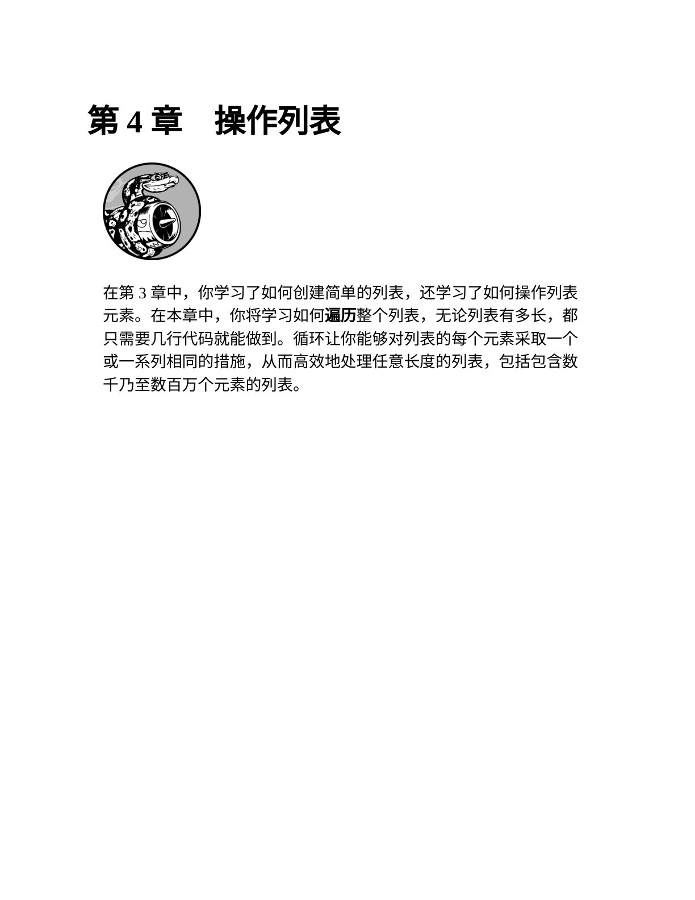

在第 3 章中，你学习了如何创建简单的列表，还学习了如何操作列表元素。在本章中，你将学习如何遍历整个列表，无论列表有多长，都只需要几行代码就能做到。循环让你能够对列表的每个元素采取一个或一系列相同的措施，从而高效地处理任意长度的列表，包括包含数千乃至数百万个元素的列表。

## PDF 第 107 页

<!-- page-status: reviewed -->
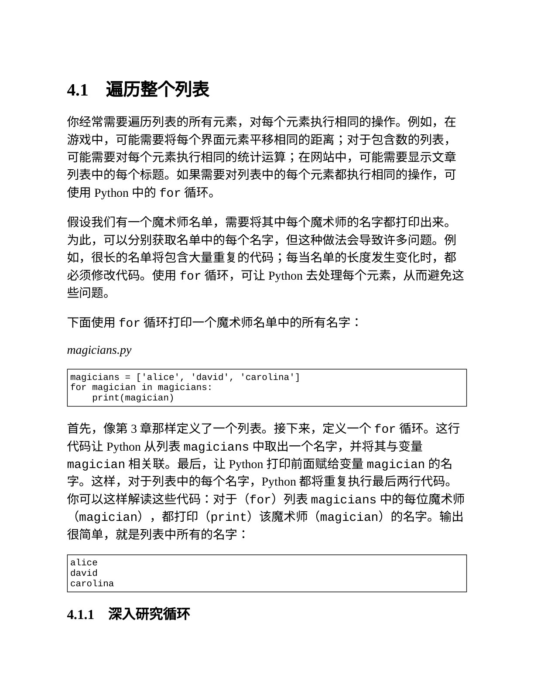

### 4.1 遍历整个列表

你经常需要遍历列表的所有元素，对每个元素执行相同的操作。例如，在游戏中，可能需要将每个界面元素平移相同的距离；对于包含数的列表，可能需要对每个元素执行相同的统计运算；在网站中，可能需要显示文章列表中的每个标题。如果需要对列表中的每个元素都执行相同的操作，可使用 Python 中的 `for` 循环。

假设我们有一个魔术师名单，需要将其中每个魔术师的名字都打印出来。为此，可以分别获取名单中的每个名字，但这种做法会导致许多问题。例如，很长的名单将包含大量重复的代码；每当名单的长度发生变化时，都必须修改代码。使用 `for` 循环，可让 Python 去处理每个元素，从而避免这些问题。

下面使用 `for` 循环打印一个魔术师名单中的所有名字：

`magicians.py`

```python
magicians = ['alice', 'david', 'carolina']
for magician in magicians:
    print(magician)
```

首先，像第 3 章那样定义了一个列表。接下来，定义一个 `for` 循环。这行代码让 Python 从列表 `magicians` 中取出一个名字，并将其与变量 `magician` 相关联。最后，让 Python 打印前面赋给变量 `magician` 的名字。这样，对于列表中的每个名字，Python 都将重复执行最后两行代码。你可以这样解读这些代码：对于（`for`）列表 `magicians` 中的每位魔术师（`magician`），都打印（`print`）该魔术师（`magician`）的名字。输出很简单，就是列表中所有的名字：

```text
alice
david
carolina
```

### 4.1.1 深入研究循环

## PDF 第 108 页

<!-- page-status: reviewed -->
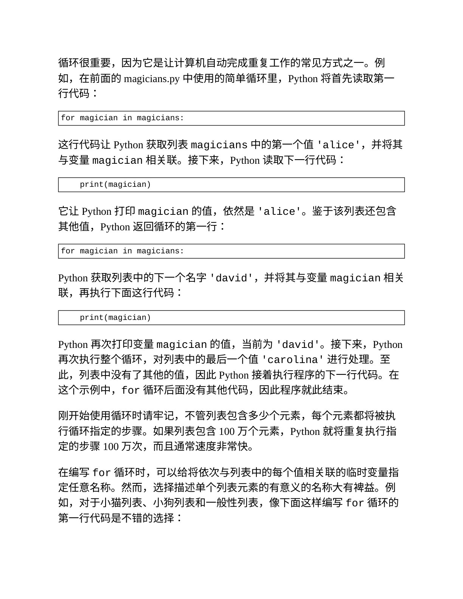

循环很重要，因为它是让计算机自动完成重复工作的常见方式之一。例如，在前面的 `magicians.py` 中使用的简单循环里，Python 将首先读取第一行代码：

```text
for magician in magicians:
```

这行代码让 Python 获取列表 `magicians` 中的第一个值 `'alice'`，并将其与变量 `magician` 相关联。接下来，Python 读取下一行代码：

```text
    print(magician)
```

它让 Python 打印 `magician` 的值，依然是 `'alice'`。鉴于该列表还包含其他值，Python 返回循环的第一行：

```text
for magician in magicians:
```

Python 获取列表中的下一个名字 `'david'`，并将其与变量 `magician` 相关联，再执行下面这行代码：

```text
    print(magician)
```

Python 再次打印变量 `magician` 的值，当前为 `'david'`。接下来，Python 再次执行整个循环，对列表中的最后一个值 `'carolina'` 进行处理。至此，列表中没有了其他的值，因此 Python 接着执行程序的下一行代码。在这个示例中，`for` 循环后面没有其他代码，因此程序就此结束。

刚开始使用循环时请牢记，不管列表包含多少个元素，每个元素都将被执行循环指定的步骤。如果列表包含 100 万个元素，Python 就将重复执行指定的步骤 100 万次，而且通常速度非常快。

在编写 `for` 循环时，可以给将依次与列表中的每个值相关联的临时变量指定任意名称。然而，选择描述单个列表元素的有意义的名称大有裨益。例如，对于小猫列表、小狗列表和一般性列表，像下面这样编写 `for` 循环的第一行代码是不错的选择（续下页）。

## PDF 第 109 页

<!-- page-status: reviewed -->
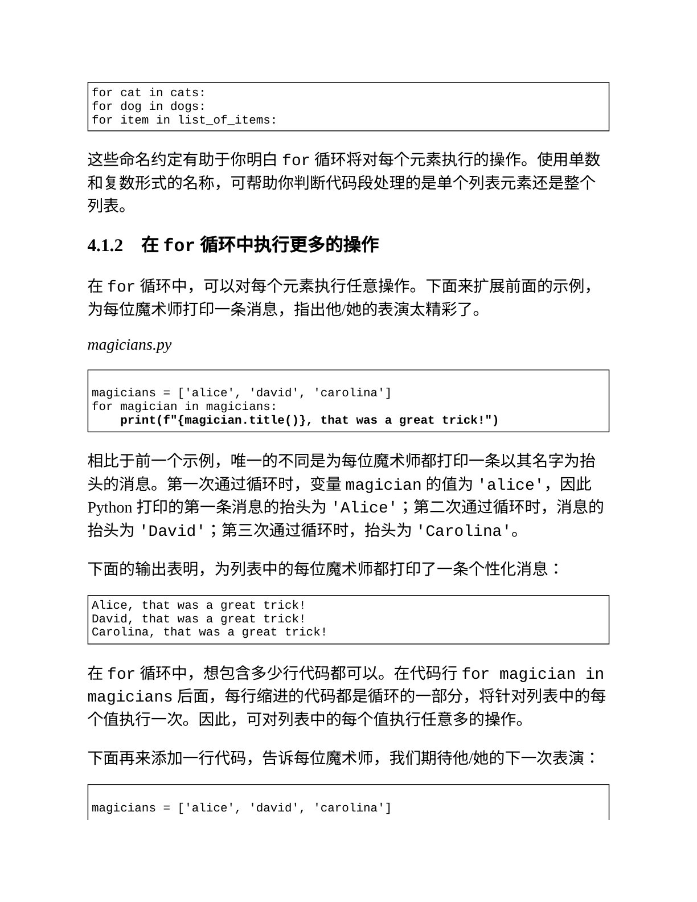

```text
for cat in cats:
for dog in dogs:
for item in list_of_items:
```

这些命名约定有助于你明白 `for` 循环将对每个元素执行的操作。使用单数和复数形式的名称，可帮助你判断代码段处理的是单个列表元素还是整个列表。

### 4.1.2 在 for 循环中执行更多的操作

在 `for` 循环中，可以对每个元素执行任意操作。下面来扩展前面的示例，为每位魔术师打印一条消息，指出他/她的表演太精彩了。

`magicians.py`

```python
magicians = ['alice', 'david', 'carolina']
for magician in magicians:
    print(f"{magician.title()}, that was a great trick!")
```

相比于前一个示例，唯一的不同是为每位魔术师都打印一条以其名字为抬头的消息。第一次通过循环时，变量 `magician` 的值为 `'alice'`，因此 Python 打印的第一条消息的抬头为 `'Alice'`；第二次通过循环时，消息的抬头为 `'David'`；第三次通过循环时，抬头为 `'Carolina'`。

下面的输出表明，为列表中的每位魔术师都打印了一条个性化消息：

```text
Alice, that was a great trick!
David, that was a great trick!
Carolina, that was a great trick!
```

在 `for` 循环中，想包含多少行代码都可以。在代码行 `for magician in magicians` 后面，每行缩进的代码都是循环的一部分，将针对列表中的每个值执行一次。因此，可对列表中的每个值执行任意多的操作。

下面再来添加一行代码，告诉每位魔术师，我们期待他/她的下一次表演：

> 代码跨 PDF 第 109–110 页，以下合并为可复制的完整代码；字符串中原书因排版而换行的部分已连成一行。

```python
magicians = ['alice', 'david', 'carolina']
for magician in magicians:
    print(f"{magician.title()}, that was a great trick!")
    print(f"I can't wait to see your next trick, {magician.title()}.\n")
```

## PDF 第 110 页

<!-- page-status: reviewed -->
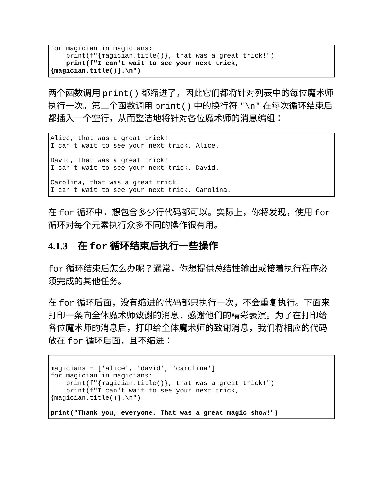

> 页面顶部为上一页代码的续行，完整代码见上页。

两个函数调用 `print()` 都缩进了，因此它们都将针对列表中的每位魔术师执行一次。第二个函数调用 `print()` 中的换行符 `"\n"` 在每次循环结束后都插入一个空行，从而整洁地将针对各位魔术师的消息编组：

```text
Alice, that was a great trick!
I can't wait to see your next trick, Alice.

David, that was a great trick!
I can't wait to see your next trick, David.

Carolina, that was a great trick!
I can't wait to see your next trick, Carolina.
```

在 `for` 循环中，想包含多少行代码都可以。实际上，你将发现，使用 `for` 循环对每个元素执行众多不同的操作很有用。

### 4.1.3 在 for 循环结束后执行一些操作

`for` 循环结束后怎么办呢？通常，你想提供总结性输出或接着执行程序必须完成的其他任务。

在 `for` 循环后面，没有缩进的代码都只执行一次，不会重复执行。下面来打印一条向全体魔术师致谢的消息，感谢他们的精彩表演。为了在打印给各位魔术师的消息后，打印给全体魔术师的致谢消息，我们将相应的代码放在 `for` 循环后面，且不缩进：

```python
magicians = ['alice', 'david', 'carolina']
for magician in magicians:
    print(f"{magician.title()}, that was a great trick!")
    print(f"I can't wait to see your next trick, {magician.title()}.\n")

print("Thank you, everyone. That was a great magic show!")
```

## PDF 第 111 页

<!-- page-status: reviewed -->
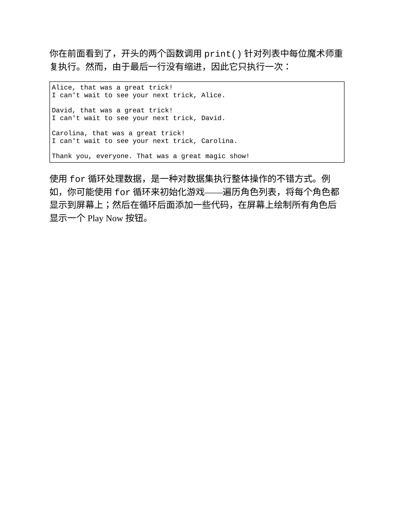

你在前面看到了，开头的两个函数调用 `print()` 针对列表中每位魔术师重复执行。然而，由于最后一行没有缩进，因此它只执行一次：

```text
Alice, that was a great trick!
I can't wait to see your next trick, Alice.

David, that was a great trick!
I can't wait to see your next trick, David.

Carolina, that was a great trick!
I can't wait to see your next trick, Carolina.

Thank you, everyone. That was a great magic show!
```

使用 `for` 循环处理数据，是一种对数据集执行整体操作的不错方式。例如，你可能使用 `for` 循环来初始化游戏——遍历角色列表，将每个角色都显示到屏幕上；然后在循环后面添加一些代码，在屏幕上绘制所有角色后显示一个 Play Now 按钮。

## PDF 第 112 页

<!-- page-status: reviewed -->
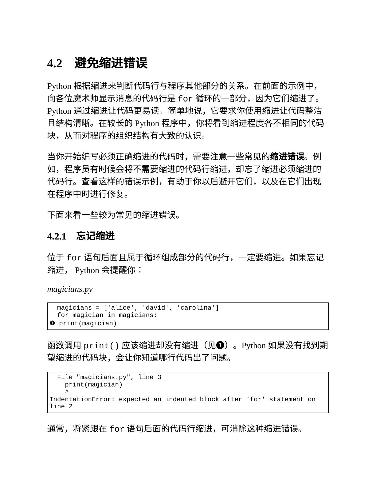

### 4.2 避免缩进错误

Python 根据缩进来判断代码行与程序其他部分的关系。在前面的示例中，向各位魔术师显示消息的代码行是 `for` 循环的一部分，因为它们缩进了。Python 通过缩进让代码更易读。简单地说，它要求你使用缩进让代码整洁且结构清晰。在较长的 Python 程序中，你将看到缩进程度各不相同的代码块，从而对程序的组织结构有大致的认识。

当你开始编写必须正确缩进的代码时，需要注意一些常见的**缩进错误**。例如，程序员有时候会将不需要缩进的代码行缩进，却忘了缩进必须缩进的代码行。查看这样的错误示例，有助于你以后避开它们，以及在它们出现在程序中时进行修复。

下面来看一些较为常见的缩进错误。

### 4.2.1 忘记缩进

位于 `for` 语句后面且属于循环组成部分的代码行，一定要缩进。如果忘记缩进，Python 会提醒你：

*magicians.py*（有意保留的错误示例）

```python
magicians = ['alice', 'david', 'carolina']
for magician in magicians:
print(magician)
```

函数调用 `print()` 应该缩进却没有缩进（见❶）。Python 如果没有找到期望缩进的代码块，会让你知道哪行代码出了问题。

```text
  File "magicians.py", line 3
    print(magician)
    ^
IndentationError: expected an indented block after 'for' statement on
line 2
```

通常，将紧跟在 `for` 语句后面的代码行缩进，可消除这种缩进错误。

## PDF 第 113 页

<!-- page-status: reviewed -->
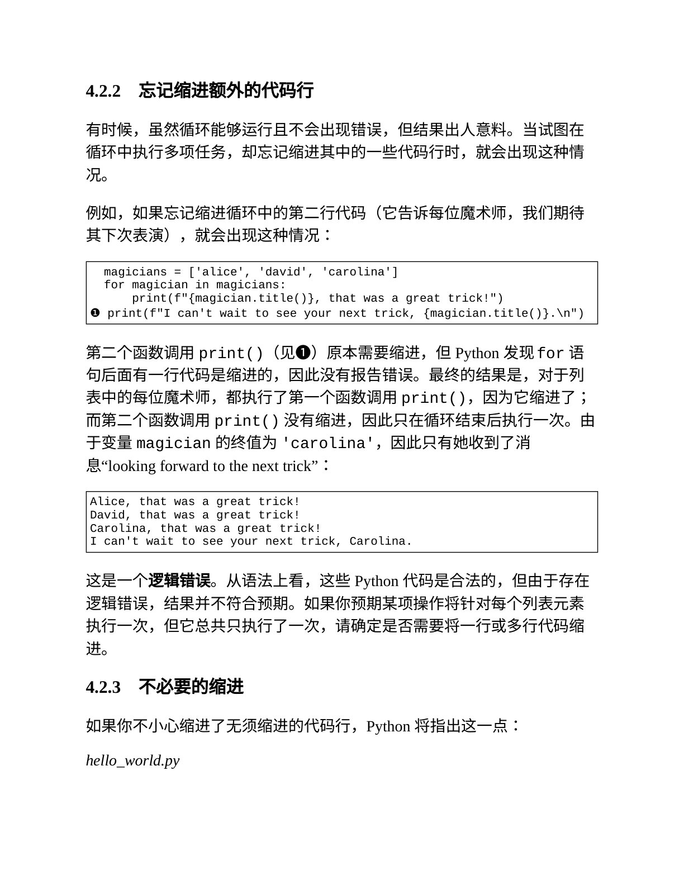

### 4.2.2 忘记缩进额外的代码行

有时候，虽然循环能够运行且不会出现错误，但结果出人意料。当试图在循环中执行多项任务，却忘记缩进其中的一些代码行时，就会出现这种情况。

例如，如果忘记缩进循环中的第二行代码（它告诉每位魔术师，我们期待其下次表演），就会出现这种情况：

```python
magicians = ['alice', 'david', 'carolina']
for magician in magicians:
    print(f"{magician.title()}, that was a great trick!")
print(f"I can't wait to see your next trick, {magician.title()}.\n")
```

第二个函数调用 `print()`（见❶）原本需要缩进，但 Python 发现 `for` 语句后面有一行代码是缩进的，因此没有报告错误。最终的结果是，对于列表中的每位魔术师，都执行了第一个函数调用 `print()`，因为它缩进了；而第二个函数调用 `print()` 没有缩进，因此只在循环结束后执行一次。由于变量 `magician` 的终值为 `'carolina'`，因此只有她收到了消息“looking forward to the next trick”：

```text
Alice, that was a great trick!
David, that was a great trick!
Carolina, that was a great trick!
I can't wait to see your next trick, Carolina.
```

这是一个**逻辑错误**。从语法上看，这些 Python 代码是合法的，但由于存在逻辑错误，结果并不符合预期。如果你预期某项操作将针对每个列表元素执行一次，但它总共只执行了一次，请确定是否需要将一行或多行代码缩进。

### 4.2.3 不必要的缩进

如果你不小心缩进了无须缩进的代码行，Python 将指出这一点：

*hello_world.py*（代码见下一页）

## PDF 第 114 页

<!-- page-status: reviewed -->
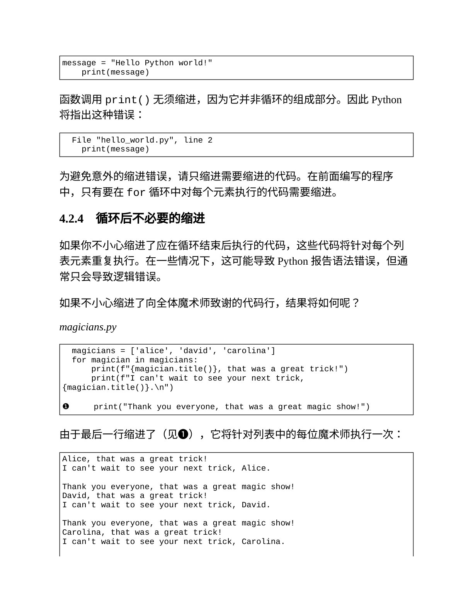

```python
message = "Hello Python world!"
    print(message)
```

函数调用 `print()` 无须缩进，因为它并非循环的组成部分。因此 Python 将指出这种错误：

```text
  File "hello_world.py", line 2
    print(message)
```

为避免意外的缩进错误，请只缩进需要缩进的代码。在前面编写的程序中，只有要在 `for` 循环中对每个元素执行的代码需要缩进。

### 4.2.4 循环后不必要的缩进

如果你不小心缩进了应在循环结束后执行的代码，这些代码将针对每个列表元素重复执行。在一些情况下，这可能导致 Python 报告语法错误，但通常只会导致逻辑错误。

如果不小心缩进了向全体魔术师致谢的代码行，结果将如何呢？

*magicians.py*

```python
magicians = ['alice', 'david', 'carolina']
for magician in magicians:
    print(f"{magician.title()}, that was a great trick!")
    print(f"I can't wait to see your next trick, {magician.title()}.\n")

    print("Thank you everyone, that was a great magic show!")
```

由于最后一行缩进了（见❶），它将针对列表中的每位魔术师执行一次：

```text
Alice, that was a great trick!
I can't wait to see your next trick, Alice.

Thank you everyone, that was a great magic show!
David, that was a great trick!
I can't wait to see your next trick, David.

Thank you everyone, that was a great magic show!
Carolina, that was a great trick!
I can't wait to see your next trick, Carolina.
```

输出续见下一页。

## PDF 第 115 页

<!-- page-status: reviewed -->
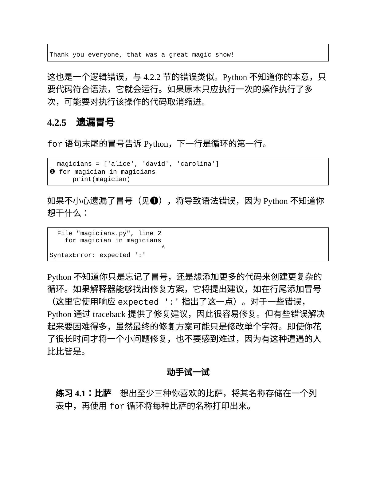

上一页的输出续：

```text
Thank you everyone, that was a great magic show!
```

这也是一个逻辑错误，与 4.2.2 节的错误类似。Python 不知道你的本意，只要代码符合语法，它就会运行。如果原本只应执行一次的操作执行了多次，可能要对执行该操作的代码取消缩进。

### 4.2.5 遗漏冒号

`for` 语句末尾的冒号告诉 Python，下一行是循环的第一行。

```python
magicians = ['alice', 'david', 'carolina']
for magician in magicians
    print(magician)
```

如果不小心遗漏了冒号（见❶），将导致语法错误，因为 Python 不知道你想干什么：

```text
  File "magicians.py", line 2
    for magician in magicians
                             ^
SyntaxError: expected ':'
```

Python 不知道你只是忘记了冒号，还是想添加更多的代码来创建更复杂的循环。如果解释器能够找出修复方案，它将提出建议，如在行尾添加冒号（这里它使用响应 `expected ':'` 指出了这一点）。对于一些错误，Python 通过 traceback 提供了修复建议，因此很容易修复。但有些错误解决起来要困难得多，虽然最终的修复方案可能只是修改单个字符。即使你花了很长时间才将一个小问题修复，也不要感到难过，因为有这种遭遇的人比比皆是。

### 动手试一试

**练习 4.1：比萨**　想出至少三种你喜欢的比萨，将其名称存储在一个列表中，再使用 `for` 循环将每种比萨的名称打印出来。

## PDF 第 116 页

<!-- page-status: reviewed -->
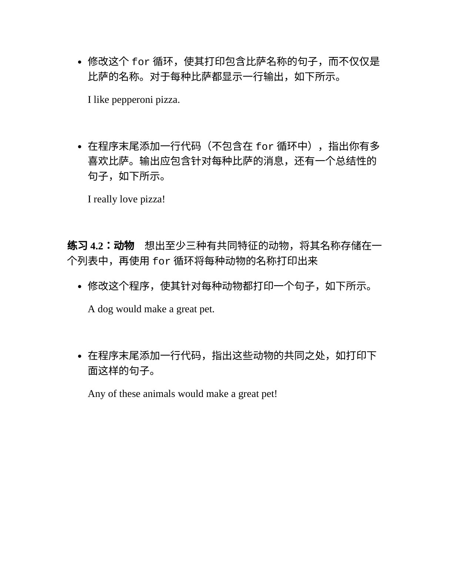

练习 4.1（接上页）：

- 修改这个 `for` 循环，使其打印包含比萨名称的句子，而不仅仅是比萨的名称。对于每种比萨都显示一行输出，如下所示。

  ```text
  I like pepperoni pizza.
  ```

- 在程序末尾添加一行代码（不包含在 `for` 循环中），指出你有多喜欢比萨。输出应包含针对每种比萨的消息，还有一个总结性的句子，如下所示。

  ```text
  I really love pizza!
  ```

**练习 4.2：动物**　想出至少三种有共同特征的动物，将其名称存储在一个列表中，再使用 `for` 循环将每种动物的名称打印出来。

- 修改这个程序，使其针对每种动物都打印一个句子，如下所示。

  ```text
  A dog would make a great pet.
  ```

- 在程序末尾添加一行代码，指出这些动物的共同之处，如打印下面这样的句子。

  ```text
  Any of these animals would make a great pet!
  ```

## PDF 第 117 页

<!-- page-status: reviewed -->
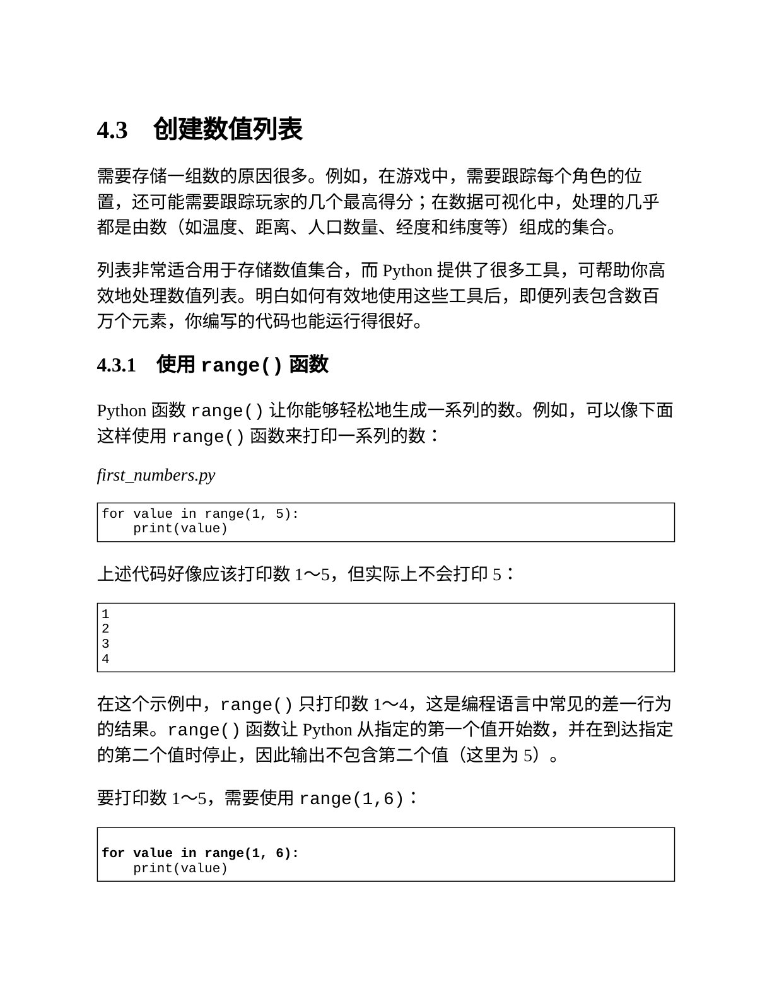

### 4.3 创建数值列表

需要存储一组数的原因很多。例如，在游戏中，需要跟踪每个角色的位置，还可能需要跟踪玩家的几个最高得分；在数据可视化中，处理的几乎都是由数（如温度、距离、人口数量、经度和纬度等）组成的集合。

列表非常适合用于存储数值集合，而 Python 提供了很多工具，可帮助你高效地处理数值列表。明白如何有效地使用这些工具后，即便列表包含数百万个元素，你编写的代码也能运行得很好。

### 4.3.1 使用 range() 函数

Python 函数 `range()` 让你能够轻松地生成一系列的数。例如，可以像下面这样使用 `range()` 函数来打印一系列的数：

`first_numbers.py`

```python
for value in range(1, 5):
    print(value)
```

上述代码好像应该打印数 1～5，但实际上不会打印 5：

```text
1
2
3
4
```

在这个示例中，`range()` 只打印数 1～4，这是编程语言中常见的差一行为的结果。`range()` 函数让 Python 从指定的第一个值开始数，并在到达指定的第二个值时停止，因此输出不包含第二个值（这里为 5）。

要打印数 1～5，需要使用 `range(1, 6)`：

```python
for value in range(1, 6):
    print(value)
```

## PDF 第 118 页

<!-- page-status: reviewed -->
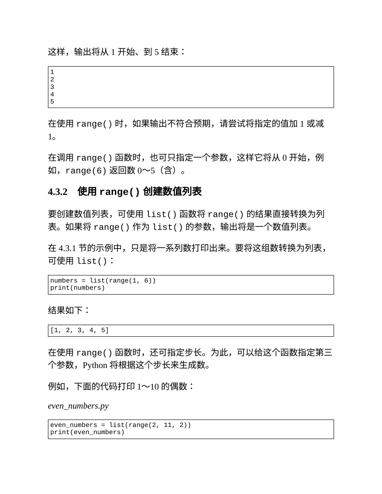

这样，输出将从 1 开始、到 5 结束：

```text
1
2
3
4
5
```

在使用 `range()` 时，如果输出不符合预期，请尝试将指定的值加 1 或减 1。

在调用 `range()` 函数时，也可只指定一个参数，这样它将从 0 开始，例如，`range(6)` 返回数 0～5（含）。

### 4.3.2 使用 range() 创建数值列表

要创建数值列表，可使用 `list()` 函数将 `range()` 的结果直接转换为列表。如果将 `range()` 作为 `list()` 的参数，输出将是一个数值列表。

在 4.3.1 节的示例中，只是将一系列数打印出来。要将这组数转换为列表，可使用 `list()`：

```python
numbers = list(range(1, 6))
print(numbers)
```

结果如下：

```text
[1, 2, 3, 4, 5]
```

在使用 `range()` 函数时，还可指定步长。为此，可以给这个函数指定第三个参数，Python 将根据这个步长来生成数。

例如，下面的代码打印 1～10 的偶数：

`even_numbers.py`

```python
even_numbers = list(range(2, 11, 2))
print(even_numbers)
```

## PDF 第 119 页

<!-- page-status: reviewed -->
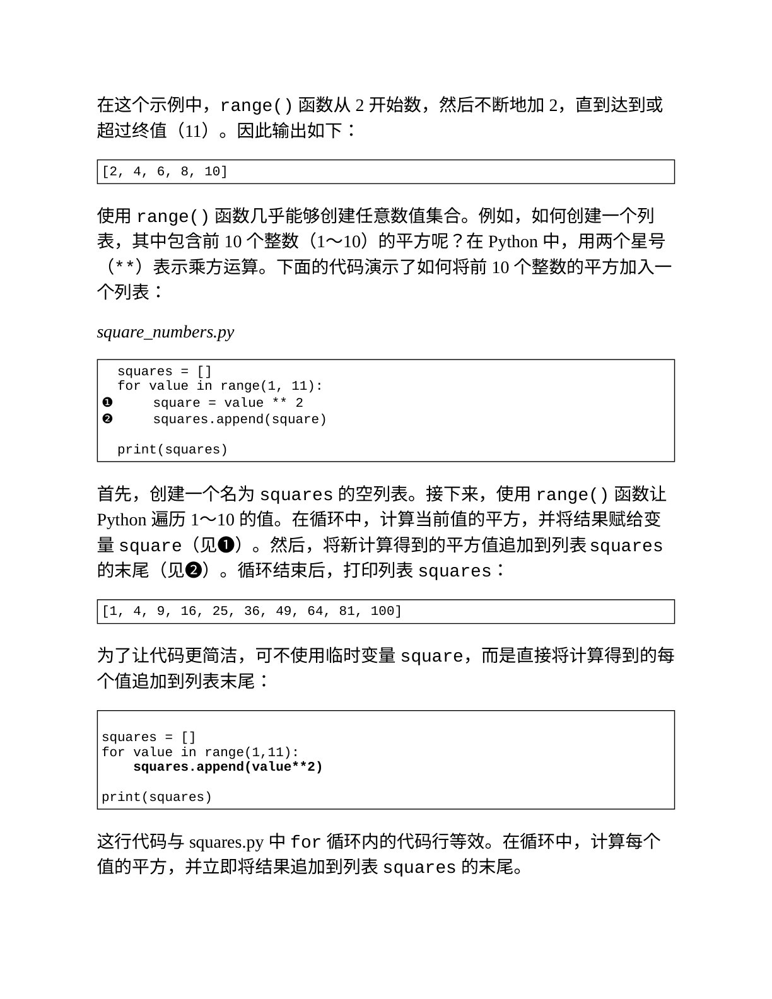

在这个示例中，`range()` 函数从 2 开始数，然后不断地加 2，直到达到或超过终值（11）。因此输出如下：

```text
[2, 4, 6, 8, 10]
```

使用 `range()` 函数几乎能够创建任意数值集合。例如，如何创建一个列表，其中包含前 10 个整数（1～10）的平方呢？在 Python 中，用两个星号（`**`）表示乘方运算。下面的代码演示了如何将前 10 个整数的平方加入一个列表：

`square_numbers.py`

```python
squares = []
for value in range(1, 11):
    square = value ** 2  # ❶
    squares.append(square)  # ❷

print(squares)
```

首先，创建一个名为 `squares` 的空列表。接下来，使用 `range()` 函数让 Python 遍历 1～10 的值。在循环中，计算当前值的平方，并将结果赋给变量 `square`（见❶）。然后，将新计算得到的平方值追加到列表 `squares` 的末尾（见❷）。循环结束后，打印列表 `squares`：

```text
[1, 4, 9, 16, 25, 36, 49, 64, 81, 100]
```

为了让代码更简洁，可不使用临时变量 `square`，而是直接将计算得到的每个值追加到列表末尾：

```python
squares = []
for value in range(1,11):
    squares.append(value**2)

print(squares)
```

这行代码与 `squares.py` 中 `for` 循环内的代码行等效。在循环中，计算每个值的平方，并立即将结果追加到列表 `squares` 的末尾。

## PDF 第 120 页

<!-- page-status: reviewed -->
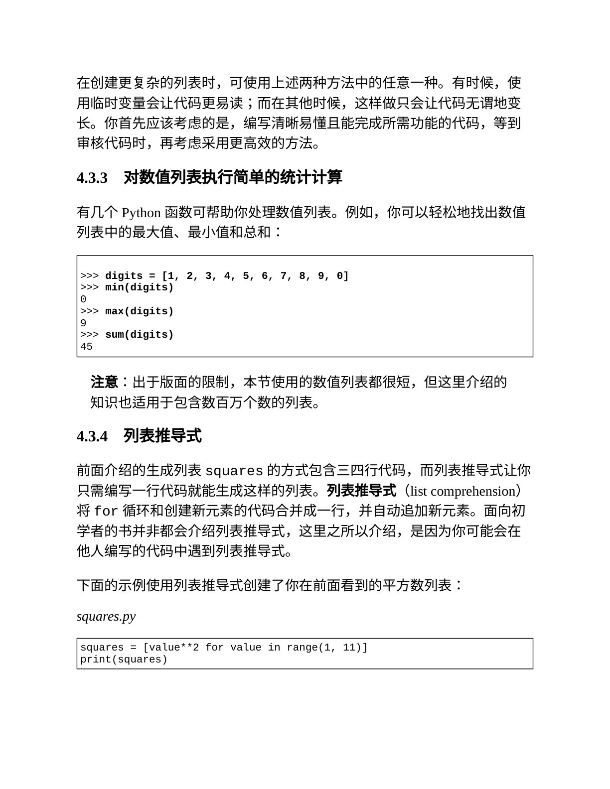

在创建更复杂的列表时，可使用上述两种方法中的任意一种。有时候，使用临时变量会让代码更易读；而在其他时候，这样做只会让代码无谓地变长。你首先应该考虑的是，编写清晰易懂且能完成所需功能的代码，等到审核代码时，再考虑采用更高效的方法。

### 4.3.3 对数值列表执行简单的统计计算

有几个 Python 函数可帮助你处理数值列表。例如，你可以轻松地找出数值列表中的最大值、最小值和总和：

```text
>>> digits = [1, 2, 3, 4, 5, 6, 7, 8, 9, 0]
>>> min(digits)
0
>>> max(digits)
9
>>> sum(digits)
45
```

> 注意：出于版面的限制，本节使用的数值列表都很短，但这里介绍的知识也适用于包含数百万个数的列表。

### 4.3.4 列表推导式

前面介绍的生成列表 `squares` 的方式包含三四行代码，而列表推导式让你只需编写一行代码就能生成这样的列表。**列表推导式**（list comprehension）将 `for` 循环和创建新元素的代码合并成一行，并自动追加新元素。面向初学者的书并非都会介绍列表推导式，这里之所以介绍，是因为你可能会在他人编写的代码中遇到列表推导式。

下面的示例使用列表推导式创建了你在前面看到的平方数列表：

`squares.py`

```python
squares = [value**2 for value in range(1, 11)]
print(squares)
```

## PDF 第 121 页

<!-- page-status: reviewed -->
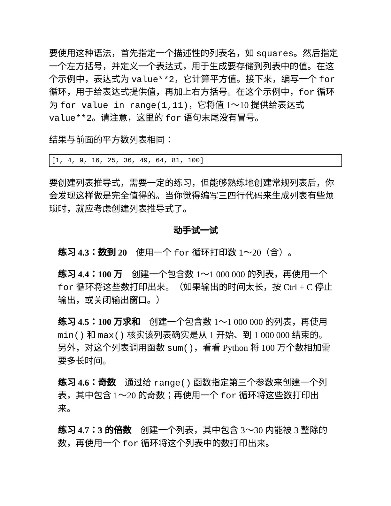

要使用这种语法，首先指定一个描述性的列表名，如 `squares`。然后指定一个左方括号，并定义一个表达式，用于生成要存储到列表中的值。在这个示例中，表达式为 `value**2`，它计算平方值。接下来，编写一个 `for` 循环，用于给表达式提供值，再加上右方括号。在这个示例中，`for` 循环为 `for value in range(1,11)`，它将值 1～10 提供给表达式 `value**2`。请注意，这里的 `for` 语句末尾没有冒号。

结果与前面的平方数列表相同：

```text
[1, 4, 9, 16, 25, 36, 49, 64, 81, 100]
```

要创建列表推导式，需要一定的练习，但能够熟练地创建常规列表后，你会发现这样做是完全值得的。当你觉得编写三四行代码来生成列表有些烦琐时，就应考虑创建列表推导式了。

#### 动手试一试

**练习 4.3：数到 20**　使用一个 `for` 循环打印数 1～20（含）。

**练习 4.4：100 万**　创建一个包含数 1～1 000 000 的列表，再使用一个 `for` 循环将这些数打印出来。（如果输出的时间太长，按 Ctrl + C 停止输出，或关闭输出窗口。）

**练习 4.5：100 万求和**　创建一个包含数 1～1 000 000 的列表，再使用 `min()` 和 `max()` 核实该列表确实是从 1 开始、到 1 000 000 结束的。另外，对这个列表调用函数 `sum()`，看看 Python 将 100 万个数相加需要多长时间。

**练习 4.6：奇数**　通过给 `range()` 函数指定第三个参数来创建一个列表，其中包含 1～20 的奇数；再使用一个 `for` 循环将这些数打印出来。

**练习 4.7：3 的倍数**　创建一个列表，其中包含 3～30 内能被 3 整除的数，再使用一个 `for` 循环将这个列表中的数打印出来。

## PDF 第 122 页

<!-- page-status: reviewed -->
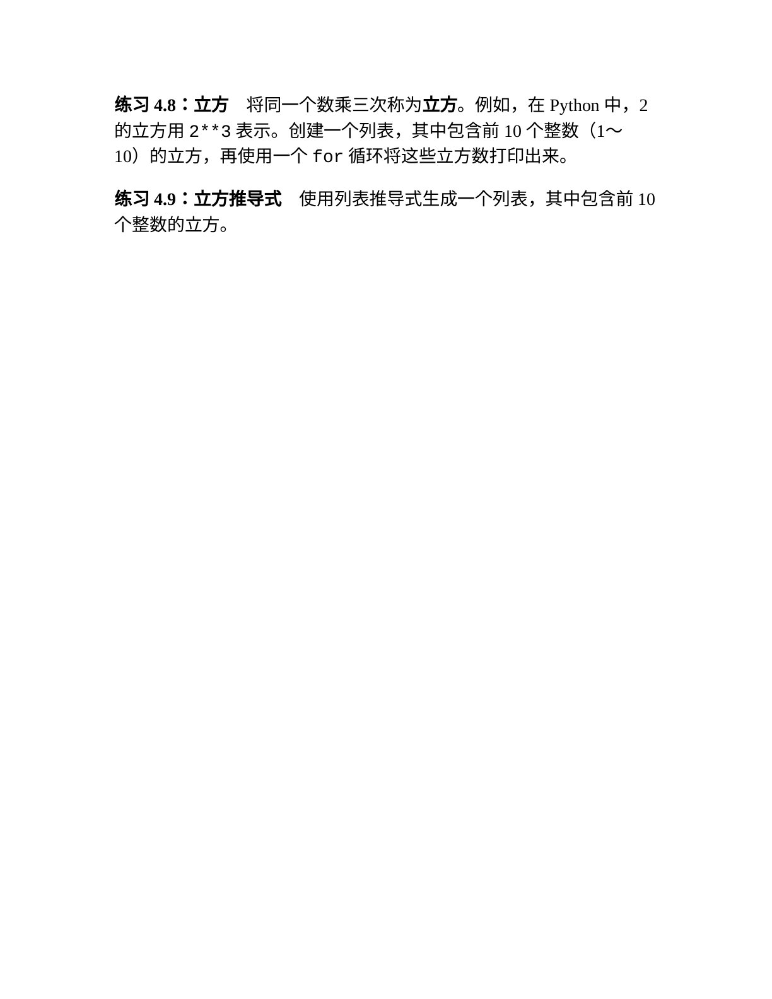

**练习 4.8：立方**　将同一个数乘三次称为立方。例如，在 Python 中，2 的立方用 `2**3` 表示。创建一个列表，其中包含前 10 个整数（1～10）的立方，再使用一个 `for` 循环将这些立方数打印出来。

**练习 4.9：立方推导式**　使用列表推导式生成一个列表，其中包含前 10 个整数的立方。

## PDF 第 123 页

<!-- page-status: reviewed -->
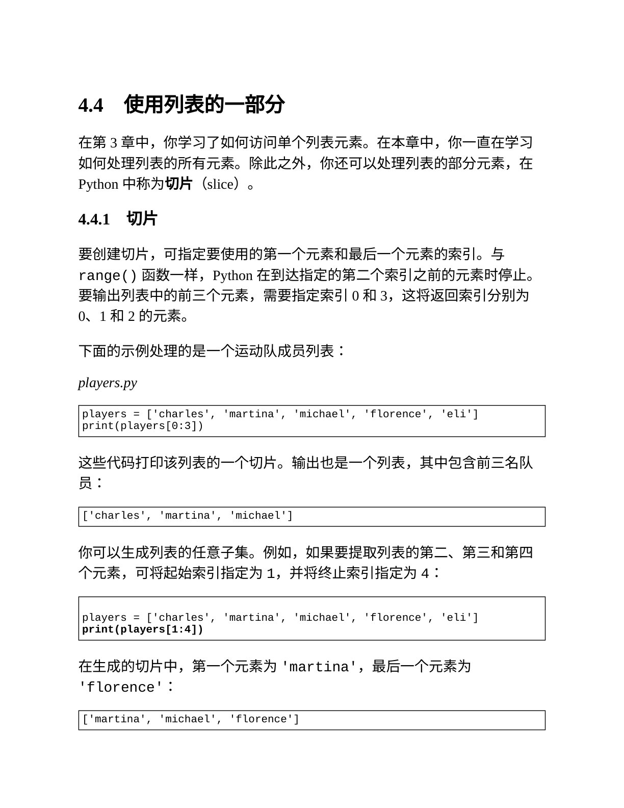

### 4.4 使用列表的一部分

在第 3 章中，你学习了如何访问单个列表元素。在本章中，你一直在学习如何处理列表的所有元素。除此之外，你还可以处理列表的部分元素，在 Python 中称为**切片**（slice）。

#### 4.4.1 切片

要创建切片，可指定要使用的第一个元素和最后一个元素的索引。与 `range()` 函数一样，Python 在到达指定的第二个索引之前的元素时停止。要输出列表中的前三个元素，需要指定索引 0 和 3，这将返回索引分别为 0、1 和 2 的元素。

下面的示例处理的是一个运动队成员列表：

`players.py`

```python
players = ['charles', 'martina', 'michael', 'florence', 'eli']
print(players[0:3])
```

这些代码打印该列表的一个切片。输出也是一个列表，其中包含前三名队员：

```text
['charles', 'martina', 'michael']
```

你可以生成列表的任意子集。例如，如果要提取列表的第二、第三和第四个元素，可将起始索引指定为 1，并将终止索引指定为 4：

```python
players = ['charles', 'martina', 'michael', 'florence', 'eli']
print(players[1:4])
```

在生成的切片中，第一个元素为 `'martina'`，最后一个元素为 `'florence'`：

```text
['martina', 'michael', 'florence']
```

## PDF 第 124 页

<!-- page-status: reviewed -->
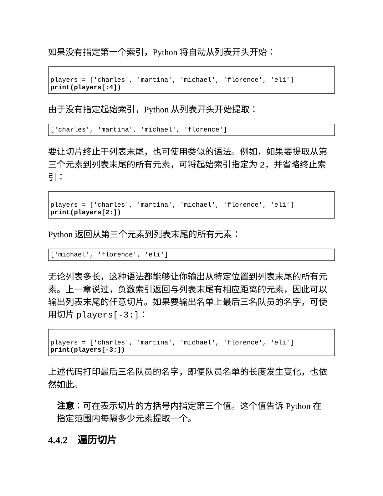

如果没有指定第一个索引，Python 将自动从列表开头开始：

```python
players = ['charles', 'martina', 'michael', 'florence', 'eli']
print(players[:4])
```

由于没有指定起始索引，Python 从列表开头开始提取：

```text
['charles', 'martina', 'michael', 'florence']
```

要让切片终止于列表末尾，也可使用类似的语法。例如，如果要提取从第三个元素到列表末尾的所有元素，可将起始索引指定为 2，并省略终止索引：

```python
players = ['charles', 'martina', 'michael', 'florence', 'eli']
print(players[2:])
```

Python 返回从第三个元素到列表末尾的所有元素：

```text
['michael', 'florence', 'eli']
```

无论列表多长，这种语法都能够让你输出从特定位置到列表末尾的所有元素。上一章说过，负数索引返回与列表末尾有相应距离的元素，因此可以输出列表末尾的任意切片。如果要输出名单上最后三名队员的名字，可使用切片 `players[-3:]`：

```python
players = ['charles', 'martina', 'michael', 'florence', 'eli']
print(players[-3:])
```

上述代码打印最后三名队员的名字，即便队员名单的长度发生变化，也依然如此。

> **注意：**可在表示切片的方括号内指定第三个值。这个值告诉 Python 在指定范围内每隔多少元素提取一个。

#### 4.4.2 遍历切片

## PDF 第 125 页

<!-- page-status: reviewed -->
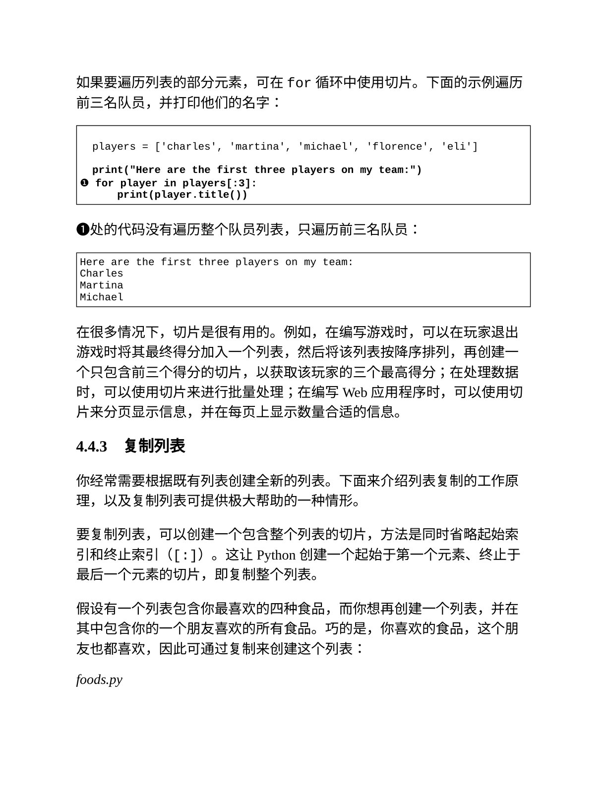

如果要遍历列表的部分元素，可在 `for` 循环中使用切片。下面的示例遍历前三名队员，并打印他们的名字：

```python
players = ['charles', 'martina', 'michael', 'florence', 'eli']

print("Here are the first three players on my team:")
for player in players[:3]:  # 原书标记 ❶
    print(player.title())
```

❶ 处的代码没有遍历整个队员列表，只遍历前三名队员：

```text
Here are the first three players on my team:
Charles
Martina
Michael
```

在很多情况下，切片是很有用的。例如，在编写游戏时，可以在玩家退出游戏时将其最终得分加入一个列表，然后将该列表按降序排列，再创建一个只包含前三个得分的切片，以获取该玩家的三个最高得分；在处理数据时，可以使用切片来进行批量处理；在编写 Web 应用程序时，可以使用切片来分页显示信息，并在每页上显示数量合适的信息。

#### 4.4.3 复制列表

你经常需要根据既有列表创建全新的列表。下面来介绍列表复制的工作原理，以及复制列表可提供极大帮助的一种情形。

要复制列表，可以创建一个包含整个列表的切片，方法是同时省略起始索引和终止索引（`[:]`）。这让 Python 创建一个起始于第一个元素、终止于最后一个元素的切片，即复制整个列表。

假设有一个列表包含你最喜欢的四种食品，而你想再创建一个列表，并在其中包含你的一个朋友喜欢的所有食品。巧的是，你喜欢的食品，这个朋友也都喜欢，因此可通过复制来创建这个列表：

`foods.py`（代码见下页）

## PDF 第 126 页

<!-- page-status: reviewed -->
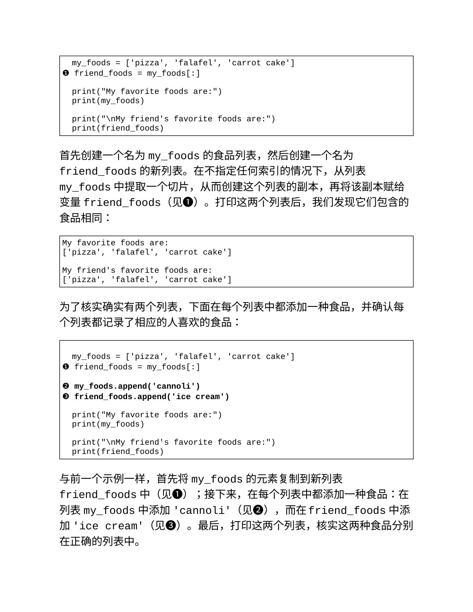

```python
my_foods = ['pizza', 'falafel', 'carrot cake']
friend_foods = my_foods[:]  # ❶

print("My favorite foods are:")
print(my_foods)

print("\nMy friend's favorite foods are:")
print(friend_foods)
```

首先创建一个名为 `my_foods` 的食品列表，然后创建一个名为 `friend_foods` 的新列表。在不指定任何索引的情况下，从列表 `my_foods` 中提取一个切片，从而创建这个列表的副本，再将该副本赋给变量 `friend_foods`（见❶）。打印这两个列表后，我们发现它们包含的食品相同：

```text
My favorite foods are:
['pizza', 'falafel', 'carrot cake']

My friend's favorite foods are:
['pizza', 'falafel', 'carrot cake']
```

为了核实确实有两个列表，下面在每个列表中都添加一种食品，并确认每个列表都记录了相应的人喜欢的食品：

```python
my_foods = ['pizza', 'falafel', 'carrot cake']
friend_foods = my_foods[:]  # ❶

my_foods.append('cannoli')        # ❷
friend_foods.append('ice cream')  # ❸

print("My favorite foods are:")
print(my_foods)

print("\nMy friend's favorite foods are:")
print(friend_foods)
```

与前一个示例一样，首先将 `my_foods` 的元素复制到新列表 `friend_foods` 中（见❶）；接下来，在每个列表中都添加一种食品：在列表 `my_foods` 中添加 `'cannoli'`（见❷），而在 `friend_foods` 中添加 `'ice cream'`（见❸）。最后，打印这两个列表，核实这两种食品分别在正确的列表中。

## PDF 第 127 页

<!-- page-status: reviewed -->
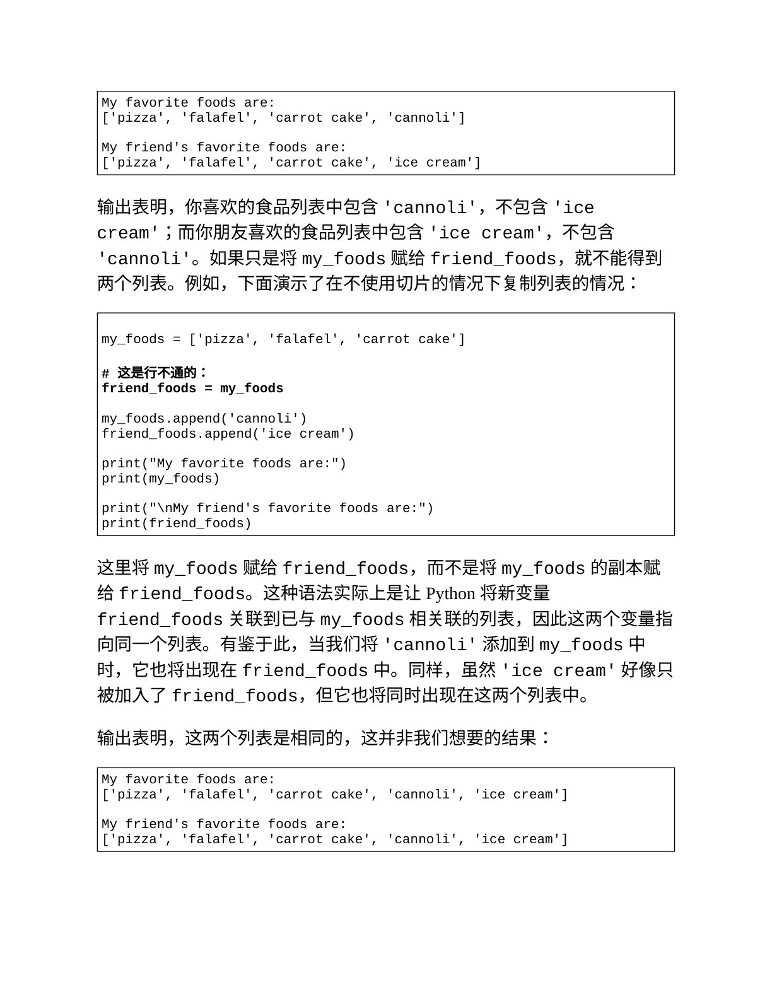

```text
My favorite foods are:
['pizza', 'falafel', 'carrot cake', 'cannoli']

My friend's favorite foods are:
['pizza', 'falafel', 'carrot cake', 'ice cream']
```

输出表明，你喜欢的食品列表中包含 `'cannoli'`，不包含 `'ice cream'`；而你朋友喜欢的食品列表中包含 `'ice cream'`，不包含 `'cannoli'`。如果只是将 `my_foods` 赋给 `friend_foods`，就不能得到两个列表。例如，下面演示了在不使用切片的情况下复制列表的情况：

```python
my_foods = ['pizza', 'falafel', 'carrot cake']

# 这是行不通的：
friend_foods = my_foods

my_foods.append('cannoli')
friend_foods.append('ice cream')

print("My favorite foods are:")
print(my_foods)

print("\nMy friend's favorite foods are:")
print(friend_foods)
```

这里将 `my_foods` 赋给 `friend_foods`，而不是将 `my_foods` 的副本赋给 `friend_foods`。这种语法实际上是让 Python 将新变量 `friend_foods` 关联到已与 `my_foods` 相关联的列表，因此这两个变量指向同一个列表。有鉴于此，当我们将 `'cannoli'` 添加到 `my_foods` 中时，它也将出现在 `friend_foods` 中。同样，虽然 `'ice cream'` 好像只被加入了 `friend_foods`，但它也将同时出现在这两个列表中。

输出表明，这两个列表是相同的，这并非我们想要的结果：

```text
My favorite foods are:
['pizza', 'falafel', 'carrot cake', 'cannoli', 'ice cream']

My friend's favorite foods are:
['pizza', 'falafel', 'carrot cake', 'cannoli', 'ice cream']
```

## PDF 第 128 页

<!-- page-status: reviewed -->
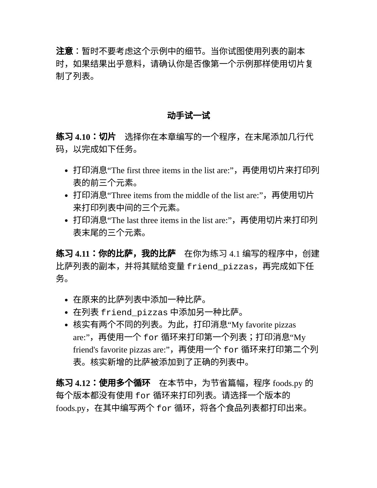

**注意：**暂时不要考虑这个示例中的细节。当你试图使用列表的副本时，如果结果出乎意料，请确认你是否像第一个示例那样使用切片复制了列表。

### 动手试一试

**练习 4.10：切片** 选择你在本章编写的一个程序，在末尾添加几行代码，以完成如下任务。

- 打印消息“The first three items in the list are:”，再使用切片来打印列表的前三个元素。
- 打印消息“Three items from the middle of the list are:”，再使用切片来打印列表中间的三个元素。
- 打印消息“The last three items in the list are:”，再使用切片来打印列表末尾的三个元素。

**练习 4.11：你的比萨，我的比萨** 在你为练习 4.1 编写的程序中，创建比萨列表的副本，并将其赋给变量 `friend_pizzas`，再完成如下任务。

- 在原来的比萨列表中添加一种比萨。
- 在列表 `friend_pizzas` 中添加另一种比萨。
- 核实有两个不同的列表。为此，打印消息“My favorite pizzas are:”，再使用一个 `for` 循环来打印第一个列表；打印消息“My friend's favorite pizzas are:”，再使用一个 `for` 循环来打印第二个列表。核实新增的比萨被添加到了正确的列表中。

**练习 4.12：使用多个循环** 在本节中，为节省篇幅，程序 `foods.py` 的每个版本都没有使用 `for` 循环来打印列表。请选择一个版本的 `foods.py`，在其中编写两个 `for` 循环，将各个食品列表都打印出来。

## PDF 第 129 页

<!-- page-status: reviewed -->
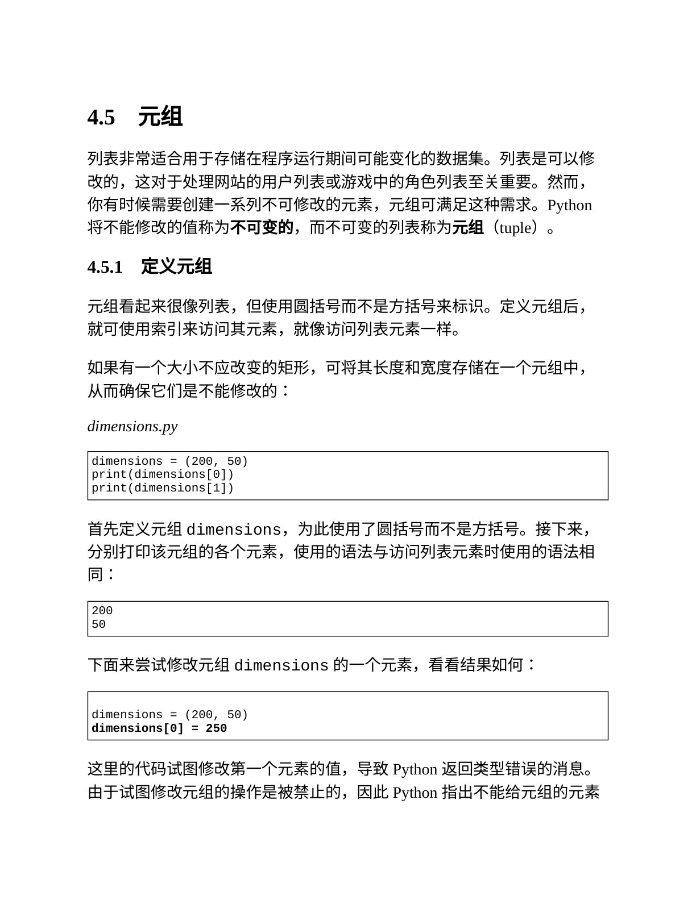

### 4.5 元组

列表非常适合用于存储在程序运行期间可能变化的数据集。列表是可以修改的，这对于处理网站的用户列表或游戏中的角色列表至关重要。然而，你有时候需要创建一系列不可修改的元素，元组可满足这种需求。Python 将不能修改的值称为**不可变的**，而不可变的列表称为**元组**（tuple）。

> 校对注：原书这里把元组称作“不可变的列表”是便于理解的说法；严格地说，元组和列表是两种不同类型。元组不能通过索引替换其元素，但如果某个元素本身是可变对象，其内部仍可能改变。

### 4.5.1 定义元组

元组看起来很像列表，但使用圆括号而不是方括号来标识。定义元组后，就可使用索引来访问其元素，就像访问列表元素一样。

如果有一个大小不应改变的矩形，可将其长度和宽度存储在一个元组中，从而确保它们是不能修改的：

`dimensions.py`

```python
dimensions = (200, 50)
print(dimensions[0])
print(dimensions[1])
```

首先定义元组 `dimensions`，为此使用了圆括号而不是方括号。接下来，分别打印该元组的各个元素，使用的语法与访问列表元素时使用的语法相同：

```text
200
50
```

下面来尝试修改元组 `dimensions` 的一个元素，看看结果如何：

```python
dimensions = (200, 50)
dimensions[0] = 250
```

这里的代码试图修改第一个元素的值，导致 Python 返回类型错误的消息。由于试图修改元组的操作是被禁止的，因此 Python 指出不能给元组的元素赋值（续下页）。

## PDF 第 130 页

<!-- page-status: reviewed -->
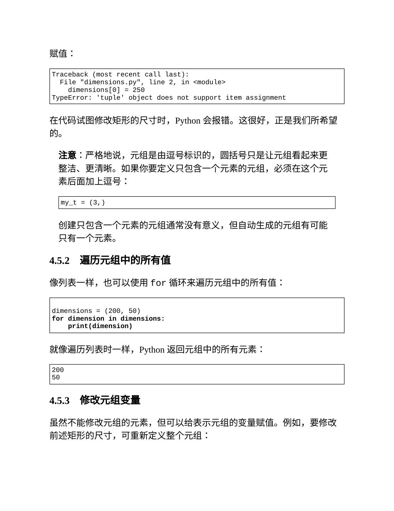

```text
Traceback (most recent call last):
  File "dimensions.py", line 2, in <module>
    dimensions[0] = 250
TypeError: 'tuple' object does not support item assignment
```

在代码试图修改矩形的尺寸时，Python 会报错。这很好，正是我们所希望的。

**注意：**严格地说，元组是由逗号标识的，圆括号只是让元组看起来更整洁、更清晰。如果你要定义只包含一个元素的元组，必须在这个元素后面加上逗号：

```python
my_t = (3,)
```

创建只包含一个元素的元组通常没有意义，但自动生成的元组有可能只有一个元素。

### 4.5.2 遍历元组中的所有值

像列表一样，也可以使用 `for` 循环来遍历元组中的所有值：

```python
dimensions = (200, 50)
for dimension in dimensions:
    print(dimension)
```

就像遍历列表时一样，Python 返回元组中的所有元素：

```text
200
50
```

### 4.5.3 修改元组变量

虽然不能修改元组的元素，但可以给表示元组的变量赋值。例如，要修改前述矩形的尺寸，可重新定义整个元组（续下页）：

## PDF 第 131 页

<!-- page-status: reviewed -->
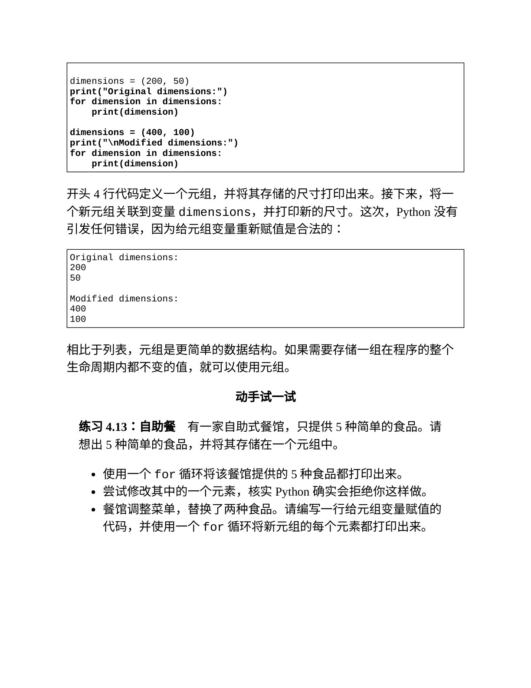

```python
dimensions = (200, 50)
print("Original dimensions:")
for dimension in dimensions:
    print(dimension)

dimensions = (400, 100)
print("\nModified dimensions:")
for dimension in dimensions:
    print(dimension)
```

开头 4 行代码定义一个元组，并将其存储的尺寸打印出来。接下来，将一个新元组关联到变量 `dimensions`，并打印新的尺寸。这次，Python 没有引发任何错误，因为给元组变量重新赋值是合法的：

```text
Original dimensions:
200
50

Modified dimensions:
400
100
```

相比于列表，元组是更简单的数据结构。如果需要存储一组在程序的整个生命周期内都不变的值，就可以使用元组。

### 动手试一试

**练习 4.13：自助餐** 有一家自助式餐馆，只提供 5 种简单的食品。请想出 5 种简单的食品，并将其存储在一个元组中。

- 使用一个 `for` 循环将该餐馆提供的 5 种食品都打印出来。
- 尝试修改其中的一个元素，核实 Python 确实会拒绝你这样做。
- 餐馆调整菜单，替换了两种食品。请编写一行给元组变量赋值的代码，并使用一个 `for` 循环将新元组的每个元素都打印出来。

## PDF 第 132 页

<!-- page-status: reviewed -->
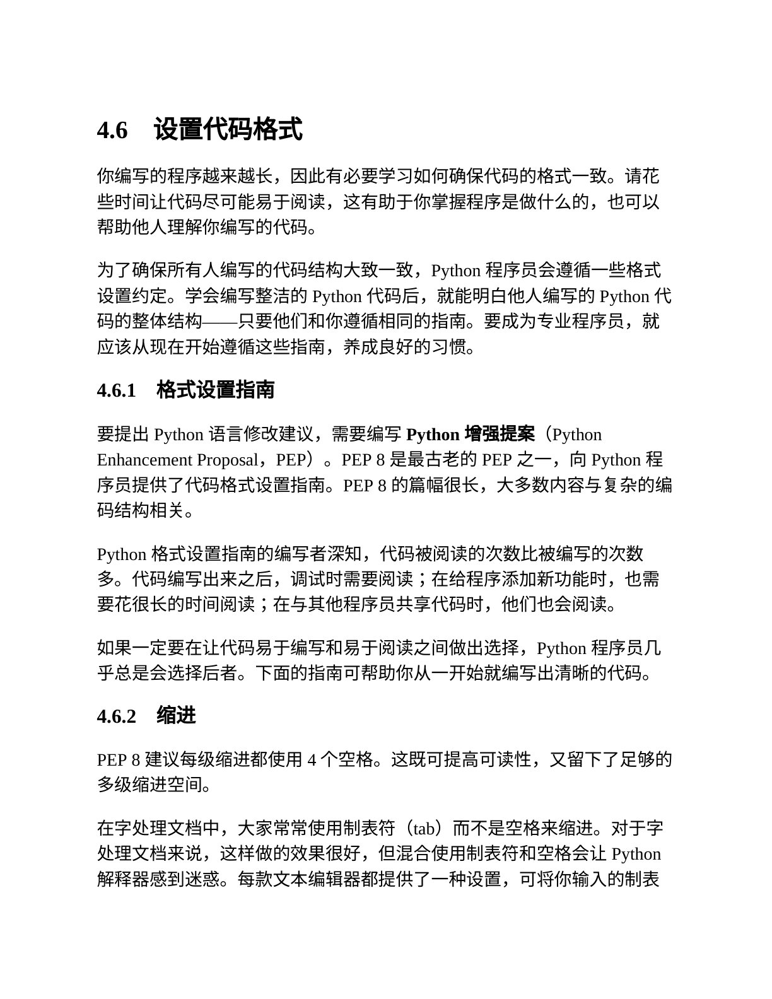

### 4.6 设置代码格式

你编写的程序越来越长，因此有必要学习如何确保代码的格式一致。请花些时间让代码尽可能易于阅读，这有助于你掌握程序是做什么的，也可以帮助他人理解你编写的代码。

为了确保所有人编写的代码结构大致一致，Python 程序员会遵循一些格式设置约定。学会编写整洁的 Python 代码后，就能明白他人编写的 Python 代码的整体结构——只要他们和你遵循相同的指南。要成为专业程序员，就应该从现在开始遵循这些指南，养成良好的习惯。

### 4.6.1 格式设置指南

要提出 Python 语言修改建议，需要编写 **Python 增强提案**（Python Enhancement Proposal，PEP）。PEP 8 是最古老的 PEP 之一，向 Python 程序员提供了代码格式设置指南。PEP 8 的篇幅很长，大多数内容与复杂的编码结构相关。

Python 格式设置指南的编写者深知，代码被阅读的次数比被编写的次数多。代码编写出来之后，调试时需要阅读；在给程序添加新功能时，也需要花很长的时间阅读；在与其他程序员共享代码时，他们也会阅读。

如果一定要在让代码易于编写和易于阅读之间做出选择，Python 程序员几乎总是会选择后者。下面的指南可帮助你从一开始就编写出清晰的代码。

### 4.6.2 缩进

PEP 8 建议每级缩进都使用 4 个空格。这既可提高可读性，又留下了足够的多级缩进空间。

在字处理文档中，大家常常使用制表符（tab）而不是空格来缩进。对于字处理文档来说，这样做的效果很好，但混合使用制表符和空格会让 Python 解释器感到迷惑。每款文本编辑器都提供了一种设置，可将你输入的制表符转换为指定数量的空格（续下页）。

## PDF 第 133 页

<!-- page-status: reviewed -->
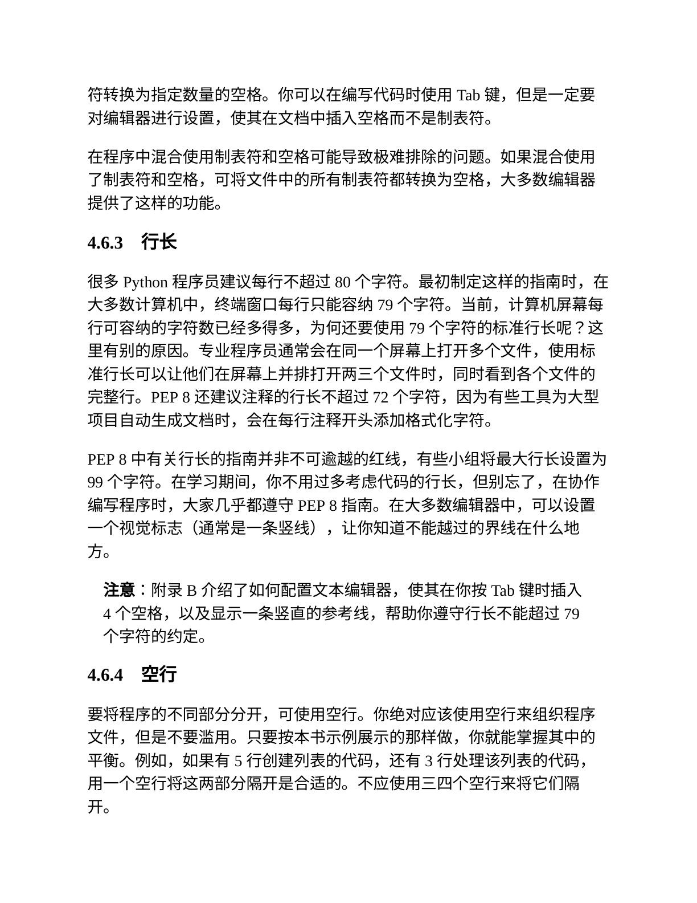

你可以在编写代码时使用 Tab 键，但是一定要对编辑器进行设置，使其在文档中插入空格而不是制表符。

在程序中混合使用制表符和空格可能导致极难排除的问题。如果混合使用了制表符和空格，可将文件中的所有制表符都转换为空格，大多数编辑器提供了这样的功能。

### 4.6.3 行长

很多 Python 程序员建议每行不超过 80 个字符。最初制定这样的指南时，在大多数计算机中，终端窗口每行只能容纳 79 个字符。当前，计算机屏幕每行可容纳的字符数已经多得多，为何还要使用 79 个字符的标准行长呢？这里有别的原因。专业程序员通常会在同一个屏幕上打开多个文件，使用标准行长可以让他们在屏幕上并排打开两三个文件时，同时看到各个文件的完整行。PEP 8 还建议注释的行长不超过 72 个字符，因为有些工具为大型项目自动生成文档时，会在每行注释开头添加格式化字符。

PEP 8 中有关行长的指南并非不可逾越的红线，有些小组将最大行长设置为 99 个字符。在学习期间，你不用过多考虑代码的行长，但别忘了，在协作编写程序时，大家几乎都遵守 PEP 8 指南。在大多数编辑器中，可以设置一个视觉标志（通常是一条竖线），让你知道不能越过的界线在什么地方。

**注意：**附录 B 介绍了如何配置文本编辑器，使其在你按 Tab 键时插入 4 个空格，以及显示一条竖直的参考线，帮助你遵守行长不能超过 79 个字符的约定。

### 4.6.4 空行

要将程序的不同部分分开，可使用空行。你绝对应该使用空行来组织程序文件，但是不要滥用。只要按本书示例展示的那样做，你就能掌握其中的平衡。例如，如果有 5 行创建列表的代码，还有 3 行处理该列表的代码，用一个空行将这两部分隔开是合适的。不应使用三四个空行来将它们隔开。

## PDF 第 134 页

<!-- page-status: reviewed -->
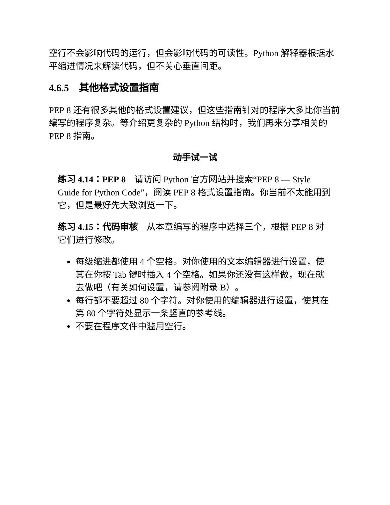

空行不会影响代码的运行，但会影响代码的可读性。Python 解释器根据水平缩进情况来解读代码，但不关心垂直间距。

### 4.6.5 其他格式设置指南

PEP 8 还有很多其他的格式设置建议，但这些指南针对的程序大多比你当前编写的程序复杂。等介绍更复杂的 Python 结构时，我们再来分享相关的 PEP 8 指南。

### 动手试一试

**练习 4.14：PEP 8** 请访问 Python 官方网站并搜索“PEP 8 — Style Guide for Python Code”，阅读 PEP 8 格式设置指南。你当前不太能用到它，但是最好先大致浏览一下。

**练习 4.15：代码审核** 从本章编写的程序中选择三个，根据 PEP 8 对它们进行修改。

- 每级缩进都使用 4 个空格。对你使用的文本编辑器进行设置，使其在你按 Tab 键时插入 4 个空格。如果你还没有这样做，现在就去做吧（有关如何设置，请参阅附录 B）。
- 每行都不要超过 80 个字符。对你使用的编辑器进行设置，使其在第 80 个字符处显示一条竖直的参考线。
- 不要在程序文件中滥用空行。

## PDF 第 135 页

<!-- page-status: reviewed -->
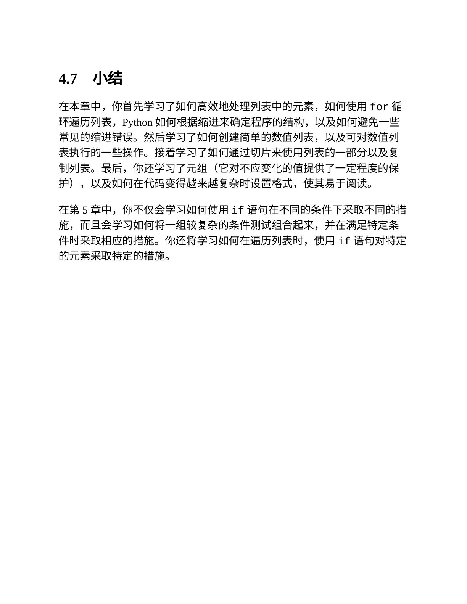

### 4.7 小结

在本章中，你首先学习了如何高效地处理列表中的元素，如何使用 `for` 循环遍历列表，Python 如何根据缩进来确定程序的结构，以及如何避免一些常见的缩进错误。然后学习了如何创建简单的数值列表，以及可对数值列表执行的一些操作。接着学习了如何通过切片来使用列表的一部分以及复制列表。最后，你还学习了元组（它对不应变化的值提供了一定程度的保护），以及如何在代码变得越来越复杂时设置格式，使其易于阅读。

在第 5 章中，你不仅会学习如何使用 `if` 语句在不同的条件下采取不同的措施，而且会学习如何将一组较复杂的条件测试组合起来，并在满足特定条件时采取相应的措施。你还将学习如何在遍历列表时，使用 `if` 语句对特定的元素采取特定的措施。
