# 第 5 章 if 语句

> 本章技术页已由 AI 对照原页整理为可编辑 Markdown，未经过人类逐页复核；原页图保留供检查，代码并非全部已执行。

[返回目录](README.md) | PDF 原页 136–161

## PDF 第 136 页

<!-- page-status: reviewed -->
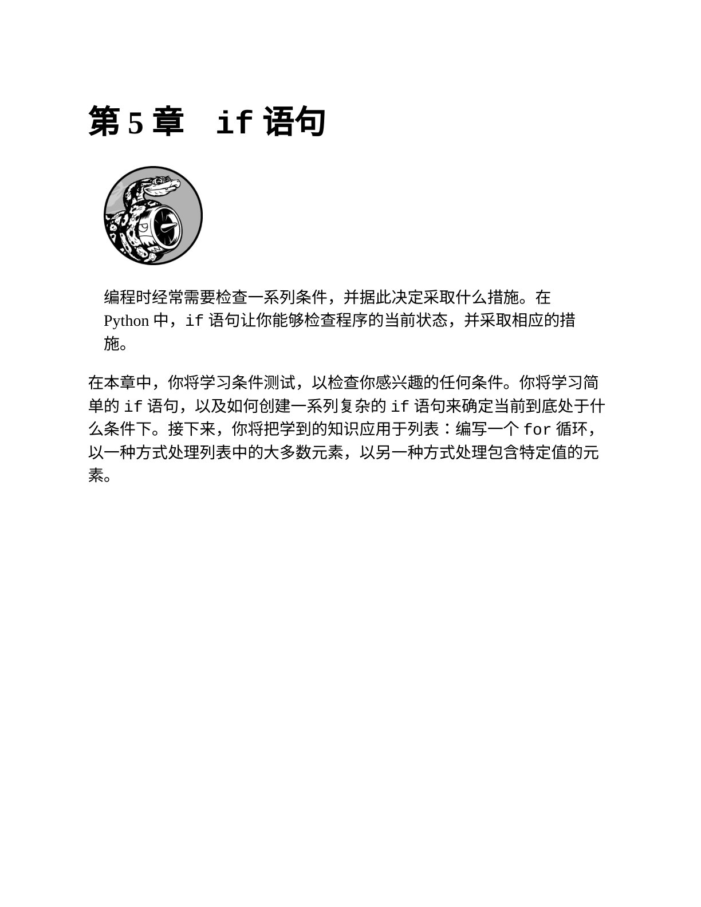

编程时经常需要检查一系列条件，并据此决定采取什么措施。在 Python 中，`if` 语句让你能够检查程序的当前状态，并采取相应的措施。

在本章中，你将学习条件测试，以检查你感兴趣的任何条件。你将学习简单的 `if` 语句，以及如何创建一系列复杂的 `if` 语句来确定当前到底处于什么条件下。接下来，你将把学到的知识应用于列表：编写一个 `for` 循环，以一种方式处理列表中的大多数元素，以另一种方式处理包含特定值的元素。

## PDF 第 137 页

<!-- page-status: reviewed -->
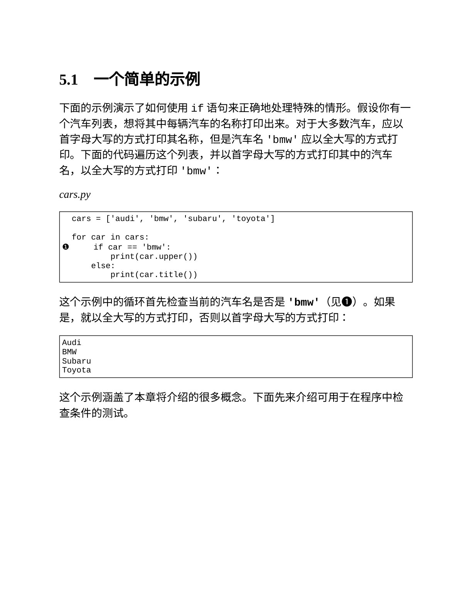

### 5.1 一个简单的示例

下面的示例演示了如何使用 `if` 语句来正确地处理特殊的情形。假设你有一个汽车列表，想将其中每辆汽车的名称打印出来。对于大多数汽车，应以首字母大写的方式打印其名称，但是汽车名 `'bmw'` 应以全大写的方式打印。下面的代码遍历这个列表，并以首字母大写的方式打印其中的汽车名，以全大写的方式打印 `'bmw'`：

`cars.py`

```python
cars = ['audi', 'bmw', 'subaru', 'toyota']

for car in cars:
    if car == 'bmw':  # ❶
        print(car.upper())
    else:
        print(car.title())
```

这个示例中的循环首先检查当前的汽车名是否是 `'bmw'`（见 ❶）。如果是，就以全大写的方式打印，否则以首字母大写的方式打印：

```text
Audi
BMW
Subaru
Toyota
```

这个示例涵盖了本章将介绍的很多概念。下面先来介绍可用于在程序中检查条件的测试。

## PDF 第 138 页

<!-- page-status: reviewed -->
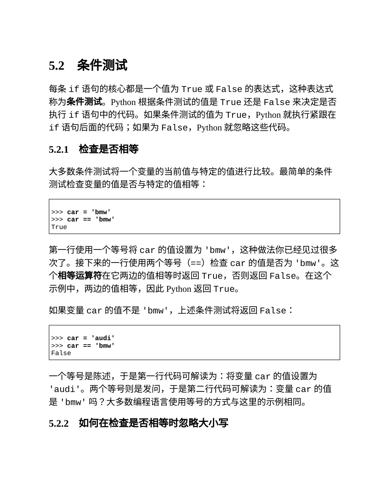

### 5.2 条件测试

每条 `if` 语句的核心都是一个值为 `True` 或 `False` 的表达式，这种表达式称为**条件测试**。Python 根据条件测试的值是 `True` 还是 `False` 来决定是否执行 `if` 语句中的代码。如果条件测试的值为 `True`，Python 就执行紧跟在 `if` 语句后面的代码；如果为 `False`，Python 就忽略这些代码。

#### 5.2.1 检查是否相等

大多数条件测试将一个变量的当前值与特定的值进行比较。最简单的条件测试检查变量的值是否与特定的值相等：

```pycon
>>> car = 'bmw'
>>> car == 'bmw'
True
```

第一行使用一个等号将 `car` 的值设置为 `'bmw'`，这种做法你已经见过很多次了。接下来的一行使用两个等号（`==`）检查 `car` 的值是否为 `'bmw'`。这个**相等运算符**在它两边的值相等时返回 `True`，否则返回 `False`。在这个示例中，两边的值相等，因此 Python 返回 `True`。

如果变量 `car` 的值不是 `'bmw'`，上述条件测试将返回 `False`：

```pycon
>>> car = 'audi'
>>> car == 'bmw'
False
```

一个等号是陈述，于是第一行代码可解读为：将变量 `car` 的值设置为 `'audi'`。两个等号则是发问，于是第二行代码可解读为：变量 `car` 的值是 `'bmw'` 吗？大多数编程语言使用等号的方式与这里的示例相同。

#### 5.2.2 如何在检查是否相等时忽略大小写

## PDF 第 139 页

<!-- page-status: reviewed -->
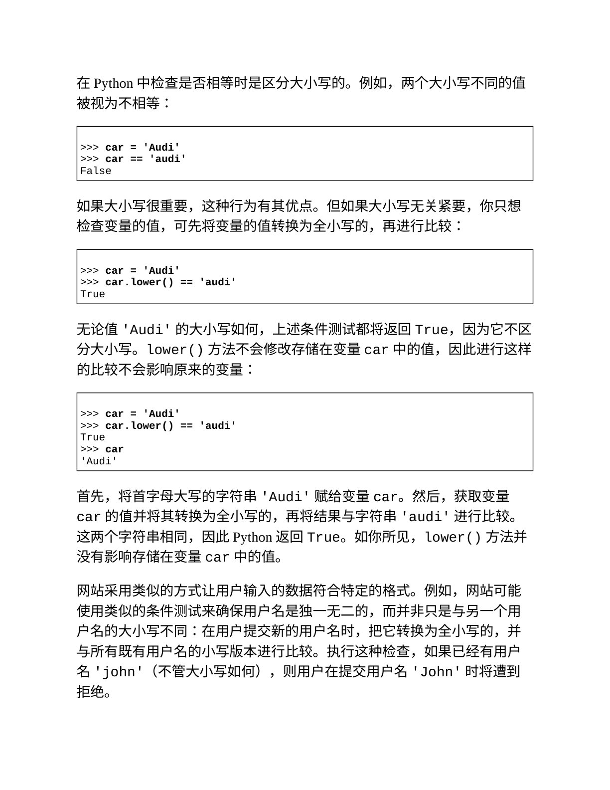

在 Python 中检查是否相等时是区分大小写的。例如，两个大小写不同的值被视为不相等：

```pycon
>>> car = 'Audi'
>>> car == 'audi'
False
```

如果大小写很重要，这种行为有其优点。但如果大小写无关紧要，你只想检查变量的值，可先将变量的值转换为全小写的，再进行比较：

```pycon
>>> car = 'Audi'
>>> car.lower() == 'audi'
True
```

无论值 `'Audi'` 的大小写如何，上述条件测试都将返回 `True`，因为它不区分大小写。`lower()` 方法不会修改存储在变量 `car` 中的值，因此进行这样的比较不会影响原来的变量：

```pycon
>>> car = 'Audi'
>>> car.lower() == 'audi'
True
>>> car
'Audi'
```

首先，将首字母大写的字符串 `'Audi'` 赋给变量 `car`。然后，获取变量 `car` 的值并将其转换为全小写的，再将结果与字符串 `'audi'` 进行比较。这两个字符串相同，因此 Python 返回 `True`。如你所见，`lower()` 方法并没有影响存储在变量 `car` 中的值。

网站采用类似的方式让用户输入的数据符合特定的格式。例如，网站可能使用类似的条件测试来确保用户名是独一无二的，而并非只是与另一个用户名的大小写不同：在用户提交新的用户名时，把它转换为全小写的，并与所有既有用户名的小写版本进行比较。执行这种检查，如果已经有用户名 `'john'`（不管大小写如何），则用户在提交用户名 `'John'` 时将遭到拒绝。

## PDF 第 140 页

<!-- page-status: reviewed -->
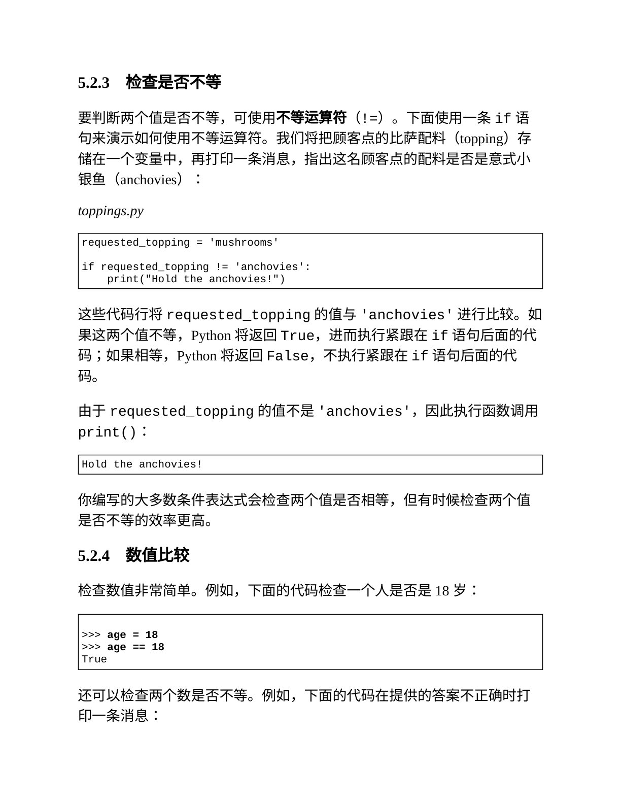

#### 5.2.3 检查是否不等

要判断两个值是否不等，可使用**不等运算符**（`!=`）。下面使用一条 `if` 语句来演示如何使用不等运算符。我们将把顾客点的比萨配料（topping）存储在一个变量中，再打印一条消息，指出这名顾客点的配料是否是意式小银鱼（anchovies）：

`toppings.py`

```python
requested_topping = 'mushrooms'

if requested_topping != 'anchovies':
    print("Hold the anchovies!")
```

这些代码行将 `requested_topping` 的值与 `'anchovies'` 进行比较。如果这两个值不等，Python 将返回 `True`，进而执行紧跟在 `if` 语句后面的代码；如果相等，Python 将返回 `False`，不执行紧跟在 `if` 语句后面的代码。

由于 `requested_topping` 的值不是 `'anchovies'`，因此执行函数调用 `print()`：

```text
Hold the anchovies!
```

你编写的大多数条件表达式会检查两个值是否相等，但有时候检查两个值是否不等的效率更高。

#### 5.2.4 数值比较

检查数值非常简单。例如，下面的代码检查一个人是否是 18 岁：

```pycon
>>> age = 18
>>> age == 18
True
```

还可以检查两个数是否不等。例如，下面的代码在提供的答案不正确时打印一条消息：

## PDF 第 141 页

<!-- page-status: reviewed -->
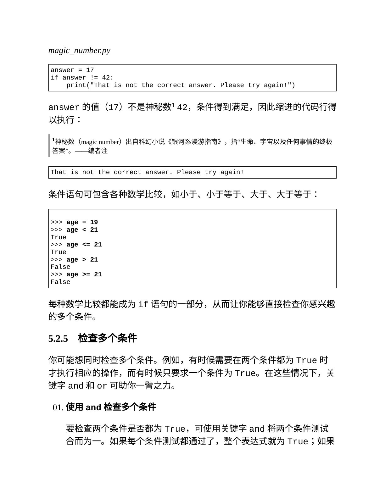

`magic_number.py`

```python
answer = 17
if answer != 42:
    print("That is not the correct answer. Please try again!")
```

`answer` 的值（17）不是神秘数 42，条件得到满足，因此缩进的代码行得以执行：

```text
That is not the correct answer. Please try again!
```

条件语句可包含各种数学比较，如小于、小于等于、大于、大于等于：

```pycon
>>> age = 19
>>> age < 21
True
>>> age <= 21
True
>>> age > 21
False
>>> age >= 21
False
```

每种数学比较都能成为 `if` 语句的一部分，从而让你能够直接检查你感兴趣的多个条件。

#### 5.2.5 检查多个条件

你可能想同时检查多个条件。例如，有时候需要在两个条件都为 `True` 时才执行相应的操作，而有时候只要求一个条件为 `True`。在这些情况下，关键字 `and` 和 `or` 可助你一臂之力。

**01. 使用 `and` 检查多个条件**

要检查两个条件是否都为 `True`，可使用关键字 `and` 将两个条件测试合而为一。如果每个条件测试都通过了，整个表达式就为 `True`；如果


## PDF 第 142 页

<!-- page-status: reviewed -->
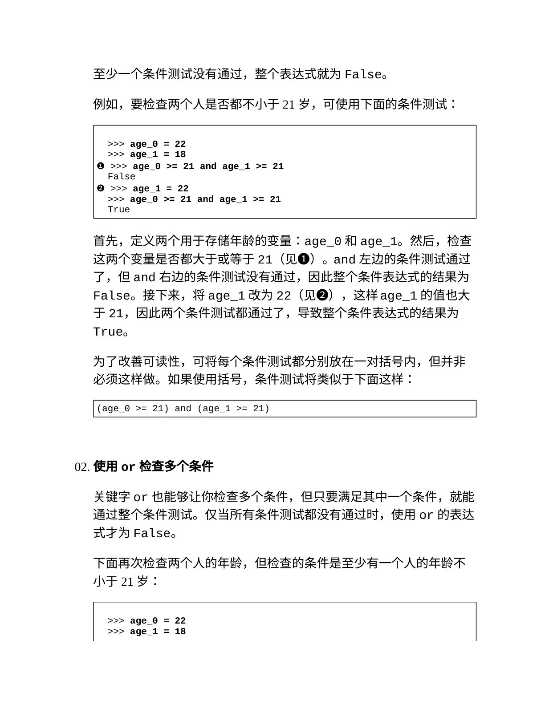

至少一个条件测试没有通过，整个表达式就为 `False`。

例如，要检查两个人是否都不小于 21 岁，可使用下面的条件测试：

```pycon
>>> age_0 = 22
>>> age_1 = 18
>>> age_0 >= 21 and age_1 >= 21
False
>>> age_1 = 22
>>> age_0 >= 21 and age_1 >= 21
True
```

原书标注：❶ 为第一次比较，❷ 为将 `age_1` 设为 22。

首先，定义两个用于存储年龄的变量：`age_0` 和 `age_1`。然后，检查这两个变量是否都大于或等于 21（见❶）。`and` 左边的条件测试通过了，但 `and` 右边的条件测试没有通过，因此整个条件表达式的结果为 `False`。接下来，将 `age_1` 改为 22（见❷），这样 `age_1` 的值也大于 21，因此两个条件测试都通过了，导致整个条件表达式的结果为 `True`。

为了改善可读性，可将每个条件测试都分别放在一对括号内，但并非必须这样做。如果使用括号，条件测试将类似于下面这样：

```python
(age_0 >= 21) and (age_1 >= 21)
```

#### 2. 使用 or 检查多个条件

关键字 `or` 也能够让你检查多个条件，但只要满足其中一个条件，就能通过整个条件测试。仅当所有条件测试都没有通过时，使用 `or` 的表达式才为 `False`。

下面再次检查两个人的年龄，但检查的条件是至少有一个人的年龄不小于 21 岁：

```pycon
>>> age_0 = 22
>>> age_1 = 18
```

（交互过程续下一页。）

## PDF 第 143 页

<!-- page-status: reviewed -->
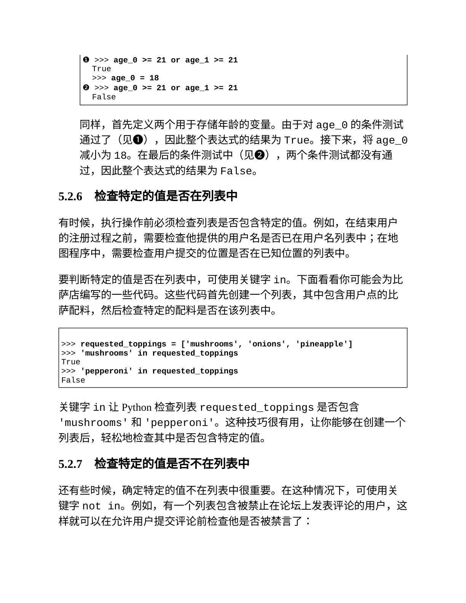

（接上一页的交互过程。）

```pycon
>>> age_0 >= 21 or age_1 >= 21
True
>>> age_0 = 18
>>> age_0 >= 21 or age_1 >= 21
False
```

原书标注：❶ 和 ❷ 分别为两次 `or` 比较。

同样，首先定义两个用于存储年龄的变量。由于对 `age_0` 的条件测试通过了（见❶），因此整个表达式的结果为 `True`。接下来，将 `age_0` 减小为 18。在最后的条件测试中（见❷），两个条件测试都没有通过，因此整个表达式的结果为 `False`。

### 5.2.6 检查特定的值是否在列表中

有时候，执行操作前必须检查列表是否包含特定的值。例如，在结束用户的注册过程之前，需要检查他提供的用户名是否已在用户名列表中；在地图程序中，需要检查用户提交的位置是否在已知位置的列表中。

要判断特定的值是否在列表中，可使用关键字 `in`。下面看看你可能会为比萨店编写的一些代码。这些代码首先创建一个列表，其中包含用户点的比萨配料，然后检查特定的配料是否在该列表中。

```pycon
>>> requested_toppings = ['mushrooms', 'onions', 'pineapple']
>>> 'mushrooms' in requested_toppings
True
>>> 'pepperoni' in requested_toppings
False
```

关键字 `in` 让 Python 检查列表 `requested_toppings` 是否包含 `'mushrooms'` 和 `'pepperoni'`。这种技巧很有用，让你能够在创建一个列表后，轻松地检查其中是否包含特定的值。

### 5.2.7 检查特定的值是否不在列表中

还有些时候，确定特定的值不在列表中很重要。在这种情况下，可使用关键字 `not in`。例如，有一个列表包含被禁止在论坛上发表评论的用户，这样就可以在允许用户提交评论前检查他是否被禁言了：

## PDF 第 144 页

<!-- page-status: reviewed -->
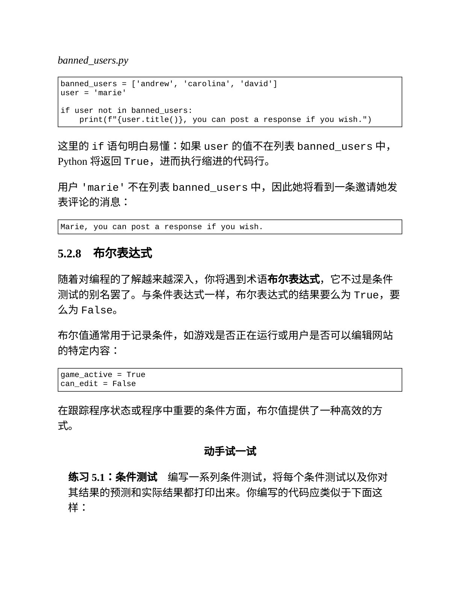

`banned_users.py`

```python
banned_users = ['andrew', 'carolina', 'david']
user = 'marie'

if user not in banned_users:
    print(f"{user.title()}, you can post a response if you wish.")
```

这里的 `if` 语句明白易懂：如果 `user` 的值不在列表 `banned_users` 中，Python 将返回 `True`，进而执行缩进的代码行。

用户 `'marie'` 不在列表 `banned_users` 中，因此她将看到一条邀请她发表评论的消息：

```text
Marie, you can post a response if you wish.
```

### 5.2.8 布尔表达式

随着对编程的了解越来越深入，你将遇到术语布尔表达式，它不过是条件测试的别名罢了。与条件表达式一样，布尔表达式的结果要么为 `True`，要么为 `False`。

布尔值通常用于记录条件，如游戏是否正在运行或用户是否可以编辑网站的特定内容：

```python
game_active = True
can_edit = False
```

在跟踪程序状态或程序中重要的条件方面，布尔值提供了一种高效的方式。

### 动手试一试

**练习 5.1：条件测试** 编写一系列条件测试，将每个条件测试以及你对其结果的预测和实际结果都打印出来。你编写的代码应类似于下面这样（代码续下一页）：

## PDF 第 145 页

<!-- page-status: reviewed -->
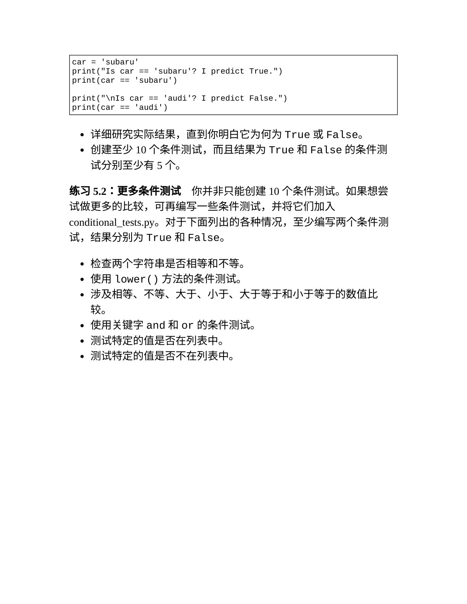

```python
car = 'subaru'
print("Is car == 'subaru'? I predict True.")
print(car == 'subaru')

print("\nIs car == 'audi'? I predict False.")
print(car == 'audi')
```

- 详细研究实际结果，直到你明白它为何为 `True` 或 `False`。
- 创建至少 10 个条件测试，而且结果为 `True` 和 `False` 的条件测试分别至少有 5 个。

**练习 5.2：更多条件测试** 你并非只能创建 10 个条件测试。如果想尝试做更多的比较，可再编写一些条件测试，并将它们加入 `conditional_tests.py`。对于下面列出的各种情况，至少编写两个条件测试，结果分别为 `True` 和 `False`。

- 检查两个字符串是否相等和不等。
- 使用 `lower()` 方法的条件测试。
- 涉及相等、不等、大于、小于、大于等于和小于等于的数值比较。
- 使用关键字 `and` 和 `or` 的条件测试。
- 测试特定的值是否在列表中。
- 测试特定的值是否不在列表中。

## PDF 第 146 页

<!-- page-status: reviewed -->
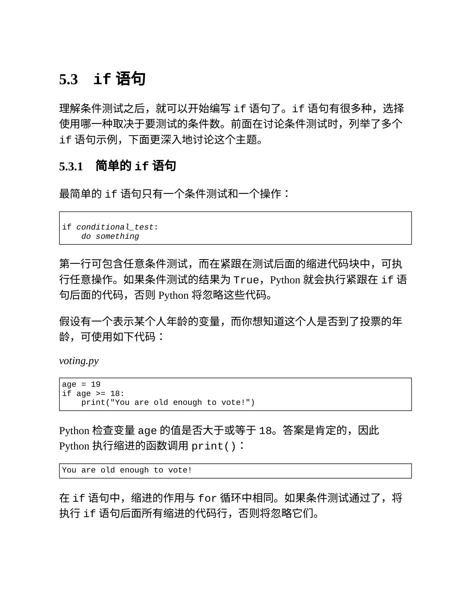

### 5.3 if 语句

理解条件测试之后，就可以开始编写 `if` 语句了。`if` 语句有很多种，选择使用哪一种取决于要测试的条件数。前面在讨论条件测试时，列举了多个 `if` 语句示例，下面更深入地讨论这个主题。

### 5.3.1 简单的 if 语句

最简单的 `if` 语句只有一个条件测试和一个操作：

```text
if conditional_test:
    do something
```

第一行可包含任意条件测试，而在紧跟在测试后面的缩进代码块中，可执行任意操作。如果条件测试的结果为 `True`，Python 就会执行紧跟在 `if` 语句后面的代码，否则 Python 将忽略这些代码。

假设有一个表示某个人年龄的变量，而你想知道这个人是否到了投票的年龄，可使用如下代码：

`voting.py`

```python
age = 19
if age >= 18:
    print("You are old enough to vote!")
```

Python 检查变量 `age` 的值是否大于或等于 18。答案是肯定的，因此 Python 执行缩进的函数调用 `print()`：

```text
You are old enough to vote!
```

在 `if` 语句中，缩进的作用与 `for` 循环中相同。如果条件测试通过了，将执行 `if` 语句后面所有缩进的代码行，否则将忽略它们。

## PDF 第 147 页

<!-- page-status: reviewed -->
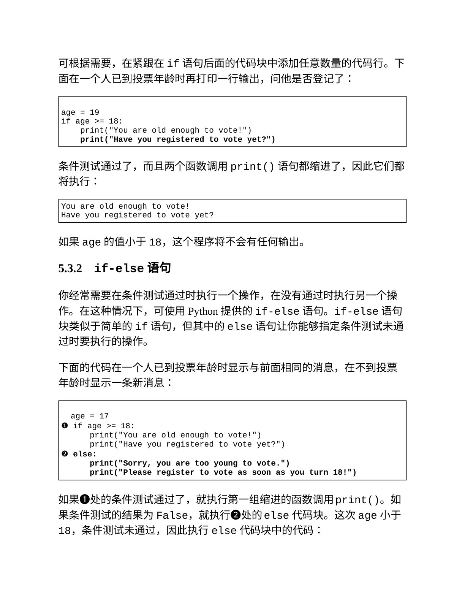

可根据需要，在紧跟在 `if` 语句后面的代码块中添加任意数量的代码行。下面在一个人已到投票年龄时再打印一行输出，问他是否登记了：

```python
age = 19
if age >= 18:
    print("You are old enough to vote!")
    print("Have you registered to vote yet?")
```

条件测试通过了，而且两个函数调用 `print()` 语句都缩进了，因此它们都将执行：

```text
You are old enough to vote!
Have you registered to vote yet?
```

如果 `age` 的值小于 18，这个程序将不会有任何输出。

### 5.3.2 if-else 语句

你经常需要在条件测试通过时执行一个操作，在没有通过时执行另一个操作。在这种情况下，可使用 Python 提供的 `if-else` 语句。`if-else` 语句块类似于简单的 `if` 语句，但其中的 `else` 语句让你能够指定条件测试未通过时要执行的操作。

下面的代码在一个人已到投票年龄时显示与前面相同的消息，在不到投票年龄时显示一条新消息：

```python
age = 17
if age >= 18:
    print("You are old enough to vote!")
    print("Have you registered to vote yet?")
else:
    print("Sorry, you are too young to vote.")
    print("Please register to vote as soon as you turn 18!")
```

原书标注：❶ 为 `if age >= 18:`，❷ 为 `else:`。

如果❶处的条件测试通过了，就执行第一组缩进的函数调用 `print()`。如果条件测试的结果为 `False`，就执行❷处的 `else` 代码块。这次 `age` 小于 18，条件测试未通过，因此执行 `else` 代码块中的代码（输出续下一页）：

## PDF 第 148 页

<!-- page-status: reviewed -->
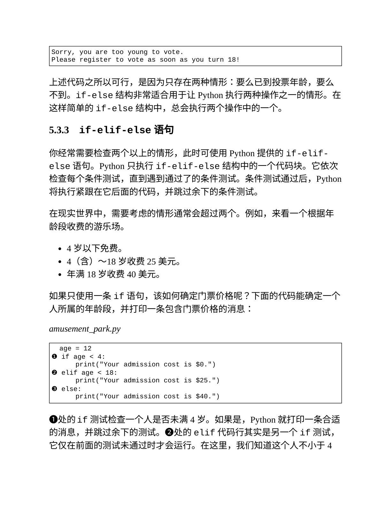

```text
Sorry, you are too young to vote.
Please register to vote as soon as you turn 18!
```

上述代码之所以可行，是因为只存在两种情形：要么已到投票年龄，要么不到。`if-else` 结构非常适合用于让 Python 执行两种操作之一的情形。在这样简单的 `if-else` 结构中，总会执行两个操作中的一个。

### 5.3.3 if-elif-else 语句

你经常需要检查两个以上的情形，此时可使用 Python 提供的 `if-elif-else` 语句。Python 只执行 `if-elif-else` 结构中的一个代码块。它依次检查每个条件测试，直到遇到通过了的条件测试。条件测试通过后，Python 将执行紧跟在它后面的代码，并跳过余下的条件测试。

在现实世界中，需要考虑的情形通常会超过两个。例如，来看一个根据年龄段收费的游乐场。

- 4 岁以下免费。
- 4（含）～18 岁收费 25 美元。
- 年满 18 岁收费 40 美元。

如果只使用一条 `if` 语句，该如何确定门票价格呢？下面的代码能确定一个人所属的年龄段，并打印一条包含门票价格的消息：

`amusement_park.py`

```python
age = 12
if age < 4:
    print("Your admission cost is $0.")
elif age < 18:
    print("Your admission cost is $25.")
else:
    print("Your admission cost is $40.")
```

原书标注：❶ 为 `if` 分支，❷ 为 `elif` 分支，❸ 为 `else` 分支。

❶处的 `if` 测试检查一个人是否未满 4 岁。如果是，Python 就打印一条合适的消息，并跳过余下的测试。❷处的 `elif` 代码行其实是另一个 `if` 测试，它仅在前面的测试未通过时才会运行。在这里，我们知道这个人不小于 4（续下一页）。

## PDF 第 149 页

<!-- page-status: reviewed -->
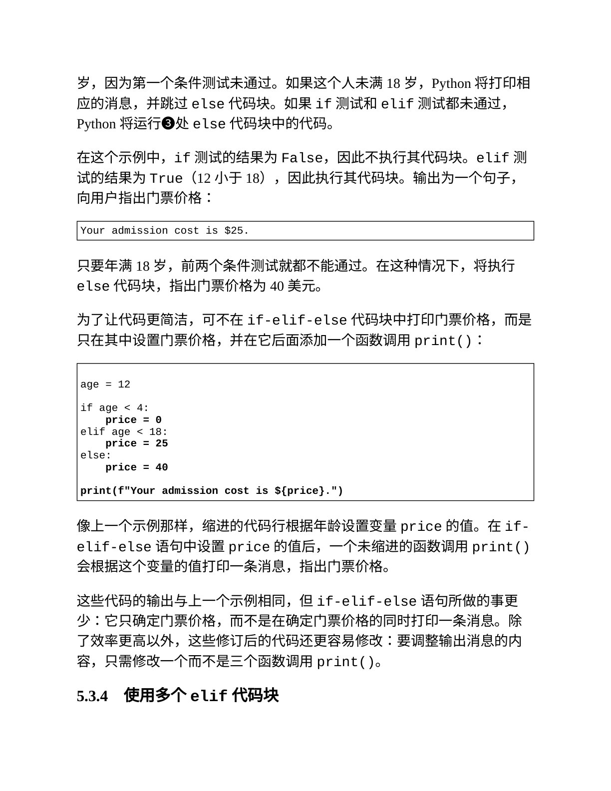

岁，因为第一个条件测试未通过。如果这个人未满 18 岁，Python 将打印相应的消息，并跳过 `else` 代码块。如果 `if` 测试和 `elif` 测试都未通过，Python 将运行❸处 `else` 代码块中的代码。

在这个示例中，`if` 测试的结果为 `False`，因此不执行其代码块。`elif` 测试的结果为 `True`（12 小于 18），因此执行其代码块。输出为一个句子，向用户指出门票价格：

```text
Your admission cost is $25.
```

只要年满 18 岁，前两个条件测试就都不能通过。在这种情况下，将执行 `else` 代码块，指出门票价格为 40 美元。

为了让代码更简洁，可不在 `if-elif-else` 代码块中打印门票价格，而是只在其中设置门票价格，并在它后面添加一个函数调用 `print()`：

```python
age = 12

if age < 4:
    price = 0
elif age < 18:
    price = 25
else:
    price = 40

print(f"Your admission cost is ${price}.")
```

像上一个示例那样，缩进的代码行根据年龄设置变量 `price` 的值。在 `if-elif-else` 语句中设置 `price` 的值后，一个未缩进的函数调用 `print()` 会根据这个变量的值打印一条消息，指出门票价格。

这些代码的输出与上一个示例相同，但 `if-elif-else` 语句所做的事更少：它只确定门票价格，而不是在确定门票价格的同时打印一条消息。除了效率更高以外，这些修订后的代码还更容易修改：要调整输出消息的内容，只需修改一个而不是三个函数调用 `print()`。

#### 5.3.4 使用多个 `elif` 代码块

## PDF 第 150 页

<!-- page-status: reviewed -->
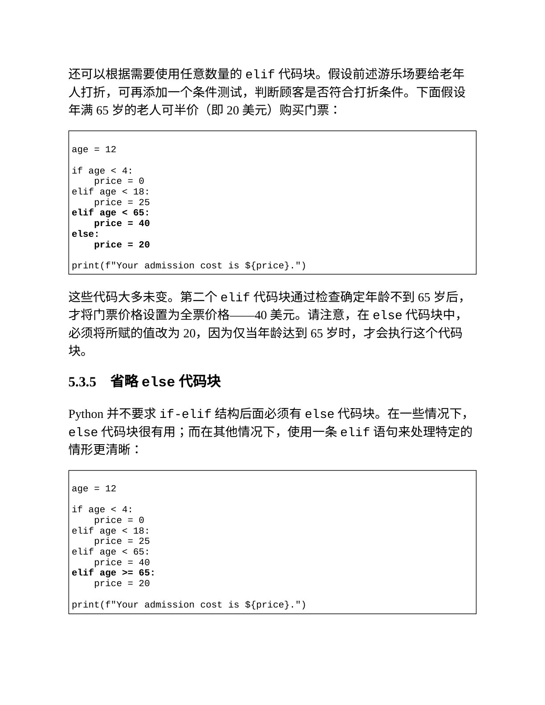

还可以根据需要使用任意数量的 `elif` 代码块。假设前述游乐场要给老年人打折，可再添加一个条件测试，判断顾客是否符合打折条件。下面假设年满 65 岁的老人可半价（即 20 美元）购买门票：

```python
age = 12

if age < 4:
    price = 0
elif age < 18:
    price = 25
elif age < 65:
    price = 40
else:
    price = 20

print(f"Your admission cost is ${price}.")
```

这些代码大多未变。第二个 `elif` 代码块通过检查确定年龄不到 65 岁后，才将门票价格设置为全票价格——40 美元。请注意，在 `else` 代码块中，必须将所赋的值改为 20，因为仅当年龄达到 65 岁时，才会执行这个代码块。

#### 5.3.5 省略 `else` 代码块

Python 并不要求 `if-elif` 结构后面必须有 `else` 代码块。在一些情况下，`else` 代码块很有用；而在其他情况下，使用一条 `elif` 语句来处理特定的情形更清晰：

```python
age = 12

if age < 4:
    price = 0
elif age < 18:
    price = 25
elif age < 65:
    price = 40
elif age >= 65:
    price = 20

print(f"Your admission cost is ${price}.")
```

## PDF 第 151 页

<!-- page-status: reviewed -->
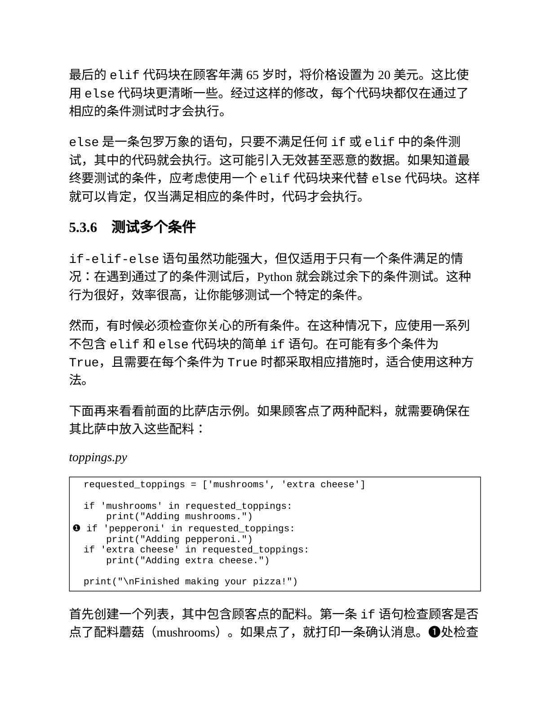

最后的 `elif` 代码块在顾客年满 65 岁时，将价格设置为 20 美元。这比使用 `else` 代码块更清晰一些。经过这样的修改，每个代码块都仅在通过了相应的条件测试时才会执行。

`else` 是一条包罗万象的语句，只要不满足任何 `if` 或 `elif` 中的条件测试，其中的代码就会执行。这可能引入无效甚至恶意的数据。如果知道最终要测试的条件，应考虑使用一个 `elif` 代码块来代替 `else` 代码块。这样就可以肯定，仅当满足相应的条件时，代码才会执行。

#### 5.3.6 测试多个条件

`if-elif-else` 语句虽然功能强大，但仅适用于只有一个条件满足的情况：在遇到通过了的条件测试后，Python 就会跳过余下的条件测试。这种行为很好，效率很高，让你能够测试一个特定的条件。

然而，有时候必须检查你关心的所有条件。在这种情况下，应使用一系列不包含 `elif` 和 `else` 代码块的简单 `if` 语句。在可能有多个条件为 `True`，且需要在每个条件为 `True` 时都采取相应措施时，适合使用这种方法。

下面再来看看前面的比萨店示例。如果顾客点了两种配料，就需要确保在其比萨中放入这些配料：

`toppings.py`

```python
requested_toppings = ['mushrooms', 'extra cheese']

if 'mushrooms' in requested_toppings:
    print("Adding mushrooms.")
if 'pepperoni' in requested_toppings:  # ❶
    print("Adding pepperoni.")
if 'extra cheese' in requested_toppings:
    print("Adding extra cheese.")

print("\nFinished making your pizza!")
```

首先创建一个列表，其中包含顾客点的配料。第一条 `if` 语句检查顾客是否点了配料蘑菇（mushrooms）。如果点了，就打印一条确认消息。❶处检查

## PDF 第 152 页

<!-- page-status: reviewed -->
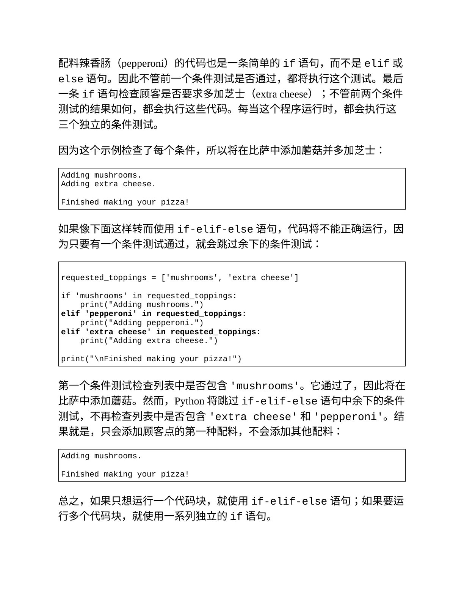

配料辣香肠（pepperoni）的代码也是一条简单的 `if` 语句，而不是 `elif` 或 `else` 语句。因此不管前一个条件测试是否通过，都将执行这个测试。最后一条 `if` 语句检查顾客是否要求多加芝士（extra cheese）；不管前两个条件测试的结果如何，都会执行这些代码。每当这个程序运行时，都会执行这三个独立的条件测试。

因为这个示例检查了每个条件，所以将在比萨中添加蘑菇并多加芝士：

```text
Adding mushrooms.
Adding extra cheese.

Finished making your pizza!
```

如果像下面这样转而使用 `if-elif-else` 语句，代码将不能正确运行，因为只要有一个条件测试通过，就会跳过余下的条件测试：

```python
requested_toppings = ['mushrooms', 'extra cheese']

if 'mushrooms' in requested_toppings:
    print("Adding mushrooms.")
elif 'pepperoni' in requested_toppings:
    print("Adding pepperoni.")
elif 'extra cheese' in requested_toppings:
    print("Adding extra cheese.")

print("\nFinished making your pizza!")
```

第一个条件测试检查列表中是否包含 `'mushrooms'`。它通过了，因此将在比萨中添加蘑菇。然而，Python 将跳过 `if-elif-else` 语句中余下的条件测试，不再检查列表中是否包含 `'extra cheese'` 和 `'pepperoni'`。结果就是，只会添加顾客点的第一种配料，不会添加其他配料：

```text
Adding mushrooms.

Finished making your pizza!
```

总之，如果只想运行一个代码块，就使用 `if-elif-else` 语句；如果要运行多个代码块，就使用一系列独立的 `if` 语句。

## PDF 第 153 页

<!-- page-status: reviewed -->
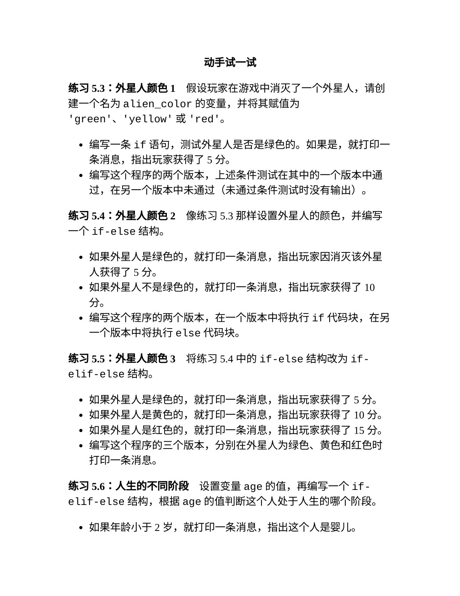

### 动手试一试

**练习 5.3：外星人颜色 1** 假设玩家在游戏中消灭了一个外星人，请创建一个名为 `alien_color` 的变量，并将其赋值为 `'green'`、`'yellow'` 或 `'red'`。

- 编写一条 `if` 语句，测试外星人是否是绿色的。如果是，就打印一条消息，指出玩家获得了 5 分。
- 编写这个程序的两个版本，上述条件测试在其中的一个版本中通过，在另一个版本中未通过（未通过条件测试时没有输出）。

**练习 5.4：外星人颜色 2** 像练习 5.3 那样设置外星人的颜色，并编写一个 `if-else` 结构。

- 如果外星人是绿色的，就打印一条消息，指出玩家因消灭该外星人获得了 5 分。
- 如果外星人不是绿色的，就打印一条消息，指出玩家获得了 10 分。
- 编写这个程序的两个版本，在一个版本中将执行 `if` 代码块，在另一个版本中将执行 `else` 代码块。

**练习 5.5：外星人颜色 3** 将练习 5.4 中的 `if-else` 结构改为 `if-elif-else` 结构。

- 如果外星人是绿色的，就打印一条消息，指出玩家获得了 5 分。
- 如果外星人是黄色的，就打印一条消息，指出玩家获得了 10 分。
- 如果外星人是红色的，就打印一条消息，指出玩家获得了 15 分。
- 编写这个程序的三个版本，分别在外星人为绿色、黄色和红色时打印一条消息。

**练习 5.6：人生的不同阶段** 设置变量 `age` 的值，再编写一个 `if-elif-else` 结构，根据 `age` 的值判断这个人处于人生的哪个阶段。

- 如果年龄小于 2 岁，就打印一条消息，指出这个人是婴儿。

## PDF 第 154 页

<!-- page-status: reviewed -->
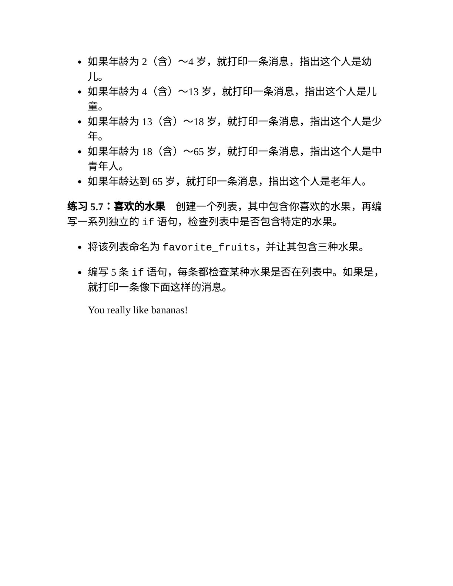

- 如果年龄为 2（含）～4 岁，就打印一条消息，指出这个人是幼儿。
- 如果年龄为 4（含）～13 岁，就打印一条消息，指出这个人是儿童。
- 如果年龄为 13（含）～18 岁，就打印一条消息，指出这个人是少年。
- 如果年龄为 18（含）～65 岁，就打印一条消息，指出这个人是中青年人。
- 如果年龄达到 65 岁，就打印一条消息，指出这个人是老年人。

**练习 5.7：喜欢的水果** 创建一个列表，其中包含你喜欢的水果，再编写一系列独立的 `if` 语句，检查列表中是否包含特定的水果。

- 将该列表命名为 `favorite_fruits`，并让其包含三种水果。
- 编写 5 条 `if` 语句，每条都检查某种水果是否在列表中。如果是，就打印一条像下面这样的消息。

  ```text
  You really like bananas!
  ```

## PDF 第 155 页

<!-- page-status: reviewed -->
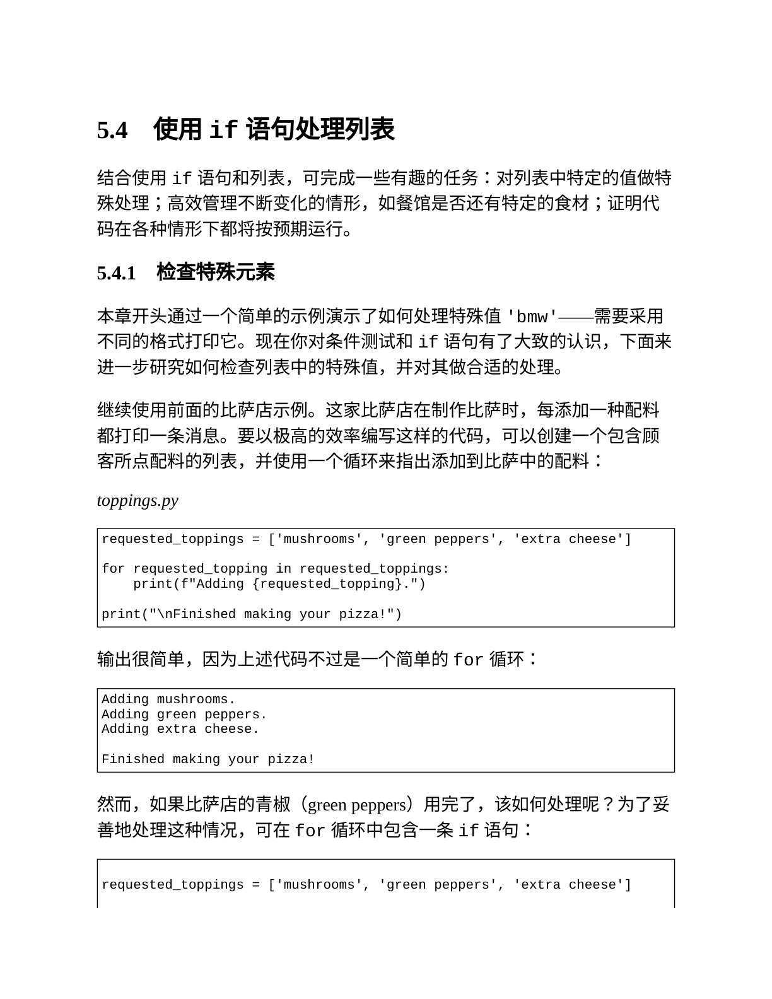

### 5.4 使用 `if` 语句处理列表

结合使用 `if` 语句和列表，可完成一些有趣的任务：对列表中特定的值做特殊处理；高效管理不断变化的情形，如餐馆是否还有特定的食材；证明代码在各种情形下都将按预期运行。

#### 5.4.1 检查特殊元素

本章开头通过一个简单的示例演示了如何处理特殊值 `'bmw'`——需要采用不同的格式打印它。现在你对条件测试和 `if` 语句有了大致的认识，下面来进一步研究如何检查列表中的特殊值，并对其做合适的处理。

继续使用前面的比萨店示例。这家比萨店在制作比萨时，每添加一种配料都打印一条消息。要以极高的效率编写这样的代码，可以创建一个包含顾客所点配料的列表，并使用一个循环来指出添加到比萨中的配料：

`toppings.py`

```python
requested_toppings = ['mushrooms', 'green peppers', 'extra cheese']

for requested_topping in requested_toppings:
    print(f"Adding {requested_topping}.")

print("\nFinished making your pizza!")
```

输出很简单，因为上述代码不过是一个简单的 `for` 循环：

```text
Adding mushrooms.
Adding green peppers.
Adding extra cheese.

Finished making your pizza!
```

然而，如果比萨店的青椒（green peppers）用完了，该如何处理呢？为了妥善地处理这种情况，可在 `for` 循环中包含一条 `if` 语句：

```python
requested_toppings = ['mushrooms', 'green peppers', 'extra cheese']
```

*代码续见下一页。*

## PDF 第 156 页

<!-- page-status: reviewed -->
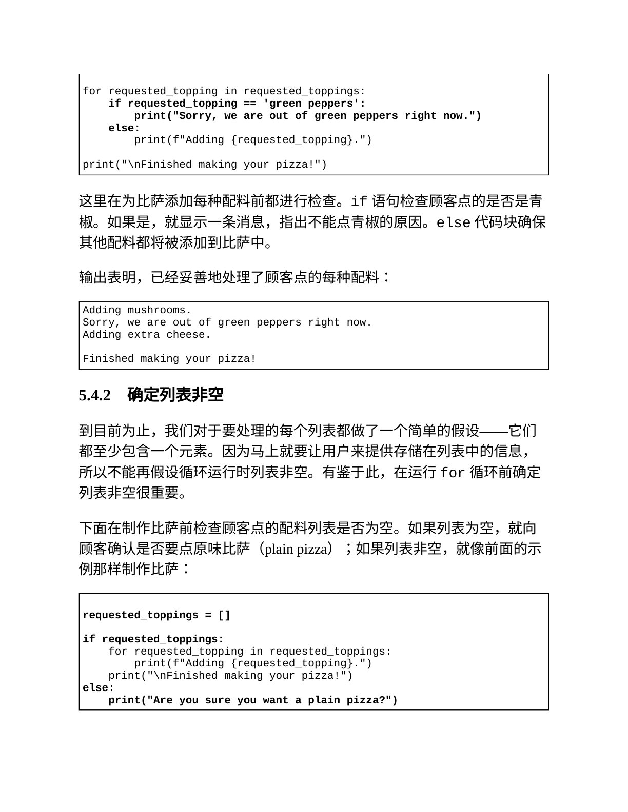

上页的代码在此页继续。以下为跨页示例的完整代码：

```python
requested_toppings = ['mushrooms', 'green peppers', 'extra cheese']

for requested_topping in requested_toppings:
    if requested_topping == 'green peppers':
        print("Sorry, we are out of green peppers right now.")
    else:
        print(f"Adding {requested_topping}.")

print("\nFinished making your pizza!")
```

这里在为比萨添加每种配料前都进行检查。`if` 语句检查顾客点的是否是青椒。如果是，就显示一条消息，指出不能点青椒的原因。`else` 代码块确保其他配料都将被添加到比萨中。

输出表明，已经妥善地处理了顾客点的每种配料：

```text
Adding mushrooms.
Sorry, we are out of green peppers right now.
Adding extra cheese.

Finished making your pizza!
```

#### 5.4.2 确定列表非空

到目前为止，我们对于要处理的每个列表都做了一个简单的假设——它们都至少包含一个元素。因为马上就要让用户来提供存储在列表中的信息，所以不能再假设循环运行时列表非空。有鉴于此，在运行 `for` 循环前确定列表非空很重要。

下面在制作比萨前检查顾客点的配料列表是否为空。如果列表为空，就向顾客确认是否要点原味比萨（plain pizza）；如果列表非空，就像前面的示例那样制作比萨：

```python
requested_toppings = []

if requested_toppings:
    for requested_topping in requested_toppings:
        print(f"Adding {requested_topping}.")
    print("\nFinished making your pizza!")
else:
    print("Are you sure you want a plain pizza?")
```

## PDF 第 157 页

<!-- page-status: reviewed -->
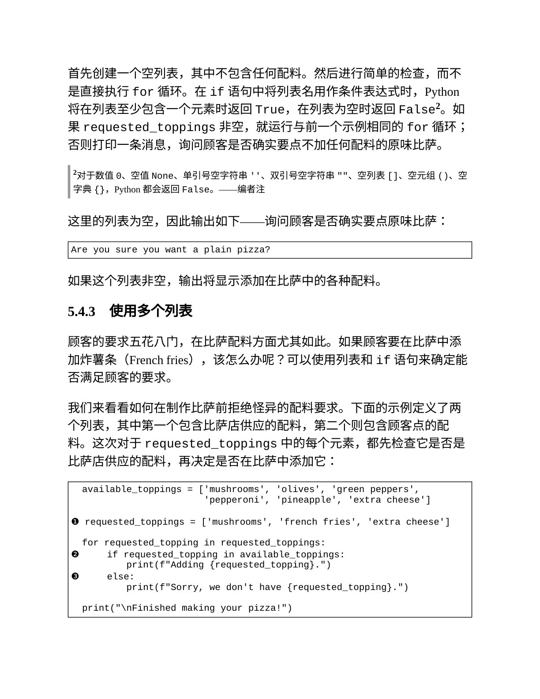

首先创建一个空列表，其中不包含任何配料。然后进行简单的检查，而不是直接执行 `for` 循环。在 `if` 语句中将列表名用作条件表达式时，Python 将在列表至少包含一个元素时返回 `True`，在列表为空时返回 `False`。如果 `requested_toppings` 非空，就运行与前一个示例相同的 `for` 循环；否则打印一条消息，询问顾客是否确实要点不加任何配料的原味比萨。

> 编者注：对于数值 `0`、空值 `None`、单引号空字符串 `''`、双引号空字符串 `""`、空列表 `[]`、空元组 `()`、空字典 `{}`，Python 都会返回 `False`。

这里的列表为空，因此输出如下——询问顾客是否确实要点原味比萨：

```text
Are you sure you want a plain pizza?
```

如果这个列表非空，输出将显示添加在比萨中的各种配料。

#### 5.4.3 使用多个列表

顾客的要求五花八门，在比萨配料方面尤其如此。如果顾客要在比萨中添加炸薯条（French fries），该怎么办呢？可以使用列表和 `if` 语句来确定能否满足顾客的要求。

我们来看看如何在制作比萨前拒绝怪异的配料要求。下面的示例定义了两个列表，其中第一个包含比萨店供应的配料，第二个则包含顾客点的配料。这次对于 `requested_toppings` 中的每个元素，都先检查它是否是比萨店供应的配料，再决定是否在比萨中添加它：

```python
available_toppings = ['mushrooms', 'olives', 'green peppers',
                      'pepperoni', 'pineapple', 'extra cheese']

requested_toppings = ['mushrooms', 'french fries', 'extra cheese']  # ❶

for requested_topping in requested_toppings:
    if requested_topping in available_toppings:  # ❷
        print(f"Adding {requested_topping}.")
    else:  # ❸
        print(f"Sorry, we don't have {requested_topping}.")

print("\nFinished making your pizza!")
```

## PDF 第 158 页

<!-- page-status: reviewed -->
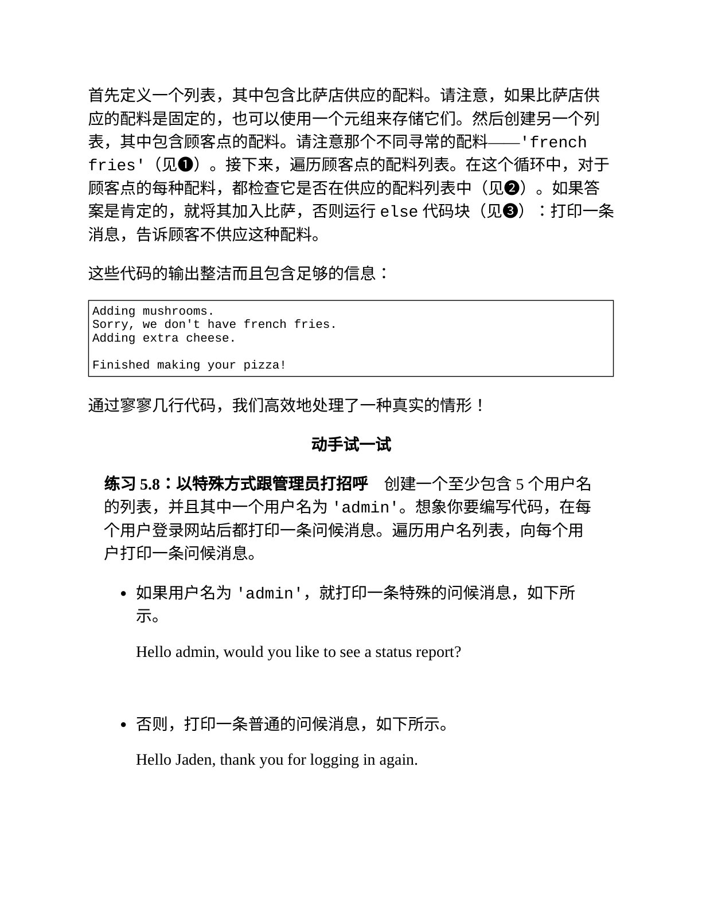

首先定义一个列表，其中包含比萨店供应的配料。请注意，如果比萨店供应的配料是固定的，也可以使用一个元组来存储它们。然后创建另一个列表，其中包含顾客点的配料。请注意那个不同寻常的配料——`'french fries'`（见❶）。接下来，遍历顾客点的配料列表。在这个循环中，对于顾客点的每种配料，都检查它是否在供应的配料列表中（见❷）。如果答案是肯定的，就将其加入比萨，否则运行 `else` 代码块（见❸）：打印一条消息，告诉顾客不供应这种配料。

这些代码的输出整洁而且包含足够的信息：

```text
Adding mushrooms.
Sorry, we don't have french fries.
Adding extra cheese.

Finished making your pizza!
```

通过寥寥几行代码，我们高效地处理了一种真实的情形！

### 动手试一试

**练习 5.8：以特殊方式跟管理员打招呼**　创建一个至少包含 5 个用户名的列表，并且其中一个用户名为 `'admin'`。想象你要编写代码，在每个用户登录网站后都打印一条问候消息。遍历用户名列表，向每个用户打印一条问候消息。

- 如果用户名为 `'admin'`，就打印一条特殊的问候消息，如下所示。

  ```text
  Hello admin, would you like to see a status report?
  ```

- 否则，打印一条普通的问候消息，如下所示。

  ```text
  Hello Jaden, thank you for logging in again.
  ```

## PDF 第 159 页

<!-- page-status: reviewed -->
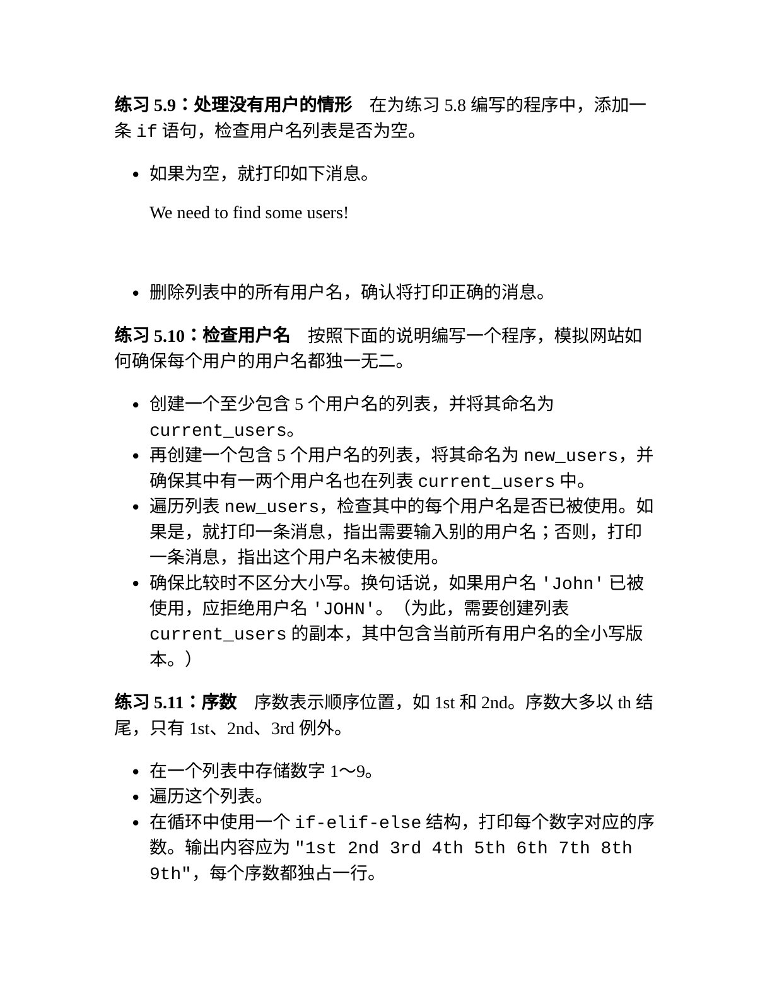

**练习 5.9：处理没有用户的情形**　在为练习 5.8 编写的程序中，添加一条 `if` 语句，检查用户名列表是否为空。

- 如果为空，就打印如下消息。

  ```text
  We need to find some users!
  ```

- 删除列表中的所有用户名，确认将打印正确的消息。

**练习 5.10：检查用户名**　按照下面的说明编写一个程序，模拟网站如何确保每个用户的用户名都独一无二。

- 创建一个至少包含 5 个用户名的列表，并将其命名为 `current_users`。
- 再创建一个包含 5 个用户名的列表，将其命名为 `new_users`，并确保其中有一两个用户名也在列表 `current_users` 中。
- 遍历列表 `new_users`，检查其中的每个用户名是否已被使用。如果是，就打印一条消息，指出需要输入别的用户名；否则，打印一条消息，指出这个用户名未被使用。
- 确保比较时不区分大小写。换句话说，如果用户名 `'John'` 已被使用，应拒绝用户名 `'JOHN'`。（为此，需要创建列表 `current_users` 的副本，其中包含当前所有用户名的全小写版本。）

**练习 5.11：序数**　序数表示顺序位置，如 1st 和 2nd。序数大多以 th 结尾，只有 1st、2nd、3rd 例外。

- 在一个列表中存储数字 1～9。
- 遍历这个列表。
- 在循环中使用一个 `if-elif-else` 结构，打印每个数字对应的序数。输出内容应为 `"1st 2nd 3rd 4th 5th 6th 7th 8th 9th"`，每个序数都独占一行。

## PDF 第 160 页

<!-- page-status: reviewed -->
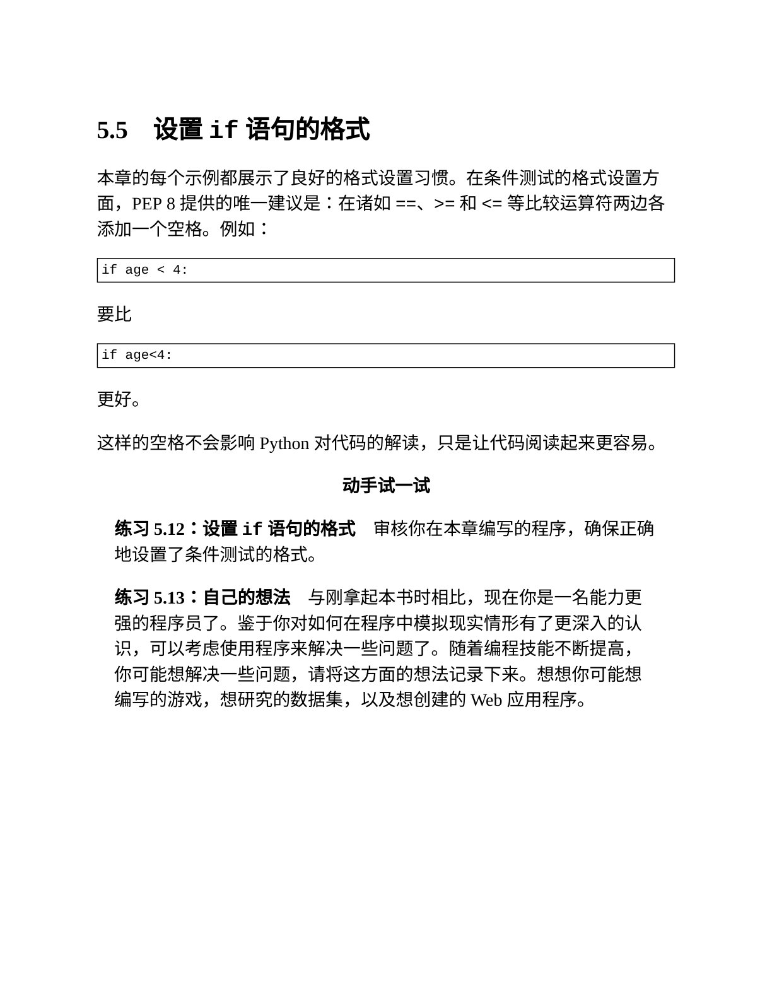

### 5.5 设置 if 语句的格式

本章的每个示例都展示了良好的格式设置习惯。在条件测试的格式设置方面，PEP 8 提供的唯一建议是：在诸如 `==`、`>=` 和 `<=` 等比较运算符两边各添加一个空格。例如：

```python
if age < 4:
```

要比

```python
if age<4:
```

更好。

这样的空格不会影响 Python 对代码的解读，只是让代码阅读起来更容易。

> 校对注：上面两段只展示 `if` 语句头，用于比较空格格式；运行时还需在下一行添加缩进的语句体。

### 动手试一试

**练习 5.12：设置 if 语句的格式**　审核你在本章编写的程序，确保正确地设置了条件测试的格式。

**练习 5.13：自己的想法**　与刚拿起本书时相比，现在你是一名能力更强的程序员了。鉴于你对如何在程序中模拟现实情形有了更深入的认识，可以考虑使用程序来解决一些问题了。随着编程技能不断提高，你可能想解决一些问题，请将这方面的想法记录下来。想想你可能想编写的游戏，想研究的数据集，以及想创建的 Web 应用程序。

## PDF 第 161 页

<!-- page-status: reviewed -->
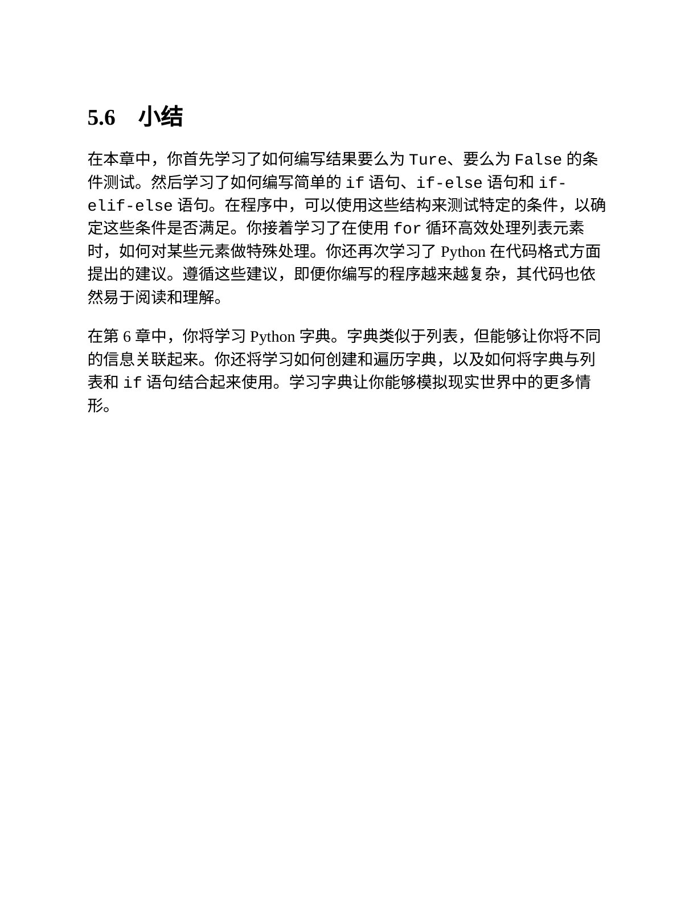

### 5.6 小结

在本章中，你首先学习了如何编写结果要么为 `True`、要么为 `False` 的条件测试。然后学习了如何编写简单的 `if` 语句、`if-else` 语句和 `if-elif-else` 语句。在程序中，可以使用这些结构来测试特定的条件，以确定这些条件是否满足。你接着学习了在使用 `for` 循环高效处理列表元素时，如何对某些元素做特殊处理。你还再次学习了 Python 在代码格式方面提出的建议。遵循这些建议，即便你编写的程序越来越复杂，其代码也依然易于阅读和理解。

在第 6 章中，你将学习 Python 字典。字典类似于列表，但能够让你将不同的信息关联起来。你还将学习如何创建和遍历字典，以及如何将字典与列表和 `if` 语句结合起来使用。学习字典让你能够模拟现实世界中的更多情形。
