# 第 7 章 用户输入和 while 循环

> 本章技术页已由 AI 对照原页整理为可编辑 Markdown，未经过人类逐页复核；原页图保留供检查，代码并非全部已执行。

[返回目录](README.md) | PDF 原页 190–209

## PDF 第 190 页

<!-- page-status: reviewed -->
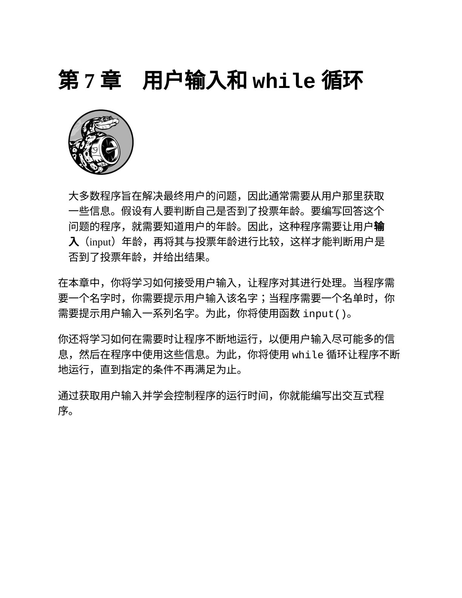

大多数程序旨在解决最终用户的问题，因此通常需要从用户那里获取一些信息。假设有人要判断自己是否到了投票年龄。要编写回答这个问题的程序，就需要知道用户的年龄。因此，这种程序需要让用户**输入**（input）年龄，再将其与投票年龄进行比较，这样才能判断用户是否到了投票年龄，并给出结果。

在本章中，你将学习如何接受用户输入，让程序对其进行处理。当程序需要一个名字时，你需要提示用户输入该名字；当程序需要一个名单时，你需要提示用户输入一系列名字。为此，你将使用函数 `input()`。

你还将学习如何在需要时让程序不断地运行，以便用户输入尽可能多的信息，然后在程序中使用这些信息。为此，你将使用 `while` 循环让程序不断地运行，直到指定的条件不再满足为止。

通过获取用户输入并学会控制程序的运行时间，你就能编写出交互式程序。

## PDF 第 191 页

<!-- page-status: reviewed -->
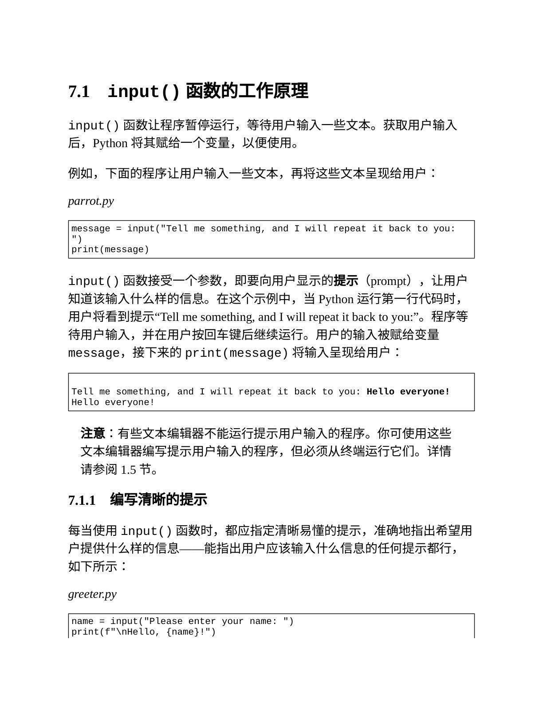

### 7.1 `input()` 函数的工作原理

`input()` 函数让程序暂停运行，等待用户输入一些文本。获取用户输入后，Python 将其赋给一个变量，以便使用。

例如，下面的程序让用户输入一些文本，再将这些文本呈现给用户：

`parrot.py`

```python
message = input("Tell me something, and I will repeat it back to you: ")
print(message)
```

`input()` 函数接受一个参数，即要向用户显示的**提示**（prompt），让用户知道该输入什么样的信息。在这个示例中，当 Python 运行第一行代码时，用户将看到提示 “Tell me something, and I will repeat it back to you:”。程序等待用户输入，并在用户按回车键后继续运行。用户的输入被赋给变量 `message`，接下来的 `print(message)` 将输入呈现给用户：

```text
Tell me something, and I will repeat it back to you: Hello everyone!
Hello everyone!
```

> 注意：有些文本编辑器不能运行提示用户输入的程序。你可使用这些文本编辑器编写提示用户输入的程序，但必须从终端运行它们。详情请参阅 1.5 节。

#### 7.1.1 编写清晰的提示

每当使用 `input()` 函数时，都应指定清晰易懂的提示，准确地指出希望用户提供什么样的信息——能指出用户应该输入什么信息的任何提示都行，如下所示：

`greeter.py`

```python
name = input("Please enter your name: ")
print(f"\nHello, {name}!")
```

## PDF 第 192 页

<!-- page-status: reviewed -->
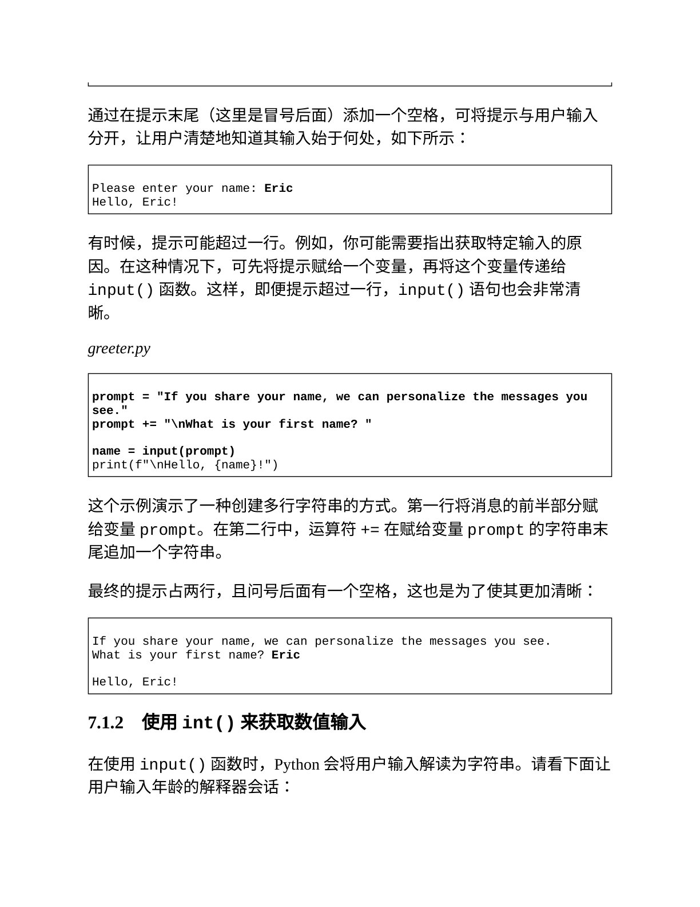

通过在提示末尾（这里是冒号后面）添加一个空格，可将提示与用户输入分开，让用户清楚地知道其输入始于何处，如下所示：

```text
Please enter your name: Eric
Hello, Eric!
```

有时候，提示可能超过一行。例如，你可能需要指出获取特定输入的原因。在这种情况下，可先将提示赋给一个变量，再将这个变量传递给 `input()` 函数。这样，即便提示超过一行，`input()` 语句也会非常清晰。

`greeter.py`

```python
prompt = "If you share your name, we can personalize the messages you see."
prompt += "\nWhat is your first name? "

name = input(prompt)
print(f"\nHello, {name}!")
```

这个示例演示了一种创建多行字符串的方式。第一行将消息的前半部分赋给变量 `prompt`。在第二行中，运算符 `+=` 在赋给变量 `prompt` 的字符串末尾追加一个字符串。

最终的提示占两行，且问号后面有一个空格，这也是为了使其更加清晰：

```text
If you share your name, we can personalize the messages you see.
What is your first name? Eric

Hello, Eric!
```

#### 7.1.2 使用 `int()` 来获取数值输入

在使用 `input()` 函数时，Python 会将用户输入解读为字符串。请看下面让用户输入年龄的解释器会话：

## PDF 第 193 页

<!-- page-status: reviewed -->
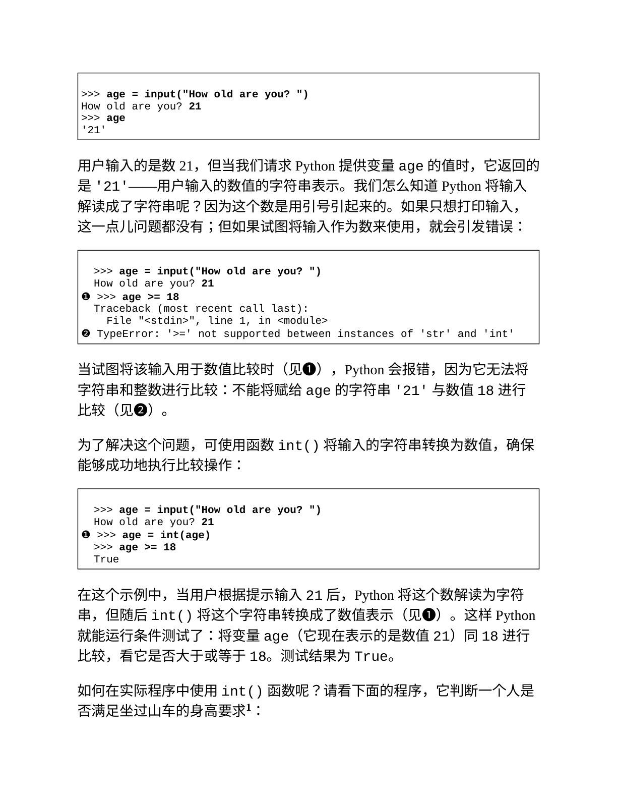

```pycon
>>> age = input("How old are you? ")
How old are you? 21
>>> age
'21'
```

用户输入的是数 21，但当我们请求 Python 提供变量 `age` 的值时，它返回的是 `'21'`——用户输入的数值的字符串表示。我们怎么知道 Python 将输入解读成了字符串呢？因为这个数是用引号引起来的。如果只想打印输入，这一点儿问题都没有；但如果试图将输入作为数来使用，就会引发错误：

```pycon
>>> age = input("How old are you? ")
How old are you? 21
>>> age >= 18
Traceback (most recent call last):
  File "<stdin>", line 1, in <module>
TypeError: '>=' not supported between instances of 'str' and 'int'
```

当试图将该输入用于数值比较时（见❶），Python 会报错，因为它无法将字符串和整数进行比较：不能将赋给 `age` 的字符串 `'21'` 与数值 `18` 进行比较（见❷）。

为了解决这个问题，可使用函数 `int()` 将输入的字符串转换为数值，确保能够成功地执行比较操作：

```pycon
>>> age = input("How old are you? ")
How old are you? 21
>>> age = int(age)
>>> age >= 18
True
```

在这个示例中，当用户根据提示输入 21 后，Python 将这个数解读为字符串，但随后 `int()` 将这个字符串转换成了数值表示（见❶）。这样 Python 就能运行条件测试了：将变量 `age`（它现在表示的是数值 21）同 18 进行比较，看它是否大于或等于 18。测试结果为 `True`。

如何在实际程序中使用 `int()` 函数呢？请看下面的程序，它判断一个人是否满足坐过山车的身高要求：

## PDF 第 194 页

<!-- page-status: reviewed -->
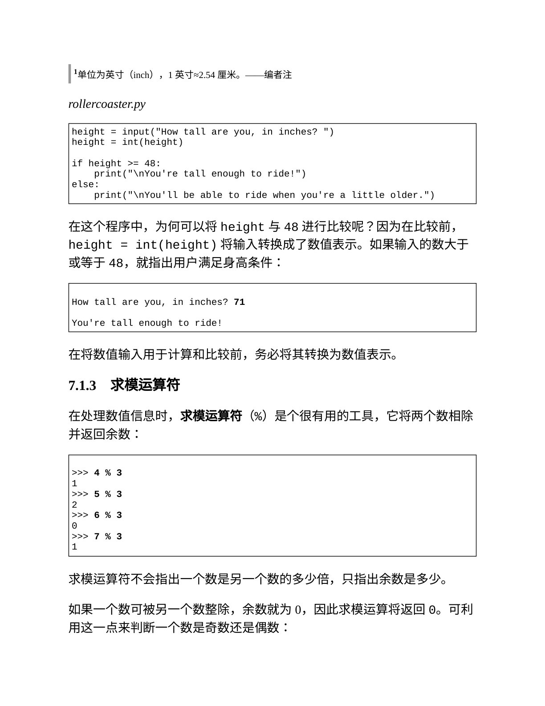

> 编者注：单位为英寸（inch），1 英寸约为 2.54 厘米。

`rollercoaster.py`

```python
height = input("How tall are you, in inches? ")
height = int(height)

if height >= 48:
    print("\nYou're tall enough to ride!")
else:
    print("\nYou'll be able to ride when you're a little older.")
```

在这个程序中，为何可以将 `height` 与 `48` 进行比较呢？因为在比较前，`height = int(height)` 将输入转换成了数值表示。如果输入的数大于或等于 48，就指出用户满足身高条件：

```text
How tall are you, in inches? 71

You're tall enough to ride!
```

在将数值输入用于计算和比较前，务必将其转换为数值表示。

#### 7.1.3 求模运算符

在处理数值信息时，**求模运算符**（`%`）是个很有用的工具，它将两个数相除并返回余数：

```pycon
>>> 4 % 3
1
>>> 5 % 3
2
>>> 6 % 3
0
>>> 7 % 3
1
```

求模运算符不会指出一个数是另一个数的多少倍，只指出余数是多少。

如果一个数可被另一个数整除，余数就为 0，因此求模运算将返回 0。可利用这一点来判断一个数是奇数还是偶数：


## PDF 第 195 页

<!-- page-status: reviewed -->
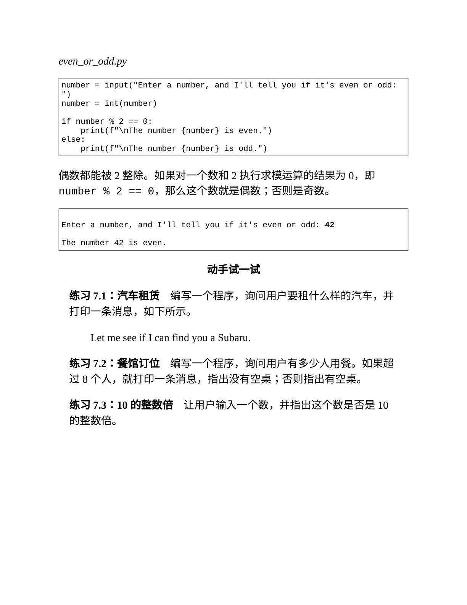

`even_or_odd.py`

```python
number = input("Enter a number, and I'll tell you if it's even or odd: ")
number = int(number)

if number % 2 == 0:
    print(f"\nThe number {number} is even.")
else:
    print(f"\nThe number {number} is odd.")
```

偶数都能被 2 整除。如果对一个数和 2 执行求模运算的结果为 0，即 `number % 2 == 0`，那么这个数就是偶数；否则是奇数。

```text
Enter a number, and I'll tell you if it's even or odd: 42

The number 42 is even.
```

### 动手试一试

**练习 7.1：汽车租赁** 编写一个程序，询问用户要租什么样的汽车，并打印一条消息，如下所示。

```text
Let me see if I can find you a Subaru.
```

**练习 7.2：餐馆订位** 编写一个程序，询问用户有多少人用餐。如果超过 8 个人，就打印一条消息，指出没有空桌；否则指出有空桌。

**练习 7.3：10 的整数倍** 让用户输入一个数，并指出这个数是否是 10 的整数倍。

## PDF 第 196 页

<!-- page-status: reviewed -->
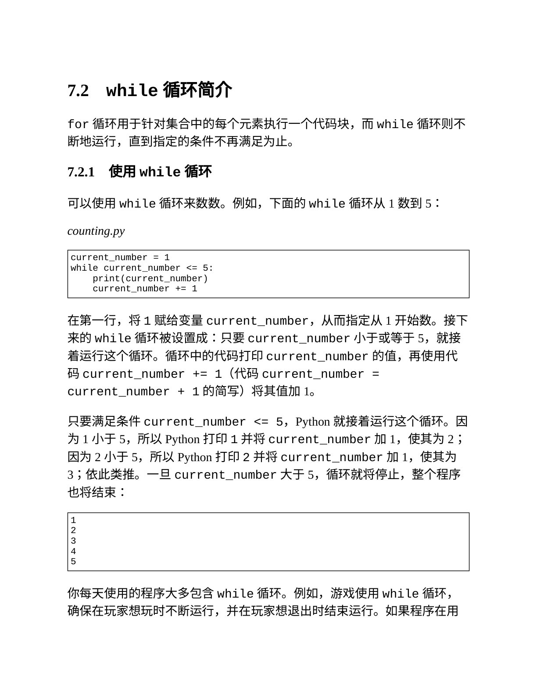

### 7.2 `while` 循环简介

`for` 循环用于针对集合中的每个元素执行一个代码块，而 `while` 循环则不断地运行，直到指定的条件不再满足为止。

#### 7.2.1 使用 `while` 循环

可以使用 `while` 循环来数数。例如，下面的 `while` 循环从 1 数到 5：

`counting.py`

```python
current_number = 1
while current_number <= 5:
    print(current_number)
    current_number += 1
```

在第一行，将 1 赋给变量 `current_number`，从而指定从 1 开始数。接下来的 `while` 循环被设置成：只要 `current_number` 小于或等于 5，就接着运行这个循环。循环中的代码打印 `current_number` 的值，再使用代码 `current_number += 1`（代码 `current_number = current_number + 1` 的简写）将其值加 1。

只要满足条件 `current_number <= 5`，Python 就接着运行这个循环。因为 1 小于 5，所以 Python 打印 1 并将 `current_number` 加 1，使其为 2；因为 2 小于 5，所以 Python 打印 2 并将 `current_number` 加 1，使其为 3；依此类推。一旦 `current_number` 大于 5，循环就将停止，整个程序也将结束：

```text
1
2
3
4
5
```

你每天使用的程序大多包含 `while` 循环。例如，游戏使用 `while` 循环，确保在玩家想玩时不断运行，并在玩家想退出时结束运行。如果程序在用

## PDF 第 197 页

<!-- page-status: reviewed -->
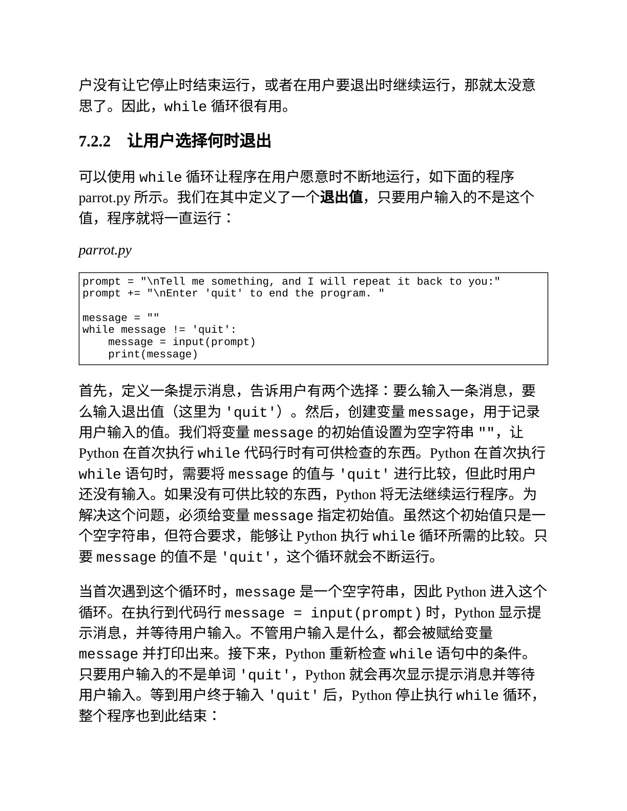

户没有让它停止时结束运行，或者在用户要退出时继续运行，那就太没意思了。因此，`while` 循环很有用。

#### 7.2.2 让用户选择何时退出

可以使用 `while` 循环让程序在用户愿意时不断地运行，如下面的程序 `parrot.py` 所示。我们在其中定义了一个**退出值**，只要用户输入的不是这个值，程序就将一直运行：

`parrot.py`

```python
prompt = "\nTell me something, and I will repeat it back to you:"
prompt += "\nEnter 'quit' to end the program. "

message = ""
while message != 'quit':
    message = input(prompt)
    print(message)
```

首先，定义一条提示消息，告诉用户有两个选择：要么输入一条消息，要么输入退出值（这里为 `'quit'`）。然后，创建变量 `message`，用于记录用户输入的值。我们将变量 `message` 的初始值设置为空字符串 `""`，让 Python 在首次执行 `while` 代码行时有可供检查的东西。Python 在首次执行 `while` 语句时，需要将 `message` 的值与 `'quit'` 进行比较，但此时用户还没有输入。如果没有可供比较的东西，Python 将无法继续运行程序。为解决这个问题，必须给变量 `message` 指定初始值。虽然这个初始值只是一个空字符串，但符合要求，能够让 Python 执行 `while` 循环所需的比较。只要 `message` 的值不是 `'quit'`，这个循环就会不断运行。

当首次遇到这个循环时，`message` 是一个空字符串，因此 Python 进入这个循环。在执行到代码行 `message = input(prompt)` 时，Python 显示提示消息，并等待用户输入。不管用户输入是什么，都会被赋给变量 `message` 并打印出来。接下来，Python 重新检查 `while` 语句中的条件。只要用户输入的不是单词 `'quit'`，Python 就会再次显示提示消息并等待用户输入。等到用户终于输入 `'quit'` 后，Python 停止执行 `while` 循环，整个程序也到此结束：

## PDF 第 198 页

<!-- page-status: reviewed -->
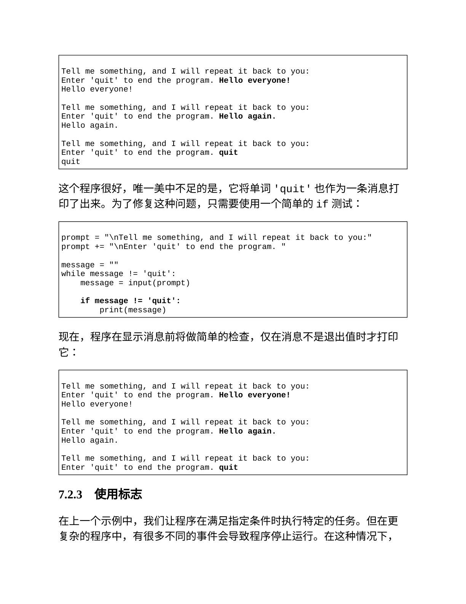

```text
Tell me something, and I will repeat it back to you:
Enter 'quit' to end the program. Hello everyone!
Hello everyone!

Tell me something, and I will repeat it back to you:
Enter 'quit' to end the program. Hello again.
Hello again.

Tell me something, and I will repeat it back to you:
Enter 'quit' to end the program. quit
quit
```

这个程序很好，唯一美中不足的是，它将单词 `'quit'` 也作为一条消息打印了出来。为了修复这种问题，只需要使用一个简单的 `if` 测试：

```python
prompt = "\nTell me something, and I will repeat it back to you:"
prompt += "\nEnter 'quit' to end the program. "

message = ""
while message != 'quit':
    message = input(prompt)

    if message != 'quit':
        print(message)
```

现在，程序在显示消息前将做简单的检查，仅在消息不是退出值时才打印它：

```text
Tell me something, and I will repeat it back to you:
Enter 'quit' to end the program. Hello everyone!
Hello everyone!

Tell me something, and I will repeat it back to you:
Enter 'quit' to end the program. Hello again.
Hello again.

Tell me something, and I will repeat it back to you:
Enter 'quit' to end the program. quit
```

#### 7.2.3 使用标志

在上一个示例中，我们让程序在满足指定条件时执行特定的任务。但在更复杂的程序中，有很多不同的事件会导致程序停止运行。在这种情况下，

## PDF 第 199 页

<!-- page-status: reviewed -->
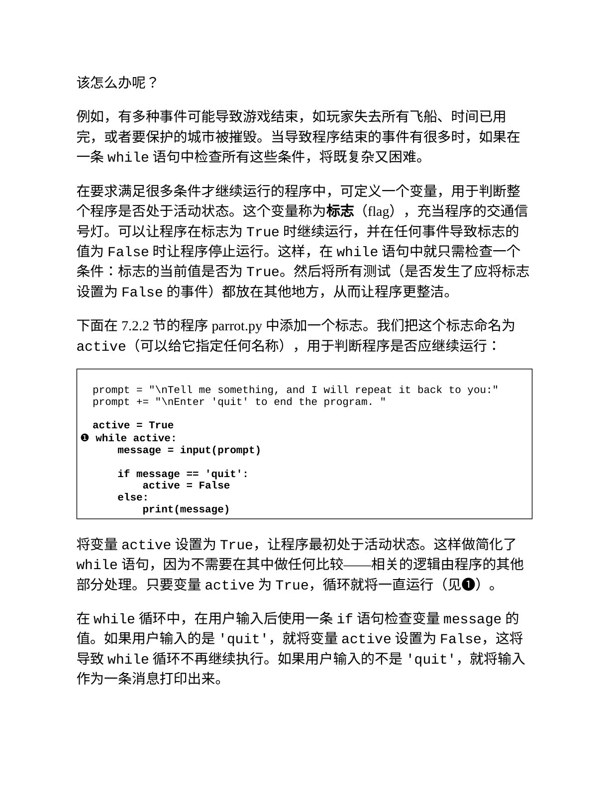

该怎么办呢？

例如，有多种事件可能导致游戏结束，如玩家失去所有飞船、时间已用完，或者要保护的城市被摧毁。当导致程序结束的事件有很多时，如果在一条 `while` 语句中检查所有这些条件，将既复杂又困难。

在要求满足很多条件才继续运行的程序中，可定义一个变量，用于判断整个程序是否处于活动状态。这个变量称为**标志**（flag），充当程序的交通信号灯。可以让程序在标志为 `True` 时继续运行，并在任何事件导致标志的值为 `False` 时让程序停止运行。这样，在 `while` 语句中就只需检查一个条件：标志的当前值是否为 `True`。然后将所有测试（是否发生了应将标志设置为 `False` 的事件）都放在其他地方，从而让程序更整洁。

下面在 7.2.2 节的程序 `parrot.py` 中添加一个标志。我们把这个标志命名为 `active`（可以给它指定任何名称），用于判断程序是否应继续运行：

```python
prompt = "\nTell me something, and I will repeat it back to you:"
prompt += "\nEnter 'quit' to end the program. "

active = True
while active:  # ❶
    message = input(prompt)

    if message == 'quit':
        active = False
    else:
        print(message)
```

将变量 `active` 设置为 `True`，让程序最初处于活动状态。这样做简化了 `while` 语句，因为不需要在其中做任何比较——相关的逻辑由程序的其他部分处理。只要变量 `active` 为 `True`，循环就将一直运行（见❶）。

在 `while` 循环中，在用户输入后使用一条 `if` 语句检查变量 `message` 的值。如果用户输入的是 `'quit'`，就将变量 `active` 设置为 `False`，这将导致 `while` 循环不再继续执行。如果用户输入的不是 `'quit'`，就将输入作为一条消息打印出来。

## PDF 第 200 页

<!-- page-status: reviewed -->
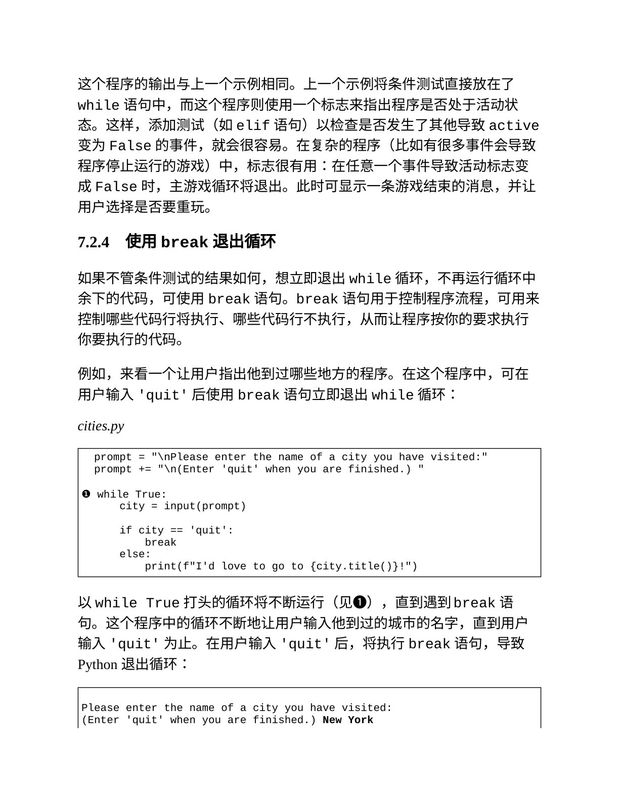

这个程序的输出与上一个示例相同。上一个示例将条件测试直接放在了 `while` 语句中，而这个程序则使用一个标志来指出程序是否处于活动状态。这样，添加测试（如 `elif` 语句）以检查是否发生了其他导致 `active` 变为 `False` 的事件，就会很容易。在复杂的程序（比如有很多事件会导致程序停止运行的游戏）中，标志很有用：在任意一个事件导致活动标志变成 `False` 时，主游戏循环将退出。此时可显示一条游戏结束的消息，并让用户选择是否要重玩。

#### 7.2.4 使用 `break` 退出循环

如果不管条件测试的结果如何，想立即退出 `while` 循环，不再运行循环中余下的代码，可使用 `break` 语句。`break` 语句用于控制程序流程，可用来控制哪些代码行将执行、哪些代码行不执行，从而让程序按你的要求执行你要执行的代码。

例如，来看一个让用户指出他到过哪些地方的程序。在这个程序中，可在用户输入 `'quit'` 后使用 `break` 语句立即退出 `while` 循环：

`cities.py`

```python
prompt = "\nPlease enter the name of a city you have visited:"
prompt += "\n(Enter 'quit' when you are finished.) "

while True:  # ❶
    city = input(prompt)

    if city == 'quit':
        break
    else:
        print(f"I'd love to go to {city.title()}!")
```

以 `while True` 打头的循环将不断运行（见❶），直到遇到 `break` 语句。这个程序中的循环不断地让用户输入他到过的城市的名字，直到用户输入 `'quit'` 为止。在用户输入 `'quit'` 后，将执行 `break` 语句，导致 Python 退出循环：

```text
Please enter the name of a city you have visited:
(Enter 'quit' when you are finished.) New York
```

（输出续下一页。）

## PDF 第 201 页

<!-- page-status: reviewed -->
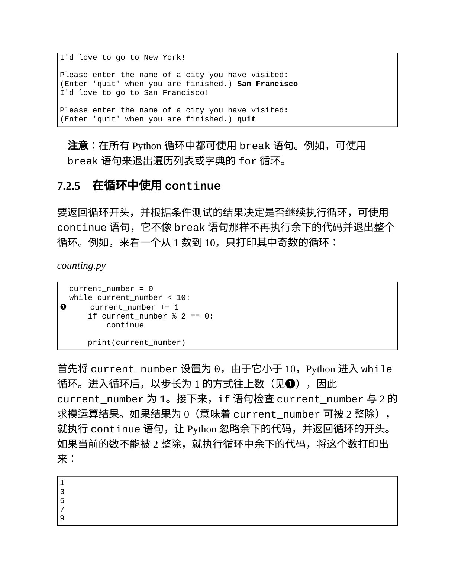

（续上页输出。）

```text
I'd love to go to New York!

Please enter the name of a city you have visited:
(Enter 'quit' when you are finished.) San Francisco
I'd love to go to San Francisco!

Please enter the name of a city you have visited:
(Enter 'quit' when you are finished.) quit
```

> 注意：在所有 Python 循环中都可使用 `break` 语句。例如，可使用 `break` 语句来退出遍历列表或字典的 `for` 循环。

#### 7.2.5 在循环中使用 `continue`

要返回循环开头，并根据条件测试的结果决定是否继续执行循环，可使用 `continue` 语句，它不像 `break` 语句那样不再执行余下的代码并退出整个循环。例如，来看一个从 1 数到 10，只打印其中奇数的循环：

`counting.py`

```python
current_number = 0
while current_number < 10:
    current_number += 1  # ❶
    if current_number % 2 == 0:
        continue

    print(current_number)
```

首先将 `current_number` 设置为 0，由于它小于 10，Python 进入 `while` 循环。进入循环后，以步长为 1 的方式往上数（见❶），因此 `current_number` 为 1。接下来，`if` 语句检查 `current_number` 与 2 的求模运算结果。如果结果为 0（意味着 `current_number` 可被 2 整除），就执行 `continue` 语句，让 Python 忽略余下的代码，并返回循环的开头。如果当前的数不能被 2 整除，就执行循环中余下的代码，将这个数打印出来：

```text
1
3
5
7
9
```

## PDF 第 202 页

<!-- page-status: reviewed -->
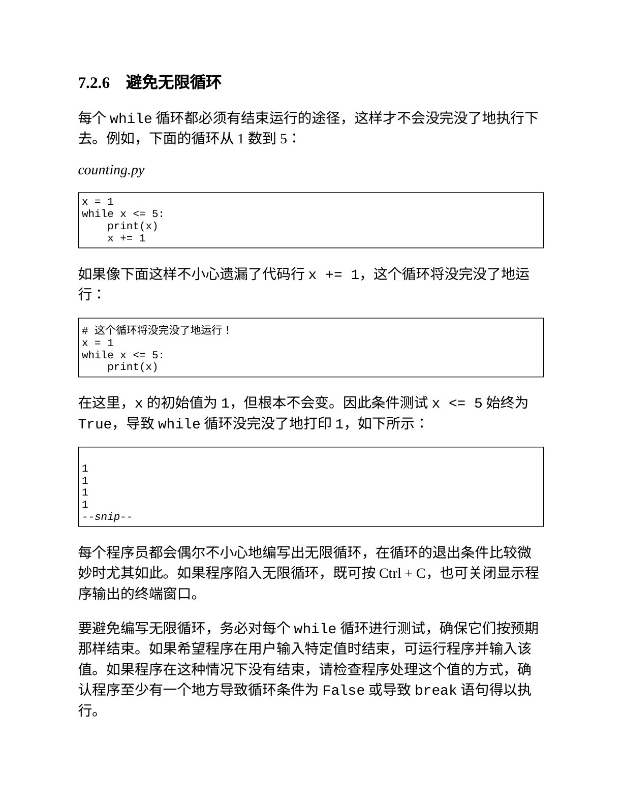

#### 7.2.6 避免无限循环

每个 `while` 循环都必须有结束运行的途径，这样才不会没完没了地执行下去。例如，下面的循环从 1 数到 5：

`counting.py`

```python
x = 1
while x <= 5:
    print(x)
    x += 1
```

如果像下面这样不小心遗漏了代码行 `x += 1`，这个循环将没完没了地运行：

```python
# 这个循环将没完没了地运行！
x = 1
while x <= 5:
    print(x)
```

在这里，`x` 的初始值为 1，但根本不会变。因此条件测试 `x <= 5` 始终为 `True`，导致 `while` 循环没完没了地打印 1，如下所示：

```text
1
1
1
1
--snip--
```

每个程序员都会偶尔不小心地编写出无限循环，在循环的退出条件比较微妙时尤其如此。如果程序陷入无限循环，既可按 Ctrl + C，也可关闭显示程序输出的终端窗口。

要避免编写无限循环，务必对每个 `while` 循环进行测试，确保它们按预期那样结束。如果希望程序在用户输入特定值时结束，可运行程序并输入该值。如果程序在这种情况下没有结束，请检查程序处理这个值的方式，确认程序至少有一个地方导致循环条件为 `False` 或导致 `break` 语句得以执行。

## PDF 第 203 页

<!-- page-status: reviewed -->
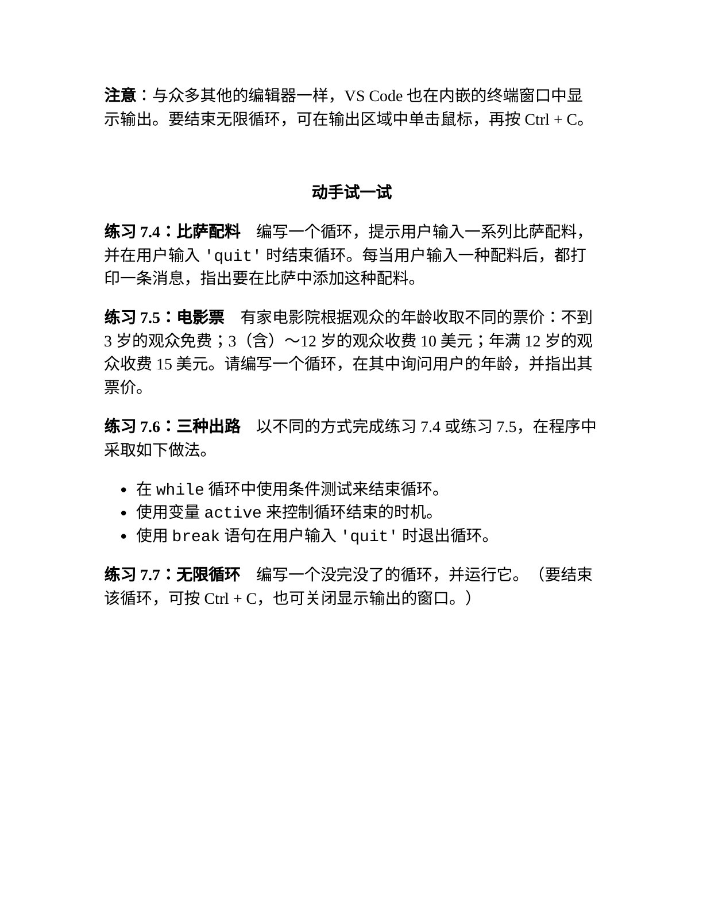

> 注意：与众多其他的编辑器一样，VS Code 也在内嵌的终端窗口中显示输出。要结束无限循环，可在输出区域中单击鼠标，再按 Ctrl + C。

### 动手试一试

**练习 7.4：比萨配料** 编写一个循环，提示用户输入一系列比萨配料，并在用户输入 `'quit'` 时结束循环。每当用户输入一种配料后，都打印一条消息，指出要在比萨中添加这种配料。

**练习 7.5：电影票** 有家电影院根据观众的年龄收取不同的票价：不到 3 岁的观众免费；3（含）～12 岁的观众收费 10 美元；年满 12 岁的观众收费 15 美元。请编写一个循环，在其中询问用户的年龄，并指出其票价。

> 校对注：原书这里的两档年龄范围都可能包含 12 岁；做题时需先明确 12 岁属于哪一档。

**练习 7.6：三种出路** 以不同的方式完成练习 7.4 或练习 7.5，在程序中采取如下做法。

- 在 `while` 循环中使用条件测试来结束循环。
- 使用变量 `active` 来控制循环结束的时机。
- 使用 `break` 语句在用户输入 `'quit'` 时退出循环。

**练习 7.7：无限循环** 编写一个没完没了的循环，并运行它。（要结束该循环，可按 Ctrl + C，也可关闭显示输出的窗口。）

## PDF 第 204 页

<!-- page-status: reviewed -->
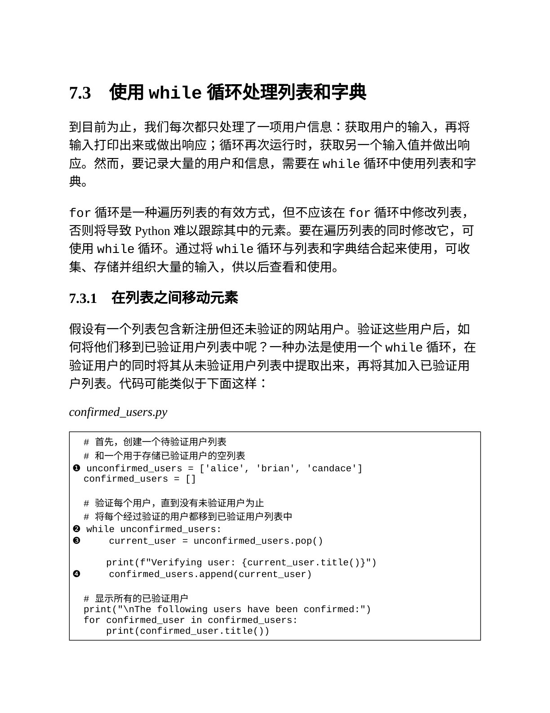

### 7.3 使用 `while` 循环处理列表和字典

到目前为止，我们每次都只处理了一项用户信息：获取用户的输入，再将输入打印出来或做出响应；循环再次运行时，获取另一个输入值并做出响应。然而，要记录大量的用户和信息，需要在 `while` 循环中使用列表和字典。

`for` 循环是一种遍历列表的有效方式，但不应该在 `for` 循环中修改列表，否则将导致 Python 难以跟踪其中的元素。要在遍历列表的同时修改它，可使用 `while` 循环。通过将 `while` 循环与列表和字典结合起来使用，可收集、存储并组织大量的输入，供以后查看和使用。

#### 7.3.1 在列表之间移动元素

假设有一个列表包含新注册但还未验证的网站用户。验证这些用户后，如何将他们移到已验证用户列表中呢？一种办法是使用一个 `while` 循环，在验证用户的同时将其从未验证用户列表中提取出来，再将其加入已验证用户列表。代码可能类似于下面这样：

`confirmed_users.py`

```python
# 首先，创建一个待验证用户列表
# 和一个用于存储已验证用户的空列表
unconfirmed_users = ['alice', 'brian', 'candace']  # ❶
confirmed_users = []

# 验证每个用户，直到没有未验证用户为止
# 将每个经过验证的用户都移到已验证用户列表中
while unconfirmed_users:  # ❷
    current_user = unconfirmed_users.pop()  # ❸

    print(f"Verifying user: {current_user.title()}")
    confirmed_users.append(current_user)  # ❹

# 显示所有的已验证用户
print("\nThe following users have been confirmed:")
for confirmed_user in confirmed_users:
    print(confirmed_user.title())
```


## PDF 第 205 页

<!-- page-status: reviewed -->
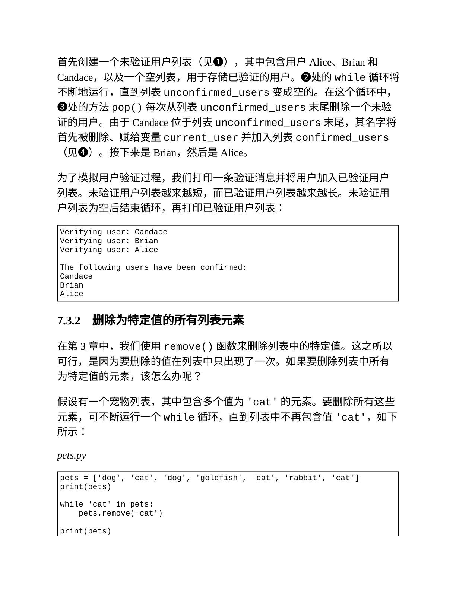

首先创建一个未验证用户列表（见❶），其中包含用户 Alice、Brian 和 Candace，以及一个空列表，用于存储已验证的用户。❷处的 `while` 循环将不断地运行，直到列表 `unconfirmed_users` 变成空的。在这个循环中，❸处的方法 `pop()` 每次从列表 `unconfirmed_users` 末尾删除一个未验证的用户。由于 Candace 位于列表 `unconfirmed_users` 末尾，其名字将首先被删除、赋给变量 `current_user` 并加入列表 `confirmed_users`（见❹）。接下来是 Brian，然后是 Alice。

为了模拟用户验证过程，我们打印一条验证消息并将用户加入已验证用户列表。未验证用户列表越来越短，而已验证用户列表越来越长。未验证用户列表为空后结束循环，再打印已验证用户列表：

```text
Verifying user: Candace
Verifying user: Brian
Verifying user: Alice

The following users have been confirmed:
Candace
Brian
Alice
```

#### 7.3.2 删除为特定值的所有列表元素

在第 3 章中，我们使用 `remove()` 函数来删除列表中的特定值。这之所以可行，是因为要删除的值在列表中只出现了一次。如果要删除列表中所有为特定值的元素，该怎么办呢？

假设有一个宠物列表，其中包含多个值为 `'cat'` 的元素。要删除所有这些元素，可不断运行一个 `while` 循环，直到列表中不再包含值 `'cat'`，如下所示：

`pets.py`

```python
pets = ['dog', 'cat', 'dog', 'goldfish', 'cat', 'rabbit', 'cat']
print(pets)

while 'cat' in pets:
    pets.remove('cat')

print(pets)
```

## PDF 第 206 页

<!-- page-status: reviewed -->
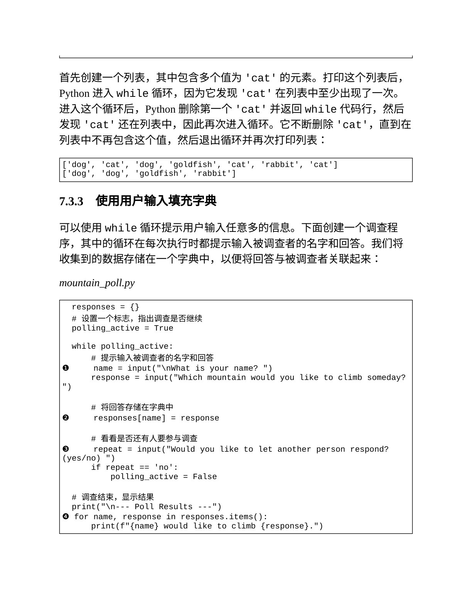

首先创建一个列表，其中包含多个值为 `'cat'` 的元素。打印这个列表后，Python 进入 `while` 循环，因为它发现 `'cat'` 在列表中至少出现了一次。进入这个循环后，Python 删除第一个 `'cat'` 并返回 `while` 代码行，然后发现 `'cat'` 还在列表中，因此再次进入循环。它不断删除 `'cat'`，直到在列表中不再包含这个值，然后退出循环并再次打印列表：

```text
['dog', 'cat', 'dog', 'goldfish', 'cat', 'rabbit', 'cat']
['dog', 'dog', 'goldfish', 'rabbit']
```

#### 7.3.3 使用用户输入填充字典

可以使用 `while` 循环提示用户输入任意多的信息。下面创建一个调查程序，其中的循环在每次执行时都提示输入被调查者的名字和回答。我们将收集到的数据存储在一个字典中，以便将回答与被调查者关联起来：

`mountain_poll.py`

```python
responses = {}

# 设置一个标志，指出调查是否继续
polling_active = True

while polling_active:
    # 提示输入被调查者的名字和回答
    name = input("\nWhat is your name? ")  # ❶
    response = input("Which mountain would you like to climb someday? ")

    # 将回答存储在字典中
    responses[name] = response  # ❷

    # 看看是否还有人要参与调查
    repeat = input("Would you like to let another person respond? (yes/no) ")  # ❸
    if repeat == 'no':
        polling_active = False

# 调查结束，显示结果
print("\n--- Poll Results ---")
for name, response in responses.items():  # ❹
    print(f"{name} would like to climb {response}.")
```

## PDF 第 207 页

<!-- page-status: reviewed -->
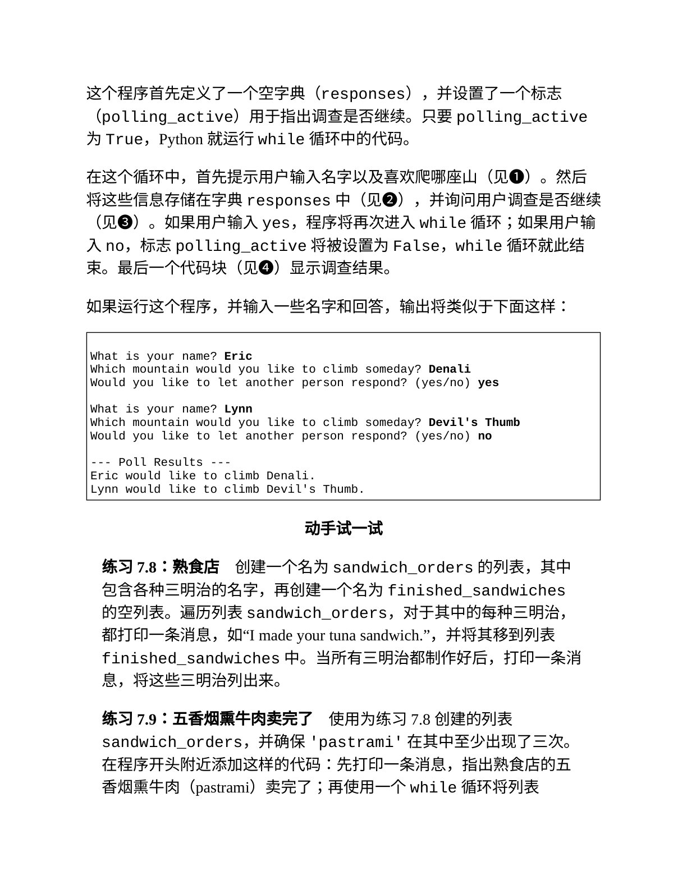

这个程序首先定义了一个空字典（`responses`），并设置了一个标志（`polling_active`）用于指出调查是否继续。只要 `polling_active` 为 `True`，Python 就运行 `while` 循环中的代码。

在这个循环中，首先提示用户输入名字以及喜欢爬哪座山（见❶）。然后将这些信息存储在字典 `responses` 中（见❷），并询问用户调查是否继续（见❸）。如果用户输入 yes，程序将再次进入 `while` 循环；如果用户输入 no，标志 `polling_active` 将被设置为 `False`，`while` 循环就此结束。最后一个代码块（见❹）显示调查结果。

如果运行这个程序，并输入一些名字和回答，输出将类似于下面这样：

```text
What is your name? Eric
Which mountain would you like to climb someday? Denali
Would you like to let another person respond? (yes/no) yes

What is your name? Lynn
Which mountain would you like to climb someday? Devil's Thumb
Would you like to let another person respond? (yes/no) no

--- Poll Results ---
Eric would like to climb Denali.
Lynn would like to climb Devil's Thumb.
```

### 动手试一试

**练习 7.8：熟食店**　创建一个名为 `sandwich_orders` 的列表，其中包含各种三明治的名字，再创建一个名为 `finished_sandwiches` 的空列表。遍历列表 `sandwich_orders`，对于其中的每种三明治，都打印一条消息，如“I made your tuna sandwich.”，并将其移到列表 `finished_sandwiches` 中。当所有三明治都制作好后，打印一条消息，将这些三明治列出来。

**练习 7.9：五香烟熏牛肉卖完了**　使用为练习 7.8 创建的列表 `sandwich_orders`，并确保 `'pastrami'` 在其中至少出现了三次。在程序开头附近添加这样的代码：先打印一条消息，指出熟食店的五香烟熏牛肉（pastrami）卖完了；再使用一个 `while` 循环将列表（续下页）

## PDF 第 208 页

<!-- page-status: reviewed -->
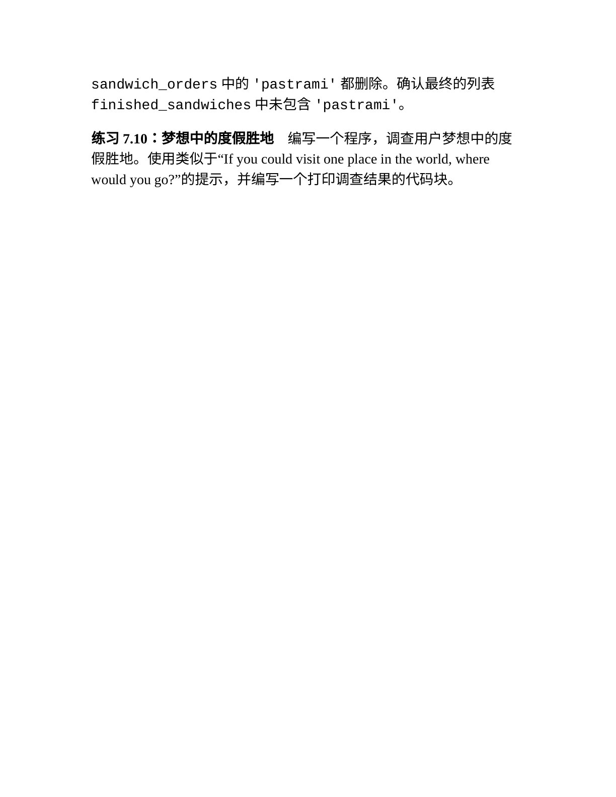

（续上页）`sandwich_orders` 中的 `'pastrami'` 都删除。确认最终的列表 `finished_sandwiches` 中未包含 `'pastrami'`。

**练习 7.10：梦想中的度假胜地**　编写一个程序，调查用户梦想中的度假胜地。使用类似于“If you could visit one place in the world, where would you go?”的提示，并编写一个打印调查结果的代码块。

## PDF 第 209 页

<!-- page-status: reviewed -->
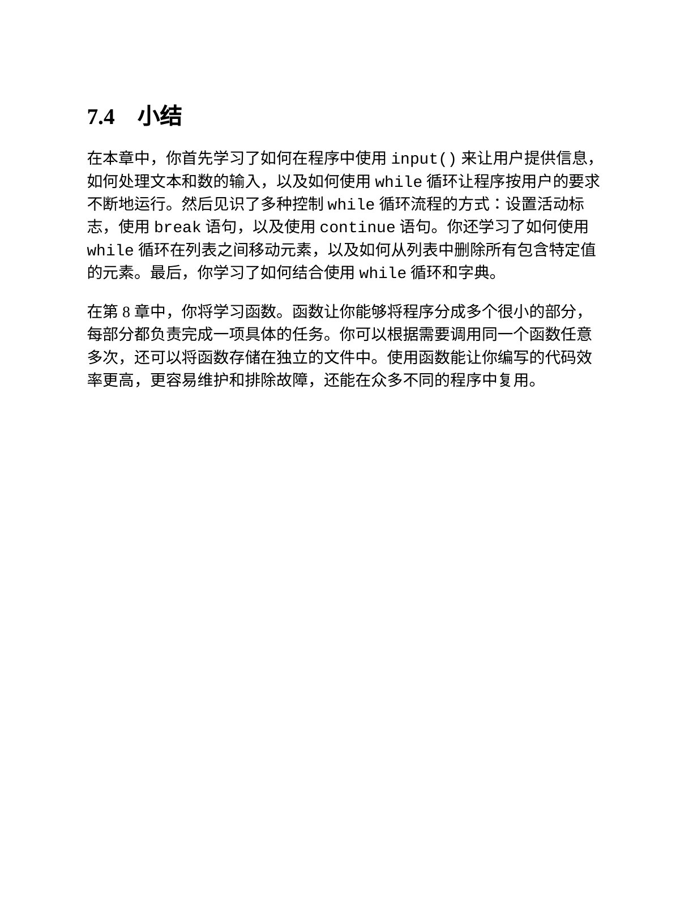

### 7.4 小结

在本章中，你首先学习了如何在程序中使用 `input()` 来让用户提供信息，如何处理文本和数的输入，以及如何使用 `while` 循环让程序按用户的要求不断地运行。然后见识了多种控制 `while` 循环流程的方式：设置活动标志，使用 `break` 语句，以及使用 `continue` 语句。你还学习了如何使用 `while` 循环在列表之间移动元素，以及如何从列表中删除所有包含特定值的元素。最后，你学习了如何结合使用 `while` 循环和字典。

在第 8 章中，你将学习函数。函数让你能够将程序分成多个很小的部分，每部分都负责完成一项具体的任务。你可以根据需要调用同一个函数任意多次，还可以将函数存储在独立的文件中。使用函数能让你编写的代码效率更高，更容易维护和排除故障，还能在众多不同的程序中复用。
