# 第 12 章 武装飞船

> 本地转换稿：带有 `page-status: reviewed` 标记的页面已由 AI 对照原页校对，保留原页图像供复核。完整示例和类内方法已做语法检查；原书带省略标记的代码片段不应直接运行，项目尚未完整执行验证。

[返回目录](README.md) | PDF 原页 339–378

## PDF 第 339 页

<!-- page-status: reviewed -->
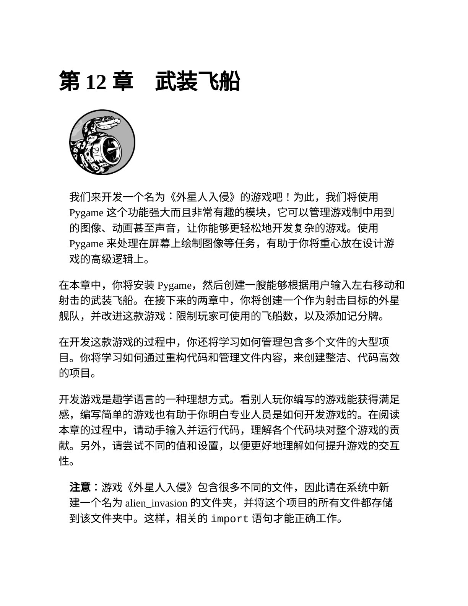

我们来开发一个名为《外星人入侵》的游戏吧！为此，我们将使用 Pygame 这个功能强大而且非常有趣的模块，它可以管理游戏制作用到的图像、动画甚至声音，让你能够更轻松地开发复杂的游戏。使用 Pygame 来处理在屏幕上绘制图像等任务，有助于你将重心放在设计游戏的高级逻辑上。

在本章中，你将安装 Pygame，然后创建一艘能够根据用户输入左右移动和射击的武装飞船。在接下来的两章中，你将创建一个作为射击目标的外星舰队，并改进这款游戏：限制玩家可使用的飞船数，以及添加记分牌。

在开发这款游戏的过程中，你还将学习如何管理包含多个文件的大型项目。你将学习如何通过重构代码和管理文件内容，来创建整洁、代码高效的项目。

开发游戏是趣学语言的一种理想方式。看别人玩你编写的游戏能获得满足感，编写简单的游戏也有助于你明白专业人员是如何开发游戏的。在阅读本章的过程中，请动手输入并运行代码，理解各个代码块对整个游戏的贡献。另外，请尝试不同的值和设置，以便更好地理解如何提升游戏的交互性。

**注意：**游戏《外星人入侵》包含很多不同的文件，因此请在系统中新建一个名为 `alien_invasion` 的文件夹，并将这个项目的所有文件都存储到该文件夹中。这样，相关的 `import` 语句才能正确工作。

## PDF 第 340 页

<!-- page-status: reviewed -->


如果你熟悉版本控制，可以将其用于这个项目；如果你没有使用过版本控制，请参阅附录 D 的概述。

## PDF 第 341 页

<!-- page-status: reviewed -->
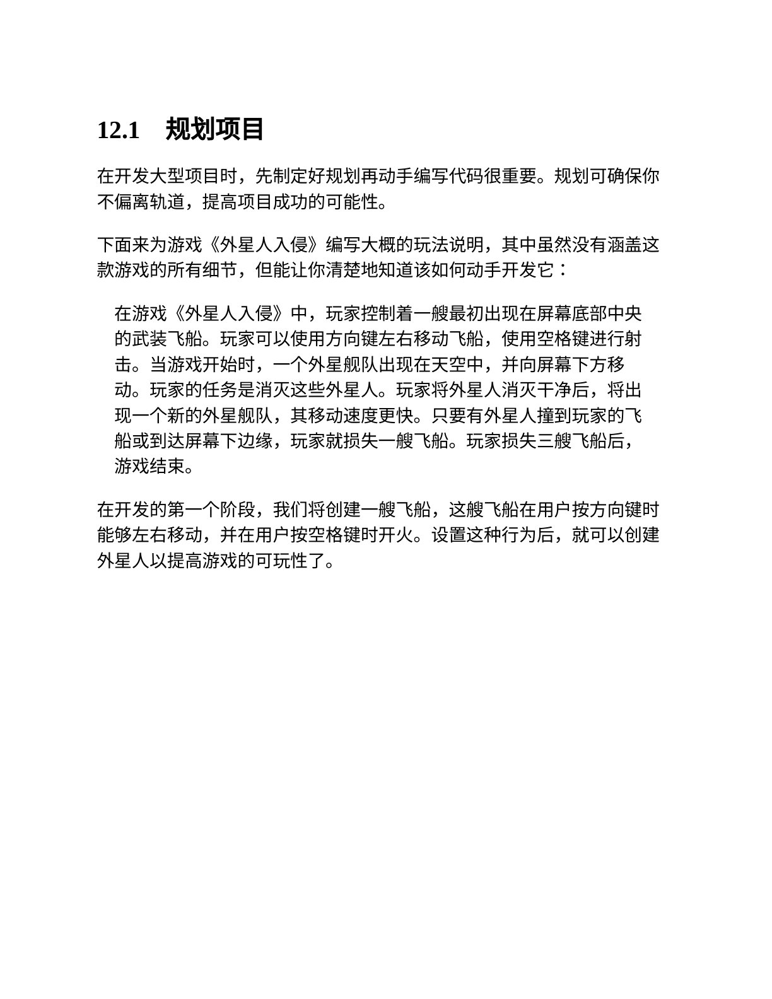

### 12.1 规划项目

在开发大型项目时，先制定好规划再动手编写代码很重要。规划可确保你不偏离轨道，提高项目成功的可能性。

下面来为游戏《外星人入侵》编写大概的玩法说明，其中虽然没有涵盖这款游戏的所有细节，但能让你清楚地知道该如何动手开发它：

> 在游戏《外星人入侵》中，玩家控制着一艘最初出现在屏幕底部中央的武装飞船。玩家可以使用方向键左右移动飞船，使用空格键进行射击。当游戏开始时，一个外星舰队出现在天空中，并向屏幕下方移动。玩家的任务是消灭这些外星人。玩家将外星人消灭干净后，将出现一个新的外星舰队，其移动速度更快。只要有外星人撞到玩家的飞船或到达屏幕下边缘，玩家就损失一艘飞船。玩家损失三艘飞船后，游戏结束。

在开发的第一个阶段，我们将创建一艘飞船，这艘飞船在用户按方向键时能够左右移动，并在用户按空格键时开火。设置这种行为后，就可以创建外星人以提高游戏的可玩性了。

## PDF 第 342 页

<!-- page-status: reviewed -->
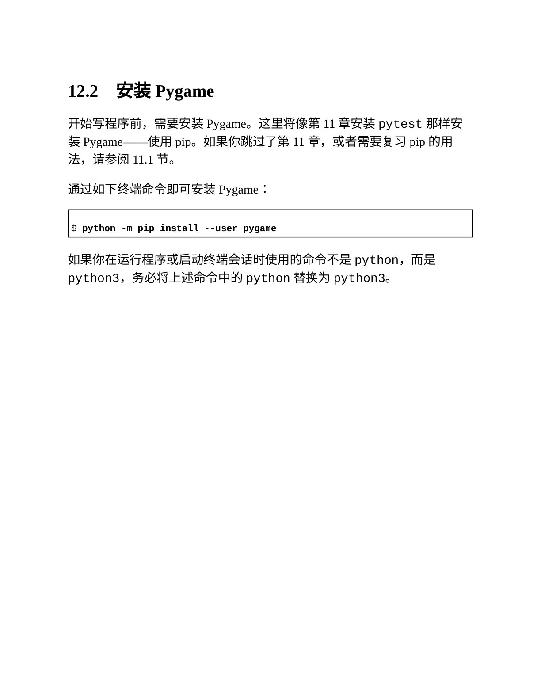

### 12.2 安装 Pygame

开始写程序前，需要安装 Pygame。这里将像第 11 章安装 `pytest` 那样安装 Pygame——使用 `pip`。如果你跳过了第 11 章，或者需要复习 `pip` 的用法，请参阅 11.1 节。

通过如下终端命令即可安装 Pygame：

```bash
python -m pip install --user pygame
```

如果你在运行程序或启动终端会话时使用的命令不是 `python`，而是 `python3`，务必将上述命令中的 `python` 替换为 `python3`。

## PDF 第 343 页

<!-- page-status: reviewed -->
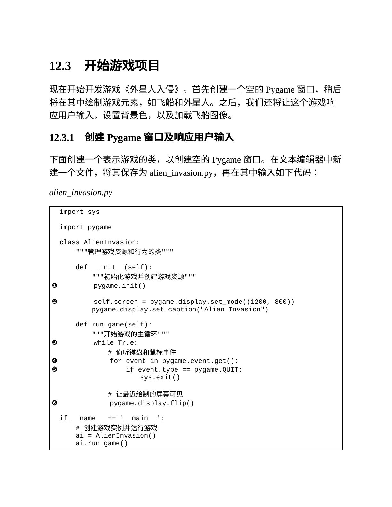

### 12.3 开始游戏项目

现在开始开发游戏《外星人入侵》。首先创建一个空的 Pygame 窗口，稍后将在其中绘制游戏元素，如飞船和外星人。之后，我们还将让这个游戏响应用户输入，设置背景色，以及加载飞船图像。

### 12.3.1 创建 Pygame 窗口及响应用户输入

下面创建一个表示游戏的类，以创建空的 Pygame 窗口。在文本编辑器中新建一个文件，将其保存为 `alien_invasion.py`，再在其中输入如下代码：

`alien_invasion.py`

```python
import sys

import pygame

class AlienInvasion:
    """管理游戏资源和行为的类"""

    def __init__(self):
        """初始化游戏并创建游戏资源"""
        pygame.init()  # ❶

        self.screen = pygame.display.set_mode((1200, 800))  # ❷
        pygame.display.set_caption("Alien Invasion")

    def run_game(self):
        """开始游戏的主循环"""
        while True:  # ❸
            # 侦听键盘和鼠标事件
            for event in pygame.event.get():  # ❹
                if event.type == pygame.QUIT:  # ❺
                    sys.exit()

            # 让最近绘制的屏幕可见
            pygame.display.flip()  # ❻

if __name__ == '__main__':
    # 创建游戏实例并运行游戏
    ai = AlienInvasion()
    ai.run_game()
```

## PDF 第 344 页

<!-- page-status: reviewed -->
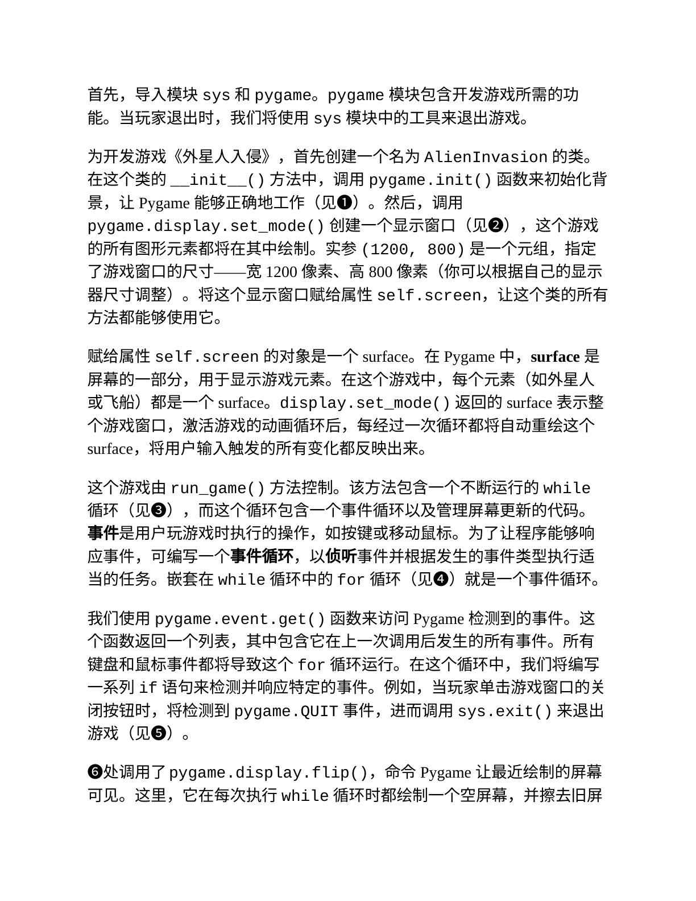

首先，导入模块 `sys` 和 `pygame`。`pygame` 模块包含开发游戏所需的功能。当玩家退出时，我们将使用 `sys` 模块中的工具来退出游戏。

为开发游戏《外星人入侵》，首先创建一个名为 `AlienInvasion` 的类。在这个类的 `__init__()` 方法中，调用 `pygame.init()` 函数来初始化背景，让 Pygame 能够正确地工作（见❶）。然后，调用 `pygame.display.set_mode()` 创建一个显示窗口（见❷），这个游戏的所有图形元素都将在其中绘制。实参 `(1200, 800)` 是一个元组，指定了游戏窗口的尺寸——宽 1200 像素、高 800 像素（你可以根据自己的显示器尺寸调整）。将这个显示窗口赋给属性 `self.screen`，让这个类的所有方法都能够使用它。

赋给属性 `self.screen` 的对象是一个 surface。在 Pygame 中，**surface** 是屏幕的一部分，用于显示游戏元素。在这个游戏中，每个元素（如外星人或飞船）都是一个 surface。`display.set_mode()` 返回的 surface 表示整个游戏窗口，激活游戏的动画循环后，每经过一次循环都将自动重绘这个 surface，将用户输入触发的所有变化都反映出来。

这个游戏由 `run_game()` 方法控制。该方法包含一个不断运行的 `while` 循环（见❸），而这个循环包含一个事件循环以及管理屏幕更新的代码。**事件**是用户玩游戏时执行的操作，如按键或移动鼠标。为了让程序能够响应事件，可编写一个**事件循环**，以侦听事件并根据发生的事件类型执行适当的任务。嵌套在 `while` 循环中的 `for` 循环（见❹）就是一个事件循环。

我们使用 `pygame.event.get()` 函数来访问 Pygame 检测到的事件。这个函数返回一个列表，其中包含它在上一次调用后发生的所有事件。所有键盘和鼠标事件都将导致这个 `for` 循环运行。在这个循环中，我们将编写一系列 `if` 语句来检测并响应特定的事件。例如，当玩家单击游戏窗口的关闭按钮时，将检测到 `pygame.QUIT` 事件，进而调用 `sys.exit()` 来退出游戏（见❺）。

❻处调用了 `pygame.display.flip()`，命令 Pygame 让最近绘制的屏幕可见。这里，它在每次执行 `while` 循环时都绘制一个空屏幕，并擦去旧屏幕（续下页）。

## PDF 第 345 页

<!-- page-status: reviewed -->
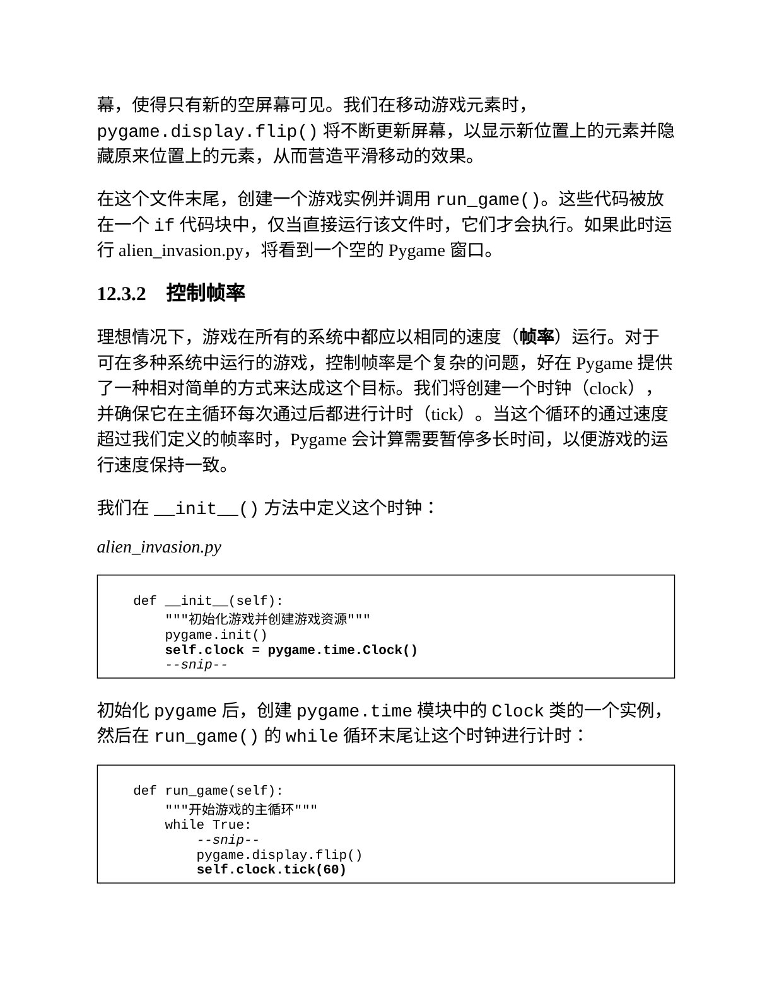

使得只有新的空屏幕可见。我们在移动游戏元素时，`pygame.display.flip()` 将不断更新屏幕，以显示新位置上的元素并隐藏原来位置上的元素，从而营造平滑移动的效果。

在这个文件末尾，创建一个游戏实例并调用 `run_game()`。这些代码被放在一个 `if` 代码块中，仅当直接运行该文件时，它们才会执行。如果此时运行 `alien_invasion.py`，将看到一个空的 Pygame 窗口。

### 12.3.2 控制帧率

理想情况下，游戏在所有的系统中都应以相同的速度（帧率）运行。对于可在多种系统中运行的游戏，控制帧率是个复杂的问题，好在 Pygame 提供了一种相对简单的方式来达成这个目标。我们将创建一个时钟（clock），并确保它在主循环每次通过后都进行计时（tick）。当这个循环的通过速度超过我们定义的帧率时，Pygame 会计算需要暂停多长时间，以便游戏的运行速度保持一致。

我们在 `__init__()` 方法中定义这个时钟：

`alien_invasion.py`（代码片段；`# --snip--` 表示原书省略的代码）

```python
def __init__(self):
    """初始化游戏并创建游戏资源"""
    pygame.init()
    self.clock = pygame.time.Clock()
    # --snip--
```

初始化 `pygame` 后，创建 `pygame.time` 模块中的 `Clock` 类的一个实例，然后在 `run_game()` 的 `while` 循环末尾让这个时钟进行计时：

```python
def run_game(self):
    """开始游戏的主循环"""
    while True:
        # --snip--
        pygame.display.flip()
        self.clock.tick(60)
```

## PDF 第 346 页

<!-- page-status: reviewed -->
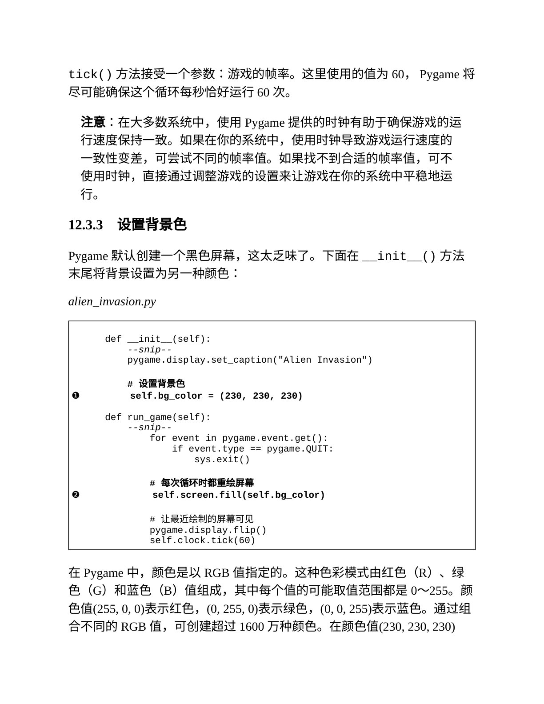

`tick()` 方法接受一个参数：游戏的帧率。这里使用的值为 60，Pygame 将尽可能确保这个循环每秒恰好运行 60 次。

**注意：**在大多数系统中，使用 Pygame 提供的时钟有助于确保游戏的运行速度保持一致。如果在你的系统中，使用时钟导致游戏运行速度的一致性变差，可尝试不同的帧率值。如果找不到合适的帧率值，可不使用时钟，直接通过调整游戏的设置来让游戏在你的系统中平稳地运行。

### 12.3.3 设置背景色

Pygame 默认创建一个黑色屏幕，这太乏味了。下面在 `__init__()` 方法末尾将背景设置为另一种颜色：

`alien_invasion.py`（原书代码片段；`--snip--` 表示省略，片段不能独立运行）

```text
    def __init__(self):
        --snip--
        pygame.display.set_caption("Alien Invasion")

        # 设置背景色
❶       self.bg_color = (230, 230, 230)

    def run_game(self):
        --snip--
            for event in pygame.event.get():
                if event.type == pygame.QUIT:
                    sys.exit()

            # 每次循环时都重绘屏幕
❷           self.screen.fill(self.bg_color)

            # 让最近绘制的屏幕可见
            pygame.display.flip()
            self.clock.tick(60)
```

在 Pygame 中，颜色是以 RGB 值指定的。这种色彩模式由红色（R）、绿色（G）和蓝色（B）值组成，其中每个值的可能取值范围都是 0～255。颜色值 `(255, 0, 0)` 表示红色，`(0, 255, 0)` 表示绿色，`(0, 0, 255)` 表示蓝色。通过组合不同的 RGB 值，可创建超过 1600 万种颜色。在颜色值 `(230, 230, 230)` 中（续下页）。

## PDF 第 347 页

<!-- page-status: reviewed -->
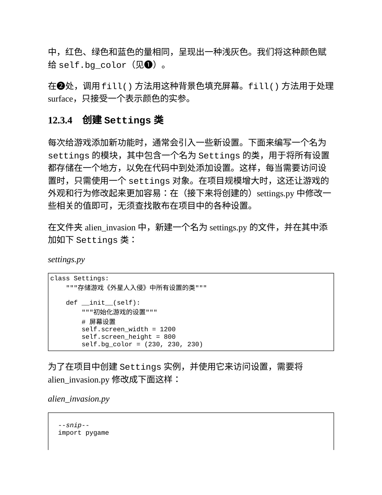

红色、绿色和蓝色的量相同，呈现出一种浅灰色。我们将这种颜色赋给 `self.bg_color`（见❶）。

在❷处，调用 `fill()` 方法用这种背景色填充屏幕。`fill()` 方法用于处理 surface，只接受一个表示颜色的实参。

### 12.3.4 创建 Settings 类

每次给游戏添加新功能时，通常会引入一些新设置。下面来编写一个名为 `settings` 的模块，其中包含一个名为 `Settings` 的类，用于将所有设置都存储在一个地方，以免在代码中到处添加设置。这样，每当需要访问设置时，只需使用一个 `settings` 对象。在项目规模增大时，这还让游戏的外观和行为修改起来更加容易：在（接下来将创建的）`settings.py` 中修改一些相关的值即可，无须查找散布在项目中的各种设置。

在文件夹 `alien_invasion` 中，新建一个名为 `settings.py` 的文件，并在其中添加如下 `Settings` 类：

`settings.py`

```python
class Settings:
    """存储游戏《外星人入侵》中所有设置的类"""

    def __init__(self):
        """初始化游戏的设置"""
        # 屏幕设置
        self.screen_width = 1200
        self.screen_height = 800
        self.bg_color = (230, 230, 230)
```

为了在项目中创建 `Settings` 实例，并使用它来访问设置，需要将 `alien_invasion.py` 修改成下面这样：

> 原书代码从 PDF 第 347 页末尾跨至第 348 页；完整片段见下页。

## PDF 第 348 页

<!-- page-status: reviewed -->
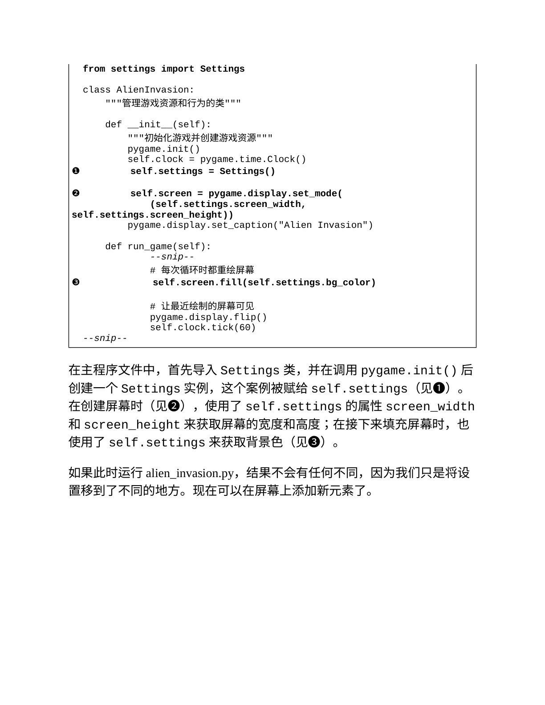

`alien_invasion.py`（跨页代码片段；`--snip--` 表示省略，片段不能独立运行）

```text
--snip--
import pygame

from settings import Settings

class AlienInvasion:
    """管理游戏资源和行为的类"""

    def __init__(self):
        """初始化游戏并创建游戏资源"""
        pygame.init()
        self.clock = pygame.time.Clock()
❶       self.settings = Settings()

❷       self.screen = pygame.display.set_mode(
            (self.settings.screen_width, self.settings.screen_height))
        pygame.display.set_caption("Alien Invasion")

    def run_game(self):
            --snip--
            # 每次循环时都重绘屏幕
❸           self.screen.fill(self.settings.bg_color)

            # 让最近绘制的屏幕可见
            pygame.display.flip()
            self.clock.tick(60)
--snip--
```

在主程序文件中，首先导入 `Settings` 类，并在调用 `pygame.init()` 后创建一个 `Settings` 实例，这个案例被赋给 `self.settings`（见❶）。在创建屏幕时（见❷），使用了 `self.settings` 的属性 `screen_width` 和 `screen_height` 来获取屏幕的宽度和高度；在接下来填充屏幕时，也使用了 `self.settings` 来获取背景色（见❸）。

如果此时运行 `alien_invasion.py`，结果不会有任何不同，因为我们只是将设置移到了不同的地方。现在可以在屏幕上添加新元素了。

## PDF 第 349 页

<!-- page-status: reviewed -->
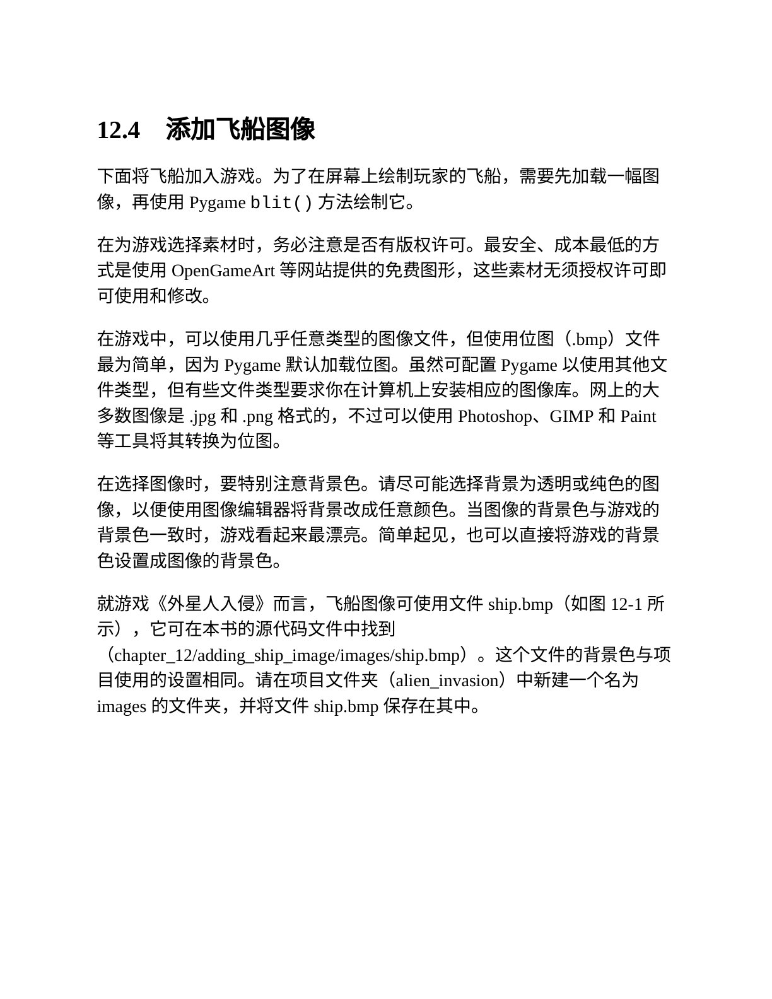

### 12.4 添加飞船图像

下面将飞船加入游戏。为了在屏幕上绘制玩家的飞船，需要先加载一幅图像，再使用 Pygame `blit()` 方法绘制它。

在为游戏选择素材时，务必注意是否有版权许可。最安全、成本最低的方式是使用 OpenGameArt 等网站提供的免费图形，这些素材无须授权许可即可使用和修改。

在游戏中，可以使用几乎任意类型的图像文件，但使用位图（`.bmp`）文件最为简单，因为 Pygame 默认加载位图。虽然可配置 Pygame 以使用其他文件类型，但有些文件类型要求你在计算机上安装相应的图像库。网上的大多数图像是 `.jpg` 和 `.png` 格式的，不过可以使用 Photoshop、GIMP 和 Paint 等工具将其转换为位图。

在选择图像时，要特别注意背景色。请尽可能选择背景为透明或纯色的图像，以便使用图像编辑器将背景改成任意颜色。当图像的背景色与游戏的背景色一致时，游戏看起来最漂亮。简单起见，也可以直接将游戏的背景色设置成图像的背景色。

就游戏《外星人入侵》而言，飞船图像可使用文件 `ship.bmp`（如图 12-1 所示），它可在本书的源代码文件中找到（`chapter_12/adding_ship_image/images/ship.bmp`）。这个文件的背景色与项目使用的设置相同。请在项目文件夹（`alien_invasion`）中新建一个名为 `images` 的文件夹，并将文件 `ship.bmp` 保存在其中。

## PDF 第 350 页

<!-- page-status: reviewed -->
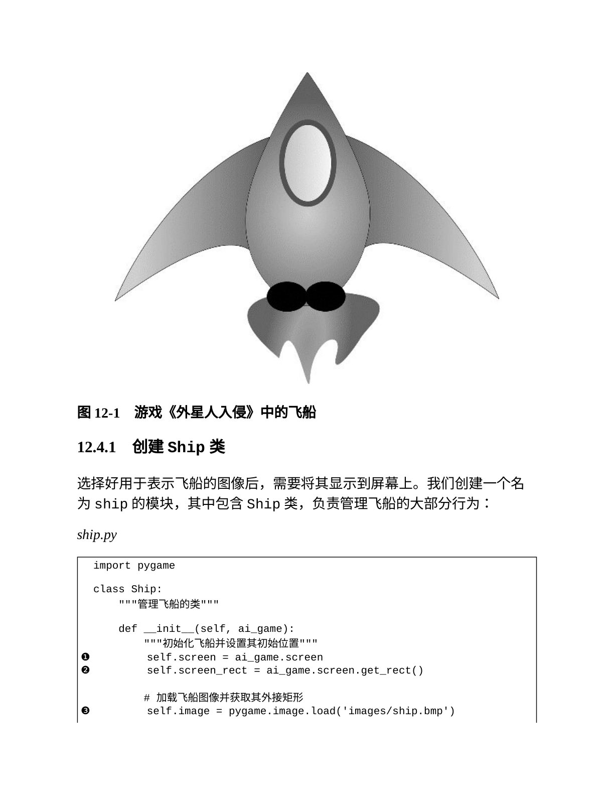

**图 12-1**　游戏《外星人入侵》中的飞船（见上方原页图）。

### 12.4.1 创建 Ship 类

选择好用于表示飞船的图像后，需要将其显示到屏幕上。我们创建一个名为 `ship` 的模块，其中包含 `Ship` 类，负责管理飞船的大部分行为：

`ship.py`

> 此代码跨 PDF 第 350–351 页，下方合并为完整代码。原书的圆圈数字放入行尾注释，以保留正文引用并使代码可编辑。

```python
import pygame

class Ship:
    """管理飞船的类"""

    def __init__(self, ai_game):
        """初始化飞船并设置其初始位置"""
        self.screen = ai_game.screen  # ❶
        self.screen_rect = ai_game.screen.get_rect()  # ❷

        # 加载飞船图像并获取其外接矩形
        self.image = pygame.image.load('images/ship.bmp')  # ❸
        self.rect = self.image.get_rect()

        # 每艘新飞船都放在屏幕底部的中央
        self.rect.midbottom = self.screen_rect.midbottom  # ❹

    def blitme(self):  # ❺
        """在指定位置绘制飞船"""
        self.screen.blit(self.image, self.rect)
```

## PDF 第 351 页

<!-- page-status: reviewed -->
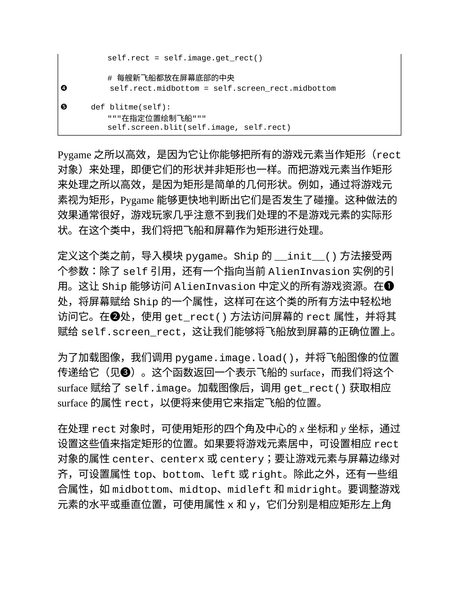

> 页面顶部是上一页代码的续行，完整代码见上页。

Pygame 之所以高效，是因为它让你能够把所有的游戏元素当作矩形（`rect` 对象）来处理，即便它们的形状并非矩形也一样。而把游戏元素当作矩形来处理之所以高效，是因为矩形是简单的几何形状。例如，通过将游戏元素视为矩形，Pygame 能够更快地判断出它们是否发生了碰撞。这种做法的效果通常很好，游戏玩家几乎注意不到我们处理的不是游戏元素的实际形状。在这个类中，我们将把飞船和屏幕作为矩形进行处理。

定义这个类之前，导入模块 `pygame`。`Ship` 的 `__init__()` 方法接受两个参数：除了 `self` 引用，还有一个指向当前 `AlienInvasion` 实例的引用。这让 `Ship` 能够访问 `AlienInvasion` 中定义的所有游戏资源。在❶处，将屏幕赋给 `Ship` 的一个属性，这样可在这个类的所有方法中轻松地访问它。在❷处，使用 `get_rect()` 方法访问屏幕的 `rect` 属性，并将其赋给 `self.screen_rect`，这让我们能够将飞船放到屏幕的正确位置上。

为了加载图像，我们调用 `pygame.image.load()`，并将飞船图像的位置传递给它（见❸）。这个函数返回一个表示飞船的 `surface`，而我们将这个 `surface` 赋给了 `self.image`。加载图像后，调用 `get_rect()` 获取相应 `surface` 的属性 `rect`，以便将来使用它来指定飞船的位置。

在处理 `rect` 对象时，可使用矩形的四个角及中心的 $x$ 坐标和 $y$ 坐标，通过设置这些值来指定矩形的位置。如果要将游戏元素居中，可设置相应 `rect` 对象的属性 `center`、`centerx` 或 `centery`；要让游戏元素与屏幕边缘对齐，可设置属性 `top`、`bottom`、`left` 或 `right`。除此之外，还有一些组合属性，如 `midbottom`、`midtop`、`midleft` 和 `midright`。要调整游戏元素的水平或垂直位置，可使用属性 `x` 和 `y`，它们分别是相应矩形左上角（续下页）

## PDF 第 352 页

<!-- page-status: reviewed -->
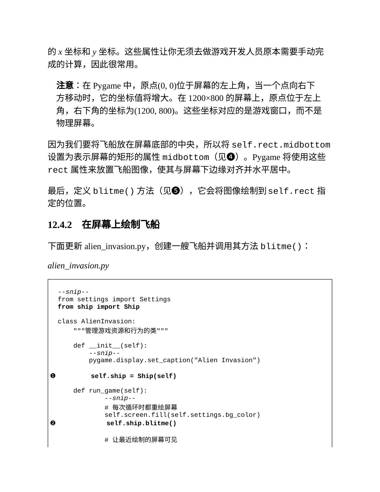

的 $x$ 坐标和 $y$ 坐标。这些属性让你无须去做游戏开发人员原本需要手动完成的计算，因此很常用。

> 注意：在 Pygame 中，原点 $(0, 0)$ 位于屏幕的左上角，当一个点向右下方移动时，它的坐标值将增大。在 $1200 \times 800$ 的屏幕上，原点位于左上角，右下角的坐标为 $(1200, 800)$。这些坐标对应的是游戏窗口，而不是物理屏幕。

因为我们要将飞船放在屏幕底部的中央，所以将 `self.rect.midbottom` 设置为表示屏幕的矩形的属性 `midbottom`（见❹）。Pygame 将使用这些 `rect` 属性来放置飞船图像，使其与屏幕下边缘对齐并水平居中。

最后，定义 `blitme()` 方法（见❺），它会将图像绘制到 `self.rect` 指定的位置。

### 12.4.2 在屏幕上绘制飞船

下面更新 `alien_invasion.py`，创建一艘飞船并调用其方法 `blitme()`：

`alien_invasion.py`

> 原书示例跨 PDF 第 352–353 页。`--snip--` 表示省略的代码，因此以下是可编辑的示意片段，不是完整可直接运行的程序；原书圆圈数字已保留在行尾标注。

```text
--snip--
from settings import Settings
from ship import Ship

class AlienInvasion:
    """管理游戏资源和行为的类"""

    def __init__(self):
        --snip--
        pygame.display.set_caption("Alien Invasion")

        self.ship = Ship(self)  # ❶

    def run_game(self):
            --snip--
            # 每次循环时都重绘屏幕
            self.screen.fill(self.settings.bg_color)
            self.ship.blitme()  # ❷

            # 让最近绘制的屏幕可见
            pygame.display.flip()
            self.clock.tick(60)
--snip--
```

## PDF 第 353 页

<!-- page-status: reviewed -->
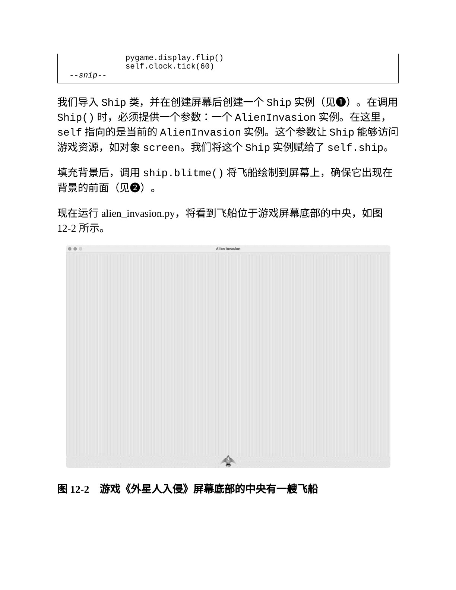

> 页面顶部是上一页代码的续行，完整示意片段见上页。

我们导入 `Ship` 类，并在创建屏幕后创建一个 `Ship` 实例（见❶）。在调用 `Ship()` 时，必须提供一个参数：一个 `AlienInvasion` 实例。在这里，`self` 指向的是当前的 `AlienInvasion` 实例。这个参数让 `Ship` 能够访问游戏资源，如对象 `screen`。我们将这个 `Ship` 实例赋给了 `self.ship`。

填充背景后，调用 `ship.blitme()` 将飞船绘制到屏幕上，确保它出现在背景的前面（见❷）。

现在运行 `alien_invasion.py`，将看到飞船位于游戏屏幕底部的中央，如图 12-2 所示。

**图 12-2**　游戏《外星人入侵》屏幕底部的中央有一艘飞船（见上方原页图）。

## PDF 第 354 页

<!-- page-status: reviewed -->
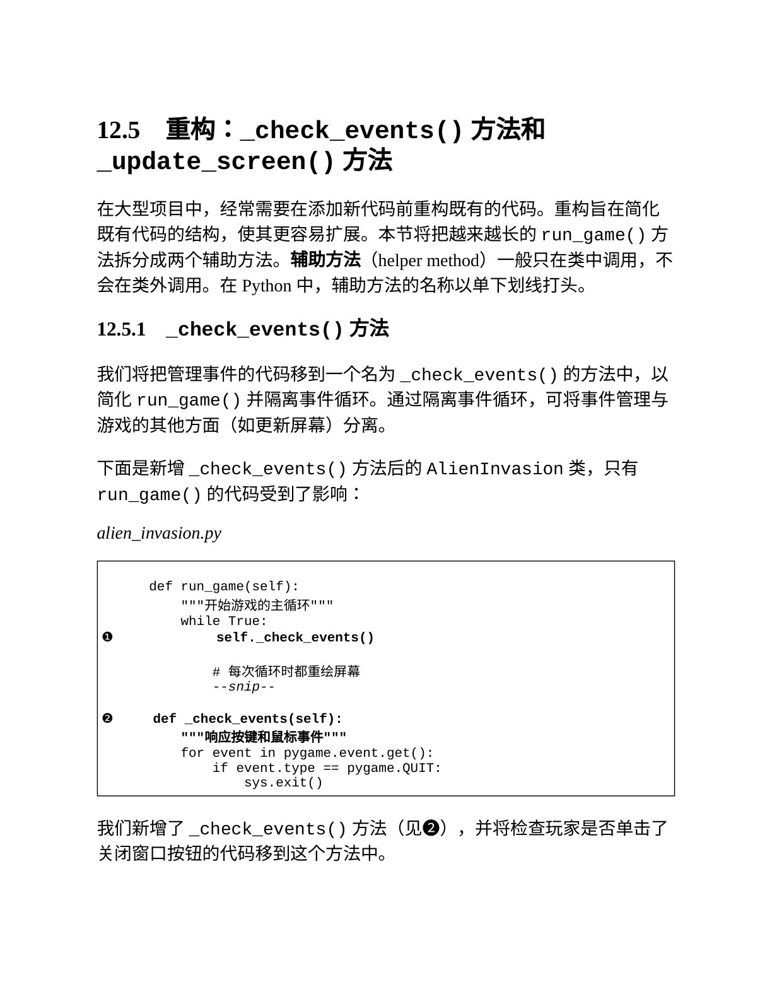

### 12.5 重构：`_check_events()` 方法和 `_update_screen()` 方法

在大型项目中，经常需要在添加新代码前重构既有的代码。重构旨在简化既有代码的结构，使其更容易扩展。本节将把越来越长的 `run_game()` 方法拆分成两个辅助方法。**辅助方法**（helper method）一般只在类中调用，不会在类外调用。在 Python 中，辅助方法的名称以单下划线打头。

### 12.5.1 `_check_events()` 方法

我们将把管理事件的代码移到一个名为 `_check_events()` 的方法中，以简化 `run_game()` 并隔离事件循环。通过隔离事件循环，可将事件管理与游戏的其他方面（如更新屏幕）分离。

下面是新增 `_check_events()` 方法后的 `AlienInvasion` 类，只有 `run_game()` 的代码受到了影响：

`alien_invasion.py`

> 以下是类中的代码片段；`--snip--` 是原书的省略标记，片段不可直接运行。原书圆圈数字以行尾注释保留。

```text
    def run_game(self):
        """开始游戏的主循环"""
        while True:
            self._check_events()  # ❶

            # 每次循环时都重绘屏幕
            --snip--

    def _check_events(self):  # ❷
        """响应按键和鼠标事件"""
        for event in pygame.event.get():
            if event.type == pygame.QUIT:
                sys.exit()
```

我们新增了 `_check_events()` 方法（见❷），并将检查玩家是否单击了关闭窗口按钮的代码移到这个方法中。

## PDF 第 355 页

<!-- page-status: reviewed -->
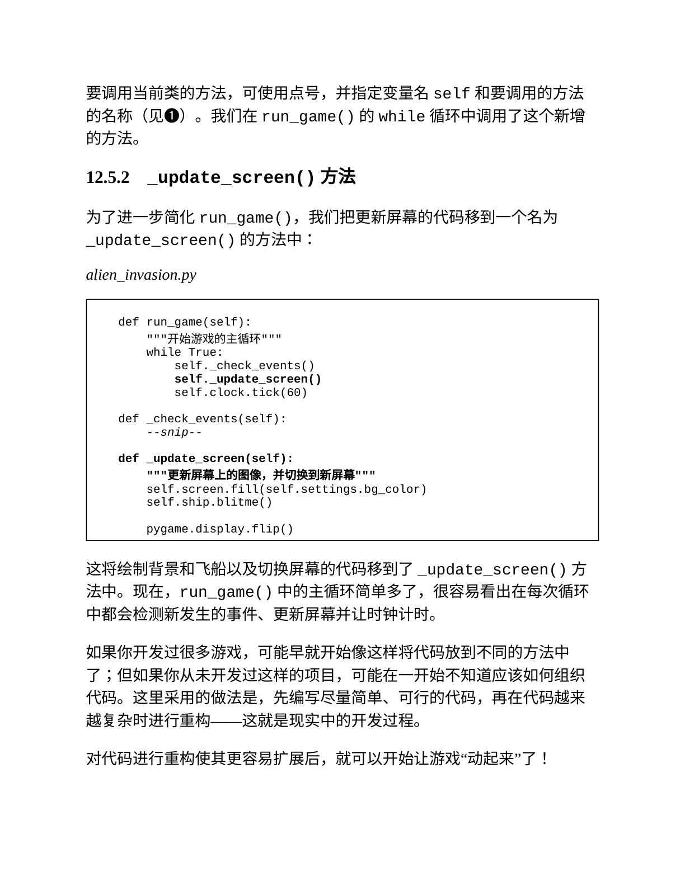

要调用当前类的方法，可使用点号，并指定变量名 `self` 和要调用的方法的名称（见❶）。我们在 `run_game()` 的 `while` 循环中调用了这个新增的方法。

### 12.5.2 `_update_screen()` 方法

为了进一步简化 `run_game()`，我们把更新屏幕的代码移到一个名为 `_update_screen()` 的方法中：

`alien_invasion.py`

> 以下是类中的代码片段，`--snip--` 表示原书省略的代码，不可直接运行。

```text
    def run_game(self):
        """开始游戏的主循环"""
        while True:
            self._check_events()
            self._update_screen()
            self.clock.tick(60)

    def _check_events(self):
        --snip--

    def _update_screen(self):
        """更新屏幕上的图像，并切换到新屏幕"""
        self.screen.fill(self.settings.bg_color)
        self.ship.blitme()

        pygame.display.flip()
```

这将绘制背景和飞船以及切换屏幕的代码移到了 `_update_screen()` 方法中。现在，`run_game()` 中的主循环简单多了，很容易看出在每次循环中都会检测新发生的事件、更新屏幕并让时钟计时。

如果你开发过很多游戏，可能早就开始像这样将代码放到不同的方法中了；但如果你从未开发过这样的项目，可能在一开始不知道应该如何组织代码。这里采用的做法是，先编写尽量简单、可行的代码，再在代码越来越复杂时进行重构——这就是现实中的开发过程。

对代码进行重构使其更容易扩展后，就可以开始让游戏“动起来”了！

## PDF 第 356 页

<!-- page-status: reviewed -->
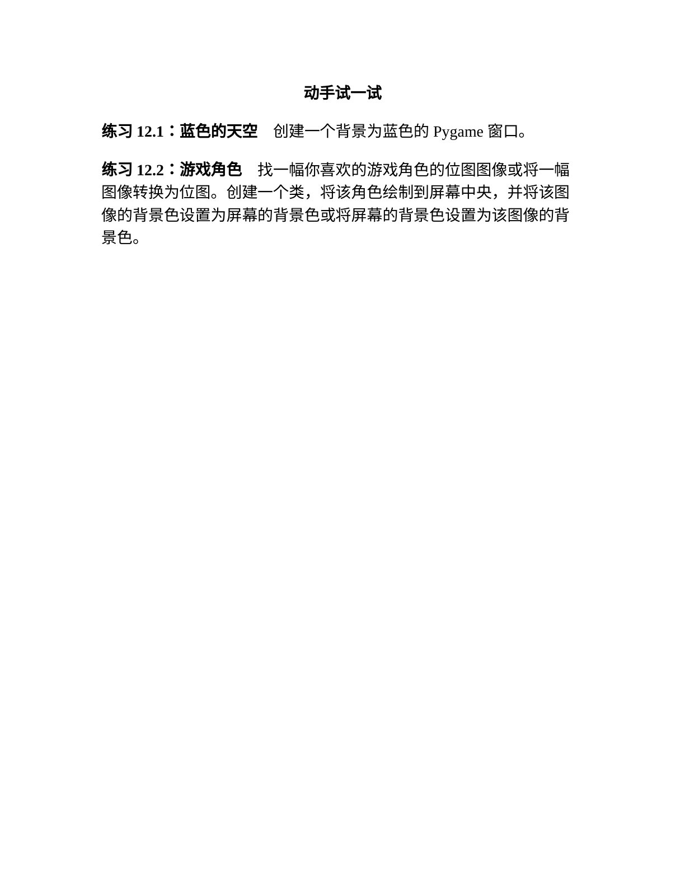

### 动手试一试

**练习 12.1：蓝色的天空**　创建一个背景为蓝色的 Pygame 窗口。

**练习 12.2：游戏角色**　找一幅你喜欢的游戏角色的位图图像或将一幅图像转换为位图。创建一个类，将该角色绘制到屏幕中央，并将该图像的背景色设置为屏幕的背景色或将屏幕的背景色设置为该图像的背景色。

## PDF 第 357 页

<!-- page-status: reviewed -->
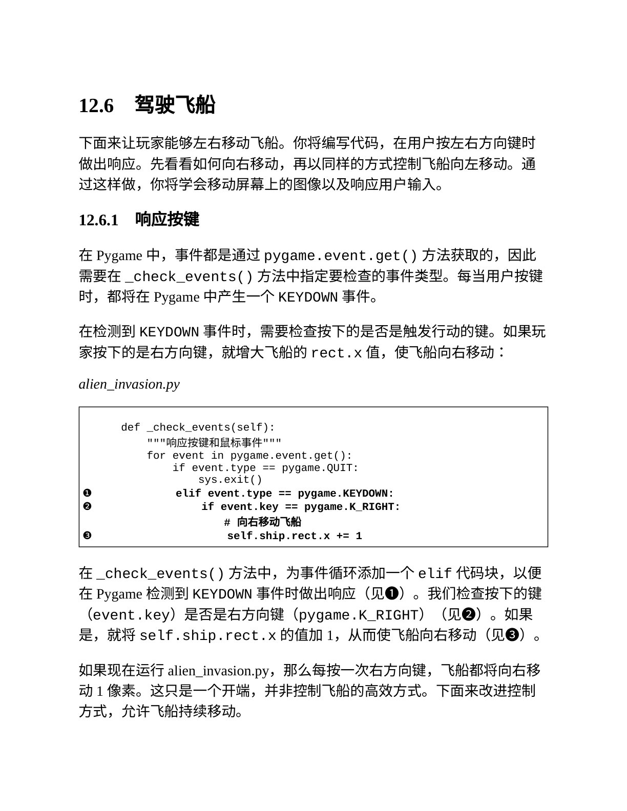

### 12.6 驾驶飞船

下面来让玩家能够左右移动飞船。你将编写代码，在用户按左右方向键时做出响应。先看看如何向右移动，再以同样的方式控制飞船向左移动。通过这样做，你将学会移动屏幕上的图像以及响应用户输入。

### 12.6.1 响应按键

在 Pygame 中，事件都是通过 `pygame.event.get()` 方法获取的，因此需要在 `_check_events()` 方法中指定要检查的事件类型。每当用户按键时，都将在 Pygame 中产生一个 `KEYDOWN` 事件。

在检测到 `KEYDOWN` 事件时，需要检查按下的是否是触发行动的键。如果玩家按下的是右方向键，就增大飞船的 `rect.x` 值，使飞船向右移动：

`alien_invasion.py`

> 以下是类中的方法；原书圆圈数字以行尾注释保留。

```python
    def _check_events(self):
        """响应按键和鼠标事件"""
        for event in pygame.event.get():
            if event.type == pygame.QUIT:
                sys.exit()
            elif event.type == pygame.KEYDOWN:  # ❶
                if event.key == pygame.K_RIGHT:  # ❷
                    # 向右移动飞船
                    self.ship.rect.x += 1  # ❸
```

在 `_check_events()` 方法中，为事件循环添加一个 `elif` 代码块，以便在 Pygame 检测到 `KEYDOWN` 事件时做出响应（见❶）。我们检查按下的键（`event.key`）是否是右方向键（`pygame.K_RIGHT`）（见❷）。如果是，就将 `self.ship.rect.x` 的值加 1，从而使飞船向右移动（见❸）。

如果现在运行 `alien_invasion.py`，那么每按一次右方向键，飞船都将向右移动 1 像素。这只是一个开端，并非控制飞船的高效方式。下面来改进控制方式，允许飞船持续移动。

## PDF 第 358 页

<!-- page-status: reviewed -->
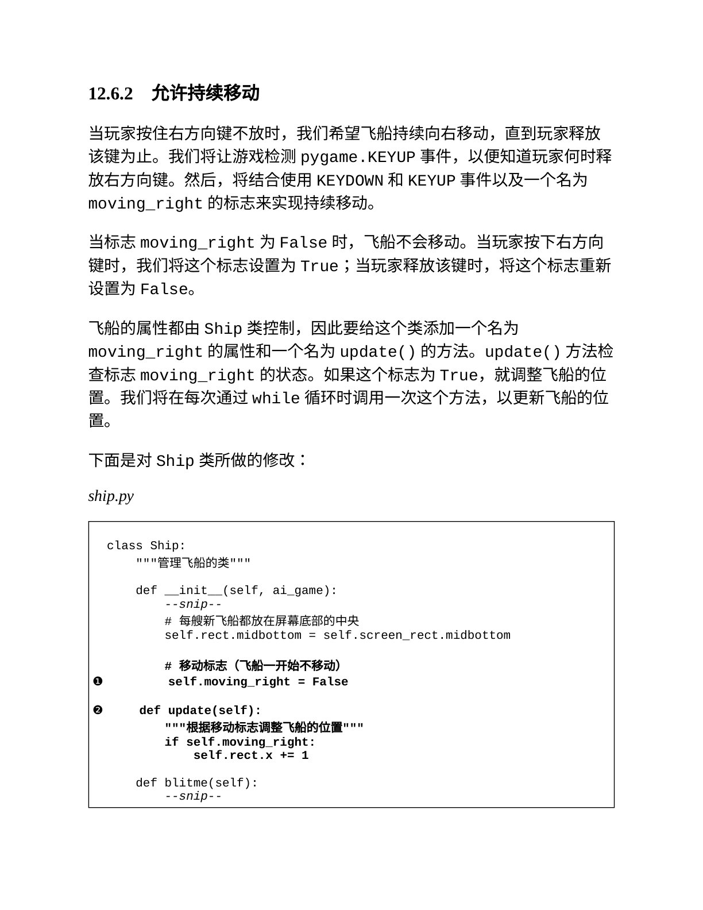

### 12.6.2 允许持续移动

当玩家按住右方向键不放时，我们希望飞船持续向右移动，直到玩家释放该键为止。我们将让游戏检测 `pygame.KEYUP` 事件，以便知道玩家何时释放右方向键。然后，将结合使用 `KEYDOWN` 和 `KEYUP` 事件以及一个名为 `moving_right` 的标志来实现持续移动。

当标志 `moving_right` 为 `False` 时，飞船不会移动。当玩家按下右方向键时，我们将这个标志设置为 `True`；当玩家释放该键时，将这个标志重新设置为 `False`。

飞船的属性都由 `Ship` 类控制，因此要给这个类添加一个名为 `moving_right` 的属性和一个名为 `update()` 的方法。`update()` 方法检查标志 `moving_right` 的状态。如果这个标志为 `True`，就调整飞船的位置。我们将在每次通过 `while` 循环时调用一次这个方法，以更新飞船的位置。

下面是对 `Ship` 类所做的修改：

`ship.py`

> `--snip--` 是原书省略标记，以下为不完整代码片段；圆圈数字以行尾注释保留。

```text
class Ship:
    """管理飞船的类"""

    def __init__(self, ai_game):
        --snip--
        # 每艘新飞船都放在屏幕底部的中央
        self.rect.midbottom = self.screen_rect.midbottom

        # 移动标志（飞船一开始不移动）
        self.moving_right = False  # ❶

    def update(self):  # ❷
        """根据移动标志调整飞船的位置"""
        if self.moving_right:
            self.rect.x += 1

    def blitme(self):
        --snip--
```

## PDF 第 359 页

<!-- page-status: reviewed -->
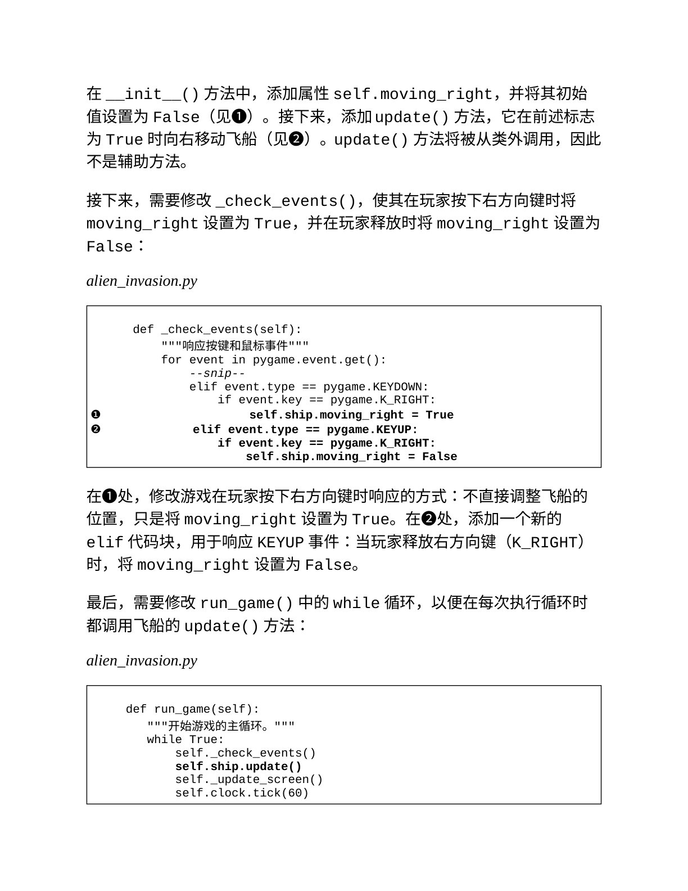

在 `__init__()` 方法中，添加属性 `self.moving_right`，并将其初始值设置为 `False`（见❶）。接下来，添加 `update()` 方法，它在前述标志为 `True` 时向右移动飞船（见❷）。`update()` 方法将被从类外调用，因此不是辅助方法。

接下来，需要修改 `_check_events()`，使其在玩家按下右方向键时将 `moving_right` 设置为 `True`，并在玩家释放时将 `moving_right` 设置为 `False`：

`alien_invasion.py`（原书代码片段，`--snip--` 表示省略；数字标记为原书注释）

```text
    def _check_events(self):
        """响应按键和鼠标事件"""
        for event in pygame.event.get():
            --snip--
            elif event.type == pygame.KEYDOWN:
                if event.key == pygame.K_RIGHT:
❶                   self.ship.moving_right = True
❷           elif event.type == pygame.KEYUP:
                if event.key == pygame.K_RIGHT:
                    self.ship.moving_right = False
```

在❶处，修改游戏在玩家按下右方向键时响应的方式：不直接调整飞船的位置，只是将 `moving_right` 设置为 `True`。在❷处，添加一个新的 `elif` 代码块，用于响应 `KEYUP` 事件：当玩家释放右方向键（`K_RIGHT`）时，将 `moving_right` 设置为 `False`。

最后，需要修改 `run_game()` 中的 `while` 循环，以便在每次执行循环时都调用飞船的 `update()` 方法：

`alien_invasion.py`

```python
def run_game(self):
    """开始游戏的主循环。"""
    while True:
        self._check_events()
        self.ship.update()
        self._update_screen()
        self.clock.tick(60)
```

## PDF 第 360 页

<!-- page-status: reviewed -->
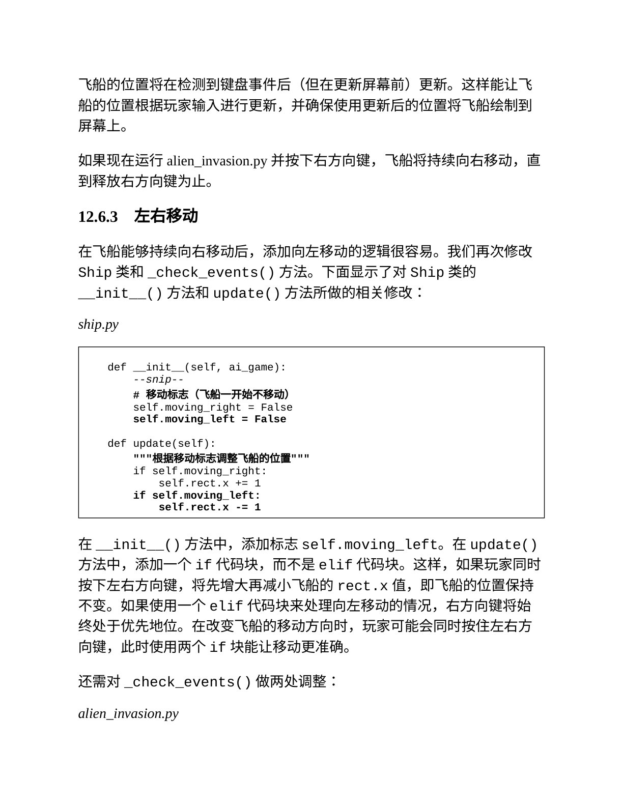

飞船的位置将在检测到键盘事件后（但在更新屏幕前）更新。这样能让飞船的位置根据玩家输入进行更新，并确保使用更新后的位置将飞船绘制到屏幕上。

如果现在运行 `alien_invasion.py` 并按下右方向键，飞船将持续向右移动，直到释放右方向键为止。

### 12.6.3 左右移动

在飞船能够持续向右移动后，添加向左移动的逻辑很容易。我们再次修改 `Ship` 类和 `_check_events()` 方法。下面显示了对 `Ship` 类的 `__init__()` 方法和 `update()` 方法所做的相关修改：

`ship.py`（原书省略的代码用注释标记）

```python
def __init__(self, ai_game):
    # --snip--
    # 移动标志（飞船一开始不移动）
    self.moving_right = False
    self.moving_left = False

def update(self):
    """根据移动标志调整飞船的位置"""
    if self.moving_right:
        self.rect.x += 1
    if self.moving_left:
        self.rect.x -= 1
```

在 `__init__()` 方法中，添加标志 `self.moving_left`。在 `update()` 方法中，添加一个 `if` 代码块，而不是 `elif` 代码块。这样，如果玩家同时按下左右方向键，将先增大再减小飞船的 `rect.x` 值，即飞船的位置保持不变。如果使用一个 `elif` 代码块来处理向左移动的情况，右方向键将始终处于优先地位。在改变飞船的移动方向时，玩家可能会同时按住左右方向键，此时使用两个 `if` 块能让移动更准确。

还需对 `_check_events()` 做两处调整：

`alien_invasion.py`（代码续下页）。

## PDF 第 361 页

<!-- page-status: reviewed -->
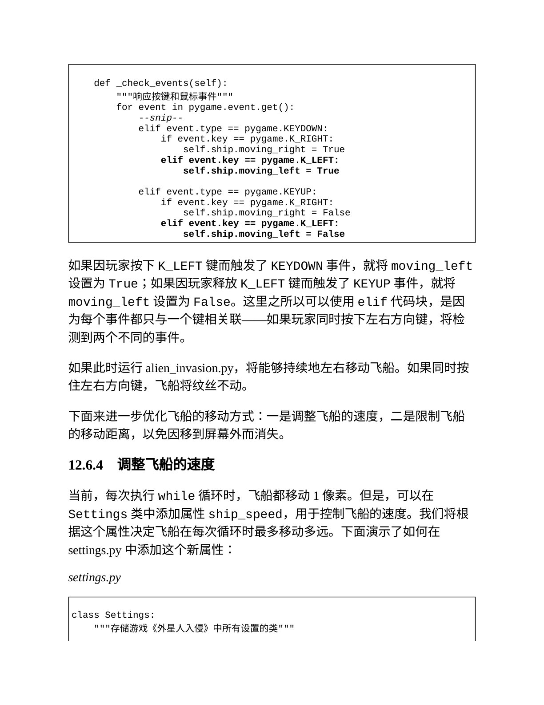

```text
    def _check_events(self):
        """响应按键和鼠标事件"""
        for event in pygame.event.get():
            --snip--
            elif event.type == pygame.KEYDOWN:
                if event.key == pygame.K_RIGHT:
                    self.ship.moving_right = True
                elif event.key == pygame.K_LEFT:
                    self.ship.moving_left = True

            elif event.type == pygame.KEYUP:
                if event.key == pygame.K_RIGHT:
                    self.ship.moving_right = False
                elif event.key == pygame.K_LEFT:
                    self.ship.moving_left = False
```

如果因玩家按下 `K_LEFT` 键而触发了 `KEYDOWN` 事件，就将 `moving_left` 设置为 `True`；如果因玩家释放 `K_LEFT` 键而触发了 `KEYUP` 事件，就将 `moving_left` 设置为 `False`。这里之所以可以使用 `elif` 代码块，是因为每个事件都只与一个键相关联——如果玩家同时按下左右方向键，将检测到两个不同的事件。

如果此时运行 `alien_invasion.py`，将能够持续地左右移动飞船。如果同时按住左右方向键，飞船将纹丝不动。

下面来进一步优化飞船的移动方式：一是调整飞船的速度，二是限制飞船的移动距离，以免因移到屏幕外而消失。

### 12.6.4 调整飞船的速度

当前，每次执行 `while` 循环时，飞船都移动 1 像素。但是，可以在 `Settings` 类中添加属性 `ship_speed`，用于控制飞船的速度。我们将根据这个属性决定飞船在每次循环时最多移动多远。下面演示了如何在 `settings.py` 中添加这个新属性：

`settings.py`（代码跨 PDF 第 361–362 页，原书以 `--snip--` 省略其余内容）

```text
class Settings:
    """存储游戏《外星人入侵》中所有设置的类"""

    def __init__(self):
        --snip--

        # 飞船的设置
        self.ship_speed = 1.5
```

## PDF 第 362 页

<!-- page-status: reviewed -->
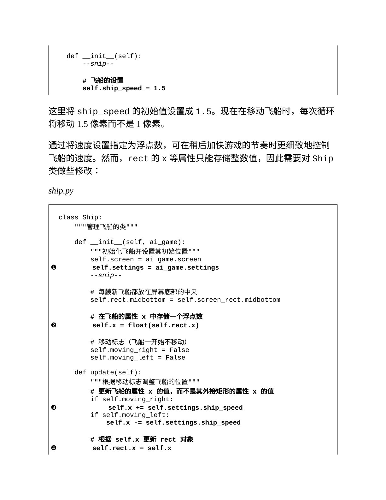

> 页首为上一页代码的续行，完整片段见上页。

这里将 `ship_speed` 的初始值设置成 1.5。现在在移动飞船时，每次循环将移动 1.5 像素而不是 1 像素。

通过将速度设置指定为浮点数，可在稍后加快游戏的节奏时更细致地控制飞船的速度。然而，`rect` 的 `x` 等属性只能存储整数值，因此需要对 `Ship` 类做些修改：

`ship.py`（代码跨 PDF 第 362–363 页；原书 `--snip--` 表示省略，数字标记为原书注释）

```text
class Ship:
    """管理飞船的类"""

    def __init__(self, ai_game):
        """初始化飞船并设置其初始位置"""
        self.screen = ai_game.screen
❶       self.settings = ai_game.settings
        --snip--

        # 每艘新飞船都放在屏幕底部的中央
        self.rect.midbottom = self.screen_rect.midbottom

        # 在飞船的属性 x 中存储一个浮点数
❷       self.x = float(self.rect.x)

        # 移动标志（飞船一开始不动）
        self.moving_right = False
        self.moving_left = False

    def update(self):
        """根据移动标志调整飞船的位置"""
        # 更新飞船的属性 x 的值，而不是其外接矩形的属性 x 的值
        if self.moving_right:
❸           self.x += self.settings.ship_speed
        if self.moving_left:
            self.x -= self.settings.ship_speed

        # 根据 self.x 更新 rect 对象
❹       self.rect.x = self.x

    def blitme(self):
        --snip--
```

## PDF 第 363 页

<!-- page-status: reviewed -->
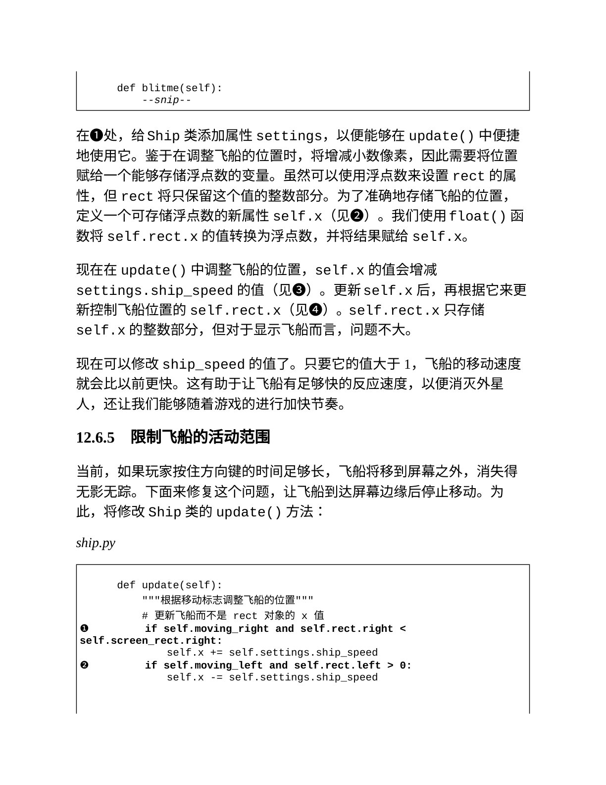

> 页首为上一页代码的续行，完整片段见上页。

在❶处，给 `Ship` 类添加属性 `settings`，以便能够在 `update()` 中便捷地使用它。鉴于在调整飞船的位置时，将增减小数像素，因此需要将位置赋给一个能够存储浮点数的变量。虽然可以使用浮点数来设置 `rect` 的属性，但 `rect` 将只保留这个值的整数部分。为了准确地存储飞船的位置，定义一个可存储浮点数的新属性 `self.x`（见❷）。我们使用 `float()` 函数将 `self.rect.x` 的值转换为浮点数，并将结果赋给 `self.x`。

现在在 `update()` 中调整飞船的位置，`self.x` 的值会增减 `settings.ship_speed` 的值（见❸）。更新 `self.x` 后，再根据它来更新控制飞船位置的 `self.rect.x`（见❹）。`self.rect.x` 只存储 `self.x` 的整数部分，但对于显示飞船而言，问题不大。

现在可以修改 `ship_speed` 的值了。只要它的值大于 1，飞船的移动速度就会比以前更快。这有助于让飞船有足够快的反应速度，以便消灭外星人，还让我们能够随着游戏的进行加快节奏。

### 12.6.5 限制飞船的活动范围

当前，如果玩家按住方向键的时间足够长，飞船将移到屏幕之外，消失得无影无踪。下面来修复这个问题，让飞船到达屏幕边缘后停止移动。为此，将修改 `Ship` 类的 `update()` 方法：

`ship.py`（此方法跨 PDF 第 363–364 页，下面合并为类中的完整方法；原书因排版换行的条件已连成一行）

```python
def update(self):
    """根据移动标志调整飞船的位置"""
    # 更新飞船而不是 rect 对象的 x 值
    if self.moving_right and self.rect.right < self.screen_rect.right:  # ❶
        self.x += self.settings.ship_speed
    if self.moving_left and self.rect.left > 0:  # ❷
        self.x -= self.settings.ship_speed

    # 根据 self.x 更新 rect 对象
    self.rect.x = self.x
```

## PDF 第 364 页

<!-- page-status: reviewed -->
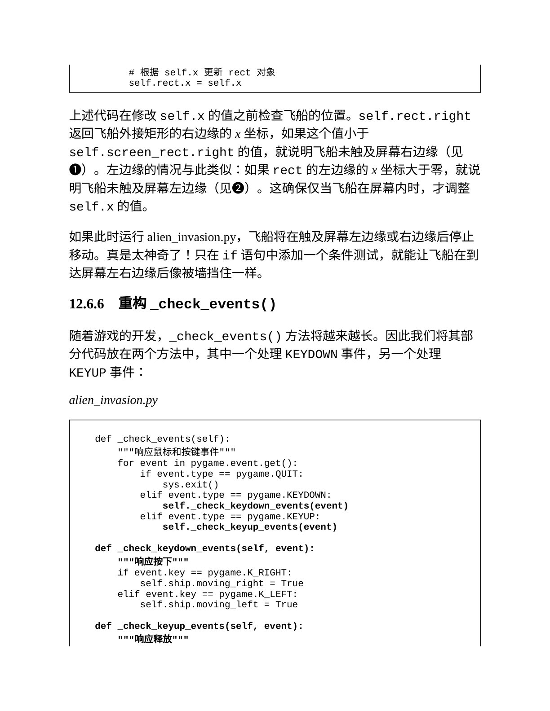

> 本页顶部是上一页方法代码的续行，合并后的完整方法见上一页。

上述代码在修改 `self.x` 的值之前检查飞船的位置。`self.rect.right` 返回飞船外接矩形的右边缘的 $x$ 坐标，如果这个值小于 `self.screen_rect.right` 的值，就说明飞船未触及屏幕右边缘（见❶）。左边缘的情况与此类似：如果 `rect` 的左边缘的 $x$ 坐标大于零，就说明飞船未触及屏幕左边缘（见❷）。这确保仅当飞船在屏幕内时，才调整 `self.x` 的值。

如果此时运行 `alien_invasion.py`，飞船将在触及屏幕左边缘或右边缘后停止移动。真是太神奇了！只在 `if` 语句中添加一个条件测试，就能让飞船在到达屏幕左右边缘后像被墙挡住一样。

### 12.6.6 重构 `_check_events()`

随着游戏的开发，`_check_events()` 方法将越来越长。因此我们将其部分代码放在两个方法中，其中一个处理 `KEYDOWN` 事件，另一个处理 `KEYUP` 事件：

`alien_invasion.py`

> 此代码跨 PDF 第 364–365 页，以下合并为完整方法片段。它们属于类中的方法，需要与其余项目代码组合使用。

```python
    def _check_events(self):
        """响应鼠标和按键事件"""
        for event in pygame.event.get():
            if event.type == pygame.QUIT:
                sys.exit()
            elif event.type == pygame.KEYDOWN:
                self._check_keydown_events(event)
            elif event.type == pygame.KEYUP:
                self._check_keyup_events(event)

    def _check_keydown_events(self, event):
        """响应按下"""
        if event.key == pygame.K_RIGHT:
            self.ship.moving_right = True
        elif event.key == pygame.K_LEFT:
            self.ship.moving_left = True

    def _check_keyup_events(self, event):
        """响应释放"""
        if event.key == pygame.K_RIGHT:
            self.ship.moving_right = False
        elif event.key == pygame.K_LEFT:
            self.ship.moving_left = False
```

## PDF 第 365 页

<!-- page-status: reviewed -->
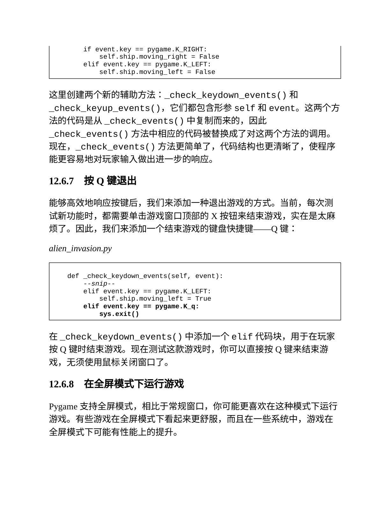

> 页面顶部是上一页代码的续行，合并后的方法片段见上页。

这里创建两个新的辅助方法：`_check_keydown_events()` 和 `_check_keyup_events()`，它们都包含形参 `self` 和 `event`。这两个方法的代码是从 `_check_events()` 中复制而来的，因此 `_check_events()` 方法中相应的代码被替换成了对这两个方法的调用。现在，`_check_events()` 方法更简单了，代码结构也更清晰了，使程序能更容易地对玩家输入做出进一步的响应。

### 12.6.7 按 Q 键退出

能够高效地响应按键后，我们来添加一种退出游戏的方式。当前，每次测试新功能时，都需要单击游戏窗口顶部的 X 按钮来结束游戏，实在是太麻烦了。因此，我们来添加一个结束游戏的键盘快捷键——Q 键：

`alien_invasion.py`

> `--snip--` 为原书的代码省略标记，以下片段不可单独运行。

```text
    def _check_keydown_events(self, event):
        --snip--
        elif event.key == pygame.K_LEFT:
            self.ship.moving_left = True
        elif event.key == pygame.K_q:
            sys.exit()
```

在 `_check_keydown_events()` 中添加一个 `elif` 代码块，用于在玩家按 Q 键时结束游戏。现在测试这款游戏时，你可以直接按 Q 键来结束游戏，无须使用鼠标关闭窗口了。

### 12.6.8 在全屏模式下运行游戏

Pygame 支持全屏模式，相比于常规窗口，你可能更喜欢在这种模式下运行游戏。有些游戏在全屏模式下看起来更舒服，而且在一些系统中，游戏在全屏模式下可能有性能上的提升。

## PDF 第 366 页

<!-- page-status: reviewed -->
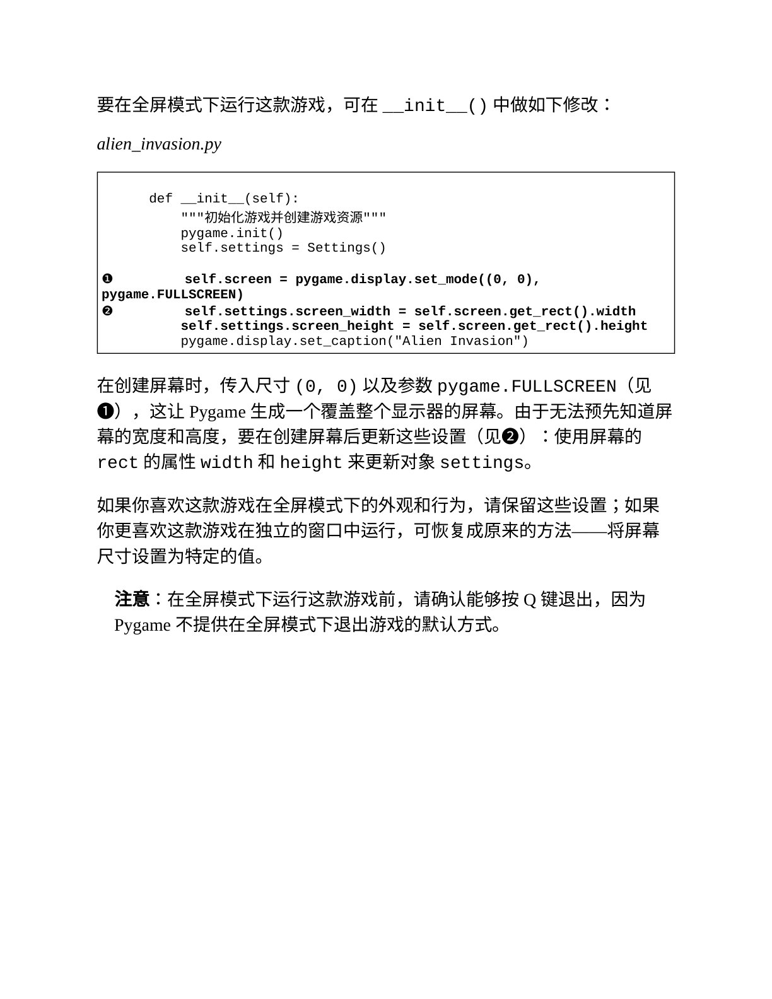

要在全屏模式下运行这款游戏，可在 `__init__()` 中做如下修改：

`alien_invasion.py`

> 这是类中的方法片段；原书的圆圈数字以行尾注释保留。原页中因版面换行而拆开的 `pygame.FULLSCREEN` 参数已连接。

```python
    def __init__(self):
        """初始化游戏并创建游戏资源"""
        pygame.init()
        self.settings = Settings()

        self.screen = pygame.display.set_mode((0, 0), pygame.FULLSCREEN)  # ❶
        self.settings.screen_width = self.screen.get_rect().width  # ❷
        self.settings.screen_height = self.screen.get_rect().height
        pygame.display.set_caption("Alien Invasion")
```

在创建屏幕时，传入尺寸 $(0, 0)$ 以及参数 `pygame.FULLSCREEN`（见❶），这让 Pygame 生成一个覆盖整个显示器的屏幕。由于无法预先知道屏幕的宽度和高度，要在创建屏幕后更新这些设置（见❷）：使用屏幕的 `rect` 的属性 `width` 和 `height` 来更新对象 `settings`。

如果你喜欢这款游戏在全屏模式下的外观和行为，请保留这些设置；如果你更喜欢这款游戏在独立的窗口中运行，可恢复成原来的方法——将屏幕尺寸设置为特定的值。

> 注意：在全屏模式下运行这款游戏前，请确认能够按 Q 键退出，因为 Pygame 不提供在全屏模式下退出游戏的默认方式。

## PDF 第 367 页

<!-- page-status: reviewed -->
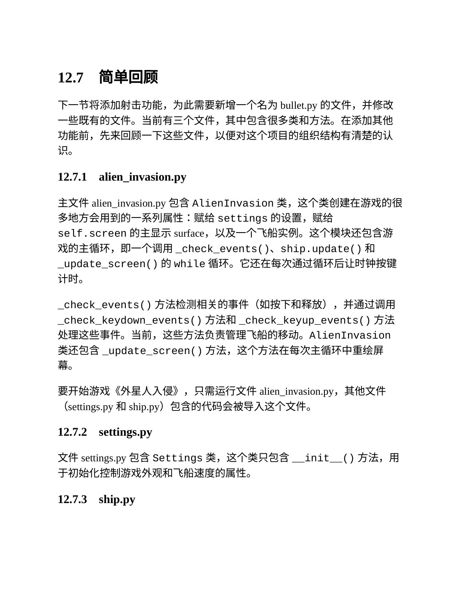

### 12.7 简单回顾

下一节将添加射击功能，为此需要新增一个名为 `bullet.py` 的文件，并修改一些既有的文件。当前有三个文件，其中包含很多类和方法。在添加其他功能前，先来回顾一下这些文件，以便对这个项目的组织结构有清楚的认识。

### 12.7.1 `alien_invasion.py`

主文件 `alien_invasion.py` 包含 `AlienInvasion` 类，这个类创建在游戏的很多地方会用到的一系列属性：赋给 `settings` 的设置，赋给 `self.screen` 的主显示 surface，以及一个飞船实例。这个模块还包含游戏的主循环，即一个调用 `_check_events()`、`ship.update()` 和 `_update_screen()` 的 `while` 循环。它还在每次通过循环后让时钟按键计时。

`_check_events()` 方法检测相关的事件（如按下和释放），并通过调用 `_check_keydown_events()` 方法和 `_check_keyup_events()` 方法处理这些事件。当前，这些方法负责管理飞船的移动。`AlienInvasion` 类还包含 `_update_screen()` 方法，这个方法在每次主循环中重绘屏幕。

要开始游戏《外星人入侵》，只需运行文件 `alien_invasion.py`，其他文件（`settings.py` 和 `ship.py`）包含的代码会被导入这个文件。

### 12.7.2 `settings.py`

文件 `settings.py` 包含 `Settings` 类，这个类只包含 `__init__()` 方法，用于初始化控制游戏外观和飞船速度的属性。

### 12.7.3 `ship.py`

## PDF 第 368 页

<!-- page-status: reviewed -->
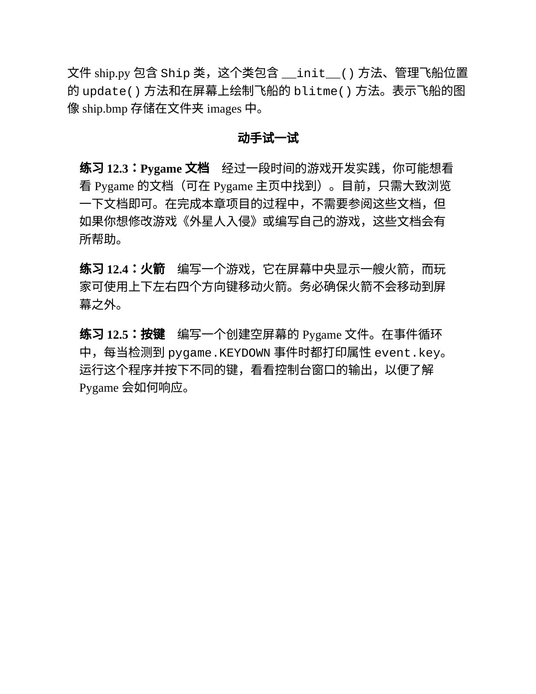

文件 `ship.py` 包含 `Ship` 类，这个类包含 `__init__()` 方法、管理飞船位置的 `update()` 方法和在屏幕上绘制飞船的 `blitme()` 方法。表示飞船的图像 `ship.bmp` 存储在文件夹 `images` 中。

### 动手试一试

**练习 12.3：Pygame 文档**　经过一段时间的游戏开发实践，你可能想看看 Pygame 的文档（可在 Pygame 主页中找到）。目前，只需大致浏览一下文档即可。在完成本章项目的过程中，不需要参阅这些文档，但如果你想修改游戏《外星人入侵》或编写自己的游戏，这些文档会有所帮助。

**练习 12.4：火箭**　编写一个游戏，它在屏幕中央显示一艘火箭，而玩家可使用上下左右四个方向键移动火箭。务必确保火箭不会移动到屏幕之外。

**练习 12.5：按键**　编写一个创建空屏幕的 Pygame 文件。在事件循环中，每当检测到 `pygame.KEYDOWN` 事件时都打印属性 `event.key`。运行这个程序并按下不同的键，看看控制台窗口的输出，以便了解 Pygame 会如何响应。

## PDF 第 369 页

<!-- page-status: reviewed -->
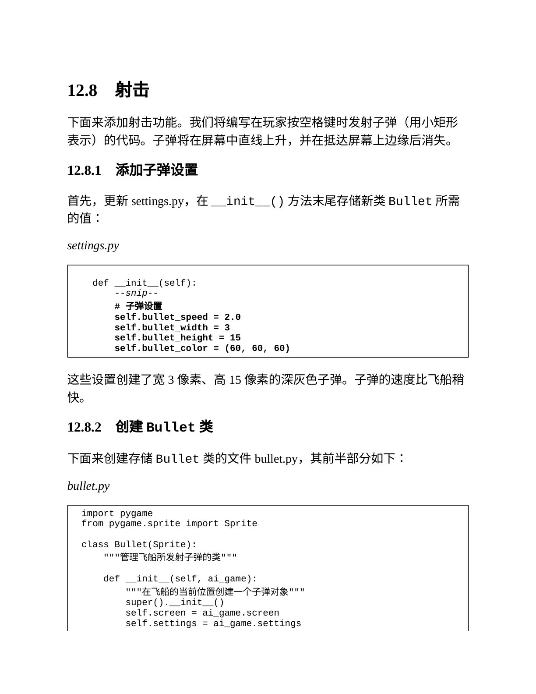

### 12.8 射击

下面来添加射击功能。我们将编写在玩家按空格键时发射子弹（用小矩形表示）的代码。子弹将在屏幕中直线上升，并在抵达屏幕上边缘后消失。

### 12.8.1 添加子弹设置

首先，更新 `settings.py`，在 `__init__()` 方法末尾存储新类 `Bullet` 所需的值：

`settings.py`（原书省略了前面的代码，以下为片段）

```text
    def __init__(self):
        --snip--
        # 子弹设置
        self.bullet_speed = 2.0
        self.bullet_width = 3
        self.bullet_height = 15
        self.bullet_color = (60, 60, 60)
```

这些设置创建了宽 3 像素、高 15 像素的深灰色子弹。子弹的速度比飞船稍快。

### 12.8.2 创建 Bullet 类

下面来创建存储 `Bullet` 类的文件 `bullet.py`，其前半部分如下：

`bullet.py`（代码跨 PDF 第 369–370 页，合并如下）

```python
import pygame
from pygame.sprite import Sprite

class Bullet(Sprite):
    """管理飞船所发射子弹的类"""

    def __init__(self, ai_game):
        """在飞船的当前位置创建一个子弹对象"""
        super().__init__()
        self.screen = ai_game.screen
        self.settings = ai_game.settings
        self.color = self.settings.bullet_color

        # 在(0,0)处创建一个表示子弹的矩形，再设置正确的位置
        self.rect = pygame.Rect(0, 0, self.settings.bullet_width,
                               self.settings.bullet_height)  # ❶
        self.rect.midtop = ai_game.ship.rect.midtop  # ❷

        # 存储用浮点数表示的子弹位置
        self.y = float(self.rect.y)  # ❸
```

## PDF 第 370 页

<!-- page-status: reviewed -->
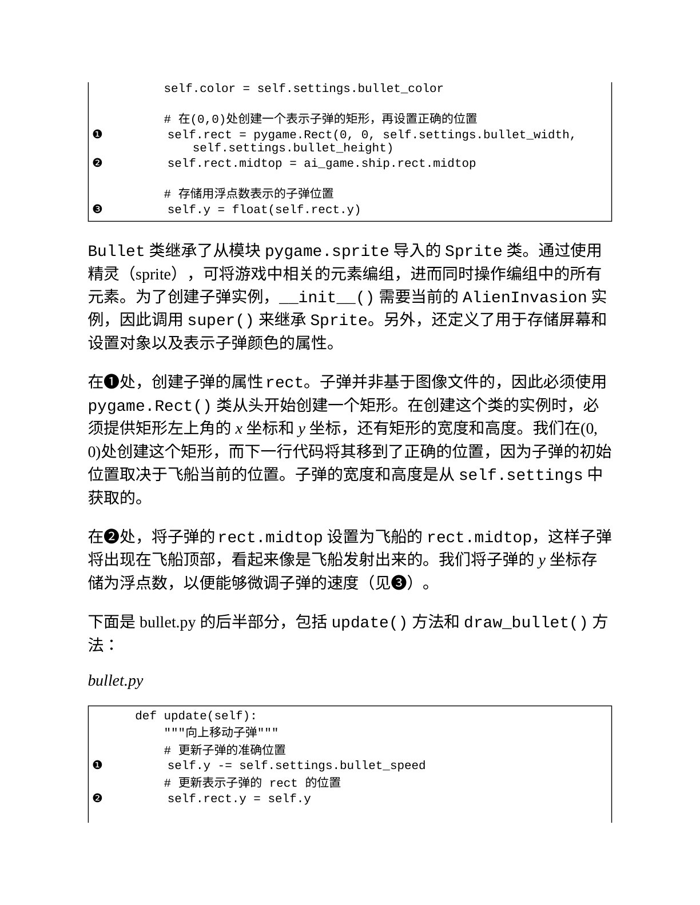

> 本页顶部是上一页代码的续行，完整片段见上一页。

`Bullet` 类继承了从模块 `pygame.sprite` 导入的 `Sprite` 类。通过使用精灵（sprite），可将游戏中相关的元素编组，进而同时操作编组中的所有元素。为了创建子弹实例，`__init__()` 需要当前的 `AlienInvasion` 实例，因此调用 `super()` 来继承 `Sprite`。另外，还定义了用于存储屏幕和设置对象以及表示子弹颜色的属性。

在❶处，创建子弹的属性 `rect`。子弹并非基于图像文件的，因此必须使用 `pygame.Rect()` 类从头开始创建一个矩形。在创建这个类的实例时，必须提供矩形左上角的 $x$ 坐标和 $y$ 坐标，还有矩形的宽度和高度。我们在 `(0, 0)` 处创建这个矩形，而下一行代码将其移到了正确的位置，因为子弹的初始位置取决于飞船当前的位置。子弹的宽度和高度是从 `self.settings` 中获取的。

在❷处，将子弹的 `rect.midtop` 设置为飞船的 `rect.midtop`，这样子弹将出现在飞船顶部，看起来像是飞船发射出来的。我们将子弹的 $y$ 坐标存储为浮点数，以便能够微调子弹的速度（见❸）。

下面是 `bullet.py` 的后半部分，包括 `update()` 方法和 `draw_bullet()` 方法：

`bullet.py`（两个方法跨 PDF 第 370–371 页，合并如下；它们属于前面的 `Bullet` 类）

```python
def update(self):
    """向上移动子弹"""
    # 更新子弹的准确位置
    self.y -= self.settings.bullet_speed  # ❶
    # 更新表示子弹的 rect 的位置
    self.rect.y = self.y  # ❷

def draw_bullet(self):
    """在屏幕上绘制子弹"""
    pygame.draw.rect(self.screen, self.color, self.rect)  # ❸
```

## PDF 第 371 页

<!-- page-status: reviewed -->
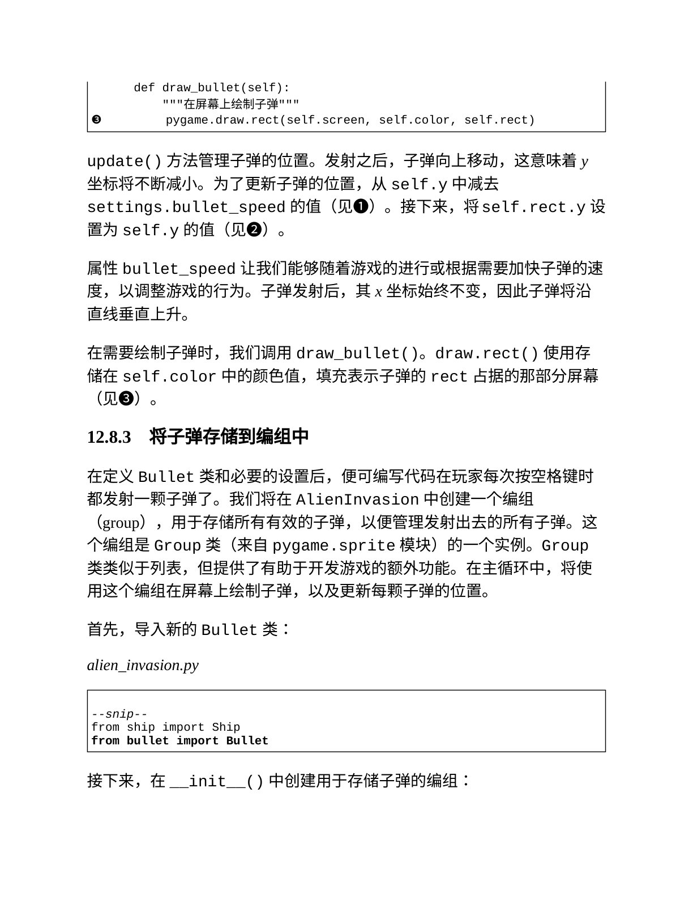

> 本页顶部是上一页方法代码的续行，完整片段见上一页。

`update()` 方法管理子弹的位置。发射之后，子弹向上移动，这意味着 $y$ 坐标将不断减小。为了更新子弹的位置，从 `self.y` 中减去 `settings.bullet_speed` 的值（见❶）。接下来，将 `self.rect.y` 设置为 `self.y` 的值（见❷）。

属性 `bullet_speed` 让我们能够随着游戏的进行或根据需要加快子弹的速度，以调整游戏的行为。子弹发射后，其 $x$ 坐标始终不变，因此子弹将沿直线垂直上升。

在需要绘制子弹时，我们调用 `draw_bullet()`。`draw.rect()` 使用存储在 `self.color` 中的颜色值，填充表示子弹的 `rect` 占据的那部分屏幕（见❸）。

### 12.8.3 将子弹存储到编组中

在定义 `Bullet` 类和必要的设置后，便可编写代码在玩家每次按空格键时都发射一颗子弹了。我们将在 `AlienInvasion` 中创建一个编组（group），用于存储所有有效的子弹，以便管理发射出去的所有子弹。这个编组是 `Group` 类（来自 `pygame.sprite` 模块）的一个实例。`Group` 类类似于列表，但提供了有助于开发游戏的额外功能。在主循环中，将使用这个编组在屏幕上绘制子弹，以及更新每颗子弹的位置。

首先，导入新的 `Bullet` 类：

`alien_invasion.py`（原书省略其余代码）

```text
--snip--
from ship import Ship
from bullet import Bullet
```

接下来，在 `__init__()` 中创建用于存储子弹的编组（续下页）：

## PDF 第 372 页

<!-- page-status: reviewed -->
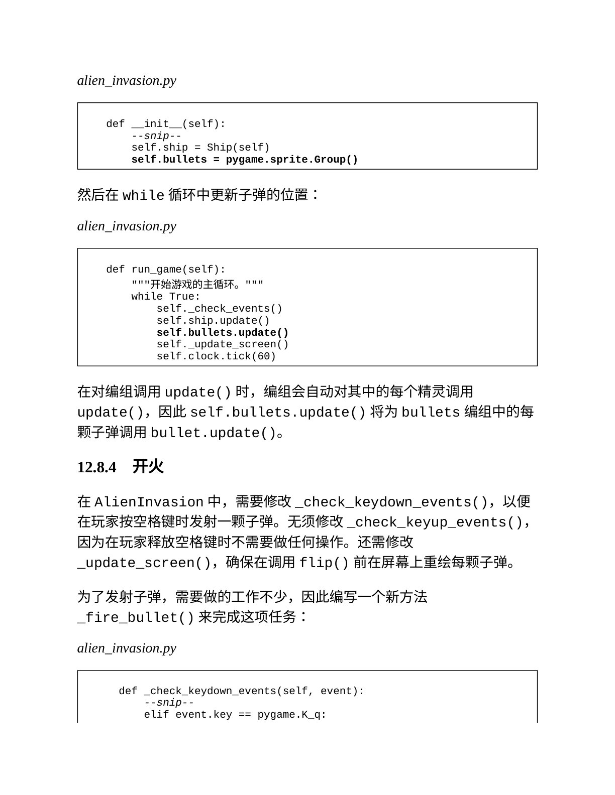

`alien_invasion.py`（原书省略其余代码）

```text
    def __init__(self):
        --snip--
        self.ship = Ship(self)
        self.bullets = pygame.sprite.Group()
```

然后在 `while` 循环中更新子弹的位置：

`alien_invasion.py`（类中的方法）

```python
def run_game(self):
    """开始游戏的主循环。"""
    while True:
        self._check_events()
        self.ship.update()
        self.bullets.update()
        self._update_screen()
        self.clock.tick(60)
```

在对编组调用 `update()` 时，编组会自动对其中的每个精灵调用 `update()`，因此 `self.bullets.update()` 将为 `bullets` 编组中的每颗子弹调用 `bullet.update()`。

### 12.8.4 开火

在 `AlienInvasion` 中，需要修改 `_check_keydown_events()`，以便在玩家按空格键时发射一颗子弹。无须修改 `_check_keyup_events()`，因为在玩家释放空格键时不需要做任何操作。还需修改 `_update_screen()`，确保在调用 `flip()` 前在屏幕上重绘每颗子弹。

为了发射子弹，需要做的工作不少，因此编写一个新方法 `_fire_bullet()` 来完成这项任务：

`alien_invasion.py`（示例跨 PDF 第 372–373 页；保留原书省略标记，不能独立运行）

```text
    def _check_keydown_events(self, event):
        --snip--
        elif event.key == pygame.K_q:
            sys.exit()
        elif event.key == pygame.K_SPACE:  # ❶
            self._fire_bullet()

    def _check_keyup_events(self, event):
        --snip--

    def _fire_bullet(self):
        """创建一颗子弹，并将其加入编组 bullets"""
        new_bullet = Bullet(self)  # ❷
        self.bullets.add(new_bullet)  # ❸

    def _update_screen(self):
        """更新屏幕上的图像，并切换到新屏幕"""
        self.screen.fill(self.settings.bg_color)
        for bullet in self.bullets.sprites():  # ❹
            bullet.draw_bullet()
        self.ship.blitme()

        pygame.display.flip()
--snip--
```

## PDF 第 373 页

<!-- page-status: reviewed -->
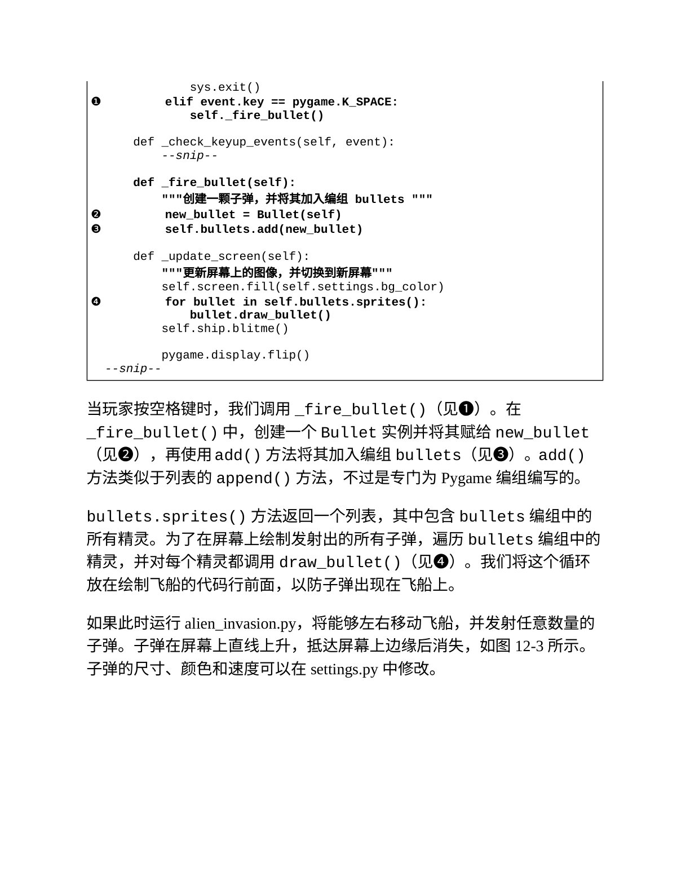

> 本页顶部是上一页代码的续行，完整片段见上一页。

当玩家按空格键时，我们调用 `_fire_bullet()`（见❶）。在 `_fire_bullet()` 中，创建一个 `Bullet` 实例并将其赋给 `new_bullet`（见❷），再使用 `add()` 方法将其加入编组 `bullets`（见❸）。`add()` 方法类似于列表的 `append()` 方法，不过是专门为 Pygame 编组编写的。

`bullets.sprites()` 方法返回一个列表，其中包含 `bullets` 编组中的所有精灵。为了在屏幕上绘制发射出的所有子弹，遍历 `bullets` 编组中的精灵，并对每个精灵都调用 `draw_bullet()`（见❹）。我们将这个循环放在绘制飞船的代码行前面，以防子弹出现在飞船上。

如果此时运行 `alien_invasion.py`，将能够左右移动飞船，并发射任意数量的子弹。子弹在屏幕上直线上升，抵达屏幕上边缘后消失，如图 12-3 所示。子弹的尺寸、颜色和速度可以在 `settings.py` 中修改。

## PDF 第 374 页

<!-- page-status: reviewed -->
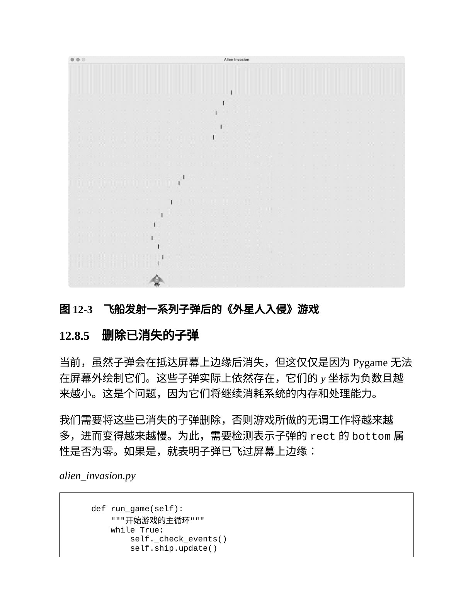

**图 12-3 飞船发射一系列子弹后的《外星人入侵》游戏**（图片见本页原图）

### 12.8.5 删除已消失的子弹

当前，虽然子弹会在抵达屏幕上边缘后消失，但这仅仅是因为 Pygame 无法在屏幕外绘制它们。这些子弹实际上依然存在，它们的 $y$ 坐标为负数且越来越小。这是个问题，因为它们将继续消耗系统的内存和处理能力。

我们需要将这些已消失的子弹删除，否则游戏所做的无谓工作将越来越多，进而变得越来越慢。为此，需要检测表示子弹的 `rect` 的 `bottom` 属性是否为零。如果是，就表明子弹已飞过屏幕上边缘：

`alien_invasion.py`（代码跨 PDF 第 374–375 页；数字标记对应原书标注）

```python
def run_game(self):
    """开始游戏的主循环"""
    while True:
        self._check_events()
        self.ship.update()
        self.bullets.update()

        # 删除已消失的子弹
        for bullet in self.bullets.copy():  # ❶
            if bullet.rect.bottom <= 0:  # ❷
                self.bullets.remove(bullet)  # ❸
        print(len(self.bullets))  # ❹

        self._update_screen()
        self.clock.tick(60)
```

## PDF 第 375 页

<!-- page-status: reviewed -->
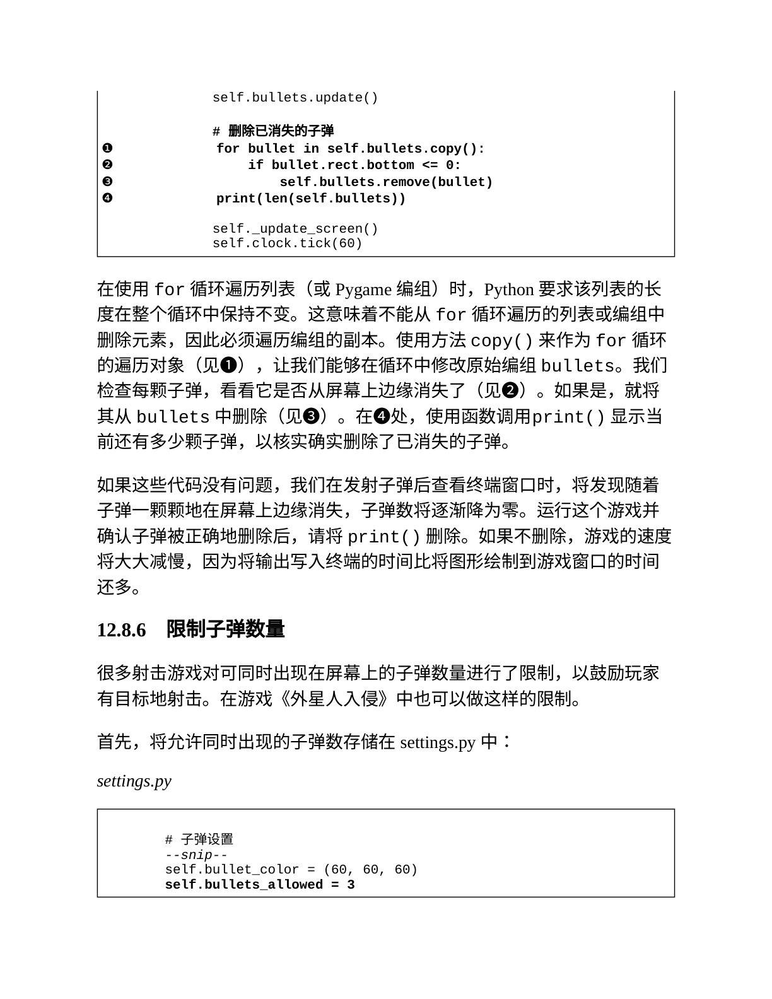

> 页面顶部为上一页代码的续行，完整方法见上页。

在使用 `for` 循环遍历列表（或 Pygame 编组）时，Python 要求该列表的长度在整个循环中保持不变。这意味着不能从 `for` 循环遍历的列表或编组中删除元素，因此必须遍历编组的副本。使用方法 `copy()` 来作为 `for` 循环的遍历对象（见❶），让我们能够在循环中修改原始编组 `bullets`。我们检查每颗子弹，看看它是否从屏幕上边缘消失了（见❷）。如果是，就将其从 `bullets` 中删除（见❸）。在❹处，使用函数调用 `print()` 显示当前还有多少颗子弹，以核实确实删除了已消失的子弹。

> 校对注：上面的“Python 要求列表长度保持不变”并不是 Python 对列表的普遍硬性规定。遍历列表时修改其长度可能使元素被跳过；遍历副本是一种避免该问题的做法。Pygame 编组的行为还需按其自身接口理解。

如果这些代码没有问题，我们在发射子弹后查看终端窗口时，将发现随着子弹一颗颗地在屏幕上边缘消失，子弹数将逐渐降为零。运行这个游戏并确认子弹被正确地删除后，请将 `print()` 删除。如果不删除，游戏的速度将大大减慢，因为将输出写入终端的时间比将图形绘制到游戏窗口的时间还多。

### 12.8.6 限制子弹数量

很多射击游戏对可同时出现在屏幕上的子弹数量进行了限制，以鼓励玩家有目标地射击。在游戏《外星人入侵》中也可以做这样的限制。

首先，将允许同时出现的子弹数存储在 `settings.py` 中：

`settings.py`（原书代码片段，`--snip--` 表示省略）

```text
        # 子弹设置
        --snip--
        self.bullet_color = (60, 60, 60)
        self.bullets_allowed = 3
```

## PDF 第 376 页

<!-- page-status: reviewed -->
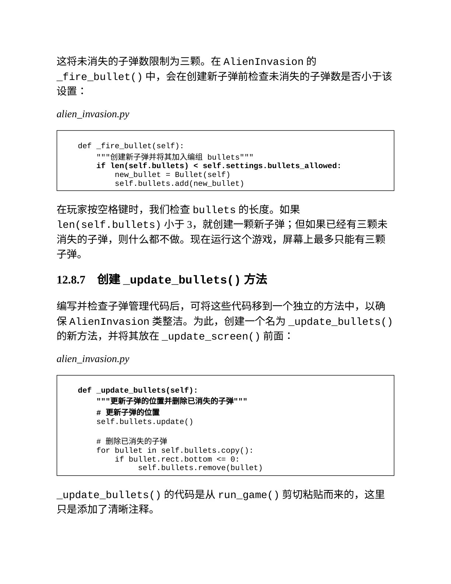

这将未消失的子弹数限制为三颗。在 `AlienInvasion` 的 `_fire_bullet()` 中，会在创建新子弹前检查未消失的子弹数是否小于该设置：

`alien_invasion.py`

```python
def _fire_bullet(self):
    """创建新子弹并将其加入编组 bullets"""
    if len(self.bullets) < self.settings.bullets_allowed:
        new_bullet = Bullet(self)
        self.bullets.add(new_bullet)
```

在玩家按空格键时，我们检查 `bullets` 的长度。如果 `len(self.bullets)` 小于 3，就创建一颗新子弹；但如果已经有三颗未消失的子弹，则什么都不做。现在运行这个游戏，屏幕上最多只能有三颗子弹。

### 12.8.7 创建 _update_bullets() 方法

编写并检查子弹管理代码后，可将这些代码移到一个独立的方法中，以确保 `AlienInvasion` 类整洁。为此，创建一个名为 `_update_bullets()` 的新方法，并将其放在 `_update_screen()` 前面：

`alien_invasion.py`

```python
def _update_bullets(self):
    """更新子弹的位置并删除已消失的子弹"""
    # 更新子弹的位置
    self.bullets.update()

    # 删除已消失的子弹
    for bullet in self.bullets.copy():
        if bullet.rect.bottom <= 0:
            self.bullets.remove(bullet)
```

`_update_bullets()` 的代码是从 `run_game()` 剪切粘贴而来的，这里只是添加了清晰注释。

## PDF 第 377 页

<!-- page-status: reviewed -->
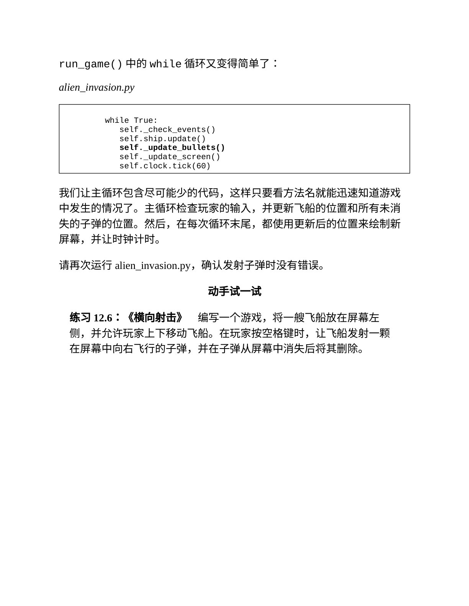

`run_game()` 中的 `while` 循环又变得简单了：

`alien_invasion.py`（方法中的循环片段）

```python
while True:
    self._check_events()
    self.ship.update()
    self._update_bullets()
    self._update_screen()
    self.clock.tick(60)
```

我们让主循环包含尽可能少的代码，这样只要看方法名就能迅速知道游戏中发生的情况了。主循环检查玩家的输入，并更新飞船的位置和所有未消失的子弹的位置。然后，在每次循环末尾，都使用更新后的位置来绘制新屏幕，并让时钟计时。

请再次运行 `alien_invasion.py`，确认发射子弹时没有错误。

### 动手试一试

**练习 12.6：《横向射击》** 编写一个游戏，将一艘飞船放在屏幕左侧，并允许玩家上下移动飞船。在玩家按空格键时，让飞船发射一颗在屏幕中向右飞行的子弹，并在子弹从屏幕中消失后将其删除。

## PDF 第 378 页

<!-- page-status: reviewed -->
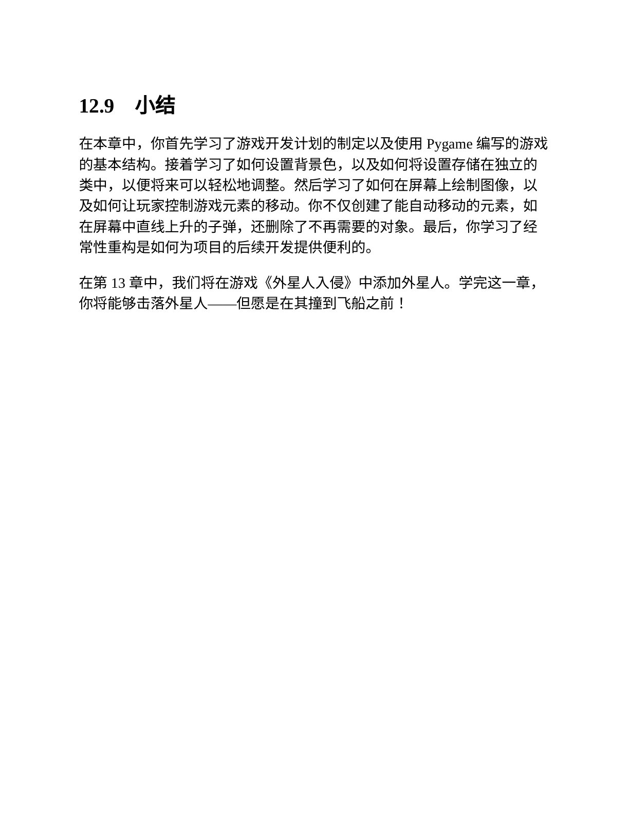

### 12.9 小结

在本章中，你首先学习了游戏开发计划的制定以及使用 Pygame 编写的游戏的基本结构。接着学习了如何设置背景色，以及如何将设置存储在独立的类中，以便将来可以轻松地调整。然后学习了如何在屏幕上绘制图像，以及如何让玩家控制游戏元素的移动。你不仅创建了能自动移动的元素，如在屏幕中直线上升的子弹，还删除了不再需要的对象。最后，你学习了经常性重构是如何为项目的后续开发提供便利的。

在第 13 章中，我们将在游戏《外星人入侵》中添加外星人。学完这一章，你将能够击落外星人——但愿是在其撞到飞船之前！
