# 第 14 章 记分

> 本章技术页已由 AI 对照原页整理为可编辑 Markdown，未经过人类逐页复核；原页图保留供检查，代码并非全部已执行。

[返回目录](README.md) | PDF 原页 413–447

## PDF 第 413 页
<!-- page-status: reviewed -->

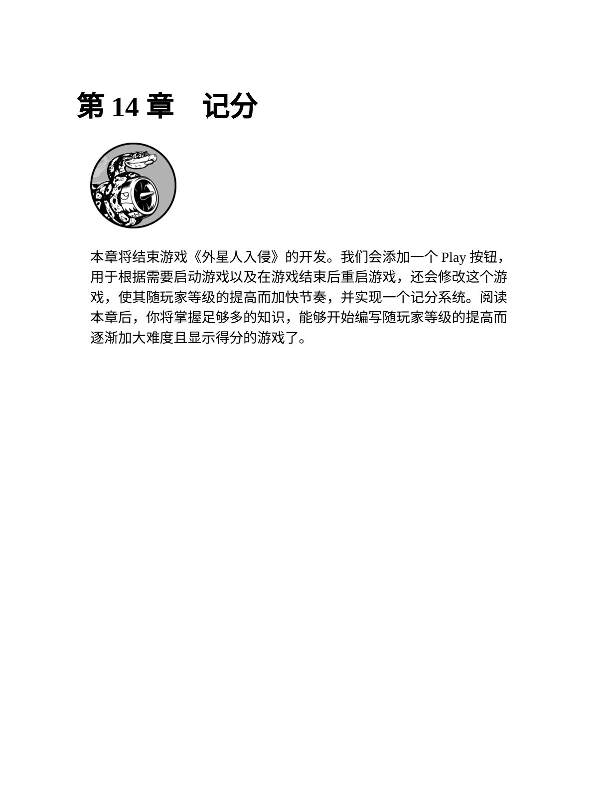

本章将结束游戏《外星人入侵》的开发。我们会添加一个 Play 按钮，用于根据需要启动游戏以及在游戏结束后重启游戏，还会修改这个游戏，使其随玩家等级的提高而加快节奏，并实现一个记分系统。阅读本章后，你将掌握足够多的知识，能够开始编写随玩家等级的提高而逐渐加大难度且显示得分的游戏了。

## PDF 第 414 页
<!-- page-status: reviewed -->

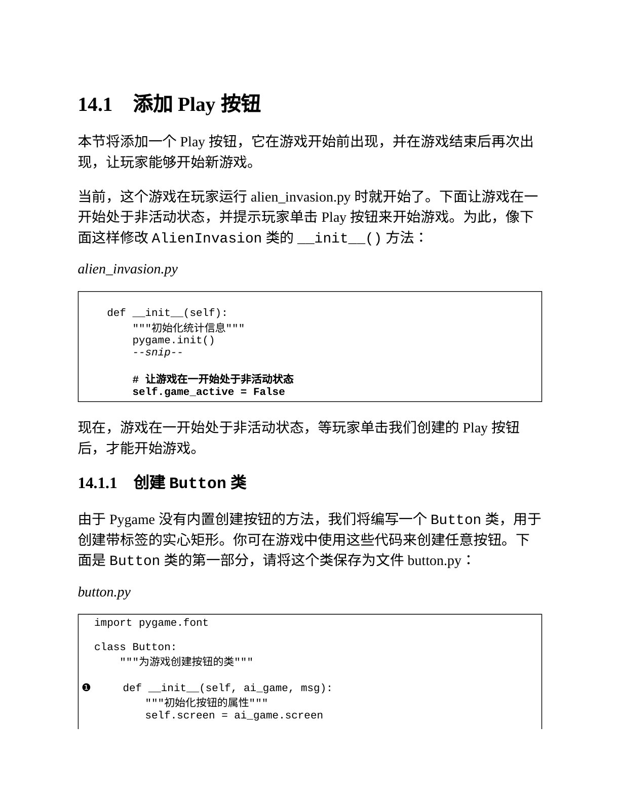

### 14.1 添加 Play 按钮

本节将添加一个 Play 按钮，它在游戏开始前出现，并在游戏结束后再次出现，让玩家能够开始新游戏。

当前，这个游戏在玩家运行 `alien_invasion.py` 时就开始了。下面让游戏在一开始处于非活动状态，并提示玩家单击 Play 按钮来开始游戏。为此，像下面这样修改 `AlienInvasion` 类的 `__init__()` 方法：

*alien_invasion.py*

```python
def __init__(self):
    """初始化统计信息"""
    pygame.init()
    # --snip--（省略既有代码）

    # 让游戏在一开始处于非活动状态
    self.game_active = False
```

现在，游戏在一开始处于非活动状态，等玩家单击我们创建的 Play 按钮后，才能开始游戏。

#### 14.1.1 创建 Button 类

由于 Pygame 没有内置创建按钮的方法，我们将编写一个 `Button` 类，用于创建带标签的实心矩形。你可在游戏中使用这些代码来创建任意按钮。下面是 `Button` 类的第一部分，请将这个类保存为文件 `button.py`：

*button.py*（以下代码跨 PDF 第 414–415 页，已合并）：

```python
import pygame.font

class Button:
    """为游戏创建按钮的类"""

    def __init__(self, ai_game, msg):  # ❶
        """初始化按钮的属性"""
        self.screen = ai_game.screen
        self.screen_rect = self.screen.get_rect()

        # 设置按钮的尺寸和其他属性
        self.width, self.height = 200, 50  # ❷
        self.button_color = (0, 135, 0)
        self.text_color = (255, 255, 255)
        self.font = pygame.font.SysFont(None, 48)  # ❸

        # 创建按钮的 rect 对象，并使其居中
        self.rect = pygame.Rect(0, 0, self.width, self.height)  # ❹
        self.rect.center = self.screen_rect.center

        # 按钮的标签只需创建一次
        self._prep_msg(msg)  # ❺
```

## PDF 第 415 页
<!-- page-status: reviewed -->

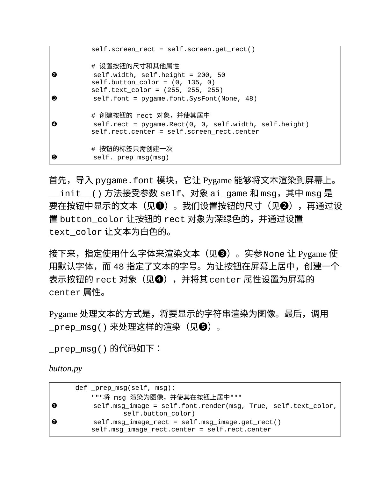

原书本页开头代码已合并到上一页的完整代码块。

首先，导入 `pygame.font` 模块，它让 Pygame 能够将文本渲染到屏幕上。`__init__()` 方法接受参数 `self`、对象 `ai_game` 和 `msg`，其中 `msg` 是要在按钮中显示的文本（见❶）。我们设置按钮的尺寸（见❷），再通过设置 `button_color` 让按钮的 `rect` 对象为深绿色的，并通过设置 `text_color` 让文本为白色的。

接下来，指定使用什么字体来渲染文本（见❸）。实参 `None` 让 Pygame 使用默认字体，而 48 指定了文本的字号。为让按钮在屏幕上居中，创建一个表示按钮的 `rect` 对象（见❹），并将其 `center` 属性设置为屏幕的 `center` 属性。

Pygame 处理文本的方式是，将要显示的字符串渲染为图像。最后，调用 `_prep_msg()` 来处理这样的渲染（见❺）。

`_prep_msg()` 的代码如下：

*button.py*

```python
def _prep_msg(self, msg):
    """将 msg 渲染为图像，并使其在按钮上居中"""
    self.msg_image = self.font.render(msg, True, self.text_color,  # ❶
                                     self.button_color)
    self.msg_image_rect = self.msg_image.get_rect()  # ❷
    self.msg_image_rect.center = self.rect.center
```

## PDF 第 416 页
<!-- page-status: reviewed -->

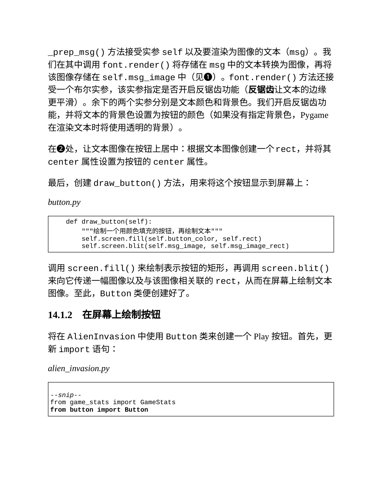

`_prep_msg()` 方法接受实参 `self` 以及要渲染为图像的文本（`msg`）。我们在其中调用 `font.render()` 将存储在 `msg` 中的文本转换为图像，再将该图像存储在 `self.msg_image` 中（见❶）。`font.render()` 方法还接受一个布尔实参，该实参指定是否开启反锯齿功能（反锯齿让文本的边缘更平滑）。余下的两个实参分别是文本颜色和背景色。我们开启反锯齿功能，并将文本的背景色设置为按钮的颜色（如果没有指定背景色，Pygame 在渲染文本时将使用透明的背景）。

在❷处，让文本图像在按钮上居中：根据文本图像创建一个 `rect`，并将其 `center` 属性设置为按钮的 `center` 属性。

最后，创建 `draw_button()` 方法，用来将这个按钮显示到屏幕上：

*button.py*

```python
def draw_button(self):
    """绘制一个用颜色填充的按钮，再绘制文本"""
    self.screen.fill(self.button_color, self.rect)
    self.screen.blit(self.msg_image, self.msg_image_rect)
```

调用 `screen.fill()` 来绘制表示按钮的矩形，再调用 `screen.blit()` 来向它传递一幅图像以及与该图像相关联的 `rect`，从而在屏幕上绘制文本图像。至此，`Button` 类便创建好了。

#### 14.1.2 在屏幕上绘制按钮

将在 `AlienInvasion` 中使用 `Button` 类来创建一个 Play 按钮。首先，更新 `import` 语句：

*alien_invasion.py*

```python
# --snip--（省略既有代码）
from game_stats import GameStats
from button import Button
```

## PDF 第 417 页
<!-- page-status: reviewed -->

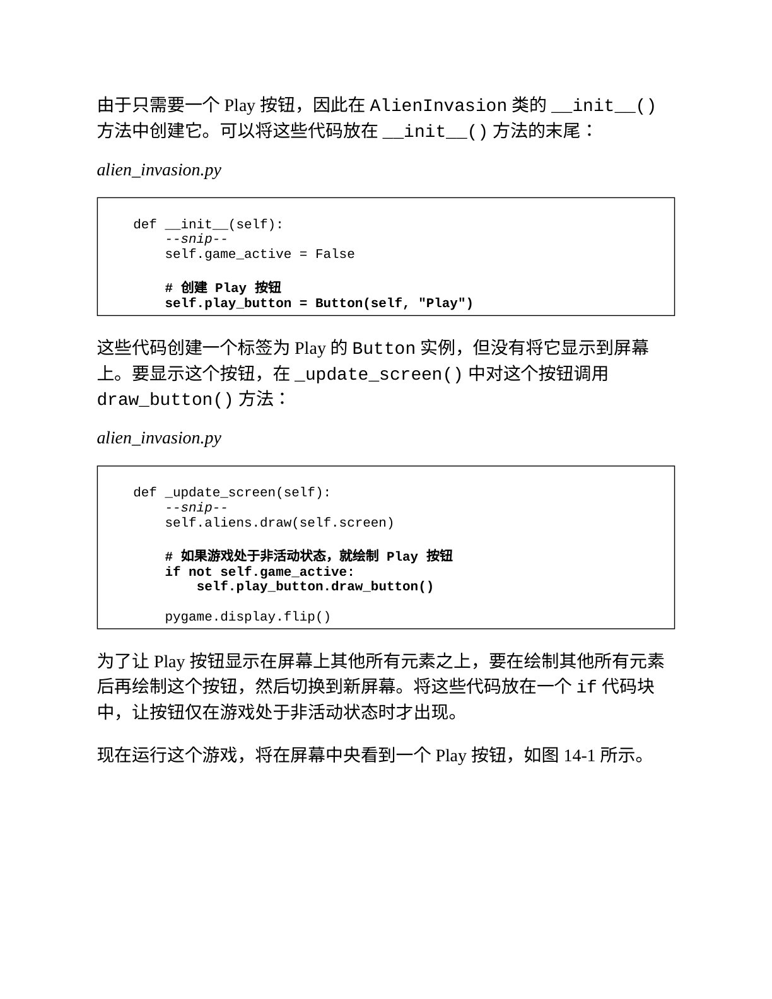

由于只需要一个 Play 按钮，因此在 `AlienInvasion` 类的 `__init__()` 方法中创建它。可以将这些代码放在 `__init__()` 方法的末尾：

*alien_invasion.py*

```python
def __init__(self):
    # --snip--（省略既有代码）
    self.game_active = False

    # 创建 Play 按钮
    self.play_button = Button(self, "Play")
```

这些代码创建一个标签为 Play 的 `Button` 实例，但没有将它显示到屏幕上。要显示这个按钮，在 `_update_screen()` 中对这个按钮调用 `draw_button()` 方法：

*alien_invasion.py*

```python
def _update_screen(self):
    # --snip--（省略既有代码）
    self.aliens.draw(self.screen)

    # 如果游戏处于非活动状态，就绘制 Play 按钮
    if not self.game_active:
        self.play_button.draw_button()

    pygame.display.flip()
```

为了让 Play 按钮显示在屏幕上其他所有元素之上，要在绘制其他所有元素后再绘制这个按钮，然后切换到新屏幕。将这些代码放在一个 `if` 代码块中，让按钮仅在游戏处于非活动状态时才出现。

现在运行这个游戏，将在屏幕中央看到一个 Play 按钮，如图 14-1 所示。

## PDF 第 418 页
<!-- page-status: reviewed -->

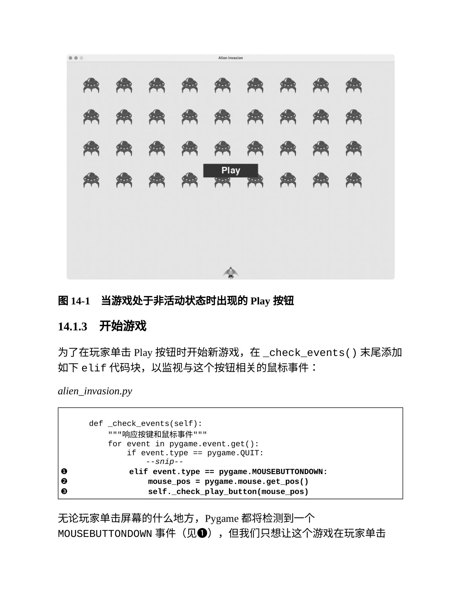

**图 14-1：当游戏处于非活动状态时出现的 Play 按钮**（见本页原图）。

#### 14.1.3 开始游戏

为了在玩家单击 Play 按钮时开始新游戏，在 `_check_events()` 末尾添加如下 `elif` 代码块，以监视与这个按钮相关的鼠标事件：

*alien_invasion.py*

> 以下是原书省略既有代码的片段，`--snip--` 不是 Python 语法，不能单独执行。

```text
def _check_events(self):
    """响应按键和鼠标事件"""
    for event in pygame.event.get():
        if event.type == pygame.QUIT:
            --snip--
        elif event.type == pygame.MOUSEBUTTONDOWN:  # ❶
            mouse_pos = pygame.mouse.get_pos()  # ❷
            self._check_play_button(mouse_pos)  # ❸
```

无论玩家单击屏幕的什么地方，Pygame 都将检测到一个 `MOUSEBUTTONDOWN` 事件（见❶），但我们只想让这个游戏在玩家单击（续下一页）

## PDF 第 419 页
<!-- page-status: reviewed -->

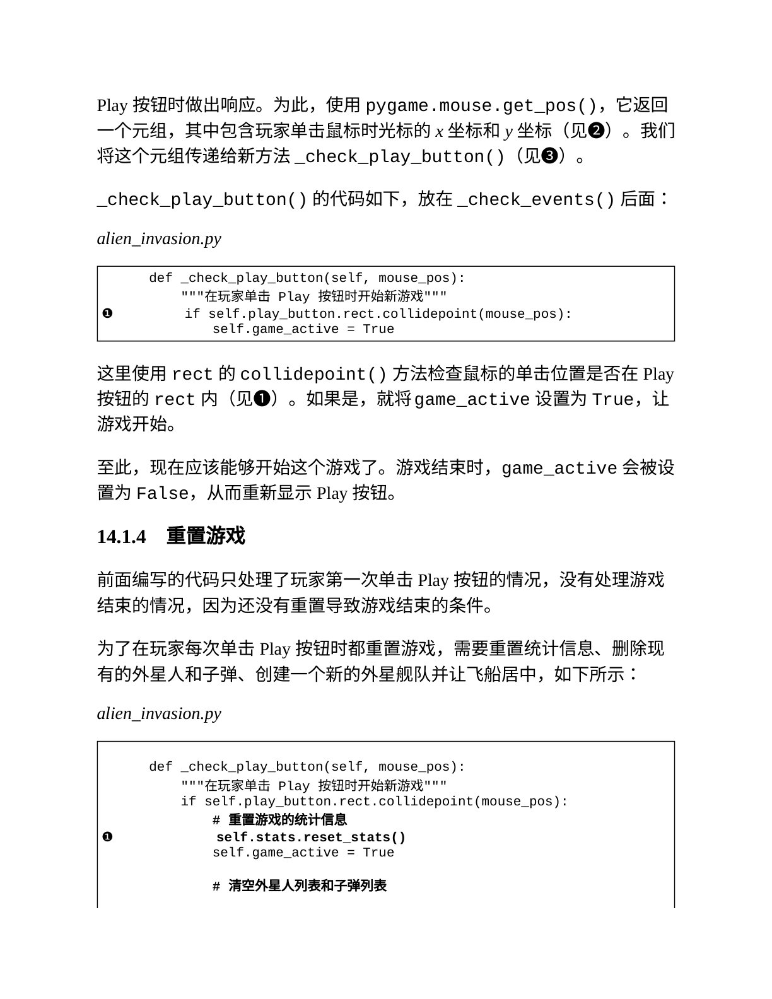

Play 按钮时做出响应。为此，使用 `pygame.mouse.get_pos()`，它返回一个元组，其中包含玩家单击鼠标时光标的 x 坐标和 y 坐标（见❷）。我们将这个元组传递给新方法 `_check_play_button()`（见❸）。

`_check_play_button()` 的代码如下，放在 `_check_events()` 后面：

*alien_invasion.py*

```python
def _check_play_button(self, mouse_pos):
    """在玩家单击 Play 按钮时开始新游戏"""
    if self.play_button.rect.collidepoint(mouse_pos):  # ❶
        self.game_active = True
```

这里使用 `rect` 的 `collidepoint()` 方法检查鼠标的单击位置是否在 Play 按钮的 `rect` 内（见❶）。如果是，就将 `game_active` 设置为 `True`，让游戏开始。

至此，现在应该能够开始这个游戏了。游戏结束时，`game_active` 会被设置为 `False`，从而重新显示 Play 按钮。

#### 14.1.4 重置游戏

前面编写的代码只处理了玩家第一次单击 Play 按钮的情况，没有处理游戏结束的情况，因为还没有重置导致游戏结束的条件。

为了在玩家每次单击 Play 按钮时都重置游戏，需要重置统计信息、删除现有的外星人和子弹、创建一个新的外星舰队并让飞船居中，如下所示：

*alien_invasion.py*（原书代码跨页，以下已合并 PDF 第 419–420 页）：

```python
def _check_play_button(self, mouse_pos):
    """在玩家单击 Play 按钮时开始新游戏"""
    if self.play_button.rect.collidepoint(mouse_pos):
        # 重置游戏的统计信息
        self.stats.reset_stats()  # ❶
        self.game_active = True

        # 清空外星人列表和子弹列表
        self.bullets.empty()  # ❷
        self.aliens.empty()

        # 创建一个新的外星舰队，并将飞船放在屏幕底部的中央
        self._create_fleet()  # ❸
        self.ship.center_ship()
```

## PDF 第 420 页
<!-- page-status: reviewed -->

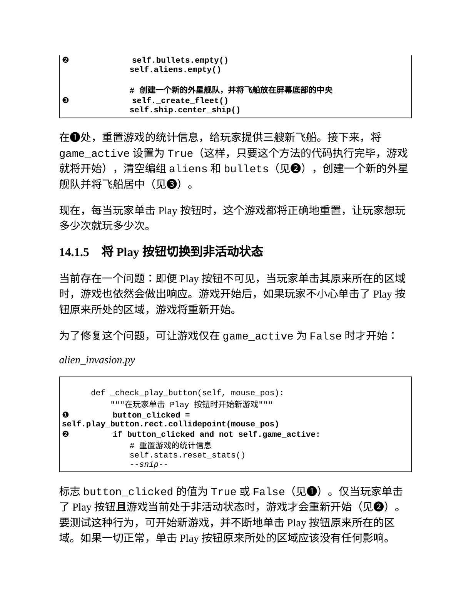

上页 `_check_play_button()` 的代码原书续至本页，已合并为上一页的完整代码块。

在❶处，重置游戏的统计信息，给玩家提供三艘新飞船。接下来，将 `game_active` 设置为 `True`（这样，只要这个方法的代码执行完毕，游戏就将开始），清空编组 `aliens` 和 `bullets`（见❷），创建一个新的外星舰队并将飞船居中（见❸）。

现在，每当玩家单击 Play 按钮时，这个游戏都将正确地重置，让玩家想玩多少次就玩多少次。

#### 14.1.5 将 Play 按钮切换到非活动状态

当前存在一个问题：即便 Play 按钮不可见，当玩家单击其原来所在的区域时，游戏也依然会做出响应。游戏开始后，如果玩家不小心单击了 Play 按钮原来所处的区域，游戏将重新开始。

为了修复这个问题，可让游戏仅在 `game_active` 为 `False` 时才开始：

*alien_invasion.py*

```python
def _check_play_button(self, mouse_pos):
    """在玩家单击 Play 按钮时开始新游戏"""
    button_clicked = self.play_button.rect.collidepoint(mouse_pos)  # ❶
    if button_clicked and not self.game_active:  # ❷
        # 重置游戏的统计信息
        self.stats.reset_stats()
        # --snip--（省略既有代码）
```

标志 `button_clicked` 的值为 `True` 或 `False`（见❶）。仅当玩家单击了 Play 按钮且游戏当前处于非活动状态时，游戏才会重新开始（见❷）。要测试这种行为，可开始新游戏，并不断地单击 Play 按钮原来所在的区域。如果一切正常，单击 Play 按钮原来所处的区域应该没有任何影响。

## PDF 第 421 页
<!-- page-status: reviewed -->

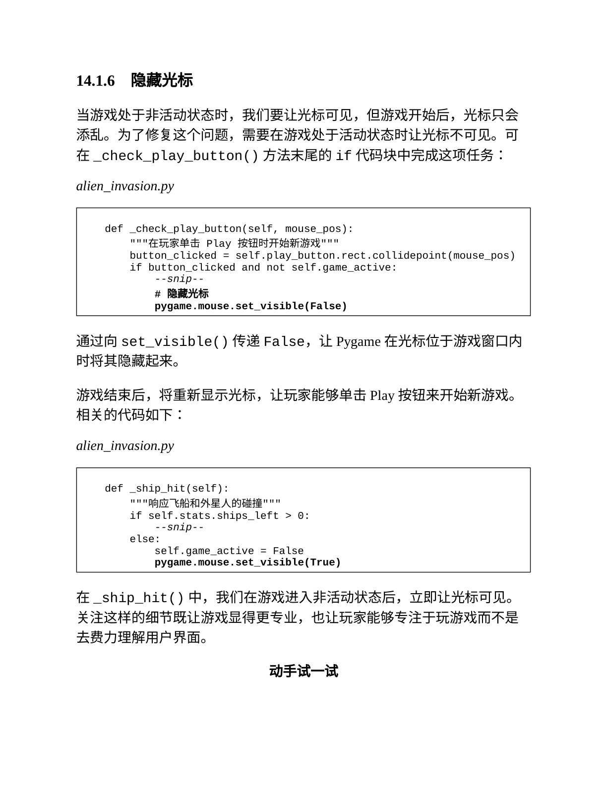

#### 14.1.6 隐藏光标

当游戏处于非活动状态时，我们要让光标可见，但游戏开始后，光标只会添乱。为了修复这个问题，需要在游戏处于活动状态时让光标不可见。可在 `_check_play_button()` 方法末尾的 `if` 代码块中完成这项任务：

*alien_invasion.py*

```python
def _check_play_button(self, mouse_pos):
    """在玩家单击 Play 按钮时开始新游戏"""
    button_clicked = self.play_button.rect.collidepoint(mouse_pos)
    if button_clicked and not self.game_active:
        # --snip--（省略既有代码）
        # 隐藏光标
        pygame.mouse.set_visible(False)
```

通过向 `set_visible()` 传递 `False`，让 Pygame 在光标位于游戏窗口内时将其隐藏起来。

游戏结束后，将重新显示光标，让玩家能够单击 Play 按钮来开始新游戏。相关的代码如下：

*alien_invasion.py*

> 以下是原书省略既有代码的片段，`--snip--` 不是 Python 语法，不能单独执行。

```text
def _ship_hit(self):
    """响应飞船和外星人的碰撞"""
    if self.stats.ships_left > 0:
        --snip--
    else:
        self.game_active = False
        pygame.mouse.set_visible(True)
```

在 `_ship_hit()` 中，我们在游戏进入非活动状态后，立即让光标可见。关注这样的细节既让游戏显得更专业，也让玩家能够专注于玩游戏而不是去费力理解用户界面。

**动手试一试**（续下一页）

## PDF 第 422 页
<!-- page-status: reviewed -->

[查看原页](images/page-0422.jpg)

**练习 14.1：按 P 键开始新游戏**　鉴于游戏《外星人入侵》使用键盘来控制飞船，最好让玩家也能够通过按键来开始游戏。请添加在玩家按 P 键时开始游戏的代码。也许这样做会有所帮助：将 `_check_play_button()` 的一些代码提取出来，放到一个名为 `_start_game()` 的方法中，并在 `_check_play_button()` 和 `_check_keydown_events()` 中调用这个方法。

**练习 14.2：射击练习**　创建一个矩形，让它在屏幕右边缘以固定的速度上下移动。然后，在屏幕左边缘创建一艘飞船，玩家可上下移动飞船并射击前述矩形目标。添加一个用于开始游戏的 Play 按钮，在玩家三次未击中目标时结束游戏，并重新显示 Play 按钮，让玩家能够单击该按钮来重新开始游戏。

## PDF 第 423 页
<!-- page-status: reviewed -->

[查看原页](images/page-0423.jpg)

### 14.2 提高难度

当前，整个外星舰队被全部击落后，玩家将提高一个等级，但游戏的难度不变。下面来增加一点儿趣味性：每当玩家将屏幕上的外星人全部击落后，都加快游戏的节奏，让游戏玩起来更难。

#### 14.2.1 修改速度设置

首先重新组织 `Settings` 类，将游戏设置划分成两组：静态的和动态的。对于随着游戏进行而变化的设置，还要确保在开始新游戏时重置。`settings.py` 的 `__init__()` 方法如下：

`settings.py`：

```python
def __init__(self):
    """初始化游戏的静态设置"""
    # 屏幕设置
    self.screen_width = 1200
    self.screen_height = 800
    self.bg_color = (230, 230, 230)

    # 飞船设置
    self.ship_limit = 3

    # 子弹设置
    self.bullet_width = 3
    self.bullet_height = 15
    self.bullet_color = 60, 60, 60
    self.bullets_allowed = 3

    # 外星人设置
    self.fleet_drop_speed = 10

    # 以什么速度加快游戏的节奏
    self.speedup_scale = 1.1

    self.initialize_dynamic_settings()
```

依然在 `__init__()` 中初始化静态设置。在①处，添加设置 `speedup_scale`，用来控制游戏节奏的加快速度：2 表示玩家每提高一个（续下一页）。

## PDF 第 424 页
<!-- page-status: reviewed -->

[查看原页](images/page-0424.jpg)

等级，游戏的节奏就翻一倍；1 表示游戏的节奏始终不变。将这个值设置为 1.1 既可以不断加快游戏的节奏，又可以避免因难度提升过快而玩不下去。最后，调用 `initialize_dynamic_settings()` 初始化随游戏进行而变化的属性（见②）。

`initialize_dynamic_settings()` 的代码如下：

`settings.py`：

```python
def initialize_dynamic_settings(self):
    """初始化随游戏进行而变化的设置"""
    self.ship_speed = 1.5
    self.bullet_speed = 2.5
    self.alien_speed = 1.0

    # fleet_direction 为 1 表示向右，为 -1 表示向左
    self.fleet_direction = 1
```

这个方法设置飞船、子弹和外星人的初始速度。随着游戏的进行，这些速度都将逐渐加快。每当玩家开始新游戏时，都将重置这些速度。在这个方法中，还设置了 `fleet_direction`，使得在游戏刚开始时，外星人总是向右移动。不需要增大 `fleet_drop_speed` 的值，因为外星人移动的速度越快，到达屏幕下边缘所需的时间就已经越短了。

为了在玩家的等级提高时加快飞船、子弹和外星人的速度，编写一个名为 `increase_speed()` 的新方法：

`settings.py`：

```python
def increase_speed(self):
    """提高速度设置的值"""
    self.ship_speed *= self.speedup_scale
    self.bullet_speed *= self.speedup_scale
    self.alien_speed *= self.speedup_scale
```

为了加快这些游戏元素的速度，将每个速度设置都乘以 `speedup_scale` 的值。

## PDF 第 425 页
<!-- page-status: reviewed -->

[查看原页](images/page-0425.jpg)

在 `_check_bullet_alien_collisions()` 中，在整个外星舰队被全部击落后调用 `increase_speed()` 来加快游戏的节奏：

`alien_invasion.py`：

```python
def _check_bullet_alien_collisions(self):
    # --snip--
    if not self.aliens:
        # 删除现有的子弹并创建一个新的外星舰队
        self.bullets.empty()
        self._create_fleet()
        self.settings.increase_speed()
```

通过修改速度设置 `ship_speed`、`alien_speed` 和 `bullet_speed` 的值，足以加快整个游戏的节奏。

#### 14.2.2 重置速度

每当玩家开始新游戏时，都需要将发生了变化的设置还原为初始值，否则新游戏将沿用上一轮已经调整了的速度参数：

`alien_invasion.py`：

```python
def _check_play_button(self, mouse_pos):
    """在玩家单击 Play 按钮时开始新游戏"""
    button_clicked = self.play_button.rect.collidepoint(mouse_pos)
    if button_clicked and not self.game_active:
        # 还原游戏设置
        self.settings.initialize_dynamic_settings()
        # --snip--
```

现在，游戏《外星人入侵》玩起来更有趣，也更有挑战性了。每当玩家将屏幕上的外星人全部击落后，游戏都将加快节奏，因此难度会越来越大。如果游戏的难度提高得太快，可减小 `settings.speedup_scale` 的值；如果游戏的挑战性不足，可稍微增大这个设置的值。找出这个设置的最佳值，让难度的提高速度相对合理：一开始的几群外星舰队很容易全部击落；接下来的几群消灭起来有一定难度，但也不是不可能；而要将之后的外星舰队全部击落则几乎不可能。

## PDF 第 426 页
<!-- page-status: reviewed -->

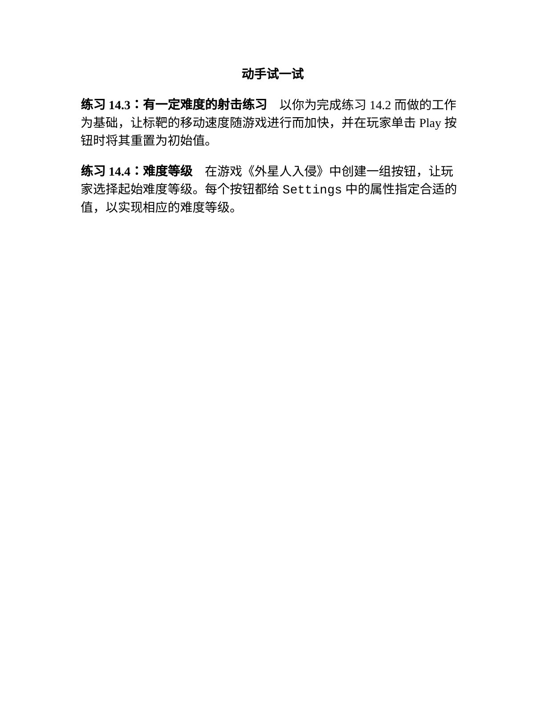

**动手试一试**

**练习 14.3：有一定难度的射击练习** 以你为完成练习 14.2 而做的工作为基础，让标靶的移动速度随游戏进行而加快，并在玩家单击 Play 按钮时将其重置为初始值。

**练习 14.4：难度等级** 在游戏《外星人入侵》中创建一组按钮，让玩家选择起始难度等级。每个按钮都给 `Settings` 中的属性指定合适的值，以实现相应的难度等级。

## PDF 第 427 页
<!-- page-status: reviewed -->

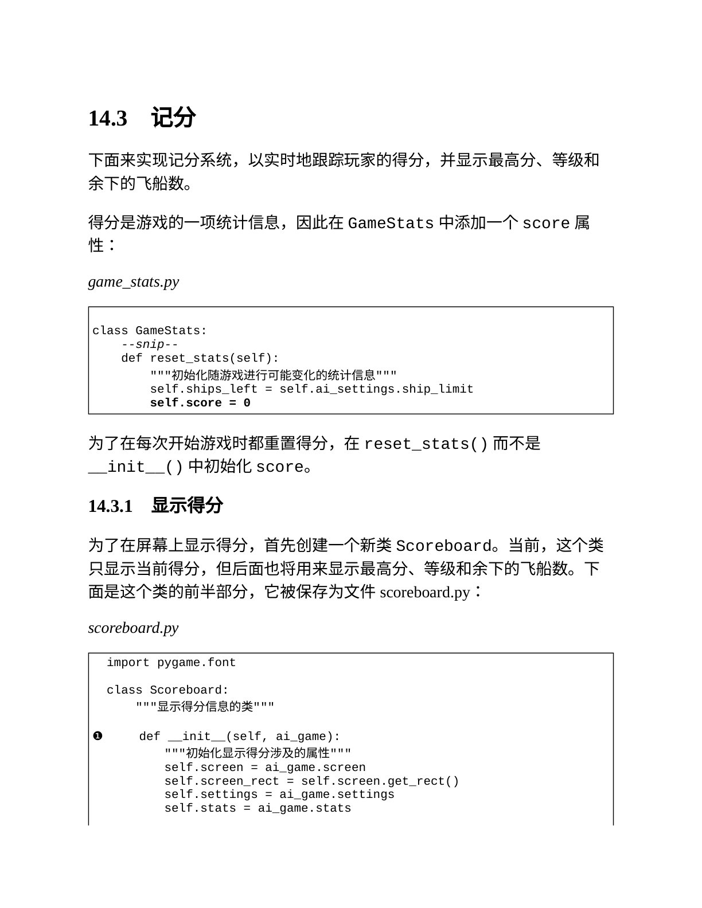

### 14.3 记分

下面来实现记分系统，以实时地跟踪玩家的得分，并显示最高分、等级和余下的飞船数。

得分是游戏的一项统计信息，因此在 `GameStats` 中添加一个 `score` 属性：

*game_stats.py*

```python
class GameStats:
    # --snip--（省略既有代码）
    def reset_stats(self):
        """初始化随游戏进行可能变化的统计信息"""
        self.ships_left = self.ai_settings.ship_limit
        self.score = 0
```

> 校对注：这里按原书保留 `self.ai_settings`；第 13 章 `GameStats` 使用的是 `self.settings`。沿用第 13 章代码时应核对并统一属性名，否则会发生 `AttributeError`。

为了在每次开始游戏时都重置得分，在 `reset_stats()` 而不是 `__init__()` 中初始化 `score`。

#### 14.3.1 显示得分

为了在屏幕上显示得分，首先创建一个新类 `Scoreboard`。当前，这个类只显示当前得分，但后面也将用来显示最高分、等级和余下的飞船数。下面是这个类的前半部分，它被保存为文件 `scoreboard.py`：

*scoreboard.py*（以下代码跨 PDF 第 427–428 页，已合并）：

```python
import pygame.font

class Scoreboard:
    """显示得分信息的类"""

    def __init__(self, ai_game):  # ❶
        """初始化显示得分涉及的属性"""
        self.screen = ai_game.screen
        self.screen_rect = self.screen.get_rect()
        self.settings = ai_game.settings
        self.stats = ai_game.stats
        # 显示得分信息时使用的字体设置
        self.text_color = (30, 30, 30)  # ❷
        self.font = pygame.font.SysFont(None, 48)  # ❸

        # 准备初始得分图像
        self.prep_score()  # ❹
```

## PDF 第 428 页
<!-- page-status: reviewed -->

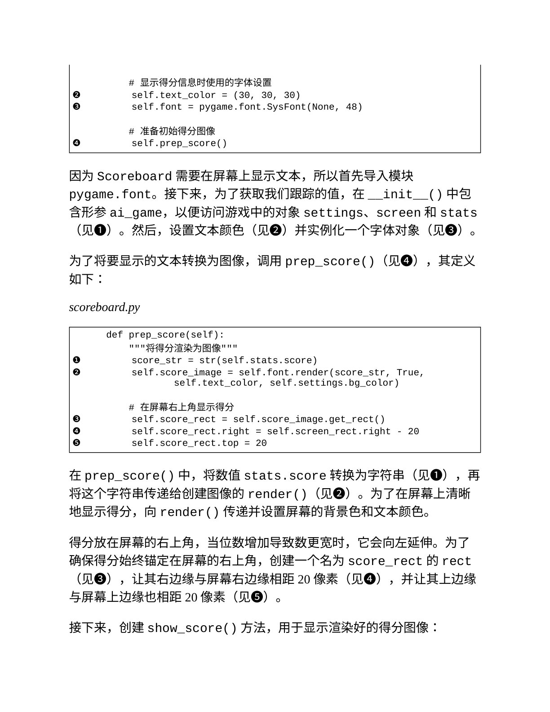

原书本页开头代码已合并到上一页的完整代码块。

因为 `Scoreboard` 需要在屏幕上显示文本，所以首先导入模块 `pygame.font`。接下来，为了获取我们跟踪的值，在 `__init__()` 中包含形参 `ai_game`，以便访问游戏中的对象 `settings`、`screen` 和 `stats`（见❶）。然后，设置文本颜色（见❷）并实例化一个字体对象（见❸）。

为了将要显示的文本转换为图像，调用 `prep_score()`（见❹），其定义如下：

*scoreboard.py*

```python
def prep_score(self):
    """将得分渲染为图像"""
    score_str = str(self.stats.score)  # ❶
    self.score_image = self.font.render(score_str, True,  # ❷
                                        self.text_color, self.settings.bg_color)

    # 在屏幕右上角显示得分
    self.score_rect = self.score_image.get_rect()  # ❸
    self.score_rect.right = self.screen_rect.right - 20  # ❹
    self.score_rect.top = 20  # ❺
```

在 `prep_score()` 中，将数值 `stats.score` 转换为字符串（见❶），再将这个字符串传递给创建图像的 `render()`（见❷）。为了在屏幕上清晰地显示得分，向 `render()` 传递并设置屏幕的背景色和文本颜色。

得分放在屏幕的右上角，当位数增加导致数更宽时，它会向左延伸。为了确保得分始终锚定在屏幕的右上角，创建一个名为 `score_rect` 的 `rect`（见❸），让其右边缘与屏幕右边缘相距 20 像素（见❹），并让其上边缘与屏幕上边缘也相距 20 像素（见❺）。

接下来，创建 `show_score()` 方法，用于显示渲染好的得分图像：

## PDF 第 429 页
<!-- page-status: reviewed -->

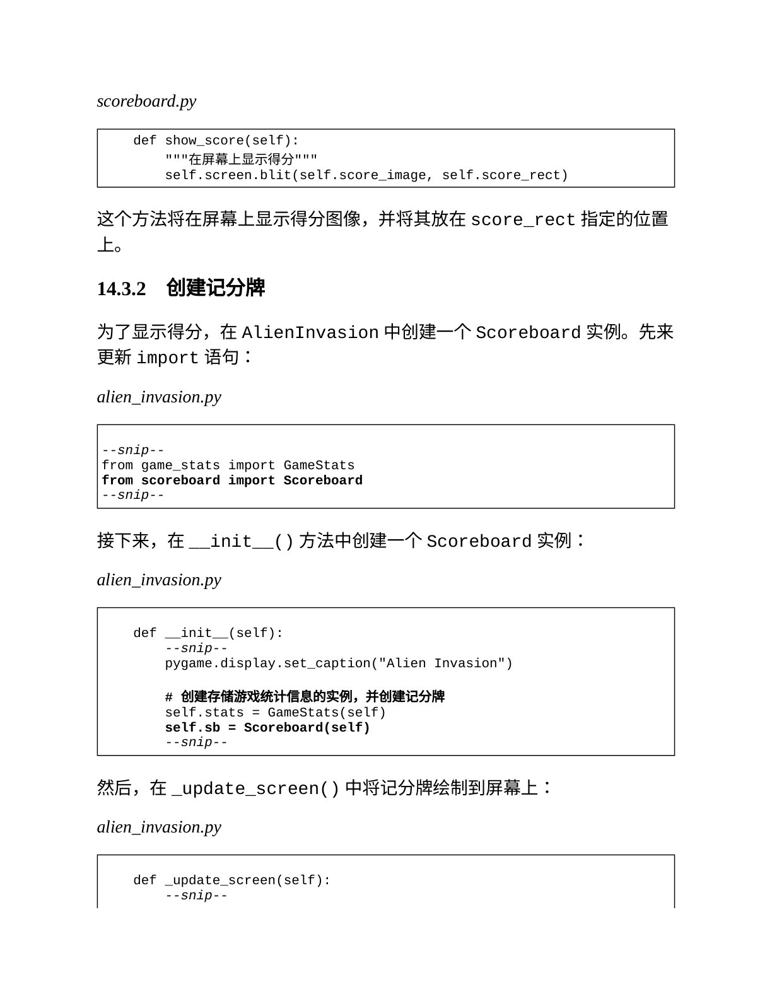

*scoreboard.py*

```python
def show_score(self):
    """在屏幕上显示得分"""
    self.screen.blit(self.score_image, self.score_rect)
```

这个方法将在屏幕上显示得分图像，并将其放在 `score_rect` 指定的位置上。

#### 14.3.2 创建记分牌

为了显示得分，在 `AlienInvasion` 中创建一个 `Scoreboard` 实例。先来更新 `import` 语句：

*alien_invasion.py*

```python
# --snip--（省略既有代码）
from game_stats import GameStats
from scoreboard import Scoreboard
# --snip--（省略既有代码）
```

接下来，在 `__init__()` 方法中创建一个 `Scoreboard` 实例：

*alien_invasion.py*

```python
def __init__(self):
    # --snip--（省略既有代码）
    pygame.display.set_caption("Alien Invasion")

    # 创建存储游戏统计信息的实例，并创建记分牌
    self.stats = GameStats(self)
    self.sb = Scoreboard(self)
    # --snip--（省略既有代码）
```

然后，在 `_update_screen()` 中将记分牌绘制到屏幕上：

*alien_invasion.py*（代码跨 PDF 第 429–430 页，以下已合并。原书省略了既有代码，此处用注释表示；这是方法片段，不能作为完整程序独立运行）：

```python
def _update_screen(self):
    # --snip--（省略既有代码）
    self.aliens.draw(self.screen)

    # 显示得分
    self.sb.show_score()

    # 如果游戏处于非活动状态，就显示 Play 按钮
    # --snip--（省略既有代码）
```

## PDF 第 430 页
<!-- page-status: reviewed -->

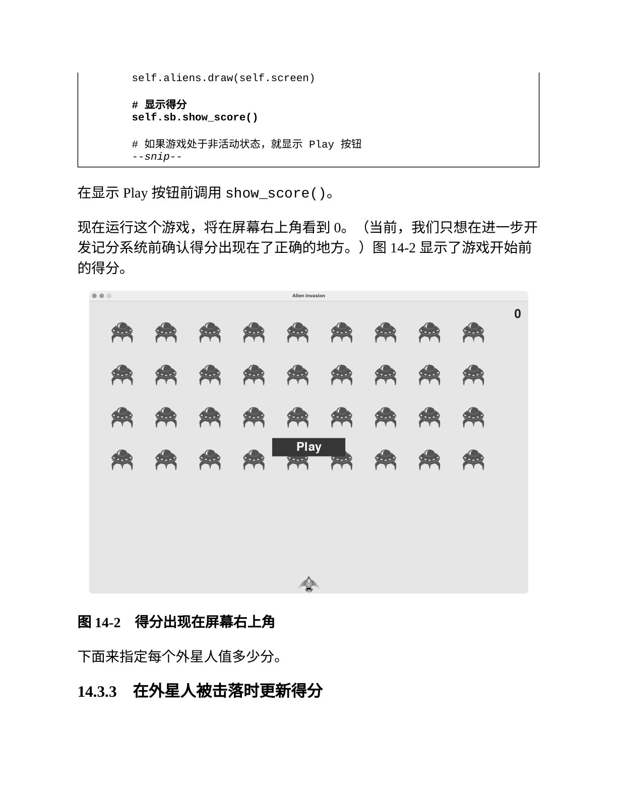

原书本页开头代码已合并到上一页的 `_update_screen()` 代码块。

在显示 Play 按钮前调用 `show_score()`。

现在运行这个游戏，将在屏幕右上角看到 0。（当前，我们只想在进一步开发记分系统前确认得分出现在了正确的地方。）图 14-2 显示了游戏开始前的得分。

**图 14-2：得分出现在屏幕右上角**（见本页原图）。

下面来指定每个外星人值多少分。

#### 14.3.3 在外星人被击落时更新得分

## PDF 第 431 页
<!-- page-status: reviewed -->

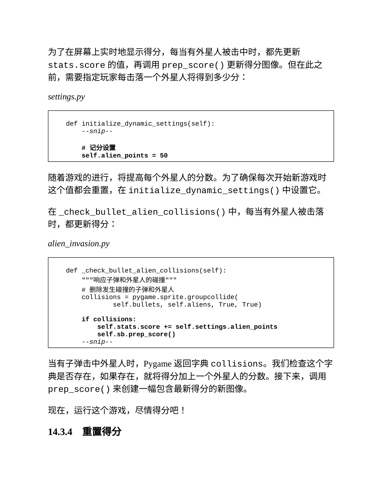

为了在屏幕上实时地显示得分，每当有外星人被击中时，都先更新 `stats.score` 的值，再调用 `prep_score()` 更新得分图像。但在此之前，需要指定玩家每击落一个外星人将得到多少分：

*settings.py*

```python
def initialize_dynamic_settings(self):
    # --snip--（省略既有代码）

    # 记分设置
    self.alien_points = 50
```

随着游戏的进行，将提高每个外星人的分数。为了确保每次开始新游戏时这个值都会重置，在 `initialize_dynamic_settings()` 中设置它。

在 `_check_bullet_alien_collisions()` 中，每当有外星人被击落时，都更新得分：

*alien_invasion.py*

```python
def _check_bullet_alien_collisions(self):
    """响应子弹和外星人的碰撞"""
    # 删除发生碰撞的子弹和外星人
    collisions = pygame.sprite.groupcollide(
        self.bullets, self.aliens, True, True)

    if collisions:
        self.stats.score += self.settings.alien_points
        self.sb.prep_score()
    # --snip--（省略既有代码）
```

当有子弹击中外星人时，Pygame 返回字典 `collisions`。我们检查这个字典是否存在，如果存在，就将得分加上一个外星人的分数。接下来，调用 `prep_score()` 来创建一幅包含最新得分的新图像。

现在，运行这个游戏，尽情得分吧！

#### 14.3.4 重置得分

## PDF 第 432 页
<!-- page-status: reviewed -->

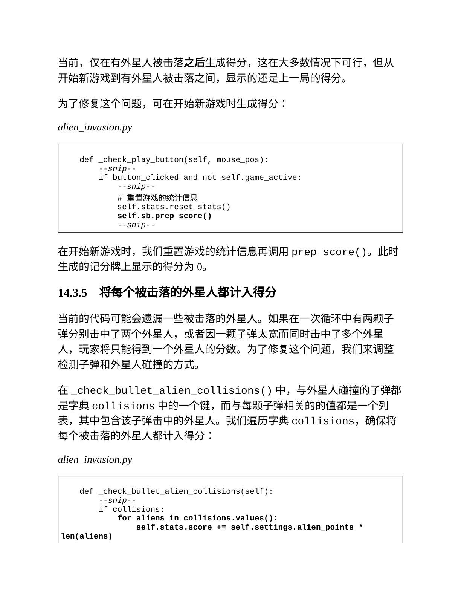

当前，仅在有外星人被击落之后生成得分，这在大多数情况下可行，但从开始新游戏到有外星人被击落之间，显示的还是上一局的得分。

为了修复这个问题，可在开始新游戏时生成得分：

*alien_invasion.py*

```python
def _check_play_button(self, mouse_pos):
    # --snip--（省略既有代码）
    if button_clicked and not self.game_active:
        # --snip--（省略既有代码）
        # 重置游戏的统计信息
        self.stats.reset_stats()
        self.sb.prep_score()
        # --snip--（省略既有代码）
```

在开始新游戏时，我们重置游戏的统计信息再调用 `prep_score()`。此时生成的记分牌上显示的得分为 0。

#### 14.3.5 将每个被击落的外星人都计入得分

当前的代码可能会遗漏一些被击落的外星人。如果在一次循环中有两颗子弹分别击中了两个外星人，或者因一颗子弹太宽而同时击中了多个外星人，玩家将只能得到一个外星人的分数。为了修复这个问题，我们来调整检测子弹和外星人碰撞的方式。

在 `_check_bullet_alien_collisions()` 中，与外星人碰撞的子弹都是字典 `collisions` 中的一个键，而与每颗子弹相关的的值都是一个列表，其中包含该子弹击中的外星人。我们遍历字典 `collisions`，确保将每个被击落的外星人都计入得分：

*alien_invasion.py*（代码跨 PDF 第 432–433 页，以下已合并；原书排版折行已恢复）

```python
def _check_bullet_alien_collisions(self):
    # --snip--（省略既有代码）
    if collisions:
        for aliens in collisions.values():
            self.stats.score += self.settings.alien_points * len(aliens)
        self.sb.prep_score()
    # --snip--（省略既有代码）
```

## PDF 第 433 页
<!-- page-status: reviewed -->

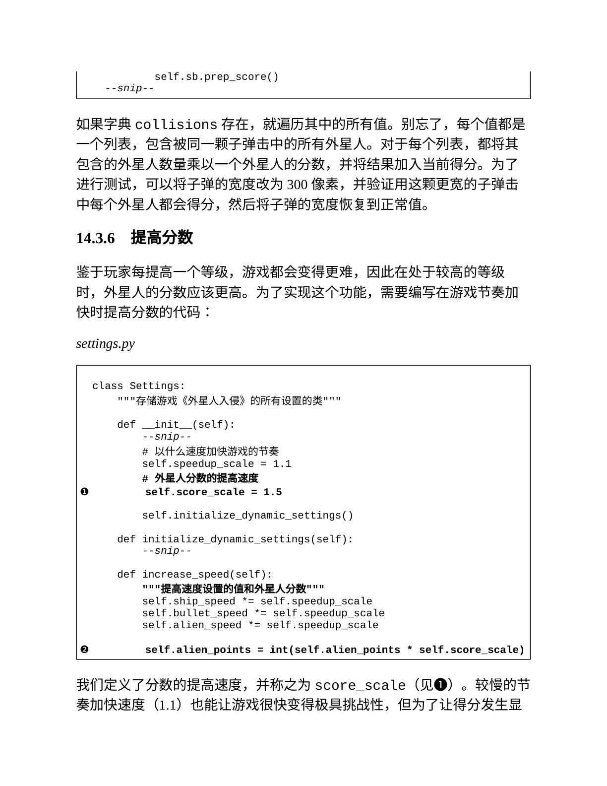

原书跨页代码已合并到上一页的 `_check_bullet_alien_collisions()` 代码块。

如果字典 `collisions` 存在，就遍历其中的所有值。别忘了，每个值都是一个列表，包含被同一颗子弹击中的所有外星人。对于每个列表，都将其包含的外星人数量乘以一个外星人的分数，并将结果加入当前得分。为了进行测试，可以将子弹的宽度改为 300 像素，并验证用这颗更宽的子弹击中每个外星人都会得分，然后将子弹的宽度恢复到正常值。

#### 14.3.6 提高分数

鉴于玩家每提高一个等级，游戏都会变得更难，因此在处于较高的等级时，外星人的分数应该更高。为了实现这个功能，需要编写在游戏节奏加快时提高分数的代码：

*settings.py*

> 这段代码保留原书的 `--snip--` 省略标记，并非完整的可执行类；须结合先前已有代码。

```text
class Settings:
    """存储游戏《外星人入侵》的所有设置的类"""

    def __init__(self):
        # --snip--（省略既有代码）
        # 以什么速度加快游戏的节奏
        self.speedup_scale = 1.1
        # 外星人分数的提高速度
        self.score_scale = 1.5  # ❶

        self.initialize_dynamic_settings()

    def initialize_dynamic_settings(self):
        --snip--

    def increase_speed(self):
        """提高速度设置的值和外星人分数"""
        self.ship_speed *= self.speedup_scale
        self.bullet_speed *= self.speedup_scale
        self.alien_speed *= self.speedup_scale

        self.alien_points = int(self.alien_points * self.score_scale)  # ❷
```

我们定义了分数的提高速度，并称之为 `score_scale`（见❶）。较慢的节奏加快速度（1.1）也能让游戏很快变得极具挑战性，但为了让得分发生显（续下一页）

## PDF 第 434 页
<!-- page-status: reviewed -->

[查看原页](images/page-0434.jpg)

（接上页）需要将分数的提高速度设置为更大的值（1.5）。现在，在加快游戏节奏的同时，还提高了每个外星人的分数（见②）。为了让外星人的分数为整数，使用函数 `int()`。

为了显示外星人的分数，在 `Settings` 的方法 `increase_speed()` 中调用函数 `print()`：

`settings.py`：

```python
def increase_speed(self):
    # --snip--
    self.alien_points = int(self.alien_points * self.score_scale)
    print(self.alien_points)
```

现在每提高一个等级，你都将在终端窗口看到新的分数值。

> 注意：确认分数在不断增加后，请记得删除调用函数 `print()` 的代码，否则可能影响游戏的性能，分散玩家的注意力。

#### 14.3.7 对得分进行舍入

大多数街机风格的射击游戏将得分显示为 10 的整数倍，下面就让记分系统遵循这个原则。我们还将设置得分的格式，在大数中添加用逗号表示的千位分隔符。在 `Scoreboard` 中进行这种修改：

`scoreboard.py`：

```python
def prep_score(self):
    """将得分渲染为图像"""
    rounded_score = round(self.stats.score, -1)
    score_str = f"{rounded_score:,}"
    self.score_image = self.font.render(score_str, True,
            self.text_color, self.settings.bg_color)
    # --snip--
```

`round()` 函数通常让浮点数（第一个实参）精确到小数点后某一位，其中的小数位数由第二个实参指定。如果将第二个实参指定为负数，`round()`（续下一页）。

## PDF 第 435 页
<!-- page-status: reviewed -->

[查看原页：图 14-3](images/page-0435.jpg)

（接上页）会将第一个实参舍入到最近的 10 的整数倍，如 10、100、1000 等。这里的代码让 Python 将 `stats.score` 的值舍入到最近的 10 的整数倍，并将结果存储到 `rounded_score` 中。

接下来，在表示得分的 f 字符串中使用一个格式说明符。**格式说明符**是一个特殊的字符序列，用于指定如何显示变量的值。这里使用的字符序列为冒号和逗号（`:,`），它让 Python 在数值的合适位置插入逗号，生成的字符串类似于 `1,000,000`（而不是 `1000000`）。

现在运行这个游戏，看到的得分将是 10 的整数倍，即便得分很高也是如此，如图 14-3 所示。

图 14-3：得分为 10 的整数倍，并将逗号用作千分位分隔符。

#### 14.3.8 最高分

## PDF 第 436 页
<!-- page-status: reviewed -->

[查看原页](images/page-0436.jpg)

每个玩家都想超过游戏的最高分记录。下面来跟踪并显示最高分，给玩家提供要超越的目标。我们将最高分存储在 `GameStats` 中：

`game_stats.py`：

```python
def __init__(self, ai_game):
    # --snip--
    # 在任何情况下都不应重置最高分
    self.high_score = 0
```

由于在任何情况下都不会重置最高分，因此在 `__init__()` 而不是 `reset_stats()` 中初始化 `high_score`。

下面来修改 `Scoreboard` 以显示最高分。先来修改 `__init__()` 方法：

`scoreboard.py`：

```python
def __init__(self, ai_game):
    # --snip--
    # 准备包含最高分和当前得分的图像
    self.prep_score()
    self.prep_high_score()
```

最高分将与当前得分分开显示，因此需要编写一个新方法 `prep_high_score()`，用于准备包含最高分的图像（见①）。

`prep_high_score()` 方法的代码如下（末两行接自 PDF 第 437 页）：

`scoreboard.py`：

```python
def prep_high_score(self):
    """将最高分渲染为图像"""
    high_score = round(self.stats.high_score, -1)
    high_score_str = f"{high_score:,}"
    self.high_score_image = self.font.render(high_score_str, True,
            self.text_color, self.settings.bg_color)

    # 将最高分放在屏幕顶部的中央
    self.high_score_rect = self.high_score_image.get_rect()
    self.high_score_rect.centerx = self.screen_rect.centerx
    self.high_score_rect.top = self.score_rect.top
```

## PDF 第 437 页
<!-- page-status: reviewed -->

[查看原页](images/page-0437.jpg)

本页开头两行代码已接入上一页的 `prep_high_score()`。

首先，将最高分舍入到最近的 10 的整数倍，并添加用逗号表示的千分位分隔符（见①）。然后，根据最高分生成一幅图像（见②），使其水平居中（见③），并将其 `top` 属性设置为当前得分图像的 `top` 属性（见④）。

现在，`show_score()` 方法需要在屏幕右上角显示当前得分，并在屏幕顶部的中央显示最高分：

`scoreboard.py`：

```python
def show_score(self):
    """在屏幕上显示当前得分和最高分"""
    self.screen.blit(self.score_image, self.score_rect)
    self.screen.blit(self.high_score_image, self.high_score_rect)
```

为了检查是否诞生了新的最高分，在 `Scoreboard` 中添加一个新方法 `check_high_score()`：

`scoreboard.py`：

```python
def check_high_score(self):
    """检查是否诞生了新的最高分"""
    if self.stats.score > self.stats.high_score:
        self.stats.high_score = self.stats.score
        self.prep_high_score()
```

`check_high_score()` 方法比较当前得分和最高分：如果当前得分更高，就更新 `high_score` 的值，并调用 `prep_high_score()` 来更新包含最高分的图像。

在 `_check_bullet_alien_collisions()` 中，每当有外星人被击落时，都需要在更新得分后调用 `check_high_score()`：

`alien_invasion.py`（代码续至 PDF 第 438 页）：

```python
def _check_bullet_alien_collisions(self):
    # --snip--
    if collisions:
        for aliens in collisions.values():
            self.stats.score += self.settings.alien_points * len(aliens)
        self.sb.prep_score()
        self.sb.check_high_score()
    # --snip--
```

## PDF 第 438 页
<!-- page-status: reviewed -->

[查看原页：图 14-4](images/page-0438.jpg)

本页开头的代码已接入上一页的 `_check_bullet_alien_collisions()`。

如果字典 `collisions` 存在，就根据击落了多少个外星人更新得分，再调用 `check_high_score()`。

在第一次玩这款游戏时，当前得分就是最高分，因此两个地方显示的都是当前得分。但是再次开始这个游戏时，最高分会出现在屏幕顶部的中央，而当前得分则会出现在屏幕的右上角，如图 14-4 所示。

图 14-4：最高分显示在屏幕顶部的中央。

#### 14.3.9 显示等级

## PDF 第 439 页
<!-- page-status: reviewed -->

[查看原页](images/page-0439.jpg)

为了在游戏中显示玩家的等级，首先需要在 `GameStats` 中添加一个表示当前等级的属性。要确保在每次开始新游戏时都重置等级，我们在 `reset_stats()` 中初始化该属性：

`game_stats.py`：

```python
def reset_stats(self):
    """初始化随游戏进行可能变化的统计信息"""
    self.ships_left = self.settings.ship_limit
    self.score = 0
    self.level = 1
```

为了让 `Scoreboard` 显示当前等级，在 `__init__()` 中调用一个新方法 `prep_level()`：

`scoreboard.py`：

```python
def __init__(self, ai_game):
    # --snip--
    self.prep_high_score()
    self.prep_level()
```

`prep_level()` 的代码如下：

`scoreboard.py`：

```python
def prep_level(self):
    """将等级渲染为图像"""
    level_str = str(self.stats.level)
    self.level_image = self.font.render(level_str, True,
            self.text_color, self.settings.bg_color)

    # 将等级放在得分下方
    self.level_rect = self.level_image.get_rect()
    self.level_rect.right = self.score_rect.right
    self.level_rect.top = self.score_rect.bottom + 10
```

`prep_level()` 方法会根据存储在 `stats.level` 中的值创建一幅图像（见①），并将其 `right` 属性设置为得分的 `right` 属性（见②）。然后，（续下一页）。

## PDF 第 440 页
<!-- page-status: reviewed -->

[查看原页](images/page-0440.jpg)

（接上页）将 `top` 属性设置得比得分图像的 `bottom` 属性大 10 像素，在得分和等级之间留出一定的空间（见③）。

还需要更新 `show_score()`：

`scoreboard.py`：

```python
def show_score(self):
    """在屏幕上显示得分和等级"""
    self.screen.blit(self.score_image, self.score_rect)
    self.screen.blit(self.high_score_image, self.high_score_rect)
    self.screen.blit(self.level_image, self.level_rect)
```

新增的代码行用于在屏幕上显示等级图像。

接下来，我们在 `_check_bullet_alien_collisions()` 中提高等级 `stats.level` 并更新等级图像：

`alien_invasion.py`：

```python
def _check_bullet_alien_collisions(self):
    # --snip--
    if not self.aliens:
        # 删除现有的子弹并创建一个新的外星舰队
        self.bullets.empty()
        self._create_fleet()
        self.settings.increase_speed()

        # 提高等级
        self.stats.level += 1
        self.sb.prep_level()
```

如果整个外星舰队都被击落，就将 `stats.level` 的值加 1，并调用 `prep_level()` 以确保正确地显示了新等级。

为了确保在开始新游戏时更新等级图像，还需在玩家单击按钮 Play 时调用 `prep_level()`：

`alien_invasion.py`（代码见下一页）。

## PDF 第 441 页
<!-- page-status: reviewed -->

[查看原页：图 14-5](images/page-0441.jpg)

```python
def _check_play_button(self, mouse_pos):
    # --snip--
    if button_clicked and not self.game_active:
        # --snip--
        self.sb.prep_score()
        self.sb.prep_level()
        # --snip--
```

这里在调用 `prep_score()` 后立即调用 `prep_level()`。

现在我们可以知道玩家到了多少级，如图 14-5 所示。

图 14-5：当前等级显示在当前得分的正下方。

> 注意：在一些经典游戏中，得分带标签，如 Score、High Score 和 Level。这里没有显示这些标签，因为在游戏开始后，每个数的含义将一目了然。要包含这些标签，只需在 `Scoreboard` 中调用 `font.render()` 之前，将它们添加到得分字符串中。

## PDF 第 442 页
<!-- page-status: reviewed -->

[查看原页](images/page-0442.jpg)

#### 14.3.10 显示余下的飞船数

最后，我们使用图形而不是数来显示玩家还剩多少艘飞船。为此，在屏幕左上角绘制飞船图像来指出还余下多少艘飞船，就像众多经典的街机游戏那样。

首先，需要让 `Ship` 继承 `Sprite`，以便能够创建飞船编组：

`ship.py`：

```python
import pygame
from pygame.sprite import Sprite

class Ship(Sprite):
    """管理飞船的类"""

    def __init__(self, ai_game):
        """初始化飞船并设置其起始位置"""
        super().__init__()
        # --snip--
```

这里导入了 `Sprite`，让 `Ship` 继承 `Sprite`（见①），并在 `__init__()` 的开头调用 `super()` 以完成精灵的初始化工作（见②）。

接下来，需要修改 `Scoreboard`，以创建可供显示的飞船编组。下面是其中的 `import` 语句：

`scoreboard.py`：

```python
import pygame.font
from pygame.sprite import Group

from ship import Ship
```

鉴于需要创建飞船编组，导入 `Group` 类和 `Ship` 类。下面是方法 `__init__()`（代码见下一页）。

## PDF 第 443 页
<!-- page-status: reviewed -->

[查看原页](images/page-0443.jpg)

`scoreboard.py`：

```python
def __init__(self, ai_game):
    """初始化记录得分的属性"""
    self.ai_game = ai_game
    self.screen = ai_game.screen
    # --snip--
    self.prep_level()
    self.prep_ships()
```

我们将游戏实例赋给一个属性，因为创建飞船时需要用到它。然后在调用 `prep_level()` 后调用 `prep_ships()`。

`prep_ships()` 的代码如下：

`scoreboard.py`：

```python
def prep_ships(self):
    """显示还余下多少艘飞船"""
    self.ships = Group()
    for ship_number in range(self.stats.ships_left):
        ship = Ship(self.ai_game)
        ship.rect.x = 10 + ship_number * ship.rect.width
        ship.rect.y = 10
        self.ships.add(ship)
```

`prep_ships()` 方法会创建一个空编组 `self.ships`，用于存储飞船实例（见①）。根据玩家还有多少艘飞船，以相应的次数运行一个循环，来填充这个编组（见②）。在这个循环中，我们创建新飞船并设置其 x 坐标，让整个飞船编组都位于屏幕左边缘，且每艘飞船的左边距都为 10 像素（见③）。我们还将飞船的 y 坐标设置为距离屏幕上边缘 10 像素，让所有飞船都出现在屏幕的左上角（见④）。最后，将每艘新飞船都添加到 `ships` 编组中（见⑤）。

现在需要在屏幕上绘制飞船了：

`scoreboard.py`（代码续接 PDF 第 444 页）：

```python
def show_score(self):
    """在屏幕上绘制得分、等级和余下的飞船数"""
    self.screen.blit(self.score_image, self.score_rect)
    self.screen.blit(self.high_score_image, self.high_score_rect)
    self.screen.blit(self.level_image, self.level_rect)
    self.ships.draw(self.screen)
```

## PDF 第 444 页
<!-- page-status: reviewed -->

[查看原页](images/page-0444.jpg)

本页开头的代码已接入上一页的 `show_score()`。

对编组调用 `draw()`，Pygame 将在屏幕上绘制每艘飞船。

为了在游戏开始时让玩家知道自己有多少艘飞船，可以在开始新游戏时调用 `prep_ships()`。因此修改 `AlienInvasion` 类中的 `_check_play_button()` 方法：

`alien_invasion.py`：

```python
def _check_play_button(self, mouse_pos):
    # --snip--
    if button_clicked and not self.game_active:
        # --snip--
        self.sb.prep_level()
        self.sb.prep_ships()
        # --snip--
```

当然，还要在飞船被外星人撞到时调用 `prep_ships()`，从而在玩家损失飞船时更新飞船图像：

`alien_invasion.py`：

```python
def _ship_hit(self):
    """响应飞船和外星人的碰撞"""
    if self.stats.ships_left > 0:
        # 将 ships_left 减 1 并更新记分牌
        self.stats.ships_left -= 1
        self.sb.prep_ships()
        # --snip--
```

这里在将 `ships_left` 的值减 1 后调用 `prep_ships()`。这样每次损失飞船后，显示的剩余飞船数都是正确的。

图 14-6 显示了完整的记分系统，它在屏幕的左上角指出了还余下多少艘飞船。

## PDF 第 445 页
<!-- page-status: reviewed -->

[查看原页：图 14-6](images/page-0445.jpg)

图 14-6：游戏《外星人入侵》的完整记分系统。

**动手试一试**

**练习 14.5：历史最高分**　每当玩家关闭并重新开始游戏《外星人入侵》时，最高分都将被重置。请这样修复该问题：调用 `sys.exit()` 前将最高分写入文件，并在 `GameStats` 中初始化最高分时从文件中读取它。

**练习 14.6：重构**　找出执行多项任务的方法，对它们进行重构，让代码高效而有序。例如，对于 `_check_bullet_alien_collisions()`，将在整个外星舰队被全部击落时开始新等级的代码移到一个名为 `start_new_level()` 的方法中。又例如，对于 `Scoreboard` 的 `__init__()` 方法，将调用四个不同方法的代码移到一个名为 `prep_images()` 的方法中，以缩短 `__init__()` 方法。如果你重构了 `_check_play_button()`，后文续见下一页。

## PDF 第 446 页
<!-- page-status: reviewed -->

[查看原页](images/page-0446.jpg)

（接上页）`prep_images()` 方法也可帮助简化 `_check_play_button()` 和 `_start_game()`。

> 注意：重构项目前，请阅读附录 D，了解如何在重构时引入了 bug，如何将项目恢复到可正确运行的状态。

**练习 14.7：扩展游戏《外星人入侵》**　想想如何扩展游戏《外星人入侵》。例如，让外星人也能够向飞船射击，或者为飞船添加盾牌，使得只有从两边射来的子弹才能摧毁飞船。另外，还可以使用像 `pygame.mixer` 这样的模块来添加声音效果，如爆炸声和射击声。

**练习 14.8：终极版《横向射击》**　模仿游戏《外星人入侵》继续开发《横向射击》。添加一个 Play 按钮，在适合的情况下加快游戏的节奏，并开发一个记分系统。在开发过程中，务必重构代码，并寻找机会以本章没有介绍的方式定制这款游戏。

## PDF 第 447 页
<!-- page-status: reviewed -->

[查看原页](images/page-0447.jpg)

### 14.4 小结

在本章中，你学习了如何创建用于开始新游戏的 Play 按钮，如何检测鼠标事件，以及如何在游戏处于活动状态时隐藏光标。你可以利用学到的知识在游戏中创建其他按钮，如显示游戏玩法的 Help 按钮。你还学习了如何随游戏的进行调整节奏，如何实现记分系统，以及如何以文本和非文本方式显示信息。

