# 第 4 章 NumPy 基础：数组和向量化计算

[返回目录](../README.md)

> 本章各页已对照原页整理为可编辑的 Markdown，页面图像保留供复核。校对标记表示已检查原页，不表示所有示例都已运行；部分旧版 NumPy 写法可能需要调整。

## PDF 第 92 页

<!-- page-status: reviewed -->
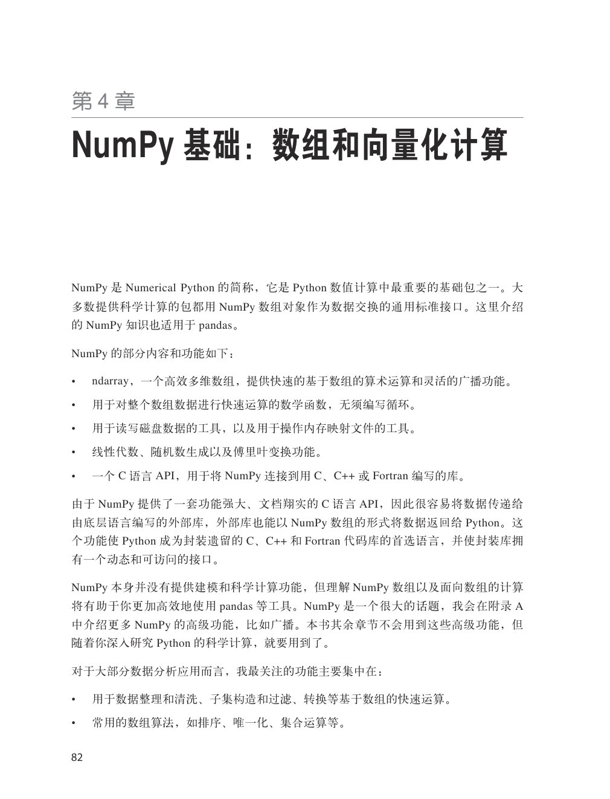

NumPy 是 Numerical Python 的简称，它是 Python 数值计算中最重要的基础包之一。大多数提供科学计算的包都用 NumPy 数组对象作为数据交换的通用标准接口。这里介绍的 NumPy 知识也适用于 pandas。

NumPy 的部分内容和功能如下：

- ndarray，一个高效多维数组，提供快速的基于数组的算术运算和灵活的广播功能。
- 用于对整个数组数据进行快速运算的数学函数，无须编写循环。
- 用于读写磁盘数据的工具，以及用于操作内存映射文件的工具。
- 线性代数、随机数生成以及傅里叶变换功能。
- 一个 C 语言 API，用于将 NumPy 连接到用 C、C++ 或 Fortran 编写的库。

由于 NumPy 提供了一套功能强大、文档翔实的 C 语言 API，因此很容易将数据传递给由底层语言编写的外部库，外部库也能以 NumPy 数组的形式将数据返回给 Python。这个功能使 Python 成为封装遗留的 C、C++ 和 Fortran 代码库的首选语言，并使封装库拥有一个动态和可访问的接口。

NumPy 本身并没有提供建模和科学计算功能，但理解 NumPy 数组以及面向数组的计算将有助于你更加高效地使用 pandas 等工具。NumPy 是一个很大的话题，我会在附录 A 中介绍更多 NumPy 的高级功能，比如广播。本书其余章节不会用到这些高级功能，但随着你深入研究 Python 的科学计算，就要用到了。

对于大部分数据分析应用而言，我最关注的功能主要集中在：

- 用于数据整理和清洗、子集构造和过滤、转换等基于数组的快速运算。
- 常用的数组算法，如排序、唯一化、集合运算等。

## PDF 第 93 页

<!-- page-status: reviewed -->
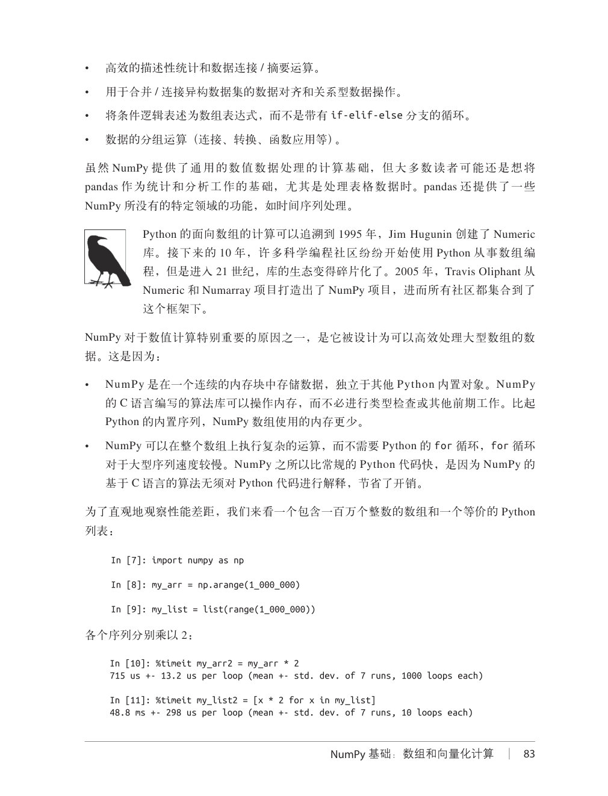

- 高效的描述性统计和数据连接 / 摘要运算。
- 用于合并 / 连接异构数据集的数据对齐和关系型数据操作。
- 将条件逻辑表述为数组表达式，而不是带有 `if-elif-else` 分支的循环。
- 数据的分组运算（连接、转换、函数应用等）。

虽然 NumPy 提供了通用的数值数据处理的计算基础，但大多数读者可能还是想将 pandas 作为统计和分析工作的基础，尤其是处理表格数据时。pandas 还提供了一些 NumPy 所没有的特定领域的功能，如时间序列处理。

NumPy 对于数值计算特别重要的原因之一，是它被设计为可以高效处理大型数组的数据。这是因为：

- NumPy 是在一个连续的内存块中存储数据，独立于其他 Python 内置对象。NumPy 的 C 语言编写的算法库可以操作内存，而不必进行类型检查或其他前期工作。比起 Python 的内置序列，NumPy 数组使用的内存更少。
- NumPy 可以在整个数组上执行复杂的运算，而不需要 Python 的 `for` 循环，`for` 循环对于大型序列速度较慢。NumPy 之所以比常规的 Python 代码快，是因为 NumPy 的基于 C 语言的算法无须对 Python 代码进行解释，节省了开销。

为了直观地观察性能差距，我们来看一个包含一百万个整数的数组和一个等价的 Python 列表：

```python
import numpy as np

my_arr = np.arange(1_000_000)
my_list = list(range(1_000_000))
```

各个序列分别乘以 2（以下为 IPython 的 `%timeit` 命令及原书输出）：

```ipython
In [10]: %timeit my_arr2 = my_arr * 2
715 us +- 13.2 us per loop (mean +- std. dev. of 7 runs, 1000 loops each)

In [11]: %timeit my_list2 = [x * 2 for x in my_list]
48.8 ms +- 298 us per loop (mean +- std. dev. of 7 runs, 10 loops each)
```

## PDF 第 94 页

<!-- page-status: reviewed -->
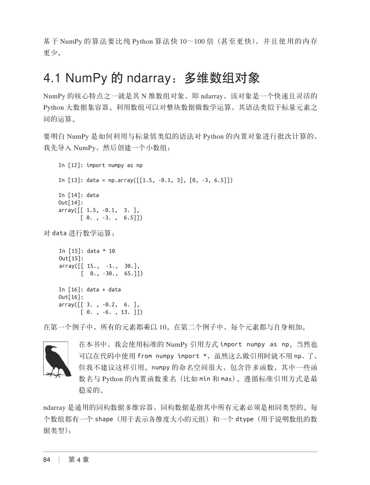

基于 NumPy 的算法要比纯 Python 算法快 10～100 倍（甚至更快），并且使用的内存更少。

### 4.1 NumPy 的 ndarray：多维数组对象

NumPy 的核心特点之一就是其 N 维数组对象，即 ndarray，该对象是一个快速且灵活的 Python 大数据集容器。利用数组可以对整块数据做数学运算，其语法类似于标量元素之间的运算。

要明白 NumPy 是如何利用与标量值类似的语法对 Python 的内置对象进行批次计算的，我先导入 NumPy，然后创建一个小数组：

```python
import numpy as np

data = np.array([[1.5, -0.1, 3], [0, -3, 6.5]])
data
```

输出：

```text
array([[ 1.5, -0.1,  3. ],
       [ 0. , -3. ,  6.5]])
```

对 `data` 进行数学运算：

```python
data * 10
```

```text
array([[ 15.,  -1.,  30.],
       [  0., -30.,  65.]])
```

```python
data + data
```

```text
array([[ 3. , -0.2,  6. ],
       [ 0. , -6. , 13. ]])
```

在第一个例子中，所有的元素都乘以 10。在第二个例子中，每个元素都与自身相加。

> 在本书中，我会使用标准的 NumPy 引用方式 `import numpy as np`。当然也可以在代码中使用 `from numpy import *`，虽然这么做引用时就不用 `np.` 了，但我不建议这样引用。numpy 的命名空间很大，包含许多函数，其中一些函数名与 Python 的内置函数重名（比如 `min` 和 `max`）。遵循标准引用方式是最稳妥的。

ndarray 是通用的同构数据多维容器，同构数据是指其中所有元素必须是相同类型的。每个数组都有一个 `shape`（用于表示各维度大小的元组）和一个 `dtype`（用于说明数组的数据类型）：

## PDF 第 95 页

<!-- page-status: reviewed -->
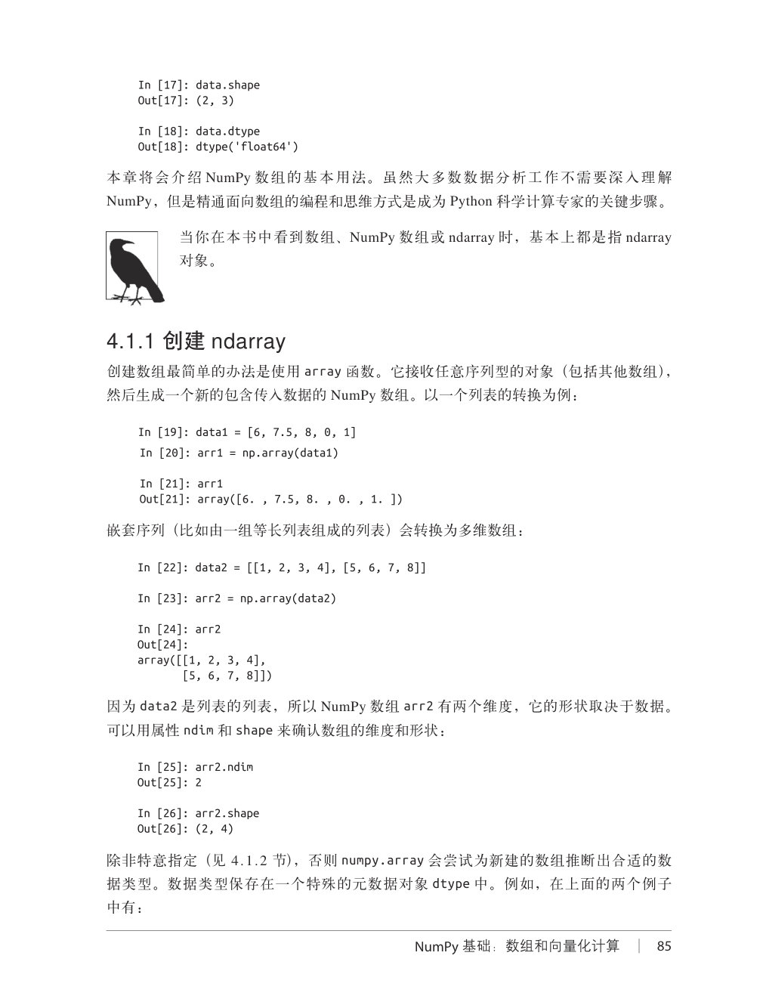

上一页创建的 `data` 数组具有以下形状和数据类型：

```python
# In [17]
data.shape
```

```text
Out[17]: (2, 3)
```

```python
# In [18]
data.dtype
```

```text
Out[18]: dtype('float64')
```

本章将会介绍 NumPy 数组的基本用法。虽然大多数数据分析工作不需要深入理解 NumPy，但是精通面向数组的编程和思维方式是成为 Python 科学计算专家的关键步骤。

> 当你在本书中看到数组、NumPy 数组或 ndarray 时，基本上都是指 ndarray 对象。

### 4.1.1 创建 ndarray

创建数组最简单的办法是使用 `array` 函数。它接收任意序列型的对象（包括其他数组），然后生成一个新的包含传入数据的 NumPy 数组。以一个列表的转换为例：

```python
# In [19]–[21]
data1 = [6, 7.5, 8, 0, 1]
arr1 = np.array(data1)
arr1
```

```text
Out[21]: array([6. , 7.5, 8. , 0. , 1. ])
```

嵌套序列（比如由一组等长列表组成的列表）会转换为多维数组：

```python
# In [22]–[24]
data2 = [[1, 2, 3, 4], [5, 6, 7, 8]]
arr2 = np.array(data2)
arr2
```

```text
Out[24]:
array([[1, 2, 3, 4],
       [5, 6, 7, 8]])
```

因为 `data2` 是列表的列表，所以 NumPy 数组 `arr2` 有两个维度，它的形状取决于数据。可以用属性 `ndim` 和 `shape` 来确认数组的维度和形状：

```python
# In [25]
arr2.ndim
```

```text
Out[25]: 2
```

```python
# In [26]
arr2.shape
```

```text
Out[26]: (2, 4)
```

除非特意指定（见 4.1.2 节），否则 `numpy.array` 会尝试为新建的数组推断出合适的数据类型。数据类型保存在一个特殊的元数据对象 `dtype` 中。例如，在上面的两个例子中有：

## PDF 第 96 页

<!-- page-status: reviewed -->
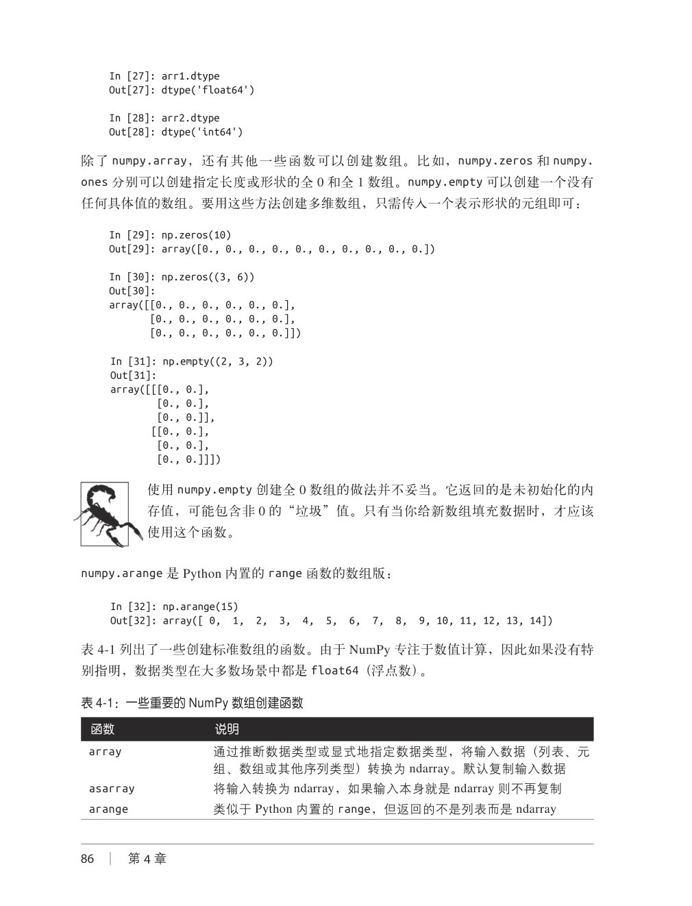

```python
# In [27]
arr1.dtype
```

```text
Out[27]: dtype('float64')
```

```python
# In [28]
arr2.dtype
```

```text
Out[28]: dtype('int64')
```

除了 `numpy.array`，还有其他一些函数可以创建数组。比如，`numpy.zeros` 和 `numpy.ones` 分别可以创建指定长度或形状的全 0 和全 1 数组。`numpy.empty` 可以创建一个没有任何具体值的数组。要用这些方法创建多维数组，只需传入一个表示形状的元组即可：

```python
# In [29]
np.zeros(10)
```

```text
Out[29]: array([0., 0., 0., 0., 0., 0., 0., 0., 0., 0.])
```

```python
# In [30]
np.zeros((3, 6))
```

```text
Out[30]:
array([[0., 0., 0., 0., 0., 0.],
       [0., 0., 0., 0., 0., 0.],
       [0., 0., 0., 0., 0., 0.]])
```

```python
# In [31]
np.empty((2, 3, 2))
```

```text
Out[31]:
array([[[0., 0.],
        [0., 0.],
        [0., 0.]],
       [[0., 0.],
        [0., 0.],
        [0., 0.]]])
```

> 使用 `numpy.empty` 创建全 0 数组的做法并不妥当。它返回的是未初始化的内存值，可能包含非 0 的“垃圾”值。只有当你给新数组填充数据时，才应该使用这个函数。上面的输出是原书的一次结果，并不能保证再次运行得到相同数值。

`numpy.arange` 是 Python 内置的 `range` 函数的数组版：

```python
# In [32]
np.arange(15)
```

```text
Out[32]: array([ 0,  1,  2,  3,  4,  5,  6,  7,  8,  9, 10, 11, 12, 13, 14])
```

表 4-1 列出了一些创建标准数组的函数。由于 NumPy 专注于数值计算，因此如果没有特别指明，数据类型在大多数场景中都是 `float64`（浮点数）。

**表 4-1：一些重要的 NumPy 数组创建函数**

| 函数 | 说明 |
|---|---|
| `array` | 通过推断数据类型或显式地指定数据类型，将输入数据（列表、元组、数组或其他序列类型）转换为 ndarray。默认复制输入数据 |
| `asarray` | 将输入转换为 ndarray，如果输入本身就是 ndarray 则不再复制 |
| `arange` | 类似于 Python 内置的 `range`，但返回的不是列表而是 ndarray |

## PDF 第 97 页

<!-- page-status: reviewed -->
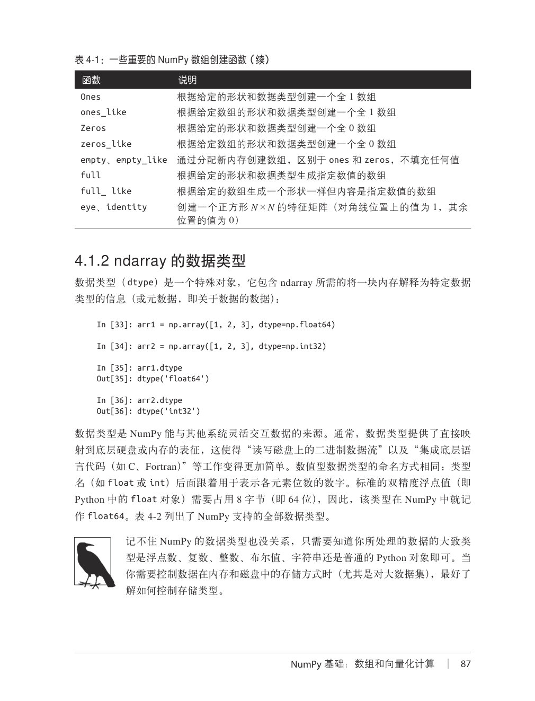

**表 4-1：一些重要的 NumPy 数组创建函数（续）**

| 函数 | 说明 |
|---|---|
| `ones` | 根据给定的形状和数据类型创建一个全 1 数组 |
| `ones_like` | 根据给定数组的形状和数据类型创建一个全 1 数组 |
| `zeros` | 根据给定的形状和数据类型创建一个全 0 数组 |
| `zeros_like` | 根据给定数组的形状和数据类型创建一个全 0 数组 |
| `empty`、`empty_like` | 通过分配新内存创建数组，区别于 `ones` 和 `zeros`，不填充任何值 |
| `full` | 根据给定的形状和数据类型生成指定数值的数组 |
| `full_like` | 根据给定的数组生成一个形状一样但内容是指定数值的数组 |
| `eye`、`identity` | 创建一个正方形 $N\times N$ 的矩阵（对角线位置上的值为 1，其余位置的值为 0） |

> 校对注：原页将部分函数印为 `Ones`、`Zeros`、`full_ like`，这里按实际函数名规范为 `ones`、`zeros`、`full_like`；原页所称的“特征矩阵”是单位矩阵。

### 4.1.2 ndarray 的数据类型

数据类型（`dtype`）是一个特殊对象，它包含 ndarray 所需的将一块内存解释为特定数据类型的信息（或元数据，即关于数据的数据）：

```python
# In [33]–[35]
arr1 = np.array([1, 2, 3], dtype=np.float64)
arr2 = np.array([1, 2, 3], dtype=np.int32)
arr1.dtype
```

```text
Out[35]: dtype('float64')
```

```python
# In [36]
arr2.dtype
```

```text
Out[36]: dtype('int32')
```

数据类型是 NumPy 能与其他系统灵活交互数据的来源。通常，数据类型提供了直接映射到底层硬盘或内存的表征，这使得“读写磁盘上的二进制数据流”以及“集成底层语言代码（如 C、Fortran）”等工作变得更加简单。数值型数据类型的命名方式相同：类型名（如 `float` 或 `int`）后面跟着用于表示各元素位数的数字。标准的双精度浮点值（即 Python 中的 `float` 对象）需要占用 8 字节（即 64 位），因此，该类型在 NumPy 中就记作 `float64`。表 4-2 列出了 NumPy 支持的全部数据类型。

> 记不住 NumPy 的数据类型也没关系，只需要知道你所处理的数据的大致类型是浮点数、复数、整数、布尔值、字符串还是普通的 Python 对象即可。当你需要控制数据在内存和磁盘中的存储方式时（尤其是对大数据集），最好了解如何控制存储类型。

## PDF 第 98 页

<!-- page-status: reviewed -->
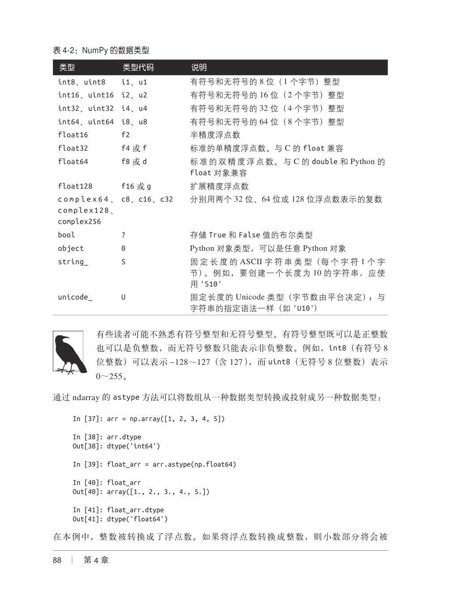

**表 4-2：NumPy 的数据类型**

| 类型 | 类型代码 | 说明 |
| --- | --- | --- |
| `int8`、`uint8` | `i1`、`u1` | 有符号和无符号的 8 位（1 个字节）整型 |
| `int16`、`uint16` | `i2`、`u2` | 有符号和无符号的 16 位（2 个字节）整型 |
| `int32`、`uint32` | `i4`、`u4` | 有符号和无符号的 32 位（4 个字节）整型 |
| `int64`、`uint64` | `i8`、`u8` | 有符号和无符号的 64 位（8 个字节）整型 |
| `float16` | `f2` | 半精度浮点数 |
| `float32` | `f4` 或 `f` | 标准的单精度浮点数。与 C 的 `float` 兼容 |
| `float64` | `f8` 或 `d` | 标准的双精度浮点数。与 C 的 `double` 和 Python 的 `float` 对象兼容 |
| `float128` | `f16` 或 `g` | 扩展精度浮点数 |
| `complex64`、`complex128`、`complex256` | `c8`、`c16`、`c32` | 分别用两个 32 位、64 位或 128 位浮点数表示的复数 |
| `bool` | `?` | 存储 `True` 和 `False` 值的布尔类型 |
| `object` | `O` | Python 对象类型，可以是任意 Python 对象 |
| `string_` | `S` | 固定长度的 ASCII 字符串类型（每个字符 1 个字节）。例如，要创建一个长度为 10 的字符串，应使用 `'S10'` |
| `unicode_` | `U` | 固定长度的 Unicode 类型（字节数由平台决定）；与字符串的指定语法一样（如 `'U10'`） |

> 有些读者可能不熟悉有符号整型和无符号整型。有符号整型既可以是正整数也可以是负整数，而无符号整数只能表示非负整数。例如，`int8`（有符号 8 位整数）可以表示 -128～127（含 127），而 `uint8`（无符号 8 位整数）表示 0～255。

通过 ndarray 的 `astype` 方法可以将数组从一种数据类型转换或投射成另一种数据类型：

```python
arr = np.array([1, 2, 3, 4, 5])
arr.dtype
```

```text
dtype('int64')
```

```python
float_arr = arr.astype(np.float64)
float_arr
```

```text
array([1., 2., 3., 4., 5.])
```

```python
float_arr.dtype
```

```text
dtype('float64')
```

在本例中，整数被转换成了浮点数。如果将浮点数转换成整数，则小数部分将会被

## PDF 第 99 页

<!-- page-status: reviewed -->
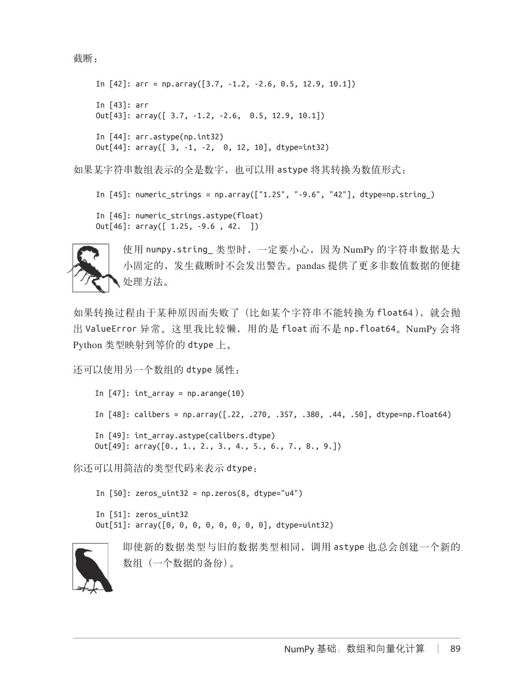

截断：

```ipython
In [42]: arr = np.array([3.7, -1.2, -2.6, 0.5, 12.9, 10.1])

In [43]: arr
Out[43]: array([ 3.7, -1.2, -2.6,  0.5, 12.9, 10.1])

In [44]: arr.astype(np.int32)
Out[44]: array([ 3, -1, -2,  0, 12, 10], dtype=int32)
```

如果某字符串数组表示的全是数字，也可以用 `astype` 将其转换为数值形式：

```ipython
In [45]: numeric_strings = np.array(["1.25", "-9.6", "42"], dtype=np.string_)

In [46]: numeric_strings.astype(float)
Out[46]: array([ 1.25, -9.6 , 42.  ])
```

> 使用 `numpy.string_` 类型时，一定要小心，因为 NumPy 的字符串数据是大小固定的，发生截断时不会发出警告。pandas 提供了更多非数值数据的便捷处理方法。

> 版本说明：原书使用的 `np.string_` 在 NumPy 2.x 中已移除。本机捆绑的 NumPy 2.3.5 中，可将上例的 `dtype=np.string_` 改为 `dtype=np.bytes_`；该替代写法已验证可以执行，并得到相同的数值转换结果。

如果转换过程由于某种原因而失败了（比如某个字符串不能转换为 `float64`），就会抛出 `ValueError` 异常。这里我比较懒，用的是 `float` 而不是 `np.float64`。NumPy 会将 Python 类型映射到等价的 dtype 上。

还可以使用另一个数组的 `dtype` 属性：

```ipython
In [47]: int_array = np.arange(10)

In [48]: calibers = np.array([.22, .270, .357, .380, .44, .50], dtype=np.float64)

In [49]: int_array.astype(calibers.dtype)
Out[49]: array([0., 1., 2., 3., 4., 5., 6., 7., 8., 9.])
```

你还可以用简洁的类型代码来表示 dtype：

```ipython
In [50]: zeros_uint32 = np.zeros(8, dtype="u4")

In [51]: zeros_uint32
Out[51]: array([0, 0, 0, 0, 0, 0, 0, 0], dtype=uint32)
```

> 即使新的数据类型与旧的数据类型相同，调用 `astype` 也总会创建一个新的数组（一个数据的备份）。

## PDF 第 100 页

<!-- page-status: reviewed -->
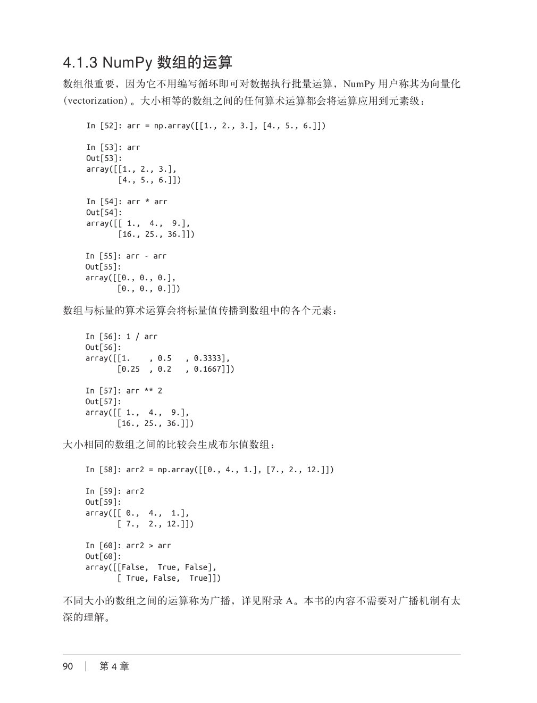

### 4.1.3 NumPy 数组的运算

数组很重要，因为它不用编写循环即可对数据执行批量运算，NumPy 用户称其为向量化（vectorization）。大小相等的数组之间的任何算术运算都会将运算应用到元素级：

```python
arr = np.array([[1., 2., 3.], [4., 5., 6.]])
arr
```

```text
array([[1., 2., 3.],
       [4., 5., 6.]])
```

```python
arr * arr
```

```text
array([[ 1.,  4.,  9.],
       [16., 25., 36.]])
```

```python
arr - arr
```

```text
array([[0., 0., 0.],
       [0., 0., 0.]])
```

数组与标量的算术运算会将标量值传播到数组中的各个元素：

```python
1 / arr
```

```text
array([[1.    , 0.5   , 0.3333],
       [0.25  , 0.2   , 0.1667]])
```

```python
arr ** 2
```

```text
array([[ 1.,  4.,  9.],
       [16., 25., 36.]])
```

大小相同的数组之间的比较会生成布尔值数组：

```python
arr2 = np.array([[0., 4., 1.], [7., 2., 12.]])
arr2
```

```text
array([[ 0.,  4.,  1.],
       [ 7.,  2., 12.]])
```

```python
arr2 > arr
```

```text
array([[False,  True, False],
       [ True, False,  True]])
```

不同大小的数组之间的运算称为广播，详见附录 A。本书的内容不需要对广播机制有太深的理解。

## PDF 第 101 页

<!-- page-status: reviewed -->
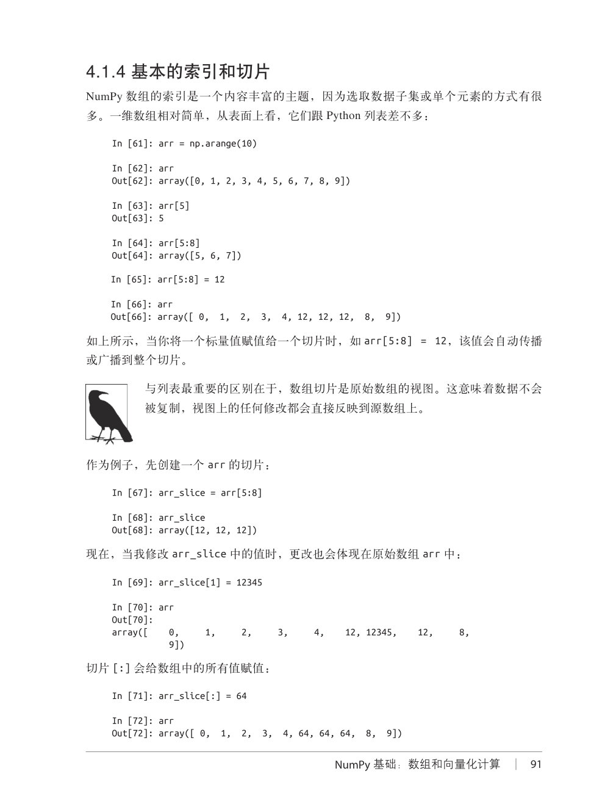

### 4.1.4 基本的索引和切片

NumPy 数组的索引是一个内容丰富的主题，因为选取数据子集或单个元素的方式有很多。一维数组相对简单，从表面上看，它们跟 Python 列表差不多：

```python
arr = np.arange(10)
arr
```

```text
array([0, 1, 2, 3, 4, 5, 6, 7, 8, 9])
```

```python
arr[5]
```

```text
5
```

```python
arr[5:8]
```

```text
array([5, 6, 7])
```

```python
arr[5:8] = 12
arr
```

```text
array([ 0,  1,  2,  3,  4, 12, 12, 12,  8,  9])
```

如上所示，当你将一个标量值赋值给一个切片时，如 `arr[5:8] = 12`，该值会自动传播或广播到整个切片。

> 与列表最重要的区别在于，数组切片是原始数组的视图。这意味着数据不会被复制，视图上的任何修改都会直接反映到源数组上。

作为例子，先创建一个 `arr` 的切片：

```python
arr_slice = arr[5:8]
arr_slice
```

```text
array([12, 12, 12])
```

现在，当我修改 `arr_slice` 中的值时，更改也会体现在原始数组 `arr` 中：

```python
arr_slice[1] = 12345
arr
```

```text
array([    0,     1,     2,     3,     4,    12, 12345,    12,     8,
           9])
```

切片 `[:]` 会给数组中的所有值赋值：

```python
arr_slice[:] = 64
arr
```

```text
array([ 0,  1,  2,  3,  4, 64, 64, 64,  8,  9])
```

## PDF 第 102 页

<!-- page-status: reviewed -->
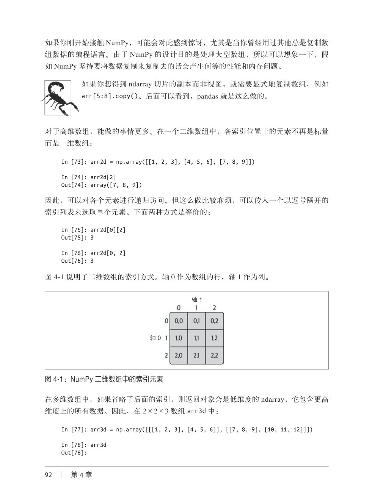

如果你刚开始接触 NumPy，可能会对此感到惊讶，尤其是当你曾经用过其他总是复制数组数据的编程语言。由于 NumPy 的设计目的是处理大型数组，所以可以想象一下，假如 NumPy 坚持要将数据复制来复制去的话会产生何等的性能和内存问题。

> 如果你想得到 ndarray 切片的副本而非视图，就需要显式地复制数组，例如 `arr[5:8].copy()`。后面可以看到，pandas 就是这么做的。

对于高维数组，能做的事情更多。在一个二维数组中，各索引位置上的元素不再是标量而是一维数组：

```python
arr2d = np.array([[1, 2, 3], [4, 5, 6], [7, 8, 9]])
arr2d[2]
```

```text
array([7, 8, 9])
```

因此，可以对各个元素进行递归访问。但这么做比较麻烦，可以传入一个以逗号隔开的索引列表来选取单个元素。下面两种方式是等价的：

```python
arr2d[0][2]
```

```text
3
```

```python
arr2d[0, 2]
```

```text
3
```

图 4-1 说明了二维数组的索引方式。轴 0 作为数组的行，轴 1 作为列。

**图 4-1：NumPy 二维数组中的索引元素**（参见本页原图）：

| 轴 0 / 轴 1 | 0 | 1 | 2 |
|---|---|---|---|
| 0 | 0,0 | 0,1 | 0,2 |
| 1 | 1,0 | 1,1 | 1,2 |
| 2 | 2,0 | 2,1 | 2,2 |

在多维数组中，如果省略了后面的索引，则返回对象会是低维度的 ndarray，它包含更高维度上的所有数据。因此，在 $2 \times 2 \times 3$ 数组 `arr3d` 中：

```python
arr3d = np.array([[[1, 2, 3], [4, 5, 6]], [[7, 8, 9], [10, 11, 12]]])
arr3d
```

输出续原 PDF 下一页。

## PDF 第 103 页

<!-- page-status: reviewed -->
```text
array([[[ 1,  2,  3],
        [ 4,  5,  6]],
       [[ 7,  8,  9],
        [10, 11, 12]]])
```

`arr3d[0]` 是一个 $2 \times 3$ 数组：

```ipython
In [79]: arr3d[0]
Out[79]:
array([[1, 2, 3],
       [4, 5, 6]])
```

标量值和数组都可以赋值给 `arr3d[0]`：

```ipython
In [80]: old_values = arr3d[0].copy()

In [81]: arr3d[0] = 42

In [82]: arr3d
Out[82]:
array([[[42, 42, 42],
        [42, 42, 42]],
       [[ 7,  8,  9],
        [10, 11, 12]]])

In [83]: arr3d[0] = old_values

In [84]: arr3d
Out[84]:
array([[[ 1,  2,  3],
        [ 4,  5,  6]],
       [[ 7,  8,  9],
        [10, 11, 12]]])
```

相似地，`arr3d[1,0]` 可以访问索引以 `(1,0)` 开头的那些值（以一维数组的形式返回）：

```ipython
In [85]: arr3d[1, 0]
Out[85]: array([7, 8, 9])
```

这个表达式等价于分两步进行索引：

```ipython
In [86]: x = arr3d[1]

In [87]: x
Out[87]:
array([[ 7,  8,  9],
       [10, 11, 12]])

In [88]: x[0]
Out[88]: array([7, 8, 9])
```

注意，在上面所有这些选取数组子集的例子中，返回的数组都是视图。

<details>
<summary>查看原 PDF 第 103 页</summary>

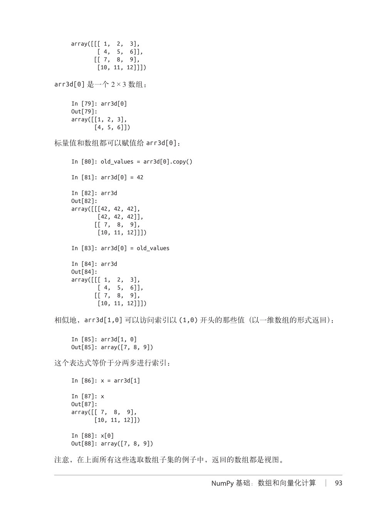

</details>

## PDF 第 104 页

<!-- page-status: reviewed -->
> NumPy 数组的多维索引语法不适用于 Python 的常规对象，比如嵌套列表。

### 切片索引

类似于 Python 列表这样的一维对象，`ndarray` 可以用相似的语法进行切片：

```ipython
In [89]: arr
Out[89]: array([ 0,  1,  2,  3,  4, 64, 64, 64,  8,  9])

In [90]: arr[1:6]
Out[90]: array([ 1,  2,  3,  4, 64])
```

对于之前的二维数组 `arr2d`，切片方式稍有不同：

```ipython
In [91]: arr2d
Out[91]:
array([[1, 2, 3],
       [4, 5, 6],
       [7, 8, 9]])

In [92]: arr2d[:2]
Out[92]:
array([[1, 2, 3],
       [4, 5, 6]])
```

可以看出，它是沿着 0 轴（即第一个轴）进行切片的。也就是说，切片是沿着一个轴向选取元素的。表达式 `arr2d[:2]` 可以被认为是“选取 `arr2d` 的前两行”。

你可以一次传入多个切片，就像传入多个索引那样：

```ipython
In [93]: arr2d[:2, 1:]
Out[93]:
array([[2, 3],
       [5, 6]])
```

像这样进行切片时，只能得到相同维数的数组视图。通过将整数索引和切片混合，可以得到低维的切片。

例如，可以选取第二行的前两列，如下所示：

```ipython
In [94]: lower_dim_slice = arr2d[1, :2]
```

这里，`arr2d` 是二维的，而 `lower_dim_slice` 是一维的，它的形状是只包含一个轴大小的元组：

```ipython
In [95]: lower_dim_slice.shape
Out[95]: (2,)
```

<details>
<summary>查看原 PDF 第 104 页</summary>

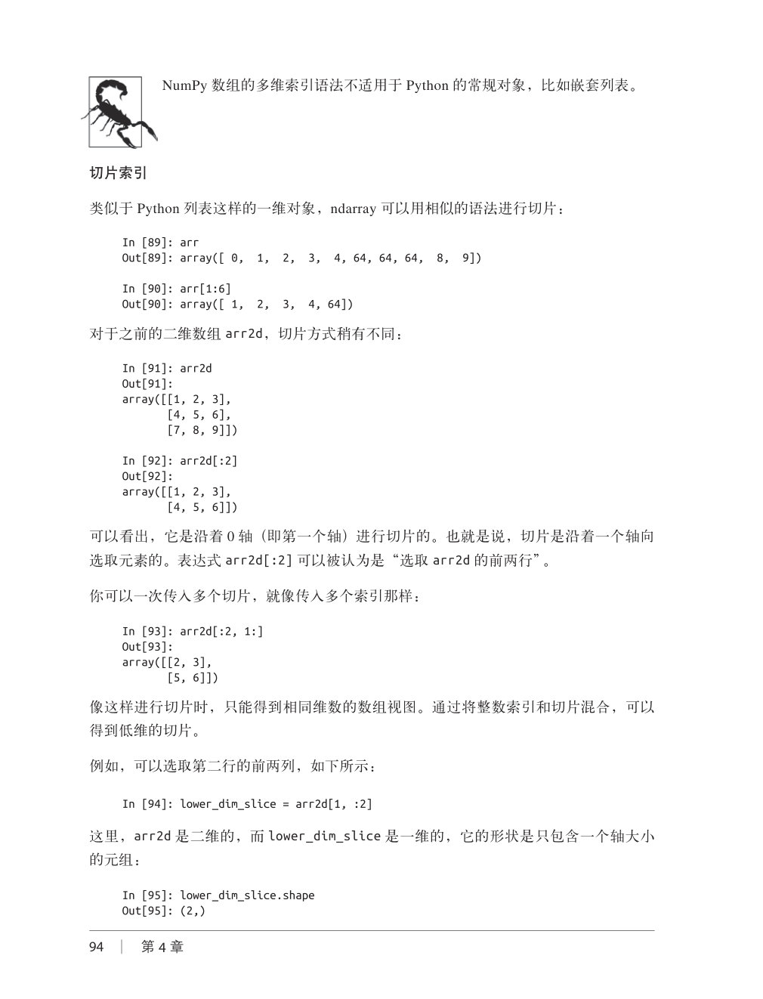

</details>

## PDF 第 105 页

<!-- page-status: reviewed -->
相似地，还可以选择第三列的前两行，如下所示：

```ipython
In [96]: arr2d[:2, 2]
Out[96]: array([3, 6])
```

图 4-2 对此进行了说明。注意，冒号本身意味着选取整个轴，因此可以像下面这样只对高维轴进行切片：

```ipython
In [97]: arr2d[:, :1]
Out[97]:
array([[1],
       [4],
       [7]])
```

图 4-2：二维数组切片。下表对应原图中各表达式和结果形状；选区示意请查看原页。

| 表达式 | 形状 |
| --- | --- |
| `arr[:2, 1:]` | `(2, 2)` |
| `arr[2]` | `(3,)` |
| `arr[2, :]` | `(3,)` |
| `arr[2:, :]` | `(1, 3)` |
| `arr[:, :2]` | `(3, 2)` |
| `arr[1, :2]` | `(2,)` |
| `arr[1:2, :2]` | `(1, 2)` |

当然，对切片表达式的赋值操作也会被扩散到整个选区：

```ipython
In [98]: arr2d[:2, 1:] = 0

In [99]: arr2d
Out[99]:
array([[1, 0, 0],
       [4, 0, 0],
       [7, 8, 9]])
```

### 4.1.5 布尔型索引

来看一个例子，假设有一个存有数据的数组以及一个存有重复姓名的数组：

<details>
<summary>查看原 PDF 第 105 页</summary>

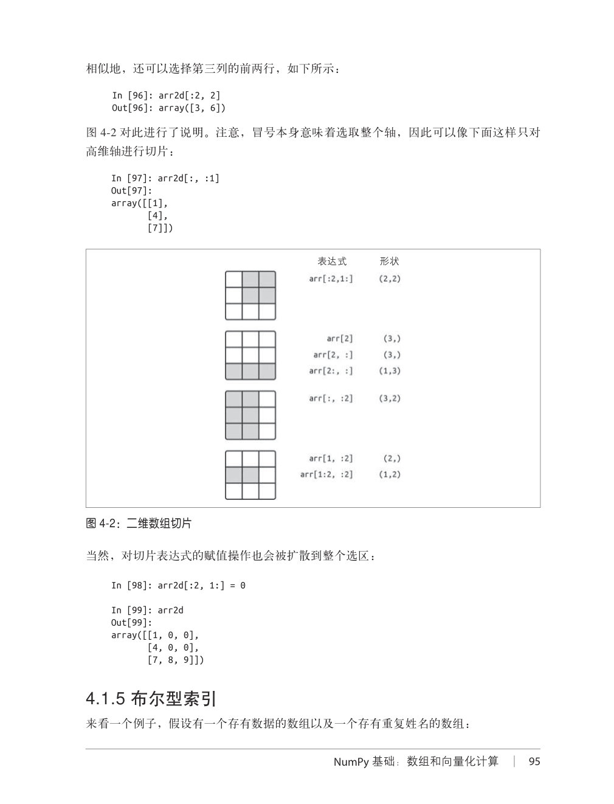

</details>

## PDF 第 106 页

<!-- page-status: reviewed -->
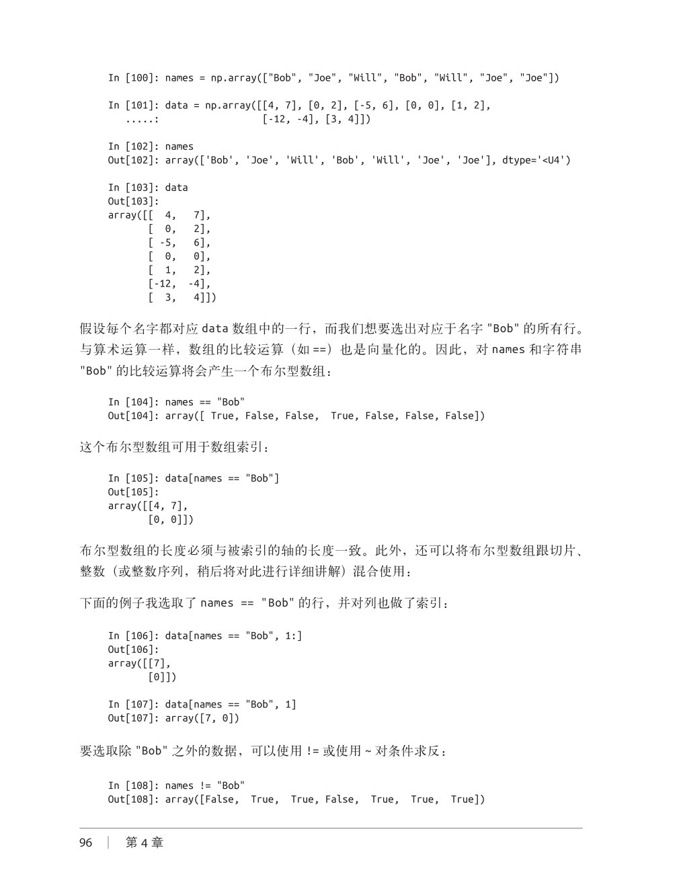

```python
names = np.array(["Bob", "Joe", "Will", "Bob", "Will", "Joe", "Joe"])
data = np.array([[4, 7], [0, 2], [-5, 6], [0, 0], [1, 2],
                 [-12, -4], [3, 4]])
names
```

```text
array(['Bob', 'Joe', 'Will', 'Bob', 'Will', 'Joe', 'Joe'], dtype='<U4')
```

```python
data
```

```text
array([[  4,   7],
       [  0,   2],
       [ -5,   6],
       [  0,   0],
       [  1,   2],
       [-12,  -4],
       [  3,   4]])
```

假设每个名字都对应 data 数组中的一行，而我们想要选出对应于名字 "Bob" 的所有行。与算术运算一样，数组的比较运算（如 `==`）也是向量化的。因此，对 names 和字符串 "Bob" 的比较运算将会产生一个布尔型数组：

```python
names == "Bob"
```

```text
array([ True, False, False,  True, False, False, False])
```

这个布尔型数组可用于数组索引：

```python
data[names == "Bob"]
```

```text
array([[4, 7],
       [0, 0]])
```

布尔型数组的长度必须与被索引的轴的长度一致。此外，还可以将布尔型数组跟切片、整数（或整数序列，稍后将对此进行详细讲解）混合使用：

下面的例子我选取了 `names == "Bob"` 的行，并对列也做了索引：

```python
data[names == "Bob", 1:]
```

```text
array([[7],
       [0]])
```

```python
data[names == "Bob", 1]
```

```text
array([7, 0])
```

要选取除 "Bob" 之外的数据，可以使用 `!=` 或使用 `~` 对条件求反：

```python
names != "Bob"
```

```text
array([False,  True,  True, False,  True,  True,  True])
```

## PDF 第 107 页

<!-- page-status: reviewed -->
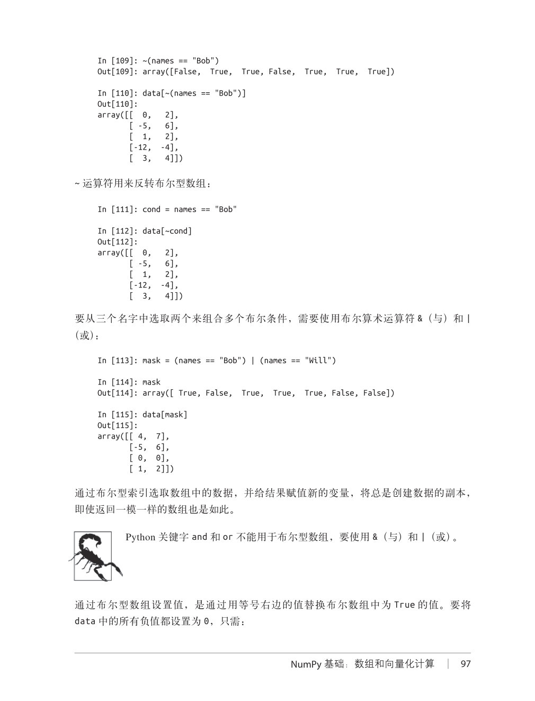

```python
~(names == "Bob")
```

```text
array([False,  True,  True, False,  True,  True,  True])
```

```python
data[~(names == "Bob")]
```

```text
array([[  0,   2],
       [ -5,   6],
       [  1,   2],
       [-12,  -4],
       [  3,   4]])
```

`~` 运算符用来反转布尔型数组：

```python
cond = names == "Bob"
data[~cond]
```

```text
array([[  0,   2],
       [ -5,   6],
       [  1,   2],
       [-12,  -4],
       [  3,   4]])
```

要从三个名字中选取两个来组合多个布尔条件，需要使用布尔算术运算符 `&`（与）和 `|`（或）：

```python
mask = (names == "Bob") | (names == "Will")
mask
```

```text
array([ True, False,  True,  True,  True, False, False])
```

```python
data[mask]
```

```text
array([[ 4,  7],
       [-5,  6],
       [ 0,  0],
       [ 1,  2]])
```

通过布尔型索引选取数组中的数据，并给结果赋值新的变量，将总是创建数据的副本，即使返回一模一样的数组也是如此。

> Python 关键字 `and` 和 `or` 不能用于布尔型数组，要使用 `&`（与）和 `|`（或）。

通过布尔型数组设置值，是通过用等号右边的值替换布尔数组中为 True 的值。要将 data 中的所有负值都设置为 0，只需：

## PDF 第 108 页

<!-- page-status: reviewed -->
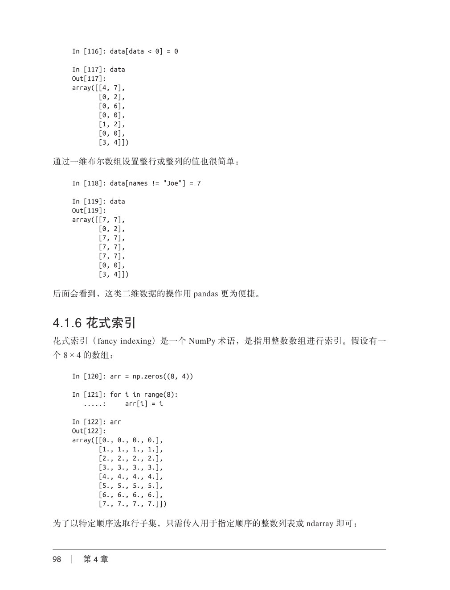

```python
data[data < 0] = 0
data
```

```text
array([[4, 7],
       [0, 2],
       [0, 6],
       [0, 0],
       [1, 2],
       [0, 0],
       [3, 4]])
```

通过一维布尔数组设置整行或整列的值也很简单：

```python
data[names != "Joe"] = 7
data
```

```text
array([[7, 7],
       [0, 2],
       [7, 7],
       [7, 7],
       [7, 7],
       [0, 0],
       [3, 4]])
```

后面会看到，这类二维数据的操作用 pandas 更为便捷。

### 4.1.6 花式索引

花式索引（fancy indexing）是一个 NumPy 术语，是指用整数数组进行索引。假设有一个 8 × 4 的数组：

```python
arr = np.zeros((8, 4))
for i in range(8):
    arr[i] = i
arr
```

```text
array([[0., 0., 0., 0.],
       [1., 1., 1., 1.],
       [2., 2., 2., 2.],
       [3., 3., 3., 3.],
       [4., 4., 4., 4.],
       [5., 5., 5., 5.],
       [6., 6., 6., 6.],
       [7., 7., 7., 7.]])
```

为了以特定顺序选取行子集，只需传入用于指定顺序的整数列表或 ndarray 即可：

## PDF 第 109 页

<!-- page-status: reviewed -->
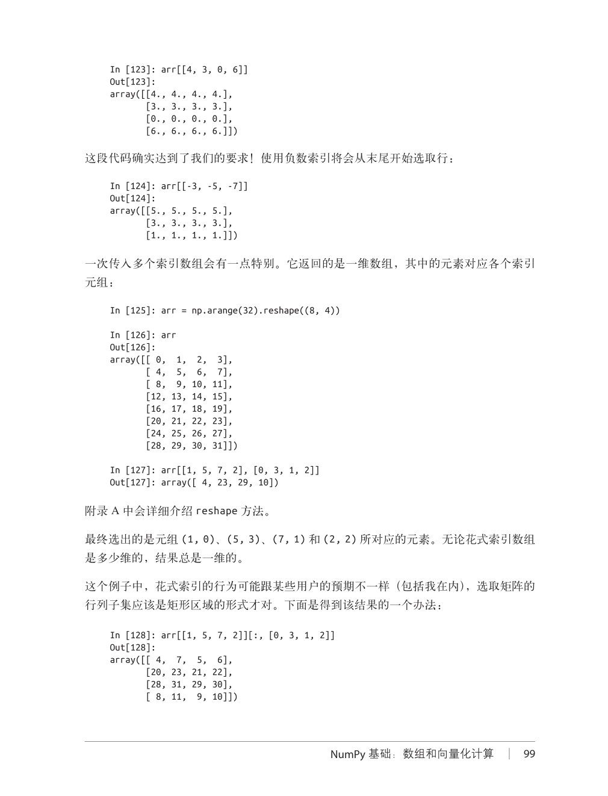

```python
arr[[4, 3, 0, 6]]
```

```text
array([[4., 4., 4., 4.],
       [3., 3., 3., 3.],
       [0., 0., 0., 0.],
       [6., 6., 6., 6.]])
```

这段代码确实达到了我们的要求！使用负数索引将会从末尾开始选取行：

```python
arr[[-3, -5, -7]]
```

```text
array([[5., 5., 5., 5.],
       [3., 3., 3., 3.],
       [1., 1., 1., 1.]])
```

一次传入多个索引数组会有一点特别。它返回的是一维数组，其中的元素对应各个索引元组：

```python
arr = np.arange(32).reshape((8, 4))
arr
```

```text
array([[ 0,  1,  2,  3],
       [ 4,  5,  6,  7],
       [ 8,  9, 10, 11],
       [12, 13, 14, 15],
       [16, 17, 18, 19],
       [20, 21, 22, 23],
       [24, 25, 26, 27],
       [28, 29, 30, 31]])
```

```python
arr[[1, 5, 7, 2], [0, 3, 1, 2]]
```

```text
array([ 4, 23, 29, 10])
```

附录 A 中会详细介绍 reshape 方法。

最终选出的是元组 (1, 0)、(5, 3)、(7, 1) 和 (2, 2) 所对应的元素。无论花式索引数组是多少维的，结果总是一维的。

> 校对注：原文最后一句并不适用于所有花式索引。多个整数索引数组可以广播成多维形状，例如把本例的两个索引数组都改成形状 `(2, 2)`，所得元素的形状也是 `(2, 2)`。

这个例子中，花式索引的行为可能跟某些用户的预期不一样（包括我在内），选取矩阵的行列子集应该是矩形区域的形式才对。下面是得到该结果的一个办法：

```python
arr[[1, 5, 7, 2]][:, [0, 3, 1, 2]]
```

```text
array([[ 4,  7,  5,  6],
       [20, 23, 21, 22],
       [28, 31, 29, 30],
       [ 8, 11,  9, 10]])
```

## PDF 第 110 页

<!-- page-status: reviewed -->
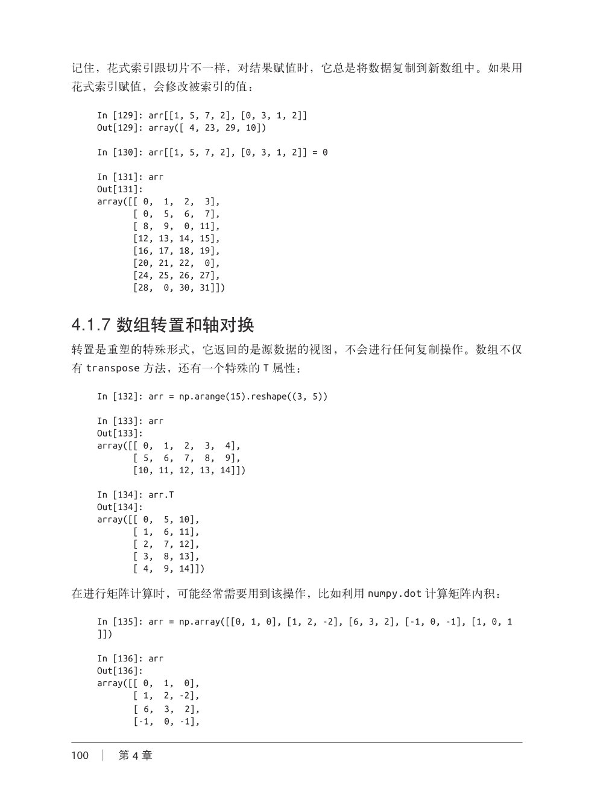

记住，花式索引跟切片不一样，对结果赋值时，它总是将数据复制到新数组中。如果用花式索引赋值，会修改被索引的值：

```python
arr[[1, 5, 7, 2], [0, 3, 1, 2]]
```

```text
array([ 4, 23, 29, 10])
```

```python
arr[[1, 5, 7, 2], [0, 3, 1, 2]] = 0
arr
```

```text
array([[ 0,  1,  2,  3],
       [ 0,  5,  6,  7],
       [ 8,  9,  0, 11],
       [12, 13, 14, 15],
       [16, 17, 18, 19],
       [20, 21, 22,  0],
       [24, 25, 26, 27],
       [28,  0, 30, 31]])
```

### 4.1.7 数组转置和轴对换

转置是重塑的特殊形式，它返回的是源数据的视图，不会进行任何复制操作。数组不仅有 transpose 方法，还有一个特殊的 T 属性：

```python
arr = np.arange(15).reshape((3, 5))
arr
```

```text
array([[ 0,  1,  2,  3,  4],
       [ 5,  6,  7,  8,  9],
       [10, 11, 12, 13, 14]])
```

```python
arr.T
```

```text
array([[ 0,  5, 10],
       [ 1,  6, 11],
       [ 2,  7, 12],
       [ 3,  8, 13],
       [ 4,  9, 14]])
```

在进行矩阵计算时，可能经常需要用到该操作，比如利用 numpy.dot 计算矩阵内积：

```python
arr = np.array([[0, 1, 0], [1, 2, -2], [6, 3, 2], [-1, 0, -1], [1, 0, 1]])
arr
```

原书在本页底部开始显示该数组的输出，最后一行接续至下一页；下面为了可读性将完整输出放在一起：

```text
array([[ 0,  1,  0],
       [ 1,  2, -2],
       [ 6,  3,  2],
       [-1,  0, -1],
       [ 1,  0,  1]])
```

## PDF 第 111 页

<!-- page-status: reviewed -->
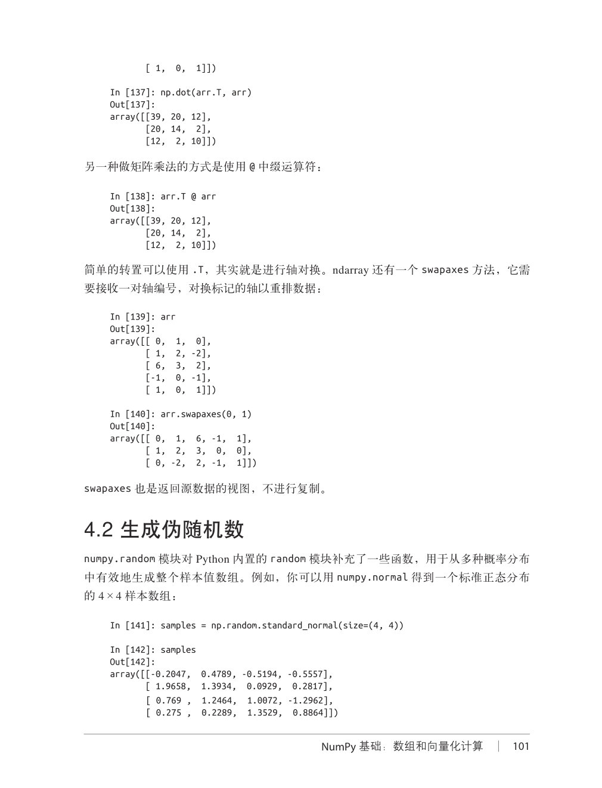

```python
np.dot(arr.T, arr)
```

```text
array([[39, 20, 12],
       [20, 14,  2],
       [12,  2, 10]])
```

另一种做矩阵乘法的方式是使用 `@` 中缀运算符：

```python
arr.T @ arr
```

```text
array([[39, 20, 12],
       [20, 14,  2],
       [12,  2, 10]])
```

简单的转置可以使用 `.T`，其实就是进行轴对换。ndarray 还有一个 swapaxes 方法，它需要接收一对轴编号，对换标记的轴以重排数据：

```python
arr
```

```text
array([[ 0,  1,  0],
       [ 1,  2, -2],
       [ 6,  3,  2],
       [-1,  0, -1],
       [ 1,  0,  1]])
```

```python
arr.swapaxes(0, 1)
```

```text
array([[ 0,  1,  6, -1,  1],
       [ 1,  2,  3,  0,  0],
       [ 0, -2,  2, -1,  1]])
```

swapaxes 也是返回源数据的视图，不进行复制。

## 4.2 生成伪随机数

numpy.random 模块对 Python 内置的 random 模块补充了一些函数，用于从多种概率分布中有效地生成整个样本值数组。例如，你可以用 numpy.normal 得到一个标准正态分布的 4 × 4 样本数组：

> 校对注：原文的 `numpy.normal` 应为 `numpy.random.normal`；本例实际使用的是 `np.random.standard_normal`。

```python
samples = np.random.standard_normal(size=(4, 4))
samples
```

```text
array([[-0.2047,  0.4789, -0.5194, -0.5557],
       [ 1.9658,  1.3934,  0.0929,  0.2817],
       [ 0.769 ,  1.2464,  1.0072, -1.2962],
       [ 0.275 ,  0.2289,  1.3529,  0.8864]])
```

## PDF 第 112 页

<!-- page-status: reviewed -->
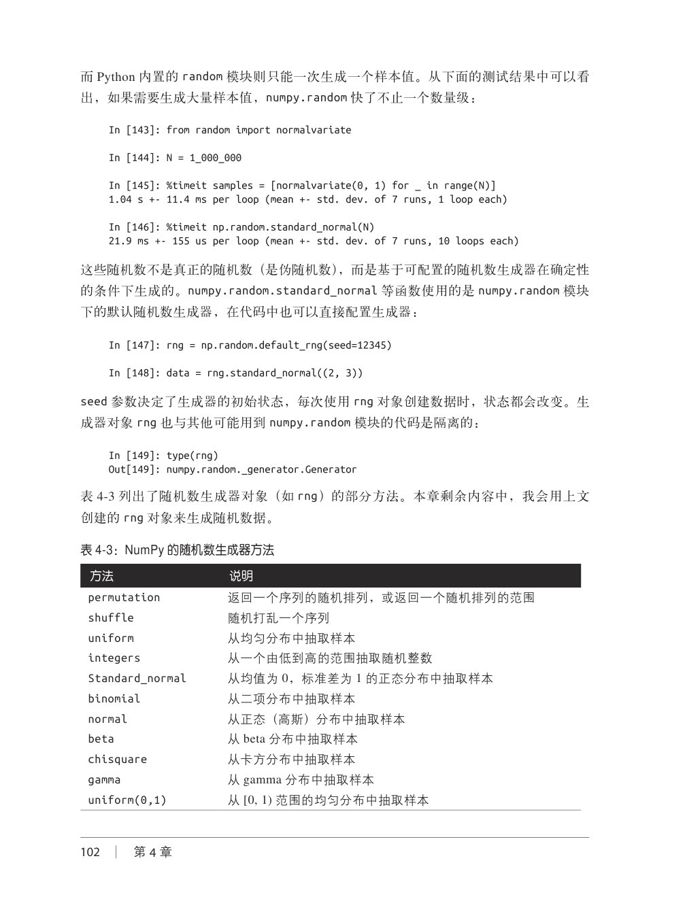

而 Python 内置的 random 模块则只能一次生成一个样本值。从下面的测试结果中可以看出，如果需要生成大量样本值，numpy.random 快了不止一个数量级：

```ipython
In [143]: from random import normalvariate
In [144]: N = 1_000_000
In [145]: %timeit samples = [normalvariate(0, 1) for _ in range(N)]
1.04 s +- 11.4 ms per loop (mean +- std. dev. of 7 runs, 1 loop each)
In [146]: %timeit np.random.standard_normal(N)
21.9 ms +- 155 us per loop (mean +- std. dev. of 7 runs, 10 loops each)
```

这些随机数不是真正的随机数（是伪随机数），而是基于可配置的随机数生成器在确定性的条件下生成的。numpy.random.standard_normal 等函数使用的是 numpy.random 模块下的默认随机数生成器，在代码中也可以直接配置生成器：

```python
rng = np.random.default_rng(seed=12345)
data = rng.standard_normal((2, 3))
```

seed 参数决定了生成器的初始状态，每次使用 rng 对象创建数据时，状态都会改变。生成器对象 rng 也与其他可能用到 numpy.random 模块的代码是隔离的：

```python
type(rng)
```

```text
numpy.random._generator.Generator
```

表 4-3 列出了随机数生成器对象（如 rng）的部分方法。本章剩余内容中，我会用上文创建的 rng 对象来生成随机数据。

**表 4-3：NumPy 的随机数生成器方法**

| 方法 | 说明 |
| --- | --- |
| permutation | 返回一个序列的随机排列，或返回一个随机排列的范围 |
| shuffle | 随机打乱一个序列 |
| uniform | 从均匀分布中抽取样本 |
| integers | 从一个由低到高的范围抽取随机整数 |
| Standard_normal | 从均值为 0，标准差为 1 的正态分布中抽取样本 |
| binomial | 从二项分布中抽取样本 |
| normal | 从正态（高斯）分布中抽取样本 |
| beta | 从 beta 分布中抽取样本 |
| chisquare | 从卡方分布中抽取样本 |
| gamma | 从 gamma 分布中抽取样本 |
| uniform(0,1) | 从 [0, 1) 范围的均匀分布中抽取样本 |

> 校对注：表中 `Standard_normal` 按原页大小写保留；上方示例使用的方法名是 `standard_normal`。

## PDF 第 113 页

<!-- page-status: reviewed -->
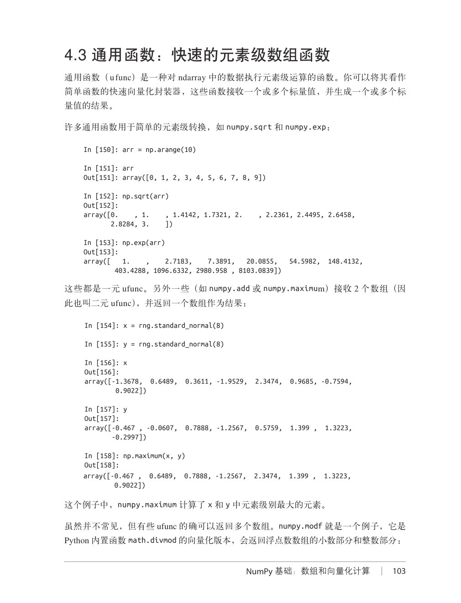

### 4.3 通用函数：快速的元素级数组函数

通用函数（ufunc）是一种对 ndarray 中的数据执行元素级运算的函数。你可以将其看作简单函数的快速向量化封装器，这些函数接收一个或多个标量值，并生成一个或多个标量值的结果。

许多通用函数用于简单的元素级转换，如 `numpy.sqrt` 和 `numpy.exp`：

```python
arr = np.arange(10)
arr
```

```text
array([0, 1, 2, 3, 4, 5, 6, 7, 8, 9])
```

```python
np.sqrt(arr)
```

```text
array([0.    , 1.    , 1.4142, 1.7321, 2.    , 2.2361, 2.4495, 2.6458,
       2.8284, 3.    ])
```

```python
np.exp(arr)
```

```text
array([   1.    ,    2.7183,    7.3891,   20.0855,   54.5982,  148.4132,
        403.4288, 1096.6332, 2980.958 , 8103.0839])
```

这些都是一元 ufunc。另外一些（如 `numpy.add` 或 `numpy.maximum`）接收 2 个数组（因此也叫二元 ufunc），并返回一个数组作为结果：

```python
x = rng.standard_normal(8)
y = rng.standard_normal(8)
x
```

```text
array([-1.3678,  0.6489,  0.3611, -1.9529,  2.3474,  0.9685, -0.7594,
        0.9022])
```

```python
y
```

```text
array([-0.467 , -0.0607,  0.7888, -1.2567,  0.5759,  1.399 ,  1.3223,
       -0.2997])
```

```python
np.maximum(x, y)
```

```text
array([-0.467 ,  0.6489,  0.7888, -1.2567,  2.3474,  1.399 ,  1.3223,
        0.9022])
```

这个例子中，`numpy.maximum` 计算了 `x` 和 `y` 中元素级别最大的元素。

虽然并不常见，但有些 ufunc 的确可以返回多个数组。`numpy.modf` 就是一个例子，它是 Python 内置函数 `math.divmod` 的向量化版本，会返回浮点数数组的小数部分和整数部分：

> 校对注：原书将 `numpy.modf` 称为 `math.divmod` 的向量化版本；二者功能不同。`modf` 分离一个数的小数和整数部分，`divmod(a, b)` 返回商和余数。

## PDF 第 114 页

<!-- page-status: reviewed -->
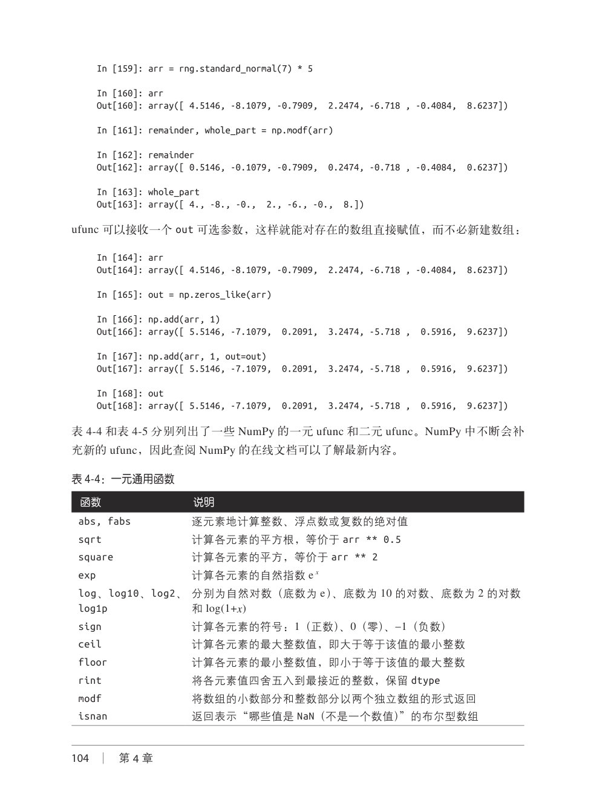

```python
arr = rng.standard_normal(7) * 5
arr
```

```text
array([ 4.5146, -8.1079, -0.7909,  2.2474, -6.718 , -0.4084,  8.6237])
```

```python
remainder, whole_part = np.modf(arr)
remainder
```

```text
array([ 0.5146, -0.1079, -0.7909,  0.2474, -0.718 , -0.4084,  0.6237])
```

```python
whole_part
```

```text
array([ 4., -8., -0.,  2., -6., -0.,  8.])
```

ufunc 可以接收一个 `out` 可选参数，这样就能对存在的数组直接赋值，而不必新建数组：

```python
arr
```

```text
array([ 4.5146, -8.1079, -0.7909,  2.2474, -6.718 , -0.4084,  8.6237])
```

```python
out = np.zeros_like(arr)
np.add(arr, 1)
```

```text
array([ 5.5146, -7.1079,  0.2091,  3.2474, -5.718 ,  0.5916,  9.6237])
```

```python
np.add(arr, 1, out=out)
```

```text
array([ 5.5146, -7.1079,  0.2091,  3.2474, -5.718 ,  0.5916,  9.6237])
```

```python
out
```

```text
array([ 5.5146, -7.1079,  0.2091,  3.2474, -5.718 ,  0.5916,  9.6237])
```

表 4-4 和表 4-5 分别列出了一些 NumPy 的一元 ufunc 和二元 ufunc。NumPy 中不断会补充新的 ufunc，因此查阅 NumPy 的在线文档可以了解最新内容。

**表 4-4：一元通用函数**

| 函数 | 说明 |
|---|---|
| `abs`, `fabs` | 逐元素地计算整数、浮点数或复数的绝对值 |
| `sqrt` | 计算各元素的平方根，等价于 `arr ** 0.5` |
| `square` | 计算各元素的平方，等价于 `arr ** 2` |
| `exp` | 计算各元素的自然指数 $e^x$ |
| `log`, `log10`, `log2`, `log1p` | 分别为自然对数（底数为 $e$）、底数为 10 的对数、底数为 2 的对数和 $\log(1+x)$ |
| `sign` | 计算各元素的符号：1（正数）、0（零）、-1（负数） |
| `ceil` | 计算各元素的最大整数值，即大于等于该值的最小整数 |
| `floor` | 计算各元素的最小整数值，即小于等于该值的最大整数 |
| `rint` | 将各元素值四舍五入到最接近的整数，保留 `dtype` |
| `modf` | 将数组的小数部分和整数部分以两个独立数组的形式返回 |
| `isnan` | 返回表示“哪些值是 NaN（不是一个数值）”的布尔型数组 |

> 校对注：表中 `ceil` 与 `floor` 的首半句容易误解；应以各自后半句为准：`ceil` 取不小于原值的最小整数，`floor` 取不大于原值的最大整数。

## PDF 第 115 页

<!-- page-status: reviewed -->
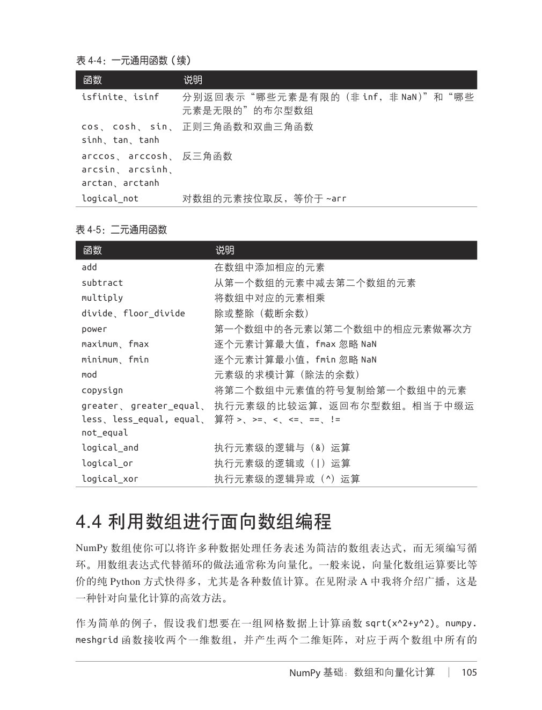

**表 4-4：一元通用函数（续）**

| 函数 | 说明 |
|---|---|
| `isfinite`, `isinf` | 分别返回表示“哪些元素是有限的（非 inf，非 NaN）”和“哪些元素是无限的”的布尔型数组 |
| `cos`, `cosh`, `sin`, `sinh`, `tan`, `tanh` | 正则三角函数和双曲三角函数 |
| `arccos`, `arccosh`, `arcsin`, `arcsinh`, `arctan`, `arctanh` | 反三角函数 |
| `logical_not` | 对数组的元素按位取反，等价于 `~arr` |

> 校对注：原表将 `logical_not` 写成“按位取反，等价于 `~arr`”。对于布尔数组二者结果一致；对整数数组则不同：`logical_not` 做逻辑取反，`~` 做按位取反。

**表 4-5：二元通用函数**

| 函数 | 说明 |
|---|---|
| `add` | 在数组中添加相应的元素 |
| `subtract` | 从第一个数组的元素中减去第二个数组的元素 |
| `multiply` | 将数组中对应的元素相乘 |
| `divide`, `floor_divide` | 除或整除（截断余数） |
| `power` | 第一个数组中的各元素以第二个数组中的相应元素做幂次方 |
| `maximum`, `fmax` | 逐个元素计算最大值，`fmax` 忽略 NaN |
| `minimum`, `fmin` | 逐个元素计算最小值，`fmin` 忽略 NaN |
| `mod` | 元素级的求模计算（除法的余数） |
| `copysign` | 将第二个数组中元素值的符号复制给第一个数组中的元素 |
| `greater`, `greater_equal`, `less`, `less_equal`, `equal`, `not_equal` | 执行元素级的比较运算，返回布尔型数组。相当于中缀运算符 `>`, `>=`, `<`, `<=`, `==`, `!=` |
| `logical_and` | 执行元素级的逻辑与（`&`）运算 |
| `logical_or` | 执行元素级的逻辑或（`\|`）运算 |
| `logical_xor` | 执行元素级的逻辑异或（`^`）运算 |

### 4.4 利用数组进行面向数组编程

NumPy 数组使你可以将许多种数据处理任务表述为简洁的数组表达式，而无须编写循环。用数组表达式代替循环的做法通常称为向量化。一般来说，向量化数组运算要比等价的纯 Python 方式快得多，尤其是各种数值计算。在见附录 A 中我将介绍广播，这是一种针对向量化计算的高效方法。

作为简单的例子，假设我们想要在一组网格数据上计算函数 $\sqrt{x^2+y^2}$。`numpy.meshgrid` 函数接收两个一维数组，并产生两个二维矩阵，对应于两个数组中所有的

## PDF 第 116 页

<!-- page-status: reviewed -->
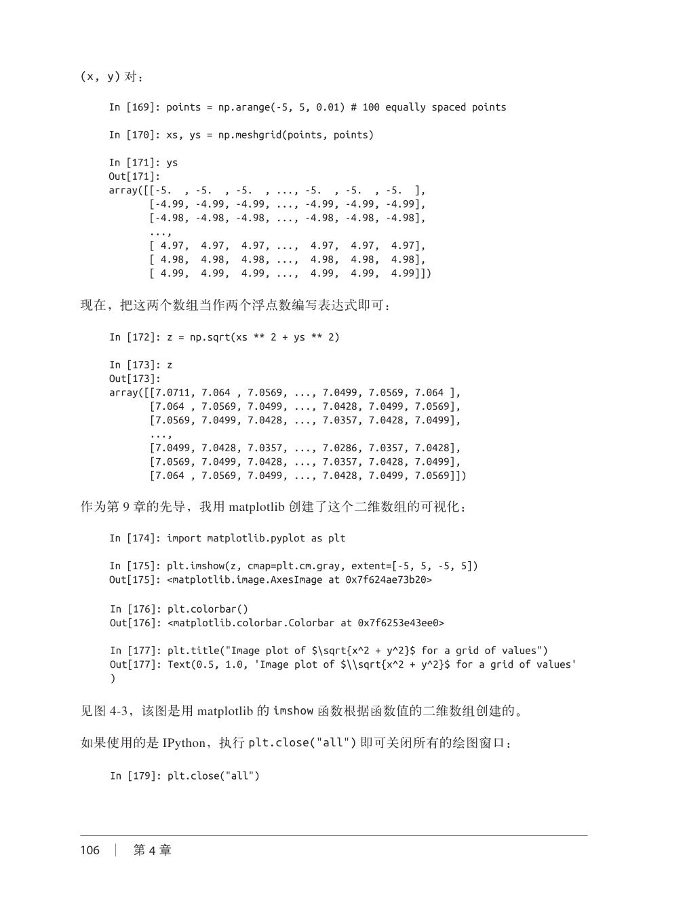

$(x, y)$ 对：

```python
points = np.arange(-5, 5, 0.01) # 100 equally spaced points
xs, ys = np.meshgrid(points, points)
ys
```

```text
array([[-5.  , -5.  , -5.  , ..., -5.  , -5.  , -5.  ],
       [-4.99, -4.99, -4.99, ..., -4.99, -4.99, -4.99],
       [-4.98, -4.98, -4.98, ..., -4.98, -4.98, -4.98],
       ...,
       [ 4.97,  4.97,  4.97, ...,  4.97,  4.97,  4.97],
       [ 4.98,  4.98,  4.98, ...,  4.98,  4.98,  4.98],
       [ 4.99,  4.99,  4.99, ...,  4.99,  4.99,  4.99]])
```

> 校对注：上面注释中的 `100` 照录原书；按代码计算，`np.arange(-5, 5, 0.01)` 实际产生 1000 个点。

现在，把这两个数组当作两个浮点数编写表达式即可：

```python
z = np.sqrt(xs ** 2 + ys ** 2)
z
```

```text
array([[7.0711, 7.064 , 7.0569, ..., 7.0499, 7.0569, 7.064 ],
       [7.064 , 7.0569, 7.0499, ..., 7.0428, 7.0499, 7.0569],
       [7.0569, 7.0499, 7.0428, ..., 7.0357, 7.0428, 7.0499],
       ...,
       [7.0499, 7.0428, 7.0357, ..., 7.0286, 7.0357, 7.0428],
       [7.0569, 7.0499, 7.0428, ..., 7.0357, 7.0428, 7.0499],
       [7.064 , 7.0569, 7.0499, ..., 7.0428, 7.0499, 7.0569]])
```

作为第 9 章的先导，我用 matplotlib 创建了这个二维数组的可视化：

```python
import matplotlib.pyplot as plt
plt.imshow(z, cmap=plt.cm.gray, extent=[-5, 5, -5, 5])
```

```text
<matplotlib.image.AxesImage at 0x7f624ae73b20>
```

```python
plt.colorbar()
```

```text
<matplotlib.colorbar.Colorbar at 0x7f6253e43ee0>
```

```python
plt.title("Image plot of $\sqrt{x^2 + y^2}$ for a grid of values")
```

```text
Text(0.5, 1.0, 'Image plot of $\\sqrt{x^2 + y^2}$ for a grid of values')
```

> 校对注：上面的标题字符串保留了原书写法。新版本 Python 对字符串中的 `\s` 可能发出无效转义警告；可在字符串前加 `r` 使用原始字符串，或将反斜杠写成 `\\`。

见图 4-3，该图是用 matplotlib 的 `imshow` 函数根据函数值的二维数组创建的。

如果使用的是 IPython，执行 `plt.close("all")` 即可关闭所有的绘图窗口：

```python
plt.close("all")
```

## PDF 第 117 页

<!-- page-status: reviewed -->
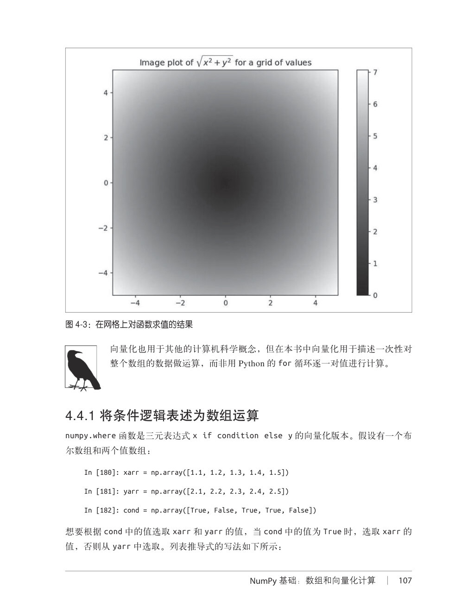

**图 4-3：在网格上对函数求值的结果。** 图中绘制的函数为 $\sqrt{x^2+y^2}$；图形与色标见原页图。

> 向量化也用于其他的计算机科学概念，但在本书中向量化用于描述一次性对整个数组的数据做运算，而非用 Python 的 `for` 循环逐一对值进行计算。

### 4.4.1 将条件逻辑表述为数组运算

`numpy.where` 函数是三元表达式 `x if condition else y` 的向量化版本。假设有一个布尔数组和两个值数组：

```python
# In [180]–[182]
xarr = np.array([1.1, 1.2, 1.3, 1.4, 1.5])
yarr = np.array([2.1, 2.2, 2.3, 2.4, 2.5])
cond = np.array([True, False, True, True, False])
```

想要根据 `cond` 中的值选取 `xarr` 和 `yarr` 的值，当 `cond` 中的值为 `True` 时，选取 `xarr` 的值，否则从 `yarr` 中选取。列表推导式的写法如下所示：

## PDF 第 118 页

<!-- page-status: reviewed -->
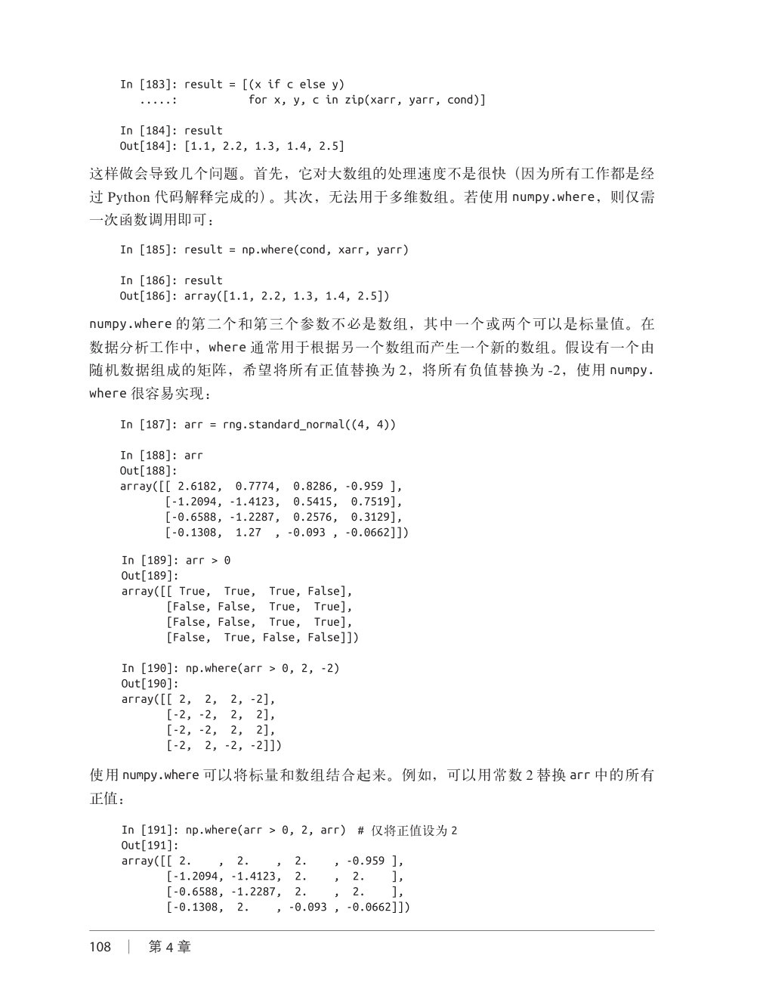

```python
# In [183]–[184]
result = [(x if c else y)
          for x, y, c in zip(xarr, yarr, cond)]
result
```

```text
Out[184]: [1.1, 2.2, 1.3, 1.4, 2.5]
```

这样做会导致几个问题。首先，它对大数组的处理速度不是很快（因为所有工作都是经过 Python 代码解释完成的）。其次，无法用于多维数组。若使用 `numpy.where`，则仅需一次函数调用即可：

```python
# In [185]–[186]
result = np.where(cond, xarr, yarr)
result
```

```text
Out[186]: array([1.1, 2.2, 1.3, 1.4, 2.5])
```

`numpy.where` 的第二个和第三个参数不必是数组，其中一个或两个可以是标量值。在数据分析工作中，`where` 通常用于根据另一个数组而产生一个新的数组。假设有一个由随机数组组成的矩阵，希望将所有正值替换为 2，将所有负值替换为 -2，使用 `numpy.where` 很容易实现：

```python
# In [187]–[188]
arr = rng.standard_normal((4, 4))
arr
```

```text
Out[188]:
array([[ 2.6182,  0.7774,  0.8286, -0.959 ],
       [-1.2094, -1.4123,  0.5415,  0.7519],
       [-0.6588, -1.2287,  0.2576,  0.3129],
       [-0.1308,  1.27  , -0.093 , -0.0662]])
```

```python
# In [189]
arr > 0
```

```text
Out[189]:
array([[ True,  True,  True, False],
       [False, False,  True,  True],
       [False, False,  True,  True],
       [False,  True, False, False]])
```

```python
# In [190]
np.where(arr > 0, 2, -2)
```

```text
Out[190]:
array([[ 2,  2,  2, -2],
       [-2, -2,  2,  2],
       [-2, -2,  2,  2],
       [-2,  2, -2, -2]])
```

使用 `numpy.where` 可以将标量和数组结合起来。例如，可以用常数 2 替换 `arr` 中的所有正值：

```python
# In [191]
np.where(arr > 0, 2, arr)  # 仅将正值设为 2
```

```text
Out[191]:
array([[ 2.    ,  2.    ,  2.    , -0.959 ],
       [-1.2094, -1.4123,  2.    ,  2.    ],
       [-0.6588, -1.2287,  2.    ,  2.    ],
       [-0.1308,  2.    , -0.093 , -0.0662]])
```

> 随机数组的数值依赖于此前的随机数生成器状态；这里的输出记录的是原书中的一次运行结果。

## PDF 第 119 页

<!-- page-status: reviewed -->
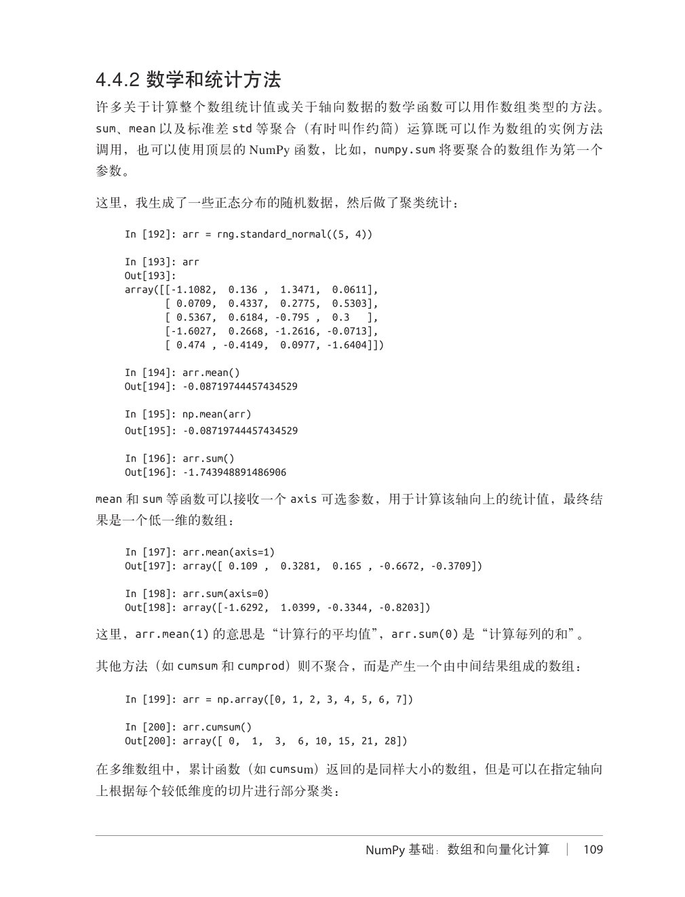

### 4.4.2 数学和统计方法

许多关于计算整个数组统计值或关于轴向数据的数学函数可以用作数组类型的方法。`sum`、`mean` 以及标准差 `std` 等聚合（有时叫作约简）运算既可以作为数组的实例方法调用，也可以使用顶层的 NumPy 函数，比如，`numpy.sum` 将要聚合的数组作为第一个参数。

这里，我生成了一些正态分布的随机数据，然后做了聚类统计：

```python
# In [192]–[193]
arr = rng.standard_normal((5, 4))
arr
```

```text
Out[193]:
array([[-1.1082,  0.136 ,  1.3471,  0.0611],
       [ 0.0709,  0.4337,  0.2775,  0.5303],
       [ 0.5367,  0.6184, -0.795 ,  0.3   ],
       [-1.6027,  0.2668, -1.2616, -0.0713],
       [ 0.474 , -0.4149,  0.0977, -1.6404]])
```

```python
# In [194]
arr.mean()
```

```text
Out[194]: -0.08719744457434529
```

```python
# In [195]
np.mean(arr)
```

```text
Out[195]: -0.08719744457434529
```

```python
# In [196]
arr.sum()
```

```text
Out[196]: -1.743948891486906
```

`mean` 和 `sum` 等函数可以接收一个 `axis` 可选参数，用于计算该轴向上的统计值，最终结果是一个低一维的数组：

```python
# In [197]
arr.mean(axis=1)
```

```text
Out[197]: array([ 0.109 ,  0.3281,  0.165 , -0.6672, -0.3709])
```

```python
# In [198]
arr.sum(axis=0)
```

```text
Out[198]: array([-1.6292,  1.0399, -0.3344, -0.8203])
```

这里，`arr.mean(1)` 的意思是“计算行的平均值”，`arr.sum(0)` 是“计算每列的和”。

其他方法（如 `cumsum` 和 `cumprod`）则不聚合，而是产生一个由中间结果组成的数组：

```python
# In [199]–[200]
arr = np.array([0, 1, 2, 3, 4, 5, 6, 7])
arr.cumsum()
```

```text
Out[200]: array([ 0,  1,  3,  6, 10, 15, 21, 28])
```

在多维数组中，累计函数（如 `cumsum`）返回的是同样大小的数组，但是可以在指定轴向上根据每个较低维度的切片进行部分聚类：

## PDF 第 120 页

<!-- page-status: reviewed -->
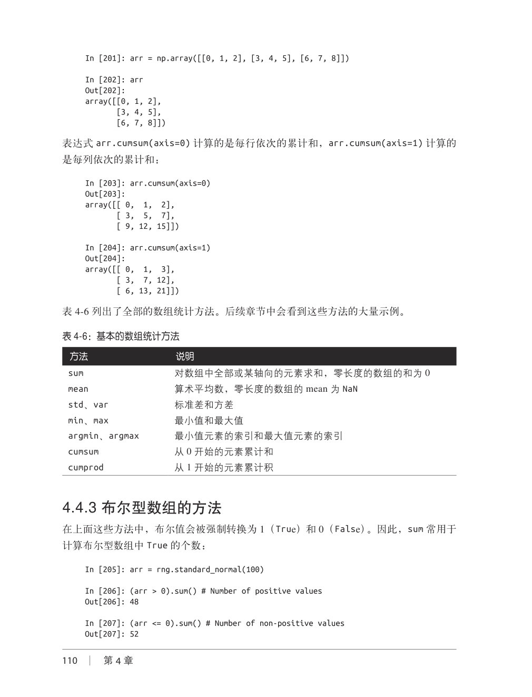

```python
# In [201]–[202]
arr = np.array([[0, 1, 2], [3, 4, 5], [6, 7, 8]])
arr
```

```text
Out[202]:
array([[0, 1, 2],
       [3, 4, 5],
       [6, 7, 8]])
```

表达式 `arr.cumsum(axis=0)` 计算的是每行依次的累计和，`arr.cumsum(axis=1)` 计算的是每列依次的累计和：

```python
# In [203]
arr.cumsum(axis=0)
```

```text
Out[203]:
array([[ 0,  1,  2],
       [ 3,  5,  7],
       [ 9, 12, 15]])
```

```python
# In [204]
arr.cumsum(axis=1)
```

```text
Out[204]:
array([[ 0,  1,  3],
       [ 3,  7, 12],
       [ 6, 13, 21]])
```

> 校对注：原书这句话中的“每行依次”和“每列依次”容易混淆。结合上面的输出，`axis=0` 沿行轴向下累计，分别累加每一列；`axis=1` 沿列轴向右累计，分别累加每一行。

表 4-6 列出了全部的数组统计方法。后续章节中会看到这些方法的大量示例。

**表 4-6：基本的数组统计方法**

| 方法 | 说明 |
|---|---|
| `sum` | 对数组中全部或某轴向的元素求和，零长度的数组的和为 0 |
| `mean` | 算术平均数，零长度的数组的 mean 为 NaN |
| `std`、`var` | 标准差和方差 |
| `min`、`max` | 最小值和最大值 |
| `argmin`、`argmax` | 最小值元素的索引和最大值元素的索引 |
| `cumsum` | 从 0 开始的元素累计和 |
| `cumprod` | 从 1 开始的元素累计积 |

### 4.4.3 布尔型数组的方法

在上面这些方法中，布尔值会被强制转换为 1（`True`）和 0（`False`）。因此，`sum` 常用于计算布尔型数组中 `True` 的个数：

```python
# In [205]
arr = rng.standard_normal(100)
```

```python
# In [206]
(arr > 0).sum()  # Number of positive values
```

```text
Out[206]: 48
```

```python
# In [207]
(arr <= 0).sum()  # Number of non-positive values
```

```text
Out[207]: 52
```

## PDF 第 121 页

<!-- page-status: reviewed -->
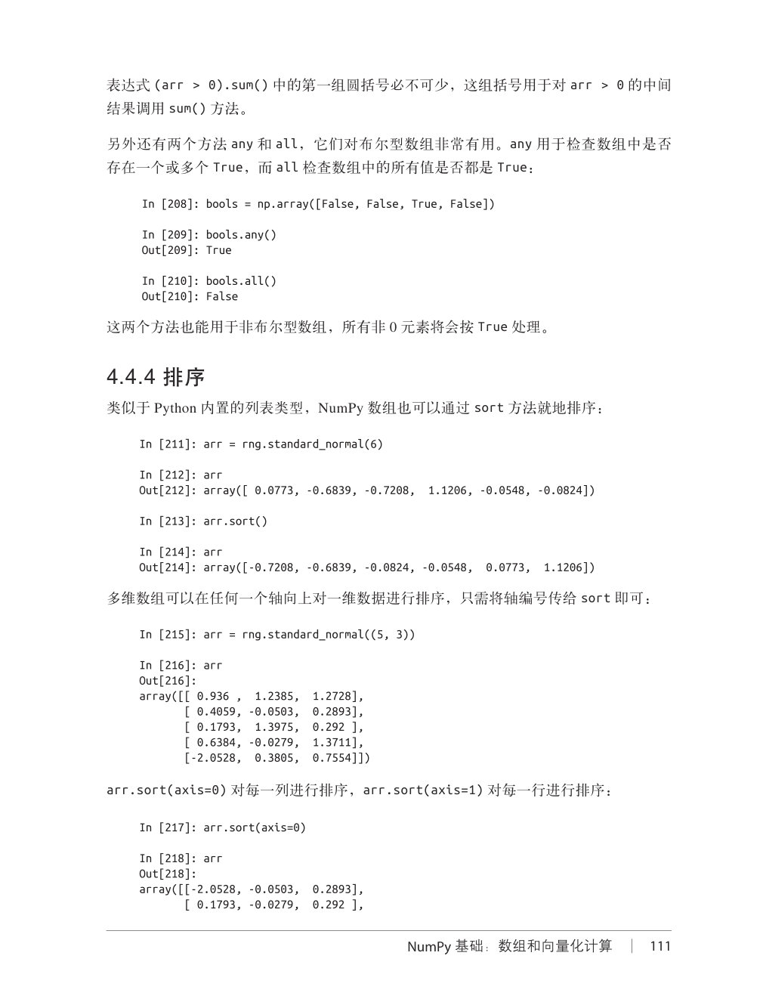

表达式 `(arr > 0).sum()` 中的第一组圆括号必不可少，这组括号用于对 `arr > 0` 的中间结果调用 `sum()` 方法。

另外还有两个方法 `any` 和 `all`，它们对布尔型数组非常有用。`any` 用于检查数组中是否存在一个或多个 `True`，而 `all` 检查数组中的所有值是否都是 `True`：

```python
bools = np.array([False, False, True, False])
bools.any()
```

```text
True
```

```python
bools.all()
```

```text
False
```

这两个方法也能用于非布尔型数组，所有非 0 元素将会按 `True` 处理。

### 4.4.4 排序

类似于 Python 内置的列表类型，NumPy 数组也可以通过 `sort` 方法就地排序：

```python
arr = rng.standard_normal(6)
arr
```

```text
array([ 0.0773, -0.6839, -0.7208,  1.1206, -0.0548, -0.0824])
```

```python
arr.sort()
arr
```

```text
array([-0.7208, -0.6839, -0.0824, -0.0548,  0.0773,  1.1206])
```

多维数组可以在任何一个轴向上对一维数据进行排序，只需将轴编号传给 `sort` 即可：

```python
arr = rng.standard_normal((5, 3))
arr
```

```text
array([[ 0.936 ,  1.2385,  1.2728],
       [ 0.4059, -0.0503,  0.2893],
       [ 0.1793,  1.3975,  0.292 ],
       [ 0.6384, -0.0279,  1.3711],
       [-2.0528,  0.3805,  0.7554]])
```

`arr.sort(axis=0)` 对每一列进行排序，`arr.sort(axis=1)` 对每一行进行排序：

```python
arr.sort(axis=0)
arr
```

该输出跨原 PDF 第 121–122 页，完整结果为：

```text
array([[-2.0528, -0.0503,  0.2893],
       [ 0.1793, -0.0279,  0.292 ],
       [ 0.4059,  0.3805,  0.7554],
       [ 0.6384,  1.2385,  1.2728],
       [ 0.936 ,  1.3975,  1.3711]])
```

## PDF 第 122 页

<!-- page-status: reviewed -->
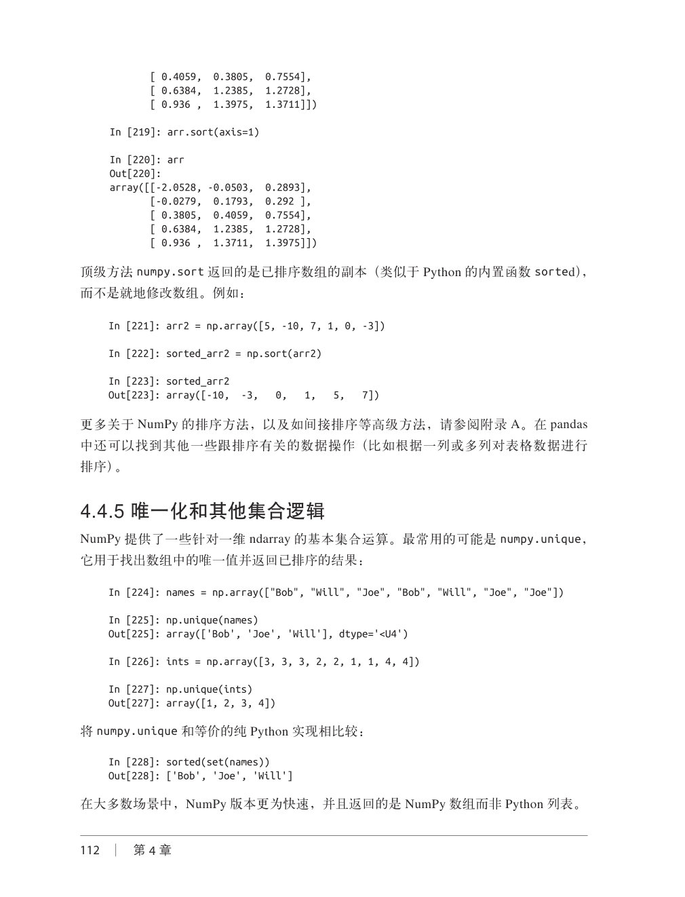

（原页开头续上一页的数组输出。）

```python
arr.sort(axis=1)
arr
```

```text
array([[-2.0528, -0.0503,  0.2893],
       [-0.0279,  0.1793,  0.292 ],
       [ 0.3805,  0.4059,  0.7554],
       [ 0.6384,  1.2385,  1.2728],
       [ 0.936 ,  1.3711,  1.3975]])
```

顶级方法 `numpy.sort` 返回的是已排序数组的副本（类似于 Python 的内置函数 `sorted`），而不是就地修改数组。例如：

```python
arr2 = np.array([5, -10, 7, 1, 0, -3])
sorted_arr2 = np.sort(arr2)
sorted_arr2
```

```text
array([-10,  -3,   0,   1,   5,   7])
```

更多关于 NumPy 的排序方法，以及如何按排序等高级方法，请参阅附录 A。在 pandas 中还可以找到其他一些跟排序有关的数据操作（比如根据一列或多列对表格数据进行排序）。

### 4.4.5 唯一化和其他集合逻辑

NumPy 提供了一些针对一维 ndarray 的基本集合运算。最常用的可能是 `numpy.unique`，它用于找出数组中的唯一值并返回已排序的结果：

```python
names = np.array(["Bob", "Will", "Joe", "Bob", "Will", "Joe", "Joe"])
np.unique(names)
```

```text
array(['Bob', 'Joe', 'Will'], dtype='<U4')
```

```python
ints = np.array([3, 3, 3, 2, 2, 1, 1, 4, 4])
np.unique(ints)
```

```text
array([1, 2, 3, 4])
```

将 `numpy.unique` 和等价的纯 Python 实现相比较：

```python
sorted(set(names))
```

```text
['Bob', 'Joe', 'Will']
```

在大多数场景中，NumPy 版本更为快速，并且返回的是 NumPy 数组而非 Python 列表。

## PDF 第 123 页

<!-- page-status: reviewed -->
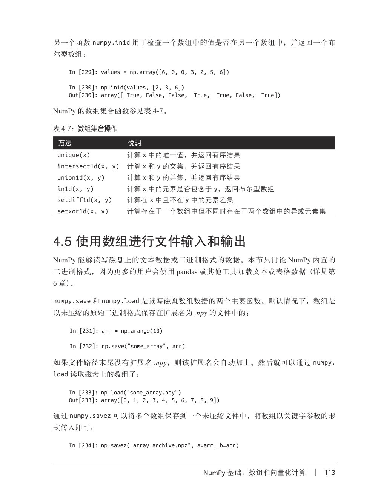

另一个函数 `numpy.in1d` 用于检查一个数组中的值是否在另一个数组中，并返回一个布尔型数组：

```python
values = np.array([6, 0, 0, 3, 2, 5, 6])
np.in1d(values, [2, 3, 6])
```

```text
array([ True, False, False,  True,  True, False,  True])
```

NumPy 的数组集合函数参见表 4-7。

**表 4-7：数组集合操作**

| 方法 | 说明 |
|---|---|
| `unique(x)` | 计算 `x` 中的唯一值，并返回有序结果 |
| `intersect1d(x, y)` | 计算 `x` 和 `y` 的交集，并返回有序结果 |
| `union1d(x, y)` | 计算 `x` 和 `y` 的并集，并返回有序结果 |
| `in1d(x, y)` | 计算 `x` 中的元素是否包含于 `y`，返回布尔型数组 |
| `setdiff1d(x, y)` | 计算在 `x` 中且不在 `y` 中的元素差集 |
| `setxor1d(x, y)` | 计算存在于一个数组中但不同时存在于两个数组中的异或元素集 |

### 4.5 使用数组进行文件输入和输出

NumPy 能够读写磁盘上的文本数据或二进制格式的数据。本节只讨论 NumPy 内置的二进制格式，因为更多的用户会使用 pandas 或其他工具加载文本或表格数据（详见第 6 章）。

`numpy.save` 和 `numpy.load` 是读写磁盘数组数据的两个主要函数。默认情况下，数组是以未压缩的原始二进制格式保存在扩展名为 `.npy` 的文件中的：

```python
arr = np.arange(10)
np.save("some_array", arr)
```

如果文件路径末尾没有扩展名 `.npy`，则该扩展名会自动加上。然后就可以通过 `numpy.load` 读取磁盘上的数组了：

```python
np.load("some_array.npy")
```

```text
array([0, 1, 2, 3, 4, 5, 6, 7, 8, 9])
```

通过 `numpy.savez` 可以将多个数组保存到一个未压缩文件中，将数组以关键字参数的形式传入即可：

```python
np.savez("array_archive.npz", a=arr, b=arr)
```

## PDF 第 124 页

<!-- page-status: reviewed -->
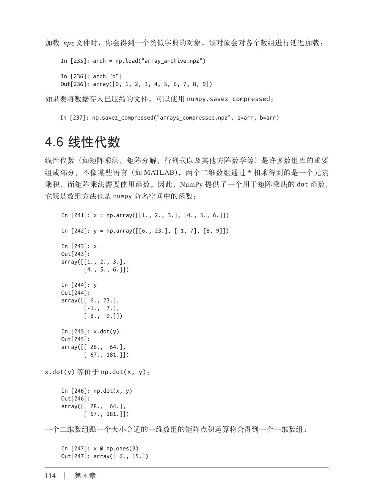

加载 `.npz` 文件时，你会得到一个类似字典的对象，该对象会对各个数组进行延迟加载：

```python
arch = np.load("array_archive.npz")
arch["b"]
```

```text
array([0, 1, 2, 3, 4, 5, 6, 7, 8, 9])
```

如果要将数据存入已压缩的文件，可以使用 `numpy.savez_compressed`：

```python
np.savez_compressed("arrays_compressed.npz", a=arr, b=arr)
```

### 4.6 线性代数

线性代数（如矩阵乘法、矩阵分解、行列式以及其他方阵数学等）是许多数组库的重要组成部分。不像某些语言（如 MATLAB），两个二维数组通过 `*` 相乘得到的是一个元素乘积，而矩阵乘法需要使用函数。因此，NumPy 提供了一个用于矩阵乘法的 `dot` 函数，它既是数组方法也是 `numpy` 命名空间中的函数：

```python
x = np.array([[1., 2., 3.], [4., 5., 6.]])
y = np.array([[6., 23.], [-1, 7], [8, 9]])
x
```

```text
array([[1., 2., 3.],
       [4., 5., 6.]])
```

```python
y
```

```text
array([[ 6., 23.],
       [-1.,  7.],
       [ 8.,  9.]])
```

```python
x.dot(y)
```

```text
array([[ 28.,  64.],
       [ 67., 181.]])
```

`x.dot(y)` 等价于 `np.dot(x, y)`：

```python
np.dot(x, y)
```

```text
array([[ 28.,  64.],
       [ 67., 181.]])
```

一个二维数组跟一个大小合适的一维数组的矩阵点积运算将会得到一个一维数组：

```python
x @ np.ones(3)
```

```text
array([ 6., 15.])
```

## PDF 第 125 页

<!-- page-status: reviewed -->
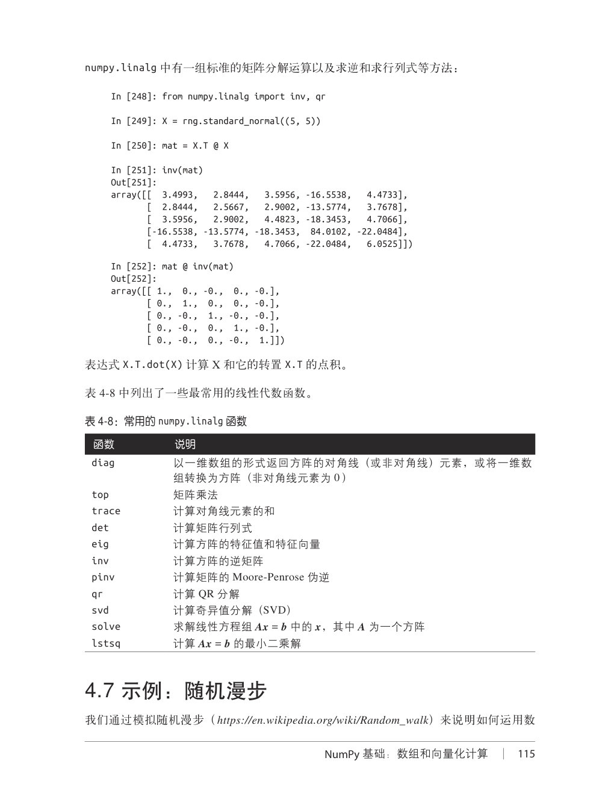

`numpy.linalg` 中有一组标准的矩阵分解运算以及求逆和求行列式等方法：

```python
# In [248]–[251]
from numpy.linalg import inv, qr
X = rng.standard_normal((5, 5))
mat = X.T @ X
inv(mat)
```

```text
Out[251]:
array([[  3.4993,   2.8444,   3.5956, -16.5538,   4.4733],
       [  2.8444,   2.5667,   2.9002, -13.5774,   3.7678],
       [  3.5956,   2.9002,   4.4823, -18.3453,   4.7066],
       [-16.5538, -13.5774, -18.3453,  84.0102, -22.0484],
       [  4.4733,   3.7678,   4.7066, -22.0484,   6.0525]])
```

```python
# In [252]
mat @ inv(mat)
```

```text
Out[252]:
array([[ 1.,  0., -0.,  0., -0.],
       [ 0.,  1.,  0.,  0., -0.],
       [ 0., -0.,  1., -0., -0.],
       [ 0., -0.,  0.,  1., -0.],
       [ 0., -0.,  0., -0.,  1.]])
```

表达式 `X.T.dot(X)` 计算 `X` 和它的转置 `X.T` 的点积。随机数结果取决于先前的生成器状态。

表 4-8 中列出了一些最常用的线性代数函数。

**表 4-8：常用的 `numpy.linalg` 函数**

| 函数 | 说明 |
|---|---|
| `diag` | 以一维数组的形式返回方阵的对角线（或非对角线）元素，或将一维数组转换为方阵（非对角线元素为 0） |
| `dot` | 矩阵乘法 |
| `trace` | 计算对角线元素的和 |
| `det` | 计算矩阵行列式 |
| `eig` | 计算方阵的特征值和特征向量 |
| `inv` | 计算方阵的逆矩阵 |
| `pinv` | 计算矩阵的 Moore-Penrose 伪逆 |
| `qr` | 计算 QR 分解 |
| `svd` | 计算奇异值分解（SVD） |
| `solve` | 求解线性方程组 $Ax=b$ 中的 $x$，其中 $A$ 为一个方阵 |
| `lstsq` | 计算 $Ax=b$ 的最小二乘解 |

> 校对注：原页表格第二项印为 `top`，这里按实际函数名更正为 `dot`；`dot` 是 NumPy 顶层函数，不属于 `numpy.linalg` 命名空间。

### 4.7 示例：随机漫步

我们通过模拟随机漫步（https://en.wikipedia.org/wiki/Random_walk）来说明如何运用数

## PDF 第 126 页

<!-- page-status: reviewed -->
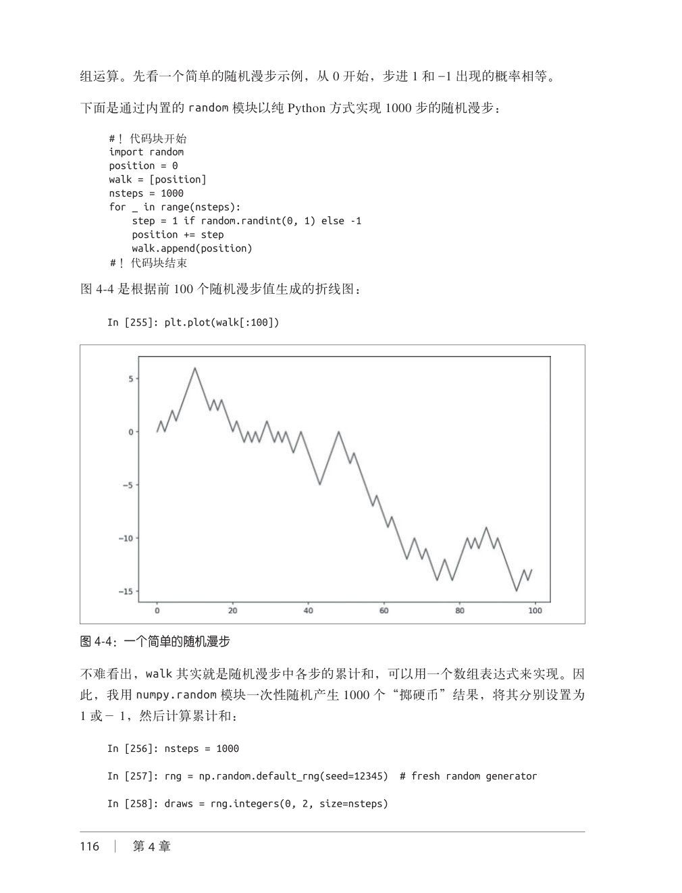

组运算。先看一个简单的随机漫步示例，从 0 开始，步进 1 和 -1 出现的概率相等。

下面是通过内置的 `random` 模块以纯 Python 方式实现 1000 步的随机漫步：

```python
import random
position = 0
walk = [position]
nsteps = 1000
for _ in range(nsteps):
    step = 1 if random.randint(0, 1) else -1
    position += step
    walk.append(position)
```

图 4-4 是根据前 100 个随机漫步值生成的折线图：

```python
# In [255]
plt.plot(walk[:100])
```

**图 4-4：一个简单的随机漫步。** 折线图见原页图。

不难看出，`walk` 其实就是随机漫步中各步的累计和，可以用一个数组表达式来实现。因此，我用 `numpy.random` 模块一次性随机产生 1000 个“掷硬币”结果，将其分别设置为 1 或 -1，然后计算累计和：

```python
# In [256]–[258]
nsteps = 1000
rng = np.random.default_rng(seed=12345)  # fresh random generator
draws = rng.integers(0, 2, size=nsteps)
```

## PDF 第 127 页

<!-- page-status: reviewed -->
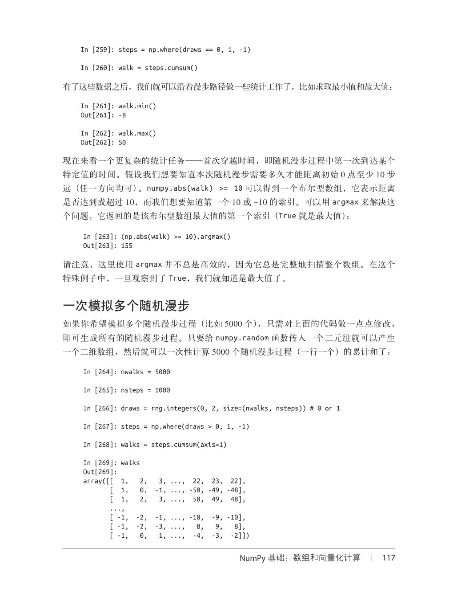

```python
# In [259]–[260]
steps = np.where(draws == 0, 1, -1)
walk = steps.cumsum()
```

有了这些数据之后，我们就可以沿着漫步路径做一些统计工作了，比如求取最小值和最大值：

```python
# In [261]
walk.min()
```

```text
Out[261]: -8
```

```python
# In [262]
walk.max()
```

```text
Out[262]: 50
```

现在来看一个更复杂的统计任务——首次穿越时间，即随机漫步过程中第一次到达某个特定值的时间。假设我们想要知道本次随机漫步需要多久才能距离初始 0 点至少 10 步远（任一方向均可）。`numpy.abs(walk) >= 10` 可以得到一个布尔型数组，它表示距离是否达到或超过 10，而我们想要知道第一个 10 或 -10 的索引。可以用 `argmax` 来解决这个问题，它返回的是该布尔型数组最大值的第一个索引（`True` 就是最大值）：

```python
# In [263]
(np.abs(walk) >= 10).argmax()
```

```text
Out[263]: 155
```

请注意，这里使用 `argmax` 并不总是高效的，因为它总是完整地扫描整个数组。在这个特殊例子中，一旦观察到了 `True`，我们就知道是最大值了。

> 校对注：当条件数组中没有任何 `True` 时，`argmax()` 也会返回 0；实际使用时需要先检查条件是否曾经满足。

### 一次模拟多个随机漫步

如果你希望模拟多个随机漫步过程（比如 5000 个），只需对上面的代码做一点点修改，即可生成所有的随机漫步过程。只要给 `numpy.random` 函数传入一个二元组就可以产生一个二维数组，然后就可以一次性计算 5000 个随机漫步过程（一行一个）的累计和了：

```python
# In [264]–[269]
nwalks = 5000
nsteps = 1000
draws = rng.integers(0, 2, size=(nwalks, nsteps))  # 0 or 1
steps = np.where(draws > 0, 1, -1)
walks = steps.cumsum(axis=1)
walks
```

```text
Out[269]:
array([[  1,   2,   3, ...,  22,  23,  22],
       [  1,   0,  -1, ..., -50, -49, -48],
       [  1,   2,   3, ...,  50,  49,  48],
       ...,
       [ -1,  -2,  -1, ..., -10,  -9, -10],
       [ -1,  -2,  -3, ...,   8,   9,   8],
       [ -1,   0,   1, ...,  -4,  -3,  -2]])
```

## PDF 第 128 页

<!-- page-status: reviewed -->
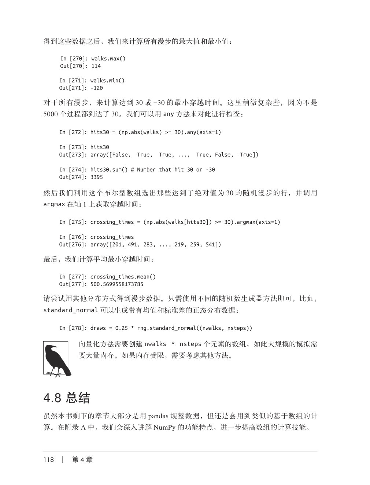

得到这些数据之后，我们来计算所有漫步的最大值和最小值：

```python
# In [270]
walks.max()
```

```text
Out[270]: 114
```

```python
# In [271]
walks.min()
```

```text
Out[271]: -120
```

对于所有漫步，来计算达到 30 或 -30 的最小穿越时间。这里稍微复杂些，因为不是 5000 个过程都到达了 30。我们可以用 `any` 方法来对此进行检查：

```python
# In [272]–[273]
hits30 = (np.abs(walks) >= 30).any(axis=1)
hits30
```

```text
Out[273]: array([False,  True,  True, ...,  True, False,  True])
```

```python
# In [274]
hits30.sum()  # Number that hit 30 or -30
```

```text
Out[274]: 3395
```

然后我们利用这个布尔型数组选出那些达到了绝对值为 30 的随机漫步的行，并调用 `argmax` 在轴 1 上获取穿越时间：

```python
# In [275]–[276]
crossing_times = (np.abs(walks[hits30]) >= 30).argmax(axis=1)
crossing_times
```

```text
Out[276]: array([201, 491, 283, ..., 219, 259, 541])
```

最后，我们计算平均最小穿越时间：

```python
# In [277]
crossing_times.mean()
```

```text
Out[277]: 500.5699558173785
```

请尝试用其他分布方式得到漫步数据。只需使用不同的随机数生成器方法即可，比如，`standard_normal` 可以生成带有均值和标准差的正态分布数据：

```python
# In [278]
draws = 0.25 * rng.standard_normal((nwalks, nsteps))
```

> 向量化方法需要创建 `nwalks * nsteps` 个元素的数组，如此大规模的模拟需要大量内存。如果内存受限，需要考虑其他方法。

### 4.8 总结

虽然本书剩下的章节大部分是用 pandas 规整数据，但还是会用到类似的基于数组的计算。在附录 A 中，我们会深入讲解 NumPy 的功能特点，进一步提高数组的计算技能。

