# 第 7 章 数据清洗和准备

[返回目录](../README.md)

> 本章已逐页对照原页图像整理为可编辑 Markdown；示例输出保留原书记录。AI 校对不等于人工复核，代码运行结果可能因环境或版本不同而变化。

## PDF 第 204 页

<!-- page-status: reviewed -->
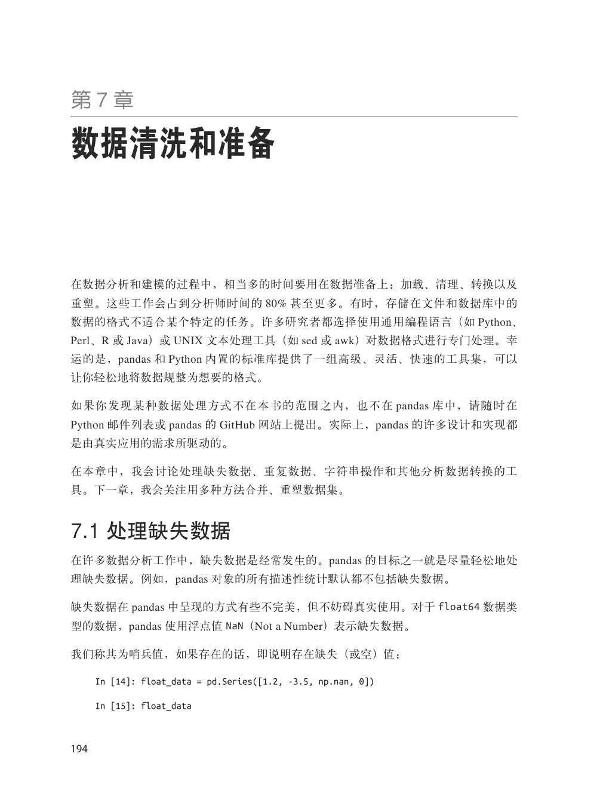

在数据分析和建模的过程中，相当多的时间要用在数据准备上：加载、清理、转换以及重塑。这些工作会占到分析师时间的 80% 甚至更多。有时，存储在文件和数据库中的数据的格式不适合某个特定的任务。许多研究者都选择使用通用编程语言（如 Python、Perl、R 或 Java）或 UNIX 文本处理工具（如 sed 或 awk）对数据格式进行专门处理。幸运的是，pandas 和 Python 内置的标准库提供了一组高级、灵活、快速的工具集，可以让你轻松地将数据规整为想要的格式。

本章讨论处理缺失数据、重复数据、字符串操作和其他分析数据转换的工具。下一章关注用多种方法合并、重塑数据集。

### 7.1 处理缺失数据

在许多数据分析工作中，缺失数据是经常发生的。pandas 的目标之一就是尽量轻松地处理缺失数据。例如，pandas 对象的所有描述性统计默认都不包括缺失数据。

缺失数据在 pandas 中呈现的方式有些不完美，但不妨碍真实使用。对于 `float64` 数据类型的数据，pandas 使用浮点值 NaN（Not a Number）表示缺失数据。

我们称其为哨兵值，如果存在的话，即说明存在缺失（或空）值：

```python
float_data = pd.Series([1.2, -3.5, np.nan, 0])
float_data
```

输出见下一页。

## PDF 第 205 页

<!-- page-status: reviewed -->
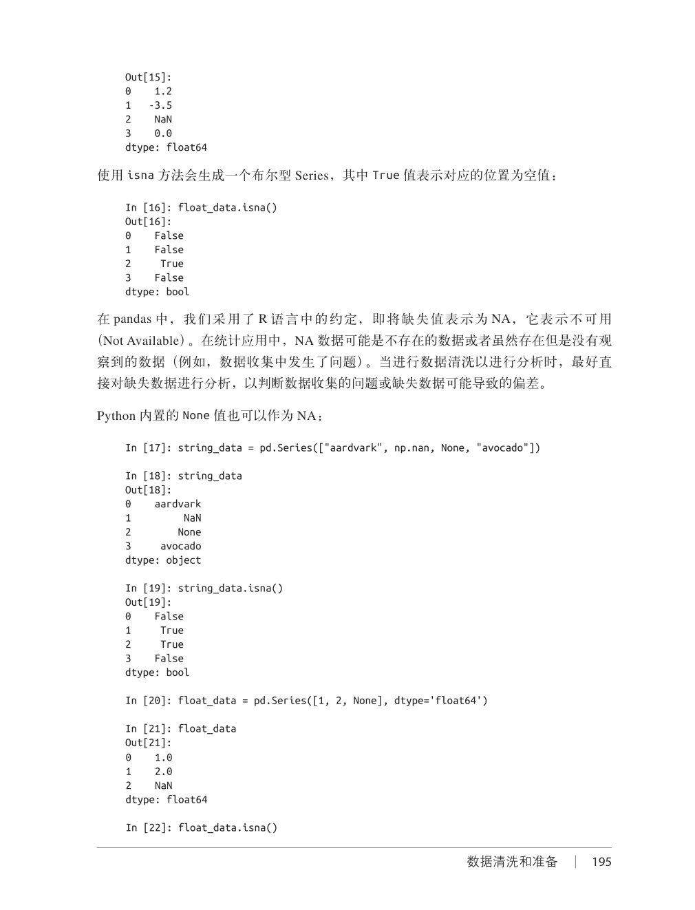

上一页 `float_data` 的输出：

```text
0    1.2
1   -3.5
2    NaN
3    0.0
dtype: float64
```

使用 `isna` 方法会生成一个布尔型 Series，其中 `True` 值表示对应的位置为空值：

```python
float_data.isna()
```

```text
0    False
1    False
2     True
3    False
dtype: bool
```

在 pandas 中，我们采用了 R 语言中的约定，即将缺失值表示为 NA，它表示不可用（Not Available）。在统计应用中，NA 数据可能是不存在的数据或者虽然存在但是没有观察到的数据（例如，数据收集中发生了问题）。当进行数据清洗以进行分析时，最好直接对缺失数据进行分析，以判断数据收集的问题或缺失数据可能导致的偏差。

Python 内置的 `None` 值也可以作为 NA：

```python
string_data = pd.Series(["aardvark", np.nan, None, "avocado"])
string_data
```

```text
0    aardvark
1         NaN
2        None
3     avocado
dtype: object
```

```python
string_data.isna()
```

```text
0    False
1     True
2     True
3    False
dtype: bool
```

```python
float_data = pd.Series([1, 2, None], dtype='float64')
float_data
```

```text
0    1.0
1    2.0
2    NaN
dtype: float64
```

```python
float_data.isna()
```

输出见下一页。

## PDF 第 206 页

<!-- page-status: reviewed -->
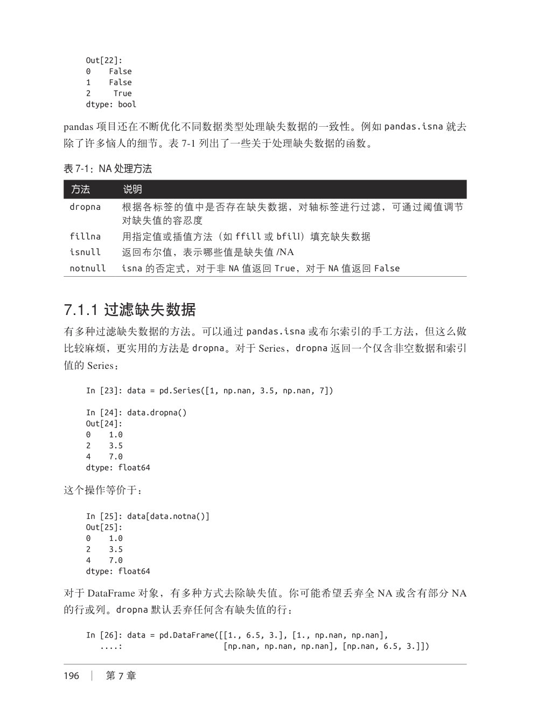

上一页 `float_data.isna()` 的输出：

```text
0    False
1    False
2     True
dtype: bool
```

pandas 项目还在不断优化不同数据类型处理缺失数据的一致性。例如 `pandas.isna` 就去除了许多恼人的细节。表 7-1 列出了一些关于处理缺失数据的函数。

**表 7-1：NA 处理方法**

| 方法 | 说明 |
| --- | --- |
| `dropna` | 根据各标签的值中是否存在缺失数据，对轴标签进行过滤，可通过阈值调节对缺失值的容忍度 |
| `fillna` | 用指定值或插值方法（如 `ffill` 或 `bfill`）填充缺失数据 |
| `isnull` | 返回布尔值，表示哪些值是缺失值 / NA |
| `notnull` | `isna` 的否定式，对于非 NA 值返回 `True`，对于 NA 值返回 `False` |

#### 7.1.1 过滤缺失数据

有多种过滤缺失数据的方法。可以通过 `pandas.isna` 或布尔索引的手工方法，但这么做比较麻烦，更实用的方法是 `dropna`。对于 Series，`dropna` 返回一个仅含非空数据和索引值的 Series：

```python
data = pd.Series([1, np.nan, 3.5, np.nan, 7])
data.dropna()
```

```text
0    1.0
2    3.5
4    7.0
dtype: float64
```

这个操作等价于：

```python
data[data.notna()]
```

```text
0    1.0
2    3.5
4    7.0
dtype: float64
```

对于 DataFrame 对象，有多种方式去除缺失值。你可能希望丢弃全 NA 或含有部分 NA 的行或列。`dropna` 默认丢弃任何含有缺失值的行：

```python
data = pd.DataFrame([[1., 6.5, 3.], [1., np.nan, np.nan],
                     [np.nan, np.nan, np.nan], [np.nan, 6.5, 3.]])
```

## PDF 第 207 页

<!-- page-status: reviewed -->
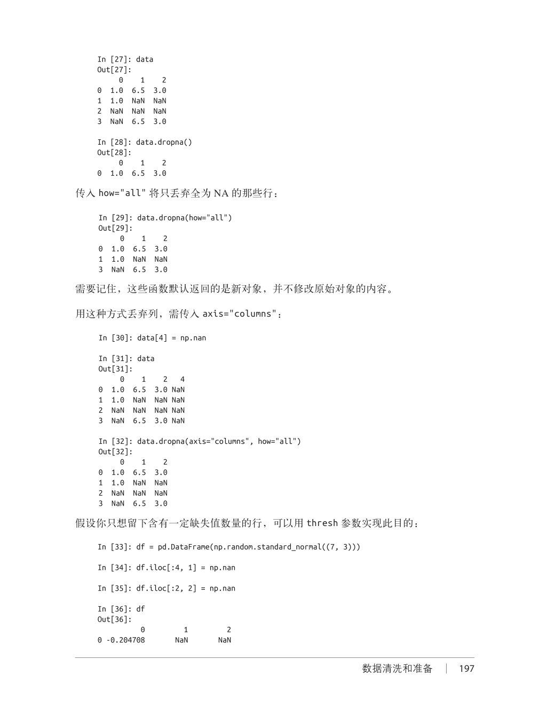

```python
data
```

```text
     0    1    2
0  1.0  6.5  3.0
1  1.0  NaN  NaN
2  NaN  NaN  NaN
3  NaN  6.5  3.0
```

```python
data.dropna()
```

```text
     0    1    2
0  1.0  6.5  3.0
```

传入 `how="all"` 将只丢弃全为 NA 的那些行：

```python
data.dropna(how="all")
```

```text
     0    1    2
0  1.0  6.5  3.0
1  1.0  NaN  NaN
3  NaN  6.5  3.0
```

需要记住，这些函数默认返回的是新对象，并不修改原始对象的内容。

用这种方式丢弃列，需传入 `axis="columns"`：

```python
data[4] = np.nan
data
```

```text
     0    1    2   4
0  1.0  6.5  3.0 NaN
1  1.0  NaN  NaN NaN
2  NaN  NaN  NaN NaN
3  NaN  6.5  3.0 NaN
```

```python
data.dropna(axis="columns", how="all")
```

```text
     0    1    2
0  1.0  6.5  3.0
1  1.0  NaN  NaN
2  NaN  NaN  NaN
3  NaN  6.5  3.0
```

假设你只想留下含有一定缺失值数量的行，可以用 `thresh` 参数实现此目的：

```python
df = pd.DataFrame(np.random.standard_normal((7, 3)))
df.iloc[:4, 1] = np.nan
df.iloc[:2, 2] = np.nan
df
```

输出跨页，见下一页。

## PDF 第 208 页

<!-- page-status: reviewed -->
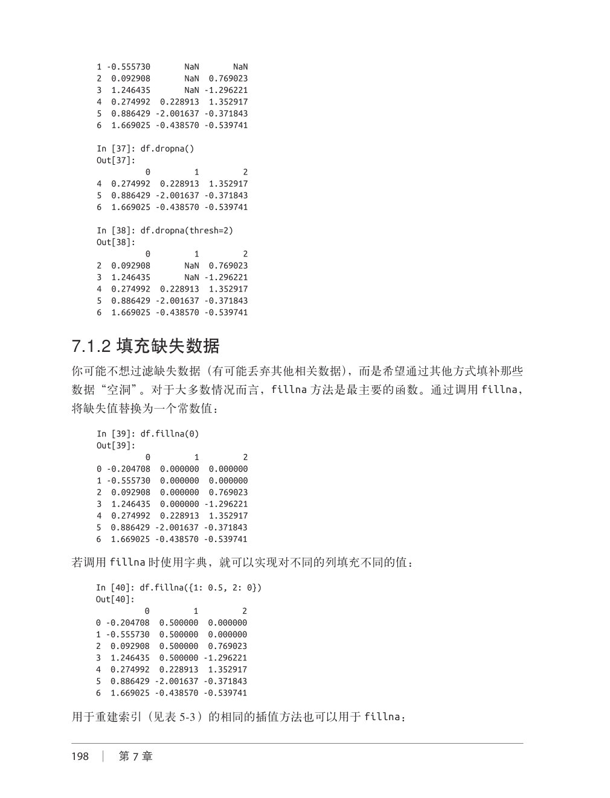

上一页 `df` 的输出（首行位于上一页，以下合并显示）：

```text
          0         1         2
0 -0.204708       NaN       NaN
1 -0.555730       NaN       NaN
2  0.092908       NaN  0.769023
3  1.246435       NaN -1.296221
4  0.274992  0.228913  1.352917
5  0.886429 -2.001637 -0.371843
6  1.669025 -0.438570 -0.539741
```

```python
df.dropna()
```

```text
          0         1         2
4  0.274992  0.228913  1.352917
5  0.886429 -2.001637 -0.371843
6  1.669025 -0.438570 -0.539741
```

```python
df.dropna(thresh=2)
```

```text
          0         1         2
2  0.092908       NaN  0.769023
3  1.246435       NaN -1.296221
4  0.274992  0.228913  1.352917
5  0.886429 -2.001637 -0.371843
6  1.669025 -0.438570 -0.539741
```

#### 7.1.2 填充缺失数据

你可能不想过滤缺失数据（有可能丢弃其他相关数据），而是希望通过其他方式填补那些数据“空洞”。对于大多数情况而言，`fillna` 方法是最主要的函数。通过调用 `fillna`，将缺失值替换为一个常数值：

```python
df.fillna(0)
```

```text
          0         1         2
0 -0.204708  0.000000  0.000000
1 -0.555730  0.000000  0.000000
2  0.092908  0.000000  0.769023
3  1.246435  0.000000 -1.296221
4  0.274992  0.228913  1.352917
5  0.886429 -2.001637 -0.371843
6  1.669025 -0.438570 -0.539741
```

若调用 `fillna` 时使用字典，就可以实现对不同的列填充不同的值：

```python
df.fillna({1: 0.5, 2: 0})
```

```text
          0         1         2
0 -0.204708  0.500000  0.000000
1 -0.555730  0.500000  0.000000
2  0.092908  0.500000  0.769023
3  1.246435  0.500000 -1.296221
4  0.274992  0.228913  1.352917
5  0.886429 -2.001637 -0.371843
6  1.669025 -0.438570 -0.539741
```

用于重建索引（见表 5-3）的相同的插值方法也可以用于 `fillna`：

## PDF 第 209 页

<!-- page-status: reviewed -->
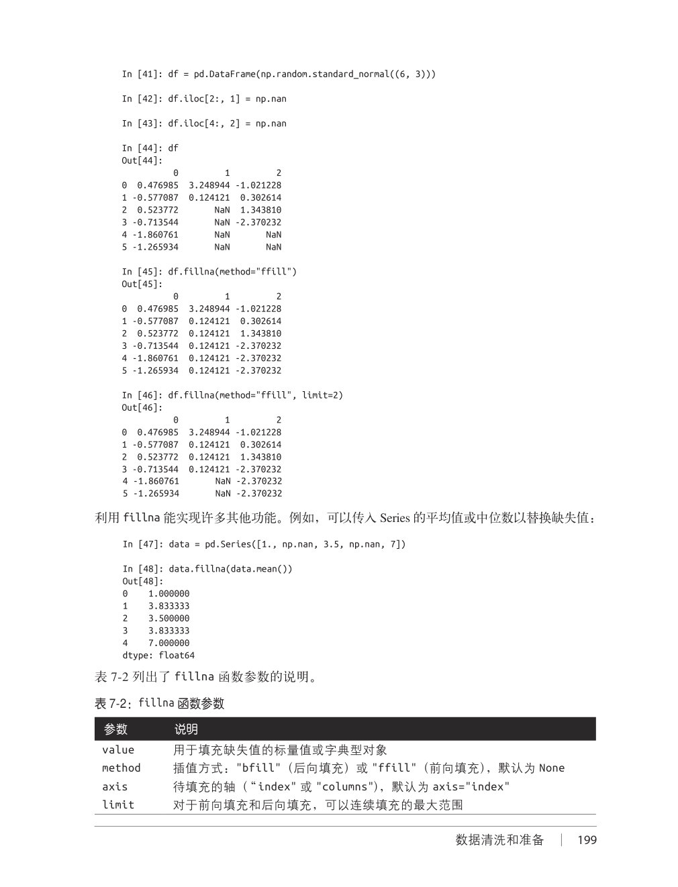

```python
df = pd.DataFrame(np.random.standard_normal((6, 3)))
df.iloc[2:, 1] = np.nan
df.iloc[4:, 2] = np.nan
df
```

```text
          0         1         2
0  0.476985  3.248944 -1.021228
1 -0.577087  0.124121  0.302614
2  0.523772       NaN  1.343810
3 -0.713544       NaN -2.370232
4 -1.860761       NaN       NaN
5 -1.265934       NaN       NaN
```

```python
df.fillna(method="ffill")
```

```text
          0         1         2
0  0.476985  3.248944 -1.021228
1 -0.577087  0.124121  0.302614
2  0.523772  0.124121  1.343810
3 -0.713544  0.124121 -2.370232
4 -1.860761  0.124121 -2.370232
5 -1.265934  0.124121 -2.370232
```

```python
df.fillna(method="ffill", limit=2)
```

```text
          0         1         2
0  0.476985  3.248944 -1.021228
1 -0.577087  0.124121  0.302614
2  0.523772  0.124121  1.343810
3 -0.713544  0.124121 -2.370232
4 -1.860761       NaN -2.370232
5 -1.265934       NaN -2.370232
```

利用 `fillna` 能实现许多其他功能。例如，可以传入 Series 的平均值或中位数以替换缺失值：

```python
data = pd.Series([1., np.nan, 3.5, np.nan, 7])
data.fillna(data.mean())
```

```text
0    1.000000
1    3.833333
2    3.500000
3    3.833333
4    7.000000
dtype: float64
```

表 7-2 列出了 `fillna` 函数参数的说明。

**表 7-2：fillna 函数参数**

| 参数 | 说明 |
| --- | --- |
| `value` | 用于填充缺失值的标量值或字典型对象 |
| `method` | 插值方式：`"bfill"`（后向填充）或 `"ffill"`（前向填充），默认为 `None` |
| `axis` | 待填充的轴（`"index"` 或 `"columns"`），默认为 `axis="index"` |
| `limit` | 对于前向填充和后向填充，可以连续填充的最大范围 |

## PDF 第 210 页

<!-- page-status: reviewed -->
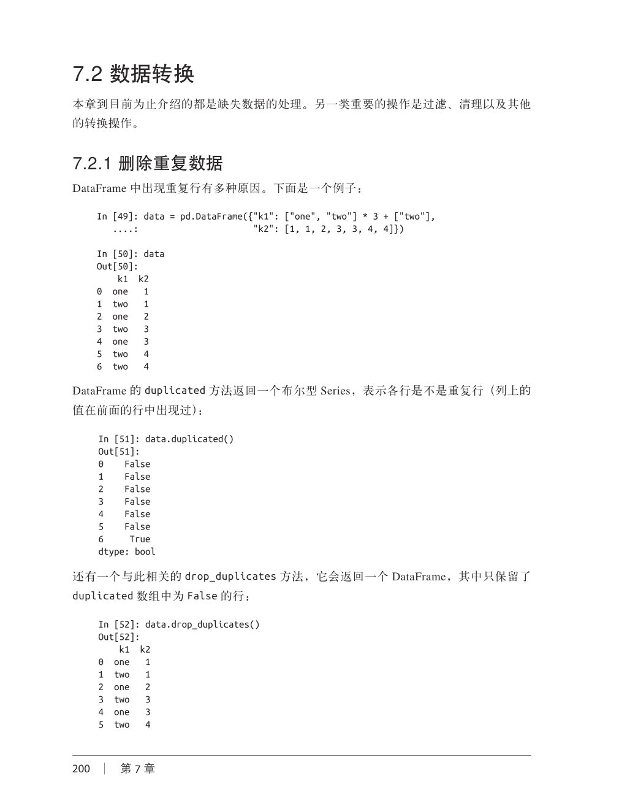

### 7.2 数据转换

本章到目前为止介绍的都是缺失数据的处理。另一类重要的操作是过滤、清理以及其他的转换操作。

#### 7.2.1 删除重复数据

DataFrame 中出现重复行有多种原因。下面是一个例子：

```python
data = pd.DataFrame({"k1": ["one", "two"] * 3 + ["two"],
                     "k2": [1, 1, 2, 3, 3, 4, 4]})
data
```

```text
    k1  k2
0  one   1
1  two   1
2  one   2
3  two   3
4  one   3
5  two   4
6  two   4
```

DataFrame 的 `duplicated` 方法返回一个布尔型 Series，表示各行是不是重复行（列上的值在前面的行中出现过）：

```python
data.duplicated()
```

```text
0    False
1    False
2    False
3    False
4    False
5    False
6     True
dtype: bool
```

还有一个与此相关的 `drop_duplicates` 方法，它会返回一个 DataFrame，其中只保留了 `duplicated` 数组中为 `False` 的行：

```python
data.drop_duplicates()
```

```text
    k1  k2
0  one   1
1  two   1
2  one   2
3  two   3
4  one   3
5  two   4
```

## PDF 第 211 页

<!-- page-status: reviewed -->
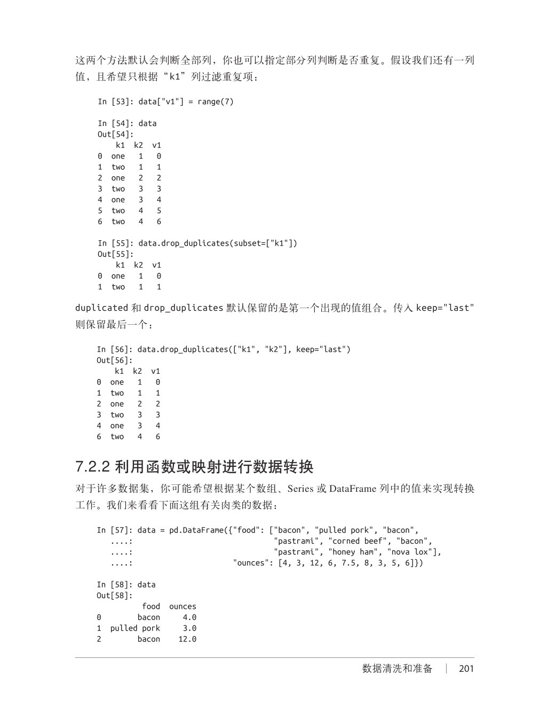

这两个方法默认会判断全部列，你也可以指定部分列判断是否重复。假设我们还有一列值，且希望只根据 `k1` 列过滤重复项：

```python
data["v1"] = range(7)
data
```

```text
    k1  k2  v1
0  one   1   0
1  two   1   1
2  one   2   2
3  two   3   3
4  one   3   4
5  two   4   5
6  two   4   6
```

```python
data.drop_duplicates(subset=["k1"])
```

```text
    k1  k2  v1
0  one   1   0
1  two   1   1
```

`duplicated` 和 `drop_duplicates` 默认保留的是第一个出现的值组合。传入 `keep="last"` 则保留最后一个：

```python
data.drop_duplicates(["k1", "k2"], keep="last")
```

```text
    k1  k2  v1
0  one   1   0
1  two   1   1
2  one   2   2
3  two   3   3
4  one   3   4
6  two   4   6
```

### 7.2.2 利用函数或映射进行数据转换

对于许多数据集，你可能希望根据某个数组、Series 或 DataFrame 列中的值来实现转换工作。我们来看看下面这组有关肉类的数据：

```python
data = pd.DataFrame({"food": ["bacon", "pulled pork", "bacon",
                              "pastrami", "corned beef", "bacon",
                              "pastrami", "honey ham", "nova lox"],
                     "ounces": [4, 3, 12, 6, 7.5, 8, 3, 5, 6]})
data
```

```text
          food  ounces
0        bacon     4.0
1  pulled pork     3.0
2        bacon    12.0
```

输出的第 3–8 行续于下一 PDF 页。

## PDF 第 212 页

<!-- page-status: reviewed -->
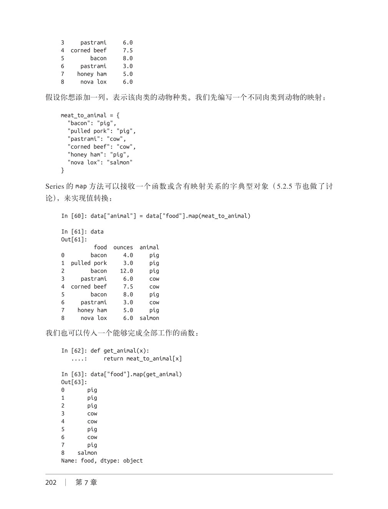

上页输出续：

```text
3     pastrami     6.0
4  corned beef     7.5
5        bacon     8.0
6     pastrami     3.0
7    honey ham     5.0
8     nova lox     6.0
```

假设你想添加一列，表示该肉类的动物种类。我们先编写一个不同肉类到动物的映射：

```python
meat_to_animal = {
    "bacon": "pig",
    "pulled pork": "pig",
    "pastrami": "cow",
    "corned beef": "cow",
    "honey ham": "pig",
    "nova lox": "salmon"
}
```

Series 的 `map` 方法可以接收一个函数或含有映射关系的字典型对象（5.2.5 节也做了讨论），来实现值转换：

```python
data["animal"] = data["food"].map(meat_to_animal)
data
```

```text
          food  ounces  animal
0        bacon     4.0     pig
1  pulled pork     3.0     pig
2        bacon    12.0     pig
3     pastrami     6.0     cow
4  corned beef     7.5     cow
5        bacon     8.0     pig
6     pastrami     3.0     cow
7    honey ham     5.0     pig
8     nova lox     6.0  salmon
```

我们也可以传入一个能够完成全部工作的函数：

```python
def get_animal(x):
    return meat_to_animal[x]

data["food"].map(get_animal)
```

```text
0       pig
1       pig
2       pig
3       cow
4       cow
5       pig
6       cow
7       pig
8    salmon
Name: food, dtype: object
```

## PDF 第 213 页

<!-- page-status: reviewed -->
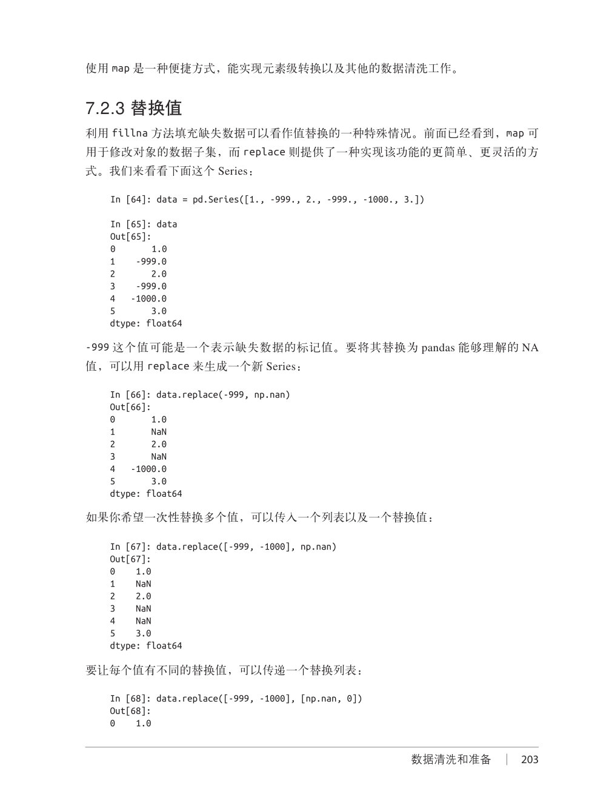

使用 `map` 是一种便捷方式，能实现元素级转换以及其他的数据清洗工作。

### 7.2.3 替换值

利用 `fillna` 方法填充缺失数据可以看作值替换的一种特殊情况。前面已经看到，`map` 可用于修改对象的数据子集，而 `replace` 则提供了一种实现该功能的更简单、更灵活的方式。我们来看看下面这个 Series：

```python
data = pd.Series([1., -999., 2., -999., -1000., 3.])
data
```

```text
0       1.0
1    -999.0
2       2.0
3    -999.0
4   -1000.0
5       3.0
dtype: float64
```

`-999` 这个值可能是一个表示缺失数据的标记值。要将其替换为 pandas 能够理解的 NA 值，可以用 `replace` 来生成一个新 Series：

```python
data.replace(-999, np.nan)
```

```text
0       1.0
1       NaN
2       2.0
3       NaN
4   -1000.0
5       3.0
dtype: float64
```

如果你希望一次性替换多个值，可以传入一个列表以及一个替换值：

```python
data.replace([-999, -1000], np.nan)
```

```text
0    1.0
1    NaN
2    2.0
3    NaN
4    NaN
5    3.0
dtype: float64
```

要让每个值有不同的替换值，可以传递一个替换列表：

```python
data.replace([-999, -1000], [np.nan, 0])
```

```text
0    1.0
```

输出的第 1–5 行续于下一 PDF 页。

## PDF 第 214 页

<!-- page-status: reviewed -->
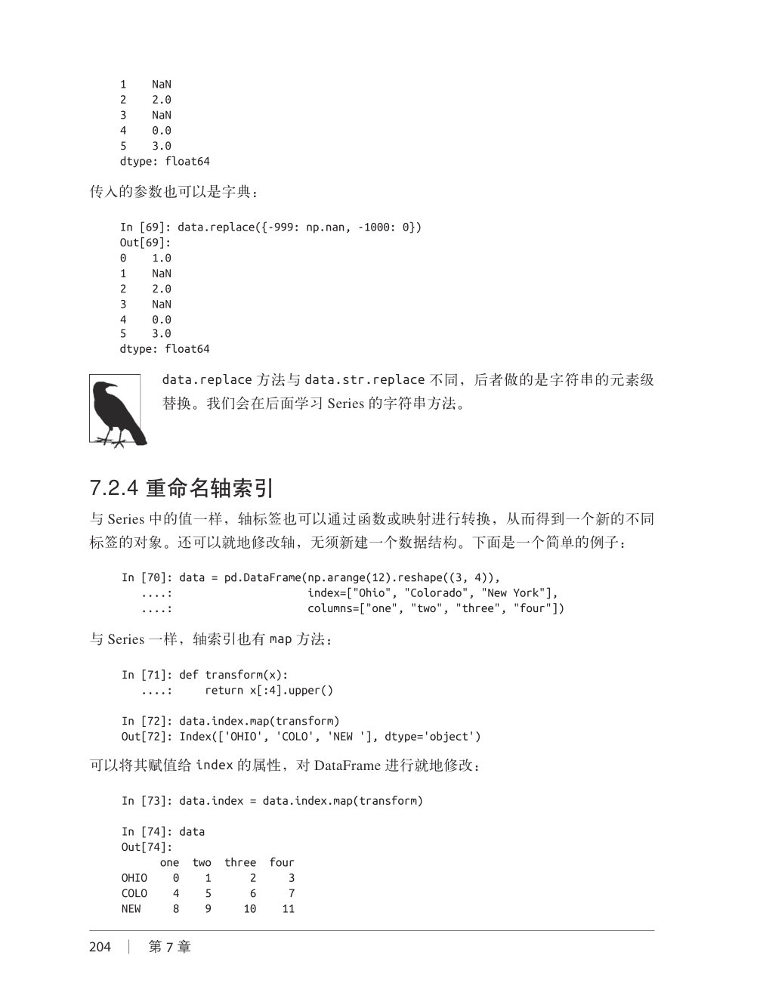

上页输出续：

```text
1    NaN
2    2.0
3    NaN
4    0.0
5    3.0
dtype: float64
```

传入的参数也可以是字典：

```python
data.replace({-999: np.nan, -1000: 0})
```

```text
0    1.0
1    NaN
2    2.0
3    NaN
4    0.0
5    3.0
dtype: float64
```

> `data.replace` 方法与 `data.str.replace` 不同，后者做的是字符串的元素级替换。我们会在后面学习 Series 的字符串方法。

### 7.2.4 重命名轴索引

与 Series 中的值一样，轴标签也可以通过函数或映射进行转换，从而得到一个新的不同标签的对象。还可以就地修改轴，无须新建一个数据结构。下面是一个简单的例子：

```python
data = pd.DataFrame(np.arange(12).reshape((3, 4)),
                    index=["Ohio", "Colorado", "New York"],
                    columns=["one", "two", "three", "four"])
```

与 Series 一样，轴索引也有 `map` 方法：

```python
def transform(x):
    return x[:4].upper()

data.index.map(transform)
```

```text
Index(['OHIO', 'COLO', 'NEW '], dtype='object')
```

可以将其赋值给 `index` 的属性，对 DataFrame 进行就地修改：

```python
data.index = data.index.map(transform)
data
```

```text
      one  two  three  four
OHIO    0    1      2     3
COLO    4    5      6     7
NEW     8    9     10    11
```

## PDF 第 215 页

<!-- page-status: reviewed -->
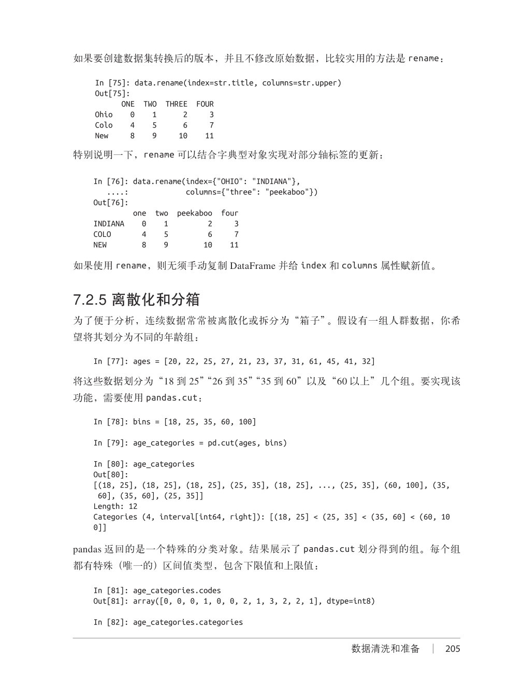

如果要创建数据集转换后的版本，并且不修改原始数据，比较实用的方法是 `rename`：

```python
data.rename(index=str.title, columns=str.upper)
```

```text
      ONE  TWO  THREE  FOUR
Ohio    0    1      2     3
Colo    4    5      6     7
New     8    9     10    11
```

特别说明一下，`rename` 可以结合字典型对象实现对部分轴标签的更新：

```python
data.rename(index={"OHIO": "INDIANA"},
            columns={"three": "peekaboo"})
```

```text
         one  two  peekaboo  four
INDIANA    0    1         2     3
COLO       4    5         6     7
NEW        8    9        10    11
```

如果使用 `rename`，则无须手动复制 DataFrame 并给 `index` 和 `columns` 属性赋新值。

### 7.2.5 离散化和分箱

为了便于分析，连续数据常常被离散化或拆分为“箱子”。假设有一组人群数据，你希望将其划分为不同的年龄组：

```python
ages = [20, 22, 25, 27, 21, 23, 37, 31, 61, 45, 41, 32]
```

将这些数据划分为“18 到 25”“26 到 35”“35 到 60”以及“60 以上”几个组。要实现该功能，需要使用 `pandas.cut`：

```python
bins = [18, 25, 35, 60, 100]
age_categories = pd.cut(ages, bins)
age_categories
```

```text
[(18, 25], (18, 25], (18, 25], (25, 35], (18, 25], ..., (25, 35], (60, 100], (35,
60], (35, 60], (25, 35]]
Length: 12
Categories (4, interval[int64, right]): [(18, 25] < (25, 35] < (35, 60] < (60, 100]]
```

pandas 返回的是一个特殊的分类对象。结果展示了 `pandas.cut` 划分得到的组。每个组都有特殊（唯一的）区间值类型，包含下限值和上限值：

```python
age_categories.codes
```

```text
array([0, 0, 0, 1, 0, 0, 2, 1, 3, 2, 2, 1], dtype=int8)
```

```python
age_categories.categories
```

输出续于下一 PDF 页。

## PDF 第 216 页

<!-- page-status: reviewed -->
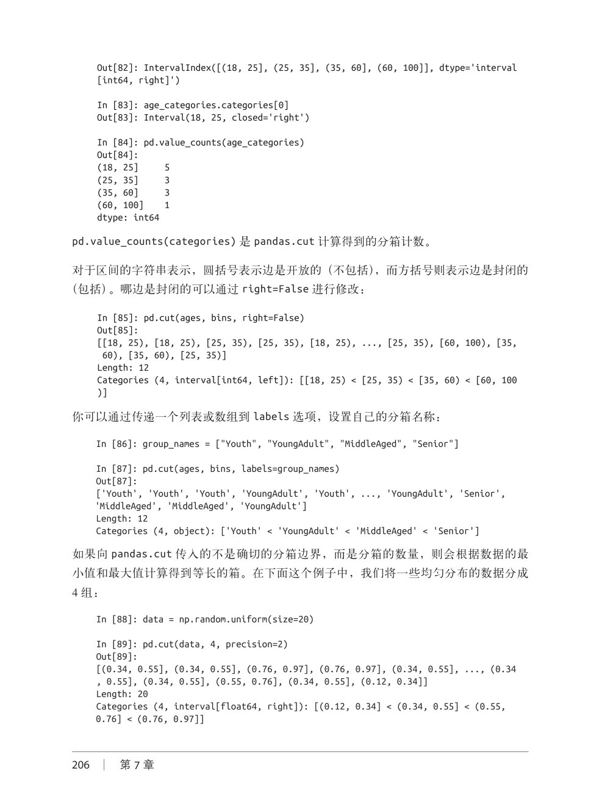

上一页代码的输出：

```text
IntervalIndex([(18, 25], (25, 35], (35, 60], (60, 100]], dtype='interval[int64, right]')
```

```python
age_categories.categories[0]
```

```text
Interval(18, 25, closed='right')
```

```python
pd.value_counts(age_categories)
```

```text
(18, 25]     5
(25, 35]     3
(35, 60]     3
(60, 100]    1
dtype: int64
```

`pd.value_counts(categories)` 是 `pandas.cut` 计算得到的分箱计数。

对于区间的字符串表示，圆括号表示边是开放的（不包括），而方括号则表示边是封闭的（包括）。哪边是封闭的可以通过 `right=False` 进行修改：

```python
pd.cut(ages, bins, right=False)
```

```text
[[18, 25), [18, 25), [25, 35), [25, 35), [18, 25), ..., [25, 35), [60, 100), [35, 60), [35, 60), [25, 35)]
Length: 12
Categories (4, interval[int64, left]): [[18, 25) < [25, 35) < [35, 60) < [60, 100)]
```

你可以通过传递一个列表或数组到 `labels` 选项，设置自己的分箱名称：

```python
group_names = ["Youth", "YoungAdult", "MiddleAged", "Senior"]
pd.cut(ages, bins, labels=group_names)
```

```text
['Youth', 'Youth', 'Youth', 'YoungAdult', 'Youth', ..., 'YoungAdult', 'Senior', 'MiddleAged', 'MiddleAged', 'YoungAdult']
Length: 12
Categories (4, object): ['Youth' < 'YoungAdult' < 'MiddleAged' < 'Senior']
```

如果向 `pandas.cut` 传入的不是确切的分箱边界，而是分箱的数量，则会根据数据的最小值和最大值计算得到等长的箱。在下面这个例子中，我们将一些均匀分布的数据分成 4 组：

```python
data = np.random.uniform(size=20)
pd.cut(data, 4, precision=2)
```

```text
[(0.34, 0.55], (0.34, 0.55], (0.76, 0.97], (0.76, 0.97], (0.34, 0.55], ..., (0.34, 0.55], (0.34, 0.55], (0.55, 0.76], (0.34, 0.55], (0.12, 0.34]]
Length: 20
Categories (4, interval[float64, right]): [(0.12, 0.34] < (0.34, 0.55] < (0.55, 0.76] < (0.76, 0.97]]
```

## PDF 第 217 页

<!-- page-status: reviewed -->
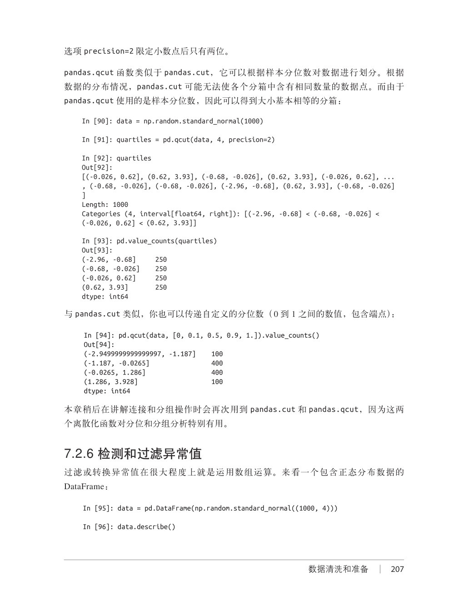

选项 `precision=2` 限定小数点后只有两位。

`pandas.qcut` 函数类似于 `pandas.cut`，它可以根据样本分位数对数据进行划分。根据数据的分布情况，`pandas.cut` 可能无法使各个分箱中含有相同数量的数据点。而由于 `pandas.qcut` 使用的是样本分位数，因此可以得到大小基本相等的分箱：

```python
data = np.random.standard_normal(1000)
quartiles = pd.qcut(data, 4, precision=2)
quartiles
```

```text
[(-0.026, 0.62], (0.62, 3.93], (-0.68, -0.026], (0.62, 3.93], (-0.026, 0.62], ..., (-0.68, -0.026], (-0.68, -0.026], (-2.96, -0.68], (0.62, 3.93], (-0.68, -0.026]]
Length: 1000
Categories (4, interval[float64, right]): [(-2.96, -0.68] < (-0.68, -0.026] < (-0.026, 0.62] < (0.62, 3.93]]
```

```python
pd.value_counts(quartiles)
```

```text
(-2.96, -0.68]      250
(-0.68, -0.026]     250
(-0.026, 0.62]      250
(0.62, 3.93]        250
dtype: int64
```

与 `pandas.cut` 类似，你也可以传递自定义的分位数（0 到 1 之间的数值，包含端点）：

```python
pd.qcut(data, [0, 0.1, 0.5, 0.9, 1.]).value_counts()
```

```text
(-2.9499999999999997, -1.187]    100
(-1.187, -0.0265]                400
(-0.0265, 1.286]                 400
(1.286, 3.928]                   100
dtype: int64
```

本章稍后在讲解连接和分组操作时会再次用到 `pandas.cut` 和 `pandas.qcut`，因为这两个离散化函数对分位和分组分析特别有用。

### 7.2.6 检测和过滤异常值

过滤或转换异常值在很大程度上就是运用数组运算。来看一个包含正态分布数据的 DataFrame：

```python
data = pd.DataFrame(np.random.standard_normal((1000, 4)))
data.describe()
```

输出续见下一页。

## PDF 第 218 页

<!-- page-status: reviewed -->
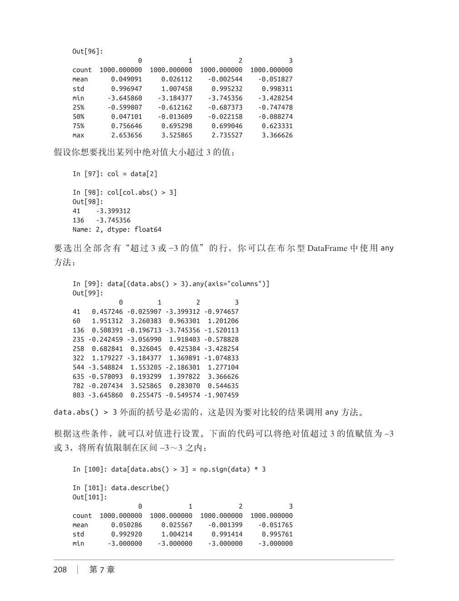

上一页 `data.describe()` 的输出：

```text
                 0            1            2            3
count  1000.000000  1000.000000  1000.000000  1000.000000
mean      0.049091     0.026112    -0.002544    -0.051827
std       0.996947     1.007458     0.995232     0.998311
min      -3.645860    -3.184377    -3.745356    -3.428254
25%      -0.599807    -0.612162    -0.687373    -0.747478
50%       0.047101    -0.013609    -0.022158    -0.088274
75%       0.756646     0.695298     0.699046     0.623331
max       2.653656     3.525865     2.735527     3.366626
```

假设你想要找出某列中绝对值大小超过 3 的值：

```python
col = data[2]
col[col.abs() > 3]
```

```text
41    -3.399312
136   -3.745356
Name: 2, dtype: float64
```

要选出全部含有“超过 3 或 −3 的值”的行，你可以在布尔型 DataFrame 中使用 `any` 方法：

```python
data[(data.abs() > 3).any(axis="columns")]
```

```text
            0         1         2         3
41   0.457246 -0.025907 -3.399312 -0.974657
60   1.951312  3.260383  0.963301  1.201206
136  0.508391 -0.196713 -3.745356 -1.520113
235 -0.242459 -3.056990  1.918403 -0.578828
258  0.682841  0.326045  0.425384 -3.428254
322  1.179227 -3.184377  1.369891 -1.074833
544 -3.548824  1.553205 -2.186301  1.277104
635 -0.578093  0.193299  1.397822  3.366626
782 -0.207434  3.525865  0.283070  0.544635
803 -3.645860  0.255475 -0.549574 -1.907459
```

`data.abs() > 3` 外面的括号是必需的，这是因为要对比较的结果调用 `any` 方法。

根据这些条件，就可以对值进行设置。下面的代码可以将绝对值超过 3 的值赋值为 −3 或 3，将所有值限制在区间 −3～3 之内：

```python
data[data.abs() > 3] = np.sign(data) * 3
data.describe()
```

```text
                 0            1            2            3
count  1000.000000  1000.000000  1000.000000  1000.000000
mean      0.050286     0.025567    -0.001399    -0.051765
std       0.992920     1.004214     0.991414     0.995761
min      -3.000000    -3.000000    -3.000000    -3.000000
```

输出续见下一页。

## PDF 第 219 页

<!-- page-status: reviewed -->
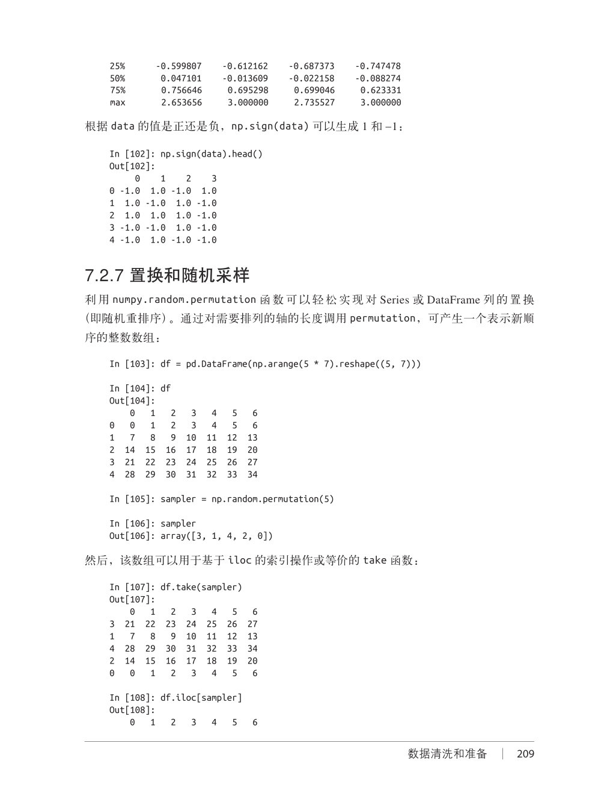

上一页 `data.describe()` 输出的续行：

```text
25%      -0.599807    -0.612162    -0.687373    -0.747478
50%       0.047101    -0.013609    -0.022158    -0.088274
75%       0.756646     0.695298     0.699046     0.623331
max       2.653656     3.000000     2.735527     3.000000
```

根据 `data` 的值是正还是负，`np.sign(data)` 可以生成 1 和 −1：

```python
np.sign(data).head()
```

```text
     0    1    2    3
0 -1.0  1.0 -1.0  1.0
1  1.0 -1.0  1.0 -1.0
2  1.0  1.0  1.0 -1.0
3 -1.0 -1.0  1.0 -1.0
4 -1.0  1.0 -1.0 -1.0
```

### 7.2.7 置换和随机采样

利用 `numpy.random.permutation` 函数可以轻松实现对 Series 或 DataFrame 列的置换（即随机重排序）。通过对需要排列的轴的长度调用 `permutation`，可产生一个表示新顺序的整数数组：

```python
df = pd.DataFrame(np.arange(5 * 7).reshape((5, 7)))
df
```

```text
    0   1   2   3   4   5   6
0   0   1   2   3   4   5   6
1   7   8   9  10  11  12  13
2  14  15  16  17  18  19  20
3  21  22  23  24  25  26  27
4  28  29  30  31  32  33  34
```

```python
sampler = np.random.permutation(5)
sampler
```

```text
array([3, 1, 4, 2, 0])
```

然后，该数组可以用于基于 `iloc` 的索引操作或等价的 `take` 函数：

```python
df.take(sampler)
```

```text
    0   1   2   3   4   5   6
3  21  22  23  24  25  26  27
1   7   8   9  10  11  12  13
4  28  29  30  31  32  33  34
2  14  15  16  17  18  19  20
0   0   1   2   3   4   5   6
```

```python
df.iloc[sampler]
```

```text
    0   1   2   3   4   5   6
```

输出在下一页续完。

## PDF 第 220 页

<!-- page-status: reviewed -->
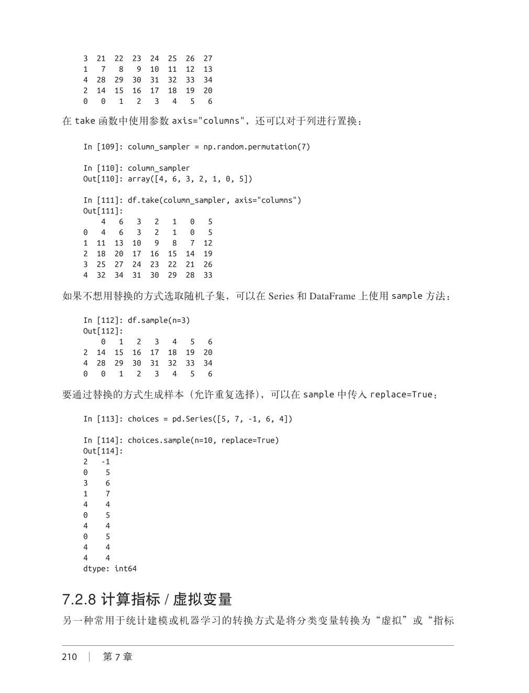

上一页 `df.iloc[sampler]` 输出的续行：

```text
3  21  22  23  24  25  26  27
1   7   8   9  10  11  12  13
4  28  29  30  31  32  33  34
2  14  15  16  17  18  19  20
0   0   1   2   3   4   5   6
```

在 `take` 函数中使用参数 `axis="columns"`，还可以对于列进行置换：

```python
column_sampler = np.random.permutation(7)
column_sampler
```

```text
array([4, 6, 3, 2, 1, 0, 5])
```

```python
df.take(column_sampler, axis="columns")
```

```text
    4   6   3   2   1   0   5
0   4   6   3   2   1   0   5
1  11  13  10   9   8   7  12
2  18  20  17  16  15  14  19
3  25  27  24  23  22  21  26
4  32  34  31  30  29  28  33
```

如果不想用替换的方式选取随机子集，可以在 Series 和 DataFrame 上使用 `sample` 方法：

```python
df.sample(n=3)
```

```text
    0   1   2   3   4   5   6
2  14  15  16  17  18  19  20
4  28  29  30  31  32  33  34
0   0   1   2   3   4   5   6
```

要通过替换的方式生成样本（允许重复选择），可以在 `sample` 中传入 `replace=True`：

```python
choices = pd.Series([5, 7, -1, 6, 4])
choices.sample(n=10, replace=True)
```

```text
2   -1
0    5
3    6
1    7
4    4
0    5
4    4
0    5
4    4
4    4
dtype: int64
```

### 7.2.8 计算指标 / 虚拟变量

另一种常用于统计建模或机器学习的转换方式是将分类变量转换为“虚拟”或“指标”（下页续）。

## PDF 第 221 页

<!-- page-status: reviewed -->
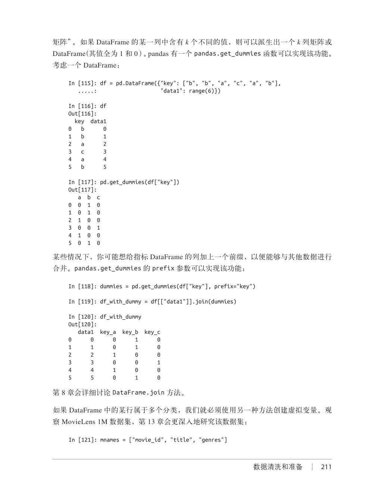

矩阵”。如果 DataFrame 的某一列中含有 $k$ 个不同的值，则可以派生出一个 $k$ 列矩阵或 DataFrame（其值全为 1 和 0）。pandas 有一个 `pandas.get_dummies` 函数可以实现该功能。考虑一个 DataFrame：

```python
df = pd.DataFrame({"key": ["b", "b", "a", "c", "a", "b"],
                   "data1": range(6)})
df
```

```text
  key  data1
0   b      0
1   b      1
2   a      2
3   c      3
4   a      4
5   b      5
```

```python
pd.get_dummies(df["key"])
```

```text
   a  b  c
0  0  1  0
1  0  1  0
2  1  0  0
3  0  0  1
4  1  0  0
5  0  1  0
```

某些情况下，你可能想给指标 DataFrame 的列加上一个前缀，以便能够与其他数据进行合并。`pandas.get_dummies` 的 `prefix` 参数可以实现该功能：

```python
dummies = pd.get_dummies(df["key"], prefix="key")
df_with_dummy = df[["data1"]].join(dummies)
df_with_dummy
```

```text
   data1  key_a  key_b  key_c
0      0      0      1      0
1      1      0      1      0
2      2      1      0      0
3      3      0      0      1
4      4      1      0      0
5      5      0      1      0
```

第 8 章会详细讨论 `DataFrame.join` 方法。

如果 DataFrame 中的某行属于多个分类，我们就必须使用另一种方法创建虚拟变量。观察 MovieLens 1M 数据集，第 13 章会更深入地研究该数据集：

```python
mnames = ["movie_id", "title", "genres"]
```

## PDF 第 222 页

<!-- page-status: reviewed -->
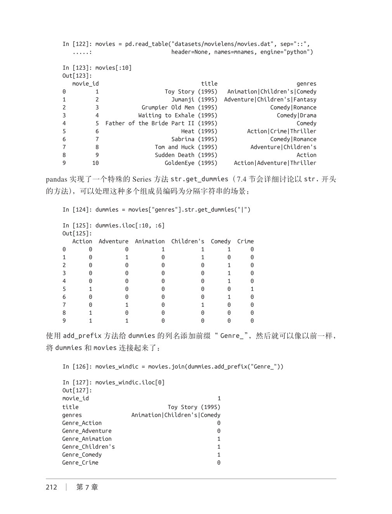

```python
movies = pd.read_table("datasets/movielens/movies.dat", sep="::",
                       header=None, names=mnames, engine="python")
movies[:10]
```

```text
   movie_id                               title                        genres
0         1                    Toy Story (1995)   Animation|Children's|Comedy
1         2                      Jumanji (1995)  Adventure|Children's|Fantasy
2         3             Grumpier Old Men (1995)                Comedy|Romance
3         4            Waiting to Exhale (1995)                  Comedy|Drama
4         5  Father of the Bride Part II (1995)                        Comedy
5         6                         Heat (1995)         Action|Crime|Thriller
6         7                      Sabrina (1995)                Comedy|Romance
7         8                 Tom and Huck (1995)          Adventure|Children's
8         9                 Sudden Death (1995)                        Action
9        10                    GoldenEye (1995)     Action|Adventure|Thriller
```

pandas 实现了一个特殊的 Series 方法 `str.get_dummies`（7.4 节会详细讨论以 `str.` 开头的方法），可以处理这种多个组成员编码为分隔字符串的场景：

```python
dummies = movies["genres"].str.get_dummies("|")
dummies.iloc[:10, :6]
```

```text
   Action  Adventure  Animation  Children's  Comedy  Crime
0       0          0          1           1       1      0
1       0          1          0           1       0      0
2       0          0          0           0       1      0
3       0          0          0           0       1      0
4       0          0          0           0       1      0
5       1          0          0           0       0      1
6       0          0          0           0       1      0
7       0          1          0           1       0      0
8       1          0          0           0       0      0
9       1          1          0           0       0      0
```

使用 `add_prefix` 方法给 `dummies` 的列名添加前缀 “`Genre_`”，然后就可以像以前一样，将 `dummies` 和 `movies` 连接起来了：

```python
movies_windic = movies.join(dummies.add_prefix("Genre_"))
movies_windic.iloc[0]
```

```text
movie_id                                1
title                    Toy Story (1995)
genres        Animation|Children's|Comedy
Genre_Action                            0
Genre_Adventure                         0
Genre_Animation                         1
Genre_Children's                        1
Genre_Comedy                            1
Genre_Crime                             0
```

输出续见下一页。

## PDF 第 223 页

<!-- page-status: reviewed -->
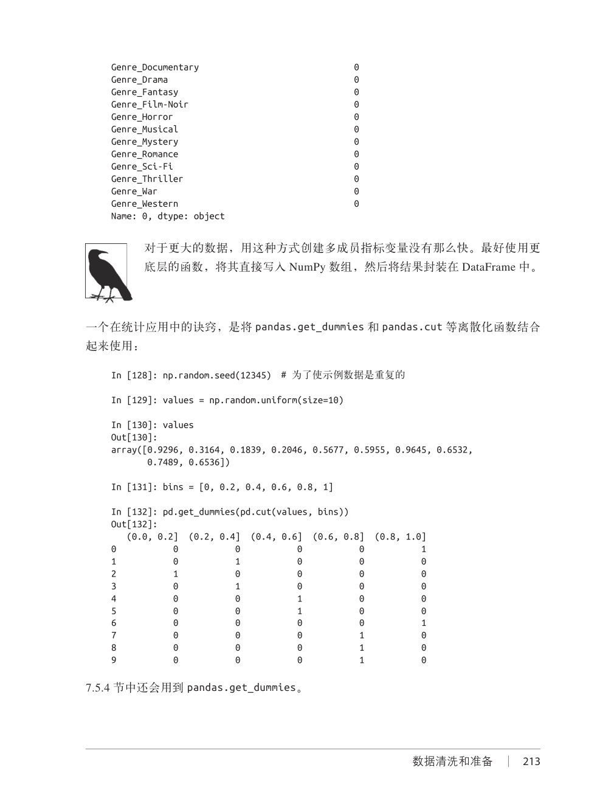

上一页输出续：

```text
Genre_Documentary                       0
Genre_Drama                             0
Genre_Fantasy                           0
Genre_Film-Noir                         0
Genre_Horror                            0
Genre_Musical                           0
Genre_Mystery                           0
Genre_Romance                           0
Genre_Sci-Fi                            0
Genre_Thriller                          0
Genre_War                               0
Genre_Western                           0
Name: 0, dtype: object
```

> 对于更大的数据，用这种方式创建多成员指标变量没有那么快。最好使用更底层的函数，将其直接写入 NumPy 数组，然后将结果封装在 DataFrame 中。

一个在统计应用中的诀窍，是将 `pandas.get_dummies` 和 `pandas.cut` 等离散化函数结合起来使用：

```python
np.random.seed(12345)  # 为了使示例数据是重复的
values = np.random.uniform(size=10)
values
```

```text
array([0.9296, 0.3164, 0.1839, 0.2046, 0.5677, 0.5955, 0.9645, 0.6532,
       0.7489, 0.6536])
```

```python
bins = [0, 0.2, 0.4, 0.6, 0.8, 1]
pd.get_dummies(pd.cut(values, bins))
```

```text
   (0.0, 0.2]  (0.2, 0.4]  (0.4, 0.6]  (0.6, 0.8]  (0.8, 1.0]
0           0           0           0           0           1
1           0           1           0           0           0
2           1           0           0           0           0
3           0           1           0           0           0
4           0           0           1           0           0
5           0           0           1           0           0
6           0           0           0           0           1
7           0           0           0           1           0
8           0           0           0           1           0
9           0           0           0           1           0
```

7.5.4 节中还会用到 `pandas.get_dummies`。

## PDF 第 224 页

<!-- page-status: reviewed -->
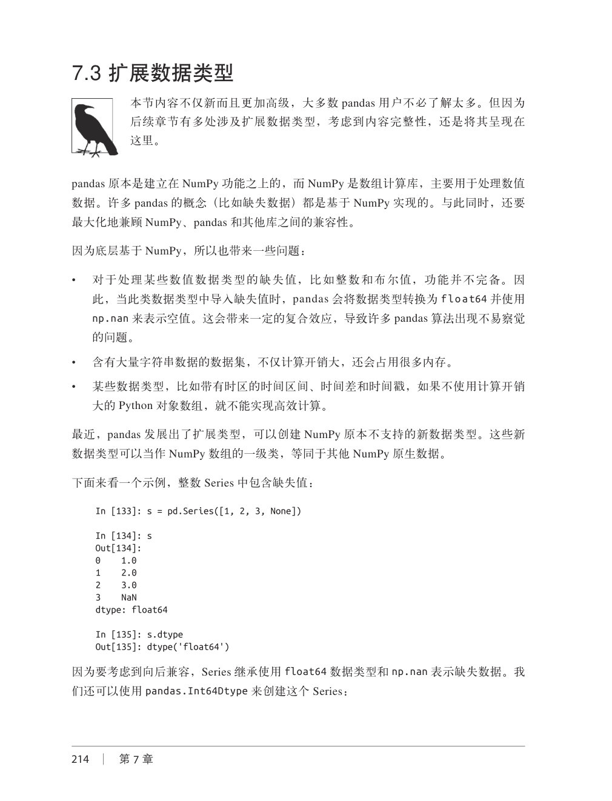

### 7.3 扩展数据类型

> 本节内容不仅新而且更加高级，大多数 pandas 用户不必了解太多。但因为后续章节有多处涉及扩展数据类型，考虑到内容完整性，还是将其呈现在这里。

pandas 原本是建立在 NumPy 功能之上的，而 NumPy 是数组计算库，主要用于处理数值数据。许多 pandas 的概念（比如缺失数据）都是基于 NumPy 实现的。与此同时，还要最大化地兼顾 NumPy、pandas 和其他库之间的兼容性。

因为底层基于 NumPy，所以也带来一些问题：

- 对于处理某些数值数据类型的缺失值，比如整数和布尔值，功能并不完备。因此，当此类数据类型中导入缺失值时，pandas 会将数据类型转换为 `float64` 并使用 `np.nan` 来表示空值。这会带来一定的复合效应，导致许多 pandas 算法出现不易察觉的问题。
- 含有大量字符串数据的数据集，不仅计算开销大，还会占用很多内存。
- 某些数据类型，比如带有时区的时间区间、时间差和时间戳，如果不使用计算开销大的 Python 对象数组，就不能实现高效计算。

最近，pandas 发展出了扩展类型，可以创建 NumPy 原本不支持的新数据类型。这些新数据类型可以当作 NumPy 数组的一级类，等同于其他 NumPy 原生数据。

下面来看一个示例，整数 Series 中包含缺失值：

```python
s = pd.Series([1, 2, 3, None])
s
```

```text
0    1.0
1    2.0
2    3.0
3    NaN
dtype: float64
```

```python
s.dtype
```

```text
dtype('float64')
```

因为要考虑到向后兼容，Series 继承使用 `float64` 数据类型和 `np.nan` 表示缺失数据。我们还可以使用 `pandas.Int64Dtype` 来创建这个 Series：

## PDF 第 225 页

<!-- page-status: reviewed -->
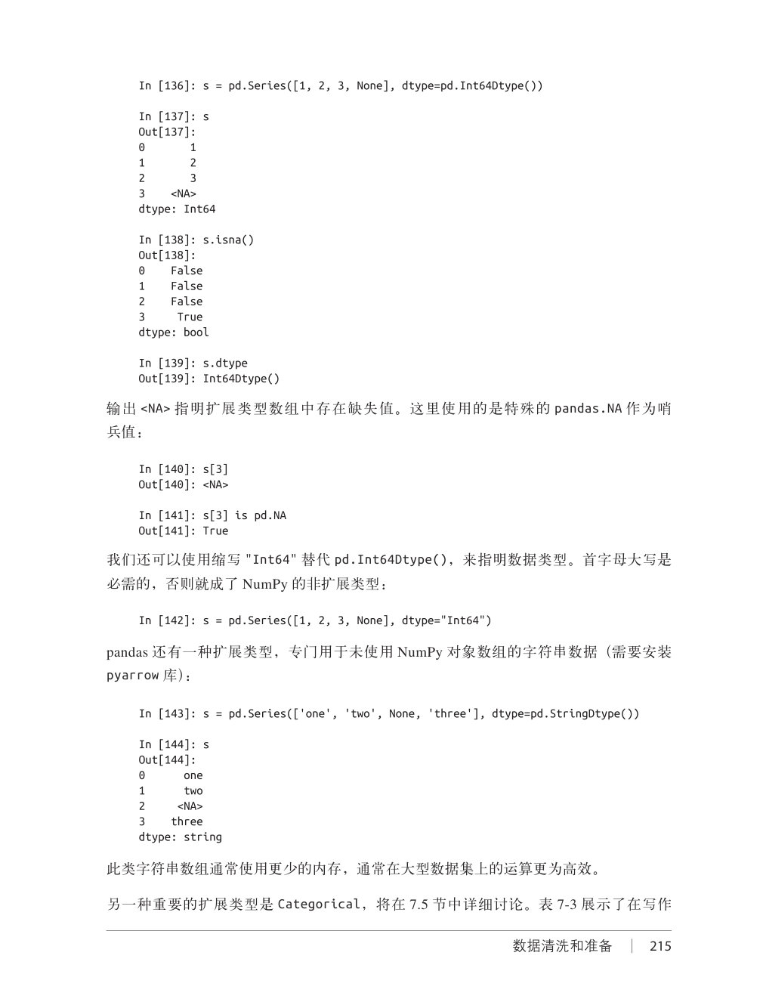

```python
s = pd.Series([1, 2, 3, None], dtype=pd.Int64Dtype())
s
```

```text
0       1
1       2
2       3
3    <NA>
dtype: Int64
```

```python
s.isna()
```

```text
0    False
1    False
2    False
3     True
dtype: bool
```

```python
s.dtype
```

```text
Int64Dtype()
```

输出 `<NA>` 指明扩展类型数组中存在缺失值。这里使用的是特殊的 `pandas.NA` 作为哨兵值：

```python
s[3]
```

```text
<NA>
```

```python
s[3] is pd.NA
```

```text
True
```

我们还可以使用缩写 `"Int64"` 替代 `pd.Int64Dtype()`，来指明数据类型。首字母大写是必需的，否则就成了 NumPy 的非扩展类型：

```python
s = pd.Series([1, 2, 3, None], dtype="Int64")
```

pandas 还有一种扩展类型，专门用于未使用 NumPy 对象数组的字符串数据（需要安装 `pyarrow` 库）：

```python
s = pd.Series(['one', 'two', None, 'three'], dtype=pd.StringDtype())
s
```

```text
0      one
1      two
2     <NA>
3    three
dtype: string
```

此类字符串数组通常使用更少的内存，通常在大型数据集上的运算更为高效。

另一种重要的扩展类型是 `Categorical`，将在 7.5 节中详细讨论。表 7-3 展示了在写作

## PDF 第 226 页

<!-- page-status: reviewed -->
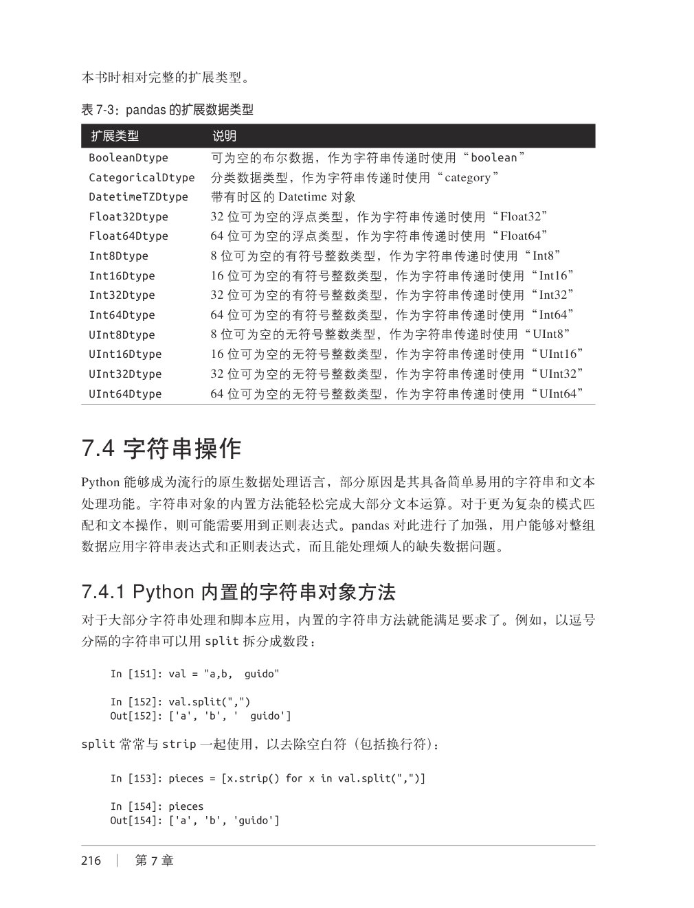

本书时相对完整的扩展类型。（续上页）

表 7-3：pandas 的扩展数据类型

| 扩展类型 | 说明 |
| --- | --- |
| `BooleanDtype` | 可为空的布尔数据，作为字符串传递时使用 `boolean` |
| `CategoricalDtype` | 分类数据类型，作为字符串传递时使用 `category` |
| `DatetimeTZDtype` | 带有时区的 Datetime 对象 |
| `Float32Dtype` | 32 位可为空的浮点类型，作为字符串传递时使用 `Float32` |
| `Float64Dtype` | 64 位可为空的浮点类型，作为字符串传递时使用 `Float64` |
| `Int8Dtype` | 8 位可为空的有符号整数类型，作为字符串传递时使用 `Int8` |
| `Int16Dtype` | 16 位可为空的有符号整数类型，作为字符串传递时使用 `Int16` |
| `Int32Dtype` | 32 位可为空的有符号整数类型，作为字符串传递时使用 `Int32` |
| `Int64Dtype` | 64 位可为空的有符号整数类型，作为字符串传递时使用 `Int64` |
| `UInt8Dtype` | 8 位可为空的无符号整数类型，作为字符串传递时使用 `UInt8` |
| `UInt16Dtype` | 16 位可为空的无符号整数类型，作为字符串传递时使用 `UInt16` |
| `UInt32Dtype` | 32 位可为空的无符号整数类型，作为字符串传递时使用 `UInt32` |
| `UInt64Dtype` | 64 位可为空的无符号整数类型，作为字符串传递时使用 `UInt64` |

### 7.4 字符串操作

Python 能够成为流行的原生数据处理语言，部分原因是其具备简单易用的字符串和文本处理功能。字符串对象的内置方法能轻松完成大部分文本运算。对于更为复杂的模式匹配和文本操作，则可能需要用到正则表达式。pandas 对此进行了加强，用户能够对整组数据应用字符串表达式和正则表达式，而且能处理烦人的缺失数据问题。

### 7.4.1 Python 内置的字符串对象方法

对于大部分字符串处理和脚本应用，内置的字符串方法就能满足要求了。例如，以逗号分隔的字符串可以用 `split` 拆分成数段：

```python
val = "a,b,  guido"
val.split(",")
```

```text
['a', 'b', '  guido']
```

`split` 常常与 `strip` 一起使用，以去除空白符（包括换行符）：

```python
pieces = [x.strip() for x in val.split(",")]
pieces
```

```text
['a', 'b', 'guido']
```

## PDF 第 227 页

<!-- page-status: reviewed -->
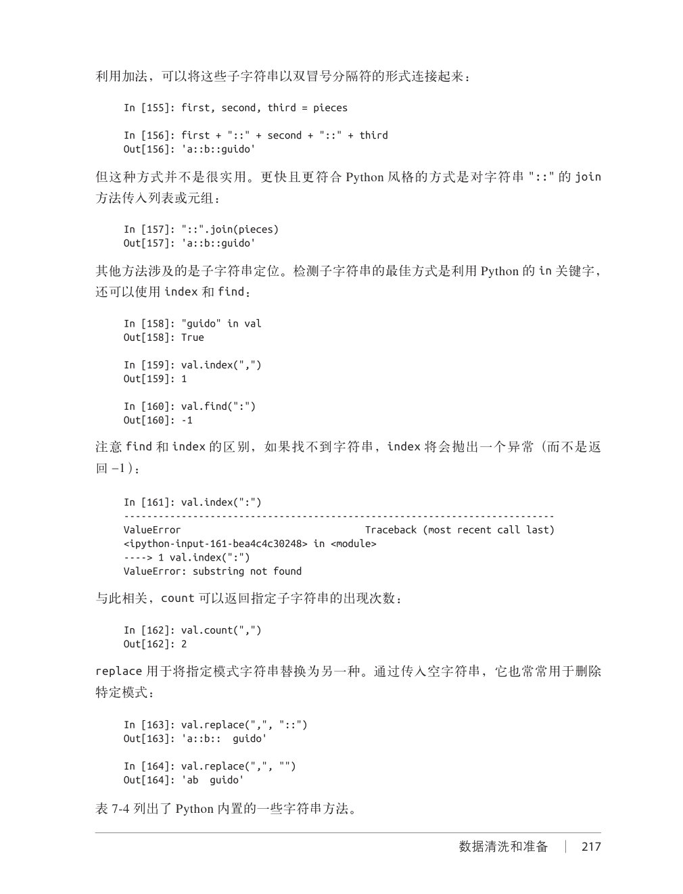

利用加法，可以将这些子字符串以双冒号分隔符的形式连接起来：

```python
first, second, third = pieces
first + "::" + second + "::" + third
```

```text
'a::b::guido'
```

但这种方式并不是很实用。更快且更符合 Python 风格的方式是对字符串 `"::"` 的 `join` 方法传入列表或元组：

```python
"::".join(pieces)
```

```text
'a::b::guido'
```

其他方法涉及的是子字符串定位。检测子字符串的最佳方式是利用 Python 的 `in` 关键字，还可以使用 `index` 和 `find`：

```python
"guido" in val
```

```text
True
```

```python
val.index(",")
```

```text
1
```

```python
val.find(":")
```

```text
-1
```

注意 `find` 和 `index` 的区别，如果找不到字符串，`index` 将会抛出一个异常（而不是返回 -1）：

```python
val.index(":")
```

```text
ValueError                                Traceback (most recent call last)
<ipython-input-161-bea4c4c30248> in <module>
----> 1 val.index(":")
ValueError: substring not found
```

与此相关，`count` 可以返回指定子字符串的出现次数：

```python
val.count(",")
```

```text
2
```

`replace` 用于将指定模式字符串替换为另一种。通过传入空字符串，它也常常用于删除特定模式：

```python
val.replace(",", "::")
```

```text
'a::b::  guido'
```

```python
val.replace(",", "")
```

```text
'ab  guido'
```

表 7-4 列出了 Python 内置的一些字符串方法。

## PDF 第 228 页

<!-- page-status: reviewed -->
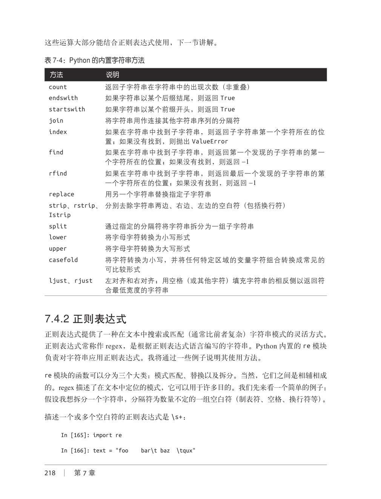

这些运算大部分能结合正则表达式使用，下一节讲解。

表 7-4：Python 的内置字符串方法

| 方法 | 说明 |
| --- | --- |
| `count` | 返回子字符串在字符串中的出现次数（非重叠） |
| `endswith` | 如果字符串以某个后缀结尾，则返回 `True` |
| `startswith` | 如果字符串以某个前缀开头，则返回 `True` |
| `join` | 将字符串用作连接其他字符串序列的分隔符 |
| `index` | 如果在字符串中找到子字符串，则返回子字符串第一个字符所在的位置；如果没有找到，则抛出 `ValueError` |
| `find` | 如果在字符串中找到子字符串，则返回第一个发现的子字符串的第一个字符所在的位置；如果没有找到，则返回 -1 |
| `rfind` | 如果在字符串中找到子字符串，则返回最后一个发现的子字符串的第一个字符所在的位置；如果没有找到，则返回 -1 |
| `replace` | 用另一个字符串替换指定子字符串 |
| `strip`、`rstrip`、`lstrip` | 分别去除字符串两边、右边、左边的空白符（包括换行符） |
| `split` | 通过指定的分隔符将字符串拆分为一组子字符串 |
| `lower` | 将字母字符转换为小写形式 |
| `upper` | 将字母字符转换为大写形式 |
| `casefold` | 将字符转换为小写，并将任何特定区域的变量字符组合转换成常见的可比较形式 |
| `ljust`、`rjust` | 左对齐和右对齐；用空格（或其他字符）填充字符串的相反侧以返回符合最低宽度的字符串 |

### 7.4.2 正则表达式

正则表达式提供了一种在文本中搜索或匹配（通常比前者复杂）字符串模式的灵活方式。正则表达式常称作 regex，是根据正则表达式语言编写的字符串。Python 内置的 `re` 模块负责对字符串应用正则表达式。我将通过一些例子说明其使用方法。

`re` 模块的函数可以分为三个大类：模式匹配、替换以及拆分。当然，它们之间是相辅相成的。regex 描述了在文本中定位的模式，它可以用于许多目的。我们先来看一个简单的例子：假设我想拆分一个字符串，分隔符为数量不定的一组空白符（制表符、空格、换行符等）。

描述一个或多个空白符的正则表达式是 `\s+`：

```python
import re
text = "foo    bar\t baz  \tqux"
```

## PDF 第 229 页

<!-- page-status: reviewed -->
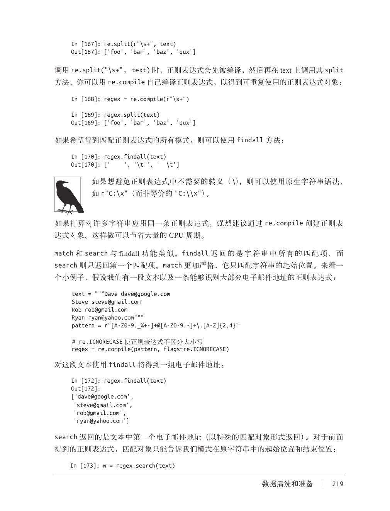

```python
re.split(r"\s+", text)
```

```text
['foo', 'bar', 'baz', 'qux']
```

调用 `re.split("\s+", text)` 时，正则表达式会先被编译，然后再在 `text` 上调用其 `split` 方法。你可以用 `re.compile` 自己编译正则表达式，以得到可重复使用的正则表达式对象：

```python
regex = re.compile(r"\s+")
regex.split(text)
```

```text
['foo', 'bar', 'baz', 'qux']
```

如果希望得到匹配正则表达式的所有模式，则可以使用 `findall` 方法：

```python
regex.findall(text)
```

```text
['    ', '\t ', '  \t']
```

> 如果想避免正则表达式中不需要的转义（`\`），则可以使用原生字符串语法，如 `r"C:\x"`（而非等价的 `"C:\\x"`）。

如果打算对许多字符串应用同一条正则表达式，强烈建议通过 `re.compile` 创建正则表达式对象。这样做可以节省大量的 CPU 周期。

`match` 和 `search` 与 `findall` 功能类似。`findall` 返回的是字符串中所有的匹配项，而 `search` 则只返回第一个匹配项。`match` 更加严格，它只匹配字符串的起始位置。来看一个小例子，假设我们有一段文本以及一条能够识别大部分电子邮件地址的正则表达式：

```python
text = """Dave dave@google.com
Steve steve@gmail.com
Rob rob@gmail.com
Ryan ryan@yahoo.com"""
pattern = r"[A-Z0-9._%+-]+@[A-Z0-9.-]+\.[A-Z]{2,4}"

# re.IGNORECASE 使正则表达式不区分大小写
regex = re.compile(pattern, flags=re.IGNORECASE)
```

对这段文本使用 `findall` 将得到一组电子邮件地址：

```python
regex.findall(text)
```

```text
['dave@google.com',
 'steve@gmail.com',
 'rob@gmail.com',
 'ryan@yahoo.com']
```

`search` 返回的是文本中第一个电子邮件地址（以特殊的匹配对象形式返回）。对于前面提到的正则表达式，匹配对象只能告诉我们模式在原字符串中的起始位置和结束位置：

```python
m = regex.search(text)
```

## PDF 第 230 页

<!-- page-status: reviewed -->
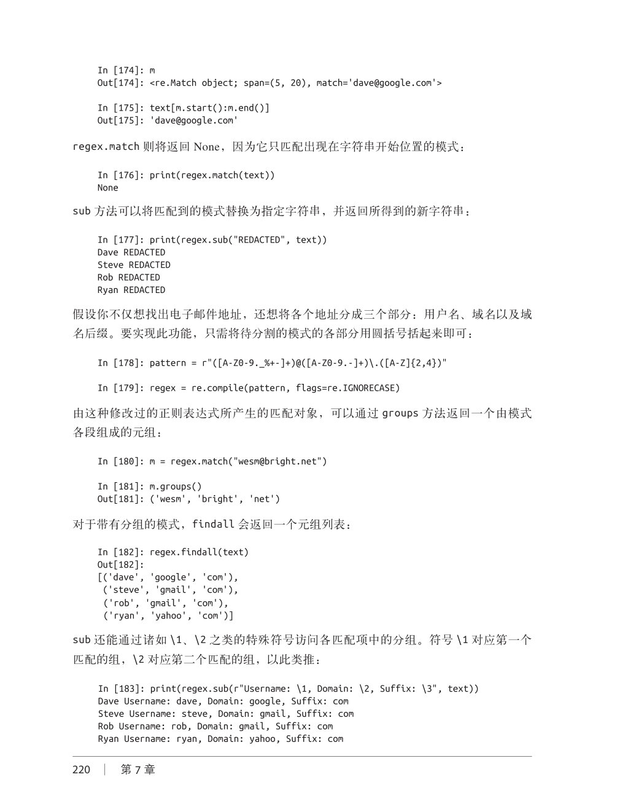

```python
m
```

```text
<re.Match object; span=(5, 20), match='dave@google.com'>
```

```python
text[m.start():m.end()]
```

```text
'dave@google.com'
```

`regex.match` 则将返回 `None`，因为它只匹配出现在字符串开始位置的模式：

```python
print(regex.match(text))
```

```text
None
```

`sub` 方法可以将匹配到的模式替换为指定字符串，并返回所得到的新字符串：

```python
print(regex.sub("REDACTED", text))
```

```text
Dave REDACTED
Steve REDACTED
Rob REDACTED
Ryan REDACTED
```

假设你不仅想找出电子邮件地址，还想将各个地址分成三个部分：用户名、域名以及域名后缀。要实现此功能，只需将待分割的模式的各部分用圆括号括起来即可：

```python
pattern = r"([A-Z0-9._%+-]+)@([A-Z0-9.-]+)\.([A-Z]{2,4})"
regex = re.compile(pattern, flags=re.IGNORECASE)
```

由这种修改过的正则表达式所产生的匹配对象，可以通过 `groups` 方法返回一个由模式各段组成的元组：

```python
m = regex.match("wesm@bright.net")
m.groups()
```

```text
('wesm', 'bright', 'net')
```

对于带有分组的模式，`findall` 会返回一个元组列表：

```python
regex.findall(text)
```

```text
[('dave', 'google', 'com'),
 ('steve', 'gmail', 'com'),
 ('rob', 'gmail', 'com'),
 ('ryan', 'yahoo', 'com')]
```

`sub` 还能通过诸如 `\1`、`\2` 之类的特殊符号访问各匹配项中的分组。符号 `\1` 对应第一个匹配的组，`\2` 对应第二个匹配的组，以此类推：

```python
print(regex.sub(r"Username: \1, Domain: \2, Suffix: \3", text))
```

```text
Dave Username: dave, Domain: google, Suffix: com
Steve Username: steve, Domain: gmail, Suffix: com
Rob Username: rob, Domain: gmail, Suffix: com
Ryan Username: ryan, Domain: yahoo, Suffix: com
```

## PDF 第 231 页

<!-- page-status: reviewed -->
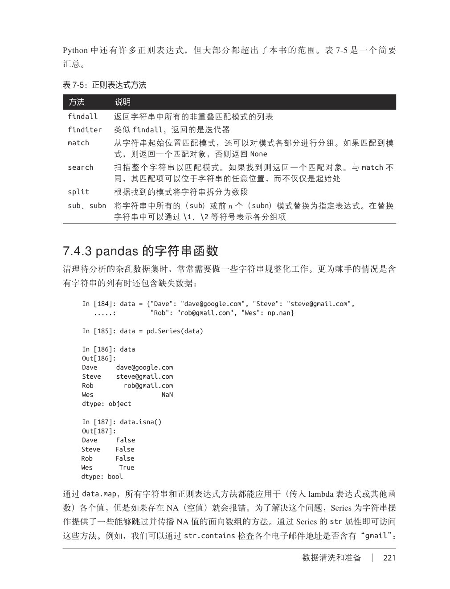

Python 中还有许多正则表达式，但大部分都超出了本书的范围。表 7-5 是一个简要汇总。

**表 7-5：正则表达式方法**

| 方法 | 说明 |
| --- | --- |
| `findall` | 返回字符串中所有的非重叠匹配模式的列表 |
| `finditer` | 类似 `findall`，返回的是迭代器 |
| `match` | 从字符串起始位置匹配模式，还可以对模式各部分进行分组。如果匹配到模式，则返回一个匹配对象，否则返回 `None` |
| `search` | 扫描整个字符串以匹配模式。如果找到则返回一个匹配对象。与 `match` 不同，其匹配项可以位于字符串的任意位置，而不仅仅是起始处 |
| `split` | 根据找到的模式将字符串拆分为数段 |
| `sub`、`subn` | 将字符串中所有的（`sub`）或前 $n$ 个（`subn`）模式替换为指定表达式。在替换字符串中可以通过 `\1`、`\2` 等符号表示各分组项 |

### 7.4.3 pandas 的字符串函数

清理待分析的杂乱数据集时，常常需要做一些字符串规整化工作。更为棘手的情况是含有字符串的列有时还包含缺失数据：

```python
data = {"Dave": "dave@google.com", "Steve": "steve@gmail.com",
        "Rob": "rob@gmail.com", "Wes": np.nan}
data = pd.Series(data)
data
```

```text
Dave     dave@google.com
Steve    steve@gmail.com
Rob        rob@gmail.com
Wes                  NaN
dtype: object
```

```python
data.isna()
```

```text
Dave     False
Steve    False
Rob      False
Wes       True
dtype: bool
```

通过 `data.map`，所有字符串和正则表达式方法都能应用于（传入 lambda 表达式或其他函数）各个值，但是如果存在 NA（空值）就会报错。为了解决这个问题，Series 为字符串操作提供了一些能够跳过并传播 NA 值的面向数组的方法。通过 Series 的 `str` 属性即可访问这些方法。例如，我们可以通过 `str.contains` 检查各个电子邮件地址是否含有“gmail”：

## PDF 第 232 页

<!-- page-status: reviewed -->
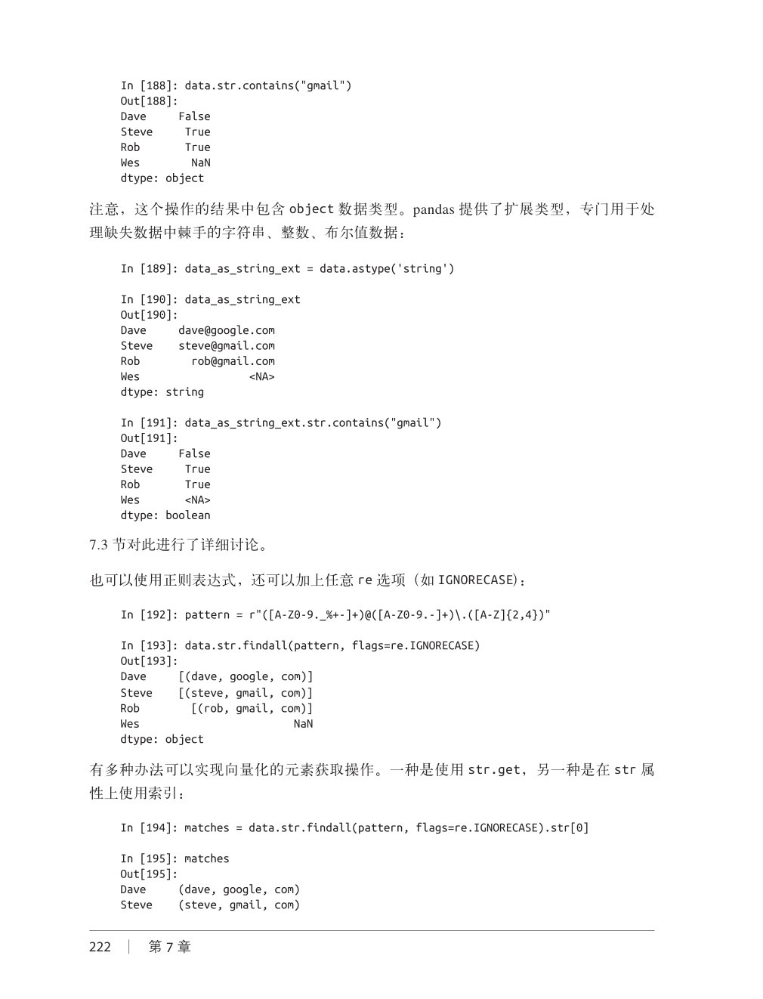

```python
data.str.contains("gmail")
```

```text
Dave     False
Steve     True
Rob       True
Wes        NaN
dtype: object
```

注意，这个操作的结果中包含 `object` 数据类型。pandas 提供了扩展类型，专门用于处理缺失数据中棘手的字符串、整数、布尔值数据：

```python
data_as_string_ext = data.astype('string')
data_as_string_ext
```

```text
Dave     dave@google.com
Steve    steve@gmail.com
Rob        rob@gmail.com
Wes                 <NA>
dtype: string
```

```python
data_as_string_ext.str.contains("gmail")
```

```text
Dave     False
Steve     True
Rob       True
Wes       <NA>
dtype: boolean
```

7.3 节对此进行了详细讨论。

也可以使用正则表达式，还可以加上任意 `re` 选项（如 `IGNORECASE`）：

```python
pattern = r"([A-Z0-9._%+-]+)@([A-Z0-9.-]+)\.([A-Z]{2,4})"
data.str.findall(pattern, flags=re.IGNORECASE)
```

```text
Dave     [(dave, google, com)]
Steve    [(steve, gmail, com)]
Rob        [(rob, gmail, com)]
Wes                        NaN
dtype: object
```

有多种办法可以实现向量化的元素获取操作。一种是使用 `str.get`，另一种是在 `str` 属性上使用索引：

```python
matches = data.str.findall(pattern, flags=re.IGNORECASE).str[0]
matches
```

```text
Dave     (dave, google, com)
Steve    (steve, gmail, com)
```

输出续于下一 PDF 页。

## PDF 第 233 页

<!-- page-status: reviewed -->
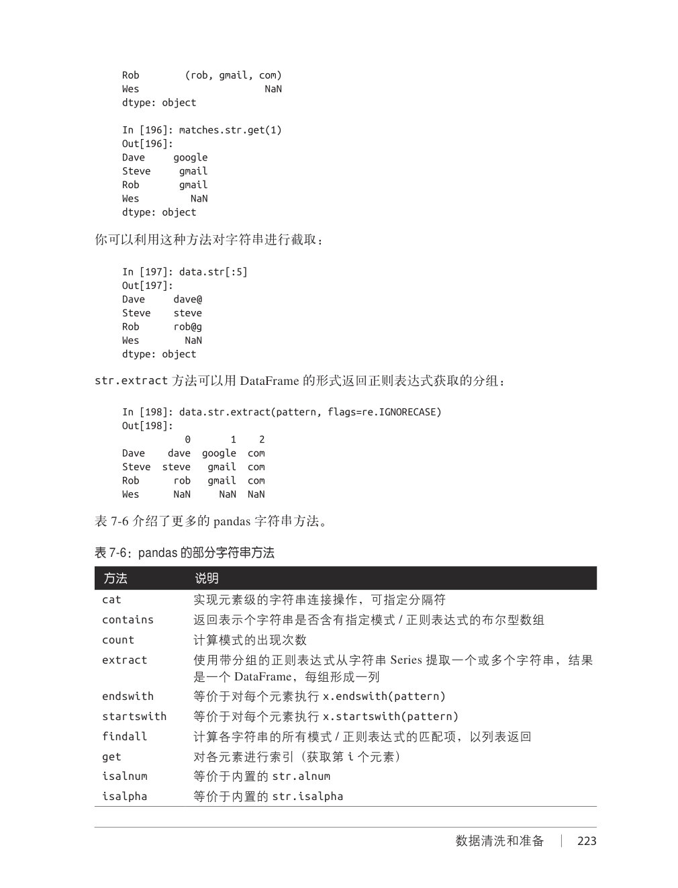

上页输出续：

```text
Rob      (rob, gmail, com)
Wes                    NaN
dtype: object
```

```python
matches.str.get(1)
```

```text
Dave     google
Steve     gmail
Rob       gmail
Wes         NaN
dtype: object
```

你可以利用这种方法对字符串进行截取：

```python
data.str[:5]
```

```text
Dave     dave@
Steve    steve
Rob      rob@g
Wes        NaN
dtype: object
```

`str.extract` 方法可以用 DataFrame 的形式返回正则表达式获取的分组：

```python
data.str.extract(pattern, flags=re.IGNORECASE)
```

```text
           0       1    2
Dave    dave  google  com
Steve  steve   gmail  com
Rob      rob   gmail  com
Wes      NaN     NaN  NaN
```

表 7-6 介绍了更多的 pandas 字符串方法。

**表 7-6：pandas 的部分字符串方法**

| 方法 | 说明 |
| --- | --- |
| `cat` | 实现元素级的字符串连接操作，可指定分隔符 |
| `contains` | 返回表示各字符串是否含有指定模式 / 正则表达式的布尔型数组 |
| `count` | 计算模式的出现次数 |
| `extract` | 使用带分组的正则表达式从字符串 Series 提取一个或多个字符串，结果是一个 DataFrame，每组形成一列 |
| `endswith` | 等价于对每个元素执行 `x.endswith(pattern)` |
| `startswith` | 等价于对每个元素执行 `x.startswith(pattern)` |
| `findall` | 计算各字符串的所有模式 / 正则表达式的匹配项，以列表返回 |
| `get` | 对各元素进行索引（获取第 $i$ 个元素） |
| `isalnum` | 等价于内置的 `str.alnum` |
| `isalpha` | 等价于内置的 `str.isalpha` |

表续于下一 PDF 页。`str.alnum` 按原书保留，Python 的实际方法名为 `str.isalnum`。

## PDF 第 234 页

<!-- page-status: reviewed -->
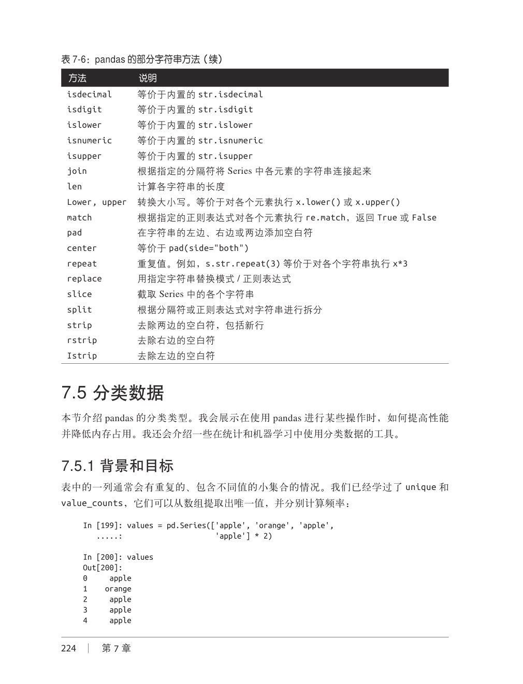

**表 7-6：pandas 的部分字符串方法（续）**

| 方法 | 说明 |
| --- | --- |
| `isdecimal` | 等价于内置的 `str.isdecimal` |
| `isdigit` | 等价于内置的 `str.isdigit` |
| `islower` | 等价于内置的 `str.islower` |
| `isnumeric` | 等价于内置的 `str.isnumeric` |
| `isupper` | 等价于内置的 `str.isupper` |
| `join` | 根据指定的分隔符将 Series 中各元素的字符串连接起来 |
| `len` | 计算各字符串的长度 |
| `lower`、`upper` | 转换大小写。等价于对各个元素执行 `x.lower()` 或 `x.upper()` |
| `match` | 根据指定的正则表达式对各个元素执行 `re.match`，返回 `True` 或 `False` |
| `pad` | 在字符串的左边、右边或两边添加空白符 |
| `center` | 等价于 `pad(side="both")` |
| `repeat` | 重复值。例如，`s.str.repeat(3)` 等价于对各个字符串执行 `x*3` |
| `replace` | 用指定字符串替换模式 / 正则表达式 |
| `slice` | 截取 Series 中的各个字符串 |
| `split` | 根据分隔符或正则表达式对字符串进行拆分 |
| `strip` | 去除两边的空白符，包括新行 |
| `rstrip` | 去除右边的空白符 |
| `lstrip` | 去除左边的空白符 |

### 7.5 分类数据

本节介绍 pandas 的分类类型。我会展示在使用 pandas 进行某些操作时，如何提高性能并降低内存占用。我还会介绍一些在统计和机器学习中使用分类数据的工具。

#### 7.5.1 背景和目标

表中的一列通常会有重复的、包含不同值的小集合的情况。我们已经学过了 `unique` 和 `value_counts`，它们可以从数组提取出唯一值，并分别计算频率：

```python
values = pd.Series(['apple', 'orange', 'apple', 'apple'] * 2)
values
```

```text
0     apple
1    orange
2     apple
3     apple
4     apple
```

输出续于下一 PDF 页。

## PDF 第 235 页

<!-- page-status: reviewed -->
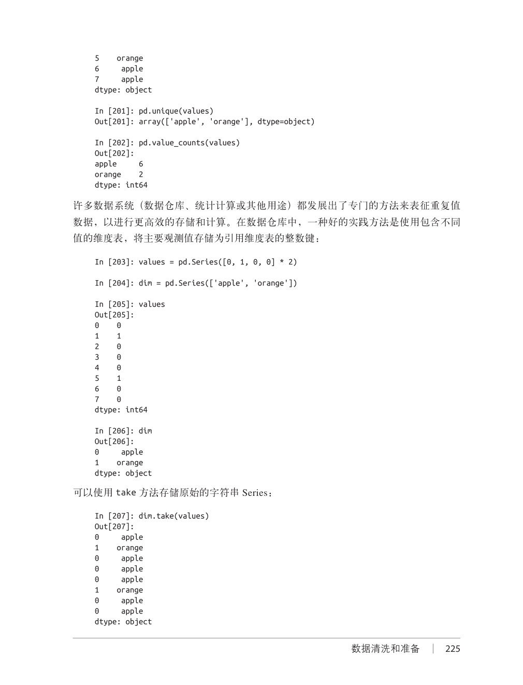

上页输出续：

```text
5    orange
6     apple
7     apple
dtype: object
```

```python
pd.unique(values)
```

```text
array(['apple', 'orange'], dtype=object)
```

```python
pd.value_counts(values)
```

```text
apple     6
orange    2
dtype: int64
```

许多数据系统（数据库、统计计算或其他用途）都发展出了专门的方法来表征重复值数据，以进行更高效的存储和计算。在数据仓库中，一种好的实践方法是使用包含不同值的维度表，将主要观测值存储为引用维度表的整数键：

```python
values = pd.Series([0, 1, 0, 0] * 2)
dim = pd.Series(['apple', 'orange'])
values
```

```text
0    0
1    1
2    0
3    0
4    0
5    1
6    0
7    0
dtype: int64
```

```python
dim
```

```text
0     apple
1    orange
dtype: object
```

可以使用 `take` 方法存储原始的字符串 Series：

```python
dim.take(values)
```

```text
0     apple
1    orange
0     apple
0     apple
0     apple
1    orange
0     apple
0     apple
dtype: object
```

## PDF 第 236 页

<!-- page-status: reviewed -->
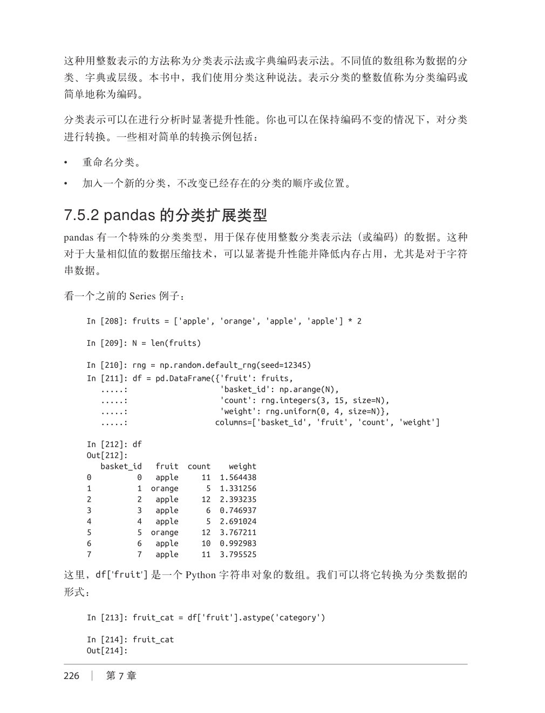

这种用整数表示的方法称为分类表示法或字典编码表示法。不同值的数组称为数据的分类、字典或层级。本书中，我们使用分类这种说法。表示分类的整数值称为分类编码或简单地称为编码。

分类表示可以在进行分析时显著提升性能。你也可以在保持编码不变的情况下，对分类进行转换。一些相对简单的转换示例包括：

- 重命名分类。
- 加入一个新的分类，不改变已经存在的分类的顺序或位置。

### 7.5.2 pandas 的分类扩展类型

pandas 有一个特殊的分类类型，用于保存使用整数分类表示法（或编码）的数据。这种对于大量相似值的数据压缩技术，可以显著提升性能并降低内存占用，尤其是对于字符串数据。

看一个之前的 Series 例子：

```python
fruits = ['apple', 'orange', 'apple', 'apple'] * 2
N = len(fruits)
rng = np.random.default_rng(seed=12345)
df = pd.DataFrame({'fruit': fruits,
                   'basket_id': np.arange(N),
                   'count': rng.integers(3, 15, size=N),
                   'weight': rng.uniform(0, 4, size=N)},
                  columns=['basket_id', 'fruit', 'count', 'weight'])
df
```

> 校对说明：原 PDF 中 `columns=[...]` 行未见结束的 `)`；上面的代码补入这一括号，以闭合 `DataFrame(...)`。其他内容按原页转写。

```text
   basket_id   fruit  count    weight
0          0   apple     11  1.564438
1          1  orange      5  1.331256
2          2   apple     12  2.393235
3          3   apple      6  0.746937
4          4   apple      5  2.691024
5          5  orange     12  3.767211
6          6   apple     10  0.992983
7          7   apple     11  3.795525
```

这里，`df['fruit']` 是一个 Python 字符串对象的数组。我们可以将它转换为分类数据的形式：

```python
fruit_cat = df['fruit'].astype('category')
fruit_cat
```

输出续见下一页。

## PDF 第 237 页

<!-- page-status: reviewed -->
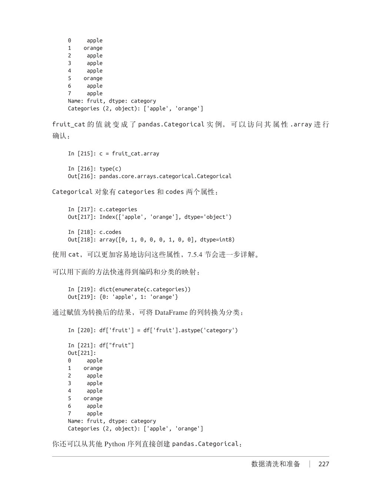

上一页 `fruit_cat` 的输出：

```text
0     apple
1    orange
2     apple
3     apple
4     apple
5    orange
6     apple
7     apple
Name: fruit, dtype: category
Categories (2, object): ['apple', 'orange']
```

`fruit_cat` 的值就变成了 `pandas.Categorical` 实例，可以访问其属性 `.array` 进行确认：

```python
c = fruit_cat.array
type(c)
```

```text
pandas.core.arrays.categorical.Categorical
```

`Categorical` 对象有 `categories` 和 `codes` 两个属性：

```python
c.categories
```

```text
Index(['apple', 'orange'], dtype='object')
```

```python
c.codes
```

```text
array([0, 1, 0, 0, 0, 1, 0, 0], dtype=int8)
```

使用 `cat`，可以更加容易地访问这些属性，7.5.4 节会进一步详解。

可以用下面的方法快速得到编码和分类的映射：

```python
dict(enumerate(c.categories))
```

```text
{0: 'apple', 1: 'orange'}
```

通过赋值为转换后的结果，可将 DataFrame 的列转换为分类：

```python
df['fruit'] = df['fruit'].astype('category')
df["fruit"]
```

```text
0     apple
1    orange
2     apple
3     apple
4     apple
5    orange
6     apple
7     apple
Name: fruit, dtype: category
Categories (2, object): ['apple', 'orange']
```

你还可以从其他 Python 序列直接创建 `pandas.Categorical`：

## PDF 第 238 页

<!-- page-status: reviewed -->
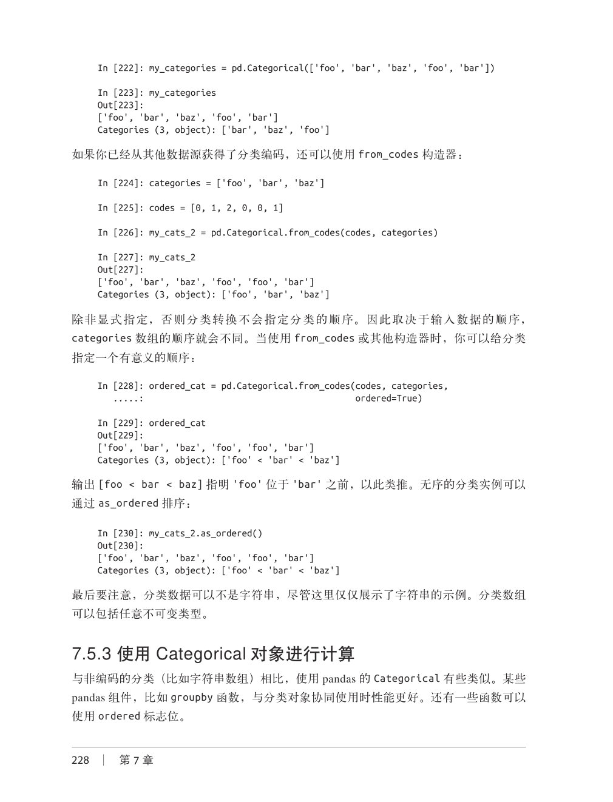

```python
my_categories = pd.Categorical(['foo', 'bar', 'baz', 'foo', 'bar'])
my_categories
```

```text
['foo', 'bar', 'baz', 'foo', 'bar']
Categories (3, object): ['bar', 'baz', 'foo']
```

如果你已经从其他数据源获得了分类编码，还可以使用 `from_codes` 构造器：

```python
categories = ['foo', 'bar', 'baz']
codes = [0, 1, 2, 0, 0, 1]
my_cats_2 = pd.Categorical.from_codes(codes, categories)
my_cats_2
```

```text
['foo', 'bar', 'baz', 'foo', 'foo', 'bar']
Categories (3, object): ['foo', 'bar', 'baz']
```

除非显式指定，否则分类转换不会指定分类的顺序。因此取决于输入数据的顺序，`categories` 数组的顺序就会不同。当使用 `from_codes` 或其他构造器时，你可以给分类指定一个有意义的顺序：

```python
ordered_cat = pd.Categorical.from_codes(codes, categories,
                                        ordered=True)
ordered_cat
```

```text
['foo', 'bar', 'baz', 'foo', 'foo', 'bar']
Categories (3, object): ['foo' < 'bar' < 'baz']
```

输出 `[foo < bar < baz]` 指明 `'foo'` 位于 `'bar'` 之前，以此类推。无序的分类实例可以通过 `as_ordered` 排序：

```python
my_cats_2.as_ordered()
```

```text
['foo', 'bar', 'baz', 'foo', 'foo', 'bar']
Categories (3, object): ['foo' < 'bar' < 'baz']
```

最后要注意，分类数据可以不是字符串，尽管这里仅仅展示了字符串的示例。分类数组可以包括任意不可变类型。

### 7.5.3 使用 Categorical 对象进行计算

与非编码的分类（比如字符串数组）相比，使用 pandas 的 `Categorical` 有些类似。某些 pandas 组件，比如 `groupby` 函数，与分类对象协同使用时性能更好。还有一些函数可以使用 `ordered` 标志位。

## PDF 第 239 页

<!-- page-status: reviewed -->
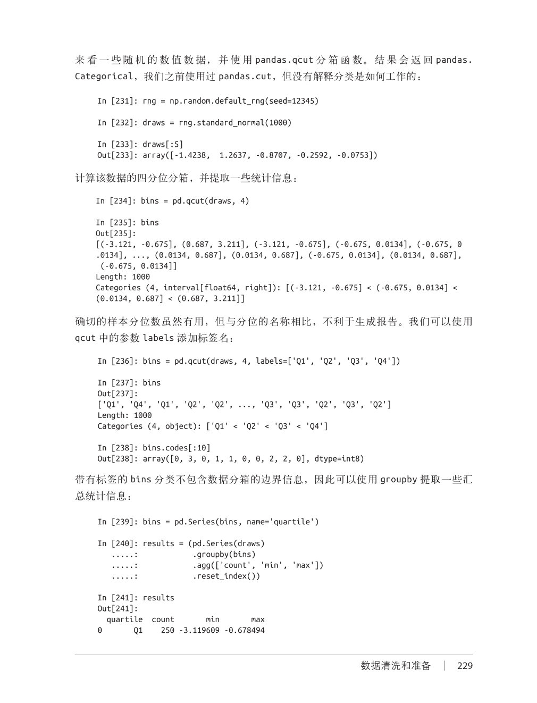

来看一些随机的数值数据，并使用 `pandas.qcut` 分箱函数。结果会返回 `pandas.Categorical`，我们之前使用过 `pandas.cut`，但没有解释分类是如何工作的：

```python
rng = np.random.default_rng(seed=12345)
draws = rng.standard_normal(1000)
draws[:5]
```

```text
array([-1.4238,  1.2637, -0.8707, -0.2592, -0.0753])
```

计算该数据的四分位分箱，并提取一些统计信息：

```python
bins = pd.qcut(draws, 4)
bins
```

```text
[(-3.121, -0.675], (0.687, 3.211], (-3.121, -0.675], (-0.675, 0.0134], (-0.675, 0.0134], ..., (0.0134, 0.687], (0.0134, 0.687], (-0.675, 0.0134], (0.0134, 0.687], (-0.675, 0.0134]]
Length: 1000
Categories (4, interval[float64, right]): [(-3.121, -0.675] < (-0.675, 0.0134] < (0.0134, 0.687] < (0.687, 3.211]]
```

确切的样本分位数虽然有用，但与分位的名称相比，不利于生成报告。我们可以使用 `qcut` 中的参数 `labels` 添加标签名：

```python
bins = pd.qcut(draws, 4, labels=['Q1', 'Q2', 'Q3', 'Q4'])
bins
```

```text
['Q1', 'Q4', 'Q1', 'Q2', 'Q2', ..., 'Q3', 'Q3', 'Q2', 'Q3', 'Q2']
Length: 1000
Categories (4, object): ['Q1' < 'Q2' < 'Q3' < 'Q4']
```

```python
bins.codes[:10]
```

```text
array([0, 3, 0, 1, 1, 0, 0, 2, 2, 0], dtype=int8)
```

带有标签的 `bins` 分类不包含数据分箱的边界信息，因此可以使用 `groupby` 提取一些汇总统计信息：

```python
bins = pd.Series(bins, name='quartile')
results = (pd.Series(draws)
           .groupby(bins)
           .agg(['count', 'min', 'max'])
           .reset_index())
results
```

```text
  quartile  count       min       max
0       Q1    250 -3.119609 -0.678494
```

输出续见下一页。

## PDF 第 240 页

<!-- page-status: reviewed -->
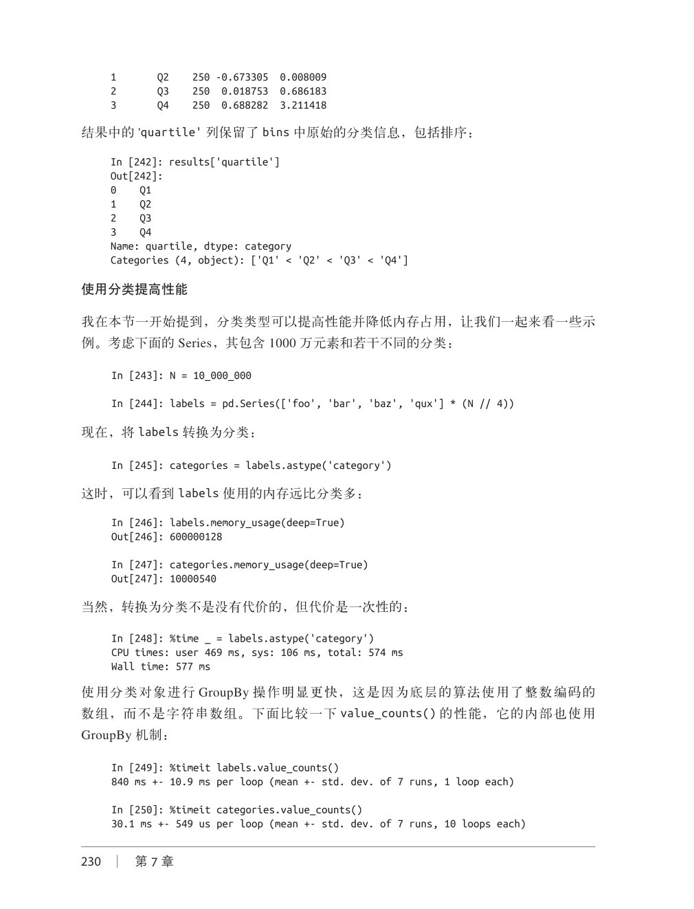

上一页输出续：

```text
1    Q2   250 -0.673305  0.008009
2    Q3   250  0.018753  0.686183
3    Q4   250  0.688282  3.211418
```

结果中的 `quartile` 列保留了 `bins` 中原始的分类信息，包括排序：

```python
results['quartile']
```

```text
0    Q1
1    Q2
2    Q3
3    Q4
Name: quartile, dtype: category
Categories (4, object): ['Q1' < 'Q2' < 'Q3' < 'Q4']
```

#### 使用分类提高性能

我在本节一开始提到，分类类型可以提高性能并降低内存占用，让我们一起来看一些示例。考虑下面的 Series，其包含 1000 万元素和若干不同的分类：

```python
N = 10_000_000
labels = pd.Series(['foo', 'bar', 'baz', 'qux'] * (N // 4))
```

现在，将 `labels` 转换为分类：

```python
categories = labels.astype('category')
```

这时，可以看到 `labels` 使用的内存远比分类型多：

```python
labels.memory_usage(deep=True)
```

```text
600000128
```

```python
categories.memory_usage(deep=True)
```

```text
10000540
```

当然，转换为分类不是没有代价的，但代价是一次性的：

```ipython
%time _ = labels.astype('category')
```

```text
CPU times: user 469 ms, sys: 106 ms, total: 574 ms
Wall time: 577 ms
```

使用分类对象进行 GroupBy 操作明显更快，这是因为底层的算法使用了整数编码的数组，而不是字符串数组。下面比较一下 `value_counts()` 的性能，它的内部也使用 GroupBy 机制：

```ipython
%timeit labels.value_counts()
```

```text
840 ms +- 10.9 ms per loop (mean +- std. dev. of 7 runs, 1 loop each)
```

```ipython
%timeit categories.value_counts()
```

```text
30.1 ms +- 549 us per loop (mean +- std. dev. of 7 runs, 10 loops each)
```

## PDF 第 241 页

<!-- page-status: reviewed -->
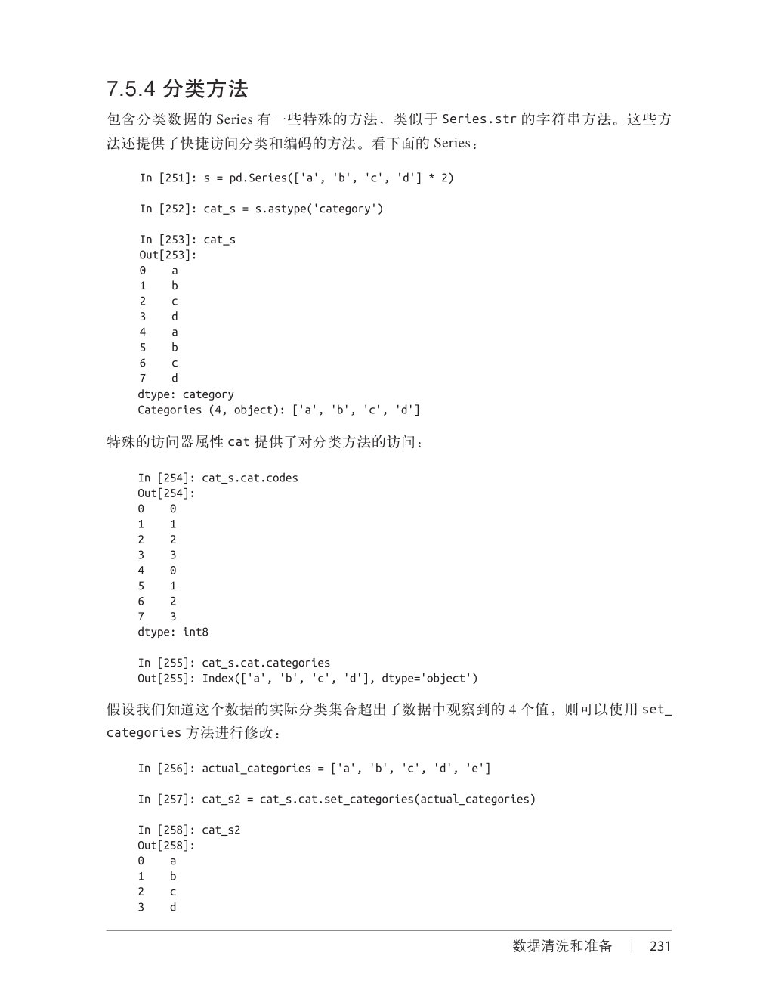

### 7.5.4 分类方法

包含分类数据的 Series 有一些特殊的方法，类似于 `Series.str` 的字符串方法。这些方法还提供了快捷访问分类和编码的方法。看下面的 Series：

```python
s = pd.Series(['a', 'b', 'c', 'd'] * 2)
cat_s = s.astype('category')
cat_s
```

```text
0    a
1    b
2    c
3    d
4    a
5    b
6    c
7    d
dtype: category
Categories (4, object): ['a', 'b', 'c', 'd']
```

特殊的访问器属性 `cat` 提供了对分类方法的访问：

```python
cat_s.cat.codes
```

```text
0    0
1    1
2    2
3    3
4    0
5    1
6    2
7    3
dtype: int8
```

```python
cat_s.cat.categories
```

```text
Index(['a', 'b', 'c', 'd'], dtype='object')
```

假设我们知道这个数据的实际分类集合超出了数据中观察到的 4 个值，则可以使用 `set_categories` 方法进行修改：

```python
actual_categories = ['a', 'b', 'c', 'd', 'e']
cat_s2 = cat_s.cat.set_categories(actual_categories)
cat_s2
```

```text
0    a
1    b
2    c
3    d
```

输出续见下一页。

## PDF 第 242 页

<!-- page-status: reviewed -->
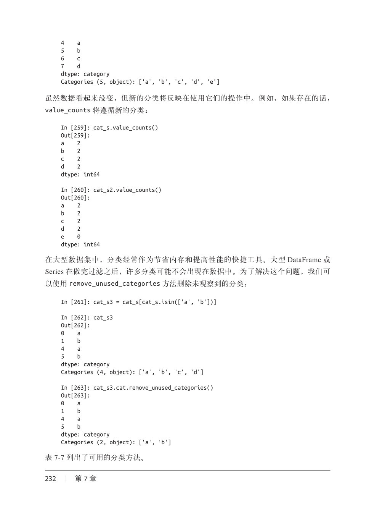

上一页输出续：

```text
4    a
5    b
6    c
7    d
dtype: category
Categories (5, object): ['a', 'b', 'c', 'd', 'e']
```

虽然数据看起来没变，但新的分类将反映在使用它们的操作中。例如，如果存在的话，`value_counts` 将遵循新的分类：

```python
cat_s.value_counts()
```

```text
a    2
b    2
c    2
d    2
dtype: int64
```

```python
cat_s2.value_counts()
```

```text
a    2
b    2
c    2
d    2
e    0
dtype: int64
```

在大型数据集中，分类经常作为节省内存和提高性能的快捷工具。大型 DataFrame 或 Series 在做完过滤之后，许多分类可能不会出现在数据中。为了解决这个问题，我们可以使用 `remove_unused_categories` 方法删除未观察到的分类：

```python
cat_s3 = cat_s[cat_s.isin(['a', 'b'])]
cat_s3
```

```text
0    a
1    b
4    a
5    b
dtype: category
Categories (4, object): ['a', 'b', 'c', 'd']
```

```python
cat_s3.cat.remove_unused_categories()
```

```text
0    a
1    b
4    a
5    b
dtype: category
Categories (2, object): ['a', 'b']
```

表 7-7 列出了可用的分类方法。

## PDF 第 243 页

<!-- page-status: reviewed -->
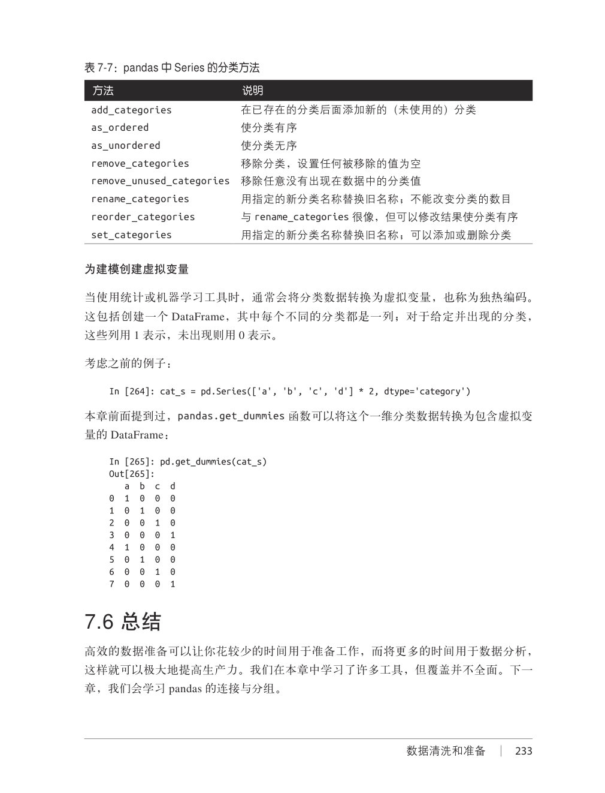

**表 7-7：pandas 中 Series 的分类方法**

| 方法 | 说明 |
| --- | --- |
| `add_categories` | 在已存在的分类后面添加新的（未使用的）分类 |
| `as_ordered` | 使分类有序 |
| `as_unordered` | 使分类无序 |
| `remove_categories` | 移除分类，设置任何被移除的值为空 |
| `remove_unused_categories` | 移除任意没有出现在数据中的分类值 |
| `rename_categories` | 用指定的新分类名称替换旧名称；不能改变分类的数目 |
| `reorder_categories` | 与 `rename_categories` 很像，但可以修改结果使分类有序 |
| `set_categories` | 用指定的新分类名称替换旧名称；可以添加或删除分类 |

#### 为建模创建虚拟变量

当使用统计或机器学习工具时，通常会将分类数据转换为虚拟变量，也称为独热编码。这包括创建一个 DataFrame，其中每个不同的分类都是一列；对于给定并出现的分类，这些列用 1 表示，未出现则用 0 表示。

考虑之前的例子：

```python
cat_s = pd.Series(['a', 'b', 'c', 'd'] * 2, dtype='category')
```

本章前面提到过，`pandas.get_dummies` 函数可以将这个一维分类数据转换为包含虚拟变量的 DataFrame：

```python
pd.get_dummies(cat_s)
```

```text
   a  b  c  d
0  1  0  0  0
1  0  1  0  0
2  0  0  1  0
3  0  0  0  1
4  1  0  0  0
5  0  1  0  0
6  0  0  1  0
7  0  0  0  1
```

### 7.6 总结

高效的数据准备可以让你花较少的时间用于准备工作，而将更多的时间用于数据分析，这样就可以极大地提高生产力。我们在本章中学习了许多工具，但覆盖并不全面。下一章，我们会学习 pandas 的连接与分组。
