# 第 8 章 数据规整：连接、联合和重塑

[返回目录](../README.md)

> 本章各页已由 AI 对照原页整理；代码示例已进行语法检查，但未全部运行，尚未经过人工复核。保留原页图像供核对。

## PDF 第 244 页
<!-- page-status: reviewed -->
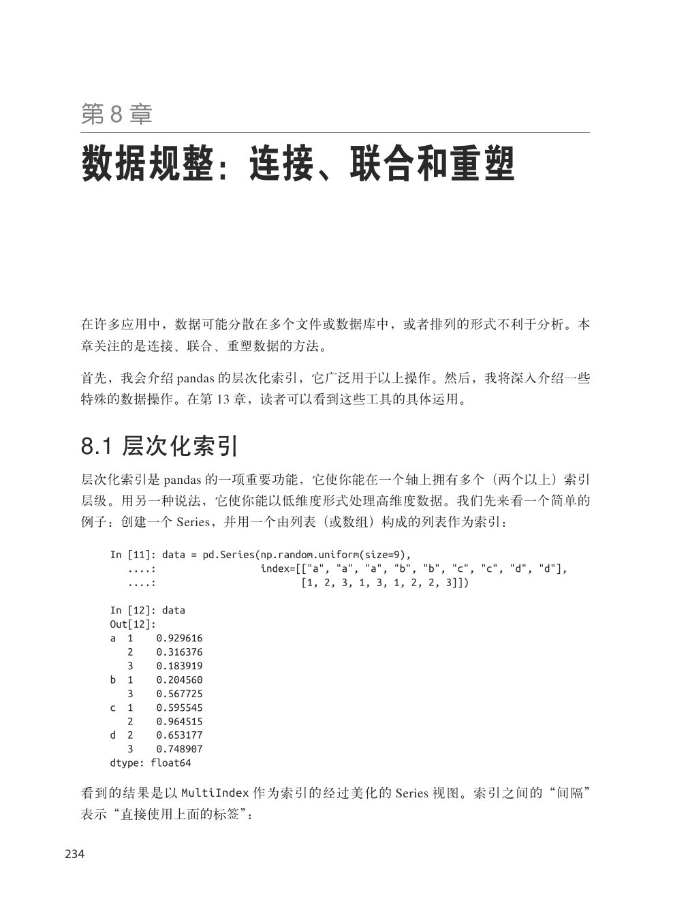

在许多应用中，数据可能分散在多个文件或数据库中，或者排列的形式不利于分析。本章关注的是连接、联合、重塑数据的方法。

首先，我会介绍 pandas 的层次化索引，它广泛用于以上操作。然后，我将深入介绍一些特殊的数据操作。在第 13 章，读者可以看到这些工具的具体运用。

### 8.1 层次化索引

层次化索引是 pandas 的一项重要功能，它使你能在一个轴上拥有多个（两个以上）索引层级。用另一种说法，它使你能以低维度形式处理高维度数据。我们先来看一个简单的例子：创建一个 Series，并用一个由列表（或数组）构成的列表作为索引：

```python
data = pd.Series(np.random.uniform(size=9),
                 index=[["a", "a", "a", "b", "b", "c", "c", "d", "d"],
                        [1, 2, 3, 1, 3, 1, 2, 2, 3]])
data
```

```text
a  1    0.929616
   2    0.316376
   3    0.183919
b  1    0.204560
   3    0.567725
c  1    0.595545
   2    0.964515
d  2    0.653177
   3    0.748907
dtype: float64
```

看到的结果是以 `MultiIndex` 作为索引的经过美化的 Series 视图。索引之间的“间隔”表示“直接使用上面的标签”：

## PDF 第 245 页
<!-- page-status: reviewed -->
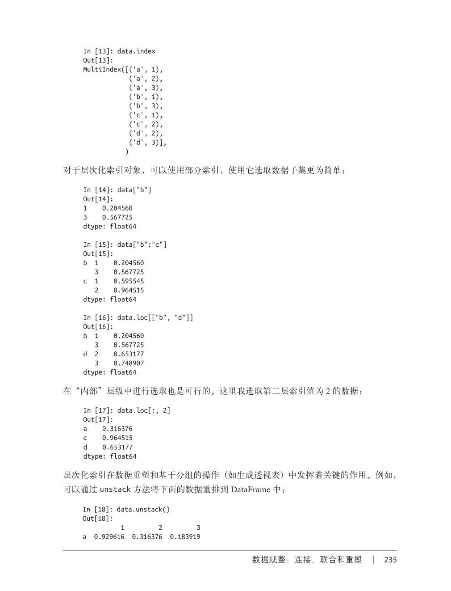

```python
data.index
```

```text
MultiIndex([('a', 1),
            ('a', 2),
            ('a', 3),
            ('b', 1),
            ('b', 3),
            ('c', 1),
            ('c', 2),
            ('d', 2),
            ('d', 3)],
           )
```

对于层次化索引对象，可以使用部分索引，使用它选取数据子集更为简单：

```python
data["b"]
```

```text
1    0.204560
3    0.567725
dtype: float64
```

```python
data["b":"c"]
```

```text
b  1    0.204560
   3    0.567725
c  1    0.595545
   2    0.964515
dtype: float64
```

```python
data.loc[["b", "d"]]
```

```text
b  1    0.204560
   3    0.567725
d  2    0.653177
   3    0.748907
dtype: float64
```

在“内部”层级中进行选取也是可行的。这里我选取第二层索引值为 2 的数据：

```python
data.loc[:, 2]
```

```text
a    0.316376
c    0.964515
d    0.653177
dtype: float64
```

层次化索引在数据重塑和基于分组的操作（如生成透视表）中发挥着关键的作用。例如，可以通过 `unstack` 方法将下面的数据重排到 DataFrame 中：

```python
data.unstack()
```

原书输出跨至下一页，完整输出如下：

```text
          1         2         3
a  0.929616  0.316376  0.183919
b  0.204560       NaN  0.567725
c  0.595545  0.964515       NaN
d       NaN  0.653177  0.748907
```

## PDF 第 246 页
<!-- page-status: reviewed -->
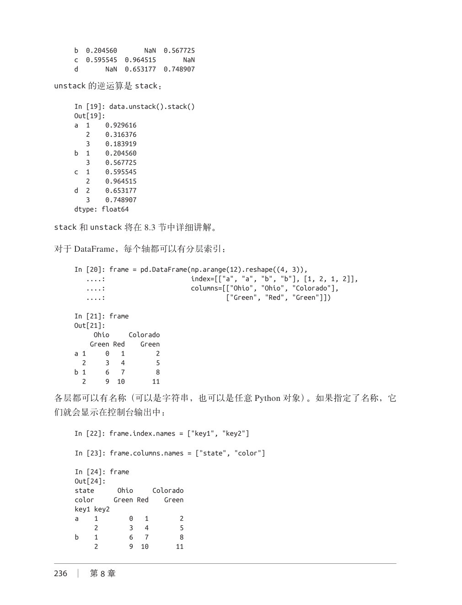

本页顶部续接上一页 `data.unstack()` 的输出。

`unstack` 的逆运算是 `stack`：

```python
data.unstack().stack()
```

```text
a  1    0.929616
   2    0.316376
   3    0.183919
b  1    0.204560
   3    0.567725
c  1    0.595545
   2    0.964515
d  2    0.653177
   3    0.748907
dtype: float64
```

`stack` 和 `unstack` 将在 8.3 节中详细讲解。

对于 DataFrame，每个轴都可以有分层索引：

```python
frame = pd.DataFrame(np.arange(12).reshape((4, 3)),
                     index=[["a", "a", "b", "b"], [1, 2, 1, 2]],
                     columns=[["Ohio", "Ohio", "Colorado"],
                              ["Green", "Red", "Green"]])
frame
```

```text
        Ohio     Colorado
       Green Red    Green
a 1        0   1        2
  2        3   4        5
b 1        6   7        8
  2        9  10       11
```

各层都可以有名称（可以是字符串，也可以是任意 Python 对象）。如果指定了名称，它们就会显示在控制台输出中：

```python
frame.index.names = ["key1", "key2"]
frame.columns.names = ["state", "color"]
frame
```

```text
state      Ohio     Colorado
color     Green Red    Green
key1 key2
a    1        0   1        2
     2        3   4        5
b    1        6   7        8
     2        9  10       11
```

## PDF 第 247 页
<!-- page-status: reviewed -->
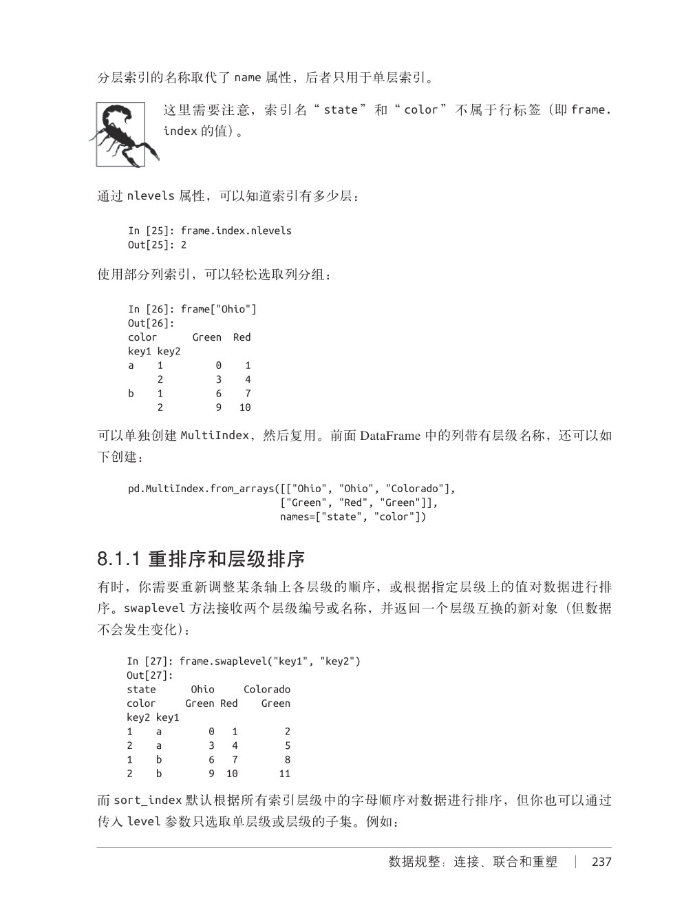

分层索引的名称取代了 `name` 属性，后者只用于单层索引。

> 这里需要注意，索引名 `state` 和 `color` 不属于行标签（即 `frame.index` 的值）。

通过 `nlevels` 属性，可以知道索引有多少层：

```python
frame.index.nlevels
```

```text
2
```

使用部分列索引，可以轻松选取列分组：

```python
frame["Ohio"]
```

```text
color      Green  Red
key1 key2
a    1         0    1
     2         3    4
b    1         6    7
     2         9   10
```

可以单独创建 `MultiIndex`，然后复用。前面 DataFrame 中的列带有层级名称，还可以如下创建：

```python
pd.MultiIndex.from_arrays([["Ohio", "Ohio", "Colorado"],
                           ["Green", "Red", "Green"]],
                          names=["state", "color"])
```

### 8.1.1 重排序和层级排序

有时，你需要重新调整某条轴上各层级的顺序，或根据指定层级上的值对数据进行排序。`swaplevel` 方法接收两个层级编号或名称，并返回一个层级互换的新对象（但数据不会发生变化）：

```python
frame.swaplevel("key1", "key2")
```

```text
state      Ohio     Colorado
color     Green Red    Green
key2 key1
1    a        0   1        2
2    a        3   4        5
1    b        6   7        8
2    b        9  10       11
```

而 `sort_index` 默认根据所有索引层级中的字母顺序对数据进行排序，但你也可以通过传入 `level` 参数只选取单层级或层级的子集。例如：

## PDF 第 248 页
<!-- page-status: reviewed -->
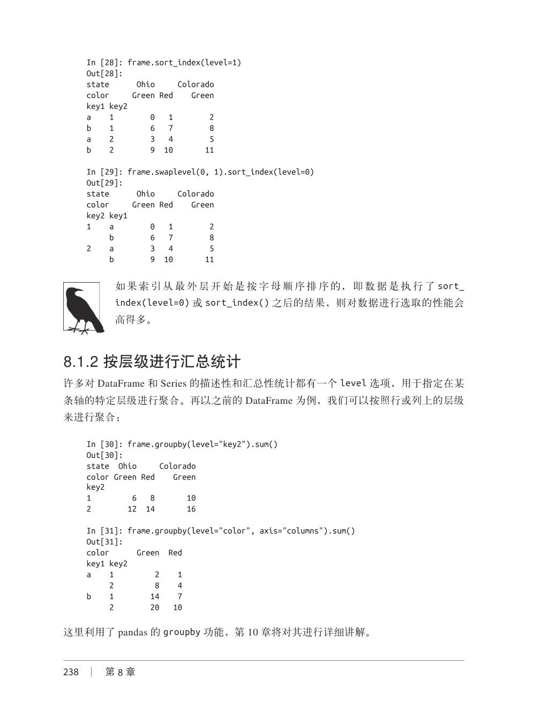

```python
frame.sort_index(level=1)
```

```text
state      Ohio     Colorado
color     Green Red    Green
key1 key2
a    1        0   1        2
b    1        6   7        8
a    2        3   4        5
b    2        9  10       11
```

```python
frame.swaplevel(0, 1).sort_index(level=0)
```

```text
state      Ohio     Colorado
color     Green Red    Green
key2 key1
1    a        0   1        2
     b        6   7        8
2    a        3   4        5
     b        9  10       11
```

> 如果索引从最外层开始是按字母顺序排序的，即数据是执行了 `sort_index(level=0)` 或 `sort_index()` 之后的结果，则对数据进行选取的性能会高得多。

### 8.1.2 按层级进行汇总统计

许多对 DataFrame 和 Series 的描述性和汇总性统计都有一个 `level` 选项，用于指定在某条轴的特定层级进行聚合。再以前面的 DataFrame 为例，我们可以按照行或列上的层级来进行聚合：

```python
frame.groupby(level="key2").sum()
```

```text
state  Ohio     Colorado
color Green Red    Green
key2
1         6   8       10
2        12  14       16
```

```python
frame.groupby(level="color", axis="columns").sum()
```

```text
color      Green  Red
key1 key2
a    1         2    1
     2         8    4
b    1        14    7
     2        20   10
```

这里利用了 pandas 的 `groupby` 功能，第 10 章将对其进行详细讲解。

## PDF 第 249 页
<!-- page-status: reviewed -->
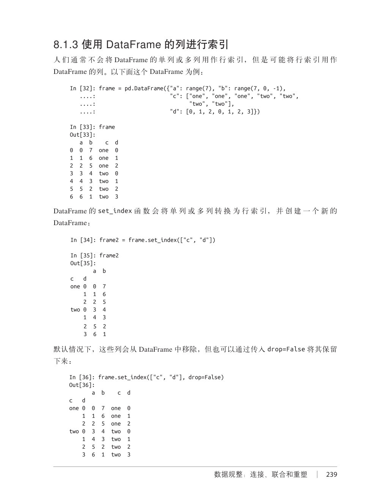

### 8.1.3 使用 DataFrame 的列进行索引

人们通常不会将 DataFrame 的单列或多列用作行索引，但是可能将行索引用作 DataFrame 的列。以下面这个 DataFrame 为例：

```python
frame = pd.DataFrame({"a": range(7), "b": range(7, 0, -1),
                      "c": ["one", "one", "one", "two", "two", "two", "two"],
                      "d": [0, 1, 2, 0, 1, 2, 3]})
frame
```

```text
   a  b    c  d
0  0  7  one  0
1  1  6  one  1
2  2  5  one  2
3  3  4  two  0
4  4  3  two  1
5  5  2  two  2
6  6  1  two  3
```

DataFrame 的 `set_index` 函数会将单列或多列转换为行索引，并创建一个新的 DataFrame：

```python
frame2 = frame.set_index(["c", "d"])
frame2
```

```text
       a  b
c   d
one 0  0  7
    1  1  6
    2  2  5
two 0  3  4
    1  4  3
    2  5  2
    3  6  1
```

默认情况下，这些列会从 DataFrame 中移除，但也可以通过传入 `drop=False` 将其保留下来：

```python
frame.set_index(["c", "d"], drop=False)
```

```text
       a  b    c  d
c   d
one 0  0  7  one  0
    1  1  6  one  1
    2  2  5  one  2
two 0  3  4  two  0
    1  4  3  two  1
    2  5  2  two  2
    3  6  1  two  3
```

## PDF 第 250 页
<!-- page-status: reviewed -->
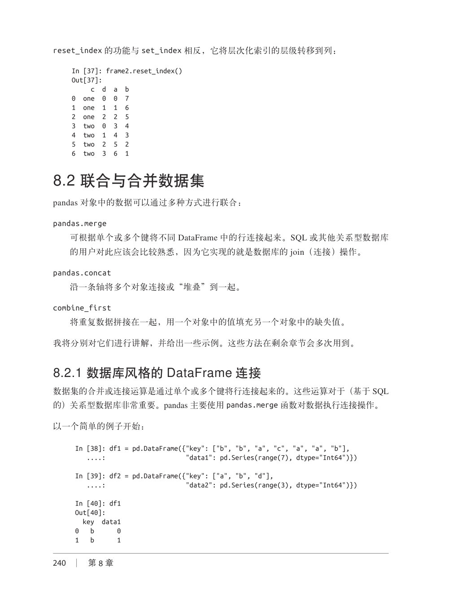

`reset_index` 的功能与 `set_index` 相反，它将层次化索引的层级转移到列：

```python
frame2.reset_index()
```

```text
     c  d  a  b
0  one  0  0  7
1  one  1  1  6
2  one  2  2  5
3  two  0  3  4
4  two  1  4  3
5  two  2  5  2
6  two  3  6  1
```

### 8.2 联合与合并数据集

pandas 对象中的数据可以通过多种方式进行联合：

- `pandas.merge`：可根据单个或多个键将不同 DataFrame 中的行连接起来。SQL 或其他关系型数据库的用户对此应该会比较熟悉，因为它实现的就是数据库的 join（连接）操作。
- `pandas.concat`：沿一条轴将多个对象连接或“堆叠”到一起。
- `combine_first`：将重复数据拼接在一起，用一个对象中的值填充另一个对象中的缺失值。

我将分别对它们进行讲解，并给出一些示例。这些方法在剩余章节会多次用到。

#### 8.2.1 数据库风格的 DataFrame 连接

数据集的合并或连接运算是通过单个或多个键将行连接起来的。这些运算对于（基于 SQL 的）关系型数据库非常重要。pandas 主要使用 `pandas.merge` 函数对数据执行连接操作。

以一个简单的例子开始：

```python
df1 = pd.DataFrame({"key": ["b", "b", "a", "c", "a", "a", "b"],
                    "data1": pd.Series(range(7), dtype="Int64")})
df2 = pd.DataFrame({"key": ["a", "b", "d"],
                    "data2": pd.Series(range(3), dtype="Int64")})
df1
```

```text
  key  data1
0   b      0
1   b      1
```

输出在下一页继续。

## PDF 第 251 页
<!-- page-status: reviewed -->
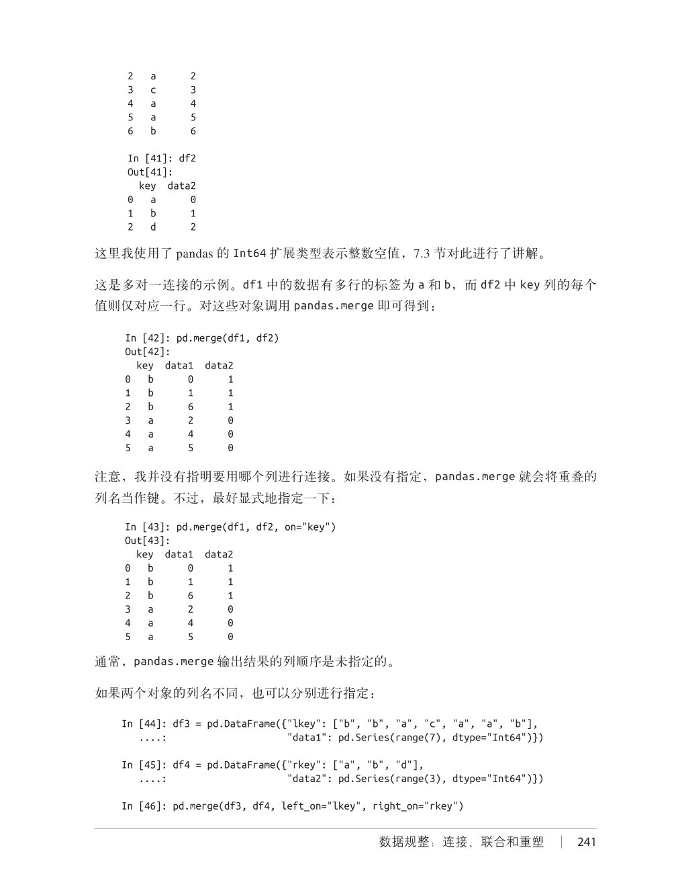

上一页 `df1` 输出续：

```text
2   a      2
3   c      3
4   a      4
5   a      5
6   b      6
```

```python
df2
```

```text
  key  data2
0   a      0
1   b      1
2   d      2
```

这里我使用了 pandas 的 `Int64` 扩展类型表示整数空值，7.3 节对此进行了讲解。

这是多对一连接的示例。`df1` 中的数据有多行的标签为 `a` 和 `b`，而 `df2` 中 `key` 列的每个值则仅对应一行。对这些对象调用 `pandas.merge` 即可得到：

```python
pd.merge(df1, df2)
```

```text
  key  data1  data2
0   b      0      1
1   b      1      1
2   b      6      1
3   a      2      0
4   a      4      0
5   a      5      0
```

注意，我并没有指明要用哪个列进行连接。如果没有指定，`pandas.merge` 就会将重叠的列名当作键。不过，最好显式地指定一下：

```python
pd.merge(df1, df2, on="key")
```

```text
  key  data1  data2
0   b      0      1
1   b      1      1
2   b      6      1
3   a      2      0
4   a      4      0
5   a      5      0
```

通常，`pandas.merge` 输出结果的列顺序是未指定的。

如果两个对象的列名不同，也可以分别进行指定：

```python
df3 = pd.DataFrame({"lkey": ["b", "b", "a", "c", "a", "a", "b"],
                    "data1": pd.Series(range(7), dtype="Int64")})
df4 = pd.DataFrame({"rkey": ["a", "b", "d"],
                    "data2": pd.Series(range(3), dtype="Int64")})
pd.merge(df3, df4, left_on="lkey", right_on="rkey")
```

输出见下一页。

## PDF 第 252 页
<!-- page-status: reviewed -->
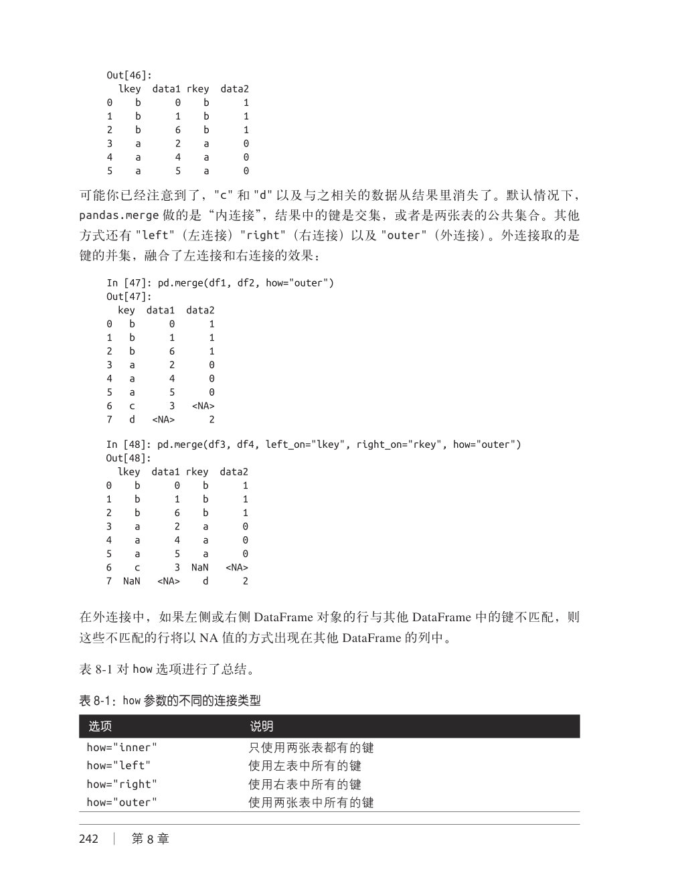

上一页 `pd.merge(df3, df4, left_on="lkey", right_on="rkey")` 的输出：

```text
  lkey  data1 rkey  data2
0    b      0    b      1
1    b      1    b      1
2    b      6    b      1
3    a      2    a      0
4    a      4    a      0
5    a      5    a      0
```

可能你已经注意到了，`"c"` 和 `"d"` 以及与之相关的数据从结果里消失了。默认情况下，`pandas.merge` 做的是“内连接”，结果中的键是交集，或者是两张表的公共集合。其他方式还有 `"left"`（左连接）`"right"`（右连接）以及 `"outer"`（外连接）。外连接取的是键的并集，融合了左连接和右连接的效果：

```python
pd.merge(df1, df2, how="outer")
```

```text
  key  data1  data2
0   b      0      1
1   b      1      1
2   b      6      1
3   a      2      0
4   a      4      0
5   a      5      0
6   c      3   <NA>
7   d   <NA>      2
```

```python
pd.merge(df3, df4, left_on="lkey", right_on="rkey", how="outer")
```

```text
  lkey  data1 rkey  data2
0    b      0    b      1
1    b      1    b      1
2    b      6    b      1
3    a      2    a      0
4    a      4    a      0
5    a      5    a      0
6    c      3  NaN   <NA>
7  NaN   <NA>    d      2
```

在外连接中，如果左侧或右侧 DataFrame 对象的行与其他 DataFrame 中的键不匹配，则这些不匹配的行将以 NA 值的方式出现在其他 DataFrame 的列中。

表 8-1 对 `how` 选项进行了总结。

**表 8-1：`how` 参数的不同的连接类型**

| 选项 | 说明 |
| --- | --- |
| `how="inner"` | 只使用两张表都有的键 |
| `how="left"` | 使用左表中所有的键 |
| `how="right"` | 使用右表中所有的键 |
| `how="outer"` | 使用两张表中所有的键 |

## PDF 第 253 页
<!-- page-status: reviewed -->
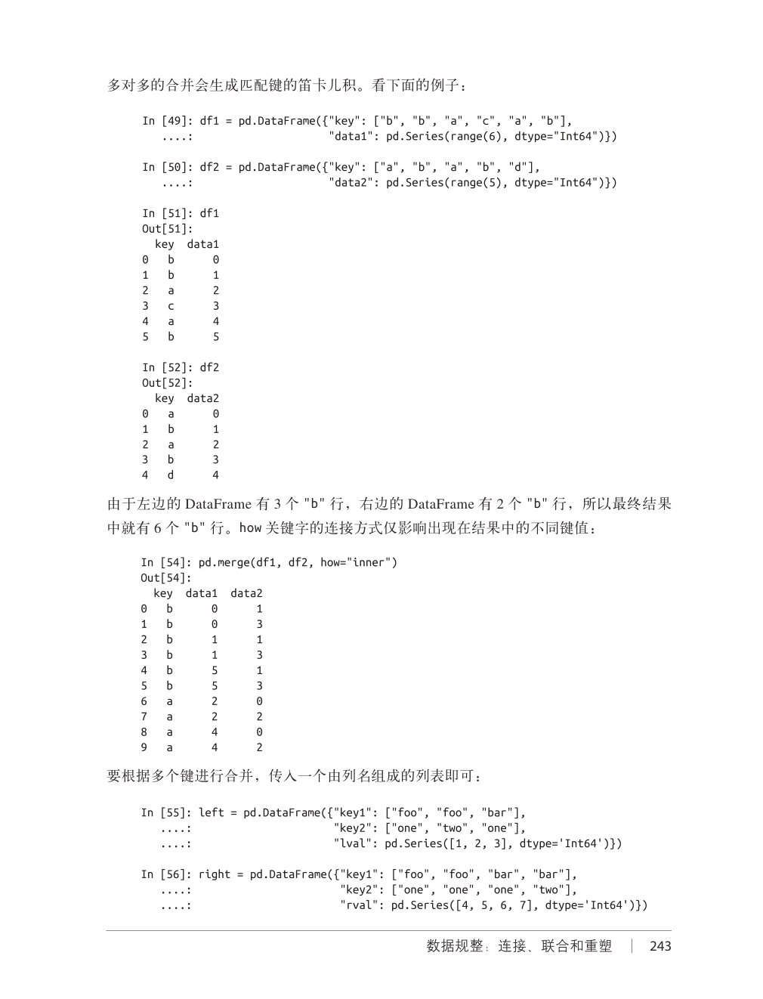

多对多的合并会生成匹配键的笛卡儿积。看下面的例子：

```python
df1 = pd.DataFrame({"key": ["b", "b", "a", "c", "a", "b"],
                    "data1": pd.Series(range(6), dtype="Int64")})
df2 = pd.DataFrame({"key": ["a", "b", "a", "b", "d"],
                    "data2": pd.Series(range(5), dtype="Int64")})
df1
```

```text
  key  data1
0   b      0
1   b      1
2   a      2
3   c      3
4   a      4
5   b      5
```

```python
df2
```

```text
  key  data2
0   a      0
1   b      1
2   a      2
3   b      3
4   d      4
```

由于左边的 DataFrame 有 3 个 `"b"` 行，右边的 DataFrame 有 2 个 `"b"` 行，所以最终结果中就有 6 个 `"b"` 行。`how` 关键字的连接方式仅影响出现在结果中的不同键值：

```python
pd.merge(df1, df2, how="inner")
```

```text
  key  data1  data2
0   b      0      1
1   b      0      3
2   b      1      1
3   b      1      3
4   b      5      1
5   b      5      3
6   a      2      0
7   a      2      2
8   a      4      0
9   a      4      2
```

要根据多个键进行合并，传入一个由列名组成的列表即可：

```python
left = pd.DataFrame({"key1": ["foo", "foo", "bar"],
                     "key2": ["one", "two", "one"],
                     "lval": pd.Series([1, 2, 3], dtype='Int64')})
right = pd.DataFrame({"key1": ["foo", "foo", "bar", "bar"],
                      "key2": ["one", "one", "one", "two"],
                      "rval": pd.Series([4, 5, 6, 7], dtype='Int64')})
```

## PDF 第 254 页
<!-- page-status: reviewed -->
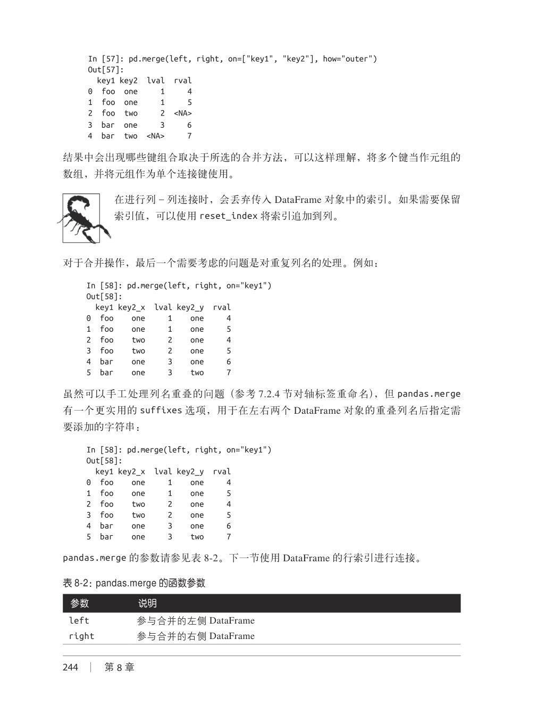

```python
pd.merge(left, right, on=["key1", "key2"], how="outer")
```

```text
  key1 key2  lval  rval
0  foo  one     1     4
1  foo  one     1     5
2  foo  two     2  <NA>
3  bar  one     3     6
4  bar  two  <NA>     7
```

结果中会出现哪些键组合取决于所选的合并方法，可以这样理解，将多个键当作元组的数组，并将元组作为单个连接键使用。

> 在进行列－列连接时，会丢弃传入 DataFrame 对象中的索引。如果需要保留索引值，可以使用 `reset_index` 将索引追加到列。

对于合并操作，最后一个需要考虑的问题是对重复列名的处理。例如：

```python
pd.merge(left, right, on="key1")
```

```text
  key1 key2_x  lval key2_y  rval
0  foo    one     1    one     4
1  foo    one     1    one     5
2  foo    two     2    one     4
3  foo    two     2    one     5
4  bar    one     3    one     6
5  bar    one     3    two     7
```

虽然可以手工处理列名重叠的问题（参考 7.2.4 节对轴标签重命名），但 `pandas.merge` 有一个更实用的 `suffixes` 选项，用于在左右两个 DataFrame 对象的重叠列名后指定需要添加的字符串：

```python
pd.merge(left, right, on="key1")
```

```text
  key1 key2_x  lval key2_y  rval
0  foo    one     1    one     4
1  foo    one     1    one     5
2  foo    two     2    one     4
3  foo    two     2    one     5
4  bar    one     3    one     6
5  bar    one     3    two     7
```

> 校对注：原页在介绍 `suffixes` 后再次印出相同的 `pd.merge(left, right, on="key1")` 代码和默认后缀输出，未展示自定义 `suffixes`；此处按原页保留。

`pandas.merge` 的参数请参见表 8-2。下一节使用 DataFrame 的行索引进行连接。

**表 8-2：`pandas.merge` 的函数参数**

| 参数 | 说明 |
| --- | --- |
| `left` | 参与合并的左侧 DataFrame |
| `right` | 参与合并的右侧 DataFrame |

表格在下一页继续。

## PDF 第 255 页
<!-- page-status: reviewed -->
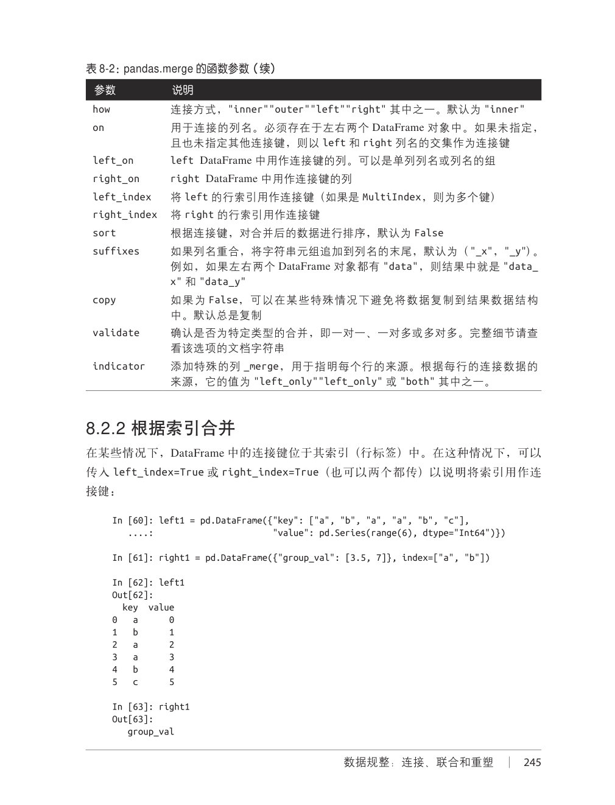

**表 8-2：`pandas.merge` 的函数参数（续）**

| 参数 | 说明 |
| --- | --- |
| `how` | 连接方式，`"inner"`、`"outer"`、`"left"`、`"right"` 其中之一。默认为 `"inner"` |
| `on` | 用于连接的列名。必须存在于左右两个 DataFrame 对象中。如果未指定，且也未指定其他连接键，则以 `left` 和 `right` 列名的交集作为连接键 |
| `left_on` | `left` DataFrame 中用作连接键的列。可以是单列列名或列名的组 |
| `right_on` | `right` DataFrame 中用作连接键的列 |
| `left_index` | 将 `left` 的行索引用作连接键（如果是 MultiIndex，则为多个键） |
| `right_index` | 将 `right` 的行索引用作连接键 |
| `sort` | 根据连接键，对合并后的数据进行排序，默认为 `False` |
| `suffixes` | 如果列名重合，将字符串元组追加到列名的末尾，默认为 `("_x", "_y")`。例如，如果左右两个 DataFrame 对象都有 `"data"`，则结果中就是 `"data_x"` 和 `"data_y"` |
| `copy` | 如果为 `False`，可以在某些特殊情况下避免将数据复制到结果数据结构中。默认总是复制 |
| `validate` | 确认是否为特定类型的合并，即一对一、一对多或多对多。完整细节请查看该选项的文档字符串 |
| `indicator` | 添加特殊的列 `_merge`，用于指明每个行的来源。根据每行的连接数据的来源，它的值为 `"left_only"`、`"left_only"` 或 `"both"` 其中之一。 |

> 校对注：原页在 `indicator` 一项中重复印了两次 `"left_only"`；此处保留原文，使用时应查阅对应版本的 pandas 文档。

#### 8.2.2 根据索引合并

在某些情况下，DataFrame 中的连接键位于其索引（行标签）中。在这种情况下，可以传入 `left_index=True` 或 `right_index=True`（也可以两个都传）以说明将索引用作连接键：

```python
left1 = pd.DataFrame({"key": ["a", "b", "a", "a", "b", "c"],
                      "value": pd.Series(range(6), dtype="Int64")})
right1 = pd.DataFrame({"group_val": [3.5, 7]}, index=["a", "b"])
left1
```

```text
  key  value
0   a      0
1   b      1
2   a      2
3   a      3
4   b      4
5   c      5
```

```python
right1
```

```text
   group_val
```

输出在下一页继续。

## PDF 第 256 页
<!-- page-status: reviewed -->
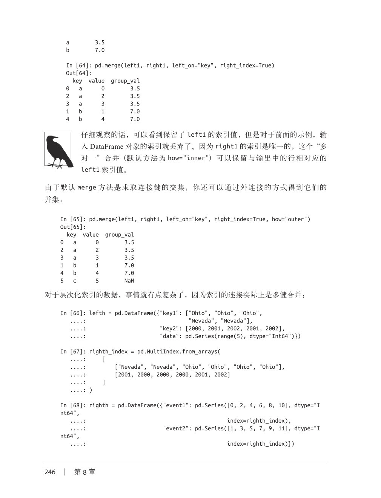

上页输出续：

~~~text
a    3.5
b    7.0
~~~

~~~python
pd.merge(left1, right1, left_on="key", right_index=True)
~~~

~~~text
  key  value  group_val
0   a      0        3.5
2   a      2        3.5
3   a      3        3.5
1   b      1        7.0
4   b      4        7.0
~~~

> 仔细观察的话，可以看到保留了 left1 的索引值，但是对于前面的示例，输入 DataFrame 对象的索引就丢弃了。因为 right1 的索引是唯一的，这个“多对一”合并（默认方法为 how="inner"）可以保留与输出中的行相对应的 left1 索引值。

由于默认 merge 方法是求取连接键的交集，你还可以通过外连接的方式得到它们的并集：

~~~python
pd.merge(left1, right1, left_on="key", right_index=True, how="outer")
~~~

~~~text
  key  value  group_val
0   a      0        3.5
2   a      2        3.5
3   a      3        3.5
1   b      1        7.0
4   b      4        7.0
5   c      5        NaN
~~~

对于层次化索引的数据，事情就有点复杂了，因为索引的连接实际上是多键合并：

~~~python
lefth = pd.DataFrame({"key1": ["Ohio", "Ohio", "Ohio",
                                "Nevada", "Nevada"],
                      "key2": [2000, 2001, 2002, 2001, 2002],
                      "data": pd.Series(range(5), dtype="Int64")})

righth_index = pd.MultiIndex.from_arrays(
    [
        ["Nevada", "Nevada", "Ohio", "Ohio", "Ohio", "Ohio"],
        [2001, 2000, 2000, 2000, 2001, 2002]
    ]
)

righth = pd.DataFrame({"event1": pd.Series([0, 2, 4, 6, 8, 10], dtype="Int64",
                                          index=righth_index),
                       "event2": pd.Series([1, 3, 5, 7, 9, 11], dtype="Int64",
                                          index=righth_index)})
~~~

## PDF 第 257 页
<!-- page-status: reviewed -->
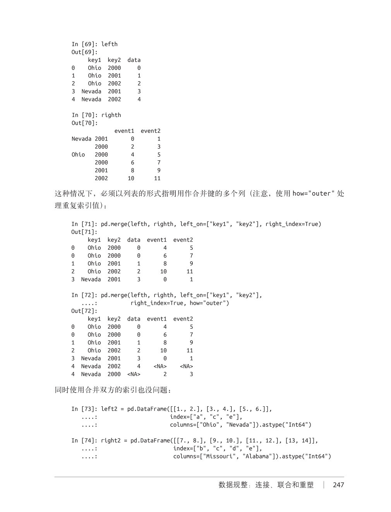

~~~python
lefth
~~~

~~~text
     key1  key2  data
0    Ohio  2000     0
1    Ohio  2001     1
2    Ohio  2002     2
3  Nevada  2001     3
4  Nevada  2002     4
~~~

~~~python
righth
~~~

~~~text
             event1  event2
Nevada 2001       0       1
       2000       2       3
Ohio   2000       4       5
       2000       6       7
       2001       8       9
       2002      10      11
~~~

这种情况下，必须以列表的形式指明用作合并键的多个列（注意，使用 how="outer" 处理重复索引值）：

~~~python
pd.merge(lefth, righth, left_on=["key1", "key2"], right_index=True)
~~~

~~~text
     key1  key2  data  event1  event2
0    Ohio  2000     0       4       5
0    Ohio  2000     0       6       7
1    Ohio  2001     1       8       9
2    Ohio  2002     2      10      11
3  Nevada  2001     3       0       1
~~~

~~~python
pd.merge(lefth, righth, left_on=["key1", "key2"],
         right_index=True, how="outer")
~~~

~~~text
     key1  key2  data  event1  event2
0    Ohio  2000     0       4       5
0    Ohio  2000     0       6       7
1    Ohio  2001     1       8       9
2    Ohio  2002     2      10      11
3  Nevada  2001     3       0       1
4  Nevada  2002     4    <NA>    <NA>
4  Nevada  2000  <NA>       2       3
~~~

同时使用合并双方的索引也没问题：

~~~python
left2 = pd.DataFrame([[1., 2.], [3., 4.], [5., 6.]],
                     index=["a", "c", "e"],
                     columns=["Ohio", "Nevada"]).astype("Int64")

right2 = pd.DataFrame([[7., 8.], [9., 10.], [11., 12.], [13, 14]],
                      index=["b", "c", "d", "e"],
                      columns=["Missouri", "Alabama"]).astype("Int64")
~~~

## PDF 第 258 页
<!-- page-status: reviewed -->
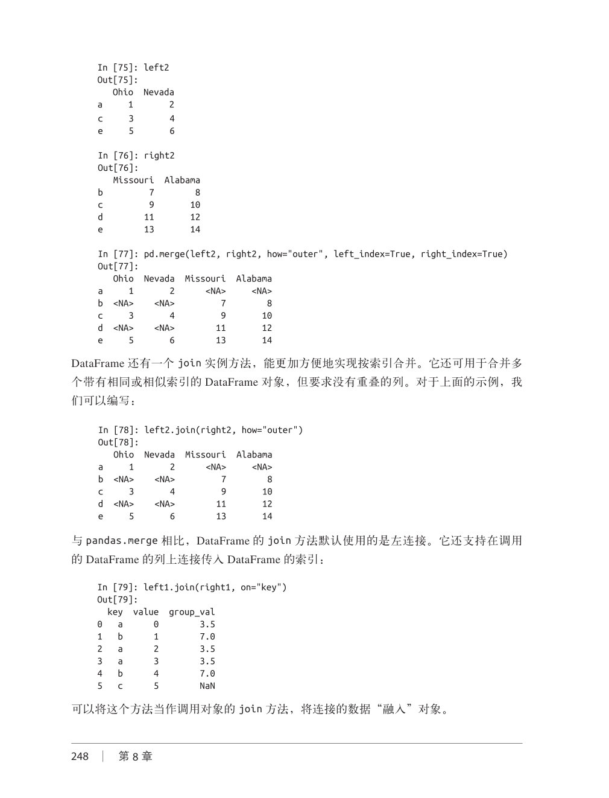

~~~python
left2
~~~

~~~text
   Ohio  Nevada
a     1       2
c     3       4
e     5       6
~~~

~~~python
right2
~~~

~~~text
   Missouri  Alabama
b         7        8
c         9       10
d        11       12
e        13       14
~~~

~~~python
pd.merge(left2, right2, how="outer", left_index=True, right_index=True)
~~~

~~~text
   Ohio  Nevada  Missouri  Alabama
a     1       2      <NA>     <NA>
b  <NA>    <NA>         7        8
c     3       4         9       10
d  <NA>    <NA>        11       12
e     5       6        13       14
~~~

DataFrame 还有一个 join 实例方法，能更加方便地实现按索引合并。它还可用于合并多个带有相同或相似索引的 DataFrame 对象，但要求没有重叠的列。对于上面的示例，我们可以编写：

~~~python
left2.join(right2, how="outer")
~~~

~~~text
   Ohio  Nevada  Missouri  Alabama
a     1       2      <NA>     <NA>
b  <NA>    <NA>         7        8
c     3       4         9       10
d  <NA>    <NA>        11       12
e     5       6        13       14
~~~

与 pandas.merge 相比，DataFrame 的 join 方法默认使用的是左连接。它还支持在调用的 DataFrame 的列上连接传入 DataFrame 的索引：

~~~python
left1.join(right1, on="key")
~~~

~~~text
  key  value  group_val
0   a      0        3.5
1   b      1        7.0
2   a      2        3.5
3   a      3        3.5
4   b      4        7.0
5   c      5        NaN
~~~

可以将这个方法当作调用对象的 join 方法，将连接的数据“融入”对象。

## PDF 第 259 页
<!-- page-status: reviewed -->
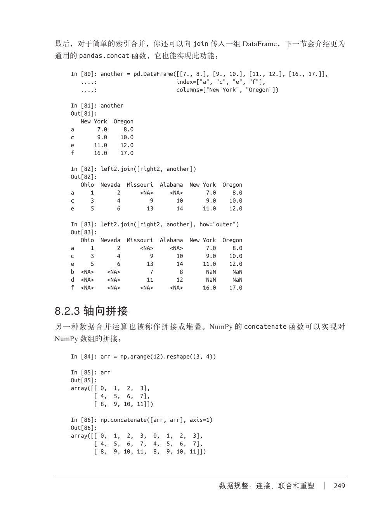

最后，对于简单的索引合并，你还可以向 join 传入一组 DataFrame，下一节会介绍更为通用的 pandas.concat 函数，它也能实现此功能：

~~~python
another = pd.DataFrame([[7., 8.], [9., 10.], [11., 12.], [16., 17.]],
                       index=["a", "c", "e", "f"],
                       columns=["New York", "Oregon"])
another
~~~

~~~text
   New York  Oregon
a       7.0     8.0
c       9.0    10.0
e      11.0    12.0
f      16.0    17.0
~~~

~~~python
left2.join([right2, another])
~~~

~~~text
   Ohio  Nevada  Missouri  Alabama  New York  Oregon
a     1       2      <NA>     <NA>       7.0     8.0
c     3       4         9       10       9.0    10.0
e     5       6        13       14      11.0    12.0
~~~

~~~python
left2.join([right2, another], how="outer")
~~~

~~~text
   Ohio  Nevada  Missouri  Alabama  New York  Oregon
a     1       2      <NA>     <NA>       7.0     8.0
c     3       4         9       10       9.0    10.0
e     5       6        13       14      11.0    12.0
b  <NA>    <NA>         7        8       NaN     NaN
d  <NA>    <NA>        11       12       NaN     NaN
f  <NA>    <NA>      <NA>     <NA>      16.0    17.0
~~~

### 8.2.3 轴向拼接

另一种数据合并运算也被称作拼接或堆叠。NumPy 的 concatenate 函数可以实现对 NumPy 数组的拼接：

~~~python
arr = np.arange(12).reshape((3, 4))
arr
~~~

~~~text
array([[ 0,  1,  2,  3],
       [ 4,  5,  6,  7],
       [ 8,  9, 10, 11]])
~~~

~~~python
np.concatenate([arr, arr], axis=1)
~~~

~~~text
array([[ 0,  1,  2,  3,  0,  1,  2,  3],
       [ 4,  5,  6,  7,  4,  5,  6,  7],
       [ 8,  9, 10, 11,  8,  9, 10, 11]])
~~~

## PDF 第 260 页
<!-- page-status: reviewed -->
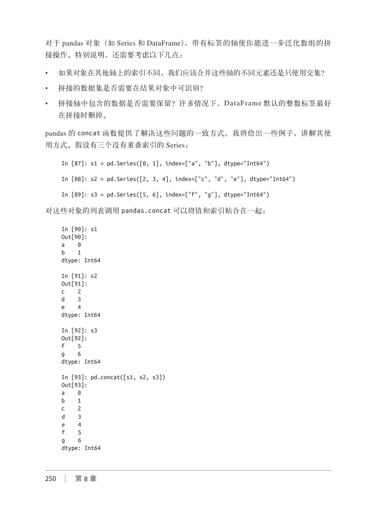

对于 pandas 对象（如 Series 和 DataFrame），带有标签的轴使你能进一步泛化数组的拼接操作。特别说明，还需要考虑以下几点：

- 如果对象在其他轴上的索引不同，我们应该合并这些轴的不同元素还是只使用交集？
- 拼接的数据集是否需要在结果对象中可识别？
- 拼接轴中包含的数据是否需要保留？许多情况下，DataFrame 默认的整数标签最好在拼接时删掉。

pandas 的 concat 函数提供了解决这些问题的一致方式。我将给出一些例子，讲解其使用方式。假设有三个没有重叠索引的 Series：

~~~python
s1 = pd.Series([0, 1], index=["a", "b"], dtype="Int64")
s2 = pd.Series([2, 3, 4], index=["c", "d", "e"], dtype="Int64")
s3 = pd.Series([5, 6], index=["f", "g"], dtype="Int64")
~~~

对这些对象的列表调用 pandas.concat 可以将值和索引粘合在一起：

~~~python
s1
~~~

~~~text
a    0
b    1
dtype: Int64
~~~

~~~python
s2
~~~

~~~text
c    2
d    3
e    4
dtype: Int64
~~~

~~~python
s3
~~~

~~~text
f    5
g    6
dtype: Int64
~~~

~~~python
pd.concat([s1, s2, s3])
~~~

~~~text
a    0
b    1
c    2
d    3
e    4
f    5
g    6
dtype: Int64
~~~

## PDF 第 261 页
<!-- page-status: reviewed -->
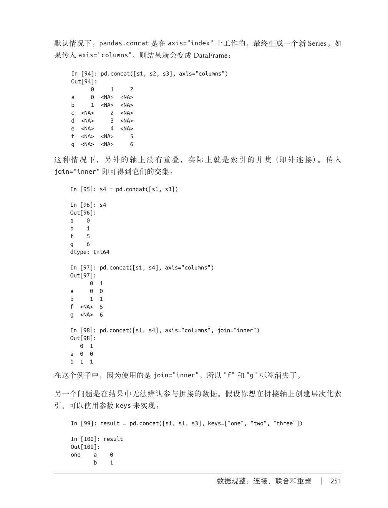

默认情况下，`pandas.concat` 是在 `axis="index"` 上工作的，最终生成一个新 Series。如果传入 `axis="columns"`，则结果就会变成 DataFrame：

```python
pd.concat([s1, s2, s3], axis="columns")
```

```text
      0     1     2
a     0  <NA>  <NA>
b     1  <NA>  <NA>
c  <NA>     2  <NA>
d  <NA>     3  <NA>
e  <NA>     4  <NA>
f  <NA>  <NA>     5
g  <NA>  <NA>     6
```

这种情况下，另外的轴上没有重叠，实际上就是索引的并集（即外连接）。传入 `join="inner"` 即可得到它们的交集：

```python
s4 = pd.concat([s1, s3])
s4
```

```text
a    0
b    1
f    5
g    6
dtype: Int64
```

```python
pd.concat([s1, s4], axis="columns")
```

```text
      0  1
a     0  0
b     1  1
f  <NA>  5
g  <NA>  6
```

```python
pd.concat([s1, s4], axis="columns", join="inner")
```

```text
   0  1
a  0  0
b  1  1
```

在这个例子中，因为使用的是 `join="inner"`，所以 `"f"` 和 `"g"` 标签消失了。

另一个问题是在结果中无法辨认参与拼接的数据。假设你想在拼接轴上创建层次化索引。可以使用参数 `keys` 来实现：

```python
result = pd.concat([s1, s1, s3], keys=["one", "two", "three"])
result
```

输出跨页，后续部分见下一页。

```text
one    a    0
       b    1
```

## PDF 第 262 页
<!-- page-status: reviewed -->
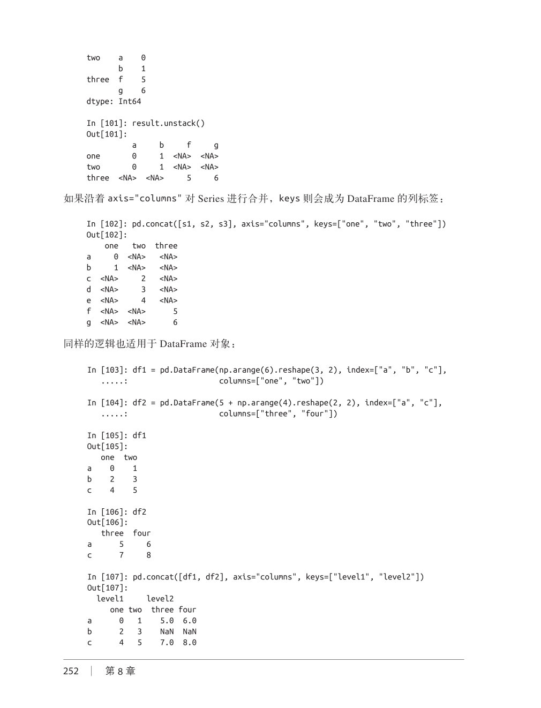

上一页输出续：

```text
two    a    0
       b    1
three  f    5
       g    6
dtype: Int64
```

```python
result.unstack()
```

```text
          a     b     f     g
one       0     1  <NA>  <NA>
two       0     1  <NA>  <NA>
three  <NA>  <NA>     5     6
```

如果沿着 `axis="columns"` 对 Series 进行合并，`keys` 则会成为 DataFrame 的列标签：

```python
pd.concat([s1, s2, s3], axis="columns", keys=["one", "two", "three"])
```

```text
    one   two  three
a     0  <NA>   <NA>
b     1  <NA>   <NA>
c  <NA>     2   <NA>
d  <NA>     3   <NA>
e  <NA>     4   <NA>
f  <NA>  <NA>      5
g  <NA>  <NA>      6
```

同样的逻辑也适用于 DataFrame 对象：

```python
df1 = pd.DataFrame(np.arange(6).reshape(3, 2), index=["a", "b", "c"],
                   columns=["one", "two"])
df2 = pd.DataFrame(5 + np.arange(4).reshape(2, 2), index=["a", "c"],
                   columns=["three", "four"])
df1
```

```text
   one  two
a    0    1
b    2    3
c    4    5
```

```python
df2
```

```text
   three  four
a      5     6
c      7     8
```

```python
pd.concat([df1, df2], axis="columns", keys=["level1", "level2"])
```

```text
  level1     level2
     one two  three four
a      0   1    5.0  6.0
b      2   3    NaN  NaN
c      4   5    7.0  8.0
```

## PDF 第 263 页
<!-- page-status: reviewed -->
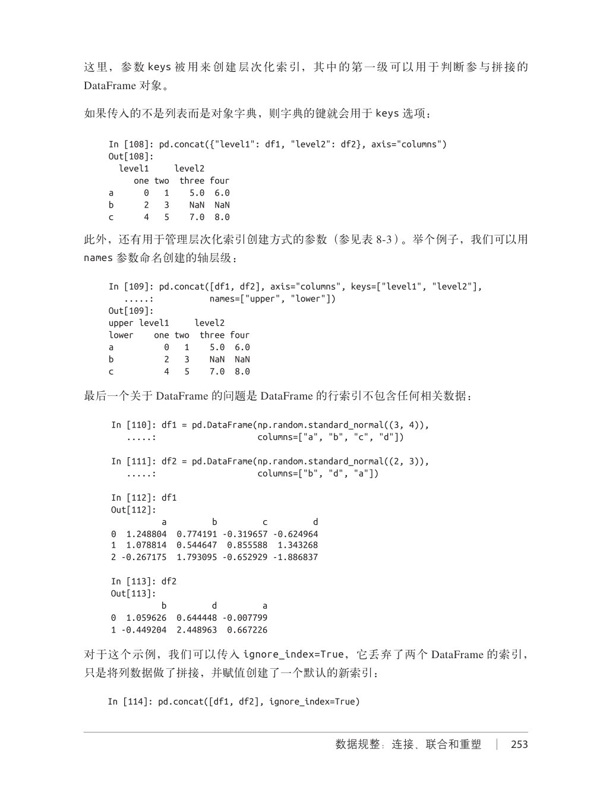

这里，参数 `keys` 被用来创建层次化索引，其中的第一级可以用于判断参与拼接的 DataFrame 对象。

如果传入的不是列表而是对象字典，则字典的键就会用于 `keys` 选项：

```python
pd.concat({"level1": df1, "level2": df2}, axis="columns")
```

```text
  level1     level2
     one two  three four
a      0   1    5.0  6.0
b      2   3    NaN  NaN
c      4   5    7.0  8.0
```

此外，还有用于管理层次化索引创建方式的参数（参见表 8-3）。举个例子，我们可以用 `names` 参数命名创建的轴层级：

```python
pd.concat([df1, df2], axis="columns", keys=["level1", "level2"],
          names=["upper", "lower"])
```

```text
upper level1     level2
lower    one two  three four
a          0   1    5.0  6.0
b          2   3    NaN  NaN
c          4   5    7.0  8.0
```

最后一个关于 DataFrame 的问题是 DataFrame 的行索引不包含任何相关数据：

```python
df1 = pd.DataFrame(np.random.standard_normal((3, 4)),
                   columns=["a", "b", "c", "d"])
df2 = pd.DataFrame(np.random.standard_normal((2, 3)),
                   columns=["b", "d", "a"])
df1
```

```text
          a         b         c         d
0  1.248804  0.774191 -0.319657 -0.624964
1  1.078814  0.544647  0.855588  1.343268
2 -0.267175  1.793095 -0.652929 -1.886837
```

```python
df2
```

```text
          b         d         a
0  1.059626  0.644448 -0.007799
1 -0.449204  2.448963  0.667226
```

对于这个示例，我们可以传入 `ignore_index=True`，它丢弃了两个 DataFrame 的索引，只是将列数据做了拼接，并赋值创建了一个默认的新索引：

```python
pd.concat([df1, df2], ignore_index=True)
```

输出见下一页。

## PDF 第 264 页
<!-- page-status: reviewed -->
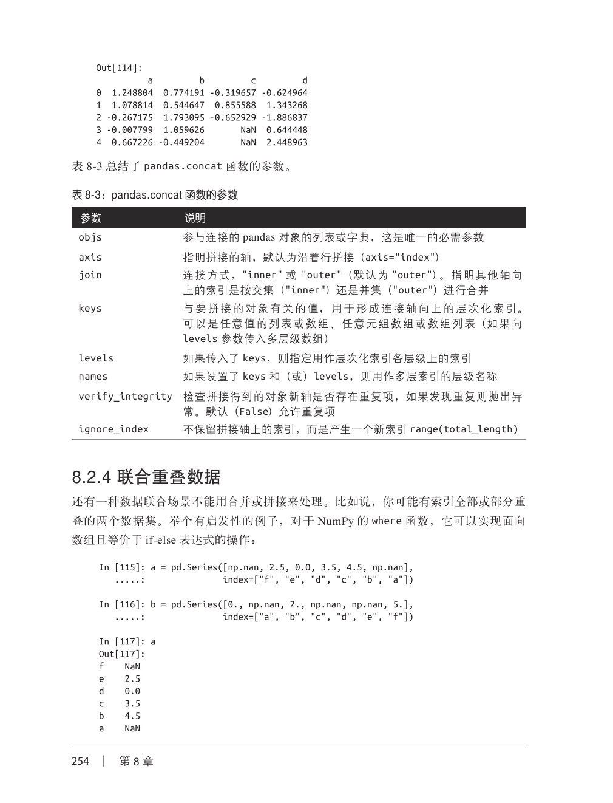

上一页代码的输出：

```text
          a         b         c         d
0  1.248804  0.774191 -0.319657 -0.624964
1  1.078814  0.544647  0.855588  1.343268
2 -0.267175  1.793095 -0.652929 -1.886837
3 -0.007799  1.059626       NaN  0.644448
4  0.667226 -0.449204       NaN  2.448963
```

表 8-3 总结了 `pandas.concat` 函数的参数。

**表 8-3：pandas.concat 函数的参数**

| 参数 | 说明 |
| --- | --- |
| `objs` | 参与连接的 pandas 对象的列表或字典，这是唯一的必需参数 |
| `axis` | 指明拼接的轴，默认为沿着行拼接（`axis="index"`） |
| `join` | 连接方式，`"inner"` 或 `"outer"`（默认为 `"outer"`）。指明其他轴向上的索引是按交集（`"inner"`）还是并集（`"outer"`）进行合并 |
| `keys` | 与要拼接的对象有关的值，用于形成连接轴向上的层次化索引。可以是任意值的列表或数组、任意元组数组或数组列表（如果向 `levels` 参数传入多层级数组） |
| `levels` | 如果传入了 `keys`，则指定用作层次化索引各层级上的索引 |
| `names` | 如果设置了 `keys` 和（或）`levels`，则用作多层索引的层级名称 |
| `verify_integrity` | 检查拼接得到的对象新轴是否存在重复项，如果发现重复则抛出异常。默认（`False`）允许重复项 |
| `ignore_index` | 不保留拼接轴上的索引，而是产生一个新索引 `range(total_length)` |

### 8.2.4 联合重叠数据

还有一种数据联合场景不能用合并或拼接来处理。比如说，你可能有索引全部或部分重叠的两个数据集。举个有启发性的例子，对于 NumPy 的 `where` 函数，它可以实现面向数组且等价于 if-else 表达式的操作：

```python
a = pd.Series([np.nan, 2.5, 0.0, 3.5, 4.5, np.nan],
              index=["f", "e", "d", "c", "b", "a"])
b = pd.Series([0., np.nan, 2., np.nan, np.nan, 5.],
              index=["a", "b", "c", "d", "e", "f"])
a
```

```text
f    NaN
e    2.5
d    0.0
c    3.5
b    4.5
a    NaN
```

输出最后一行 `dtype: float64` 续于下一页。

## PDF 第 265 页
<!-- page-status: reviewed -->
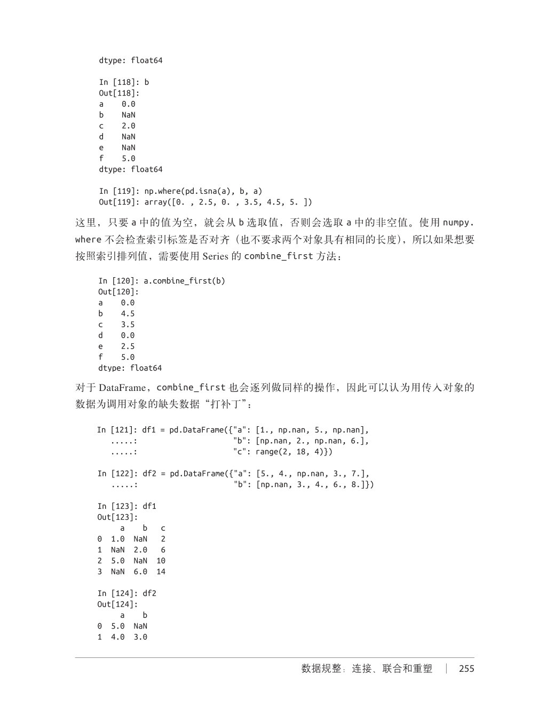

上一页输出续：

```text
dtype: float64
```

```python
b
```

```text
a    0.0
b    NaN
c    2.0
d    NaN
e    NaN
f    5.0
dtype: float64
```

```python
np.where(pd.isna(a), b, a)
```

```text
array([0. , 2.5, 0. , 3.5, 4.5, 5. ])
```

这里，只要 `a` 中的值为空，就会从 `b` 选取值，否则会选取 `a` 中的非空值。使用 `numpy.where` 不会检查索引标签是否对齐（也不要求两个对象具有相同的长度），所以如果想要按照索引排列值，需要使用 Series 的 `combine_first` 方法：

```python
a.combine_first(b)
```

```text
a    0.0
b    4.5
c    3.5
d    0.0
e    2.5
f    5.0
dtype: float64
```

对于 DataFrame，`combine_first` 也会逐列做同样的操作，因此可以认为用传入对象的数据为调用对象的缺失数据“打补丁”：

```python
df1 = pd.DataFrame({"a": [1., np.nan, 5., np.nan],
                    "b": [np.nan, 2., np.nan, 6.],
                    "c": range(2, 18, 4)})
df2 = pd.DataFrame({"a": [5., 4., np.nan, 3., 7.],
                    "b": [np.nan, 3., 4., 6., 8.]})
df1
```

```text
     a    b   c
0  1.0  NaN   2
1  NaN  2.0   6
2  5.0  NaN  10
3  NaN  6.0  14
```

```python
df2
```

```text
     a    b
0  5.0  NaN
1  4.0  3.0
```

输出续于下一页。

## PDF 第 266 页
<!-- page-status: reviewed -->
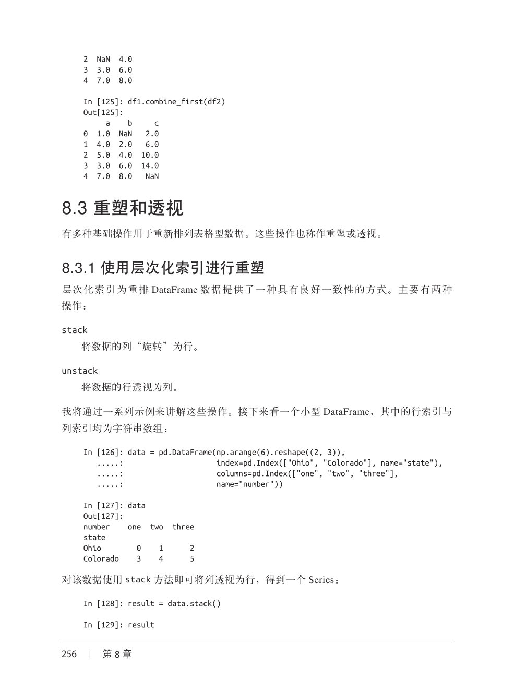

上一页输出的末尾：

```text
2  NaN  4.0
3  3.0  6.0
4  7.0  8.0
```

```python
df1.combine_first(df2)
```

```text
     a    b     c
0  1.0  NaN   2.0
1  4.0  2.0   6.0
2  5.0  4.0  10.0
3  3.0  6.0  14.0
4  7.0  8.0   NaN
```

### 8.3 重塑和透视

有多种基础操作用于重新排列表格型数据。这些操作也称作重塑或透视。

#### 8.3.1 使用层次化索引进行重塑

层次化索引为重排 DataFrame 数据提供了一种具有良好一致性的方式。主要有两种操作：

- `stack`：将数据的列“旋转”为行。
- `unstack`：将数据的行透视为列。

我将通过一系列示例来讲解这些操作。接下来看一个小型 DataFrame，其中的行索引与列索引均为字符串数组：

```python
data = pd.DataFrame(np.arange(6).reshape((2, 3)),
                    index=pd.Index(["Ohio", "Colorado"], name="state"),
                    columns=pd.Index(["one", "two", "three"],
                                     name="number"))
data
```

```text
number    one  two  three
state
Ohio        0    1      2
Colorado    3    4      5
```

对该数据使用 `stack` 方法即可将列透视为行，得到一个 Series：

```python
result = data.stack()
result
```

输出续接下一页。

## PDF 第 267 页
<!-- page-status: reviewed -->
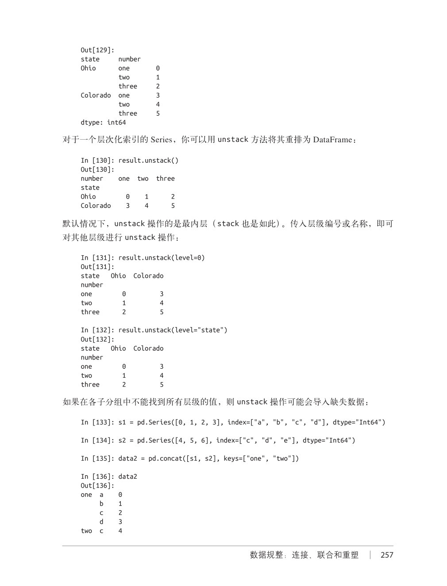

上一页 `result` 的输出：

```text
state     number
Ohio      one       0
          two       1
          three     2
Colorado  one       3
          two       4
          three     5
dtype: int64
```

对于一个层次化索引的 Series，你可以用 `unstack` 方法将其重排为 DataFrame：

```python
result.unstack()
```

```text
number    one  two  three
state
Ohio        0    1      2
Colorado    3    4      5
```

默认情况下，`unstack` 操作的是最内层（`stack` 也是如此）。传入层级编号或名称，即可对其他层级进行 `unstack` 操作：

```python
result.unstack(level=0)
```

```text
state   Ohio  Colorado
number
one        0         3
two        1         4
three      2         5
```

```python
result.unstack(level="state")
```

```text
state   Ohio  Colorado
number
one        0         3
two        1         4
three      2         5
```

如果在各子分组中不能找到所有层级的值，则 `unstack` 操作可能会导入缺失数据：

```python
s1 = pd.Series([0, 1, 2, 3], index=["a", "b", "c", "d"], dtype="Int64")
s2 = pd.Series([4, 5, 6], index=["c", "d", "e"], dtype="Int64")
data2 = pd.concat([s1, s2], keys=["one", "two"])
data2
```

```text
one  a    0
     b    1
     c    2
     d    3
two  c    4
```

输出续接下一页。

## PDF 第 268 页
<!-- page-status: reviewed -->
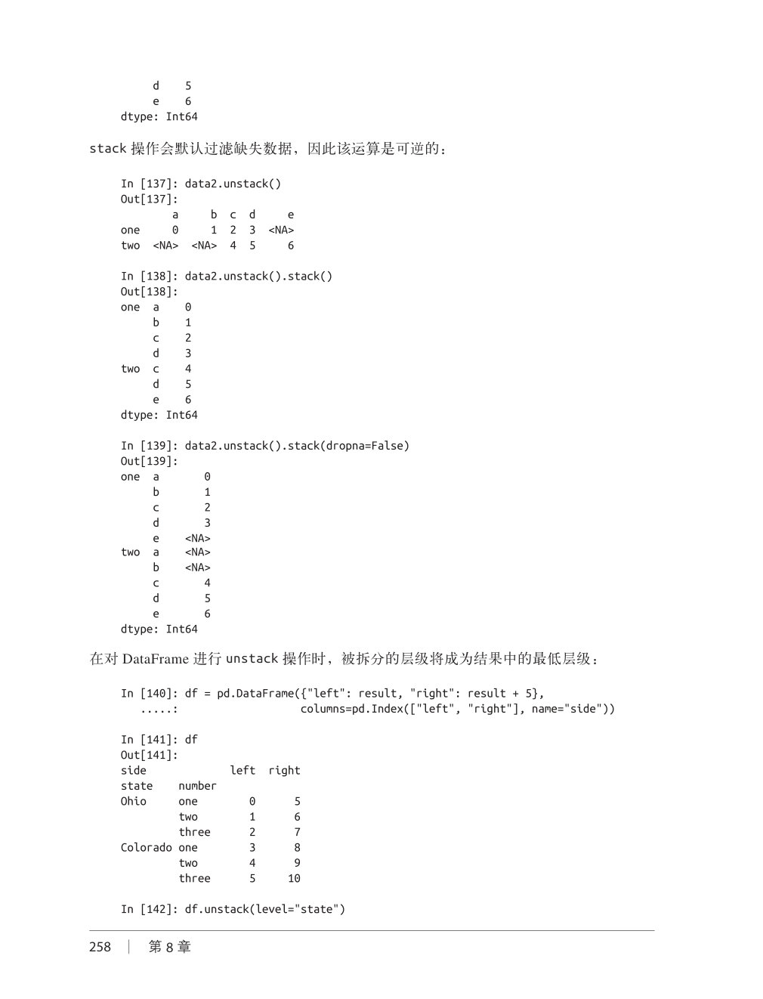

上一页 `data2` 输出的末尾：

```text
     d    5
     e    6
dtype: Int64
```

`stack` 操作会默认过滤缺失数据，因此该运算是可逆的：

```python
data2.unstack()
```

```text
        a     b  c  d     e
one     0     1  2  3  <NA>
two  <NA>  <NA>  4  5     6
```

```python
data2.unstack().stack()
```

```text
one  a    0
     b    1
     c    2
     d    3
two  c    4
     d    5
     e    6
dtype: Int64
```

```python
data2.unstack().stack(dropna=False)
```

```text
one  a       0
     b       1
     c       2
     d       3
     e    <NA>
two  a    <NA>
     b    <NA>
     c       4
     d       5
     e       6
dtype: Int64
```

在对 DataFrame 进行 `unstack` 操作时，被拆分的层级将成为结果中的最低层级：

```python
df = pd.DataFrame({"left": result, "right": result + 5},
                  columns=pd.Index(["left", "right"], name="side"))
df
```

```text
side             left  right
state    number
Ohio     one        0      5
         two        1      6
         three      2      7
Colorado one        3      8
         two        4      9
         three      5     10
```

```python
df.unstack(level="state")
```

输出续接下一页。

## PDF 第 269 页
<!-- page-status: reviewed -->
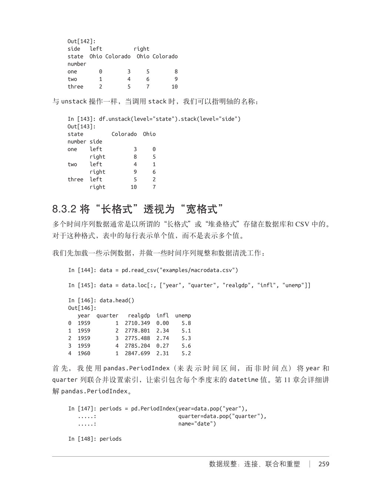

上一页 `df.unstack(level="state")` 的输出：

```text
side    left           right
state   Ohio Colorado  Ohio Colorado
number
one        0        3     5        8
two        1        4     6        9
three      2        5     7       10
```

与 `unstack` 操作一样，当调用 `stack` 时，我们可以指明轴的名称：

```python
df.unstack(level="state").stack(level="side")
```

```text
state         Colorado  Ohio
number side
one    left          3     0
       right         8     5
two    left          4     1
       right         9     6
three  left          5     2
       right        10     7
```

#### 8.3.2 将“长格式”透视为“宽格式”

多个时间序列数据通常是以所谓的“长格式”或“堆叠格式”存储在数据库和 CSV 中的。对于这种格式，表中的每行表示单个值，而不是表示多个值。

我们先加载一些示例数据，并做一些时间序列规整和数据清洗工作：

```python
data = pd.read_csv("examples/macrodata.csv")
data = data.loc[:, ["year", "quarter", "realgdp", "infl", "unemp"]]
data.head()
```

```text
   year  quarter   realgdp  infl  unemp
0  1959        1  2710.349  0.00    5.8
1  1959        2  2778.801  2.34    5.1
2  1959        3  2775.488  2.74    5.3
3  1959        4  2785.204  0.27    5.6
4  1960        1  2847.699  2.31    5.2
```

首先，我使用 `pandas.PeriodIndex`（来表示时间区间，而非时间点）将 `year` 和 `quarter` 列联合并设置索引，让索引包含每个季度末的 `datetime` 值。第 11 章会详细讲解 `pandas.PeriodIndex`。

```python
periods = pd.PeriodIndex(year=data.pop("year"),
                         quarter=data.pop("quarter"),
                         name="date")
periods
```

输出续接下一页。

## PDF 第 270 页
<!-- page-status: reviewed -->
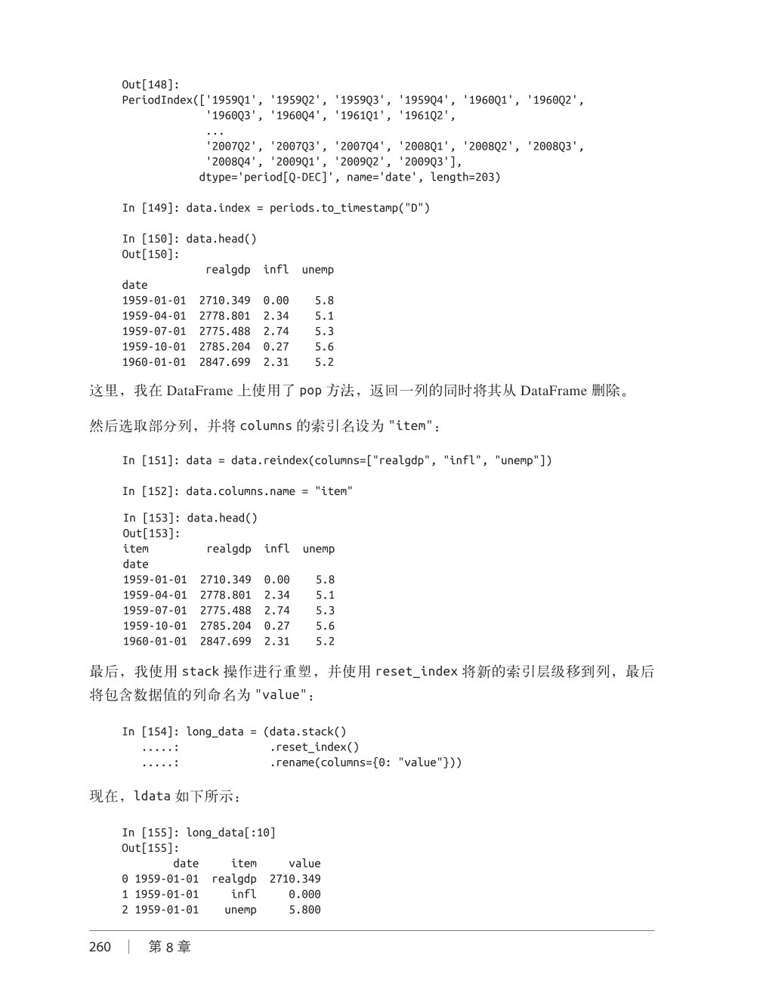

上一页 `periods` 的输出：

```text
PeriodIndex(['1959Q1', '1959Q2', '1959Q3', '1959Q4', '1960Q1', '1960Q2',
             '1960Q3', '1960Q4', '1961Q1', '1961Q2',
             ...
             '2007Q2', '2007Q3', '2007Q4', '2008Q1', '2008Q2', '2008Q3',
             '2008Q4', '2009Q1', '2009Q2', '2009Q3'],
            dtype='period[Q-DEC]', name='date', length=203)
```

```python
data.index = periods.to_timestamp("D")
data.head()
```

```text
             realgdp  infl  unemp
date
1959-01-01  2710.349  0.00    5.8
1959-04-01  2778.801  2.34    5.1
1959-07-01  2775.488  2.74    5.3
1959-10-01  2785.204  0.27    5.6
1960-01-01  2847.699  2.31    5.2
```

这里，我在 DataFrame 上使用了 `pop` 方法，返回一列的同时将其从 DataFrame 删除。然后选取部分列，并将 `columns` 的索引名设为 `"item"`：

```python
data = data.reindex(columns=["realgdp", "infl", "unemp"])
data.columns.name = "item"
data.head()
```

```text
item         realgdp  infl  unemp
date
1959-01-01  2710.349  0.00    5.8
1959-04-01  2778.801  2.34    5.1
1959-07-01  2775.488  2.74    5.3
1959-10-01  2785.204  0.27    5.6
1960-01-01  2847.699  2.31    5.2
```

最后，我使用 `stack` 操作进行重塑，并使用 `reset_index` 将新的索引层级移到列，最后将包含数据值的列命名为 `"value"`：

```python
long_data = (data.stack()
             .reset_index()
             .rename(columns={0: "value"}))
```

现在，`ldata` 如下所示：

> 原书正文称为 `ldata`，但示例代码中的变量名是 `long_data`。

```python
long_data[:10]
```

```text
        date     item     value
0 1959-01-01  realgdp  2710.349
1 1959-01-01     infl     0.000
2 1959-01-01    unemp     5.800
```

输出续接下一页。

## PDF 第 271 页
<!-- page-status: reviewed -->
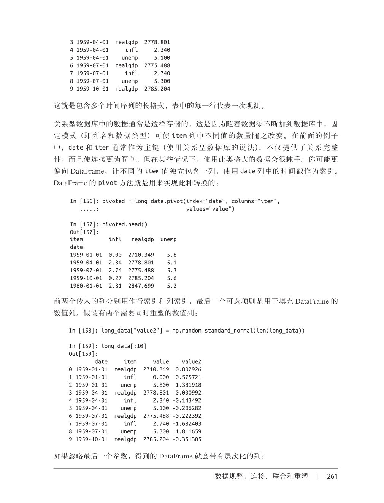

上一页输出继续：

```text
3 1959-04-01  realgdp  2778.801
4 1959-04-01     infl     2.340
5 1959-04-01    unemp     5.100
6 1959-07-01  realgdp  2775.488
7 1959-07-01     infl     2.740
8 1959-07-01    unemp     5.300
9 1959-10-01  realgdp  2785.204
```

这就是包含多个时间序列的长格式，表中的每一行代表一次观测。

关系型数据库中的数据通常是这样存储的，这是因为随着数据添不断加到数据库中，固定模式（即列名和数据类型）可使 `item` 列中不同值的数量随之改变。在前面的例子中，`date` 和 `item` 通常作为主键（使用关系型数据库的说法），不仅提供了关系完整性，而且使连接更为简单。但在某些情况下，使用此类格式的数据会很棘手。你可能更偏向 DataFrame，让不同的 `item` 值独立包含一列，使用 `date` 列中的时间戳作为索引。DataFrame 的 `pivot` 方法就是用来实现此种转换的：

```python
pivoted = long_data.pivot(index="date", columns="item", values="value")
pivoted.head()
```

```text
item        infl  realgdp  unemp
date
1959-01-01  0.00  2710.349    5.8
1959-04-01  2.34  2778.801    5.1
1959-07-01  2.74  2775.488    5.3
1959-10-01  0.27  2785.204    5.6
1960-01-01  2.31  2847.699    5.2
```

前两个传入的列分别用作行索引和列索引，最后一个可选项则是用于填充 DataFrame 的数值列。假设有两个需要同时重塑的数值列：

```python
long_data["value2"] = np.random.standard_normal(len(long_data))
long_data[:10]
```

```text
         date     item     value    value2
0  1959-01-01  realgdp  2710.349  0.802926
1  1959-01-01     infl     0.000  0.575721
2  1959-01-01    unemp     5.800  1.381918
3  1959-04-01  realgdp  2778.801  0.000992
4  1959-04-01     infl     2.340 -0.143492
5  1959-04-01    unemp     5.100 -0.206282
6  1959-07-01  realgdp  2775.488 -0.222392
7  1959-07-01     infl     2.740 -1.682403
8  1959-07-01    unemp     5.300  1.811659
9  1959-10-01  realgdp  2785.204 -0.351305
```

如果忽略最后一个参数，得到的 DataFrame 就会带有层次化的列：

## PDF 第 272 页
<!-- page-status: reviewed -->
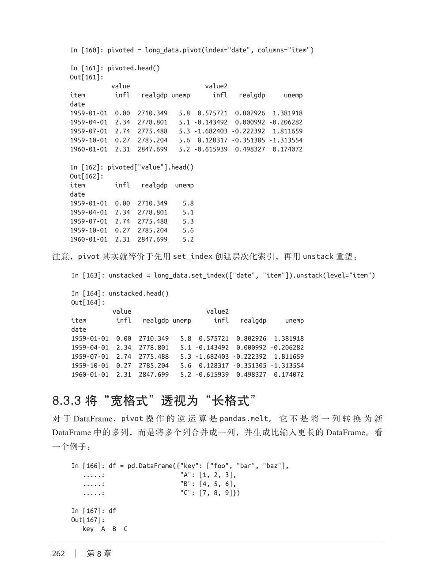

```python
pivoted = long_data.pivot(index="date", columns="item")
pivoted.head()
```

```text
             value                        value2
item          infl  realgdp  unemp          infl  realgdp     unemp
date
1959-01-01    0.00  2710.349   5.8      0.575721  0.802926  1.381918
1959-04-01    2.34  2778.801   5.1     -0.143492  0.000992 -0.206282
1959-07-01    2.74  2775.488   5.3     -1.682403 -0.222392  1.811659
1959-10-01    0.27  2785.204   5.6      0.128317 -0.351305 -1.313554
1960-01-01    2.31  2847.699   5.2     -0.615939  0.498327  0.174072
```

```python
pivoted["value"].head()
```

```text
item        infl  realgdp  unemp
date
1959-01-01  0.00  2710.349    5.8
1959-04-01  2.34  2778.801    5.1
1959-07-01  2.74  2775.488    5.3
1959-10-01  0.27  2785.204    5.6
1960-01-01  2.31  2847.699    5.2
```

注意，`pivot` 其实就等价于先用 `set_index` 创建层次化索引，再用 `unstack` 重塑：

```python
unstacked = long_data.set_index(["date", "item"]).unstack(level="item")
unstacked.head()
```

```text
             value                        value2
item          infl  realgdp  unemp          infl  realgdp     unemp
date
1959-01-01    0.00  2710.349   5.8      0.575721  0.802926  1.381918
1959-04-01    2.34  2778.801   5.1     -0.143492  0.000992 -0.206282
1959-07-01    2.74  2775.488   5.3     -1.682403 -0.222392  1.811659
1959-10-01    0.27  2785.204   5.6      0.128317 -0.351305 -1.313554
1960-01-01    2.31  2847.699   5.2     -0.615939  0.498327  0.174072
```

### 8.3.3 将“宽格式”透视为“长格式”

对于 DataFrame，`pivot` 操作的逆运算是 `pandas.melt`。它不是将一列转换为新 DataFrame 中的多列，而是将多个列合并成一列，并生成比输入更长的 DataFrame。看一个例子：

```python
df = pd.DataFrame({"key": ["foo", "bar", "baz"],
                   "A": [1, 2, 3],
                   "B": [4, 5, 6],
                   "C": [7, 8, 9]})
df
```

原书输出跨至下一页，完整输出如下：

```text
   key  A  B  C
0  foo  1  4  7
1  bar  2  5  8
2  baz  3  6  9
```

## PDF 第 273 页
<!-- page-status: reviewed -->
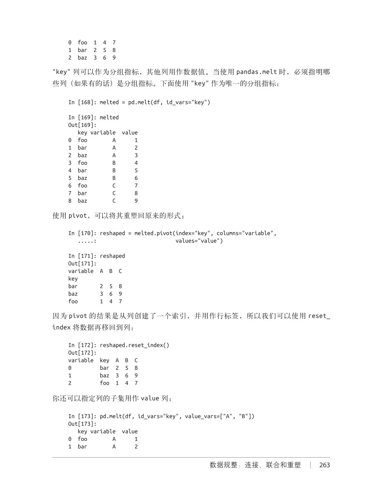

本页顶部续接上一页 `df` 的输出。

`"key"` 列可以作为分组指标，其他列用作数据值。当使用 `pandas.melt` 时，必须指明哪些列（如果有的话）是分组指标。下面使用 `"key"` 作为唯一的分组指标：

```python
melted = pd.melt(df, id_vars="key")
melted
```

```text
   key variable  value
0  foo        A      1
1  bar        A      2
2  baz        A      3
3  foo        B      4
4  bar        B      5
5  baz        B      6
6  foo        C      7
7  bar        C      8
8  baz        C      9
```

使用 `pivot`，可以将其重塑回原来的形式：

```python
reshaped = melted.pivot(index="key", columns="variable", values="value")
reshaped
```

```text
variable  A  B  C
key
bar       2  5  8
baz       3  6  9
foo       1  4  7
```

因为 `pivot` 的结果是从列创建了一个索引，并用作行标签，所以我们可以使用 `reset_index` 将数据再移回到列：

```python
reshaped.reset_index()
```

```text
variable  key  A  B  C
0         bar  2  5  8
1         baz  3  6  9
2         foo  1  4  7
```

你还可以指定列的子集用作 `value` 列：

```python
pd.melt(df, id_vars="key", value_vars=["A", "B"])
```

原书输出跨至下一页，完整输出如下：

```text
   key variable  value
0  foo        A      1
1  bar        A      2
2  baz        A      3
3  foo        B      4
4  bar        B      5
5  baz        B      6
```

## PDF 第 274 页
<!-- page-status: reviewed -->
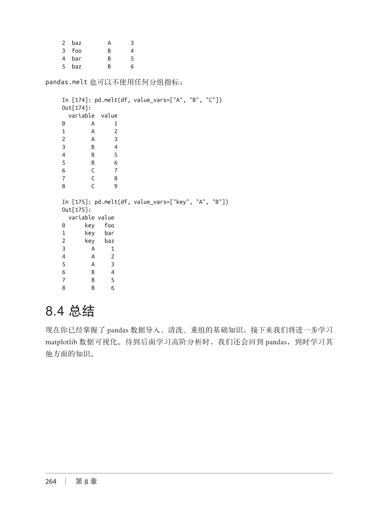

本页顶部续接上一页 `pd.melt(df, id_vars="key", value_vars=["A", "B"])` 的输出。

`pandas.melt` 也可以不使用任何分组指标：

```python
pd.melt(df, value_vars=["A", "B", "C"])
```

```text
  variable  value
0        A      1
1        A      2
2        A      3
3        B      4
4        B      5
5        B      6
6        C      7
7        C      8
8        C      9
```

```python
pd.melt(df, value_vars=["key", "A", "B"])
```

```text
  variable value
0      key   foo
1      key   bar
2      key   baz
3        A     1
4        A     2
5        A     3
6        B     4
7        B     5
8        B     6
```

### 8.4 总结

现在你已经掌握了 pandas 数据导入、清洗、重组的基础知识，接下来我们将进一步学习 matplotlib 数据可视化。待到后面学习高阶分析时，我们还会回到 pandas，到时学习其他方面的知识。

