# 第 9 章 绘图和可视化

[返回目录](../README.md)

> 本章 PDF 第 275–304 页已由 AI 对照原页图整理为可编辑 Markdown；原页图仍是校对依据。代码块已做语法检查，未逐块运行，也未经人工复核。

## PDF 第 275 页

<!-- page-status: reviewed -->
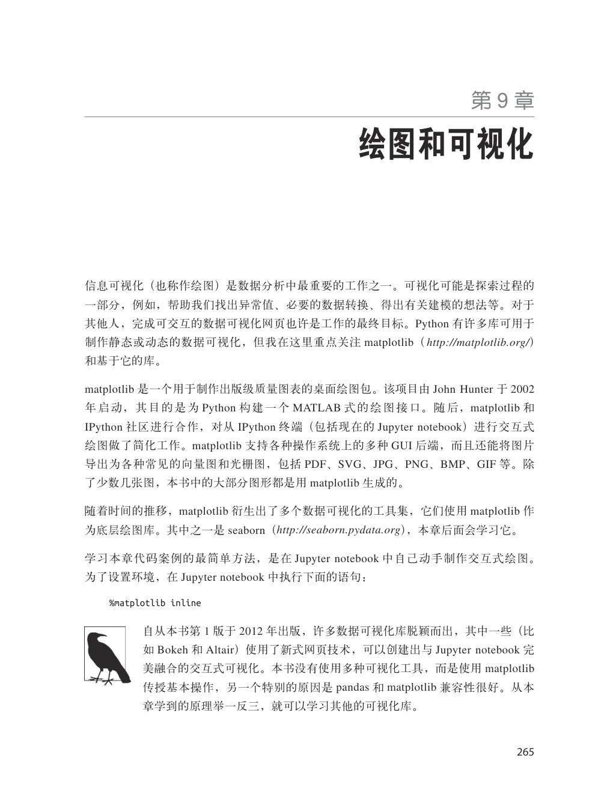

信息可视化（也称作绘图）是数据分析中最重要的工作之一。可视化可能是探索过程的一部分，例如，帮助我们找出异常值、必要的数据转换、得出有关建模的想法等。对于其他人，完成可交互的数据可视化网页也许是工作的最终目标。Python 有许多库可用于制作静态或动态的数据可视化，但我在这里重点关注 matplotlib（http://matplotlib.org/）和基于它的库。

matplotlib 是一个用于制作出版级质量图表的桌面绘图包。该项目由 John Hunter 于 2002 年启动，其目的是为 Python 构建一个 MATLAB 式的绘图接口。随后，matplotlib 和 IPython 社区进行合作，对从 IPython 终端（包括现在的 Jupyter notebook）进行交互式绘图做了简化工作。matplotlib 支持各种操作系统上的多种 GUI 后端，而且还能将图片导出为各种常见的向量图和光栅图，包括 PDF、SVG、JPG、PNG、BMP、GIF 等。除了少数几张图，本书中的大部分图形都是用 matplotlib 生成的。

随着时间的推移，matplotlib 衍生出了多个数据可视化的工具集，它们使用 matplotlib 作为底层绘图库。其中之一是 seaborn（http://seaborn.pydata.org），本章后面会学习它。

学习本章代码案例的最简单方法，是在 Jupyter notebook 中自己动手制作交互式绘图。为了设置环境，在 Jupyter notebook 中执行下面的语句：

```ipython
%matplotlib inline
```

> 自从本书第 1 版于 2012 年出版，许多数据可视化库脱颖而出，其中一些（比如 Bokeh 和 Altair）使用了新式网页技术，可以创建出与 Jupyter notebook 完美融合的交互式可视化。本书没有使用多种可视化工具，而是使用 matplotlib 传授基本操作，另一个特别的原因是 pandas 和 matplotlib 兼容性很好。从本章学到的原理举一反三，就可以学习其他的可视化库。

## PDF 第 276 页

<!-- page-status: reviewed -->
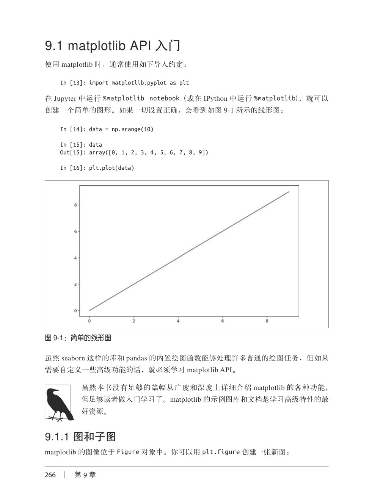

### 9.1 matplotlib API 入门

使用 matplotlib 时，通常使用如下导入约定：

```python
import matplotlib.pyplot as plt
```

在 Jupyter 中运行 `%matplotlib notebook`（或在 IPython 中运行 `%matplotlib`），就可以创建一个简单的图形。如果一切设置正确，会看到如图 9-1 所示的线形图：

```python
data = np.arange(10)
data
```

```text
array([0, 1, 2, 3, 4, 5, 6, 7, 8, 9])
```

```python
plt.plot(data)
```

图 9-1：简单的线形图（见本页原图）。

虽然 seaborn 这样的库和 pandas 的内置绘图函数能够处理许多普通的绘图任务，但如果需要自定义一些高级功能的话，就必须学习 matplotlib API。

> 虽然本书没有足够的篇幅从广度和深度上详细介绍 matplotlib 的各种功能，但足够读者做入门学习了。matplotlib 的示例图库和文档是学习高级特性的最好资源。

### 9.1.1 图和子图

matplotlib 的图像位于 Figure 对象中。你可以用 `plt.figure` 创建一张新图（代码见下一页）。

## PDF 第 277 页

<!-- page-status: reviewed -->
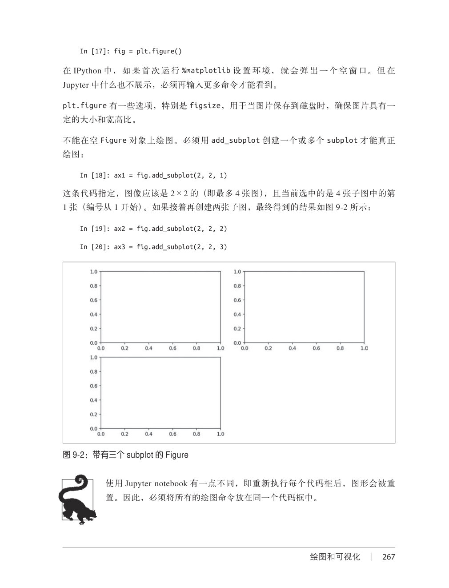

```python
fig = plt.figure()
```

在 IPython 中，如果首次运行 `%matplotlib` 设置环境，就会弹出一个空窗口。但在 Jupyter 中什么也不展示，必须再输入更多命令才能看到。

`plt.figure` 有一些选项，特别是 `figsize`，用于当图片保存到磁盘时，确保图片具有一定的大小和宽高比。

不能在空 Figure 对象上绘图。必须用 `add_subplot` 创建一个或多个 subplot 才能真正绘图：

```python
ax1 = fig.add_subplot(2, 2, 1)
```

这条代码指定，图像应该是 2×2 的（即最多 4 张图），且当前选中的是 4 张子图中的第 1 张（编号从 1 开始）。如果接着再创建两张子图，最终得到的结果如图 9-2 所示：

```python
ax2 = fig.add_subplot(2, 2, 2)
ax3 = fig.add_subplot(2, 2, 3)
```

图 9-2：带有三个 subplot 的 Figure（见本页原图）。

> 使用 Jupyter notebook 有一点不同，即重新执行每个代码框后，图形会被重置。因此，必须将所有的绘图命令放在同一个代码框中。

## PDF 第 278 页

<!-- page-status: reviewed -->
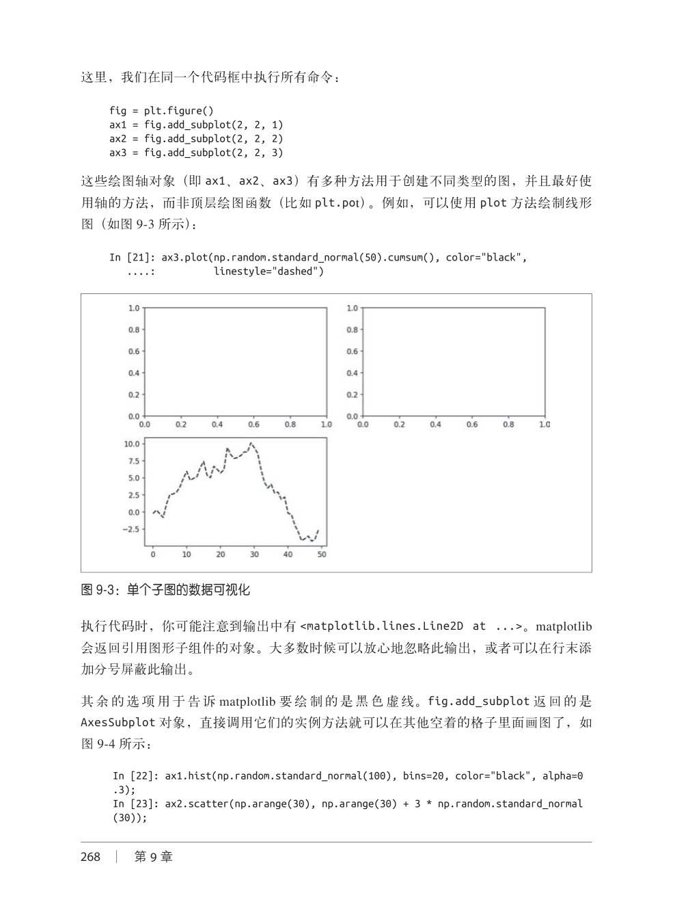

这里，我们在同一个代码框中执行所有命令：

```python
fig = plt.figure()
ax1 = fig.add_subplot(2, 2, 1)
ax2 = fig.add_subplot(2, 2, 2)
ax3 = fig.add_subplot(2, 2, 3)
```

这些绘图轴对象（即 `ax1`、`ax2`、`ax3`）有多种方法用于创建不同类型的图，并且最好使用轴的方法，而非顶层绘图函数（比如 `plt.pot`）。例如，可以使用 `plot` 方法绘制线形图（如图 9-3 所示）：

> 注：`plt.pot` 为原书的拼写，常用的函数是 `plt.plot`。

```python
ax3.plot(np.random.standard_normal(50).cumsum(), color="black",
         linestyle="dashed")
```

图 9-3：单个子图的数据可视化（见本页原图）。

执行代码时，你可能注意到输出中有 `<matplotlib.lines.Line2D at ...>`。matplotlib 会返回引用图形子组件的对象。大多数时候可以放心地忽略此输出，或者可以在行末添加分号屏蔽此输出。

其余的选项用于告诉 matplotlib 要绘制的是黑色虚线。`fig.add_subplot` 返回的是 `AxesSubplot` 对象，直接调用它们的实例方法就可以在其他空着的格子里面画图了，如图 9-4 所示：

```python
ax1.hist(np.random.standard_normal(100), bins=20, color="black", alpha=0.3);
ax2.scatter(np.arange(30), np.arange(30) + 3 * np.random.standard_normal(30));
```

## PDF 第 279 页

<!-- page-status: reviewed -->
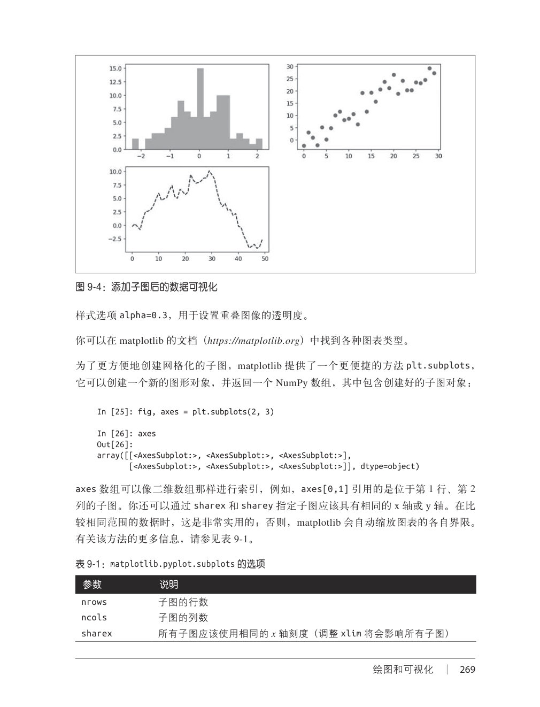

图 9-4：添加子图后的数据可视化（见本页原图）。

样式选项 `alpha=0.3`，用于设置重叠图像的透明度。

你可以在 matplotlib 的文档（https://matplotlib.org）中找到各种图表类型。

为了更方便地创建网格化的子图，matplotlib 提供了一个更便捷的方法 `plt.subplots`，它可以创建一个新的图形对象，并返回一个 NumPy 数组，其中包含创建好的子图对象：

```python
fig, axes = plt.subplots(2, 3)
axes
```

```text
array([[<AxesSubplot:>, <AxesSubplot:>, <AxesSubplot:>],
       [<AxesSubplot:>, <AxesSubplot:>, <AxesSubplot:>]], dtype=object)
```

`axes` 数组可以像二维数组那样进行索引，例如，`axes[0,1]` 引用的是位于第 1 行、第 2 列的子图。你还可以通过 `sharex` 和 `sharey` 指定子图应该具有相同的 x 轴或 y 轴。在比较相同范围的数据时，这是非常实用的；否则，matplotlib 会自动缩放图表的各自界限。有关该方法的更多信息，请参见表 9-1。

表 9-1：matplotlib.pyplot.subplots 的选项（下页续）

| 参数 | 说明 |
| --- | --- |
| `nrows` | 子图的行数 |
| `ncols` | 子图的列数 |
| `sharex` | 所有子图应该使用相同的 x 轴刻度（调整 `xlim` 将会影响所有子图） |

## PDF 第 280 页

<!-- page-status: reviewed -->
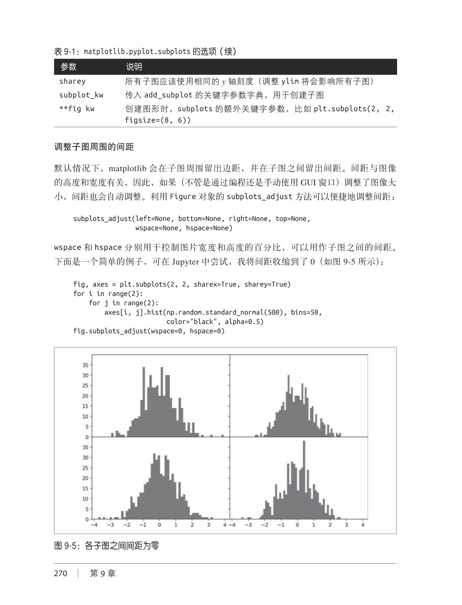

表 9-1：matplotlib.pyplot.subplots 的选项（续）

| 参数 | 说明 |
| --- | --- |
| `sharey` | 所有子图应该使用相同的 y 轴刻度（调整 `ylim` 将会影响所有子图） |
| `subplot_kw` | 传入 `add_subplot` 的关键字参数字典，用于创建子图 |
| `**fig kw`（原文） | 创建图形时，`subplots` 的额外关键字参数，比如 `plt.subplots(2, 2, figsize=(8, 6))` |

#### 调整子图周围的间距

默认情况下，matplotlib 会在子图周围留出边距，并在子图之间留出间距。间距与图像的高度和宽度有关，因此，如果（不管是通过编程还是手动使用 GUI 窗口）调整了图像大小，间距也会自动调整。利用 Figure 对象的 `subplots_adjust` 方法可以便捷地调整间距：

```python
subplots_adjust(left=None, bottom=None, right=None, top=None,
                wspace=None, hspace=None)
```

`wspace` 和 `hspace` 分别用于控制图片宽度和高度的百分比，可以用作子图之间的间距。下面是一个简单的例子，可在 Jupyter 中尝试，我将间距收缩到了 0（如图 9-5 所示）：

```python
fig, axes = plt.subplots(2, 2, sharex=True, sharey=True)
for i in range(2):
    for j in range(2):
        axes[i, j].hist(np.random.standard_normal(500), bins=50,
                        color="black", alpha=0.5)
fig.subplots_adjust(wspace=0, hspace=0)
```

图 9-5：各子图之间间距为零（见本页原图）。


## PDF 第 281 页

<!-- page-status: reviewed -->
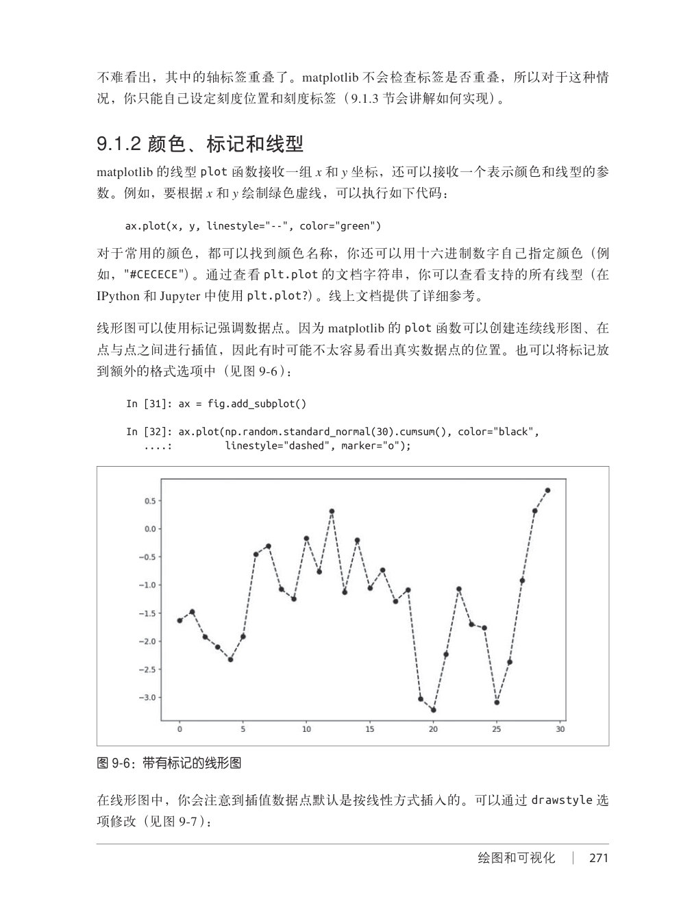

不难看出，其中的轴标签重叠了。matplotlib 不会检查标签是否重叠，所以对于这种情况，你只能自己设定刻度位置和刻度标签（9.1.3 节会讲解如何实现）。

### 9.1.2 颜色、标记和线型

matplotlib 的线型 `plot` 函数接收一组 x 和 y 坐标，还可以接收一个表示颜色和线型的参数。例如，要根据 x 和 y 绘制绿色虚线，可以执行如下代码：

```python
ax.plot(x, y, linestyle="--", color="green")
```

对于常用的颜色，都可以找到颜色名称，你还可以用十六进制数字自己指定颜色（例如，`"#CECECE"`）。通过查看 `plt.plot` 的文档字符串，你可以查看支持的所有线型（在 IPython 和 Jupyter 中使用 `plt.plot?`）。线上文档提供了详细参考。

线形图可以使用标记强调数据点。因为 matplotlib 的 `plot` 函数可以创建连续线形图、在点与点之间进行插值，因此有时可能不太容易看出真实数据点的位置。也可以将标记放到额外的格式选项中（见图 9-6）：

```python
ax = fig.add_subplot()
ax.plot(np.random.standard_normal(30).cumsum(), color="black",
        linestyle="dashed", marker="o");
```

图 9-6：带有标记的线形图（见本页原图）。

在线形图中，你会注意到插值数据点默认是按线性方式插入的。可以通过 `drawstyle` 选项修改（见图 9-7，代码续下页）：

## PDF 第 282 页

<!-- page-status: reviewed -->
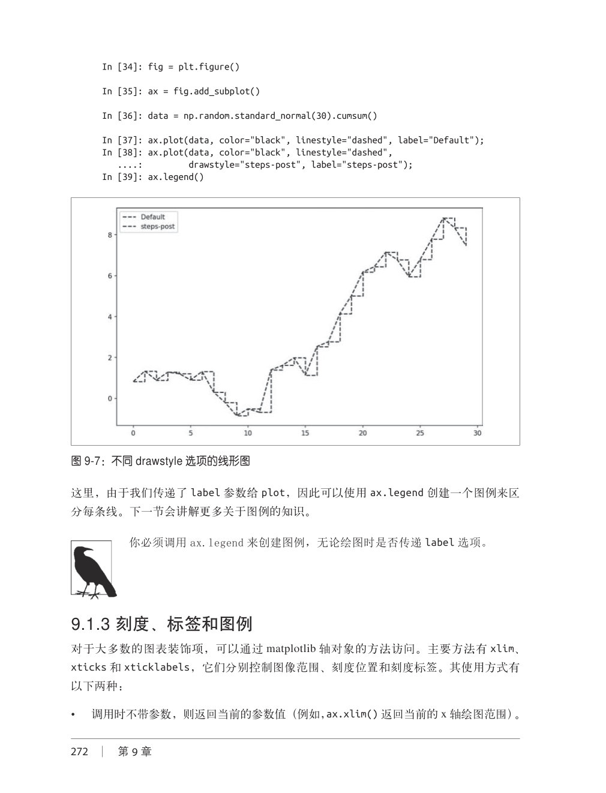

```python
fig = plt.figure()
ax = fig.add_subplot()
data = np.random.standard_normal(30).cumsum()
ax.plot(data, color="black", linestyle="dashed", label="Default");
ax.plot(data, color="black", linestyle="dashed",
        drawstyle="steps-post", label="steps-post");
ax.legend()
```

图 9-7：不同 drawstyle 选项的线形图（见本页原图）。

这里，由于我们传递了 `label` 参数给 `plot`，因此可以使用 `ax.legend` 创建一个图例来区分每条线。下一节会讲解更多关于图例的知识。

> 你必须调用 `ax.legend` 来创建图例，无论绘图时是否传递 `label` 选项。

### 9.1.3 刻度、标签和图例

对于大多数的图表装饰项，可以通过 matplotlib 轴对象的方法访问。主要方法有 `xlim`、`xticks` 和 `xticklabels`，它们分别控制图像范围、刻度位置和刻度标签。其使用方式有以下两种：

- 调用时不带参数，则返回当前的参数值（例如，`ax.xlim()` 返回当前的 x 轴绘图范围）。

> 原文使用 `ax.xlim()`；轴对象通常使用 `ax.get_xlim()` 获取范围，使用 `ax.set_xlim(...)` 设置范围。

## PDF 第 283 页

<!-- page-status: reviewed -->
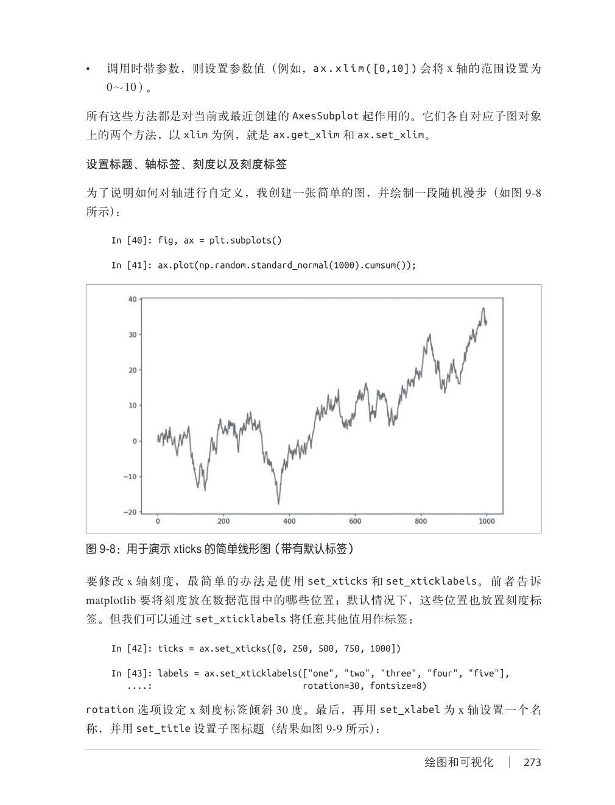

- 调用时带参数，则设置参数值（例如，`ax.xlim([0,10])` 会将 x 轴的范围设置为 0～10）。

> 上例按原文保留；轴对象应使用 `ax.set_xlim([0, 10])`。

所有这些方法都是对当前或最近创建的 `AxesSubplot` 起作用的。它们各自对应子图对象上的两个方法，以 `xlim` 为例，就是 `ax.get_xlim` 和 `ax.set_xlim`。

#### 设置标题、轴标签、刻度以及刻度标签

为了说明如何对轴进行自定义，我创建一张简单的图，并绘制一段随机漫步（如图 9-8 所示）：

```python
fig, ax = plt.subplots()
ax.plot(np.random.standard_normal(1000).cumsum());
```

图 9-8：用于演示 xticks 的简单线形图（带有默认标签）（见本页原图）。

要修改 x 轴刻度，最简单的办法是使用 `set_xticks` 和 `set_xticklabels`。前者告诉 matplotlib 要将刻度放在数据范围中的哪些位置；默认情况下，这些位置也放置刻度标签。但我们可以通过 `set_xticklabels` 将任意其他值用作标签：

```python
ticks = ax.set_xticks([0, 250, 500, 750, 1000])
labels = ax.set_xticklabels(["one", "two", "three", "four", "five"],
                            rotation=30, fontsize=8)
```

`rotation` 选项设定 x 刻度标签倾斜 30 度。最后，再用 `set_xlabel` 为 x 轴设置一个名称，并用 `set_title` 设置子图标题（结果如图 9-9 所示，代码续下页）：

## PDF 第 284 页

<!-- page-status: reviewed -->
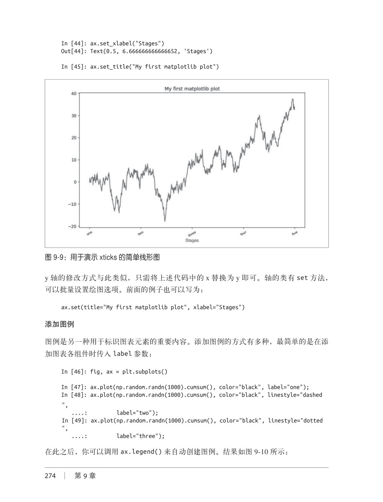

```python
ax.set_xlabel("Stages")
```

```text
Text(0.5, 6.666666666666652, 'Stages')
```

```python
ax.set_title("My first matplotlib plot")
```

图 9-9：用于演示 xticks 的简单线形图（见本页原图）。

y 轴的修改方式与此类似，只需将上述代码中的 x 替换为 y 即可。轴的类有 `set` 方法，可以批量设置绘图选项。前面的例子也可以写为：

```python
ax.set(title="My first matplotlib plot", xlabel="Stages")
```

#### 添加图例

图例是另一种用于标识图表元素的重要内容。添加图例的方式有多种，最简单的是在添加图表各组件时传入 `label` 参数：

```python
fig, ax = plt.subplots()
ax.plot(np.random.randn(1000).cumsum(), color="black", label="one");
ax.plot(np.random.randn(1000).cumsum(), color="black", linestyle="dashed",
        label="two");
ax.plot(np.random.randn(1000).cumsum(), color="black", linestyle="dotted",
        label="three");
```

在此之后，你可以调用 `ax.legend()` 来自动创建图例。结果如图 9-10 所示（代码续下页）：

## PDF 第 285 页

<!-- page-status: reviewed -->
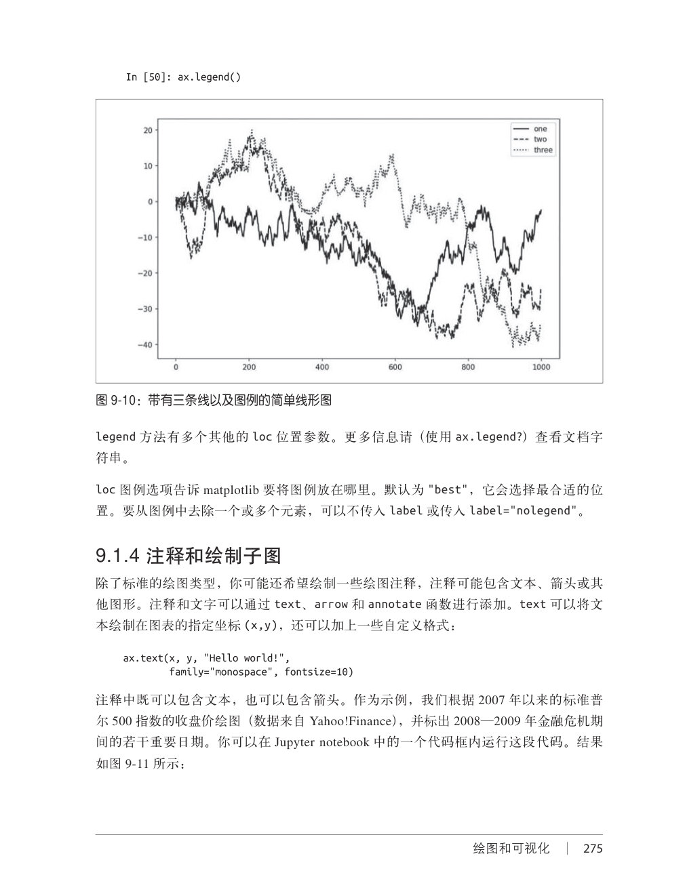

```python
ax.legend()
```

图 9-10：带有三条线以及图例的简单线形图（见本页原图）。

`legend` 方法有多个其他的 `loc` 位置参数。更多信息请（使用 `ax.legend?`）查看文档字符串。

`loc` 图例选项告诉 matplotlib 要将图例放在哪里。默认为 `"best"`，它会选择最合适的位置。要从图例中去除一个或多个元素，可以不传入 `label` 或传入 `label="nolegend"`。

### 9.1.4 注释和绘制子图

除了标准的绘图类型，你可能还希望绘制一些绘图注释，注释可能包含文本、箭头或其他图形。注释和文字可以通过 `text`、`arrow` 和 `annotate` 函数进行添加。`text` 可以将文本绘制在图表的指定坐标 `(x, y)`，还可以加上一些自定义格式：

```python
ax.text(x, y, "Hello world!",
        family="monospace", fontsize=10)
```

注释中既可以包含文本，也可以包含箭头。作为示例，我们根据 2007 年以来的标准普尔 500 指数的收盘价绘图（数据来自 Yahoo!Finance），并标出 2008—2009 年金融危机期间的若干重要日期。你可以在 Jupyter notebook 中的一个代码框内运行这段代码。结果如图 9-11 所示（代码续下页）：

## PDF 第 286 页

<!-- page-status: reviewed -->
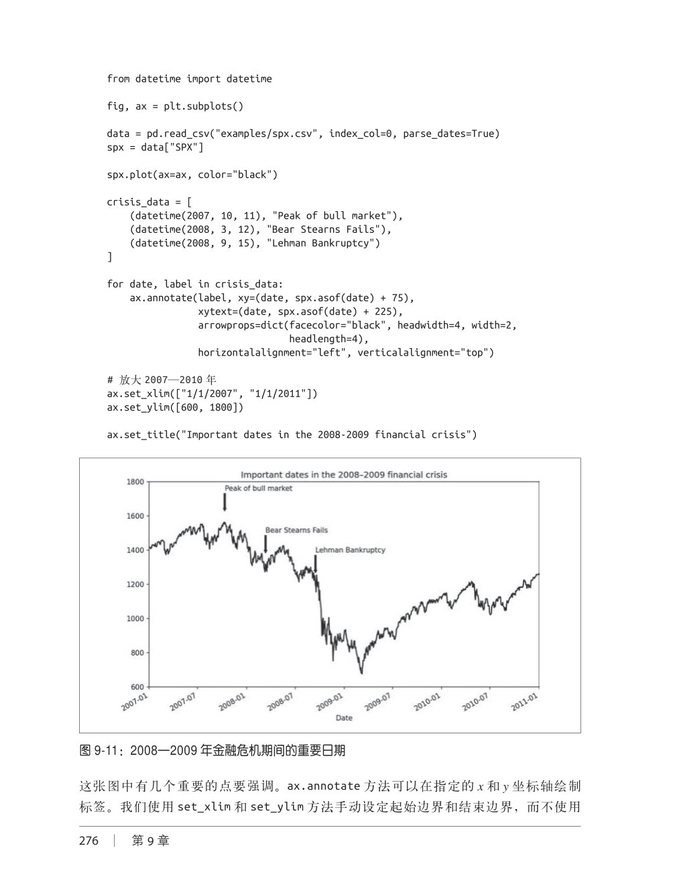

```python
from datetime import datetime

fig, ax = plt.subplots()

data = pd.read_csv("examples/spx.csv", index_col=0, parse_dates=True)
spx = data["SPX"]

spx.plot(ax=ax, color="black")

crisis_data = [
    (datetime(2007, 10, 11), "Peak of bull market"),
    (datetime(2008, 3, 12), "Bear Stearns Fails"),
    (datetime(2008, 9, 15), "Lehman Bankruptcy")
]

for date, label in crisis_data:
    ax.annotate(label, xy=(date, spx.asof(date) + 75),
                xytext=(date, spx.asof(date) + 225),
                arrowprops=dict(facecolor="black", headwidth=4, width=2,
                                headlength=4),
                horizontalalignment="left", verticalalignment="top")

# 放大 2007—2010 年
ax.set_xlim(["1/1/2007", "1/1/2011"])
ax.set_ylim([600, 1800])

ax.set_title("Important dates in the 2008-2009 financial crisis")
```

图 9-11：2008—2009 年金融危机期间的重要日期（见本页原图）。

这张图中有几个重要的点要强调。`ax.annotate` 方法可以在指定的 x 和 y 坐标轴绘制标签。我们使用 `set_xlim` 和 `set_ylim` 方法手动设定起始边界和结束边界，而不使用

## PDF 第 287 页

<!-- page-status: reviewed -->
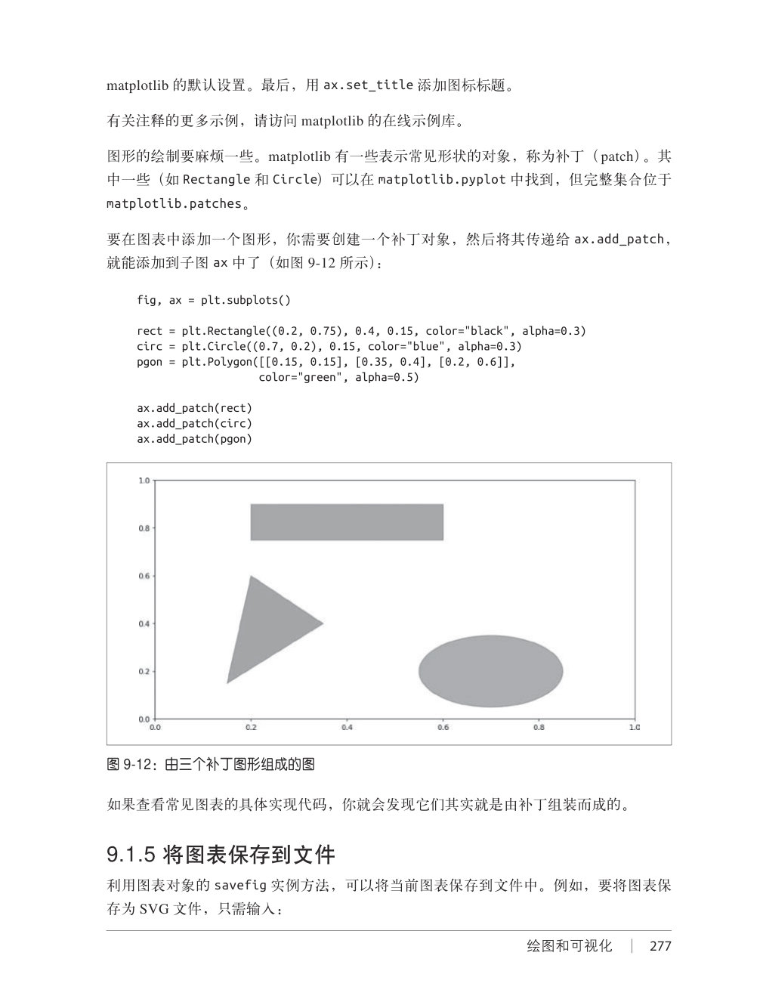

matplotlib 的默认设置。最后，用 `ax.set_title` 添加图标标题。

有关注释的更多示例，请访问 matplotlib 的在线示例库。

图形的绘制要麻烦一些。matplotlib 有一些表示常见形状的对象，称为补丁（patch）。其中一些（如 Rectangle 和 Circle）可以在 `matplotlib.pyplot` 中找到，但完整集合位于 `matplotlib.patches`。

要在图表中添加一个图形，你需要创建一个补丁对象，然后将其传递给 `ax.add_patch`，就能添加到子图 `ax` 中了（如图 9-12 所示）：

```python
fig, ax = plt.subplots()

rect = plt.Rectangle((0.2, 0.75), 0.4, 0.15, color="black", alpha=0.3)
circ = plt.Circle((0.7, 0.2), 0.15, color="blue", alpha=0.3)
pgon = plt.Polygon([[0.15, 0.15], [0.35, 0.4], [0.2, 0.6]],
                   color="green", alpha=0.5)

ax.add_patch(rect)
ax.add_patch(circ)
ax.add_patch(pgon)
```

图 9-12：由三个补丁图形组成的图（见本页原图）。

如果查看常见图表的具体实现代码，你就会发现它们其实就是由补丁组装而成的。

### 9.1.5 将图表保存到文件

利用图表对象的 `savefig` 实例方法，可以将当前图表保存到文件中。例如，要将图表保存为 SVG 文件，只需输入（见下一页）：

## PDF 第 288 页

<!-- page-status: reviewed -->
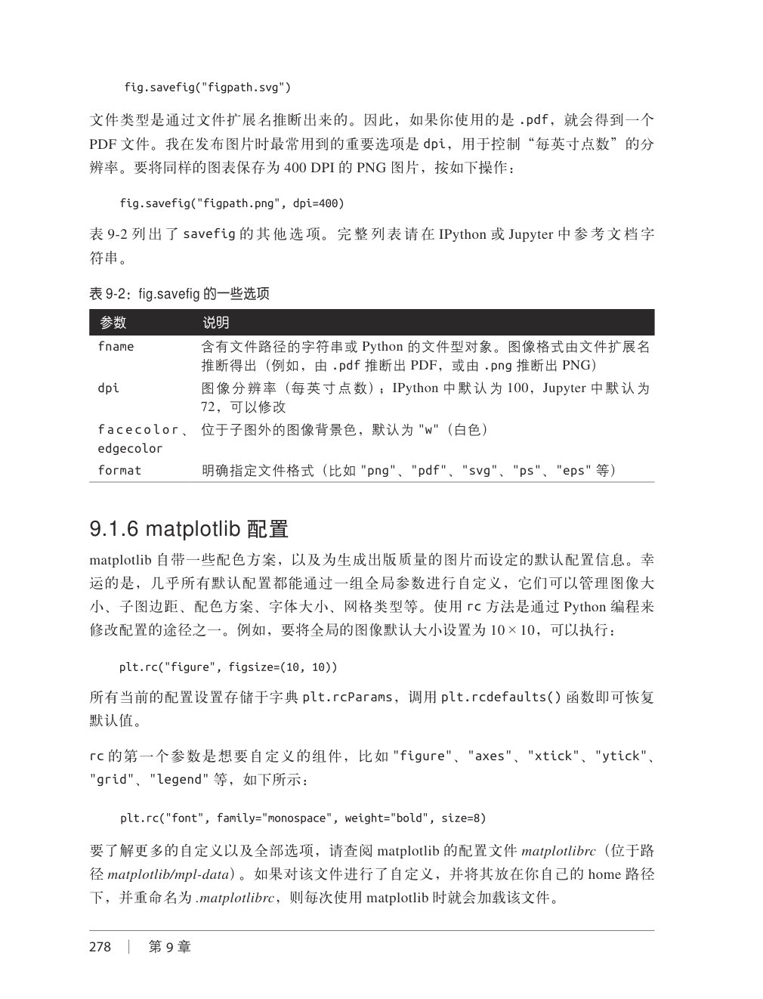

```python
fig.savefig("figpath.svg")
```

文件类型是通过文件扩展名推断出来的。因此，如果你使用的是 `.pdf`，就会得到一个 PDF 文件。我在发布图片时最常用到的重要选项是 `dpi`，用于控制“每英寸点数”的分辨率。要将同样的图表保存为 400 DPI 的 PNG 图片，按如下操作：

```python
fig.savefig("figpath.png", dpi=400)
```

表 9-2 列出了 `savefig` 的其他选项。完整列表请在 IPython 或 Jupyter 中参考文档字符串。

表 9-2：fig.savefig 的一些选项

| 参数 | 说明 |
| --- | --- |
| `fname` | 含有文件路径的字符串或 Python 的文件型对象。图像格式由文件扩展名推断得出（例如，由 `.pdf` 推断出 PDF，或由 `.png` 推断出 PNG） |
| `dpi` | 图像分辨率（每英寸点数）；IPython 中默认为 100，Jupyter 中默认为 72，可以修改 |
| `facecolor`、`edgecolor` | 位于子图外的图像背景色，默认为 `"w"`（白色） |
| `format` | 明确指定文件格式（比如 `"png"`、`"pdf"`、`"svg"`、`"ps"`、`"eps"` 等） |

### 9.1.6 matplotlib 配置

matplotlib 自带一些配色方案，以及为生成出版质量的图片而设定的默认配置信息。幸运的是，几乎所有默认配置都能通过一组全局参数进行自定义，它们可以管理图像大小、子图边距、配色方案、字体大小、网格类型等。使用 `rc` 方法是通过 Python 编程来修改配置的途径之一。例如，要将全局的图像默认大小设置为 10×10，可以执行：

```python
plt.rc("figure", figsize=(10, 10))
```

所有当前的配置设置存储于字典 `plt.rcParams`，调用 `plt.rcdefaults()` 函数即可恢复默认值。

`rc` 的第一个参数是想要自定义的组件，比如 `"figure"`、`"axes"`、`"xtick"`、`"ytick"`、`"grid"`、`"legend"` 等，如下所示：

```python
plt.rc("font", family="monospace", weight="bold", size=8)
```

要了解更多的自定义以及全部选项，请查阅 matplotlib 的配置文件 `matplotlibrc`（位于路径 `matplotlib/mpl-data`）。如果对该文件进行了自定义，并将其放在你自己的 home 路径下，并重命名为 `.matplotlibrc`，则每次使用 matplotlib 时就会加载该文件。

## PDF 第 289 页

<!-- page-status: reviewed -->
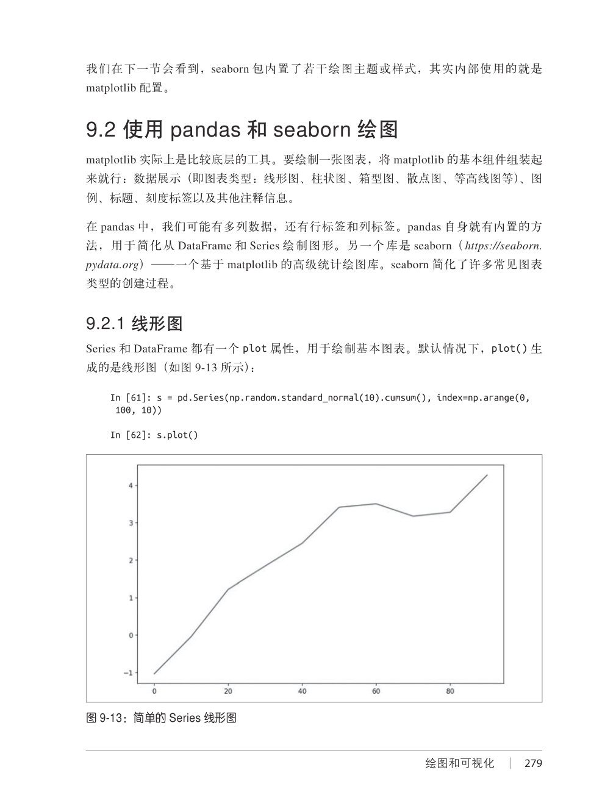

我们在下一节会看到，seaborn 包内置了若干绘图主题或样式，其实内部使用的就是 matplotlib 配置。

### 9.2 使用 pandas 和 seaborn 绘图

matplotlib 实际上是比较底层的工具。要绘制一张图表，将 matplotlib 的基本组件组装起来就行：数据展示（即图表类型：线形图、柱状图、箱型图、散点图、等高线图等）、图例、标题、刻度标签以及其他注释信息。

在 pandas 中，我们可能有多列数据，还有行标签和列标签。pandas 自身就有内置的方法，用于简化从 DataFrame 和 Series 绘制图形。另一个库是 seaborn（https://seaborn.pydata.org）——一个基于 matplotlib 的高级统计绘图库。seaborn 简化了许多常见图表类型的创建过程。

### 9.2.1 线形图

Series 和 DataFrame 都有一个 `plot` 属性，用于绘制基本图表。默认情况下，`plot()` 生成的是线形图（如图 9-13 所示）：

```python
s = pd.Series(np.random.standard_normal(10).cumsum(), index=np.arange(0, 100, 10))
s.plot()
```

图 9-13：简单的 Series 线形图（见本页原图）。

## PDF 第 290 页

<!-- page-status: reviewed -->
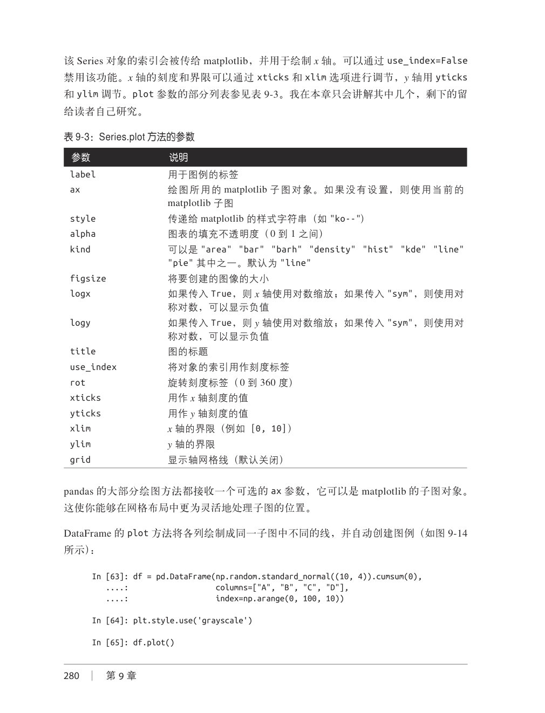

该 Series 对象的索引会被传给 matplotlib，并用于绘制 x 轴。可以通过 `use_index=False` 禁用该功能。x 轴的刻度和界限可以通过 `xticks` 和 `xlim` 选项进行调节，y 轴用 `yticks` 和 `ylim` 调节。`plot` 参数的部分列表参见表 9-3。我在本章只会讲解其中几个，剩下的留给读者自己研究。

表 9-3：Series.plot 方法的参数

| 参数 | 说明 |
| --- | --- |
| `label` | 用于图例的标签 |
| `ax` | 绘图所用的 matplotlib 子图对象。如果没有设置，则使用当前的 matplotlib 子图 |
| `style` | 传递给 matplotlib 的样式字符串（如 `"ko--"`） |
| `alpha` | 图表的填充不透明度（0 到 1 之间） |
| `kind` | 可以是 `"area"`、`"bar"`、`"barh"`、`"density"`、`"hist"`、`"kde"`、`"line"`、`"pie"` 其中之一。默认为 `"line"` |
| `figsize` | 将要创建的图像的大小 |
| `logx` | 如果传入 `True`，则 x 轴使用对数缩放；如果传入 `"sym"`，则使用对称对数，可以显示负值 |
| `logy` | 如果传入 `True`，则 y 轴使用对数缩放；如果传入 `"sym"`，则使用对称对数，可以显示负值 |
| `title` | 图的标题 |
| `use_index` | 将对象的索引用作刻度标签 |
| `rot` | 旋转刻度标签（0 到 360 度） |
| `xticks` | 用作 x 轴刻度的值 |
| `yticks` | 用作 y 轴刻度的值 |
| `xlim` | x 轴的界限（例如 `[0, 10]`） |
| `ylim` | y 轴的界限 |
| `grid` | 显示轴网格线（默认关闭） |

pandas 的大部分绘图方法都接收一个可选的 `ax` 参数，它可以是 matplotlib 的子图对象。这使你能够在网格布局中更为灵活地处理子图的位置。

DataFrame 的 `plot` 方法将各列绘制成同一子图中不同的线，并自动创建图例（如图 9-14 所示）：

```python
df = pd.DataFrame(np.random.standard_normal((10, 4)).cumsum(0),
                  columns=["A", "B", "C", "D"],
                  index=np.arange(0, 100, 10))
plt.style.use('grayscale')
df.plot()
```

## PDF 第 291 页

<!-- page-status: reviewed -->
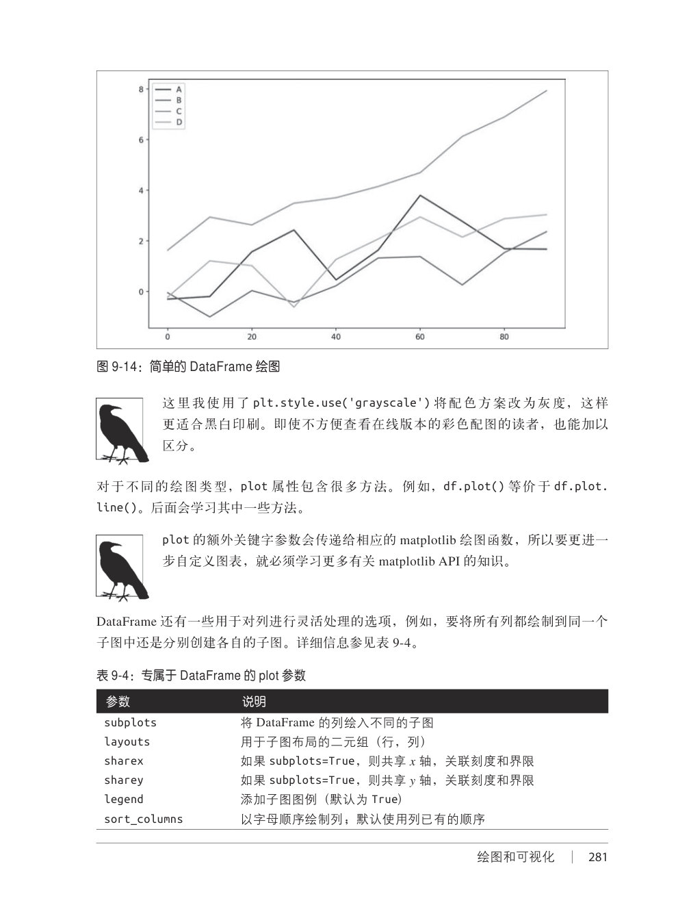

图 9-14：简单的 DataFrame 绘图（见本页原图）。

> 这里我使用了 `plt.style.use('grayscale')` 将配色方案改为灰度，这样更适合黑白印刷。即使不方便查看在线版本的彩色配图的读者，也能加以区分。

对于不同的绘图类型，`plot` 属性包含很多方法。例如，`df.plot()` 等价于 `df.plot.line()`。后面会学习其中一些方法。

> `plot` 的额外关键字参数会传递给相应的 matplotlib 绘图函数，所以要更进一步自定义图表，就必须学习更多有关 matplotlib API 的知识。

DataFrame 还有一些用于对列进行灵活处理的选项，例如，要将所有列都绘制到同一个子图中还是分别创建各自的子图。详细信息参见表 9-4。

表 9-4：专属于 DataFrame 的 plot 参数

| 参数 | 说明 |
| --- | --- |
| `subplots` | 将 DataFrame 的列绘入不同的子图 |
| `layouts` | 用于子图布局的二元组（行，列） |
| `sharex` | 如果 `subplots=True`，则共享 x 轴，关联刻度和界限 |
| `sharey` | 如果 `subplots=True`，则共享 y 轴，关联刻度和界限 |
| `legend` | 添加子图图例（默认为 `True`） |
| `sort_columns` | 以字母顺序绘制列；默认使用列已有的顺序 |

## PDF 第 292 页

<!-- page-status: reviewed -->
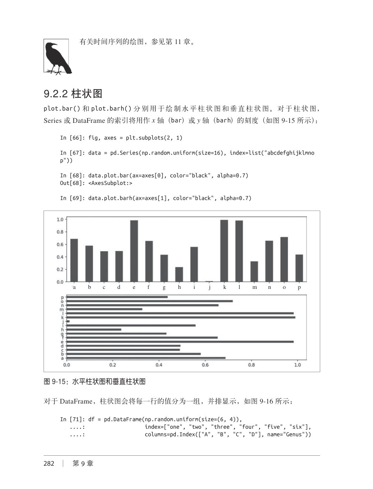

> 有关时间序列的绘图，参见第 11 章。

### 9.2.2 柱状图

`plot.bar()` 和 `plot.barh()` 分别用于绘制水平柱状图和垂直柱状图。对于柱状图，Series 或 DataFrame 的索引将用作 x 轴（`bar`）或 y 轴（`barh`）的刻度（如图 9-15 所示）：

> 校对注：上一句方向按原文保留；从下方示例和图 9-15 可见，`bar()` 实际绘制垂直柱状图，`barh()` 绘制水平柱状图。

```python
fig, axes = plt.subplots(2, 1)
data = pd.Series(np.random.uniform(size=16), index=list("abcdefghijklmnop"))
data.plot.bar(ax=axes[0], color="black", alpha=0.7)
```

```text
<AxesSubplot:>
```

```python
data.plot.barh(ax=axes[1], color="black", alpha=0.7)
```

图 9-15：水平柱状图和垂直柱状图（见本页原图）。

对于 DataFrame，柱状图会将每一行的值分为一组，并排显示，如图 9-16 所示：

```python
df = pd.DataFrame(np.random.uniform(size=(6, 4)),
                  index=["one", "two", "three", "four", "five", "six"],
                  columns=pd.Index(["A", "B", "C", "D"], name="Genus"))
```

## PDF 第 293 页

<!-- page-status: reviewed -->
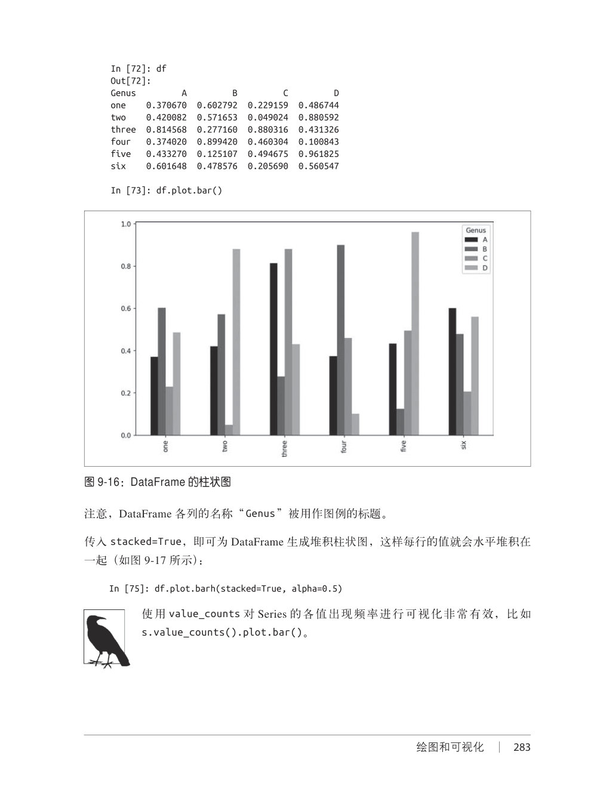

```python
df
```

```text
Genus         A         B         C         D
one    0.370670  0.602792  0.229159  0.486744
two    0.420082  0.571653  0.049024  0.880592
three  0.814568  0.277160  0.880316  0.431326
four   0.374020  0.899420  0.460304  0.100843
five   0.433270  0.125107  0.494675  0.961825
six    0.601648  0.478576  0.205690  0.560547
```

```python
df.plot.bar()
```

图 9-16：DataFrame 的柱状图（见本页原图）。

注意，DataFrame 各列的名称“Genus”被用作图例的标题。

传入 `stacked=True`，即可为 DataFrame 生成堆积柱状图，这样每行的值就会水平堆积在一起（如图 9-17 所示）：

```python
df.plot.barh(stacked=True, alpha=0.5)
```

> 使用 `value_counts` 对 Series 的各值出现频率进行可视化非常有效，比如 `s.value_counts().plot.bar()`。

## PDF 第 294 页

<!-- page-status: reviewed -->
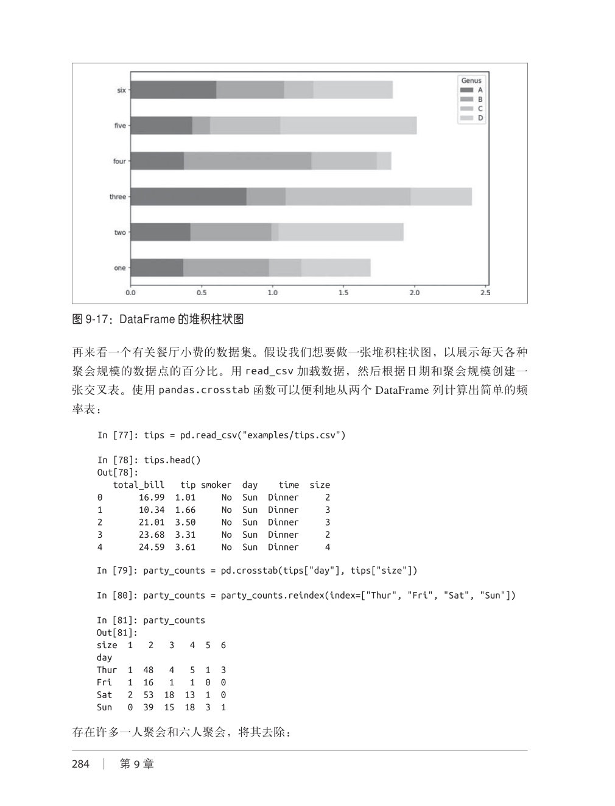

图 9-17：DataFrame 的堆积柱状图（见本页原图）。

再来看一个有关餐厅小费的数据集。假设我们想要做一张堆积柱状图，以展示每天各种聚会规模的数据点的百分比。用 `read_csv` 加载数据，然后根据日期和聚会规模创建一张交叉表。使用 `pandas.crosstab` 函数可以便利地从两个 DataFrame 列计算出简单的频率表：

```python
tips = pd.read_csv("examples/tips.csv")
tips.head()
```

```text
   total_bill   tip smoker  day    time  size
0       16.99  1.01     No  Sun  Dinner     2
1       10.34  1.66     No  Sun  Dinner     3
2       21.01  3.50     No  Sun  Dinner     3
3       23.68  3.31     No  Sun  Dinner     2
4       24.59  3.61     No  Sun  Dinner     4
```

```python
party_counts = pd.crosstab(tips["day"], tips["size"])
party_counts = party_counts.reindex(index=["Thur", "Fri", "Sat", "Sun"])
party_counts
```

```text
size  1   2   3   4  5  6
day
Thur  1  48   4   5  1  3
Fri   1  16   1   1  0  0
Sat   2  53  18  13  1  0
Sun   0  39  15  18  3  1
```

存在许多一人聚会和六人聚会，将其去除（代码见下一页）：

## PDF 第 295 页

<!-- page-status: reviewed -->
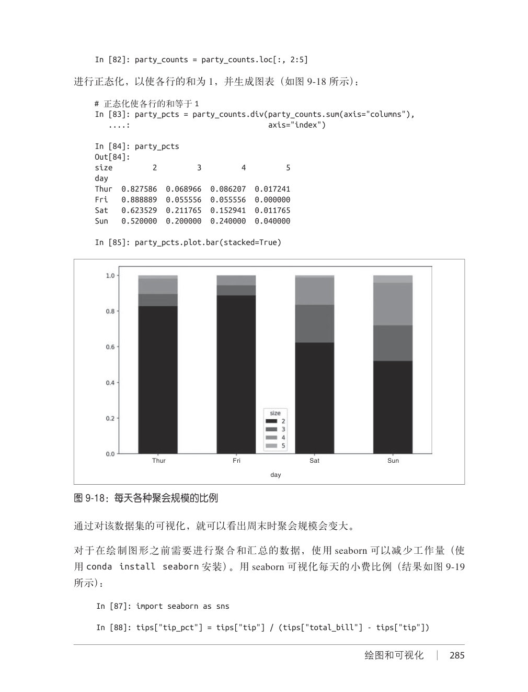

```python
party_counts = party_counts.loc[:, 2:5]
```

进行正态化，以使各行的和为 1，并生成图表（如图 9-18 所示）：

```python
# 正态化使各行的和等于 1
party_pcts = party_counts.div(party_counts.sum(axis="columns"),
                              axis="index")
party_pcts
```

```text
size         2         3         4         5
day
Thur  0.827586  0.068966  0.086207  0.017241
Fri   0.888889  0.055556  0.055556  0.000000
Sat   0.623529  0.211765  0.152941  0.011765
Sun   0.520000  0.200000  0.240000  0.040000
```

```python
party_pcts.plot.bar(stacked=True)
```

图 9-18：每天各种聚会规模的比例（见本页原图）。

通过对该数据集的可视化，就可以看出周末时聚会规模会变大。

对于在绘制图形之前需要进行聚合和汇总的数据，使用 seaborn 可以减少工作量（使用 `conda install seaborn` 安装）。用 seaborn 可视化每天的小费比例（结果如图 9-19 所示）：

```python
import seaborn as sns

tips["tip_pct"] = tips["tip"] / (tips["total_bill"] - tips["tip"])
```

## PDF 第 296 页

<!-- page-status: reviewed -->
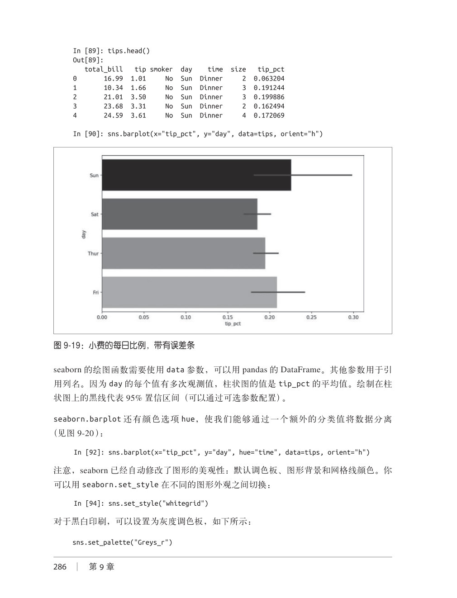

```python
tips.head()
```

```text
   total_bill   tip smoker  day    time  size   tip_pct
0       16.99  1.01     No  Sun  Dinner     2  0.063204
1       10.34  1.66     No  Sun  Dinner     3  0.191244
2       21.01  3.50     No  Sun  Dinner     3  0.199886
3       23.68  3.31     No  Sun  Dinner     2  0.162494
4       24.59  3.61     No  Sun  Dinner     4  0.172069
```

```python
sns.barplot(x="tip_pct", y="day", data=tips, orient="h")
```

图 9-19：小费的每日比例，带有误差条（见本页原图）。

seaborn 的绘图函数需要使用 `data` 参数，可以用 pandas 的 DataFrame。其他参数用于引用列名。因为 `day` 的每个值有多次观测值，柱状图的值是 `tip_pct` 的平均值。绘制在柱状图上的黑线代表 95% 置信区间（可以通过可选参数配置）。

`seaborn.barplot` 还有颜色选项 `hue`，使我们能够通过一个额外的分类值将数据分离（见图 9-20）：

```python
sns.barplot(x="tip_pct", y="day", hue="time", data=tips, orient="h")
```

注意，seaborn 已经自动修改了图形的美观性：默认调色板、图形背景和网格线颜色。你可以用 `seaborn.set_style` 在不同的图形外观之间切换：

```python
sns.set_style("whitegrid")
```

对于黑白印刷，可以设置为灰度调色板，如下所示：

```python
sns.set_palette("Greys_r")
```

## PDF 第 297 页

<!-- page-status: reviewed -->
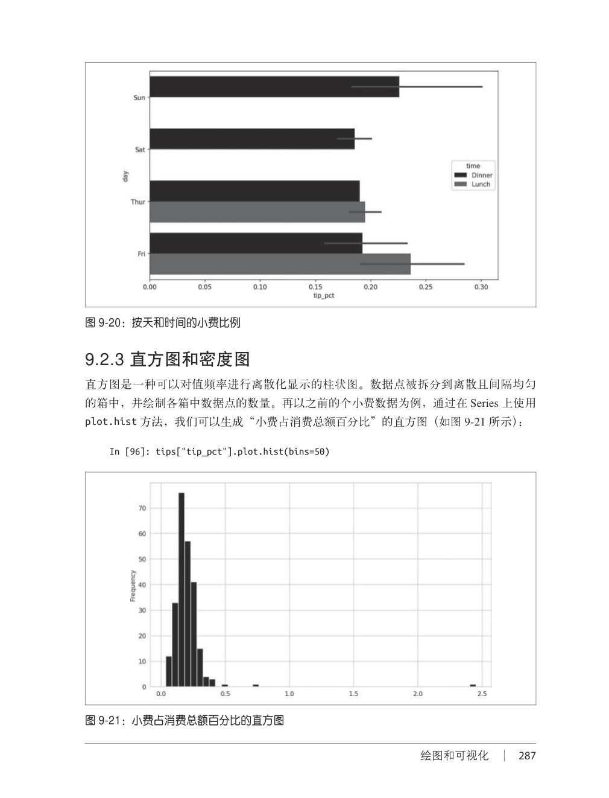

图 9-20：按天和时间的小费比例（见本页原图）。

### 9.2.3 直方图和密度图

直方图是一种可以对值频率进行离散化显示的柱状图。数据点被拆分到离散且间隔均匀的箱中，并绘制各箱中数据点的数量。再以之前的小费数据为例，通过在 Series 上使用 `plot.hist` 方法，我们可以生成“小费占消费总额百分比”的直方图（如图 9-21 所示）：

```python
tips["tip_pct"].plot.hist(bins=50)
```

图 9-21：小费占消费总额百分比的直方图（见本页原图）。

## PDF 第 298 页

<!-- page-status: reviewed -->
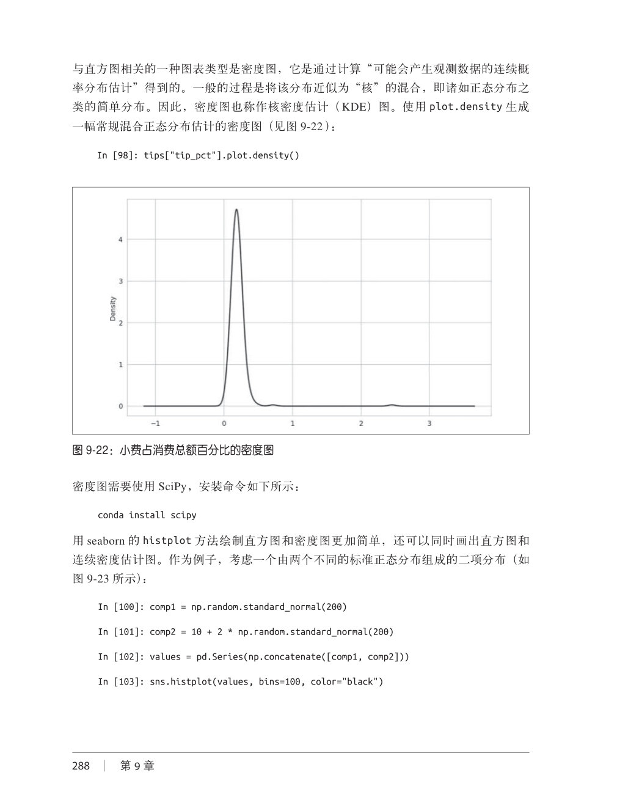

与直方图相关的一种图表类型是密度图，它是通过计算“可能会产生观测数据的连续概率分布估计”得到的。一般的过程是将该分布近似为“核”的混合，即诸如正态分布之类的简单分布。因此，密度图也称作核密度估计（KDE）图。使用 `plot.density` 生成一幅常规混合正态分布估计的密度图（见图 9-22）：

```python
tips["tip_pct"].plot.density()
```

图 9-22：小费占消费总额百分比的密度图（见本页原图）。

密度图需要使用 SciPy，安装命令如下所示：

```bash
conda install scipy
```

用 seaborn 的 `histplot` 方法绘制直方图和密度图更加简单，还可以同时画出直方图和连续密度估计图。作为例子，考虑一个由两个不同的标准正态分布组成的二项分布（如图 9-23 所示）：

```python
comp1 = np.random.standard_normal(200)
comp2 = 10 + 2 * np.random.standard_normal(200)
values = pd.Series(np.concatenate([comp1, comp2]))
sns.histplot(values, bins=100, color="black")
```

## PDF 第 299 页

<!-- page-status: reviewed -->
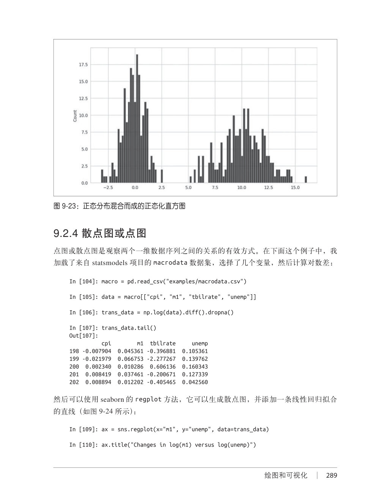

图 9-23：正态分布混合而成的正态化直方图（见本页原图）。

### 9.2.4 散点图或点图

点图或散点图是观察两个一维数据序列之间的关系的有效方式。在下面这个例子中，我加载了来自 statsmodels 项目的 macrodata 数据集，选择了几个变量，然后计算对数差：

```python
macro = pd.read_csv("examples/macrodata.csv")
data = macro[["cpi", "m1", "tbilrate", "unemp"]]
trans_data = np.log(data).diff().dropna()
trans_data.tail()
```

```text
          cpi        m1  tbilrate     unemp
198 -0.007904  0.045361 -0.396881  0.105361
199 -0.021979  0.066753 -2.277267  0.139762
200  0.002340  0.010286  0.606136  0.160343
201  0.008419  0.037461 -0.200671  0.127339
202  0.008894  0.012202 -0.405465  0.042560
```

然后可以使用 seaborn 的 `regplot` 方法，它可以生成散点图，并添加一条线性回归拟合的直线（如图 9-24 所示）：

```python
ax = sns.regplot(x="m1", y="unemp", data=trans_data)
ax.title("Changes in log(m1) versus log(unemp)")
```

> 原书此处写作 `ax.title(...)`；通常 `ax.title` 是文本对象，设置标题应使用 `ax.set_title(...)`。上方保留原文，使用时请注意这一差异。

## PDF 第 300 页

<!-- page-status: reviewed -->
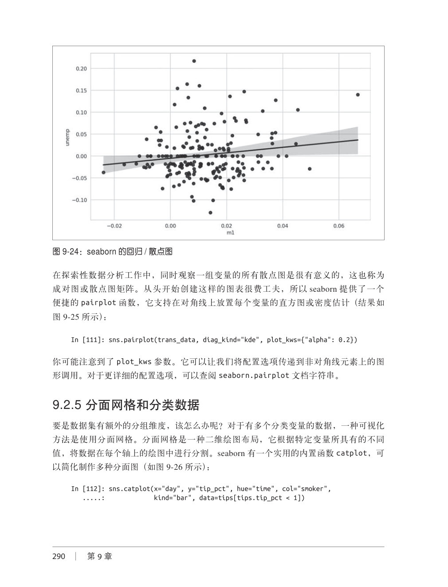

图 9-24：seaborn 的回归 / 散点图（见本页原图）。

在探索性数据分析工作中，同时观察一组变量的所有散点图是很有意义的，这也称为成对图或散点图矩阵。从头开始创建这样的图表很费工夫，所以 seaborn 提供了一个便捷的 `pairplot` 函数，它支持在对角线上放置每个变量的直方图或密度估计（结果如图 9-25 所示）：

```python
sns.pairplot(trans_data, diag_kind="kde", plot_kws={"alpha": 0.2})
```

你可能注意到了 `plot_kws` 参数。它可以让我们将配置选项传递到非对角线元素上的图形调用。对于更详细的配置选项，可以查阅 `seaborn.pairplot` 文档字符串。

### 9.2.5 分面网格和分类数据

要是数据集有额外的分组维度，该怎么办呢？对于有多个分类变量的数据，一种可视化方法是使用分面网格。分面网格是一种二维绘图布局，它根据特定变量所具有的不同值，将数据在每个轴上的绘图中进行分割。seaborn 有一个实用的内置函数 `catplot`，可以简化制作多种分面图（如图 9-26 所示）：

```python
sns.catplot(x="day", y="tip_pct", hue="time", col="smoker",
            kind="bar", data=tips[tips.tip_pct < 1])
```

## PDF 第 301 页

<!-- page-status: reviewed -->
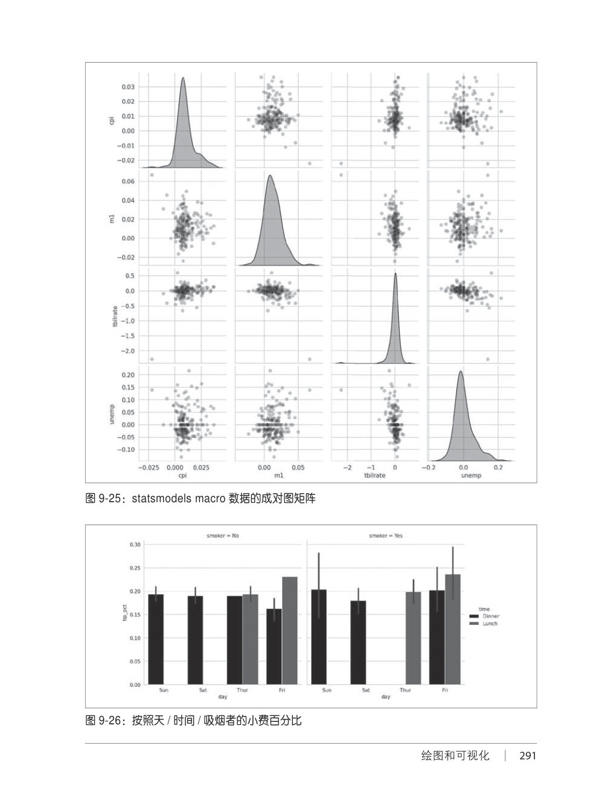

图 9-25：statsmodels macro 数据的成对图矩阵（见本页原图）。

图 9-26：按照天 / 时间 / 吸烟者的小费百分比（见本页原图）。

## PDF 第 302 页

<!-- page-status: reviewed -->
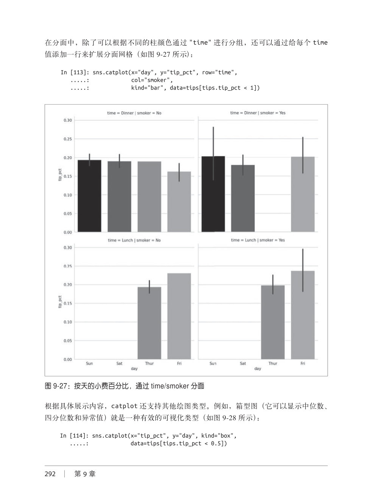

在分面中，除了可以根据不同的柱颜色通过 `"time"` 进行分组，还可以通过给每个 `time` 值添加一行来扩展分面网格（如图 9-27 所示）：

```python
sns.catplot(x="day", y="tip_pct", row="time",
            col="smoker",
            kind="bar", data=tips[tips.tip_pct < 1])
```

图 9-27：按天的小费百分比，通过 time/smoker 分面（见本页原图）。

根据具体展示内容，`catplot` 还支持其他绘图类型。例如，箱型图（它可以显示中位数、四分位数和异常值）就是一种有效的可视化类型（如图 9-28 所示）：

```python
sns.catplot(x="tip_pct", y="day", kind="box",
            data=tips[tips.tip_pct < 0.5])
```

## PDF 第 303 页

<!-- page-status: reviewed -->
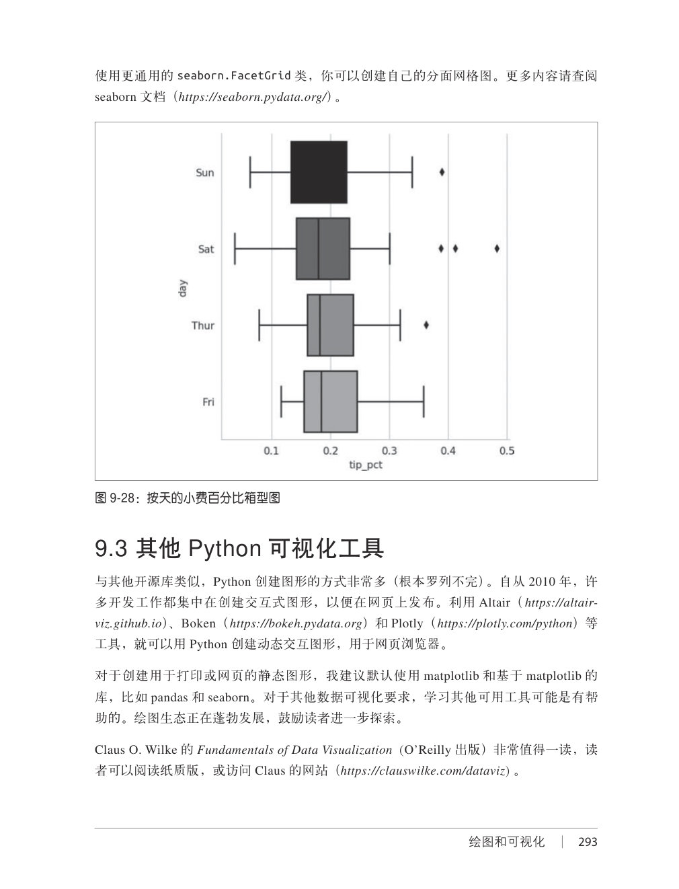

使用更通用的 `seaborn.FacetGrid` 类，你可以创建自己的分面网格图。更多内容请查阅 seaborn 文档（https://seaborn.pydata.org/）。

图 9-28：按天的小费百分比箱型图（见本页原图）。

### 9.3 其他 Python 可视化工具

与其他开源库类似，Python 创建图形的方式非常多（根本罗列不完）。自从 2010 年，许多开发工作都集中在创建交互式图形，以便在网页上发布。利用 Altair（https://altair-viz.github.io）、Boken（https://bokeh.pydata.org）和 Plotly（https://plotly.com/python）等工具，就可以用 Python 创建动态交互图形，用于网页浏览器。

> 原文写作 Boken；其所链接项目名为 Bokeh。

对于创建用于打印或网页的静态图形，我建议默认使用 matplotlib 和基于 matplotlib 的库，比如 pandas 和 seaborn。对于其他数据可视化要求，学习其他可用工具可能是有帮助的。绘图生态正在蓬勃发展，鼓励读者进一步探索。

Claus O. Wilke 的 *Fundamentals of Data Visualization*（O’Reilly 出版）非常值得一读，读者可以阅读纸质版，或访问 Claus 的网站（https://clauswilke.com/dataviz）。

## PDF 第 304 页

<!-- page-status: reviewed -->


### 9.4 总结

本章的目的是通过 pandas、matplotlib 和 seaborn，让读者熟悉一些基本的数据可视化操作。如果直观地传导数据分析结果对你的工作很重要，我鼓励你寻求更多资源来学习更高效的数据可视化技术。这是一个活跃的研究领域，你可以接触许多优秀的在线和纸质学习资源。

下一章，我们将关注使用 pandas 进行数据聚合和分组操作。

