# 第 10 章 数据聚合与分组操作

[返回目录](../README.md)

> 本章各页已由 AI 对照原页图转写代码、公式和正文；尚未经人工复核。代码块已做语法检查，示例和书中输出未逐一运行；原书历史版本行为可能与当前环境不同。

## PDF 第 305 页

<!-- page-status: reviewed -->

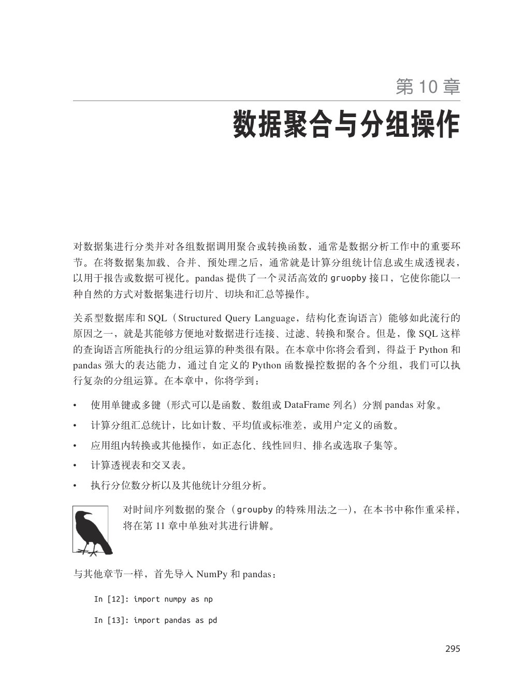

对数据集进行分类并对各组数据调用聚合或转换函数，通常是数据分析工作中的重要环节。在将数据集加载、合并、预处理之后，通常就是计算分组统计信息或生成透视表，以用于报告或数据可视化。pandas 提供了一个灵活高效的 `groupby` 接口，它使你能以一种自然的方式对数据集进行切片、切块和汇总等操作。

> 原页此处将 `groupby` 拼作 `gruopby`；此处按实际接口名称更正。

关系型数据库和 SQL（Structured Query Language，结构化查询语言）能够如此流行的原因之一，就是其能够方便地对数据进行连接、过滤、转换和聚合。但是，像 SQL 这样的查询语言所能执行的分组运算的种类很有限。在本章中你将会看到，得益于 Python 和 pandas 强大的表达能力，通过自定义的 Python 函数操控数据的各个分组，我们可以执行复杂的分组运算。在本章中，你将学到：

- 使用单键或多键（形式可以是函数、数组或 DataFrame 列名）分割 pandas 对象。
- 计算分组汇总统计，比如计数、平均值或标准差，或用户定义的函数。
- 应用组内转换或其他操作，如正态化、线性回归、排名或选取子集等。
- 计算透视表和交叉表。
- 执行分位数分析以及其他统计分组分析。

> 对时间序列数据的聚合（`groupby` 的特殊用法之一），在本书中称作重采样，将在第 11 章中单独对其进行讲解。

与其他章节一样，首先导入 NumPy 和 pandas：

```python
import numpy as np
import pandas as pd
```

## PDF 第 306 页

<!-- page-status: reviewed -->

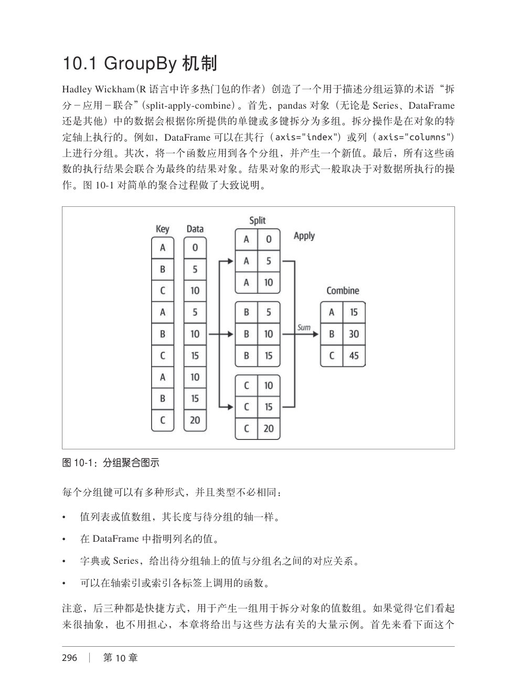

### 10.1 GroupBy 机制

Hadley Wickham（R 语言中许多热门包的作者）创造了一个用于描述分组运算的术语“拆分-应用-联合”（split-apply-combine）。首先，pandas 对象（无论是 Series、DataFrame 还是其他）中的数据会根据你所提供的单键或多键拆分为多组。拆分操作是在对象的特定轴上执行的。例如，DataFrame 可以在其行（`axis="index"`）或列（`axis="columns"`）上进行分组。其次，将一个函数应用到各个分组，并产生一个新值。最后，所有这些函数的执行结果会联合为最终的结果对象。结果对象的形式一般取决于对数据所执行的操作。图 10-1 对简单的聚合过程做了大致说明。

图 10-1：分组聚合图示（见原页图）。

每个分组键可以有多种形式，并且类型不必相同：

- 值列表或值数组，其长度与待分组的轴一样。
- 在 DataFrame 中指明列名的值。
- 字典或 Series，给出待分组轴上的值与分组名之间的对应关系。
- 可以在轴索引或索引各标签上调用的函数。

注意，后三种都是快捷方式，用于产生一组用于拆分对象的值数组。如果觉得它们看起来很抽象，也不用担心，本章将给出与这些方法有关的大量示例。首先来看下面这个 DataFrame——一个非常简单的表格型数据集（续下页）：

## PDF 第 307 页

<!-- page-status: reviewed -->

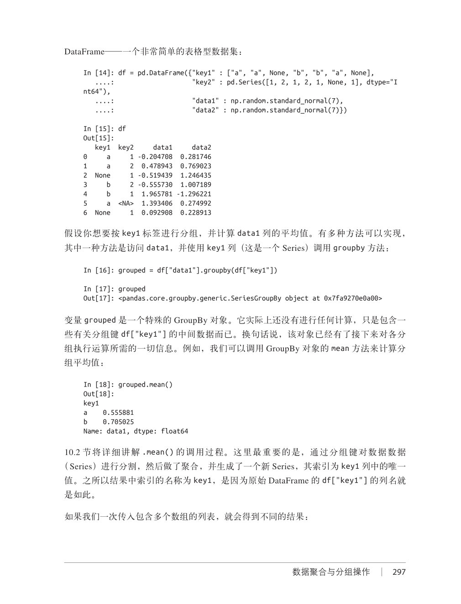

```python
df = pd.DataFrame({"key1": ["a", "a", None, "b", "b", "a", None],
                   "key2": pd.Series([1, 2, 1, 2, 1, None, 1], dtype="Int64"),
                   "data1": np.random.standard_normal(7),
                   "data2": np.random.standard_normal(7)})
df
```

```text
   key1  key2     data1     data2
0     a     1 -0.204708  0.281746
1     a     2  0.478943  0.769023
2  None     1 -0.519439  1.246435
3     b     2 -0.555730  1.007189
4     b     1  1.965781 -1.296221
5     a  <NA>  1.393406  0.274992
6  None     1  0.092908  0.228913
```

假设你想要按 `key1` 标签进行分组，并计算 `data1` 列的平均值。有多种方法可以实现，其中一种方法是访问 `data1`，并使用 `key1` 列（这是一个 Series）调用 `groupby` 方法：

```python
grouped = df["data1"].groupby(df["key1"])
grouped
```

```text
<pandas.core.groupby.generic.SeriesGroupBy object at 0x7fa9270e0a00>
```

变量 `grouped` 是一个特殊的 GroupBy 对象。它实际上还没有进行任何计算，只是包含一些有关分组键 `df["key1"]` 的中间数据而已。换句话说，该对象已经有了接下来对各分组执行运算所需的一切信息。例如，我们可以调用 GroupBy 对象的 `mean` 方法来计算分组平均值：

```python
grouped.mean()
```

```text
key1
a    0.555881
b    0.705025
Name: data1, dtype: float64
```

10.2 节将详细讲解 `.mean()` 的调用过程。这里最重要的是，通过分组键对数据（Series）进行分割，然后做了聚合，并生成了一个新 Series，其索引为 `key1` 列中的唯一值。之所以结果中索引的名称为 `key1`，是因为原始 DataFrame 的 `df["key1"]` 的列名就是如此。

如果我们一次传入包含多个数组的列表，就会得到不同的结果：

## PDF 第 308 页

<!-- page-status: reviewed -->

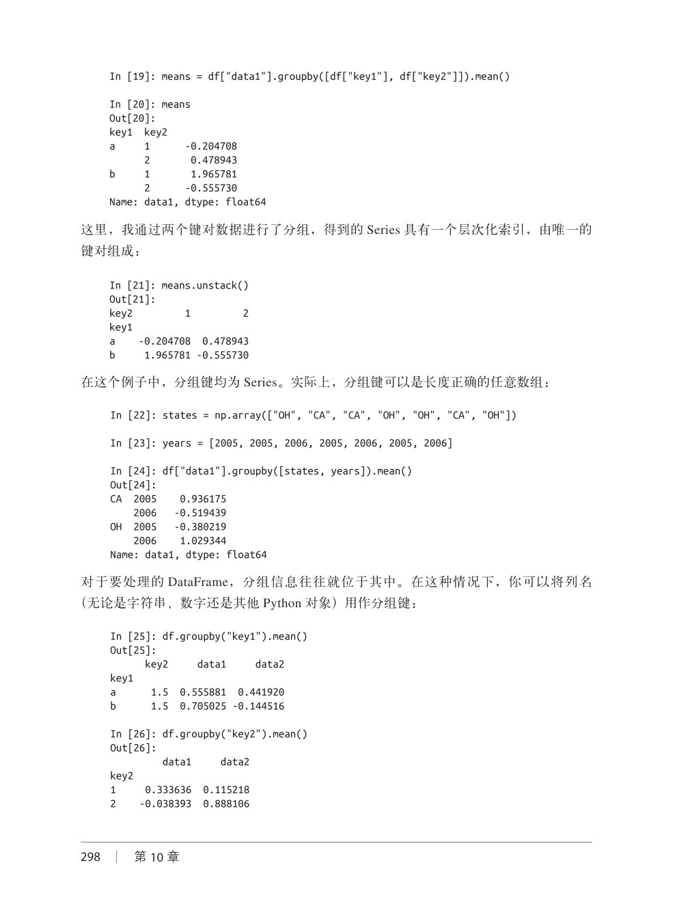

```python
means = df["data1"].groupby([df["key1"], df["key2"]]).mean()
means
```

```text
key1  key2
a     1      -0.204708
      2       0.478943
b     1       1.965781
      2      -0.555730
Name: data1, dtype: float64
```

这里，我通过两个键对数据进行了分组，得到的 Series 具有一个层次化索引，由唯一的键对组成：

```python
means.unstack()
```

```text
key2         1         2
key1
a    -0.204708  0.478943
b     1.965781 -0.555730
```

在这个例子中，分组键均为 Series。实际上，分组键可以是长度正确的任意数组：

```python
states = np.array(["OH", "CA", "CA", "OH", "OH", "CA", "OH"])
years = [2005, 2005, 2006, 2005, 2006, 2005, 2006]
df["data1"].groupby([states, years]).mean()
```

```text
CA  2005    0.936175
    2006   -0.519439
OH  2005   -0.380219
    2006    1.029344
Name: data1, dtype: float64
```

对于要处理的 DataFrame，分组信息往往就位于其中。在这种情况下，你可以将列名（无论是字符串、数字还是其他 Python 对象）用作分组键：

```python
df.groupby("key1").mean()
```

```text
      key2     data1     data2
key1
a      1.5  0.555881  0.441920
b      1.5  0.705025 -0.144516
```

```python
df.groupby("key2").mean()
```

```text
         data1     data2
key2
1     0.333636  0.115218
2    -0.038393  0.888106
```

## PDF 第 309 页

<!-- page-status: reviewed -->

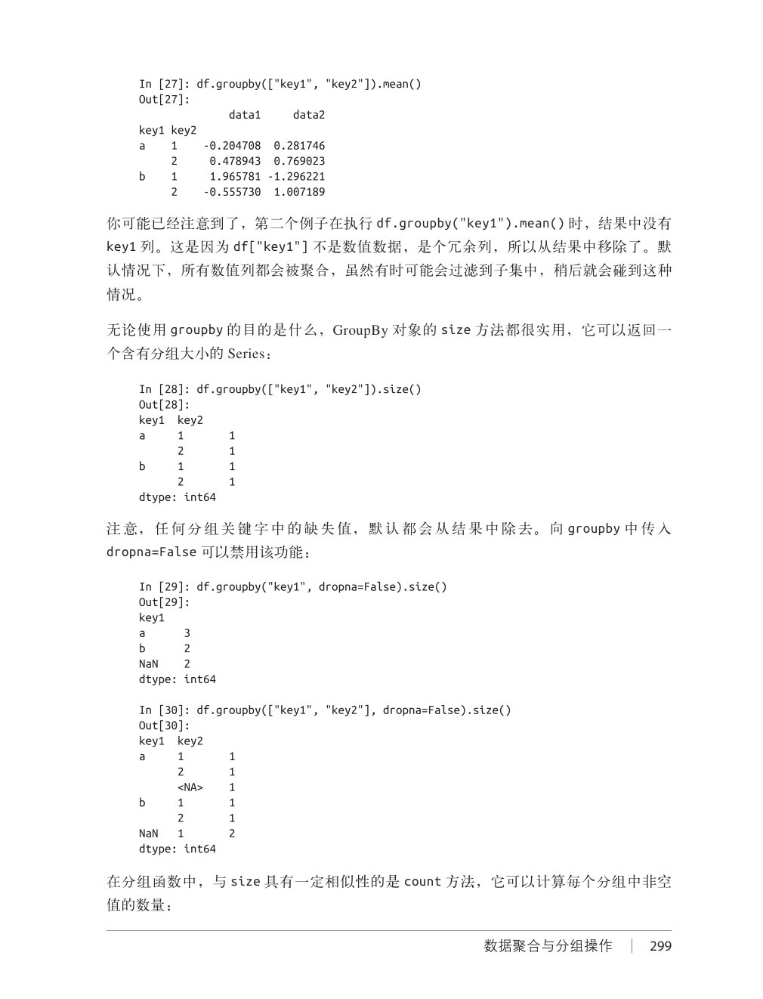

```python
df.groupby(["key1", "key2"]).mean()
```

```text
               data1     data2
key1 key2
a    1     -0.204708  0.281746
     2      0.478943  0.769023
b    1      1.965781 -1.296221
     2     -0.555730  1.007189
```

你可能已经注意到了，第二个例子在执行 `df.groupby("key1").mean()` 时，结果中没有 `key1` 列。这是因为 `df["key1"]` 不是数值数据，是个冗余列，所以从结果中移除了。默认情况下，所有数值列都会被聚合，虽然有时可能会过滤到子集中，稍后就会碰到这种情况。

无论使用 `groupby` 的目的是什么，GroupBy 对象的 `size` 方法都很实用，它可以返回一个含有分组大小的 Series：

```python
df.groupby(["key1", "key2"]).size()
```

```text
key1  key2
a     1       1
      2       1
b     1       1
      2       1
dtype: int64
```

注意，任何分组关键字中的缺失值，默认都会从结果中除去。向 `groupby` 中传入 `dropna=False` 可以禁用该功能：

```python
df.groupby("key1", dropna=False).size()
```

```text
key1
a      3
b      2
NaN    2
dtype: int64
```

```python
df.groupby(["key1", "key2"], dropna=False).size()
```

```text
key1  key2
a     1       1
      2       1
      <NA>    1
b     1       1
      2       1
NaN   1       2
dtype: int64
```

在分组函数中，与 `size` 具有一定相似性的是 `count` 方法，它可以计算每个分组中非空值的数量：

## PDF 第 310 页

<!-- page-status: reviewed -->

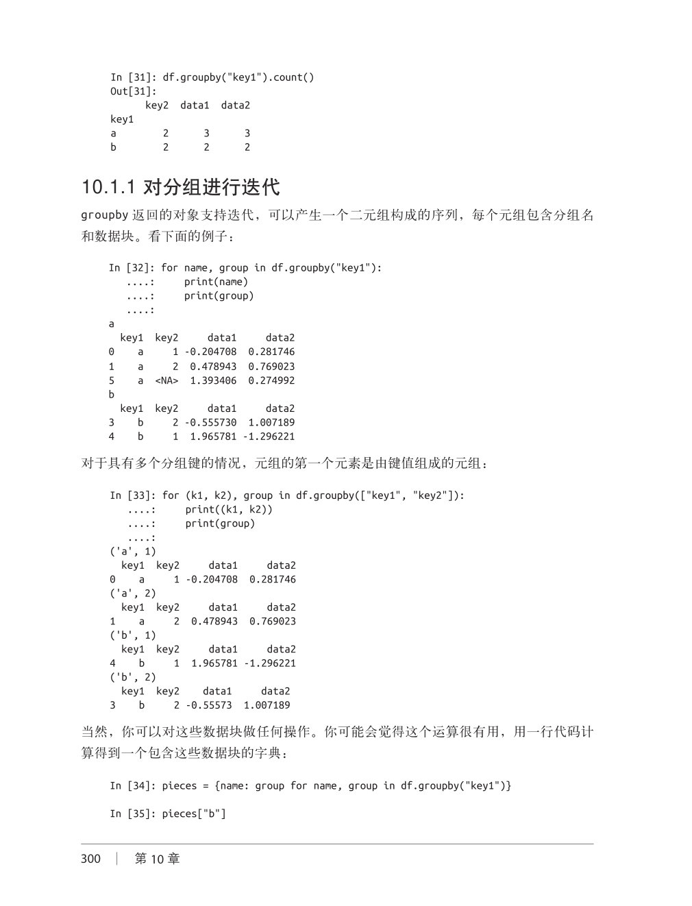

```python
df.groupby("key1").count()
```

```text
      key2  data1  data2
key1
a        2      3      3
b        2      2      2
```

#### 10.1.1 对分组进行迭代

`groupby` 返回的对象支持迭代，可以产生一个二元组构成的序列，每个元组包含分组名和数据块。看下面的例子：

```python
for name, group in df.groupby("key1"):
    print(name)
    print(group)
```

```text
a
  key1  key2     data1     data2
0    a     1 -0.204708  0.281746
1    a     2  0.478943  0.769023
5    a  <NA>  1.393406  0.274992
b
  key1  key2     data1     data2
3    b     2 -0.555730  1.007189
4    b     1  1.965781 -1.296221
```

对于具有多个分组键的情况，元组的第一个元素是由键值组成的元组：

```python
for (k1, k2), group in df.groupby(["key1", "key2"]):
    print((k1, k2))
    print(group)
```

```text
('a', 1)
  key1  key2     data1     data2
0    a     1 -0.204708  0.281746
('a', 2)
  key1  key2     data1     data2
1    a     2  0.478943  0.769023
('b', 1)
  key1  key2     data1     data2
4    b     1  1.965781 -1.296221
('b', 2)
  key1  key2    data1     data2
3    b     2 -0.55573  1.007189
```

当然，你可以对这些数据块做任何操作。你可能会觉得这个运算很有用，用一行代码计算得到一个包含这些数据块的字典：

```python
pieces = {name: group for name, group in df.groupby("key1")}
pieces["b"]
```

输出见下一页。

## PDF 第 311 页

<!-- page-status: reviewed -->

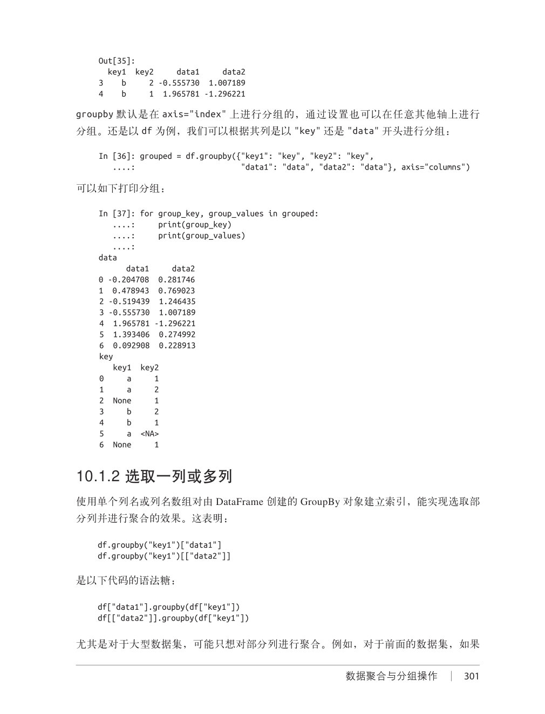

上一页的输出：

```text
Out[35]:
  key1  key2     data1     data2
3    b     2 -0.555730  1.007189
4    b     1  1.965781 -1.296221
```

`groupby` 默认是在 `axis="index"` 上进行分组的，通过设置也可以在任意其他轴上进行分组。还是以 `df` 为例，我们可以根据其列是以 `"key"` 还是 `"data"` 开头进行分组：

```python
grouped = df.groupby({"key1": "key", "key2": "key",
                      "data1": "data", "data2": "data"}, axis="columns")
```

可以如下打印分组：

```python
for group_key, group_values in grouped:
    print(group_key)
    print(group_values)
```

```text
data
      data1     data2
0 -0.204708  0.281746
1  0.478943  0.769023
2 -0.519439  1.246435
3 -0.555730  1.007189
4  1.965781 -1.296221
5  1.393406  0.274992
6  0.092908  0.228913
key
   key1  key2
0     a     1
1     a     2
2  None     1
3     b     2
4     b     1
5     a  <NA>
6  None     1
```

### 10.1.2 选取一列或多列

使用单个列名或列名数组对由 DataFrame 创建的 GroupBy 对象建立索引，能实现选取部分列并进行聚合的效果。这表明：

```python
df.groupby("key1")["data1"]
df.groupby("key1")[["data2"]]
```

是以下代码的语法糖：

```python
df["data1"].groupby(df["key1"])
df[["data2"]].groupby(df["key1"])
```

尤其是对于大型数据集，可能只想对部分列进行聚合。例如，对于前面的数据集，如果（续见下页）

## PDF 第 312 页

<!-- page-status: reviewed -->

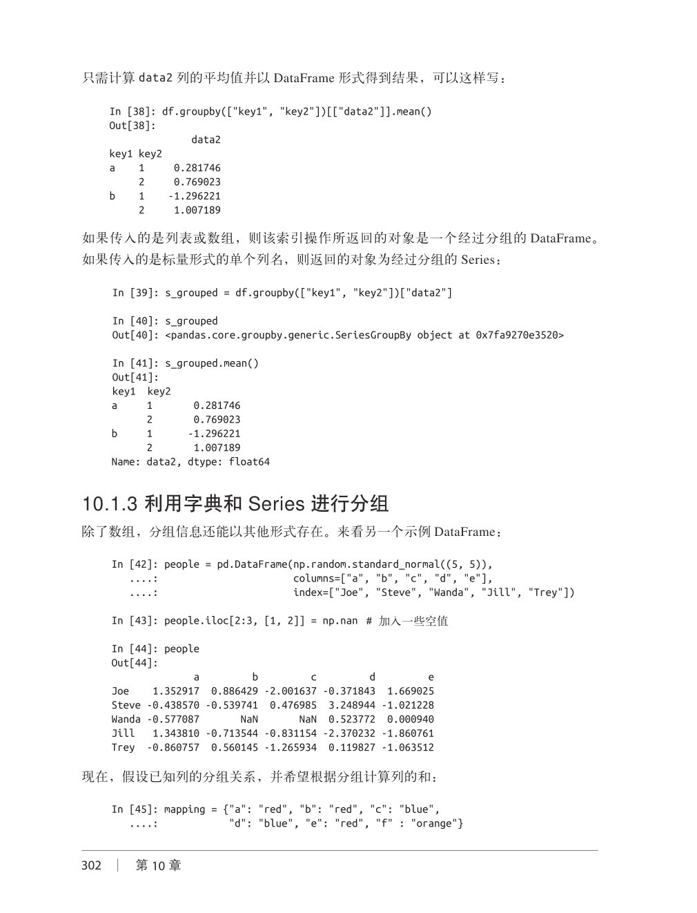

（续上页）只需计算 `data2` 列的平均值并以 DataFrame 形式得到结果，可以这样写：

```python
df.groupby(["key1", "key2"])[["data2"]].mean()
```

```text
Out[38]:
               data2
key1 key2
a    1      0.281746
     2      0.769023
b    1     -1.296221
     2      1.007189
```

如果传入的是列表或数组，则该索引操作所返回的对象是一个经过分组的 DataFrame。如果传入的是标量形式的单个列名，则返回的对象为经过分组的 Series：

```python
s_grouped = df.groupby(["key1", "key2"])["data2"]
s_grouped
```

```text
Out[40]: <pandas.core.groupby.generic.SeriesGroupBy object at 0x7fa9270e3520>
```

```python
s_grouped.mean()
```

```text
Out[41]:
key1  key2
a     1       0.281746
      2       0.769023
b     1      -1.296221
      2       1.007189
Name: data2, dtype: float64
```

### 10.1.3 利用字典和 Series 进行分组

除了数组，分组信息还能以其他形式存在。来看另一个示例 DataFrame：

```python
people = pd.DataFrame(np.random.standard_normal((5, 5)),
                      columns=["a", "b", "c", "d", "e"],
                      index=["Joe", "Steve", "Wanda", "Jill", "Trey"])
people.iloc[2:3, [1, 2]] = np.nan  # 加入一些空值
people
```

```text
Out[44]:
              a         b         c         d         e
Joe    1.352917  0.886429 -2.001637 -0.371843  1.669025
Steve -0.438570 -0.539741  0.476985  3.248944 -1.021228
Wanda -0.577087       NaN       NaN  0.523772  0.000940
Jill   1.343810 -0.713544 -0.831154 -2.370232 -1.860761
Trey  -0.860757  0.560145 -1.265934  0.119827 -1.063512
```

现在，假设已知列的分组关系，并希望根据分组计算列的和：

```python
mapping = {"a": "red", "b": "red", "c": "blue",
           "d": "blue", "e": "red", "f": "orange"}
```

## PDF 第 313 页

<!-- page-status: reviewed -->

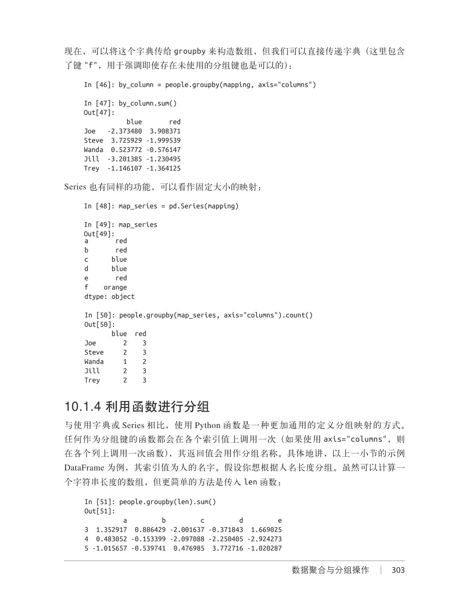

现在，可以将这个字典传给 `groupby` 来构造数组，但我们可以直接传递字典（这里包含了键 `"f"`，用于强调即使存在未使用的分组键也是可以的）：

```python
by_column = people.groupby(mapping, axis="columns")
by_column.sum()
```

```text
Out[47]:
           blue       red
Joe   -2.373480  3.908371
Steve  3.725929 -1.999539
Wanda  0.523772 -0.576147
Jill  -3.201385 -1.230495
Trey  -1.146107 -1.364125
```

Series 也有同样的功能，可以看作固定大小的映射：

```python
map_series = pd.Series(mapping)
map_series
```

```text
Out[49]:
a       red
b       red
c      blue
d      blue
e       red
f    orange
dtype: object
```

```python
people.groupby(map_series, axis="columns").count()
```

```text
Out[50]:
       blue  red
Joe       2    3
Steve     2    3
Wanda     1    2
Jill      2    3
Trey      2    3
```

### 10.1.4 利用函数进行分组

与使用字典或 Series 相比，使用 Python 函数是一种更加通用的定义分组映射的方式。任何作为分组键的函数都会在各个索引值上调用一次（如果使用 `axis="columns"`，则在各个列上调用一次函数），其返回值会用作分组名称。具体地讲，以上一小节的示例 DataFrame 为例，其索引值为人的名字。假设你想根据人名长度分组。虽然可以计算一个字符串长度的数组，但更简单的方法是传入 `len` 函数：

```python
people.groupby(len).sum()
```

```text
Out[51]:
          a         b         c         d         e
3  1.352917  0.886429 -2.001637 -0.371843  1.669025
4  0.483052 -0.153399 -2.097088 -2.250405 -2.924273
5 -1.015657 -0.539741  0.476985  3.772716 -1.020287
```

## PDF 第 314 页

<!-- page-status: reviewed -->

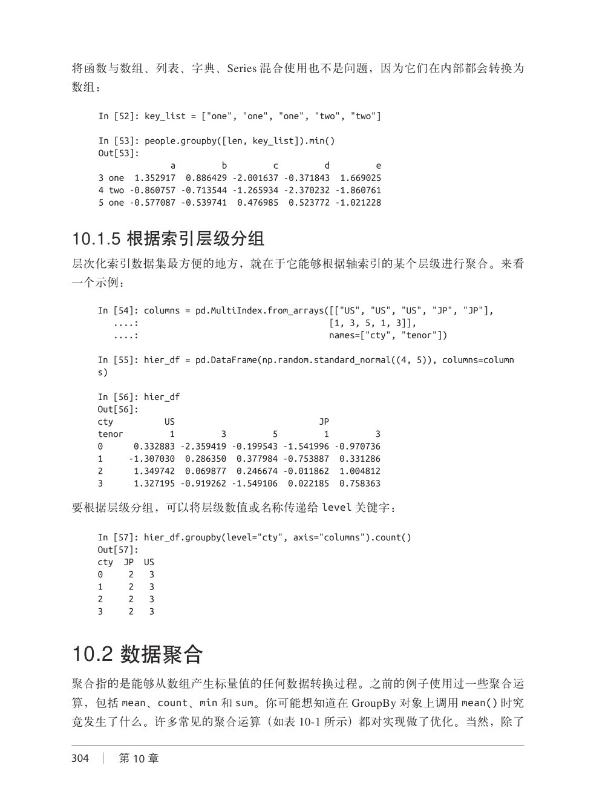

将函数与数组、列表、字典、Series 混合使用也不是问题，因为它们在内部都会转换为数组：

```python
key_list = ["one", "one", "one", "two", "two"]
people.groupby([len, key_list]).min()
```

```text
Out[53]:
              a         b         c         d         e
3 one  1.352917  0.886429 -2.001637 -0.371843  1.669025
4 two -0.860757 -0.713544 -1.265934 -2.370232 -1.860761
5 one -0.577087 -0.539741  0.476985  0.523772 -1.021228
```

### 10.1.5 根据索引层级分组

层次化索引数据集最方便的地方，就在于它能够根据轴索引的某个层级进行聚合。来看一个示例：

```python
columns = pd.MultiIndex.from_arrays([["US", "US", "US", "JP", "JP"],
                                     [1, 3, 5, 1, 3]],
                                    names=["cty", "tenor"])
hier_df = pd.DataFrame(np.random.standard_normal((4, 5)), columns=columns)
hier_df
```

```text
Out[56]:
cty          US                        JP
tenor         1         3         5         1         3
0      0.332883 -2.359419 -0.199543 -1.541996 -0.970736
1     -1.307030  0.286350  0.377984 -0.753887  0.331286
2      1.349742  0.069877  0.246674 -0.011862  1.004812
3      1.327195 -0.919262 -1.549106  0.022185  0.758363
```

要根据层级分组，可以将层级数值或名称传递给 `level` 关键字：

```python
hier_df.groupby(level="cty", axis="columns").count()
```

```text
Out[57]:
cty  JP  US
0     2   3
1     2   3
2     2   3
3     2   3
```

### 10.2 数据聚合

聚合指的是能够从数组产生标量值的任何数据转换过程。之前的例子使用过一些聚合运算，包括 `mean`、`count`、`min` 和 `sum`。你可能想知道在 GroupBy 对象上调用 `mean()` 时究竟发生了什么。许多常见的聚合运算（如表 10-1 所示）都对实现做了优化。当然，除了（续见下页）

## PDF 第 315 页

<!-- page-status: reviewed -->

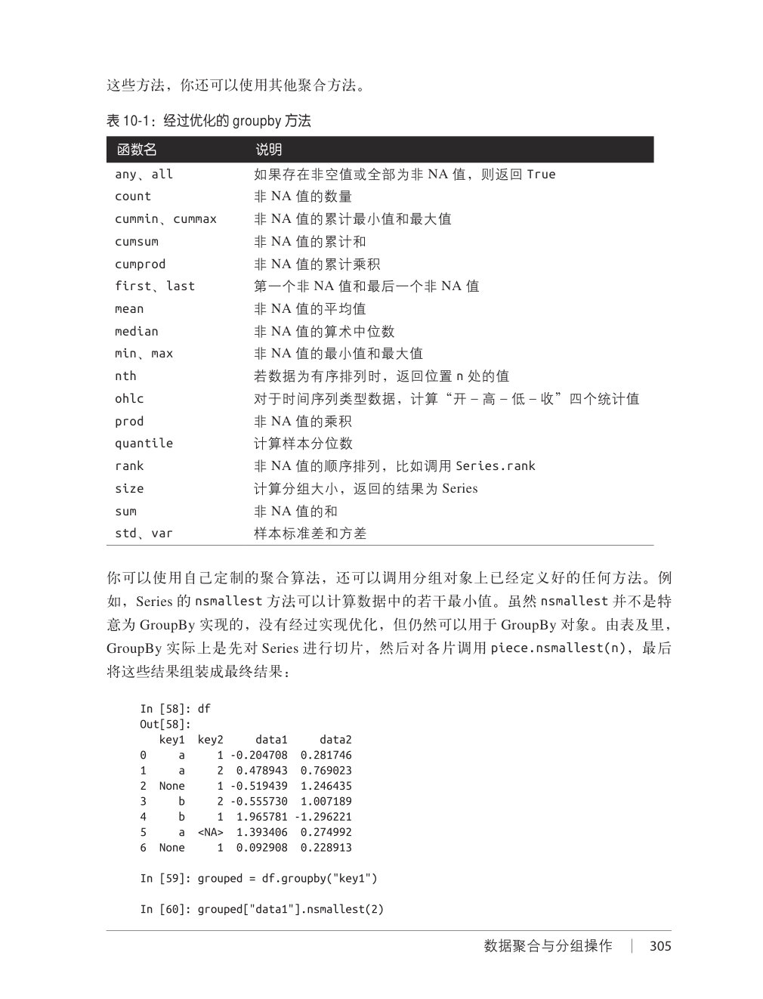

（续上页）这些方法，你还可以使用其他聚合方法。

**表 10-1：经过优化的 groupby 方法**

| 函数名 | 说明 |
| --- | --- |
| `any`、`all` | 如果存在非空值或全部为非 NA 值，则返回 True |
| `count` | 非 NA 值的数量 |
| `cummin`、`cummax` | 非 NA 值的累计最小值和最大值 |
| `cumsum` | 非 NA 值的累计和 |
| `cumprod` | 非 NA 值的累计乘积 |
| `first`、`last` | 第一个非 NA 值和最后一个非 NA 值 |
| `mean` | 非 NA 值的平均值 |
| `median` | 非 NA 值的算术中位数 |
| `min`、`max` | 非 NA 值的最小值和最大值 |
| `nth` | 若数据为有序排列时，返回位置 n 处的值 |
| `ohlc` | 对于时间序列类型数据，计算“开－高－低－收”四个统计值 |
| `prod` | 非 NA 值的乘积 |
| `quantile` | 计算样本分位数 |
| `rank` | 非 NA 值的顺序排列，比如调用 Series.rank |
| `size` | 计算分组大小，返回的结果为 Series |
| `sum` | 非 NA 值的和 |
| `std`、`var` | 样本标准差和方差 |

你可以使用自己定制的聚合算法，还可以调用分组对象上已经定义好的任何方法。例如，Series 的 `nsmallest` 方法可以计算数据中的若干最小值。虽然 `nsmallest` 并不是特意为 GroupBy 实现的，没有经过实现优化，但仍然可以用于 GroupBy 对象。由表及里，GroupBy 实际上是先对 Series 进行切片，然后对各片调用 `piece.nsmallest(n)`，最后将这些结果组装成最终结果：

```python
df
```

```text
Out[58]:
   key1  key2     data1     data2
0     a     1 -0.204708  0.281746
1     a     2  0.478943  0.769023
2  None     1 -0.519439  1.246435
3     b     2 -0.555730  1.007189
4     b     1  1.965781 -1.296221
5     a  <NA>  1.393406  0.274992
6  None     1  0.092908  0.228913
```

```python
grouped = df.groupby("key1")
grouped["data1"].nsmallest(2)
```

输出续见下页。

## PDF 第 316 页

<!-- page-status: reviewed -->

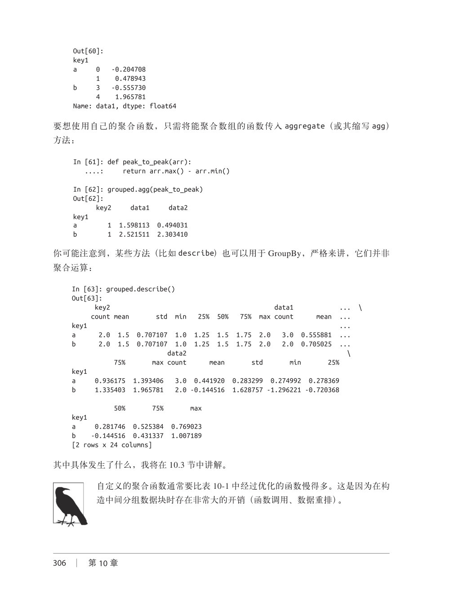

上一页的输出：

```text
Out[60]:
key1
a     0   -0.204708
      1    0.478943
b     3   -0.555730
      4    1.965781
Name: data1, dtype: float64
```

要想使用自己的聚合函数，只需将能聚合数组的函数传入 `aggregate`（或其缩写 `agg`）方法：

```python
def peak_to_peak(arr):
    return arr.max() - arr.min()

grouped.agg(peak_to_peak)
```

```text
Out[62]:
      key2     data1     data2
key1
a        1  1.598113  0.494031
b        1  2.521511  2.303410
```

你可能注意到，某些方法（比如 `describe`）也可以用于 GroupBy，严格来讲，它们并非聚合运算：

```python
grouped.describe()
```

```text
Out[63]:
      key2                                    data1          ...  \
     count mean       std  min   25%  50%   75%  max count      mean  ...
key1                                                          ...
a      2.0  1.5  0.707107  1.0  1.25  1.5  1.75  2.0   3.0  0.555881  ...
b      2.0  1.5  0.707107  1.0  1.25  1.5  1.75  2.0   2.0  0.705025  ...
          data2                                               \
           75%       max count      mean       std       min       25%
key1
a      0.936175  1.393406   3.0  0.441920  0.283299  0.274992  0.278369
b      1.335403  1.965781   2.0 -0.144516  1.628757 -1.296221 -0.720368
            50%       75%       max
key1
a      0.281746  0.525384  0.769023
b     -0.144516  0.431337  1.007189
[2 rows x 24 columns]
```

其中具体发生了什么，我将在 10.3 节中讲解。

> 自定义的聚合函数通常要比表 10-1 中经过优化的函数慢得多。这是因为在构造中间分组数据块时存在非常大的开销（函数调用、数据重排）。

## PDF 第 317 页

<!-- page-status: reviewed -->

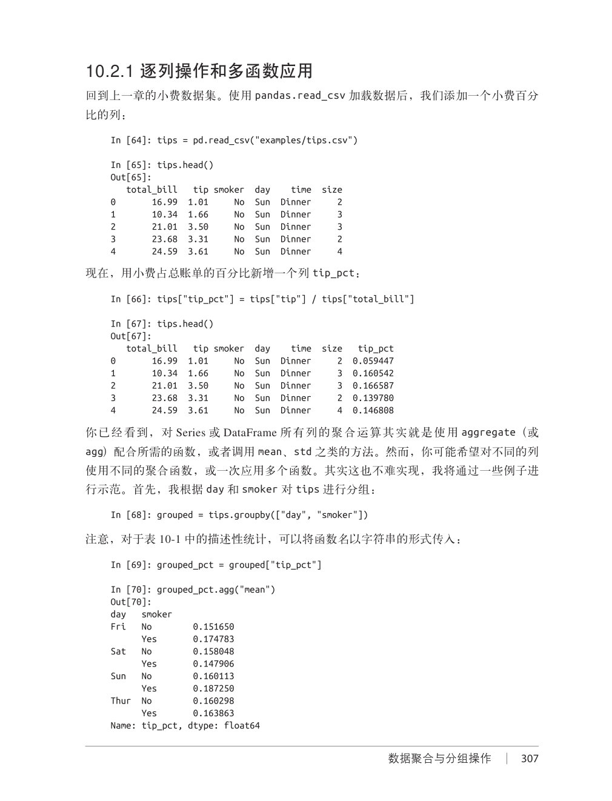

### 10.2.1 逐列操作和多函数应用

回到上一章的小费数据集。使用 `pandas.read_csv` 加载数据后，我们添加一个小费百分比的列：

```python
tips = pd.read_csv("examples/tips.csv")
tips.head()
```

```text
   total_bill   tip smoker  day    time  size
0       16.99  1.01     No  Sun  Dinner     2
1       10.34  1.66     No  Sun  Dinner     3
2       21.01  3.50     No  Sun  Dinner     3
3       23.68  3.31     No  Sun  Dinner     2
4       24.59  3.61     No  Sun  Dinner     4
```

现在，用小费占总账单的百分比新增一个列 `tip_pct`：

```python
tips["tip_pct"] = tips["tip"] / tips["total_bill"]
tips.head()
```

```text
   total_bill   tip smoker  day    time  size   tip_pct
0       16.99  1.01     No  Sun  Dinner     2  0.059447
1       10.34  1.66     No  Sun  Dinner     3  0.160542
2       21.01  3.50     No  Sun  Dinner     3  0.166587
3       23.68  3.31     No  Sun  Dinner     2  0.139780
4       24.59  3.61     No  Sun  Dinner     4  0.146808
```

你已经看到，对 Series 或 DataFrame 所有列的聚合运算其实就是使用 `aggregate`（或 `agg`）配合所需的函数，或者调用 `mean`、`std` 之类的方法。然而，你可能希望对不同的列使用不同的聚合函数，或一次应用多个函数。其实这也不难实现，我将通过一些例子进行示范。首先，我根据 `day` 和 `smoker` 对 `tips` 进行分组：

```python
grouped = tips.groupby(["day", "smoker"])
```

注意，对于表 10-1 中的描述性统计，可以将函数名以字符串的形式传入：

```python
grouped_pct = grouped["tip_pct"]
grouped_pct.agg("mean")
```

```text
day   smoker
Fri   No        0.151650
      Yes       0.174783
Sat   No        0.158048
      Yes       0.147906
Sun   No        0.160113
      Yes       0.187250
Thur  No        0.160298
      Yes       0.163863
Name: tip_pct, dtype: float64
```

## PDF 第 318 页

<!-- page-status: reviewed -->

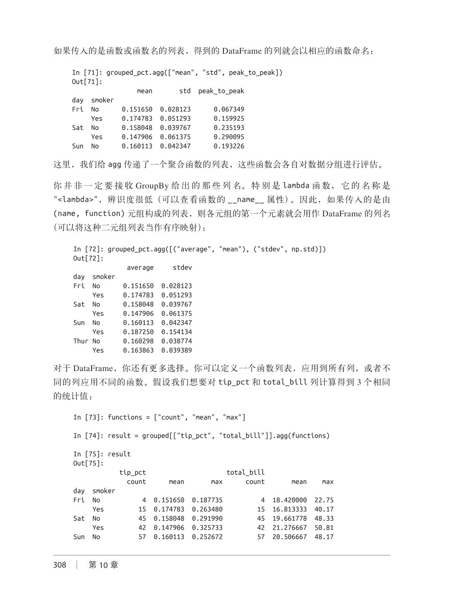

如果传入的是函数或函数名的列表，得到的 DataFrame 的列就会以相应的函数命名：

```python
grouped_pct.agg(["mean", "std", peak_to_peak])
```

```text
                 mean       std  peak_to_peak
day  smoker
Fri  No      0.151650  0.028123      0.067349
     Yes     0.174783  0.051293      0.159925
Sat  No      0.158048  0.039767      0.235193
     Yes     0.147906  0.061375      0.290095
Sun  No      0.160113  0.042347      0.193226
```

这里，我们给 `agg` 传递了一个聚合函数的列表，这些函数会各自对数据分组进行评估。

你并非一定要接收 GroupBy 给出的那些列名。特别是 lambda 函数，它的名称是 `"<lambda>"`，辨识度很低（可以查看函数的 `__name__` 属性）。因此，如果传入的是由 `(name, function)` 元组构成的列表，则各元组的第一个元素就会用作 DataFrame 的列名（可以将这种二元组列表当作有序映射）：

```python
grouped_pct.agg([("average", "mean"), ("stdev", np.std)])
```

```text
               average     stdev
day  smoker
Fri  No       0.151650  0.028123
     Yes      0.174783  0.051293
Sat  No       0.158048  0.039767
     Yes      0.147906  0.061375
Sun  No       0.160113  0.042347
     Yes      0.187250  0.154134
Thur No       0.160298  0.038774
     Yes      0.163863  0.039389
```

对于 DataFrame，你还有更多选择。你可以定义一个函数列表，应用到所有列，或者不同的列应用不同的函数。假设我们想要对 `tip_pct` 和 `total_bill` 列计算得到 3 个相同的统计值：

```python
functions = ["count", "mean", "max"]
result = grouped[["tip_pct", "total_bill"]].agg(functions)
result
```

```text
             tip_pct                     total_bill
               count      mean       max      count       mean    max
day  smoker
Fri  No            4  0.151650  0.187735          4  18.420000  22.75
     Yes          15  0.174783  0.263480         15  16.813333  40.17
Sat  No           45  0.158048  0.291990         45  19.661778  48.33
     Yes          42  0.147906  0.325733         42  21.276667  50.81
Sun  No           57  0.160113  0.252672         57  20.506667  48.17
```

## PDF 第 319 页

<!-- page-status: reviewed -->

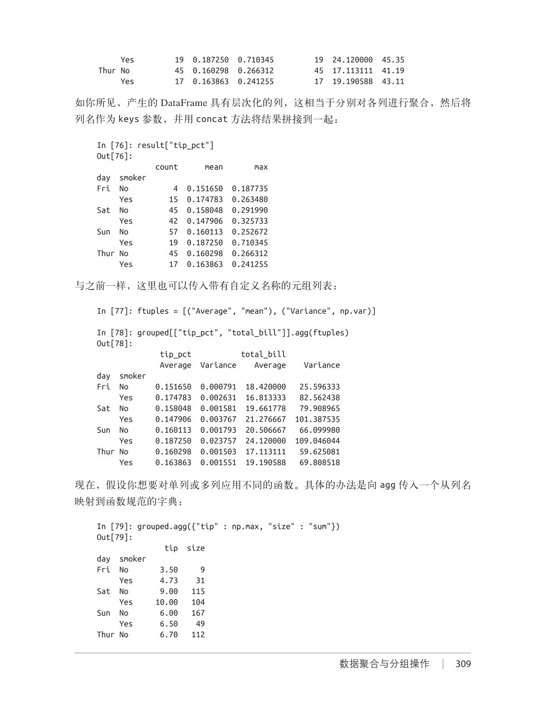

（上页输出续）

```text
     Yes          19  0.187250  0.710345         19  24.120000  45.35
Thur No           45  0.160298  0.266312         45  17.113111  41.19
     Yes          17  0.163863  0.241255         17  19.190588  43.11
```

如你所见，产生的 DataFrame 具有层次化的列，这相当于分别对各列进行聚合，然后将列名作为 `keys` 参数，并用 `concat` 方法将结果拼接到一起：

```python
result["tip_pct"]
```

```text
             count      mean       max
day  smoker
Fri  No          4  0.151650  0.187735
     Yes        15  0.174783  0.263480
Sat  No         45  0.158048  0.291990
     Yes        42  0.147906  0.325733
Sun  No         57  0.160113  0.252672
     Yes        19  0.187250  0.710345
Thur No         45  0.160298  0.266312
     Yes        17  0.163863  0.241255
```

与之前一样，这里也可以传入带有自定义名称的元组列表：

```python
ftuples = [("Average", "mean"), ("Variance", np.var)]
grouped[["tip_pct", "total_bill"]].agg(ftuples)
```

```text
               tip_pct              total_bill
               Average  Variance       Average    Variance
day  smoker
Fri  No       0.151650  0.000791     18.420000   25.596333
     Yes      0.174783  0.002631     16.813333   82.562438
Sat  No       0.158048  0.001581     19.661778   79.908965
     Yes      0.147906  0.003767     21.276667  101.387535
Sun  No       0.160113  0.001793     20.506667   66.099980
     Yes      0.187250  0.023757     24.120000  109.046044
Thur No       0.160298  0.001503     17.113111   59.625081
     Yes      0.163863  0.001551     19.190588   69.808518
```

现在，假设你想要对单列或多列应用不同的函数。具体的办法是向 `agg` 传入一个从列名映射到函数规范的字典：

```python
grouped.agg({"tip": np.max, "size": "sum"})
```

```text
              tip  size
day  smoker
Fri  No      3.50     9
     Yes     4.73    31
Sat  No      9.00   115
     Yes    10.00   104
Sun  No      6.00   167
     Yes     6.50    49
Thur No      6.70   112
```

## PDF 第 320 页

<!-- page-status: reviewed -->

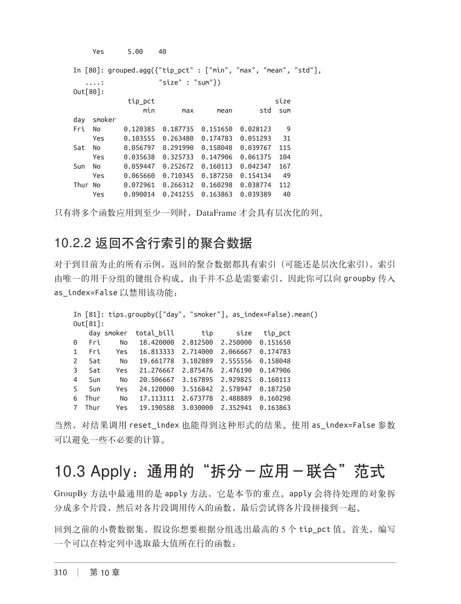

（上页输出续）

```text
     Yes     5.00    40
```

```python
grouped.agg({"tip_pct": ["min", "max", "mean", "std"],
             "size": "sum"})
```

```text
              tip_pct                                    size
                  min       max      mean       std       sum
day  smoker
Fri  No      0.120385  0.187735  0.151650  0.028123         9
     Yes     0.103555  0.263480  0.174783  0.051293        31
Sat  No      0.056797  0.291990  0.158048  0.039767       115
     Yes     0.035638  0.325733  0.147906  0.061375       104
Sun  No      0.059447  0.252672  0.160113  0.042347       167
     Yes     0.065660  0.710345  0.187250  0.154134        49
Thur No      0.072961  0.266312  0.160298  0.038774       112
     Yes     0.090014  0.241255  0.163863  0.039389        40
```

只有将多个函数应用到至少一列时，DataFrame 才会具有层次化的列。

### 10.2.2 返回不含行索引的聚合数据

对于到目前为止的所有示例，返回的聚合数据都具有索引（可能还是层次化索引），索引由唯一的用于分组的键组合构成。由于并不总是需要索引，因此你可以向 `groupby` 传入 `as_index=False` 以禁用该功能：

```python
tips.groupby(["day", "smoker"], as_index=False).mean()
```

```text
    day smoker  total_bill       tip      size   tip_pct
0   Fri     No   18.420000  2.812500  2.250000  0.151650
1   Fri    Yes   16.813333  2.714000  2.066667  0.174783
2   Sat     No   19.661778  3.102889  2.555556  0.158048
3   Sat    Yes   21.276667  2.875476  2.476190  0.147906
4   Sun     No   20.506667  3.167895  2.929825  0.160113
5   Sun    Yes   24.120000  3.516842  2.578947  0.187250
6  Thur     No   17.113111  2.673778  2.488889  0.160298
7  Thur    Yes   19.190588  3.030000  2.352941  0.163863
```

当然，对结果调用 `reset_index` 也能得到这种形式的结果。使用 `as_index=False` 参数可以避免一些不必要的计算。

### 10.3 Apply：通用的“拆分－应用－联合”范式

GroupBy 方法中最通用的是 `apply` 方法，它是本节的重点。`apply` 会将待处理的对象拆分成多个片段，然后对各片段调用传入的函数，最后尝试将各片段拼接到一起。

回到之前的小费数据集，假设你想要根据分组选出最高的 5 个 `tip_pct` 值。首先，编写一个可以在特定列中选取最大值所在行的函数：

## PDF 第 321 页

<!-- page-status: reviewed -->

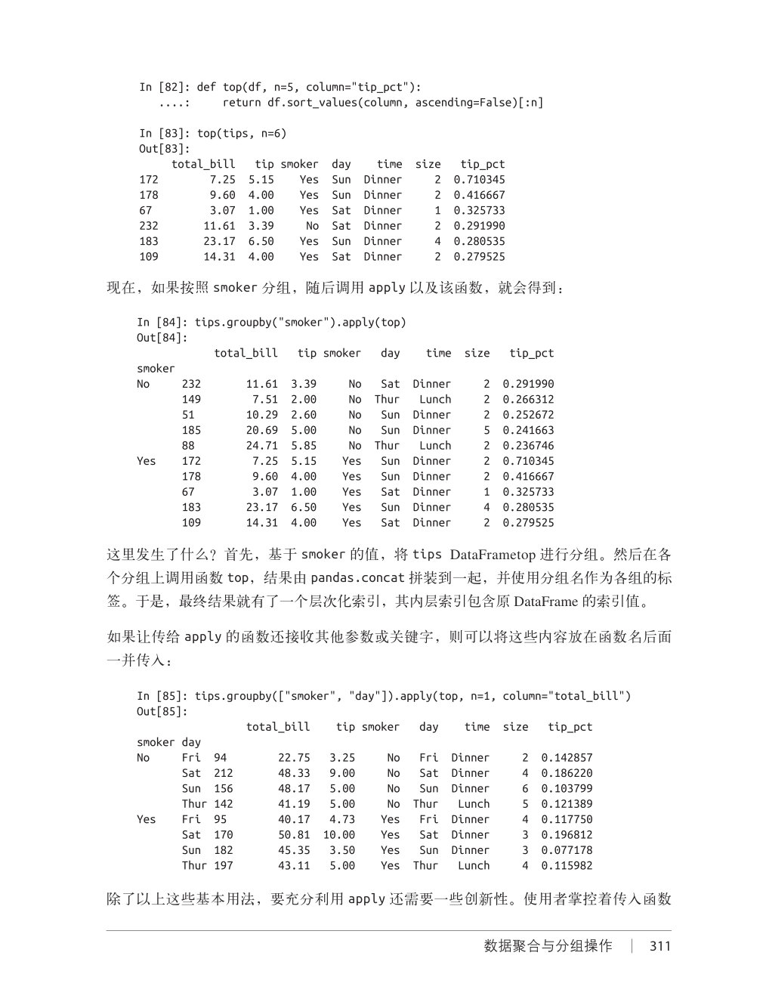

```python
def top(df, n=5, column="tip_pct"):
    return df.sort_values(column, ascending=False)[:n]

top(tips, n=6)
```

```text
     total_bill   tip smoker  day    time  size   tip_pct
172        7.25  5.15    Yes  Sun  Dinner     2  0.710345
178        9.60  4.00    Yes  Sun  Dinner     2  0.416667
67         3.07  1.00    Yes  Sat  Dinner     1  0.325733
232       11.61  3.39     No  Sat  Dinner     2  0.291990
183       23.17  6.50    Yes  Sun  Dinner     4  0.280535
109       14.31  4.00    Yes  Sat  Dinner     2  0.279525
```

现在，如果按照 `smoker` 分组，随后调用 `apply` 以及该函数，就会得到：

```python
tips.groupby("smoker").apply(top)
```

```text
            total_bill   tip smoker   day    time  size   tip_pct
smoker
No     232       11.61  3.39     No   Sat  Dinner     2  0.291990
       149        7.51  2.00     No  Thur   Lunch     2  0.266312
       51        10.29  2.60     No   Sun  Dinner     2  0.252672
       185       20.69  5.00     No   Sun  Dinner     5  0.241663
       88        24.71  5.85     No  Thur   Lunch     2  0.236746
Yes    172        7.25  5.15    Yes   Sun  Dinner     2  0.710345
       178        9.60  4.00    Yes   Sun  Dinner     2  0.416667
       67         3.07  1.00    Yes   Sat  Dinner     1  0.325733
       183       23.17  6.50    Yes   Sun  Dinner     4  0.280535
       109       14.31  4.00    Yes   Sat  Dinner     2  0.279525
```

这里发生了什么？首先，基于 `smoker` 的值，将 `tips` DataFrame 分组。然后在各个分组上调用函数 `top`，结果由 `pandas.concat` 拼装到一起，并使用分组名作为各组的标签。于是，最终结果就有了一个层次化索引，其内层索引包含原 DataFrame 的索引值。

如果让传给 `apply` 的函数还接收其他参数或关键字，则可以将这些内容放在函数名后面一并传入：

```python
tips.groupby(["smoker", "day"]).apply(top, n=1, column="total_bill")
```

```text
                total_bill    tip smoker   day    time  size   tip_pct
smoker day
No     Fri  94       22.75   3.25     No   Fri  Dinner     2  0.142857
       Sat  212      48.33   9.00     No   Sat  Dinner     4  0.186220
       Sun  156      48.17   5.00     No   Sun  Dinner     6  0.103799
       Thur 142      41.19   5.00     No  Thur   Lunch     5  0.121389
Yes    Fri  95       40.17   4.73    Yes   Fri  Dinner     4  0.117750
       Sat  170      50.81  10.00    Yes   Sat  Dinner     3  0.196812
       Sun  182      45.35   3.50    Yes   Sun  Dinner     3  0.077178
       Thur 197      43.11   5.00    Yes  Thur   Lunch     4  0.115982
```

除了以上这些基本用法，要充分利用 `apply` 还需要一些创新性。使用者掌控着传入函数

## PDF 第 322 页

<!-- page-status: reviewed -->

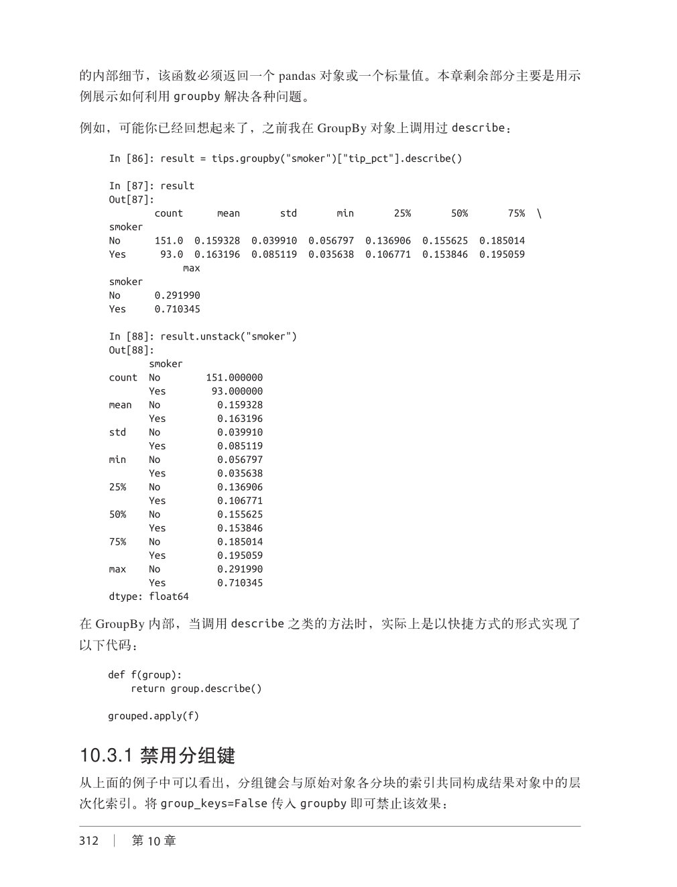

（上页续）

的内部细节，该函数必须返回一个 pandas 对象或一个标量值。本章剩余部分主要是用示例展示如何利用 `groupby` 解决各种问题。

例如，可能你已经回想起来了，之前我在 GroupBy 对象上调用过 `describe`：

```python
result = tips.groupby("smoker")["tip_pct"].describe()
result
```

```text
        count      mean       std       min       25%       50%       75%  \
smoker
No      151.0  0.159328  0.039910  0.056797  0.136906  0.155625  0.185014
Yes      93.0  0.163196  0.085119  0.035638  0.106771  0.153846  0.195059

             max
smoker
No      0.291990
Yes     0.710345
```

```python
result.unstack("smoker")
```

```text
       smoker
count  No        151.000000
       Yes        93.000000
mean   No          0.159328
       Yes         0.163196
std    No          0.039910
       Yes         0.085119
min    No          0.056797
       Yes         0.035638
25%    No          0.136906
       Yes         0.106771
50%    No          0.155625
       Yes         0.153846
75%    No          0.185014
       Yes         0.195059
max    No          0.291990
       Yes         0.710345
dtype: float64
```

在 GroupBy 内部，当调用 `describe` 之类的方法时，实际上是以快捷方式的形式实现了以下代码：

```python
def f(group):
    return group.describe()

grouped.apply(f)
```

### 10.3.1 禁用分组键

从上面的例子中可以看出，分组键会与原始对象各分块的索引共同构成结果对象中的层次化索引。将 `group_keys=False` 传入 `groupby` 即可禁止该效果：

## PDF 第 323 页

<!-- page-status: reviewed -->

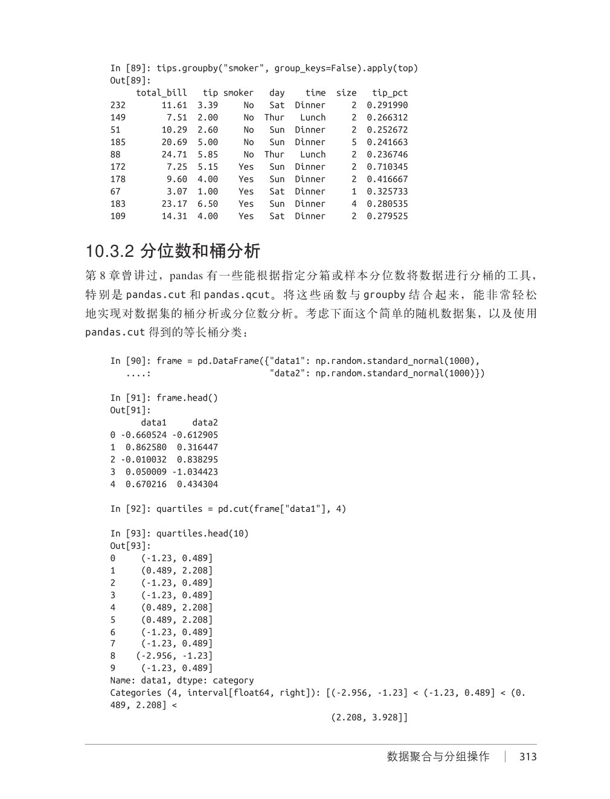

```python
tips.groupby("smoker", group_keys=False).apply(top)
```

```text
     total_bill   tip smoker  day    time  size   tip_pct
232       11.61  3.39     No  Sat  Dinner     2  0.291990
149        7.51  2.00     No  Thur  Lunch     2  0.266312
51        10.29  2.60     No  Sun  Dinner     2  0.252672
185       20.69  5.00     No  Sun  Dinner     5  0.241663
88        24.71  5.85     No  Thur  Lunch     2  0.236746
172        7.25  5.15    Yes  Sun  Dinner     2  0.710345
178        9.60  4.00    Yes  Sun  Dinner     2  0.416667
67         3.07  1.00    Yes  Sat  Dinner     1  0.325733
183       23.17  6.50    Yes  Sun  Dinner     4  0.280535
109       14.31  4.00    Yes  Sat  Dinner     2  0.279525
```

### 10.3.2 分位数和桶分析

第 8 章曾讲过，pandas 有一些能根据指定分箱或样本分位数将数据进行分桶的工具，特别是 `pandas.cut` 和 `pandas.qcut`。将这些函数与 `groupby` 结合起来，能非常轻松地实现对数据集的桶分析或分位数分析。考虑下面这个简单的随机数据集，以及使用 `pandas.cut` 得到的等长桶分类：

```python
frame = pd.DataFrame({"data1": np.random.standard_normal(1000),
                      "data2": np.random.standard_normal(1000)})
frame.head()
```

```text
      data1     data2
0 -0.660524 -0.612905
1  0.862580  0.316447
2 -0.010032  0.838295
3  0.050009 -1.034423
4  0.670216  0.434304
```

```python
quartiles = pd.cut(frame["data1"], 4)
quartiles.head(10)
```

```text
0    (-1.23, 0.489]
1    (0.489, 2.208]
2    (-1.23, 0.489]
3    (-1.23, 0.489]
4    (0.489, 2.208]
5    (0.489, 2.208]
6    (-1.23, 0.489]
7    (-1.23, 0.489]
8    (-2.956, -1.23]
9    (-1.23, 0.489]
Name: data1, dtype: category
Categories (4, interval[float64, right]): [(-2.956, -1.23] < (-1.23, 0.489] < (0.489, 2.208] <
                                          (2.208, 3.928]]
```

## PDF 第 324 页

<!-- page-status: reviewed -->

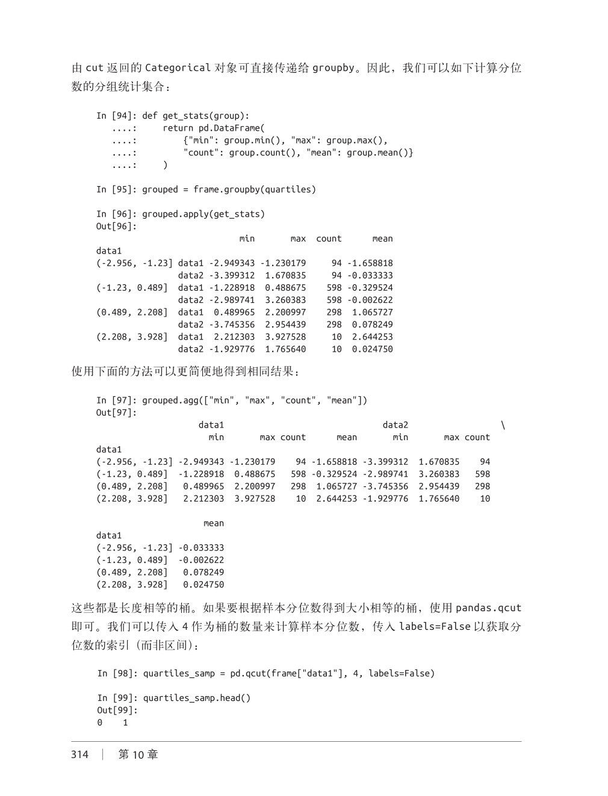

由 `cut` 返回的 `Categorical` 对象可直接传递给 `groupby`。因此，我们可以如下计算分位数的分组统计集合：

```python
def get_stats(group):
    return pd.DataFrame(
        {"min": group.min(), "max": group.max(),
         "count": group.count(), "mean": group.mean()}
    )

grouped = frame.groupby(quartiles)
grouped.apply(get_stats)
```

```text
                           min       max  count      mean
data1
(-2.956, -1.23] data1 -2.949343 -1.230179     94 -1.658818
                data2 -3.399312  1.670835     94 -0.033333
(-1.23, 0.489]  data1 -1.228918  0.488675    598 -0.329524
                data2 -2.989741  3.260383    598 -0.002622
(0.489, 2.208]  data1  0.489965  2.200997    298  1.065727
                data2 -3.745356  2.954439    298  0.078249
(2.208, 3.928]  data1  2.212303  3.927528     10  2.644253
                data2 -1.929776  1.765640     10  0.024750
```

使用下面的方法可以更简便地得到相同结果：

```python
grouped.agg(["min", "max", "count", "mean"])
```

```text
                          data1                                  data2                         \
                            min       max count      mean          min       max count
 data1
(-2.956, -1.23]       -2.949343 -1.230179    94 -1.658818    -3.399312  1.670835    94
(-1.23, 0.489]        -1.228918  0.488675   598 -0.329524    -2.989741  3.260383   598
(0.489, 2.208]         0.489965  2.200997   298  1.065727    -3.745356  2.954439   298
(2.208, 3.928]         2.212303  3.927528    10  2.644253    -1.929776  1.765640    10

                           mean
data1
(-2.956, -1.23]       -0.033333
(-1.23, 0.489]        -0.002622
(0.489, 2.208]         0.078249
(2.208, 3.928]         0.024750
```

这些都是长度相等的桶。如果要根据样本分位数得到大小相等的桶，使用 `pandas.qcut` 即可。我们可以传入 4 作为桶的数量来计算样本分位数，传入 `labels=False` 以获取分位数的索引（而非区间）：

```python
quartiles_samp = pd.qcut(frame["data1"], 4, labels=False)
quartiles_samp.head()
```

```text
0    1
```

（输出接下页。）

## PDF 第 325 页

<!-- page-status: reviewed -->

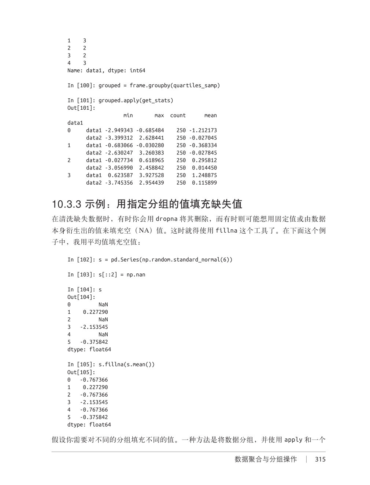

```text
1    3
2    2
3    2
4    3
Name: data1, dtype: int64
```

```python
grouped = frame.groupby(quartiles_samp)
grouped.apply(get_stats)
```

```text
                  min       max  count      mean
data1
0     data1 -2.949343 -0.685484    250 -1.212173
      data2 -3.399312  2.628441    250 -0.027045
1     data1 -0.683066 -0.030280    250 -0.368334
      data2 -2.630247  3.260383    250 -0.027845
2     data1 -0.027734  0.618965    250  0.295812
      data2 -3.056990  2.458842    250  0.014450
3     data1  0.623587  3.927528    250  1.248875
      data2 -3.745356  2.954439    250  0.115899
```

### 10.3.3 示例：用指定分组的值填充缺失值

在清洗缺失数据时，有时你会用 `dropna` 将其删除，而有时则可能想用固定值或由数据本身衍生出的值来填充空（NA）值。这时就得使用 `fillna` 这个工具了。在下面这个例子中，我用平均值填充空值：

```python
s = pd.Series(np.random.standard_normal(6))
s[::2] = np.nan
s
```

```text
0         NaN
1    0.227290
2         NaN
3   -2.153545
4         NaN
5   -0.375842
dtype: float64
```

```python
s.fillna(s.mean())
```

```text
0   -0.767366
1    0.227290
2   -0.767366
3   -2.153545
4   -0.767366
5   -0.375842
dtype: float64
```

假设你需要对不同的分组填充不同的值。一种方法是将数据分组，并使用 `apply` 和一个

## PDF 第 326 页

<!-- page-status: reviewed -->

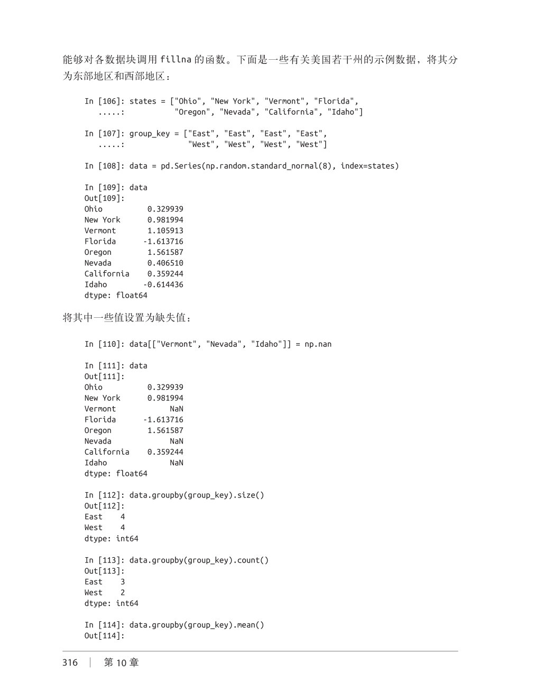

能够对各数据块调用 `fillna` 的函数。下面是一些有关美国若干州的示例数据，将其分为东部地区和西部地区：

```python
states = ["Ohio", "New York", "Vermont", "Florida",
          "Oregon", "Nevada", "California", "Idaho"]
group_key = ["East", "East", "East", "East",
             "West", "West", "West", "West"]
data = pd.Series(np.random.standard_normal(8), index=states)
data
```

```text
Ohio          0.329939
New York      0.981994
Vermont       1.105913
Florida      -1.613716
Oregon        1.561587
Nevada        0.406510
California    0.359244
Idaho        -0.614436
dtype: float64
```

将其中一些值设置为缺失值：

```python
data[["Vermont", "Nevada", "Idaho"]] = np.nan
data
```

```text
Ohio          0.329939
New York      0.981994
Vermont            NaN
Florida      -1.613716
Oregon        1.561587
Nevada             NaN
California    0.359244
Idaho              NaN
dtype: float64
```

```python
data.groupby(group_key).size()
```

```text
East    4
West    4
dtype: int64
```

```python
data.groupby(group_key).count()
```

```text
East    3
West    2
dtype: int64
```

```python
data.groupby(group_key).mean()
```

（输出接下页。）

## PDF 第 327 页

<!-- page-status: reviewed -->

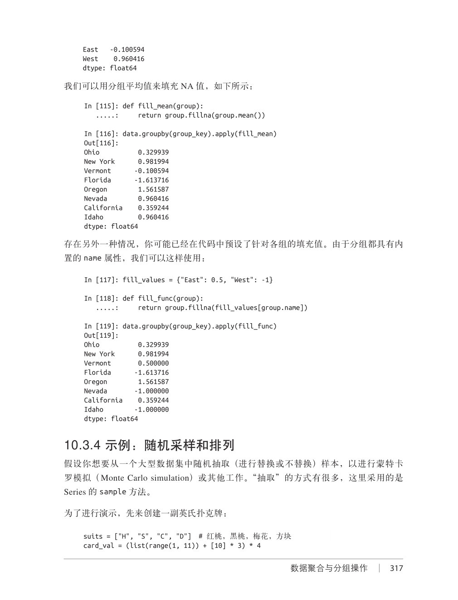

```text
East   -0.100594
West    0.960416
dtype: float64
```

我们可以用分组平均值来填充 NA 值，如下所示：

```python
def fill_mean(group):
    return group.fillna(group.mean())

data.groupby(group_key).apply(fill_mean)
```

```text
Ohio          0.329939
New York      0.981994
Vermont      -0.100594
Florida      -1.613716
Oregon        1.561587
Nevada        0.960416
California    0.359244
Idaho         0.960416
dtype: float64
```

存在另外一种情况，你可能已经在代码中预设了针对各组的填充值。由于分组都具有内置的 `name` 属性，我们可以这样使用：

```python
fill_values = {"East": 0.5, "West": -1}

def fill_func(group):
    return group.fillna(fill_values[group.name])

data.groupby(group_key).apply(fill_func)
```

```text
Ohio          0.329939
New York      0.981994
Vermont       0.500000
Florida      -1.613716
Oregon        1.561587
Nevada       -1.000000
California    0.359244
Idaho        -1.000000
dtype: float64
```

### 10.3.4 示例：随机采样和排列

假设你想要从一个大型数据集中随机抽取（进行替换或不替换）样本，以进行蒙特卡罗模拟（Monte Carlo simulation）或其他工作。“抽取”的方式有很多，这里采用的是 Series 的 `sample` 方法。

为了进行演示，先来创建一副英式扑克牌：

```python
suits = ["H", "S", "C", "D"]  # 红桃、黑桃、梅花、方块
card_val = (list(range(1, 11)) + [10] * 3) * 4
```

## PDF 第 328 页

<!-- page-status: reviewed -->

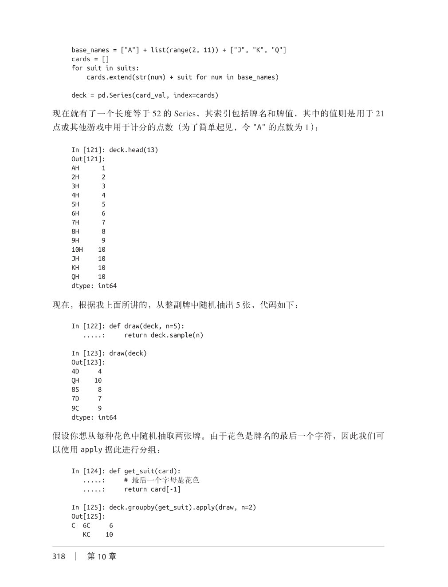

```python
base_names = ["A"] + list(range(2, 11)) + ["J", "K", "Q"]
cards = []
for suit in suits:
    cards.extend(str(num) + suit for num in base_names)

deck = pd.Series(card_val, index=cards)
```

现在就有了一个长度等于 52 的 Series，其索引包括牌名和牌值，其中的值则是用于 21 点或其他游戏中用于计分的点数（为了简单起见，令 `"A"` 的点数为 1）：

```python
deck.head(13)
```

```text
AH      1
2H      2
3H      3
4H      4
5H      5
6H      6
7H      7
8H      8
9H      9
10H    10
JH     10
KH     10
QH     10
dtype: int64
```

现在，根据我上面所讲的，从整副牌中随机抽出 5 张，代码如下：

```python
def draw(deck, n=5):
    return deck.sample(n)

draw(deck)
```

```text
4D     4
QH    10
8S     8
7D     7
9C     9
dtype: int64
```

假设你想从每种花色中随机抽取两张牌。由于花色是牌名的最后一个字符，因此我们可以使用 `apply` 据此进行分组：

```python
def get_suit(card):
    # 最后一个字母是花色
    return card[-1]

deck.groupby(get_suit).apply(draw, n=2)
```

```text
C  6C     6
   KC    10
```

（输出接下页。）

## PDF 第 329 页

<!-- page-status: reviewed -->

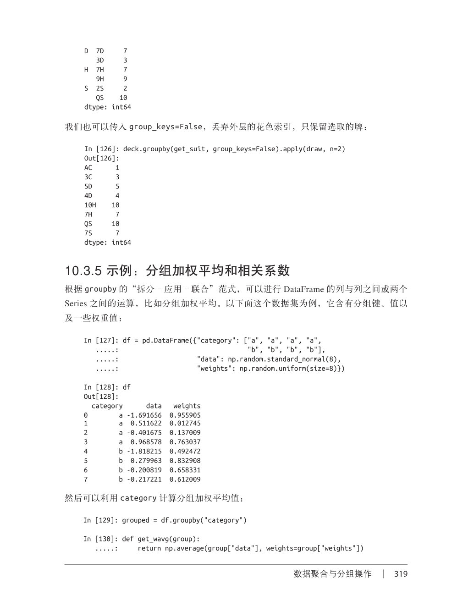

上一页输出续：

```text
D  7D     7
   3D     3
H  7H     7
   9H     9
S  2S     2
   QS    10
dtype: int64
```

我们也可以传入 `group_keys=False`，丢弃外层的花色索引，只保留选取的牌：

```python
# In [126]
deck.groupby(get_suit, group_keys=False).apply(draw, n=2)
```

```text
Out[126]:
AC      1
3C      3
5D      5
4D      4
10H    10
7H      7
QS     10
7S      7
dtype: int64
```

### 10.3.5 示例：分组加权平均和相关系数

根据 `groupby` 的“拆分-应用-联合”范式，可以进行 DataFrame 的列与列之间或两个 Series 之间的运算，比如分组加权平均。以下面这个数据集为例，它含有分组键、值以及一些权重值：

```python
# In [127]–[128]
df = pd.DataFrame({"category": ["a", "a", "a", "a",
                                "b", "b", "b", "b"],
                   "data": np.random.standard_normal(8),
                   "weights": np.random.uniform(size=8)})
df
```

```text
Out[128]:
  category      data   weights
0        a -1.691656  0.955905
1        a  0.511622  0.012745
2        a -0.401675  0.137009
3        a  0.968578  0.763037
4        b -1.818215  0.492472
5        b  0.279963  0.832908
6        b -0.200819  0.658331
7        b -0.217221  0.612009
```

然后可以利用 `category` 计算分组加权平均值：

```python
# In [129]–[130]
grouped = df.groupby("category")

def get_wavg(group):
    return np.average(group["data"], weights=group["weights"])
```

## PDF 第 330 页

<!-- page-status: reviewed -->

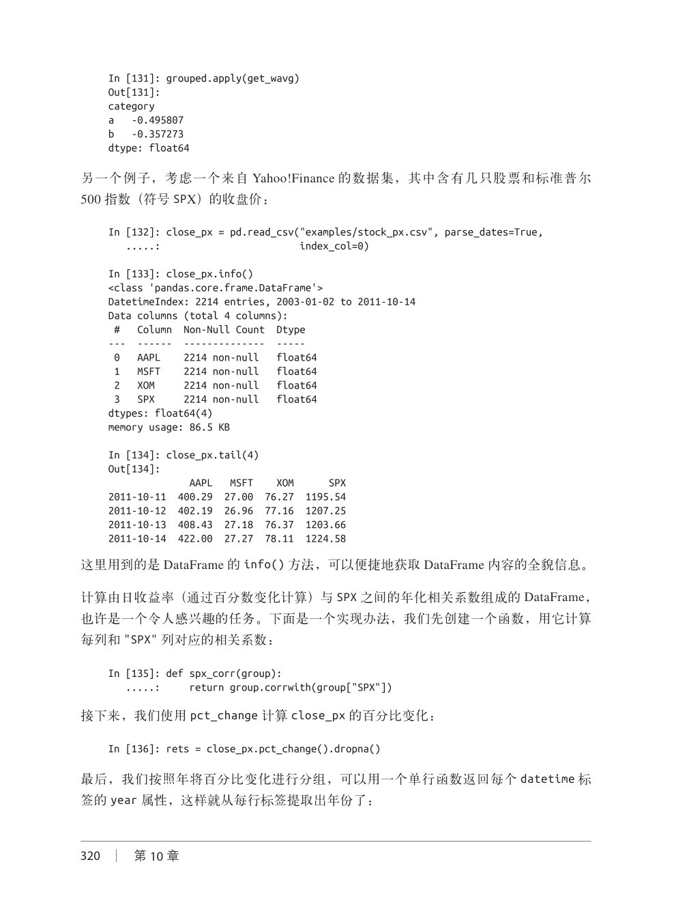

```python
# In [131]
grouped.apply(get_wavg)
```

```text
Out[131]:
category
a   -0.495807
b   -0.357273
dtype: float64
```

另一个例子，考虑一个来自 Yahoo!Finance 的数据集，其中含有几只股票和标准普尔 500 指数（符号 SPX）的收盘价：

```python
# In [132]–[133]
close_px = pd.read_csv("examples/stock_px.csv", parse_dates=True,
                       index_col=0)
close_px.info()
```

```text
<class 'pandas.core.frame.DataFrame'>
DatetimeIndex: 2214 entries, 2003-01-02 to 2011-10-14
Data columns (total 4 columns):
 #   Column  Non-Null Count  Dtype
---  ------  --------------  -----
 0   AAPL    2214 non-null   float64
 1   MSFT    2214 non-null   float64
 2   XOM     2214 non-null   float64
 3   SPX     2214 non-null   float64
dtypes: float64(4)
memory usage: 86.5 KB
```

```python
# In [134]
close_px.tail(4)
```

```text
Out[134]:
              AAPL   MSFT    XOM      SPX
2011-10-11  400.29  27.00  76.27  1195.54
2011-10-12  402.19  26.96  77.16  1207.25
2011-10-13  408.43  27.18  76.37  1203.66
2011-10-14  422.00  27.27  78.11  1224.58
```

这里用到的是 DataFrame 的 `info()` 方法，可以便捷地获取 DataFrame 内容的全貌信息。

计算由日收益率（通过百分数变化计算）与 SPX 之间的年化相关系数组成的 DataFrame，也许是一个令人感兴趣的任务。下面是一个实现办法，我们先创建一个函数，用它计算每列和 `"SPX"` 列对应的相关系数：

```python
# In [135]
def spx_corr(group):
    return group.corrwith(group["SPX"])
```

接下来，我们使用 `pct_change` 计算 `close_px` 的百分比变化：

```python
# In [136]
rets = close_px.pct_change().dropna()
```

最后，我们按照年将百分比变化进行分组，可以用一个单行函数返回每个 datetime 标签的 `year` 属性，这样就从每行标签提取出年份了：

## PDF 第 331 页

<!-- page-status: reviewed -->

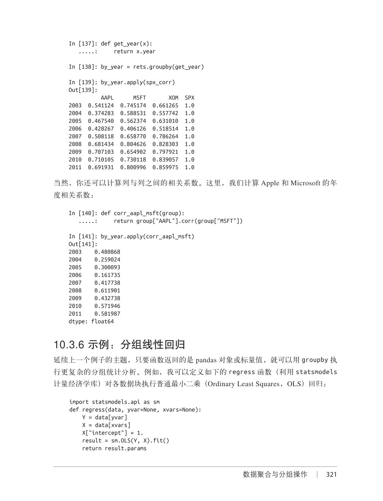

```python
# In [137]–[139]
def get_year(x):
    return x.year

by_year = rets.groupby(get_year)
by_year.apply(spx_corr)
```

```text
Out[139]:
          AAPL      MSFT       XOM  SPX
2003  0.541124  0.745174  0.661265  1.0
2004  0.374283  0.588531  0.557742  1.0
2005  0.467540  0.562374  0.631010  1.0
2006  0.428267  0.406126  0.518514  1.0
2007  0.508118  0.658770  0.786264  1.0
2008  0.681434  0.804626  0.828303  1.0
2009  0.707103  0.654902  0.797921  1.0
2010  0.710105  0.730118  0.839057  1.0
2011  0.691931  0.800996  0.859975  1.0
```

当然，你还可以计算列与列之间的相关系数。这里，我们计算 Apple 和 Microsoft 的年度相关系数：

```python
# In [140]–[141]
def corr_aapl_msft(group):
    return group["AAPL"].corr(group["MSFT"])

by_year.apply(corr_aapl_msft)
```

```text
Out[141]:
2003    0.480868
2004    0.259024
2005    0.300093
2006    0.161735
2007    0.417738
2008    0.611901
2009    0.432738
2010    0.571946
2011    0.581987
dtype: float64
```

### 10.3.6 示例：分组线性回归

延续上一个例子的主题，只要函数返回的是 pandas 对象或标量值，就可以用 `groupby` 执行更复杂的分组统计分析。例如，我可以定义如下的 `regress` 函数（利用 statsmodels 计量经济学库）对各数据块执行普通最小二乘（Ordinary Least Squares，OLS）回归：

```python
import statsmodels.api as sm

def regress(data, yvar=None, xvars=None):
    Y = data[yvar]
    X = data[xvars]
    X["intercept"] = 1.
    result = sm.OLS(Y, X).fit()
    return result.params
```

## PDF 第 332 页

<!-- page-status: reviewed -->

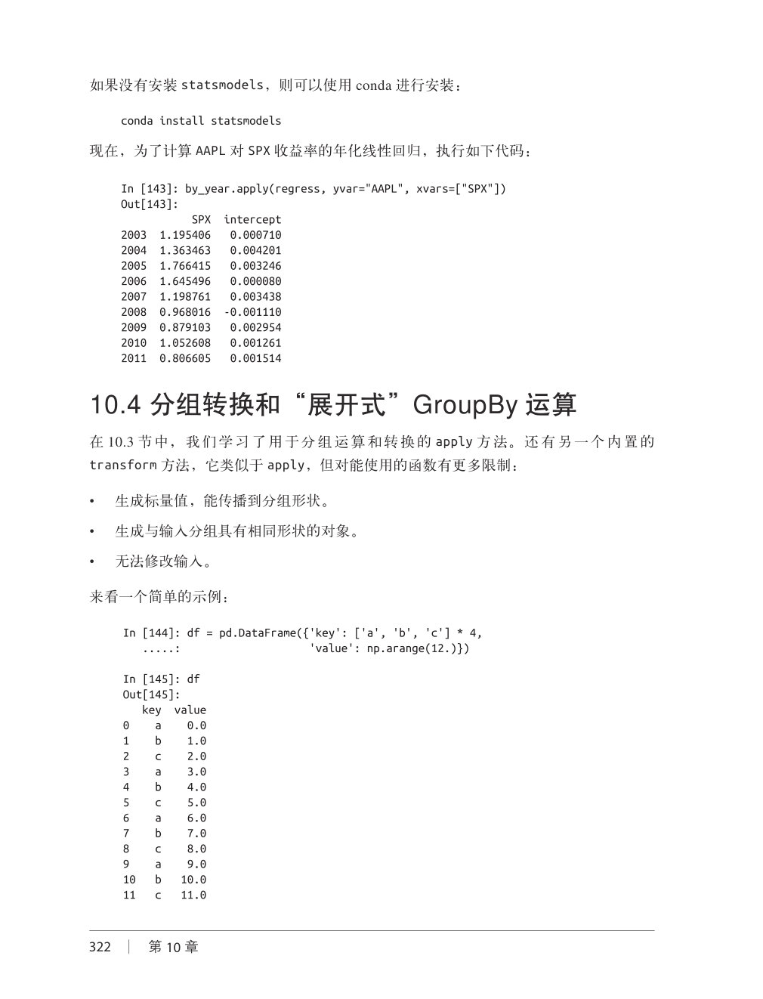

如果没有安装 statsmodels，则可以使用 conda 进行安装：

```bash
conda install statsmodels
```

现在，为了计算 AAPL 对 SPX 收益率的年化线性回归，执行如下代码：

```python
# In [143]
by_year.apply(regress, yvar="AAPL", xvars=["SPX"])
```

```text
Out[143]:
           SPX  intercept
2003  1.195406   0.000710
2004  1.363463   0.004201
2005  1.766415   0.003246
2006  1.645496   0.000080
2007  1.198761   0.003438
2008  0.968016  -0.001110
2009  0.879103   0.002954
2010  1.052608   0.001261
2011  0.806605   0.001514
```

### 10.4 分组转换和“展开式”GroupBy 运算

在 10.3 节中，我们学习了用于分组运算和转换的 `apply` 方法。还有另一个内置的 `transform` 方法，它类似于 `apply`，但对能使用的函数有更多限制：

- 生成标量值，能传播到分组形状。
- 生成与输入分组具有相同形状的对象。
- 无法修改输入。

来看一个简单的示例：

```python
# In [144]–[145]
df = pd.DataFrame({'key': ['a', 'b', 'c'] * 4,
                   'value': np.arange(12.)})
df
```

```text
Out[145]:
   key  value
0    a    0.0
1    b    1.0
2    c    2.0
3    a    3.0
4    b    4.0
5    c    5.0
6    a    6.0
7    b    7.0
8    c    8.0
9    a    9.0
10   b   10.0
11   c   11.0
```

## PDF 第 333 页

<!-- page-status: reviewed -->

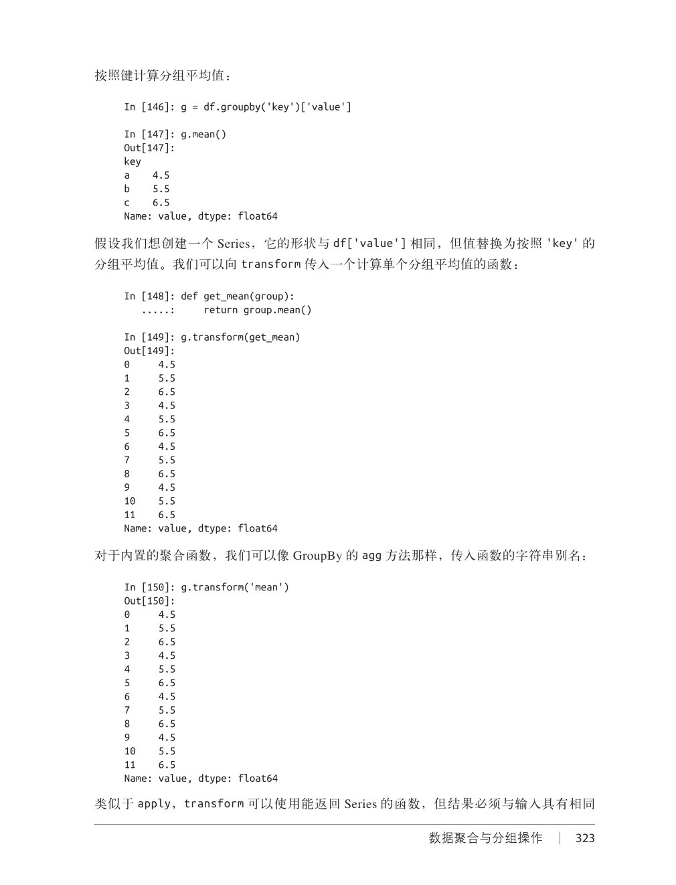

按照键计算分组平均值：

```python
# In [146]–[147]
g = df.groupby('key')['value']
g.mean()
```

```text
Out[147]:
key
a    4.5
b    5.5
c    6.5
Name: value, dtype: float64
```

假设我们想创建一个 Series，它的形状与 `df['value']` 相同，但值替换为按照 `'key'` 的分组平均值。我们可以向 `transform` 传入一个计算单个分组平均值的函数：

```python
# In [148]–[149]
def get_mean(group):
    return group.mean()

g.transform(get_mean)
```

```text
Out[149]:
0     4.5
1     5.5
2     6.5
3     4.5
4     5.5
5     6.5
6     4.5
7     5.5
8     6.5
9     4.5
10    5.5
11    6.5
Name: value, dtype: float64
```

对于内置的聚合函数，我们可以像 GroupBy 的 `agg` 方法那样，传入函数的字符串别名：

```python
# In [150]
g.transform('mean')
```

```text
Out[150]:
0     4.5
1     5.5
2     6.5
3     4.5
4     5.5
5     6.5
6     4.5
7     5.5
8     6.5
9     4.5
10    5.5
11    6.5
Name: value, dtype: float64
```

类似于 `apply`，`transform` 可以使用能返回 Series 的函数，但结果必须与输入具有相同

## PDF 第 334 页

<!-- page-status: reviewed -->

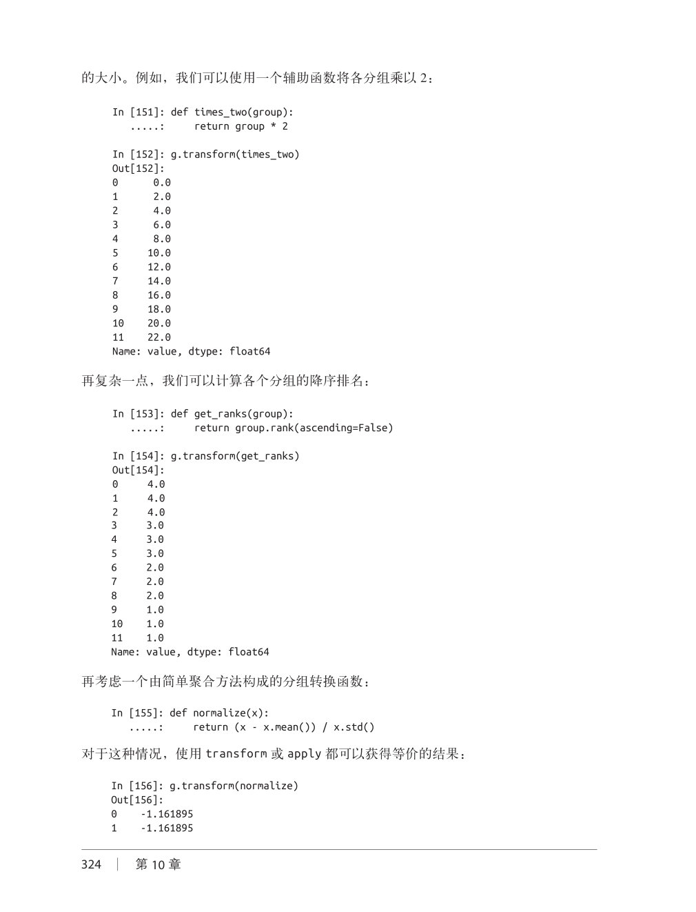

的大小。例如，我们可以使用一个辅助函数将各分组乘以 2：

```python
# In [151]–[152]
def times_two(group):
    return group * 2

g.transform(times_two)
```

```text
Out[152]:
0      0.0
1      2.0
2      4.0
3      6.0
4      8.0
5     10.0
6     12.0
7     14.0
8     16.0
9     18.0
10    20.0
11    22.0
Name: value, dtype: float64
```

再复杂一点，我们可以计算各个分组的降序排名：

```python
# In [153]–[154]
def get_ranks(group):
    return group.rank(ascending=False)

g.transform(get_ranks)
```

```text
Out[154]:
0     4.0
1     4.0
2     4.0
3     3.0
4     3.0
5     3.0
6     2.0
7     2.0
8     2.0
9     1.0
10    1.0
11    1.0
Name: value, dtype: float64
```

再考虑一个由简单聚合方法构成的分组转换函数：

```python
# In [155]
def normalize(x):
    return (x - x.mean()) / x.std()
```

对于这种情况，使用 `transform` 或 `apply` 都可以获得等价的结果：

```python
# In [156]
g.transform(normalize)
```

```text
Out[156]:
0   -1.161895
1   -1.161895
```

输出续见下一页。

## PDF 第 335 页

<!-- page-status: reviewed -->

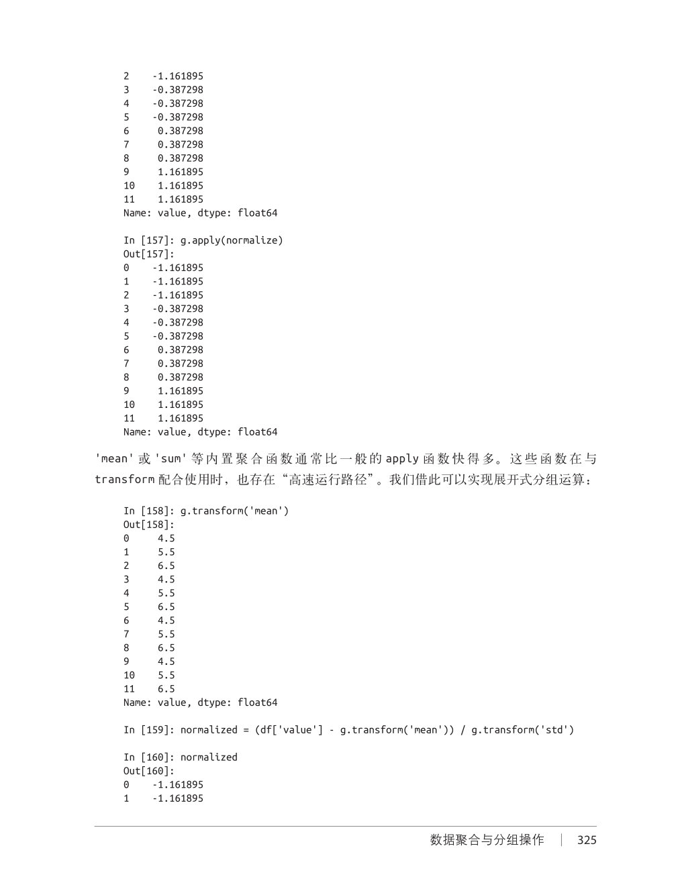

接上页输出：

```text
2    -1.161895
3    -0.387298
4    -0.387298
5    -0.387298
6     0.387298
7     0.387298
8     0.387298
9     1.161895
10    1.161895
11    1.161895
Name: value, dtype: float64
```

```python
g.apply(normalize)
```

```text
0    -1.161895
1    -1.161895
2    -1.161895
3    -0.387298
4    -0.387298
5    -0.387298
6     0.387298
7     0.387298
8     0.387298
9     1.161895
10    1.161895
11    1.161895
Name: value, dtype: float64
```

`'mean'` 或 `'sum'` 等内置聚合函数通常比一般的 `apply` 函数快得多。这些函数在与 `transform` 配合使用时，也存在“高速运行路径”。我们借此可以实现展开式分组运算：

```python
g.transform('mean')
```

```text
0     4.5
1     5.5
2     6.5
3     4.5
4     5.5
5     6.5
6     4.5
7     5.5
8     6.5
9     4.5
10    5.5
11    6.5
Name: value, dtype: float64
```

```python
normalized = (df['value'] - g.transform('mean')) / g.transform('std')
normalized
```

```text
0   -1.161895
1   -1.161895
```

其余输出见下一页。

## PDF 第 336 页

<!-- page-status: reviewed -->

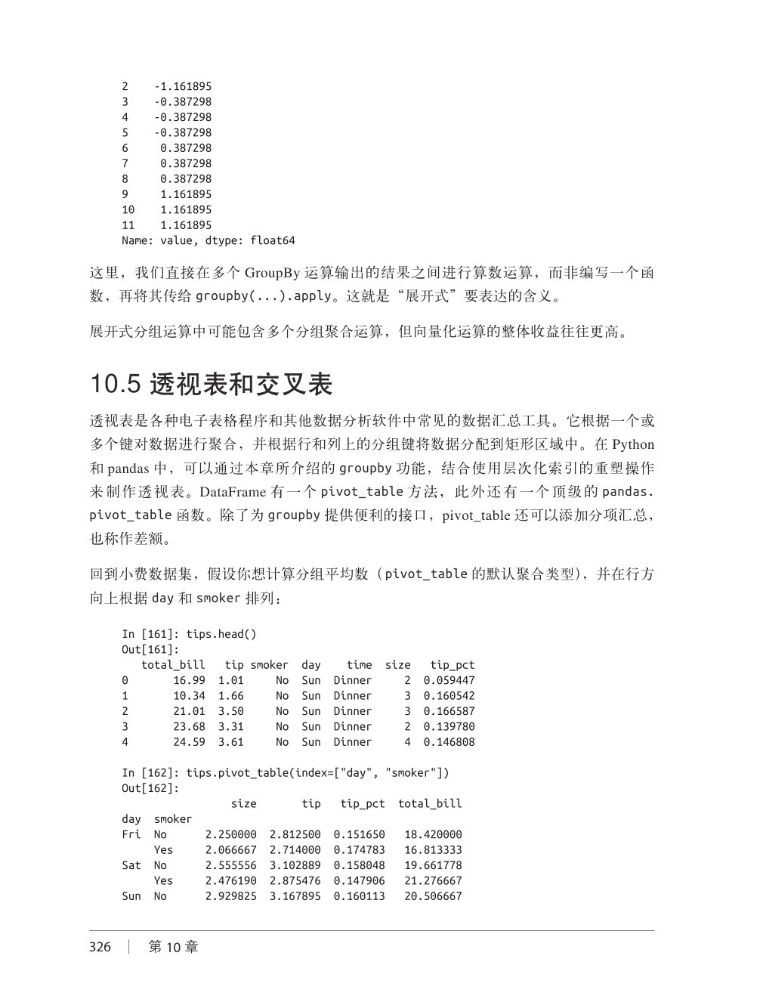

接上页输出：

```text
2    -1.161895
3    -0.387298
4    -0.387298
5    -0.387298
6     0.387298
7     0.387298
8     0.387298
9     1.161895
10    1.161895
11    1.161895
Name: value, dtype: float64
```

这里，我们直接在多个 GroupBy 运算输出的结果之间进行算数运算，而非编写一个函数，再将其传给 `groupby(...).apply`。这就是“展开式”要表达的含义。

展开式分组运算中可能包含多个分组聚合运算，但向量化运算的整体收益往往更高。

### 10.5 透视表和交叉表

透视表是各种电子表格程序和其他数据分析软件中常见的数据汇总工具。它根据一个或多个键对数据进行聚合，并根据行和列上的分组键将数据分配到矩形区域中。在 Python 和 pandas 中，可以通过本章所介绍的 groupby 功能，结合使用层次化索引的重塑操作来制作透视表。DataFrame 有一个 `pivot_table` 方法，此外还有一个顶级的 `pandas.pivot_table` 函数。除了为 groupby 提供便利的接口，pivot_table 还可以添加分项汇总，也称作差额。

回到小费数据集，假设你想计算分组平均数（pivot_table 的默认聚合类型），并在行方向上根据 day 和 smoker 排列：

```python
tips.head()
```

```text
   total_bill   tip smoker  day    time  size   tip_pct
0       16.99  1.01     No  Sun  Dinner     2  0.059447
1       10.34  1.66     No  Sun  Dinner     3  0.160542
2       21.01  3.50     No  Sun  Dinner     3  0.166587
3       23.68  3.31     No  Sun  Dinner     2  0.139780
4       24.59  3.61     No  Sun  Dinner     4  0.146808
```

```python
tips.pivot_table(index=["day", "smoker"])
```

```text
                 size       tip   tip_pct  total_bill
day  smoker
Fri  No      2.250000  2.812500  0.151650   18.420000
     Yes     2.066667  2.714000  0.174783   16.813333
Sat  No      2.555556  3.102889  0.158048   19.661778
     Yes     2.476190  2.875476  0.147906   21.276667
Sun  No      2.929825  3.167895  0.160113   20.506667
```

其余输出见下一页。

## PDF 第 337 页

<!-- page-status: reviewed -->

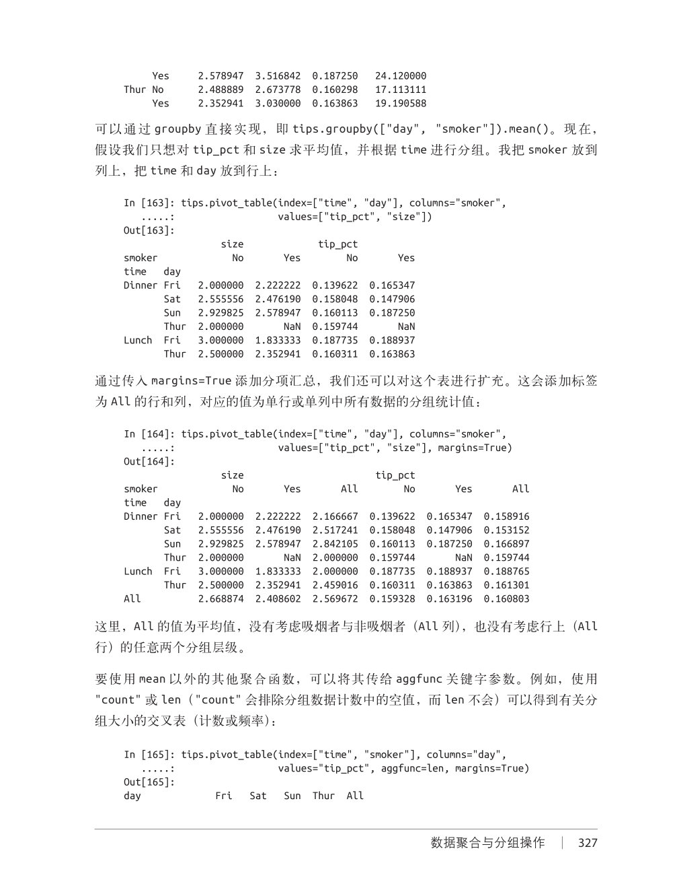

接上页输出：

```text
     Yes     2.578947  3.516842  0.187250   24.120000
Thur No      2.488889  2.673778  0.160298   17.113111
     Yes     2.352941  3.030000  0.163863   19.190588
```

可以通过 groupby 直接实现，即 `tips.groupby(["day", "smoker"]).mean()`。现在，假设我们只想对 tip_pct 和 size 求平均值，并根据 time 进行分组。我把 smoker 放到列上，把 time 和 day 放到行上：

```python
tips.pivot_table(index=["time", "day"], columns="smoker",
                 values=["tip_pct", "size"])
```

```text
                   size             tip_pct
smoker               No       Yes        No       Yes
time   day
Dinner Fri     2.000000  2.222222  0.139622  0.165347
       Sat     2.555556  2.476190  0.158048  0.147906
       Sun     2.929825  2.578947  0.160113  0.187250
       Thur    2.000000       NaN  0.159744       NaN
Lunch  Fri     3.000000  1.833333  0.187735  0.188937
       Thur    2.500000  2.352941  0.160311  0.163863
```

通过传入 `margins=True` 添加分项汇总，我们还可以对这个表进行扩充。这会添加标签为 All 的行和列，对应的值为单行或单列中所有数据的分组统计值：

```python
tips.pivot_table(index=["time", "day"], columns="smoker",
                 values=["tip_pct", "size"], margins=True)
```

```text
                   size                       tip_pct
smoker               No       Yes       All        No       Yes       All
time   day
Dinner Fri     2.000000  2.222222  2.166667  0.139622  0.165347  0.158916
       Sat     2.555556  2.476190  2.517241  0.158048  0.147906  0.153152
       Sun     2.929825  2.578947  2.842105  0.160113  0.187250  0.166897
       Thur    2.000000       NaN  2.000000  0.159744       NaN  0.159744
Lunch  Fri     3.000000  1.833333  2.000000  0.187735  0.188937  0.188765
       Thur    2.500000  2.352941  2.459016  0.160311  0.163863  0.161301
All            2.668874  2.408602  2.569672  0.159328  0.163196  0.160803
```

这里，All 的值为平均值，没有考虑吸烟者与非吸烟者（All 列），也没有考虑行上（All 行）的任意两个分组层级。

要使用 mean 以外的其他聚合函数，可以将其传给 aggfunc 关键字参数。例如，使用 `"count"` 或 len（`"count"` 会排除分组数据计数中的空值，而 len 不会）可以得到有关分组大小的交叉表（计数或频率）：

```python
tips.pivot_table(index=["time", "smoker"], columns="day",
                 values="tip_pct", aggfunc=len, margins=True)
```

```text
day             Fri  Sat  Sun  Thur  All
```

其余输出见下一页。

## PDF 第 338 页

<!-- page-status: reviewed -->

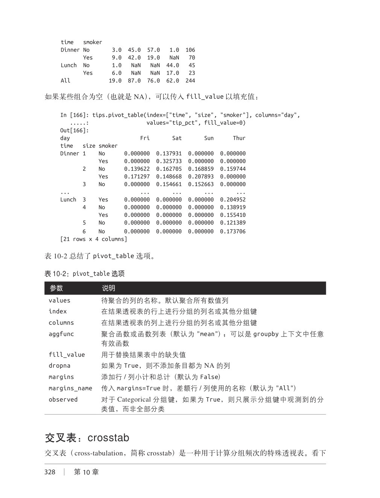

接上页输出：

```text
time    smoker
Dinner  No       3.0  45.0  57.0   1.0  106
        Yes      9.0  42.0  19.0   NaN   70
Lunch   No       1.0   NaN   NaN  44.0   45
        Yes      6.0   NaN   NaN  17.0   23
All             19.0  87.0  76.0  62.0  244
```

如果某些组合为空（也就是 NA），可以传入 fill_value 以填充值：

```python
tips.pivot_table(index=["time", "size", "smoker"], columns="day",
                 values="tip_pct", fill_value=0)
```

```text
day                         Fri       Sat       Sun      Thur
time   size smoker
Dinner 1    No         0.000000  0.137931  0.000000  0.000000
            Yes        0.000000  0.325733  0.000000  0.000000
       2    No         0.139622  0.162705  0.168859  0.159744
            Yes        0.171297  0.148668  0.207893  0.000000
       3    No         0.000000  0.154661  0.152663  0.000000
...                         ...       ...       ...       ...
Lunch  3    Yes        0.000000  0.000000  0.000000  0.204952
       4    No         0.000000  0.000000  0.000000  0.138919
            Yes        0.000000  0.000000  0.000000  0.155410
       5    No         0.000000  0.000000  0.000000  0.121389
       6    No         0.000000  0.000000  0.000000  0.173706
[21 rows x 4 columns]
```

表 10-2 总结了 pivot_table 选项。

表 10-2：pivot_table 选项

| 参数 | 说明 |
| --- | --- |
| values | 待聚合的列的名称。默认聚合所有数值列 |
| index | 在结果透视表的行上进行分组的列名或其他分组键 |
| columns | 在结果透视表的列上进行分组的列名或其他分组键 |
| aggfunc | 聚合函数或函数列表（默认为 `"mean"`）；可以是 groupby 上下文中任意有效函数 |
| fill_value | 用于替换结果表中的缺失值 |
| dropna | 如果为 True，则不添加条目都为 NA 的列 |
| margins | 添加行 / 列小计和总计（默认为 False） |
| margins_name | 传入 margins=True 时，差额行 / 列使用的名称（默认为 `"All"`） |
| observed | 对于 Categorical 分组键，如果为 True，则只展示分组键中观测到的分类值，而非全部分类 |

### 交叉表：crosstab

交叉表（cross-tabulation，简称 crosstab）是一种用于计算分组频次的特殊透视表。看下面的示例：

## PDF 第 339 页

<!-- page-status: reviewed -->

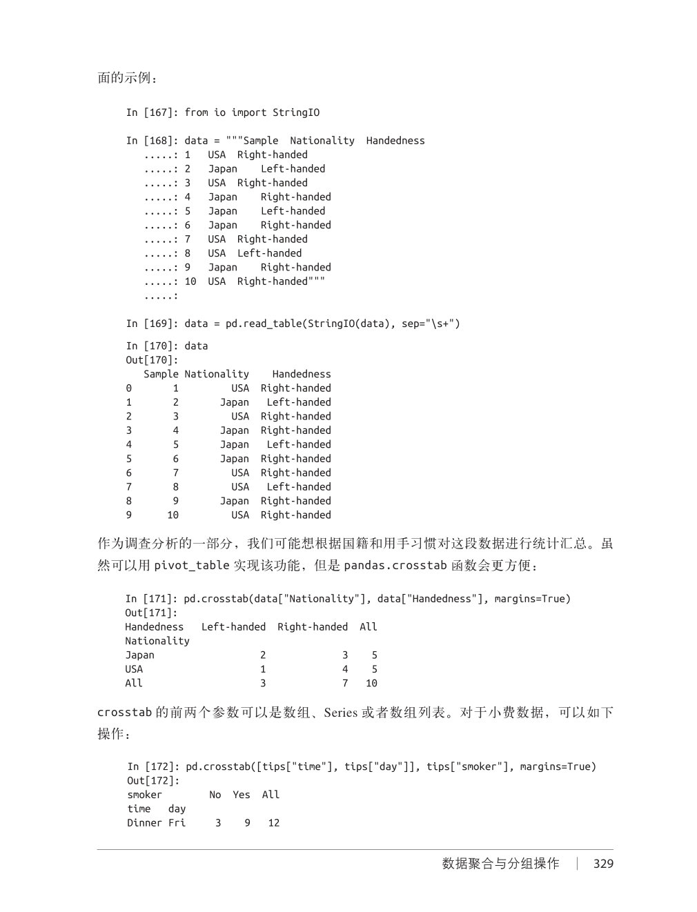

```python
from io import StringIO

data = """Sample  Nationality  Handedness
1   USA  Right-handed
2   Japan   Left-handed
3   USA  Right-handed
4   Japan   Right-handed
5   Japan   Left-handed
6   Japan   Right-handed
7   USA  Right-handed
8   USA  Left-handed
9   Japan   Right-handed
10  USA  Right-handed"""

data = pd.read_table(StringIO(data), sep="\s+")
data
```

```text
   Sample Nationality    Handedness
0       1         USA  Right-handed
1       2       Japan   Left-handed
2       3         USA  Right-handed
3       4       Japan  Right-handed
4       5       Japan   Left-handed
5       6       Japan  Right-handed
6       7         USA  Right-handed
7       8         USA   Left-handed
8       9       Japan  Right-handed
9      10         USA  Right-handed
```

作为调查分析的一部分，我们可能想根据国籍和用手习惯对这段数据进行统计汇总。虽然可以用 pivot_table 实现该功能，但是 pandas.crosstab 函数会更方便：

```python
pd.crosstab(data["Nationality"], data["Handedness"], margins=True)
```

```text
Handedness   Left-handed  Right-handed  All
Nationality
Japan                  2             3    5
USA                    1             4    5
All                    3             7   10
```

crosstab 的前两个参数可以是数组、Series 或者数组列表。对于小费数据，可以如下操作：

```python
pd.crosstab([tips["time"], tips["day"]], tips["smoker"], margins=True)
```

```text
smoker       No  Yes  All
time   day
Dinner Fri    3    9   12
```

其余输出见下一页。

## PDF 第 340 页

<!-- page-status: reviewed -->

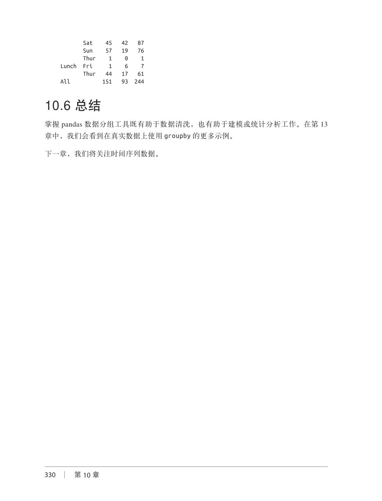

接上页输出：

```text
       Sat   45   42   87
       Sun   57   19   76
       Thur   1    0    1
Lunch  Fri    1    6    7
       Thur  44   17   61
All         151   93  244
```

### 10.6 总结

掌握 pandas 数据分组工具既有助于数据清洗，也有助于建模或统计分析工作。在第 13 章中，我们会看到在真实数据上使用 groupby 的更多示例。

下一章，我们将关注时间序列数据。

