# 第 11 章 时间序列

[返回目录](../README.md)

> 本章各页已由 AI 对照原页整理，页面图像保留供复核。校对标记不表示所有示例都已运行；部分旧版 pandas 写法和依赖数据文件的示例需要结合运行环境检查。

## PDF 第 341 页

<!-- page-status: reviewed -->
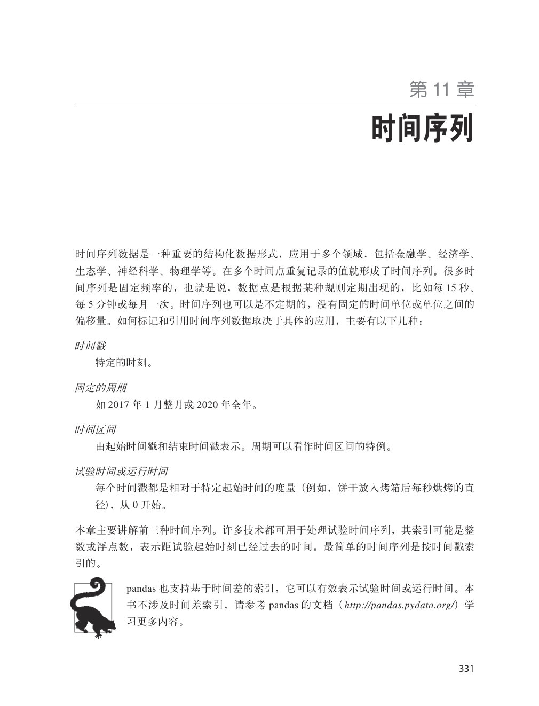

时间序列数据是一种重要的结构化数据形式，应用于多个领域，包括金融学、经济学、生态学、神经科学、物理学等。在多个时间点重复记录的值就形成了时间序列。很多时间序列是固定频率的，也就是说，数据点是根据某种规则定期出现的，比如每 15 秒、每 5 分钟或每月一次。时间序列也可以是不定期的，没有固定的时间单位或单位之间的偏移量。如何标记和引用时间序列数据取决于具体的应用，主要有以下几种：

- **时间戳**：特定的时刻。
- **固定的周期**：如 2017 年 1 月整月或 2020 年全年。
- **时间区间**：由起始时间戳和结束时间戳表示。周期可以看作时间区间的特例。
- **试验时间或运行时间**：每个时间戳都是相对于特定起始时间的度量（例如，饼干放入烤箱后每秒烘烤的直径），从 0 开始。

本章主要讲解前三种时间序列。许多技术都可用于处理试验时间序列，其索引可能是整数或浮点数，表示距试验起始时刻已经过去的时间。最简单的时间序列是按时间戳索引的。

> pandas 也支持基于时间差的索引，它可以有效表示试验时间或运行时间。本书不涉及时间差索引，请参考 pandas 的文档学习更多内容。

## PDF 第 342 页

<!-- page-status: reviewed -->
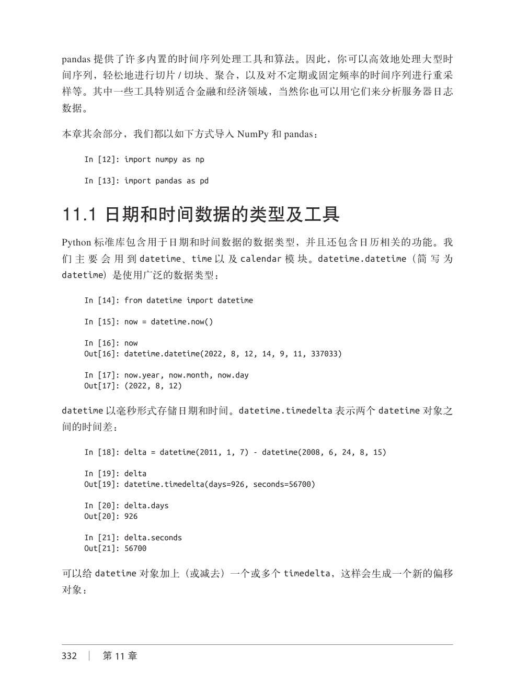

pandas 提供了许多内置的时间序列处理工具和算法。因此，你可以高效地处理大型时间序列，轻松地进行切片 / 切块、聚合，以及对不定期或固定频率的时间序列进行重采样等。其中一些工具特别适合金融和经济领域，当然你也可以用它们来分析服务器日志数据。

本章其余部分，我们都以如下方式导入 NumPy 和 pandas：

```python
import numpy as np
import pandas as pd
```

### 11.1 日期和时间数据的类型及工具

Python 标准库包含用于日期和时间数据的数据类型，并且还包含日历相关的功能。我们主要会用到 `datetime`、`time` 以及 `calendar` 模块。`datetime.datetime`（简写为 `datetime`）是使用广泛的数据类型：

```python
from datetime import datetime
now = datetime.now()
now
now.year, now.month, now.day
```

原书中的一次输出：

```text
datetime.datetime(2022, 8, 12, 14, 9, 11, 337033)
(2022, 8, 12)
```

原书写道，`datetime` 以毫秒形式存储日期和时间。`datetime.timedelta` 表示两个 `datetime` 对象之间的时间差：

> 校对注：Python 的 `datetime` 提供微秒字段（`microsecond`，精度为一微秒），不应把其精度概括为毫秒。`datetime.now()` 的结果依运行时刻而变化。

```python
delta = datetime(2011, 1, 7) - datetime(2008, 6, 24, 8, 15)
delta
delta.days
delta.seconds
```

```text
datetime.timedelta(days=926, seconds=56700)
926
56700
```

可以给 `datetime` 对象加上（或减去）一个或多个 `timedelta`，这样会生成一个新的偏移对象（代码见下一页）。

## PDF 第 343 页

<!-- page-status: reviewed -->
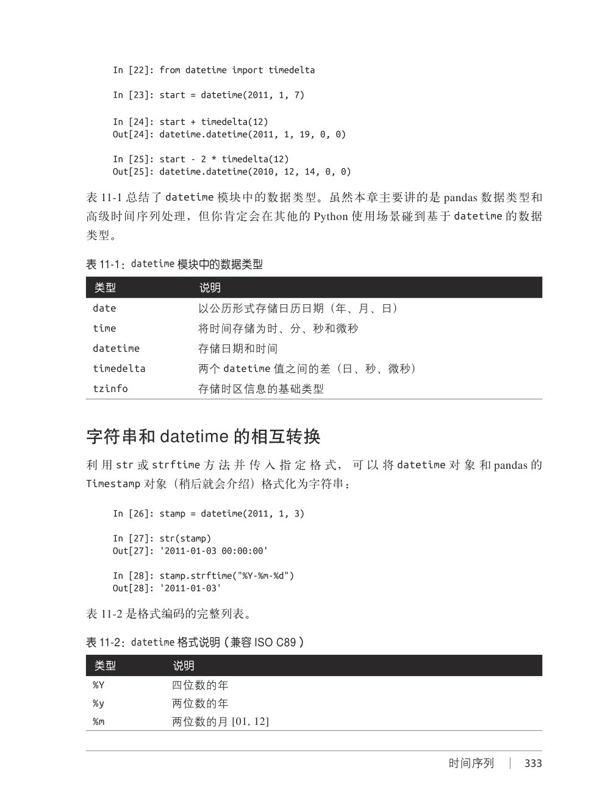

```python
from datetime import timedelta
start = datetime(2011, 1, 7)
start + timedelta(12)
start - 2 * timedelta(12)
```

```text
datetime.datetime(2011, 1, 19, 0, 0)
datetime.datetime(2010, 12, 14, 0, 0)
```

表 11-1 总结了 `datetime` 模块中的数据类型。虽然本章主要讲的是 pandas 数据类型和高级时间序列处理，但你肯定会在其他的 Python 使用场景碰到基于 `datetime` 的数据类型。

**表 11-1：datetime 模块中的数据类型**

| 类型 | 说明 |
| --- | --- |
| `date` | 以公历形式存储日历日期（年、月、日） |
| `time` | 将时间存储为时、分、秒和微秒 |
| `datetime` | 存储日期和时间 |
| `timedelta` | 两个 `datetime` 值之间的差（日、秒、微秒） |
| `tzinfo` | 存储时区信息的基础类型 |

### 字符串和 datetime 的相互转换

利用 `str` 或 `strftime` 方法并传入指定格式，可以将 `datetime` 对象和 pandas 的 `Timestamp` 对象（稍后就会介绍）格式化为字符串：

```python
stamp = datetime(2011, 1, 3)
str(stamp)
stamp.strftime("%Y-%m-%d")
```

```text
'2011-01-03 00:00:00'
'2011-01-03'
```

表 11-2 是格式编码的完整列表。

**表 11-2：datetime 格式说明（兼容 ISO C89）**

| 类型 | 说明 |
| --- | --- |
| `%Y` | 四位数的年 |
| `%y` | 两位数的年 |
| `%m` | 两位数的月 [01, 12] |

## PDF 第 344 页

<!-- page-status: reviewed -->
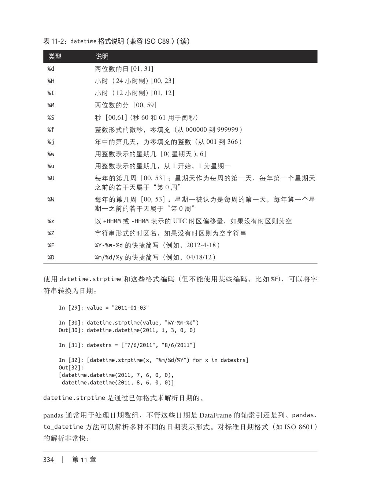

**表 11-2：datetime 格式说明（兼容 ISO C89）（续）**

| 类型 | 说明 |
| --- | --- |
| `%d` | 两位数的日 [01, 31] |
| `%H` | 小时（24 小时制）[00, 23] |
| `%I` | 小时（12 小时制）[01, 12] |
| `%M` | 两位数的分 [00, 59] |
| `%S` | 秒 [00, 61]（秒 60 和 61 用于闰秒） |
| `%f` | 整数形式的微秒，零填充（从 000000 到 999999） |
| `%j` | 年中的第几天，为零填充的整数（从 001 到 366） |
| `%w` | 用整数表示的星期几 [0（星期天）, 6] |
| `%u` | 用整数表示的星期几，从 1 开始，1 为星期一 |
| `%U` | 每年的第几周 [00, 53]；星期天作为每周的第一天，每年第一个星期天之前的若干天属于“第 0 周” |
| `%W` | 每年的第几周 [00, 53]；星期一被认为是每周的第一天，每年第一个星期一之前的若干天属于“第 0 周” |
| `%z` | 以 +HHMM 或 -HHMM 表示的 UTC 时区偏移量，如果没有时区则为空 |
| `%Z` | 字符串形式的时区名，如果没有时区则为空字符串 |
| `%F` | `%Y-%m-%d` 的快捷简写（例如，2012-4-18） |
| `%D` | `%m/%d/%y` 的快捷简写（例如，04/18/12） |

使用 `datetime.strptime` 和这些格式编码（但不能使用某些编码，比如 `%F`），可以将字符串转换为日期：

```python
value = "2011-01-03"
datetime.strptime(value, "%Y-%m-%d")
datestrs = ["7/6/2011", "8/6/2011"]
[datetime.strptime(x, "%m/%d/%Y") for x in datestrs]
```

```text
datetime.datetime(2011, 1, 3, 0, 0)
[datetime.datetime(2011, 7, 6, 0, 0),
 datetime.datetime(2011, 8, 6, 0, 0)]
```

`datetime.strptime` 是通过已知格式来解析日期的。

pandas 通常用于处理日期数组，不管这些日期是 DataFrame 的轴索引还是列。`pandas.to_datetime` 方法可以解析多种不同的日期表示形式。对标准日期格式（如 ISO 8601）的解析非常快（代码见下一页）。

## PDF 第 345 页

<!-- page-status: reviewed -->
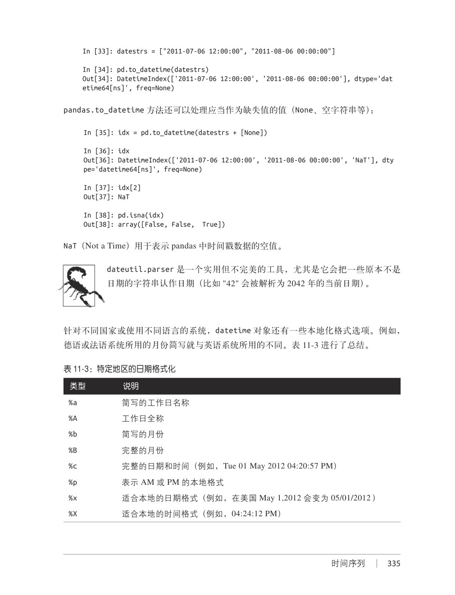

```python
datestrs = ["2011-07-06 12:00:00", "2011-08-06 00:00:00"]
pd.to_datetime(datestrs)
```

```text
DatetimeIndex(['2011-07-06 12:00:00', '2011-08-06 00:00:00'], dtype='datetime64[ns]', freq=None)
```

`pandas.to_datetime` 方法还可以处理应当作为缺失值的值（`None`、空字符串等）：

```python
idx = pd.to_datetime(datestrs + [None])
idx
idx[2]
pd.isna(idx)
```

```text
DatetimeIndex(['2011-07-06 12:00:00', '2011-08-06 00:00:00', 'NaT'], dtype='datetime64[ns]', freq=None)
NaT
array([False, False,  True])
```

`NaT`（Not a Time）用于表示 pandas 中时间戳数据的空值。

> `dateutil.parser` 是一个实用但不完美的工具，尤其是它会把一些原本不是日期的字符串认作日期（比如 `"42"` 会被解析为 2042 年的当前日期）。

针对不同国家或使用不同语言的系统，`datetime` 对象还有一些本地化格式选项。例如，德语或法语系统所用的月份简写就与英语系统所用的不同。表 11-3 进行了总结。

**表 11-3：特定地区的日期格式化**

| 类型 | 说明 |
| --- | --- |
| `%a` | 简写的工作日名称 |
| `%A` | 工作日全称 |
| `%b` | 简写的月份 |
| `%B` | 完整的月份 |
| `%c` | 完整的日期和时间（例如，Tue 01 May 2012 04:20:57 PM） |
| `%p` | 表示 AM 或 PM 的本地格式 |
| `%x` | 适合本地的日期格式（例如，在美国 May 1, 2012 会变为 05/01/2012） |
| `%X` | 适合本地的时间格式（例如，04:24:12 PM） |

## PDF 第 346 页

<!-- page-status: reviewed -->
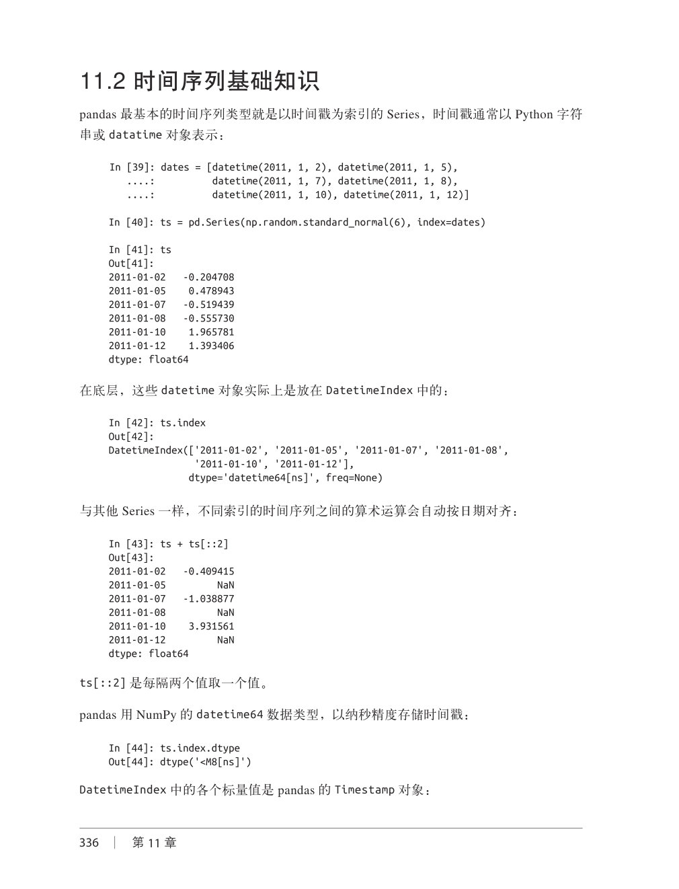

### 11.2 时间序列基础知识

pandas 最基本的时间序列类型就是以时间戳为索引的 Series，时间戳通常以 Python 字符串或 `datetime` 对象表示：

```python
dates = [datetime(2011, 1, 2), datetime(2011, 1, 5),
         datetime(2011, 1, 7), datetime(2011, 1, 8),
         datetime(2011, 1, 10), datetime(2011, 1, 12)]
ts = pd.Series(np.random.standard_normal(6), index=dates)
ts
```

原书中的一次随机输出：

```text
2011-01-02   -0.204708
2011-01-05    0.478943
2011-01-07   -0.519439
2011-01-08   -0.555730
2011-01-10    1.965781
2011-01-12    1.393406
dtype: float64
```

在底层，这些 `datetime` 对象实际上是放在 `DatetimeIndex` 中的：

```python
ts.index
```

```text
DatetimeIndex(['2011-01-02', '2011-01-05', '2011-01-07', '2011-01-08',
               '2011-01-10', '2011-01-12'],
              dtype='datetime64[ns]', freq=None)
```

与其他 Series 一样，不同索引的时间序列之间的算术运算会自动按日期对齐：

```python
ts + ts[::2]
```

```text
2011-01-02   -0.409415
2011-01-05         NaN
2011-01-07   -1.038877
2011-01-08         NaN
2011-01-10    3.931561
2011-01-12         NaN
dtype: float64
```

`ts[::2]` 是每隔两个值取一个值。

pandas 用 NumPy 的 `datetime64` 数据类型，以纳秒精度存储时间戳：

```python
ts.index.dtype
```

```text
dtype('<M8[ns]')
```

`DatetimeIndex` 中的各个标量值是 pandas 的 `Timestamp` 对象（代码见下一页）。

## PDF 第 347 页

<!-- page-status: reviewed -->
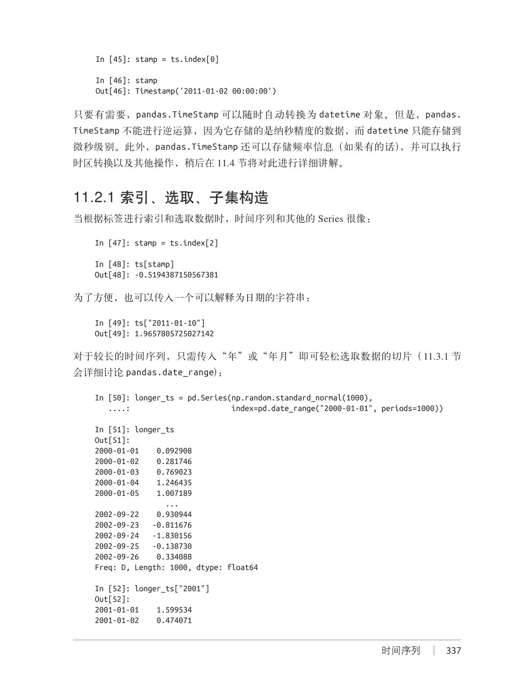

```python
stamp = ts.index[0]
stamp
```

```text
Timestamp('2011-01-02 00:00:00')
```

只要有需要，原书称 pandas 的 `TimeStamp` 可以随时自动转换为 `datetime` 对象。但是，原书称不能进行逆运算，因为它存储的是纳秒精度的数据，而 `datetime` 只能存储到微秒级别。此外，原书称它还可以存储频率信息（如果有的话），并可以执行时区转换以及其他操作，稍后在 11.4 节将对此进行详细讲解。

> 校对注：类名为 `pandas.Timestamp`；`datetime` 可以构造为 `pd.Timestamp(datetime_value)`。将带有纳秒精度的 `Timestamp` 转为 Python `datetime` 时，纳秒部分可能丢失；原书关于不能逆向转换的说法并不准确。pandas 的具体频率属性也随版本变化。

### 11.2.1 索引、选取、子集构造

当根据标签进行索引和选取数据时，时间序列和其他的 Series 很像：

```python
stamp = ts.index[2]
ts[stamp]
```

原书随机样本输出：

```text
-0.5194387150567381
```

为了方便，也可以传入一个可以解释为日期的字符串：

```python
ts["2011-01-10"]
```

```text
1.9657805725027142
```

对于较长的时间序列，只需传入“年”或“年月”即可轻松选取数据的切片（11.3.1 节会详细讨论 `pandas.date_range`）：

```python
longer_ts = pd.Series(np.random.standard_normal(1000),
                      index=pd.date_range("2000-01-01", periods=1000))
longer_ts
```

原书随机样本输出：

```text
2000-01-01    0.092908
2000-01-02    0.281746
2000-01-03    0.769023
2000-01-04    1.246435
2000-01-05    1.007189
                ...
2002-09-22    0.930944
2002-09-23   -0.811676
2002-09-24   -1.830156
2002-09-25   -0.138730
2002-09-26    0.334088
Freq: D, Length: 1000, dtype: float64
```

```python
longer_ts["2001"]
```

原书输出的开头（续见下一页）：

```text
2001-01-01    1.599534
2001-01-02    0.474071
```

> 版本说明：在较新 pandas 中，使用 `longer_ts.loc["2001"]` 进行按年选择更明确。

## PDF 第 348 页

<!-- page-status: reviewed -->
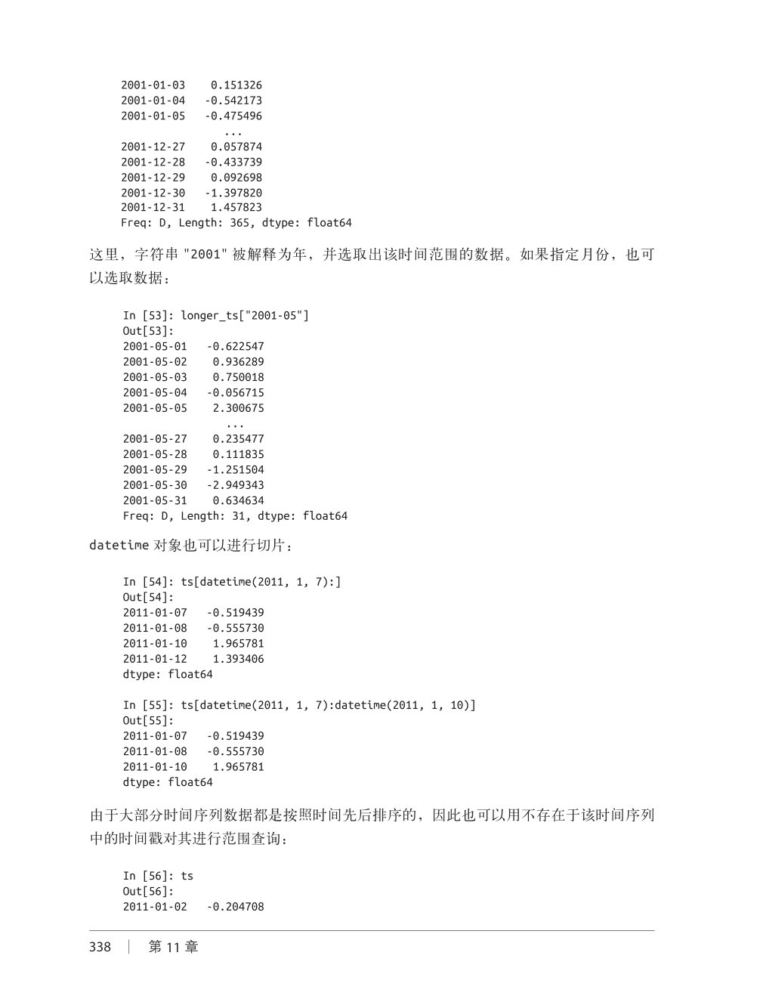

上一页 `longer_ts["2001"]` 输出的续页：

```text
2001-01-03    0.151326
2001-01-04   -0.542173
2001-01-05   -0.475496
                ...
2001-12-27    0.057874
2001-12-28   -0.433739
2001-12-29    0.092698
2001-12-30   -1.397820
2001-12-31    1.457823
Freq: D, Length: 365, dtype: float64
```

这里，字符串 `"2001"` 被解释为年，并选取出该时间范围的数据。如果指定月份，也可以选取数据：

```python
longer_ts["2001-05"]
```

原书输出：

```text
2001-05-01   -0.622547
2001-05-02    0.936289
2001-05-03    0.750018
2001-05-04   -0.056715
2001-05-05    2.300675
                ...
2001-05-27    0.235477
2001-05-28    0.111835
2001-05-29   -1.251504
2001-05-30   -2.949343
2001-05-31    0.634634
Freq: D, Length: 31, dtype: float64
```

`datetime` 对象也可以进行切片：

```python
ts[datetime(2011, 1, 7):]
```

原书输出：

```text
2011-01-07   -0.519439
2011-01-08   -0.555730
2011-01-10    1.965781
2011-01-12    1.393406
dtype: float64
```

```python
ts[datetime(2011, 1, 7):datetime(2011, 1, 10)]
```

原书输出：

```text
2011-01-07   -0.519439
2011-01-08   -0.555730
2011-01-10    1.965781
dtype: float64
```

由于大部分时间序列数据都是按照时间先后排序的，因此也可以用不存在于该时间序列中的时间戳对其进行范围查询：

```python
ts
```

原书输出的首行（余下内容续下一页）：

```text
2011-01-02   -0.204708
```

## PDF 第 349 页

<!-- page-status: reviewed -->
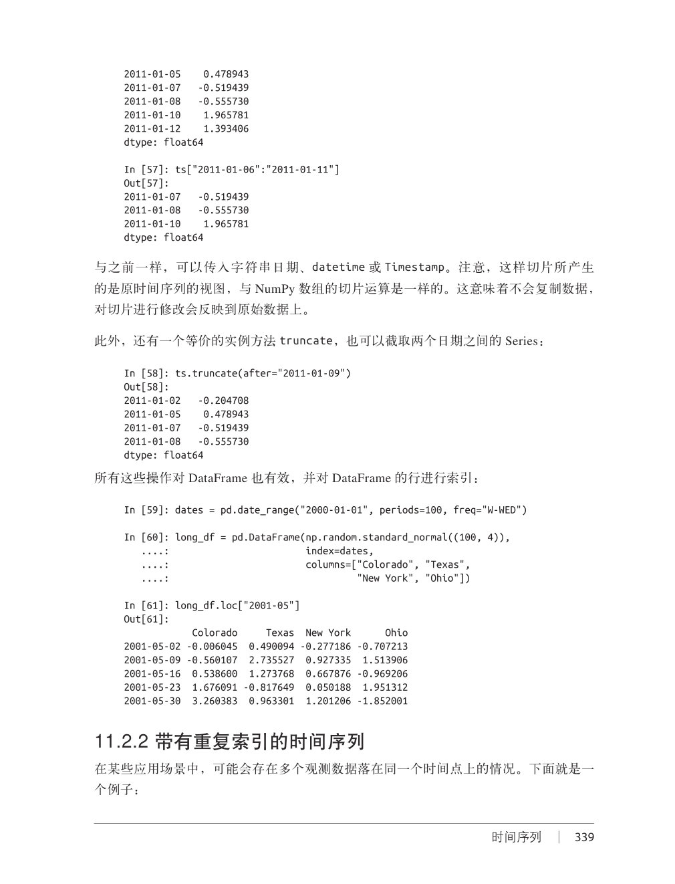

上一页 `ts` 输出续：

```text
2011-01-05    0.478943
2011-01-07   -0.519439
2011-01-08   -0.555730
2011-01-10    1.965781
2011-01-12    1.393406
dtype: float64
```

```python
ts["2011-01-06":"2011-01-11"]
```

原书输出：

```text
2011-01-07   -0.519439
2011-01-08   -0.555730
2011-01-10    1.965781
dtype: float64
```

与之前一样，可以传入字符串日期、`datetime` 或 `Timestamp`。注意，这样切片所产生的是原时间序列的视图，与 NumPy 数组的切片运算是一样的。这意味着不会复制数据，对切片进行修改会反映到原始数据上。

> 版本说明：上面关于切片修改的文字保留原书表述。新版本 pandas 的 Copy-on-Write 设置会影响修改是否传播，实际代码应显式修改原对象，不要依赖视图副作用。

此外，还有一个等价的实例方法 `truncate`，也可以截取两个日期之间的 Series：

```python
ts.truncate(after="2011-01-09")
```

原书输出：

```text
2011-01-02   -0.204708
2011-01-05    0.478943
2011-01-07   -0.519439
2011-01-08   -0.555730
dtype: float64
```

所有这些操作对 DataFrame 也有效，并对 DataFrame 的行进行索引：

```python
dates = pd.date_range("2000-01-01", periods=100, freq="W-WED")
long_df = pd.DataFrame(np.random.standard_normal((100, 4)),
                       index=dates,
                       columns=["Colorado", "Texas", "New York", "Ohio"])
long_df.loc["2001-05"]
```

原书输出（随机数为原书运行结果）：

```text
            Colorado     Texas  New York      Ohio
2001-05-02 -0.006045  0.490094 -0.277186 -0.707213
2001-05-09 -0.560107  2.735527  0.927335  1.513906
2001-05-16  0.538600  1.273768  0.667876 -0.969206
2001-05-23  1.676091 -0.817649  0.050188  1.951312
2001-05-30  3.260383  0.963301  1.201206 -1.852001
```

### 11.2.2 带有重复索引的时间序列

在某些应用场景中，可能会存在多个观测数据落在同一个时间点上的情况。下面就是一个例子：

## PDF 第 350 页

<!-- page-status: reviewed -->
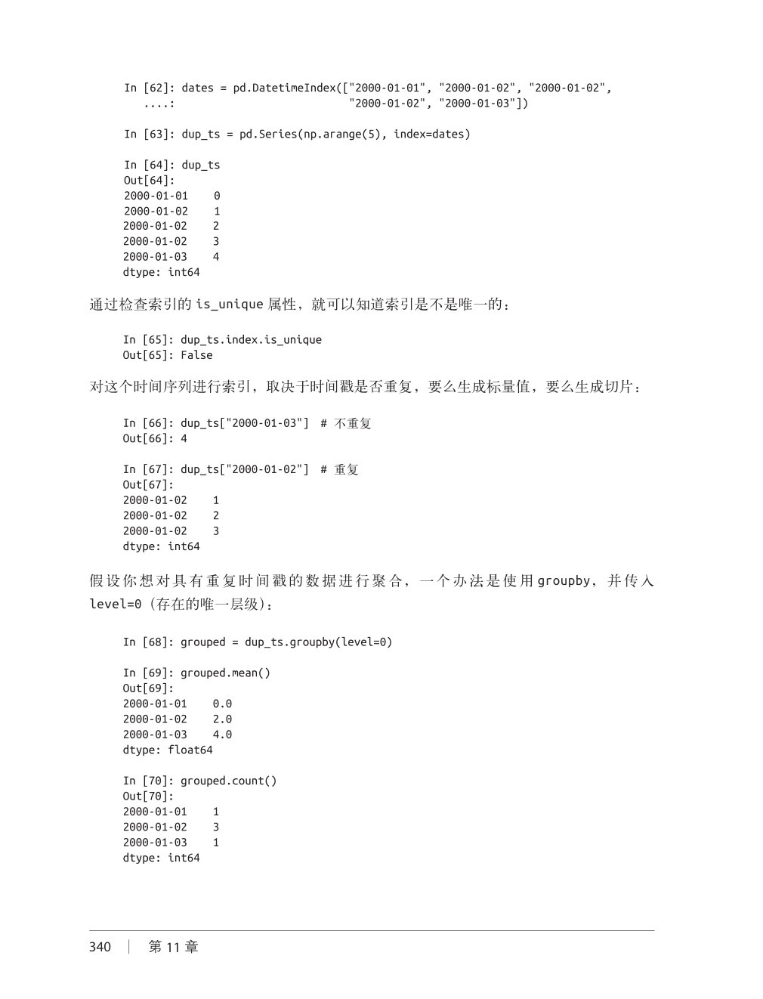

```python
dates = pd.DatetimeIndex(["2000-01-01", "2000-01-02", "2000-01-02",
                          "2000-01-02", "2000-01-03"])
dup_ts = pd.Series(np.arange(5), index=dates)
dup_ts
```

原书输出：

```text
2000-01-01    0
2000-01-02    1
2000-01-02    2
2000-01-02    3
2000-01-03    4
dtype: int64
```

通过检查索引的 `is_unique` 属性，就可以知道索引是不是唯一的：

```python
dup_ts.index.is_unique  # False
```

对这个时间序列进行索引，取决于时间戳是否重复，要么生成标量值，要么生成切片：

```python
dup_ts["2000-01-03"]  # 不重复，输出 4
dup_ts["2000-01-02"]  # 重复
```

第二个表达式的原书输出：

```text
2000-01-02    1
2000-01-02    2
2000-01-02    3
dtype: int64
```

假设你想对具有重复时间戳的数据进行聚合，一个办法是使用 `groupby`，并传入 `level=0`（存在的唯一层级）：

```python
grouped = dup_ts.groupby(level=0)
grouped.mean()
```

原书输出：

```text
2000-01-01    0.0
2000-01-02    2.0
2000-01-03    4.0
dtype: float64
```

```python
grouped.count()
```

原书输出：

```text
2000-01-01    1
2000-01-02    3
2000-01-03    1
dtype: int64
```

## PDF 第 351 页

<!-- page-status: reviewed -->
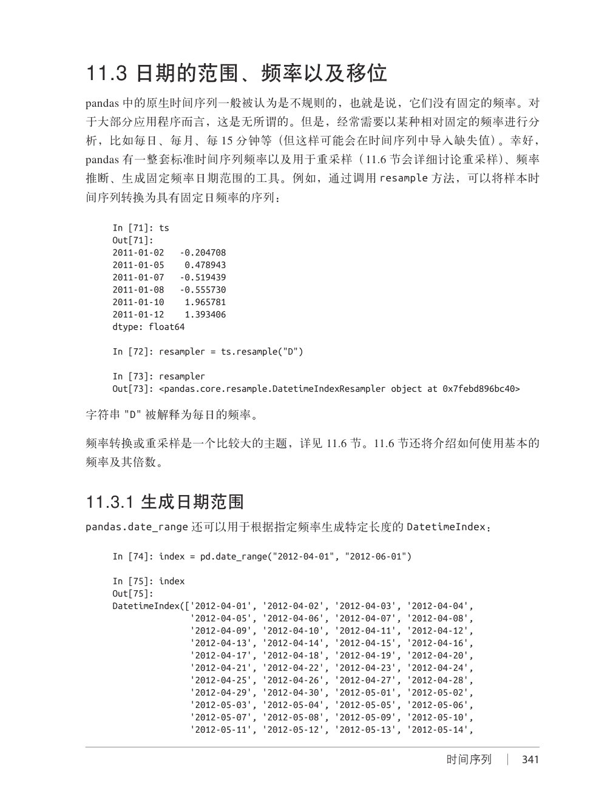

### 11.3 日期的范围、频率以及移位

pandas 中的原生时间序列一般被认为是不规则的，也就是说，它们没有固定的频率。对于大部分应用程序而言，这是无所谓的。但是，经常需要以某种相对固定的频率进行分析，比如每日、每月、每 15 分钟等（但这样可能会在时间序列中引入缺失值）。幸好，pandas 有一整套标准时间序列频率以及用于重采样（11.6 节会详细讨论重采样）、频率推断、生成固定频率日期范围的工具。例如，通过调用 `resample` 方法，可以将样本时间序列转换为具有固定日频率的序列：

```python
ts
```

原书输出：

```text
2011-01-02   -0.204708
2011-01-05    0.478943
2011-01-07   -0.519439
2011-01-08   -0.555730
2011-01-10    1.965781
2011-01-12    1.393406
dtype: float64
```

```python
resampler = ts.resample("D")
resampler
```

原书输出：

```text
<pandas.core.resample.DatetimeIndexResampler object at 0x7febd896bc40>
```

字符串 `"D"` 被解释为每日的频率。频率转换或重采样是一个比较大的主题，详见 11.6 节。11.6 节还将介绍如何使用基本的频率及其倍数。

### 11.3.1 生成日期范围

`pandas.date_range` 还可以用于根据指定频率生成特定长度的 `DatetimeIndex`：

```python
index = pd.date_range("2012-04-01", "2012-06-01")
index
```

原书输出的前半部分（续下页）：

```text
DatetimeIndex(['2012-04-01', '2012-04-02', '2012-04-03', '2012-04-04',
               '2012-04-05', '2012-04-06', '2012-04-07', '2012-04-08',
               '2012-04-09', '2012-04-10', '2012-04-11', '2012-04-12',
               '2012-04-13', '2012-04-14', '2012-04-15', '2012-04-16',
               '2012-04-17', '2012-04-18', '2012-04-19', '2012-04-20',
               '2012-04-21', '2012-04-22', '2012-04-23', '2012-04-24',
               '2012-04-25', '2012-04-26', '2012-04-27', '2012-04-28',
               '2012-04-29', '2012-04-30', '2012-05-01', '2012-05-02',
               '2012-05-03', '2012-05-04', '2012-05-05', '2012-05-06',
               '2012-05-07', '2012-05-08', '2012-05-09', '2012-05-10',
               '2012-05-11', '2012-05-12', '2012-05-13', '2012-05-14',
```

## PDF 第 352 页

<!-- page-status: reviewed -->
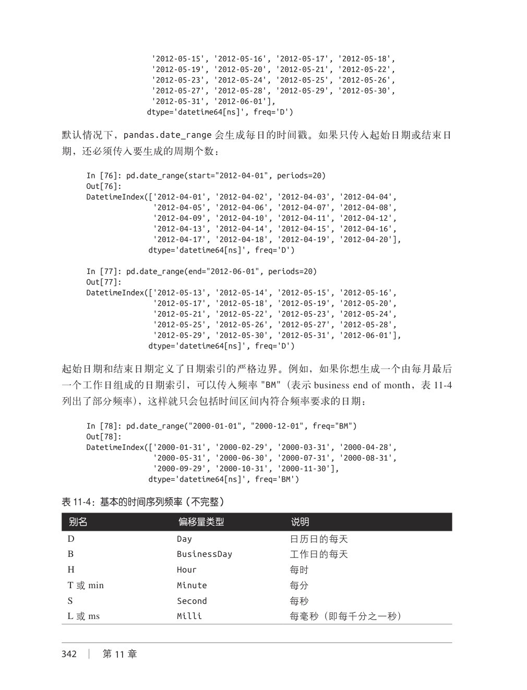

上一页 `index` 输出续：

```text
               '2012-05-15', '2012-05-16', '2012-05-17', '2012-05-18',
               '2012-05-19', '2012-05-20', '2012-05-21', '2012-05-22',
               '2012-05-23', '2012-05-24', '2012-05-25', '2012-05-26',
               '2012-05-27', '2012-05-28', '2012-05-29', '2012-05-30',
               '2012-05-31', '2012-06-01'],
              dtype='datetime64[ns]', freq='D')
```

默认情况下，`pandas.date_range` 会生成每日的时间戳。如果只传入起始日期或结束日期，还必须传入要生成的周期个数：

```python
pd.date_range(start="2012-04-01", periods=20)
```

原书输出：

```text
DatetimeIndex(['2012-04-01', '2012-04-02', '2012-04-03', '2012-04-04',
               '2012-04-05', '2012-04-06', '2012-04-07', '2012-04-08',
               '2012-04-09', '2012-04-10', '2012-04-11', '2012-04-12',
               '2012-04-13', '2012-04-14', '2012-04-15', '2012-04-16',
               '2012-04-17', '2012-04-18', '2012-04-19', '2012-04-20'],
              dtype='datetime64[ns]', freq='D')
```

```python
pd.date_range(end="2012-06-01", periods=20)
```

原书输出：

```text
DatetimeIndex(['2012-05-13', '2012-05-14', '2012-05-15', '2012-05-16',
               '2012-05-17', '2012-05-18', '2012-05-19', '2012-05-20',
               '2012-05-21', '2012-05-22', '2012-05-23', '2012-05-24',
               '2012-05-25', '2012-05-26', '2012-05-27', '2012-05-28',
               '2012-05-29', '2012-05-30', '2012-05-31', '2012-06-01'],
              dtype='datetime64[ns]', freq='D')
```

起始日期和结束日期定义了日期索引的严格边界。例如，如果你想生成一个由每月最后一个工作日组成的日期索引，可以传入频率 `"BM"`（表示 business end of month，表 11-4 列出了部分频率），这样就只会包括时间区间内符合频率要求的日期：

```python
pd.date_range("2000-01-01", "2000-12-01", freq="BM")
```

原书输出：

```text
DatetimeIndex(['2000-01-31', '2000-02-29', '2000-03-31', '2000-04-28',
               '2000-05-31', '2000-06-30', '2000-07-31', '2000-08-31',
               '2000-09-29', '2000-10-31', '2000-11-30'],
              dtype='datetime64[ns]', freq='BM')
```

> 版本说明：原书的 `BM` 是旧版频率别名。已用本机 pandas 2.2.3 核对，该别名发出弃用警告，推荐改用 `BME`；例如 `pd.date_range("2000-01-01", "2000-12-01", freq="BME")`。

**表 11-4：基本的时间序列频率（不完整）**

| 别名 | 偏移量类型 | 说明 |
|---|---|---|
| `D` | `Day` | 日历日的每天 |
| `B` | `BusinessDay` | 工作日的每天 |
| `H` | `Hour` | 每时 |
| `T` 或 `min` | `Minute` | 每分 |
| `S` | `Second` | 每秒 |
| `L` 或 `ms` | `Milli` | 每毫秒（即每千分之一秒） |

## PDF 第 353 页

<!-- page-status: reviewed -->
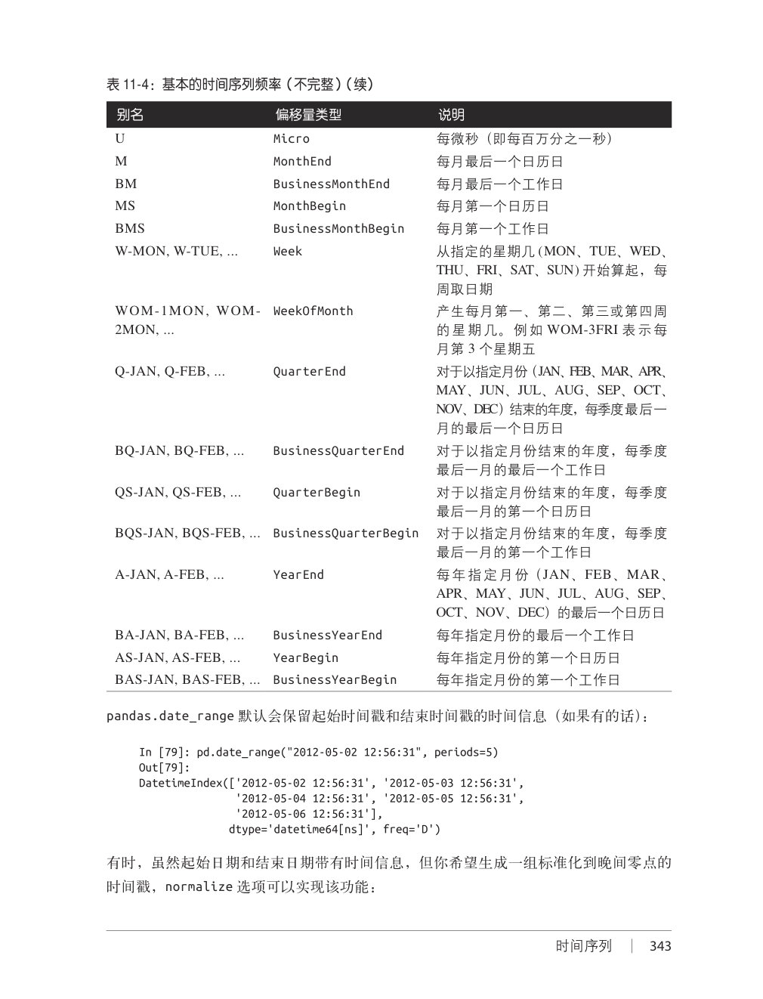

**表 11-4：基本的时间序列频率（不完整）（续）**

| 别名 | 偏移量类型 | 说明 |
|---|---|---|
| `U` | `Micro` | 每微秒（即每百万分之一秒） |
| `M` | `MonthEnd` | 每月最后一个日历日 |
| `BM` | `BusinessMonthEnd` | 每月最后一个工作日 |
| `MS` | `MonthBegin` | 每月第一个日历日 |
| `BMS` | `BusinessMonthBegin` | 每月第一个工作日 |
| `W-MON`、`W-TUE`、... | `Week` | 从指定的星期几（MON、TUE、WED、THU、FRI、SAT、SUN）开始算起，每周取日期 |
| `WOM-1MON`、`WOM-2MON`、... | `WeekOfMonth` | 产生每月第一、第二、第三或第四周的星期几。例如 `WOM-3FRI` 表示每月第 3 个星期五 |
| `Q-JAN`、`Q-FEB`、... | `QuarterEnd` | 对于以指定月份（JAN、FEB、MAR、APR、MAY、JUN、JUL、AUG、SEP、OCT、NOV、DEC）结束的年度，每季度最后一月的最后一个日历日 |
| `BQ-JAN`、`BQ-FEB`、... | `BusinessQuarterEnd` | 对于以指定月份结束的年度，每季度最后一月的最后一个工作日 |
| `QS-JAN`、`QS-FEB`、... | `QuarterBegin` | 对于以指定月份结束的年度，每季度最后一月的第一个日历日 |
| `BQS-JAN`、`BQS-FEB`、... | `BusinessQuarterBegin` | 对于以指定月份结束的年度，每季度最后一月的第一个工作日 |
| `A-JAN`、`A-FEB`、... | `YearEnd` | 每年指定月份（JAN、FEB、MAR、APR、MAY、JUN、JUL、AUG、SEP、OCT、NOV、DEC）的最后一个日历日 |
| `BA-JAN`、`BA-FEB`、... | `BusinessYearEnd` | 每年指定月份的最后一个工作日 |
| `AS-JAN`、`AS-FEB`、... | `YearBegin` | 每年指定月份的第一个日历日 |
| `BAS-JAN`、`BAS-FEB`、... | `BusinessYearBegin` | 每年指定月份的第一个工作日 |

`pandas.date_range` 默认会保留起始时间戳和结束时间戳的时间信息（如果有的话）：

```python
pd.date_range("2012-05-02 12:56:31", periods=5)
```

原书输出：

```text
DatetimeIndex(['2012-05-02 12:56:31', '2012-05-03 12:56:31',
               '2012-05-04 12:56:31', '2012-05-05 12:56:31',
               '2012-05-06 12:56:31'],
              dtype='datetime64[ns]', freq='D')
```

有时，虽然起始日期和结束日期带有时间信息，但你希望生成一组标准化到晚间零点的时间戳，`normalize` 选项可以实现该功能：

## PDF 第 354 页

<!-- page-status: reviewed -->
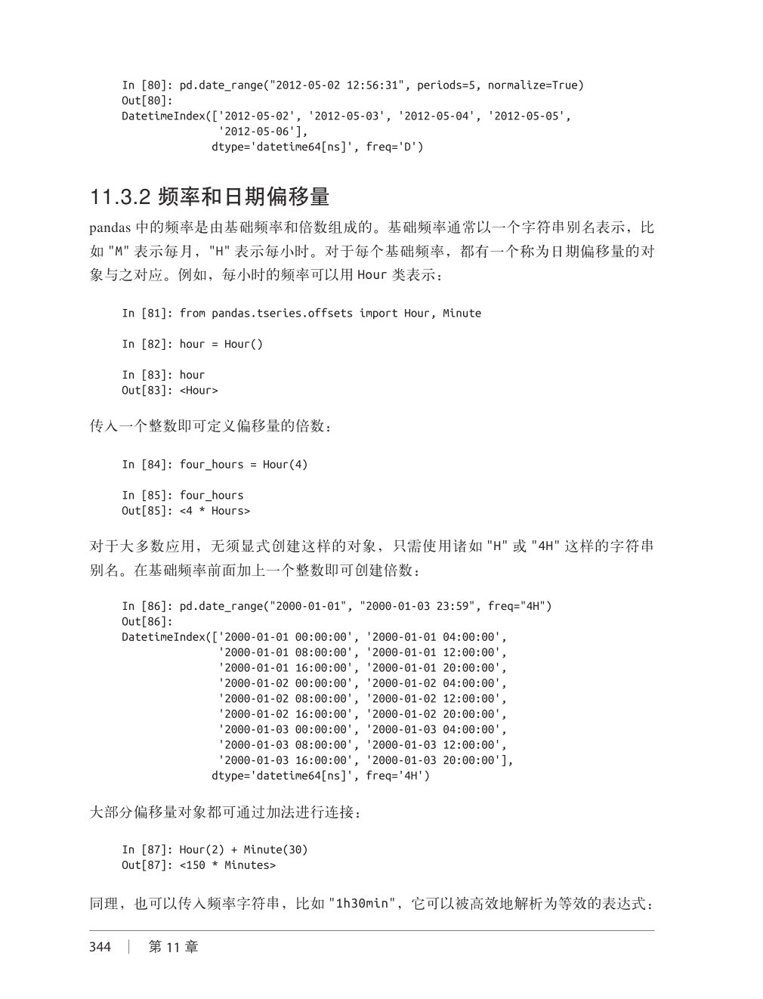

```python
pd.date_range("2012-05-02 12:56:31", periods=5, normalize=True)
```

原书输出：

```text
DatetimeIndex(['2012-05-02', '2012-05-03', '2012-05-04', '2012-05-05',
               '2012-05-06'],
              dtype='datetime64[ns]', freq='D')
```

### 11.3.2 频率和日期偏移量

pandas 中的频率是由基础频率和倍数组成的。基础频率通常以一个字符串别名表示，比如 `"M"` 表示每月，`"H"` 表示每小时。对于每个基础频率，都有一个称为日期偏移量的对象与之对应。例如，每小时的频率可以用 `Hour` 类表示：

```python
from pandas.tseries.offsets import Hour, Minute
hour = Hour()
hour
```

原书输出：`<Hour>`。

传入一个整数即可定义偏移量的倍数：

```python
four_hours = Hour(4)
four_hours
```

原书输出：`<4 * Hours>`。

对于大多数应用，无须显式创建这样的对象，只需使用诸如 `"H"` 或 `"4H"` 这样的字符串别名。在基础频率前面加上一个整数即可创建倍数：

```python
pd.date_range("2000-01-01", "2000-01-03 23:59", freq="4H")
```

原书输出：

```text
DatetimeIndex(['2000-01-01 00:00:00', '2000-01-01 04:00:00',
               '2000-01-01 08:00:00', '2000-01-01 12:00:00',
               '2000-01-01 16:00:00', '2000-01-01 20:00:00',
               '2000-01-02 00:00:00', '2000-01-02 04:00:00',
               '2000-01-02 08:00:00', '2000-01-02 12:00:00',
               '2000-01-02 16:00:00', '2000-01-02 20:00:00',
               '2000-01-03 00:00:00', '2000-01-03 04:00:00',
               '2000-01-03 08:00:00', '2000-01-03 12:00:00',
               '2000-01-03 16:00:00', '2000-01-03 20:00:00'],
              dtype='datetime64[ns]', freq='4H')
```

> 版本说明：本机 pandas 2.2.3 对小时频率别名 `H` 发出弃用警告；运行上例可将 `freq="4H"` 改成 `freq="4h"`。

大部分偏移量对象都可通过加法进行连接：

```python
Hour(2) + Minute(30)
```

原书输出：`<150 * Minutes>`。

同理，也可以传入频率字符串，比如 `"1h30min"`，它可以被高效地解析为等效的表达式：

## PDF 第 355 页

<!-- page-status: reviewed -->
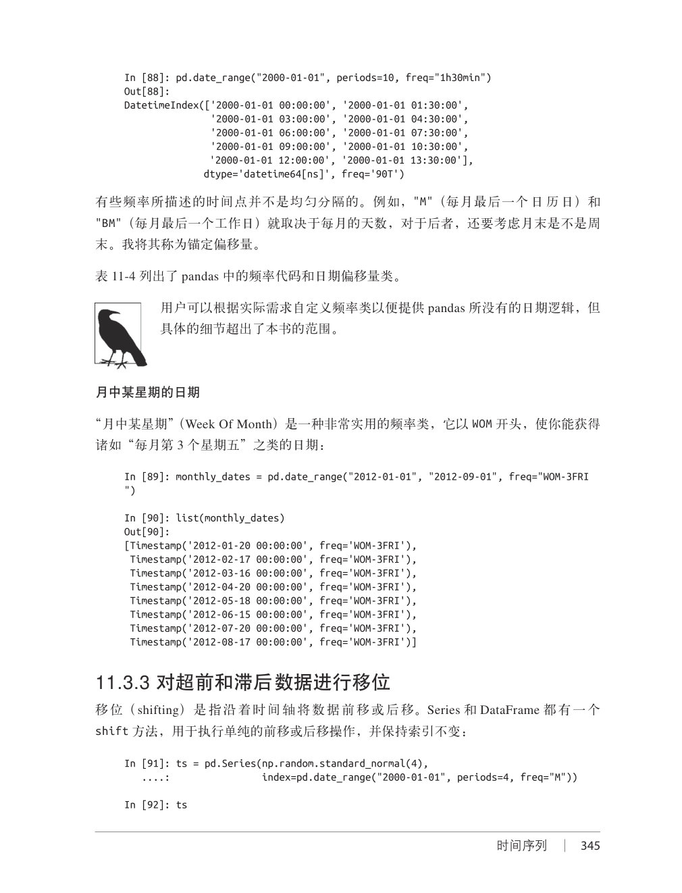

```ipython
In [88]: pd.date_range("2000-01-01", periods=10, freq="1h30min")
Out[88]:
DatetimeIndex(['2000-01-01 00:00:00', '2000-01-01 01:30:00',
               '2000-01-01 03:00:00', '2000-01-01 04:30:00',
               '2000-01-01 06:00:00', '2000-01-01 07:30:00',
               '2000-01-01 09:00:00', '2000-01-01 10:30:00',
               '2000-01-01 12:00:00', '2000-01-01 13:30:00'],
              dtype='datetime64[ns]', freq='90T')
```

有些频率所描述的时间点并不是均匀分隔的。例如，`"M"`（每月最后一个日历日）和 `"BM"`（每月最后一个工作日）就取决于每月的天数，对于后者，还要考虑月末是不是周末。我将其称为锚定偏移量。

表 11-4 列出了 pandas 中的频率代码和日期偏移量类。

> 用户可以根据实际需求自定义频率类以便提供 pandas 所没有的日期逻辑，但具体的细节超出了本书的范围。

#### 月中某星期的日期

“月中某星期”（Week Of Month）是一种非常实用的频率类，它以 `WOM` 开头，使你能获得诸如“每月第 3 个星期五”之类的日期：

```ipython
In [89]: monthly_dates = pd.date_range("2012-01-01", "2012-09-01", freq="WOM-3FRI")

In [90]: list(monthly_dates)
Out[90]:
[Timestamp('2012-01-20 00:00:00', freq='WOM-3FRI'),
 Timestamp('2012-02-17 00:00:00', freq='WOM-3FRI'),
 Timestamp('2012-03-16 00:00:00', freq='WOM-3FRI'),
 Timestamp('2012-04-20 00:00:00', freq='WOM-3FRI'),
 Timestamp('2012-05-18 00:00:00', freq='WOM-3FRI'),
 Timestamp('2012-06-15 00:00:00', freq='WOM-3FRI'),
 Timestamp('2012-07-20 00:00:00', freq='WOM-3FRI'),
 Timestamp('2012-08-17 00:00:00', freq='WOM-3FRI')]
```

### 11.3.3 对超前和滞后数据进行移位

移位（shifting）是指沿着时间轴将数据前移或后移。Series 和 DataFrame 都有一个 `shift` 方法，用于执行单纯的前移或后移操作，并保持索引不变：

```ipython
In [91]: ts = pd.Series(np.random.standard_normal(4),
   ....:                index=pd.date_range("2000-01-01", periods=4, freq="M"))

In [92]: ts
```

输出续下一页。

## PDF 第 356 页

<!-- page-status: reviewed -->
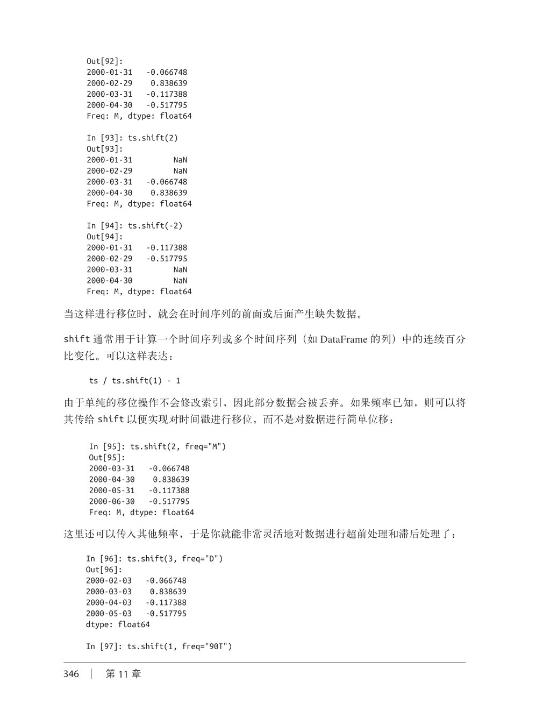

```ipython
Out[92]:
2000-01-31   -0.066748
2000-02-29    0.838639
2000-03-31   -0.117388
2000-04-30   -0.517795
Freq: M, dtype: float64

In [93]: ts.shift(2)
Out[93]:
2000-01-31         NaN
2000-02-29         NaN
2000-03-31   -0.066748
2000-04-30    0.838639
Freq: M, dtype: float64

In [94]: ts.shift(-2)
Out[94]:
2000-01-31   -0.117388
2000-02-29   -0.517795
2000-03-31         NaN
2000-04-30         NaN
Freq: M, dtype: float64
```

当这样进行移位时，就会在时间序列的前面或后面产生缺失数据。

`shift` 通常用于计算一个时间序列或多个时间序列（如 DataFrame 的列）中的连续百分比变化。可以这样表达：

```python
ts / ts.shift(1) - 1
```

由于单纯的移位操作不会修改索引，因此部分数据会被丢弃。如果频率已知，则可以将其传给 `shift` 以便实现对时间戳进行移位，而不是对数据进行简单位移：

```ipython
In [95]: ts.shift(2, freq="M")
Out[95]:
2000-03-31   -0.066748
2000-04-30    0.838639
2000-05-31   -0.117388
2000-06-30   -0.517795
Freq: M, dtype: float64
```

这里还可以传入其他频率，于是你就能非常灵活地对数据进行超前处理和滞后处理了：

```ipython
In [96]: ts.shift(3, freq="D")
Out[96]:
2000-02-03   -0.066748
2000-03-03    0.838639
2000-04-03   -0.117388
2000-05-03   -0.517795
dtype: float64

In [97]: ts.shift(1, freq="90T")
```

输出续下一页。

## PDF 第 357 页

<!-- page-status: reviewed -->
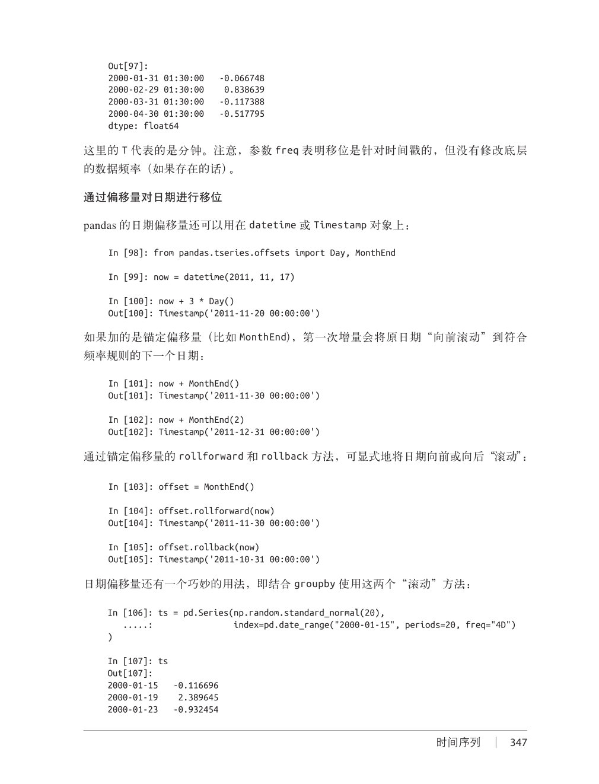

```ipython
Out[97]:
2000-01-31 01:30:00   -0.066748
2000-02-29 01:30:00    0.838639
2000-03-31 01:30:00   -0.117388
2000-04-30 01:30:00   -0.517795
dtype: float64
```

这里的 `T` 代表的是分钟。注意，参数 `freq` 表明移位是针对时间戳的，但没有修改底层的数据频率（如果存在的话）。

#### 通过偏移量对日期进行移位

pandas 的日期偏移量还可以用在 `datetime` 或 `Timestamp` 对象上：

```ipython
In [98]: from pandas.tseries.offsets import Day, MonthEnd

In [99]: now = datetime(2011, 11, 17)

In [100]: now + 3 * Day()
Out[100]: Timestamp('2011-11-20 00:00:00')
```

如果加的是锚定偏移量（比如 `MonthEnd`），第一次增量会将原日期“向前滚动”到符合频率规则的下一个日期：

```ipython
In [101]: now + MonthEnd()
Out[101]: Timestamp('2011-11-30 00:00:00')

In [102]: now + MonthEnd(2)
Out[102]: Timestamp('2011-12-31 00:00:00')
```

通过锚定偏移量的 `rollforward` 和 `rollback` 方法，可显式地将日期向前或向后“滚动”：

```ipython
In [103]: offset = MonthEnd()

In [104]: offset.rollforward(now)
Out[104]: Timestamp('2011-11-30 00:00:00')

In [105]: offset.rollback(now)
Out[105]: Timestamp('2011-10-31 00:00:00')
```

日期偏移量还有一个巧妙的用法，即结合 `groupby` 使用这两个“滚动”方法：

```ipython
In [106]: ts = pd.Series(np.random.standard_normal(20),
   .....:                index=pd.date_range("2000-01-15", periods=20, freq="4D"))

In [107]: ts
Out[107]:
2000-01-15   -0.116696
2000-01-19    2.389645
2000-01-23   -0.932454
```

输出续下一页。

## PDF 第 358 页

<!-- page-status: reviewed -->
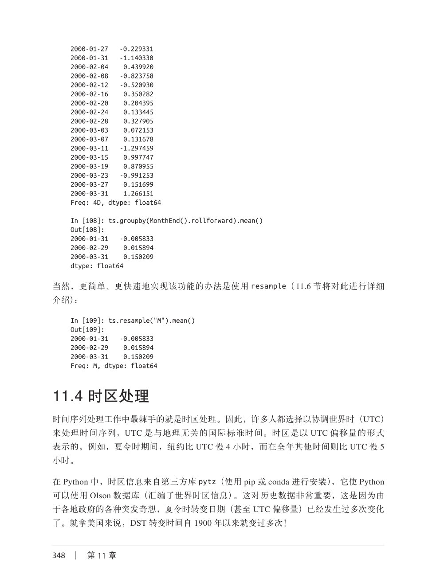

```text
2000-01-27   -0.229331
2000-01-31   -1.140330
2000-02-04    0.439920
2000-02-08   -0.823758
2000-02-12   -0.520930
2000-02-16    0.350282
2000-02-20    0.204395
2000-02-24    0.133445
2000-02-28    0.327905
2000-03-03    0.072153
2000-03-07    0.131678
2000-03-11   -1.297459
2000-03-15    0.997747
2000-03-19    0.870955
2000-03-23   -0.991253
2000-03-27    0.151699
2000-03-31    1.266151
Freq: 4D, dtype: float64
```

```ipython
In [108]: ts.groupby(MonthEnd().rollforward).mean()
Out[108]:
2000-01-31   -0.005833
2000-02-29    0.015894
2000-03-31    0.150209
dtype: float64
```

当然，更简单、更快速地实现该功能的办法是使用 `resample`（11.6 节将对此进行详细介绍）：

```ipython
In [109]: ts.resample("M").mean()
Out[109]:
2000-01-31   -0.005833
2000-02-29    0.015894
2000-03-31    0.150209
Freq: M, dtype: float64
```

### 11.4 时区处理

时间序列处理工作中最棘手的就是时区处理。因此，许多人都选择以协调世界时（UTC）来处理时间序列，UTC 是与地理无关的国际标准时间。时区是以 UTC 偏移量的形式表示的。例如，夏令时期间，纽约比 UTC 慢 4 小时，而在全年其他时间则比 UTC 慢 5 小时。

在 Python 中，时区信息来自第三方库 `pytz`（使用 pip 或 conda 进行安装），它使 Python 可以使用 Olson 数据库（汇编了世界时区信息）。这对历史数据非常重要，这是因为由于各地政府的各种突发奇想，夏令时转变日期（甚至 UTC 偏移量）已经发生过多次变化了。就拿美国来说，DST 转变时间自 1900 年以来就变过多次！

## PDF 第 359 页

<!-- page-status: reviewed -->
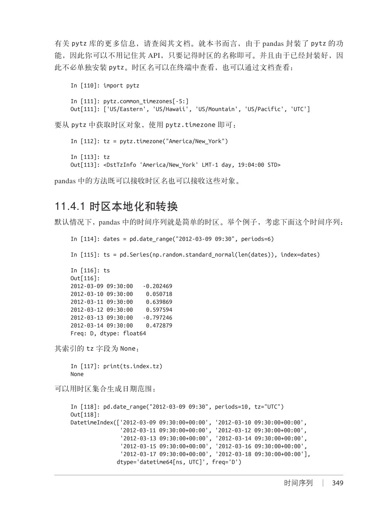

有关 `pytz` 库的更多信息，请查阅其文档。就本书而言，由于 pandas 封装了 `pytz` 的功能，因此你可以不用记住其 API，只要记得时区的名称即可。并且由于已经封装好，因此不必单独安装 `pytz`。时区名可以在终端中查看，也可以通过文档查看：

```ipython
In [110]: import pytz

In [111]: pytz.common_timezones[-5:]
Out[111]: ['US/Eastern', 'US/Hawaii', 'US/Mountain', 'US/Pacific', 'UTC']
```

要从 `pytz` 中获取时区对象，使用 `pytz.timezone` 即可：

```ipython
In [112]: tz = pytz.timezone("America/New_York")

In [113]: tz
Out[113]: <DstTzInfo 'America/New_York' LMT-1 day, 19:04:00 STD>
```

pandas 中的方法既可以接收时区名也可以接收这些对象。

### 11.4.1 时区本地化和转换

默认情况下，pandas 中的时间序列就是简单的时区。举个例子，考虑下面这个时间序列：

```ipython
In [114]: dates = pd.date_range("2012-03-09 09:30", periods=6)

In [115]: ts = pd.Series(np.random.standard_normal(len(dates)), index=dates)

In [116]: ts
Out[116]:
2012-03-09 09:30:00   -0.202469
2012-03-10 09:30:00    0.050718
2012-03-11 09:30:00    0.639869
2012-03-12 09:30:00    0.597594
2012-03-13 09:30:00   -0.797246
2012-03-14 09:30:00    0.472879
Freq: D, dtype: float64
```

其索引的 `tz` 字段为 `None`：

```ipython
In [117]: print(ts.index.tz)
None
```

可以用时区集合生成日期范围：

```ipython
In [118]: pd.date_range("2012-03-09 09:30", periods=10, tz="UTC")
Out[118]:
DatetimeIndex(['2012-03-09 09:30:00+00:00', '2012-03-10 09:30:00+00:00',
               '2012-03-11 09:30:00+00:00', '2012-03-12 09:30:00+00:00',
               '2012-03-13 09:30:00+00:00', '2012-03-14 09:30:00+00:00',
               '2012-03-15 09:30:00+00:00', '2012-03-16 09:30:00+00:00',
               '2012-03-17 09:30:00+00:00', '2012-03-18 09:30:00+00:00'],
              dtype='datetime64[ns, UTC]', freq='D')
```

## PDF 第 360 页

<!-- page-status: reviewed -->
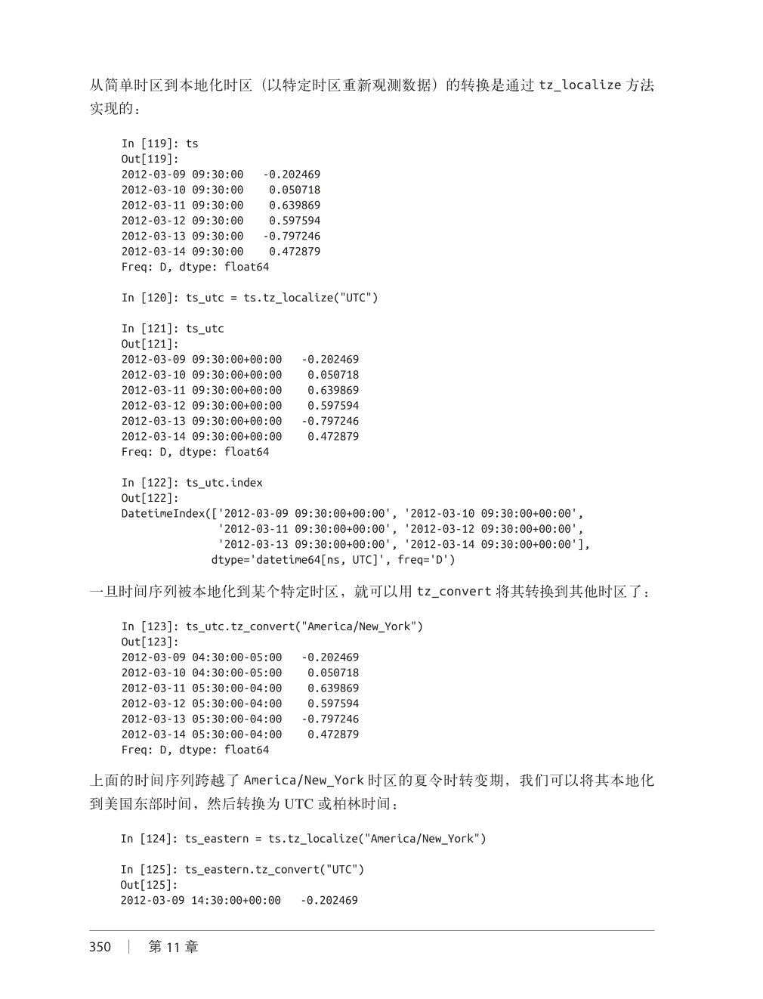

从简单时区到本地化时区（以特定时区重新观测数据）的转换是通过 `tz_localize` 方法实现的：

```ipython
In [119]: ts
Out[119]:
2012-03-09 09:30:00   -0.202469
2012-03-10 09:30:00    0.050718
2012-03-11 09:30:00    0.639869
2012-03-12 09:30:00    0.597594
2012-03-13 09:30:00   -0.797246
2012-03-14 09:30:00    0.472879
Freq: D, dtype: float64

In [120]: ts_utc = ts.tz_localize("UTC")

In [121]: ts_utc
Out[121]:
2012-03-09 09:30:00+00:00   -0.202469
2012-03-10 09:30:00+00:00    0.050718
2012-03-11 09:30:00+00:00    0.639869
2012-03-12 09:30:00+00:00    0.597594
2012-03-13 09:30:00+00:00   -0.797246
2012-03-14 09:30:00+00:00    0.472879
Freq: D, dtype: float64

In [122]: ts_utc.index
Out[122]:
DatetimeIndex(['2012-03-09 09:30:00+00:00', '2012-03-10 09:30:00+00:00',
               '2012-03-11 09:30:00+00:00', '2012-03-12 09:30:00+00:00',
               '2012-03-13 09:30:00+00:00', '2012-03-14 09:30:00+00:00'],
              dtype='datetime64[ns, UTC]', freq='D')
```

一旦时间序列被本地化到某个特定时区，就可以用 `tz_convert` 将其转换到其他时区了：

```ipython
In [123]: ts_utc.tz_convert("America/New_York")
Out[123]:
2012-03-09 04:30:00-05:00   -0.202469
2012-03-10 04:30:00-05:00    0.050718
2012-03-11 05:30:00-04:00    0.639869
2012-03-12 05:30:00-04:00    0.597594
2012-03-13 05:30:00-04:00   -0.797246
2012-03-14 05:30:00-04:00    0.472879
Freq: D, dtype: float64
```

上面的时间序列跨越了 `America/New_York` 时区的夏令时转变期，我们可以将其本地化到美国东部时间，然后转换为 UTC 或柏林时间：

```ipython
In [124]: ts_eastern = ts.tz_localize("America/New_York")

In [125]: ts_eastern.tz_convert("UTC")
Out[125]:
2012-03-09 14:30:00+00:00   -0.202469
```

输出续下一页。

## PDF 第 361 页

<!-- page-status: reviewed -->
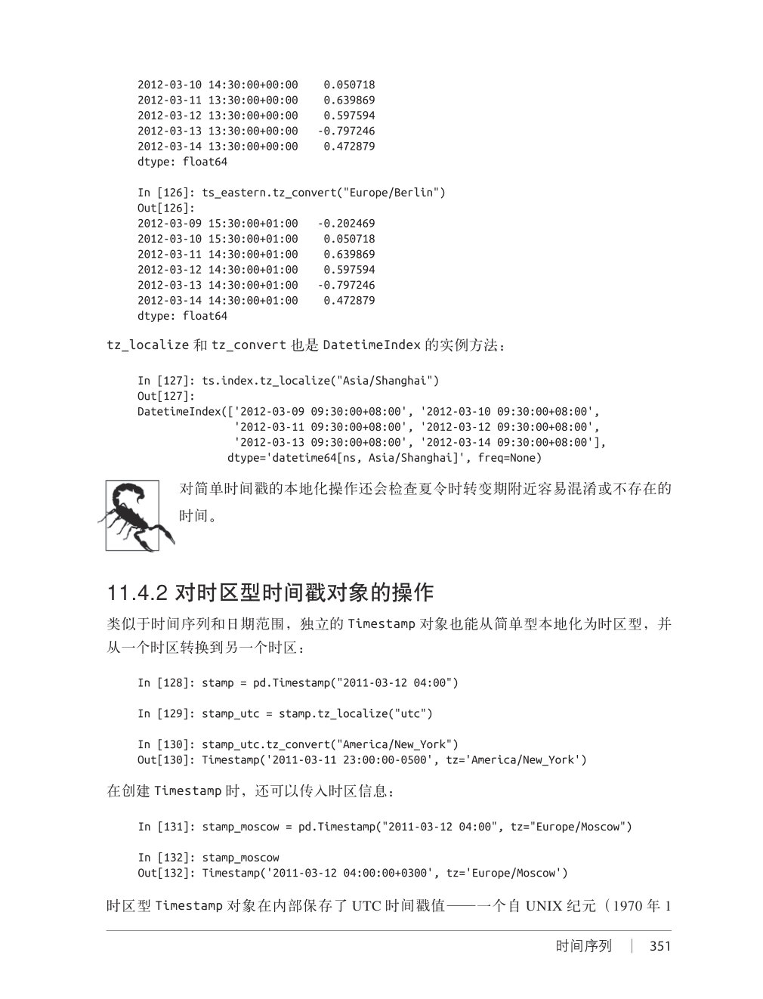

```text
2012-03-10 14:30:00+00:00    0.050718
2012-03-11 13:30:00+00:00    0.639869
2012-03-12 13:30:00+00:00    0.597594
2012-03-13 13:30:00+00:00   -0.797246
2012-03-14 13:30:00+00:00    0.472879
dtype: float64
```

```ipython
In [126]: ts_eastern.tz_convert("Europe/Berlin")
Out[126]:
2012-03-09 15:30:00+01:00   -0.202469
2012-03-10 15:30:00+01:00    0.050718
2012-03-11 14:30:00+01:00    0.639869
2012-03-12 14:30:00+01:00    0.597594
2012-03-13 14:30:00+01:00   -0.797246
2012-03-14 14:30:00+01:00    0.472879
dtype: float64
```

`tz_localize` 和 `tz_convert` 也是 `DatetimeIndex` 的实例方法：

```ipython
In [127]: ts.index.tz_localize("Asia/Shanghai")
Out[127]:
DatetimeIndex(['2012-03-09 09:30:00+08:00', '2012-03-10 09:30:00+08:00',
               '2012-03-11 09:30:00+08:00', '2012-03-12 09:30:00+08:00',
               '2012-03-13 09:30:00+08:00', '2012-03-14 09:30:00+08:00'],
              dtype='datetime64[ns, Asia/Shanghai]', freq=None)
```

> 对简单时间戳的本地化操作还会检查夏令时转变期附近容易混淆或不存在的时间。

### 11.4.2 对时区型时间戳对象的操作

类似于时间序列和日期范围，独立的 `Timestamp` 对象也能从简单型本地化为时区型，并从一个时区转换到另一个时区：

```ipython
In [128]: stamp = pd.Timestamp("2011-03-12 04:00")

In [129]: stamp_utc = stamp.tz_localize("utc")

In [130]: stamp_utc.tz_convert("America/New_York")
Out[130]: Timestamp('2011-03-11 23:00:00-0500', tz='America/New_York')
```

在创建 `Timestamp` 时，还可以传入时区信息：

```ipython
In [131]: stamp_moscow = pd.Timestamp("2011-03-12 04:00", tz="Europe/Moscow")

In [132]: stamp_moscow
Out[132]: Timestamp('2011-03-12 04:00:00+0300', tz='Europe/Moscow')
```

时区型 `Timestamp` 对象在内部保存了 UTC 时间戳值——一个自 UNIX 纪元（1970 年 1

## PDF 第 362 页

<!-- page-status: reviewed -->
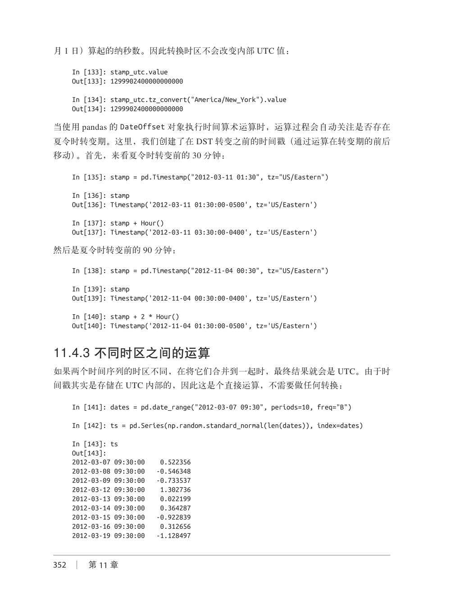

（接上页）月 1 日）算起的纳秒数。因此转换时区不会改变内部 UTC 值：

```python
stamp_utc.value
```

```text
1299902400000000000
```

```python
stamp_utc.tz_convert("America/New_York").value
```

```text
1299902400000000000
```

当使用 pandas 的 `DateOffset` 对象执行时间算术运算时，运算过程会自动关注是否存在夏令时转变期。这里，我们创建了在 DST 转变之前的时间戳（通过运算在转变期的前后移动）。首先，来看夏令时转变前的 30 分钟：

```python
stamp = pd.Timestamp("2012-03-11 01:30", tz="US/Eastern")
stamp
```

```text
Timestamp('2012-03-11 01:30:00-0500', tz='US/Eastern')
```

```python
stamp + Hour()
```

```text
Timestamp('2012-03-11 03:30:00-0400', tz='US/Eastern')
```

然后是夏令时转变前的 90 分钟：

```python
stamp = pd.Timestamp("2012-11-04 00:30", tz="US/Eastern")
stamp
```

```text
Timestamp('2012-11-04 00:30:00-0400', tz='US/Eastern')
```

```python
stamp + 2 * Hour()
```

```text
Timestamp('2012-11-04 01:30:00-0500', tz='US/Eastern')
```

### 11.4.3 不同时区之间的运算

如果两个时间序列的时区不同，在将它们合并到一起时，最终结果就会是 UTC。由于时间戳其实是存储在 UTC 内部的，因此这是个直接运算，不需要做任何转换：

```python
dates = pd.date_range("2012-03-07 09:30", periods=10, freq="B")
ts = pd.Series(np.random.standard_normal(len(dates)), index=dates)
ts
```

```text
2012-03-07 09:30:00    0.522356
2012-03-08 09:30:00   -0.546348
2012-03-09 09:30:00   -0.733537
2012-03-12 09:30:00    1.302736
2012-03-13 09:30:00    0.022199
2012-03-14 09:30:00    0.364287
2012-03-15 09:30:00   -0.922839
2012-03-16 09:30:00    0.312656
2012-03-19 09:30:00   -1.128497
```

原书输出末行和 dtype 在下一页；示例值为原书随机样本，运行时会因随机状态不同而变化。

## PDF 第 363 页

<!-- page-status: reviewed -->
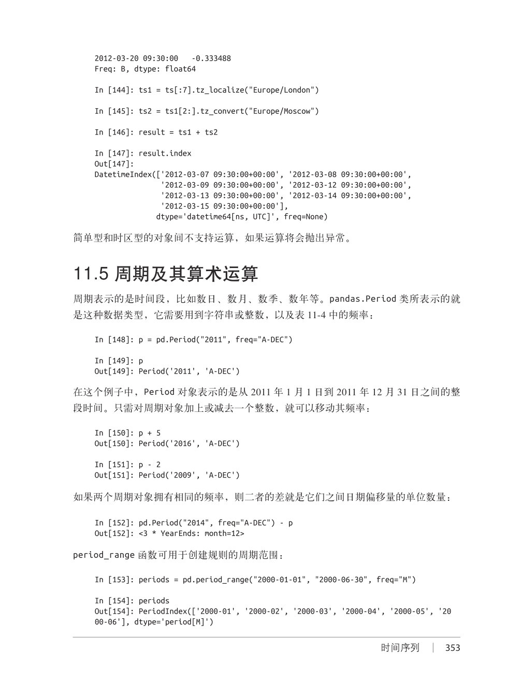

上页输出续：

```text
2012-03-20 09:30:00   -0.333488
Freq: B, dtype: float64
```

```python
ts1 = ts[:7].tz_localize("Europe/London")
ts2 = ts1[2:].tz_convert("Europe/Moscow")
result = ts1 + ts2
result.index
```

```text
DatetimeIndex(['2012-03-07 09:30:00+00:00', '2012-03-08 09:30:00+00:00',
               '2012-03-09 09:30:00+00:00', '2012-03-12 09:30:00+00:00',
               '2012-03-13 09:30:00+00:00', '2012-03-14 09:30:00+00:00',
               '2012-03-15 09:30:00+00:00'],
              dtype='datetime64[ns, UTC]', freq=None)
```

简单型和时区型的对象间不支持运算，如果运算将会抛出异常。

### 11.5 周期及其算术运算

周期表示的是时间段，比如数日、数月、数季、数年等。`pandas.Period` 类所表示的就是这种数据类型，它需要用到字符串或整数，以及表 11-4 中的频率：

```python
p = pd.Period("2011", freq="A-DEC")
p
```

```text
Period('2011', 'A-DEC')
```

> 版本说明：在本机 pandas 2.2.3 中，原书的 `A-DEC` 已提示弃用；可改用 `Y-DEC`。代码和输出仍按原书保留。

在这个例子中，`Period` 对象表示的是从 2011 年 1 月 1 日到 2011 年 12 月 31 日之间的整段时间。只需对周期对象加上或减去一个整数，就可以移动其频率：

```python
p + 5
```

```text
Period('2016', 'A-DEC')
```

```python
p - 2
```

```text
Period('2009', 'A-DEC')
```

如果两个周期对象拥有相同的频率，则二者的差就是它们之间日期偏移量的单位数量：

```python
pd.Period("2014", freq="A-DEC") - p
```

```text
<3 * YearEnds: month=12>
```

`period_range` 函数可用于创建规则的周期范围：

```python
periods = pd.period_range("2000-01-01", "2000-06-30", freq="M")
periods
```

```text
PeriodIndex(['2000-01', '2000-02', '2000-03', '2000-04', '2000-05', '2000-06'], dtype='period[M]')
```

## PDF 第 364 页

<!-- page-status: reviewed -->
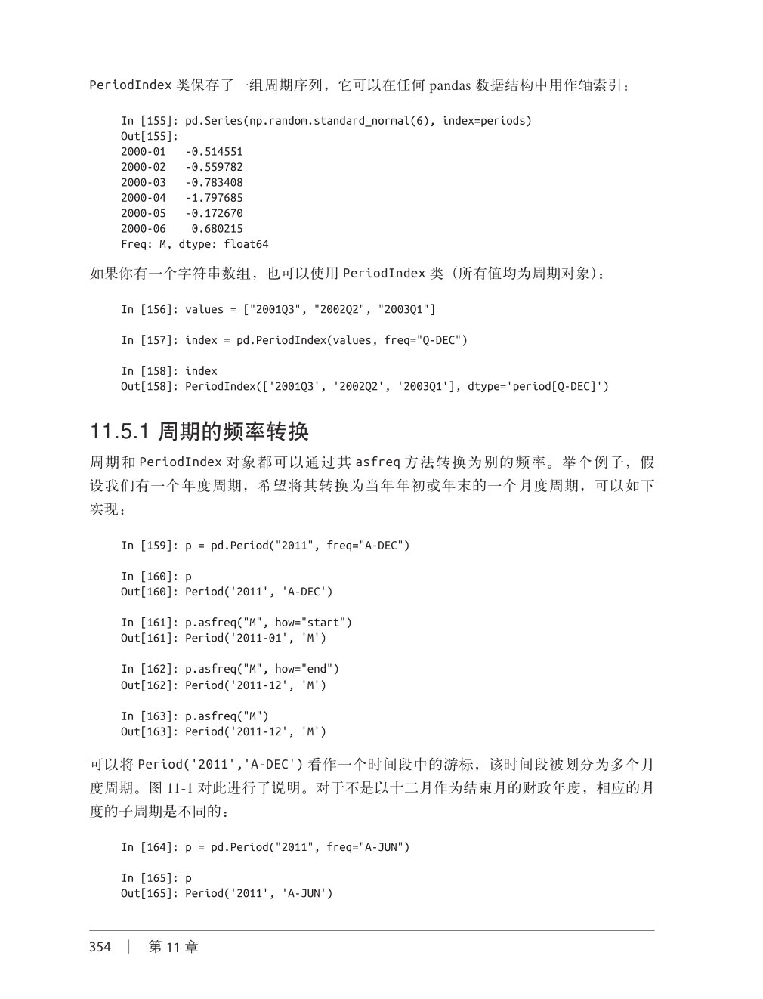

`PeriodIndex` 类保存了一组周期序列，它可以在任何 pandas 数据结构中用作轴索引：

```python
pd.Series(np.random.standard_normal(6), index=periods)
```

```text
2000-01   -0.514551
2000-02   -0.559782
2000-03   -0.783408
2000-04   -1.797685
2000-05   -0.172670
2000-06    0.680215
Freq: M, dtype: float64
```

> 以上随机数是原书输出；重新运行不保证相同。

如果你有一个字符串数组，也可以使用 `PeriodIndex` 类（所有值均为周期对象）：

```python
values = ["2001Q3", "2002Q2", "2003Q1"]
index = pd.PeriodIndex(values, freq="Q-DEC")
index
```

```text
PeriodIndex(['2001Q3', '2002Q2', '2003Q1'], dtype='period[Q-DEC]')
```

### 11.5.1 周期的频率转换

周期和 `PeriodIndex` 对象都可以通过其 `asfreq` 方法转换为别的频率。举个例子，假设我们有一个年度周期，希望将其转换为当年年初或年末的一个月度周期，可以如下实现：

```python
p = pd.Period("2011", freq="A-DEC")
p
```

```text
Period('2011', 'A-DEC')
```

```python
p.asfreq("M", how="start")
```

```text
Period('2011-01', 'M')
```

```python
p.asfreq("M", how="end")
```

```text
Period('2011-12', 'M')
```

```python
p.asfreq("M")
```

```text
Period('2011-12', 'M')
```

可以将 `Period('2011', 'A-DEC')` 看作一个时间段中的游标，该时间段被划分为多个月度周期。图 11-1 对此进行了说明。对于不是以十二月作为结束月的财政年度，相应的月度的子周期是不同的：

```python
p = pd.Period("2011", freq="A-JUN")
p
```

```text
Period('2011', 'A-JUN')
```

## PDF 第 365 页

<!-- page-status: reviewed -->
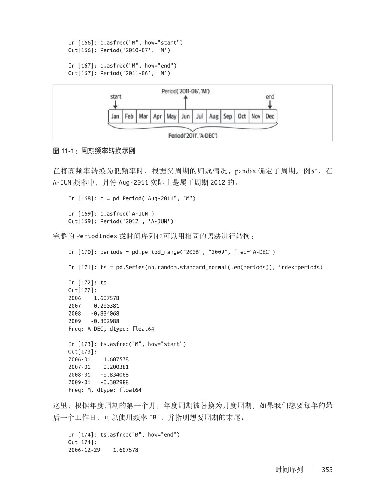

接上页的年度周期 `p`：

```python
p.asfreq("M", how="start")
p.asfreq("M", how="end")
```

```text
Period('2010-07', 'M')
Period('2011-06', 'M')
```

**图 11-1：周期频率转换示例**（示意图见原页）。

在将高频率转换为低频率时，根据父周期的归属情况，pandas 确定了周期。例如，在 `A-JUN` 频率中，月份 Aug-2011 实际上是属于周期 2012 的：

```python
p = pd.Period("Aug-2011", "M")
p.asfreq("A-JUN")
```

```text
Period('2012', 'A-JUN')
```

完整的 `PeriodIndex` 或时间序列也可以用相同的语法进行转换：

```python
periods = pd.period_range("2006", "2009", freq="A-DEC")
ts = pd.Series(np.random.standard_normal(len(periods)), index=periods)
ts
ts.asfreq("M", how="start")
```

原书中的一次随机输出：

```text
2006    1.607578
2007    0.200381
2008   -0.834068
2009   -0.302988
Freq: A-DEC, dtype: float64

2006-01    1.607578
2007-01    0.200381
2008-01   -0.834068
2009-01   -0.302988
Freq: M, dtype: float64
```

这里，根据年度周期的第一个月，年度周期被替换为月度周期。如果我们想要每年的最后一个工作日，可以使用频率 `"B"`，并指明想要周期的末尾：

```python
ts.asfreq("B", how="end")
```

输出跨至下一页，完整原书结果为：

```text
2006-12-29    1.607578
2007-12-31    0.200381
2008-12-31   -0.834068
2009-12-31   -0.302988
Freq: B, dtype: float64
```

## PDF 第 366 页

<!-- page-status: reviewed -->
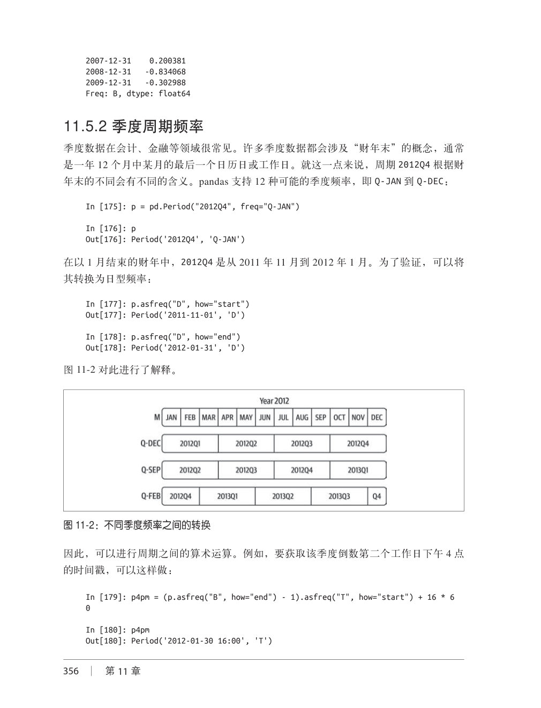

本页开头为上一页 `ts.asfreq("B", how="end")` 输出的续行，已与上页合并。

### 11.5.2 季度周期频率

季度数据在会计、金融等领域很常见。许多季度数据都会涉及“财年末”的概念，通常是一年 12 个月中某月的最后一个日历日或工作日。就这一点来说，周期 2012Q4 根据财年末的不同会有不同的含义。pandas 支持 12 种可能的季度频率，即 `Q-JAN` 到 `Q-DEC`：

```python
p = pd.Period("2012Q4", freq="Q-JAN")
p
```

```text
Period('2012Q4', 'Q-JAN')
```

在以 1 月结束的财年中，2012Q4 是从 2011 年 11 月到 2012 年 1 月。为了验证，可以将其转换为日型频率：

```python
p.asfreq("D", how="start")
p.asfreq("D", how="end")
```

```text
Period('2011-11-01', 'D')
Period('2012-01-31', 'D')
```

**图 11-2：不同季度频率之间的转换**（具体示意见原页）。

因此，可以进行周期之间的算术运算。例如，要获取该季度倒数第二个工作日下午 4 点的时间戳，可以这样做：

```python
p4pm = (p.asfreq("B", how="end") - 1).asfreq("T", how="start") + 16 * 60
p4pm
```

```text
Period('2012-01-30 16:00', 'T')
```

## PDF 第 367 页

<!-- page-status: reviewed -->
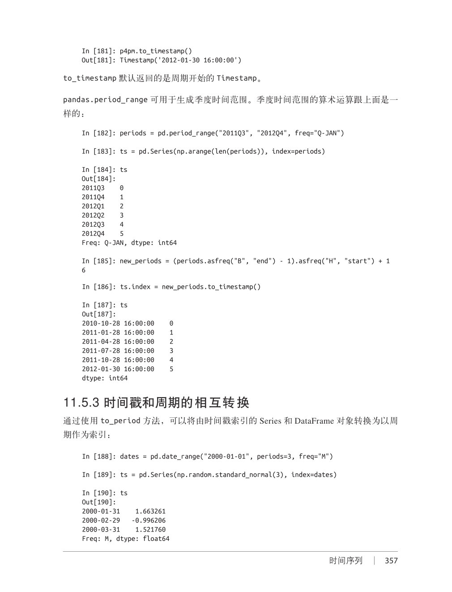

```python
p4pm.to_timestamp()
```

```text
Timestamp('2012-01-30 16:00:00')
```

`to_timestamp` 默认返回的是周期开始的 `Timestamp`。

`pandas.period_range` 可用于生成季度时间范围。季度时间范围的算术运算跟上面是一样的：

```python
periods = pd.period_range("2011Q3", "2012Q4", freq="Q-JAN")
ts = pd.Series(np.arange(len(periods)), index=periods)
ts
new_periods = (periods.asfreq("B", "end") - 1).asfreq("H", "start") + 16
ts.index = new_periods.to_timestamp()
ts
```

原书输出：

```text
2011Q3    0
2011Q4    1
2012Q1    2
2012Q2    3
2012Q3    4
2012Q4    5
Freq: Q-JAN, dtype: int64

2010-10-28 16:00:00    0
2011-01-28 16:00:00    1
2011-04-28 16:00:00    2
2011-07-28 16:00:00    3
2011-10-28 16:00:00    4
2012-01-30 16:00:00    5
dtype: int64
```

### 11.5.3 时间戳和周期的相互转换

通过使用 `to_period` 方法，可以将由时间戳索引的 Series 和 DataFrame 对象转换为以周期作为索引：

```python
dates = pd.date_range("2000-01-01", periods=3, freq="M")
ts = pd.Series(np.random.standard_normal(3), index=dates)
ts
```

原书中的一次随机输出：

```text
2000-01-31    1.663261
2000-02-29   -0.996206
2000-03-31    1.521760
Freq: M, dtype: float64
```

## PDF 第 368 页

<!-- page-status: reviewed -->
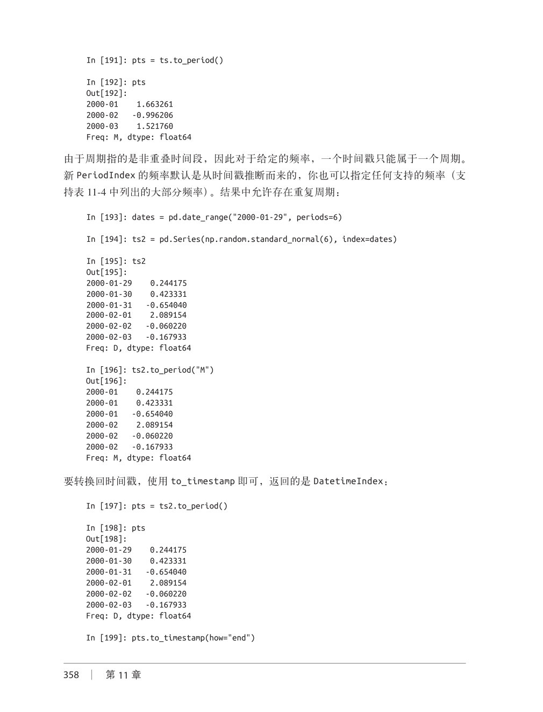

```python
pts = ts.to_period()
pts
```

```text
2000-01    1.663261
2000-02   -0.996206
2000-03    1.521760
Freq: M, dtype: float64
```

由于周期指的是非重叠时间段，因此对于给定的频率，一个时间戳只能属于一个周期。新 `PeriodIndex` 的频率默认是从时间戳推断而来的，你也可以指定任何支持的频率（支持表 11-4 中列出的大部分频率）。结果中允许存在重复周期：

```python
dates = pd.date_range("2000-01-29", periods=6)
ts2 = pd.Series(np.random.standard_normal(6), index=dates)
ts2
ts2.to_period("M")
```

原书中的一次随机输出：

```text
2000-01-29    0.244175
2000-01-30    0.423331
2000-01-31   -0.654040
2000-02-01    2.089154
2000-02-02   -0.060220
2000-02-03   -0.167933
Freq: D, dtype: float64

2000-01    0.244175
2000-01    0.423331
2000-01   -0.654040
2000-02    2.089154
2000-02   -0.060220
2000-02   -0.167933
Freq: M, dtype: float64
```

要转换回时间戳，使用 `to_timestamp` 即可，返回的是 `DatetimeIndex`：

```python
pts = ts2.to_period()
pts
pts.to_timestamp(how="end")
```

原书 `pts` 输出：

```text
2000-01-29    0.244175
2000-01-30    0.423331
2000-01-31   -0.654040
2000-02-01    2.089154
2000-02-02   -0.060220
2000-02-03   -0.167933
Freq: D, dtype: float64
```

`pts.to_timestamp(how="end")` 输出见下一页。

> 校对注：对 Series 使用 `to_timestamp()` 返回的是带 `DatetimeIndex` 的 Series；对 `PeriodIndex` 调用该方法才直接返回 `DatetimeIndex`。

## PDF 第 369 页

<!-- page-status: reviewed -->
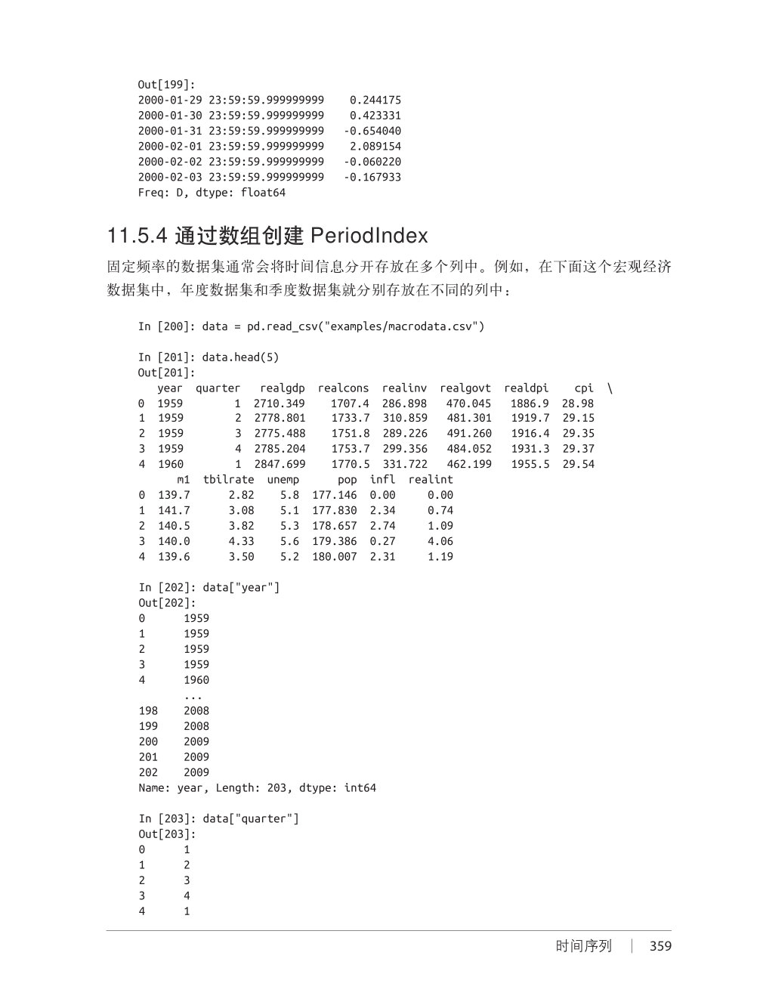

上一页 `pts.to_timestamp(how="end")` 的原书输出：

```text
2000-01-29 23:59:59.999999999    0.244175
2000-01-30 23:59:59.999999999    0.423331
2000-01-31 23:59:59.999999999   -0.654040
2000-02-01 23:59:59.999999999    2.089154
2000-02-02 23:59:59.999999999   -0.060220
2000-02-03 23:59:59.999999999   -0.167933
Freq: D, dtype: float64
```

### 11.5.4 通过数组创建 PeriodIndex

固定频率的数据集通常会将时间信息分开存放在多个列中。例如，在下面这个宏观经济数据集中，年度数据集和季度数据集就分别存放在不同的列中：

```python
data = pd.read_csv("examples/macrodata.csv")
data.head(5)
```

原书输出：

```text
   year  quarter   realgdp  realcons  realinv  realgovt  realdpi    cpi  \
0  1959        1  2710.349    1707.4  286.898   470.045   1886.9  28.98
1  1959        2  2778.801    1733.7  310.859   481.301   1919.7  29.15
2  1959        3  2775.488    1751.8  289.226   491.260   1916.4  29.35
3  1959        4  2785.204    1753.7  299.356   484.052   1931.3  29.37
4  1960        1  2847.699    1770.5  331.722   462.199   1955.5  29.54
      m1  tbilrate  unemp      pop  infl  realint
0  139.7      2.82    5.8  177.146  0.00     0.00
1  141.7      3.08    5.1  177.830  2.34     0.74
2  140.5      3.82    5.3  178.657  2.74     1.09
3  140.0      4.33    5.6  179.386  0.27     4.06
4  139.6      3.50    5.2  180.007  2.31     1.19
```

```python
data["year"]
data["quarter"]
```

```text
0      1959
1      1959
2      1959
3      1959
4      1960
       ...
198    2008
199    2008
200    2009
201    2009
202    2009
Name: year, Length: 203, dtype: int64

0      1
1      2
2      3
3      4
4      1
```

`data["quarter"]` 输出续见下一页。示例依赖原书的 `examples/macrodata.csv` 数据文件，未随本转换稿提供。

## PDF 第 370 页

<!-- page-status: reviewed -->
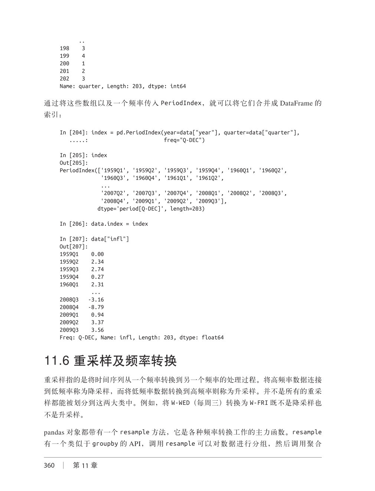

上一页 `data["quarter"]` 的续行：

```text
       ...
198    3
199    4
200    1
201    2
202    3
Name: quarter, Length: 203, dtype: int64
```

通过将这些数组以及一个频率传入 `PeriodIndex`，就可以将它们合并成 DataFrame 的索引：

```python
index = pd.PeriodIndex(year=data["year"], quarter=data["quarter"], freq="Q-DEC")
index
data.index = index
data["infl"]
```

原书输出：

```text
PeriodIndex(['1959Q1', '1959Q2', '1959Q3', '1959Q4', '1960Q1', '1960Q2',
             '1960Q3', '1960Q4', '1961Q1', '1961Q2',
             ...
             '2007Q2', '2007Q3', '2007Q4', '2008Q1', '2008Q2', '2008Q3',
             '2008Q4', '2009Q1', '2009Q2', '2009Q3'],
            dtype='period[Q-DEC]', length=203)

1959Q1    0.00
1959Q2    2.34
1959Q3    2.74
1959Q4    0.27
1960Q1    2.31
          ...
2008Q3   -3.16
2008Q4   -8.79
2009Q1    0.94
2009Q2    3.37
2009Q3    3.56
Freq: Q-DEC, Name: infl, Length: 203, dtype: float64
```

### 11.6 重采样及频率转换

重采样指的是将时间序列从一个频率转换到另一个频率的处理过程。将高频率数据连接到低频率称为降采样，而将低频率数据转换到高频率则称为升采样。并不是所有的重采样都能被划分到这两大类中。例如，将 `W-WED`（每周三）转换为 `W-FRI` 既不是降采样也不是升采样。

pandas 对象都带有一个 `resample` 方法，它是各种频率转换工作的主力函数。`resample` 有一个类似于 `groupby` 的 API，调用 `resample` 可以对数据进行分组，然后调用聚合函数（代码见下一页）。

## PDF 第 371 页

<!-- page-status: reviewed -->
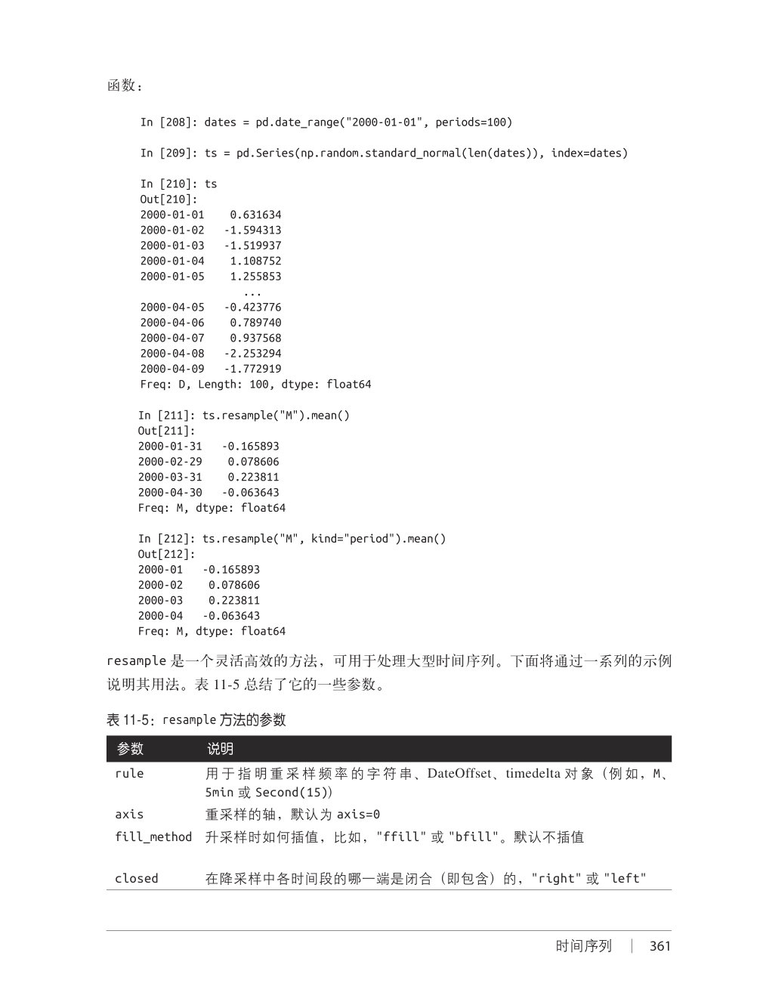

```python
dates = pd.date_range("2000-01-01", periods=100)
ts = pd.Series(np.random.standard_normal(len(dates)), index=dates)
ts
ts.resample("M").mean()
ts.resample("M", kind="period").mean()
```

原书中的一次随机输出：

```text
2000-01-01    0.631634
2000-01-02   -1.594313
2000-01-03   -1.519937
2000-01-04    1.108752
2000-01-05    1.255853
                ...
2000-04-05   -0.423776
2000-04-06    0.789740
2000-04-07    0.937568
2000-04-08   -2.253294
2000-04-09   -1.772919
Freq: D, Length: 100, dtype: float64

2000-01-31   -0.165893
2000-02-29    0.078606
2000-03-31    0.223811
2000-04-30   -0.063643
Freq: M, dtype: float64

2000-01   -0.165893
2000-02    0.078606
2000-03    0.223811
2000-04   -0.063643
Freq: M, dtype: float64
```

`resample` 是一个灵活高效的方法，可用于处理大型时间序列。下面将通过一系列的示例说明其用法。表 11-5 总结了它的一些参数。

**表 11-5：resample 方法的参数**

| 参数 | 说明 |
| --- | --- |
| `rule` | 用于指明重采样频率的字符串、`DateOffset`、`timedelta` 对象（例如，`M`、`5min` 或 `Second(15)`） |
| `axis` | 重采样的轴，默认为 `axis=0` |
| `fill_method` | 升采样时如何插值，比如，`"ffill"` 或 `"bfill"`。默认不插值 |
| `closed` | 在降采样中各时间段的哪一端是闭合（即包含）的，`"right"` 或 `"left"` |

> 版本说明：本页保留原书的 API 和频率符号，新版本 pandas 对部分参数及别名可能发出弃用提示；实际运行时应结合当前 pandas 版本检查。

## PDF 第 372 页

<!-- page-status: reviewed -->
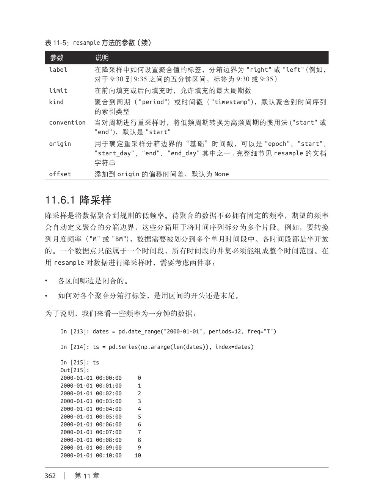

**表 11-5：`resample` 方法的参数（续）**

| 参数 | 说明 |
|---|---|
| `label` | 在降采样中如何设置聚合值的标签，分箱边界为 `"right"` 或 `"left"`（例如，对于 9:30 到 9:35 之间的五分钟区间，标签为 9:30 或 9:35） |
| `limit` | 在前向填充或后向填充时，允许填充的最大周期数 |
| `kind` | 聚合到周期（`"period"`）或时间戳（`"timestamp"`），默认聚合到时间序列的索引类型 |
| `convention` | 当对周期进行重采样时，将低频周期转换为高频周期的惯用法（`"start"` 或 `"end"`），默认是 `"start"` |
| `origin` | 用于确定重采样分箱边界的“基础”时间戳，可以是 `"epoch"`、`"start"`、`"start_day"`、`"end"`、`"end_day"` 其中之一，完整细节见 `resample` 的文档字符串 |
| `offset` | 添加到 `origin` 的偏移时间差，默认为 `None` |

### 11.6.1 降采样

降采样是将数据聚合到规则的低频率。待聚合的数据不必拥有固定的频率，期望的频率会自动定义聚合的分箱边界，这些分箱用于将时间序列拆分为多个片段。例如，要转换到月度频率（`"M"` 或 `"BM"`），数据需要被划分到多个单月时间段中。各时间段都是半开放的。一个数据点只能属于一个时间段，所有时间段的并集必须能组成整个时间范围。在用 `resample` 对数据进行降采样时，需要考虑两件事：

- 各区间哪边是闭合的。
- 如何对各个聚合分箱打标签，是用区间的开头还是末尾。

为了说明，我们来看一些频率为一分钟的数据：

```python
dates = pd.date_range("2000-01-01", periods=12, freq="T")
ts = pd.Series(np.arange(len(dates)), index=dates)
ts
```

原书输出（末行及 `dtype` 续下一页）：

```text
2000-01-01 00:00:00     0
2000-01-01 00:01:00     1
2000-01-01 00:02:00     2
2000-01-01 00:03:00     3
2000-01-01 00:04:00     4
2000-01-01 00:05:00     5
2000-01-01 00:06:00     6
2000-01-01 00:07:00     7
2000-01-01 00:08:00     8
2000-01-01 00:09:00     9
2000-01-01 00:10:00    10
```

> 版本说明：本机 pandas 2.2.3 对 `freq="T"` 发出弃用警告，可改用 `freq="min"`。原书代码保留以便对照。

## PDF 第 373 页

<!-- page-status: reviewed -->
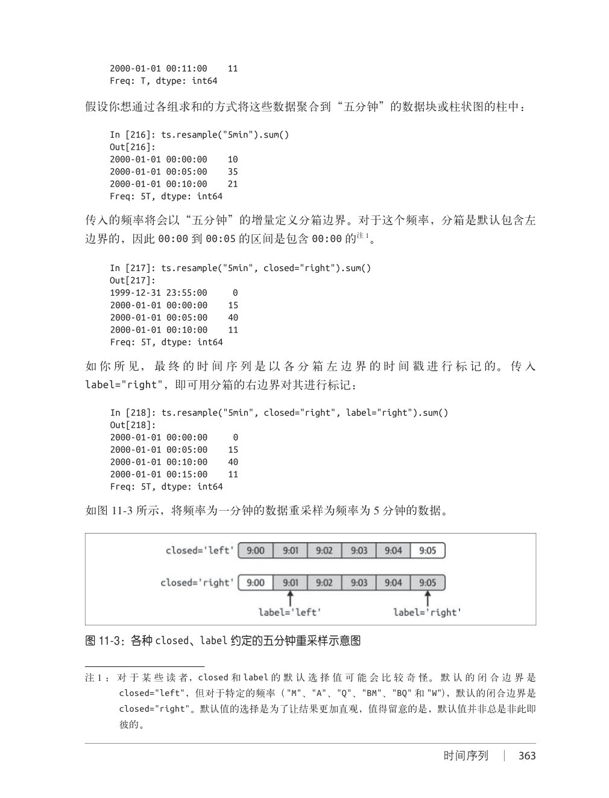

上一页 `ts` 输出续：

```text
2000-01-01 00:11:00    11
Freq: T, dtype: int64
```

假设你想通过各组求和的方式将这些数据聚合到“五分钟”的数据块或柱状图的柱中：

```python
ts.resample("5min").sum()
```

原书输出：

```text
2000-01-01 00:00:00    10
2000-01-01 00:05:00    35
2000-01-01 00:10:00    21
Freq: 5T, dtype: int64
```

传入的频率将会以“五分钟”的增量定义分箱边界。对于这个频率，分箱是默认包含左边界的，因此 00:00 到 00:05 的区间是包含 00:00 的。¹

```python
ts.resample("5min", closed="right").sum()
```

原书输出：

```text
1999-12-31 23:55:00     0
2000-01-01 00:00:00    15
2000-01-01 00:05:00    40
2000-01-01 00:10:00    11
Freq: 5T, dtype: int64
```

如你所见，最终的时间序列是以各分箱左边界的时间戳进行标记的。传入 `label="right"`，即可用分箱的右边界对其进行标记：

```python
ts.resample("5min", closed="right", label="right").sum()
```

原书输出：

```text
2000-01-01 00:00:00     0
2000-01-01 00:05:00    15
2000-01-01 00:10:00    40
2000-01-01 00:15:00    11
Freq: 5T, dtype: int64
```

如图 11-3 所示，将频率为一分钟的数据重采样为频率为 5 分钟的数据。

**图 11-3：各种 `closed`、`label` 约定的五分钟重采样示意图。** 原页图中展示左右边界是否闭合和选择左、右边界作为标签的区别。

> 注 1：对于某些读者，`closed` 和 `label` 的默认选择值可能会比较奇怪。默认的闭合边界是 `closed="left"`，但对于特定的频率（`"M"`、`"A"`、`"Q"`、`"BM"`、`"BQ"` 和 `"W"`），默认的闭合边界是 `closed="right"`。默认值的选择是为了让结果更加直观，值得留意的是，默认值并非总是非此即彼的。

## PDF 第 374 页

<!-- page-status: reviewed -->
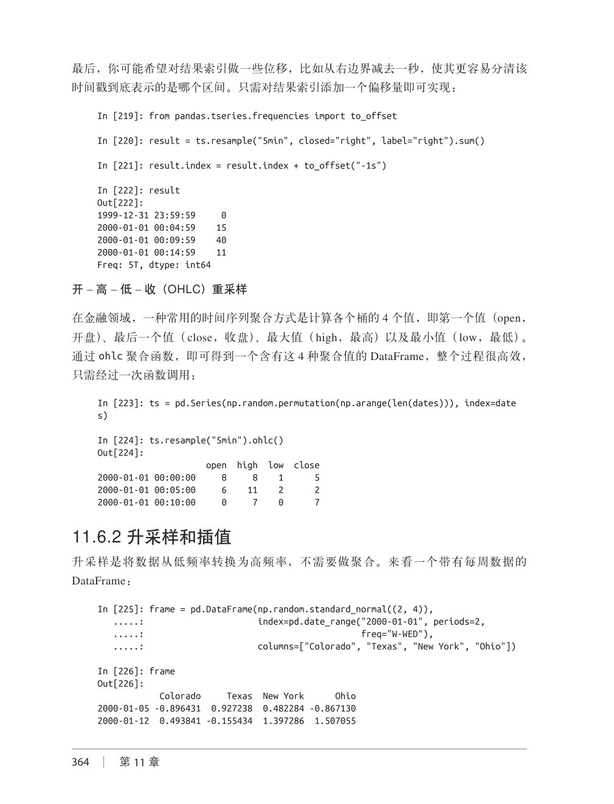

最后，你可能希望对结果索引做一些位移，比如从右边界减去一秒，使其更容易分清该时间戳到底表示的是哪个区间。只需对结果索引添加一个偏移量即可实现：

```python
from pandas.tseries.frequencies import to_offset
result = ts.resample("5min", closed="right", label="right").sum()
result.index = result.index + to_offset("-1s")
result
```

原书输出：

```text
1999-12-31 23:59:59     0
2000-01-01 00:04:59    15
2000-01-01 00:09:59    40
2000-01-01 00:14:59    11
Freq: 5T, dtype: int64
```

#### 开－高－低－收（OHLC）重采样

在金融领域，一种常用的时间序列聚合方式是计算各个桶的 4 个值，即第一个值（open，开盘）、最后一个值（close，收盘）、最大值（high，最高）以及最小值（low，最低）。通过 `ohlc` 聚合函数，即可得到一个含有这 4 种聚合值的 DataFrame，整个过程很高效，只需经过一次函数调用：

```python
ts = pd.Series(np.random.permutation(np.arange(len(dates))), index=dates)
ts.resample("5min").ohlc()
```

原书输出（随机数为原书运行结果）：

```text
                     open  high  low  close
2000-01-01 00:00:00     8     8    1      5
2000-01-01 00:05:00     6    11    2      2
2000-01-01 00:10:00     0     7    0      7
```

### 11.6.2 升采样和插值

升采样是将数据从低频率转换为高频率，不需要做聚合。来看一个带有每周数据的 DataFrame：

```python
frame = pd.DataFrame(np.random.standard_normal((2, 4)),
                     index=pd.date_range("2000-01-01", periods=2,
                                         freq="W-WED"),
                     columns=["Colorado", "Texas", "New York", "Ohio"])
frame
```

原书输出（随机数为原书运行结果）：

```text
            Colorado     Texas  New York      Ohio
2000-01-05 -0.896431  0.927238  0.482284 -0.867130
2000-01-12  0.493841 -0.155434  1.397286  1.507055
```

## PDF 第 375 页

<!-- page-status: reviewed -->
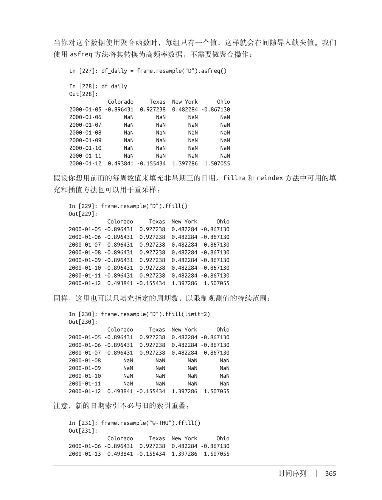

当你对这个数据使用聚合函数时，每组只有一个值，这样就会在间隙导入缺失值。我们使用 `asfreq` 方法将其转换为高频率数据，不需要做聚合操作：

```python
df_daily = frame.resample("D").asfreq()
df_daily
```

原书输出：

```text
            Colorado     Texas  New York      Ohio
2000-01-05 -0.896431  0.927238  0.482284 -0.867130
2000-01-06       NaN       NaN       NaN       NaN
2000-01-07       NaN       NaN       NaN       NaN
2000-01-08       NaN       NaN       NaN       NaN
2000-01-09       NaN       NaN       NaN       NaN
2000-01-10       NaN       NaN       NaN       NaN
2000-01-11       NaN       NaN       NaN       NaN
2000-01-12  0.493841 -0.155434  1.397286  1.507055
```

假设你想用前面的每周数值来填充非星期三的日期。`fillna` 和 `reindex` 方法中可用的填充和插值方法也可以用于重采样：

```python
frame.resample("D").ffill()
```

原书输出：

```text
            Colorado     Texas  New York      Ohio
2000-01-05 -0.896431  0.927238  0.482284 -0.867130
2000-01-06 -0.896431  0.927238  0.482284 -0.867130
2000-01-07 -0.896431  0.927238  0.482284 -0.867130
2000-01-08 -0.896431  0.927238  0.482284 -0.867130
2000-01-09 -0.896431  0.927238  0.482284 -0.867130
2000-01-10 -0.896431  0.927238  0.482284 -0.867130
2000-01-11 -0.896431  0.927238  0.482284 -0.867130
2000-01-12  0.493841 -0.155434  1.397286  1.507055
```

同样，这里也可以只填充指定的周期数，以限制观测值的持续范围：

```python
frame.resample("D").ffill(limit=2)
```

原书输出：

```text
            Colorado     Texas  New York      Ohio
2000-01-05 -0.896431  0.927238  0.482284 -0.867130
2000-01-06 -0.896431  0.927238  0.482284 -0.867130
2000-01-07 -0.896431  0.927238  0.482284 -0.867130
2000-01-08       NaN       NaN       NaN       NaN
2000-01-09       NaN       NaN       NaN       NaN
2000-01-10       NaN       NaN       NaN       NaN
2000-01-11       NaN       NaN       NaN       NaN
2000-01-12  0.493841 -0.155434  1.397286  1.507055
```

注意，新的日期索引不必与旧的索引重叠：

```python
frame.resample("W-THU").ffill()
```

原书输出：

```text
            Colorado     Texas  New York      Ohio
2000-01-06 -0.896431  0.927238  0.482284 -0.867130
2000-01-13  0.493841 -0.155434  1.397286  1.507055
```

## PDF 第 376 页

<!-- page-status: reviewed -->
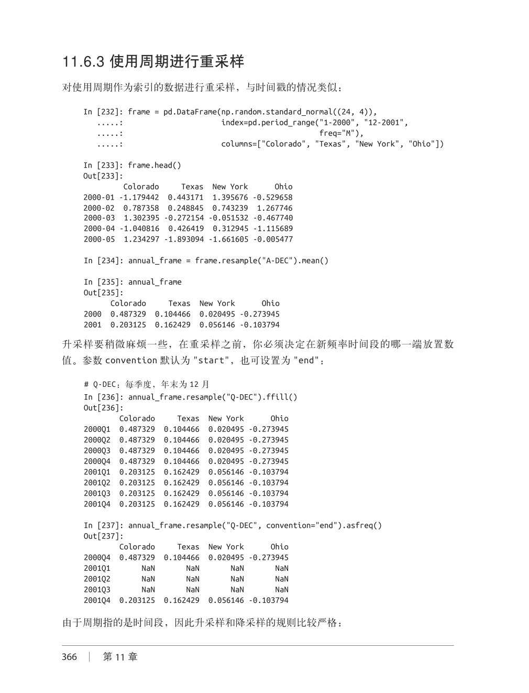

### 11.6.3 使用周期进行重采样

对使用周期作为索引的数据进行重采样，与时间戳的情况类似：

```python
frame = pd.DataFrame(np.random.standard_normal((24, 4)),
                     index=pd.period_range("1-2000", "12-2001", freq="M"),
                     columns=["Colorado", "Texas", "New York", "Ohio"])
frame.head()
```

原书输出（随机数为原书的一次结果）：

```text
         Colorado     Texas  New York      Ohio
2000-01 -1.179442  0.443171  1.395676 -0.529658
2000-02  0.787358  0.248845  0.743239  1.267746
2000-03  1.302395 -0.272154 -0.051532 -0.467740
2000-04 -1.040816  0.426419  0.312945 -1.115689
2000-05  1.234297 -1.893094 -1.661605 -0.005477
```

```python
annual_frame = frame.resample("A-DEC").mean()
annual_frame
```

原书输出：

```text
      Colorado     Texas  New York      Ohio
2000  0.487329  0.104466  0.020495 -0.273945
2001  0.203125  0.162429  0.056146 -0.103794
```

> 版本说明：上面的写法保留原书示例。实测 pandas 2.2.3 对 `A-DEC` 和直接对 `PeriodIndex` 重采样发出弃用警告；后者提示先转为 `DatetimeIndex`，转换时需要考虑周期的起点或终点。

升采样要稍微麻烦一些，在重采样之前，你必须决定在新频率时间段的哪一端放置数值。参数 `convention` 默认为 `"start"`，也可设置为 `"end"`：

```python
# Q-DEC: 每季度，年末为 12 月
annual_frame.resample("Q-DEC").ffill()
```

原书输出：

```text
        Colorado     Texas  New York      Ohio
2000Q1  0.487329  0.104466  0.020495 -0.273945
2000Q2  0.487329  0.104466  0.020495 -0.273945
2000Q3  0.487329  0.104466  0.020495 -0.273945
2000Q4  0.487329  0.104466  0.020495 -0.273945
2001Q1  0.203125  0.162429  0.056146 -0.103794
2001Q2  0.203125  0.162429  0.056146 -0.103794
2001Q3  0.203125  0.162429  0.056146 -0.103794
2001Q4  0.203125  0.162429  0.056146 -0.103794
```

```python
annual_frame.resample("Q-DEC", convention="end").asfreq()
```

原书输出：

```text
        Colorado     Texas  New York      Ohio
2000Q4  0.487329  0.104466  0.020495 -0.273945
2001Q1       NaN       NaN       NaN       NaN
2001Q2       NaN       NaN       NaN       NaN
2001Q3       NaN       NaN       NaN       NaN
2001Q4  0.203125  0.162429  0.056146 -0.103794
```

由于周期指的是时间段，因此升采样和降采样的规则比较严格：

## PDF 第 377 页

<!-- page-status: reviewed -->
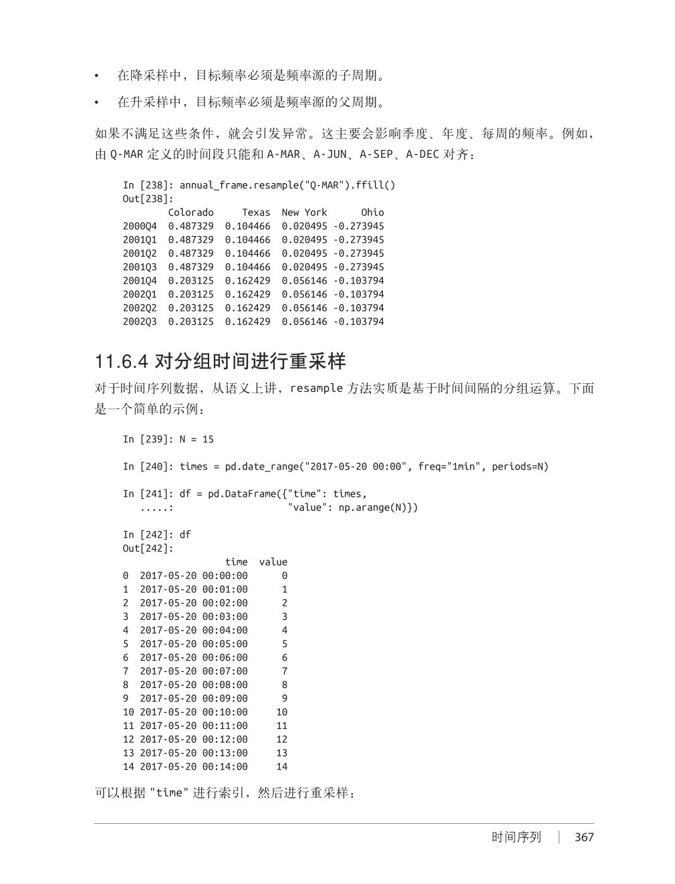

- 在降采样中，目标频率必须是频率源的子周期。
- 在升采样中，目标频率必须是频率源的父周期。

> 校对注：上述两条保留原书文字，但父、子周期方向似乎写反：例如按月数据降采样到年时，月是年的子周期；把年数据升采样到季度时，年是季度的父周期。实际兼容关系还应按具体频率和 pandas 版本验证。

如果不满足这些条件，就会引发异常。这主要会影响季度、年度、每周的频率。例如，由 `Q-MAR` 定义的时间段只能和 `A-MAR`、`A-JUN`、`A-SEP`、`A-DEC` 对齐：

```python
annual_frame.resample("Q-MAR").ffill()
```

原书输出：

```text
        Colorado     Texas  New York      Ohio
2000Q4  0.487329  0.104466  0.020495 -0.273945
2001Q1  0.487329  0.104466  0.020495 -0.273945
2001Q2  0.487329  0.104466  0.020495 -0.273945
2001Q3  0.487329  0.104466  0.020495 -0.273945
2001Q4  0.203125  0.162429  0.056146 -0.103794
2002Q1  0.203125  0.162429  0.056146 -0.103794
2002Q2  0.203125  0.162429  0.056146 -0.103794
2002Q3  0.203125  0.162429  0.056146 -0.103794
```

### 11.6.4 对分组时间进行重采样

对于时间序列数据，从语义上讲，`resample` 方法实质是基于时间间隔的分组运算。下面是一个简单的示例：

```python
N = 15
times = pd.date_range("2017-05-20 00:00", freq="1min", periods=N)
df = pd.DataFrame({"time": times, "value": np.arange(N)})
df
```

原书输出：

```text
                  time  value
0  2017-05-20 00:00:00      0
1  2017-05-20 00:01:00      1
2  2017-05-20 00:02:00      2
3  2017-05-20 00:03:00      3
4  2017-05-20 00:04:00      4
5  2017-05-20 00:05:00      5
6  2017-05-20 00:06:00      6
7  2017-05-20 00:07:00      7
8  2017-05-20 00:08:00      8
9  2017-05-20 00:09:00      9
10 2017-05-20 00:10:00     10
11 2017-05-20 00:11:00     11
12 2017-05-20 00:12:00     12
13 2017-05-20 00:13:00     13
14 2017-05-20 00:14:00     14
```

可以根据 `"time"` 进行索引，然后进行重采样：

## PDF 第 378 页

<!-- page-status: reviewed -->
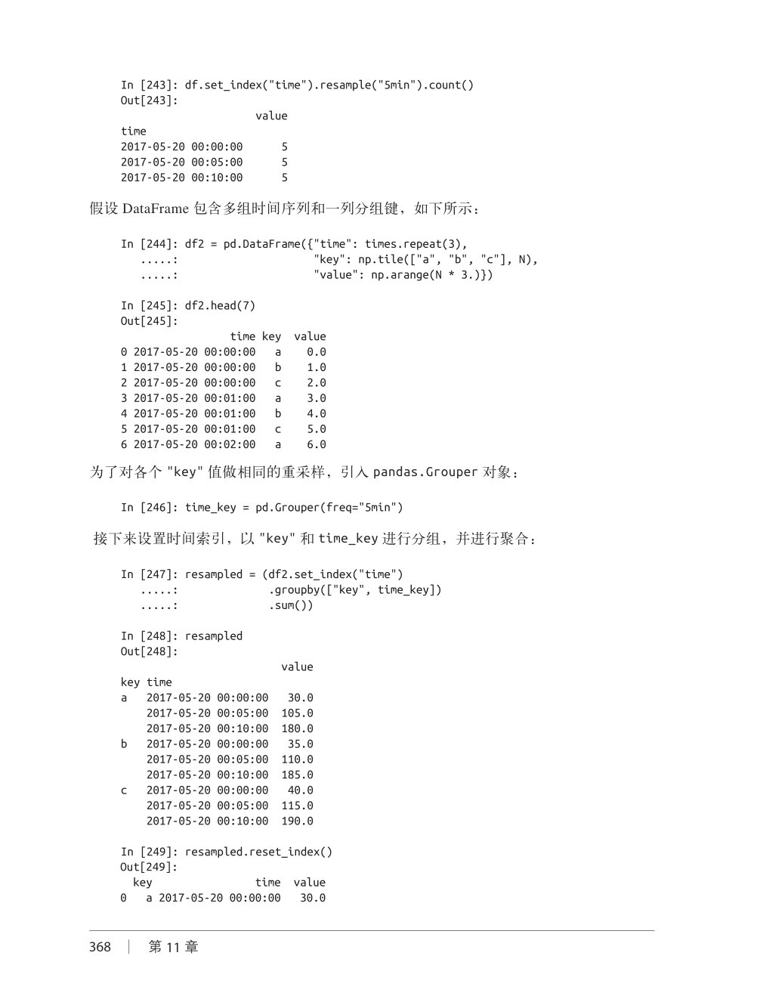

```python
df.set_index("time").resample("5min").count()
```

原书输出：

```text
                     value
time
2017-05-20 00:00:00      5
2017-05-20 00:05:00      5
2017-05-20 00:10:00      5
```

假设 DataFrame 包含多组时间序列和一列分组键，如下所示：

```python
df2 = pd.DataFrame({"time": times.repeat(3),
                    "key": np.tile(["a", "b", "c"], N),
                    "value": np.arange(N * 3.)})
df2.head(7)
```

原书输出：

```text
                 time key  value
0 2017-05-20 00:00:00   a    0.0
1 2017-05-20 00:00:00   b    1.0
2 2017-05-20 00:00:00   c    2.0
3 2017-05-20 00:01:00   a    3.0
4 2017-05-20 00:01:00   b    4.0
5 2017-05-20 00:01:00   c    5.0
6 2017-05-20 00:02:00   a    6.0
```

为了对各个 `"key"` 值做相同的重采样，引入 `pandas.Grouper` 对象：

```python
time_key = pd.Grouper(freq="5min")
```

接下来设置时间索引，以 `"key"` 和 `time_key` 进行分组，并进行聚合：

```python
resampled = (df2.set_index("time")
             .groupby(["key", time_key])
             .sum())
resampled
```

原书输出：

```text
                         value
key time
 a  2017-05-20 00:00:00   30.0
    2017-05-20 00:05:00  105.0
    2017-05-20 00:10:00  180.0
 b  2017-05-20 00:00:00   35.0
    2017-05-20 00:05:00  110.0
    2017-05-20 00:10:00  185.0
 c  2017-05-20 00:00:00   40.0
    2017-05-20 00:05:00  115.0
    2017-05-20 00:10:00  190.0
```

```python
resampled.reset_index()
```

原书输出第一行（续下一页）：

```text
  key                time  value
0   a 2017-05-20 00:00:00   30.0
```

## PDF 第 379 页

<!-- page-status: reviewed -->
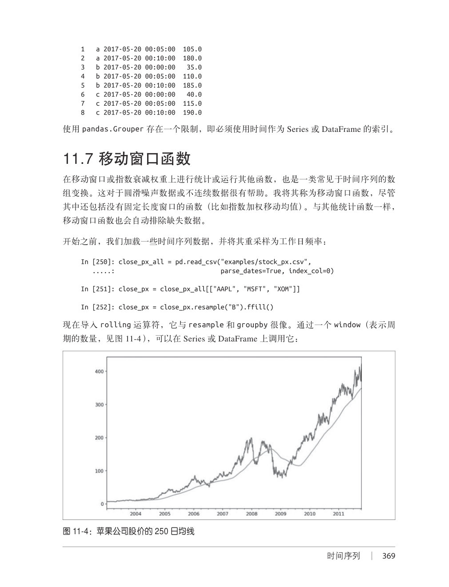

上一页输出续：

```text
1  a 2017-05-20 00:05:00  105.0
2  a 2017-05-20 00:10:00  180.0
3  b 2017-05-20 00:00:00   35.0
4  b 2017-05-20 00:05:00  110.0
5  b 2017-05-20 00:10:00  185.0
6  c 2017-05-20 00:00:00   40.0
7  c 2017-05-20 00:05:00  115.0
8  c 2017-05-20 00:10:00  190.0
```

使用 `pandas.Grouper` 存在一个限制，即必须使用时间作为 Series 或 DataFrame 的索引。

> 校对注：上句保留原书说法。实际也可用 `pd.Grouper(key="时间列名", freq="D")` 按 DataFrame 中的日期列分组，而不必先将该列设为索引；该用法已在 pandas 2.2.3 下验证。

### 11.7 移动窗口函数

在移动窗口或指数衰减权重上进行统计或运行其他函数，也是一类常见于时间序列的数组变换。这对于圆滑噪声数据或不连续数据很有帮助。我将其称为移动窗口函数，尽管其中还包括没有固定长度窗口的函数（比如指数加权移动均值）。与其他统计函数一样，移动窗口函数也会自动排除缺失数据。

开始之前，我们加载一些时间序列数据，并将其重采样为工作日频率：

```python
# In [250]–[252]
close_px_all = pd.read_csv("examples/stock_px.csv", parse_dates=True, index_col=0)
close_px = close_px_all[["AAPL", "MSFT", "XOM"]]
close_px = close_px.resample("B").ffill()
```

现在导入 `rolling` 运算符，它与 `resample` 和 `groupby` 很像。通过一个 `window`（表示周期的数量，见图 11-4），可以在 Series 或 DataFrame 上调用它：

**图 11-4：苹果公司股价的 250 日均线。** 图像见本页原页，绘图代码见下一页。

## PDF 第 380 页

<!-- page-status: reviewed -->
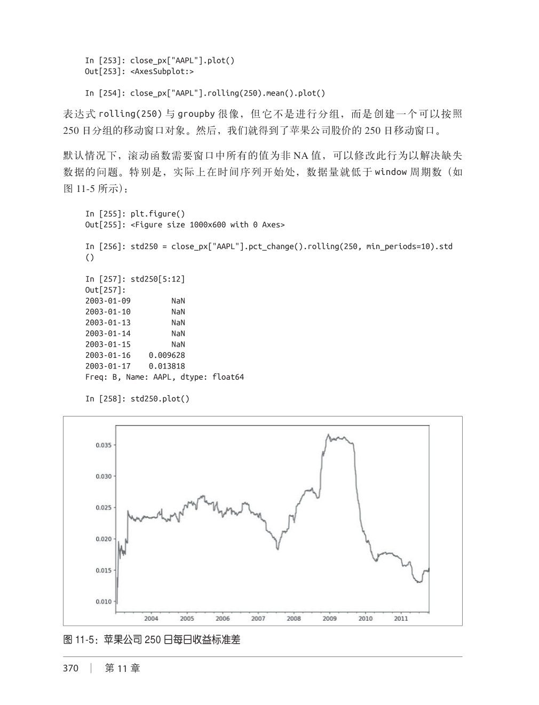

```python
# In [253]–[254]
close_px["AAPL"].plot()
close_px["AAPL"].rolling(250).mean().plot()
```

原书 `In [253]` 输出：`<AxesSubplot:>`。

表达式 `rolling(250)` 与 `groupby` 很像，但它不是进行分组，而是创建一个可以按照 250 日分组的移动窗口对象。然后，我们就得到了苹果公司股价的 250 日移动窗口。

默认情况下，滚动函数需要窗口中所有的值为非 NA 值，可以修改此行为以解决缺失数据的问题。特别是，实际上在时间序列开始处，数据量就低于 `window` 周期数（如图 11-5 所示）：

```python
# In [255]–[258]
plt.figure()
std250 = close_px["AAPL"].pct_change().rolling(250, min_periods=10).std()
std250[5:12]
```

原书输出：

```text
Out[255]: <Figure size 1000x600 with 0 Axes>
Out[257]:
2003-01-09         NaN
2003-01-10         NaN
2003-01-13         NaN
2003-01-14         NaN
2003-01-15         NaN
2003-01-16    0.009628
2003-01-17    0.013818
Freq: B, Name: AAPL, dtype: float64
```

```python
std250.plot()  # In [258]
```

**图 11-5：苹果公司 250 日每日收益标准差。** 图像见本页原页。

## PDF 第 381 页

<!-- page-status: reviewed -->
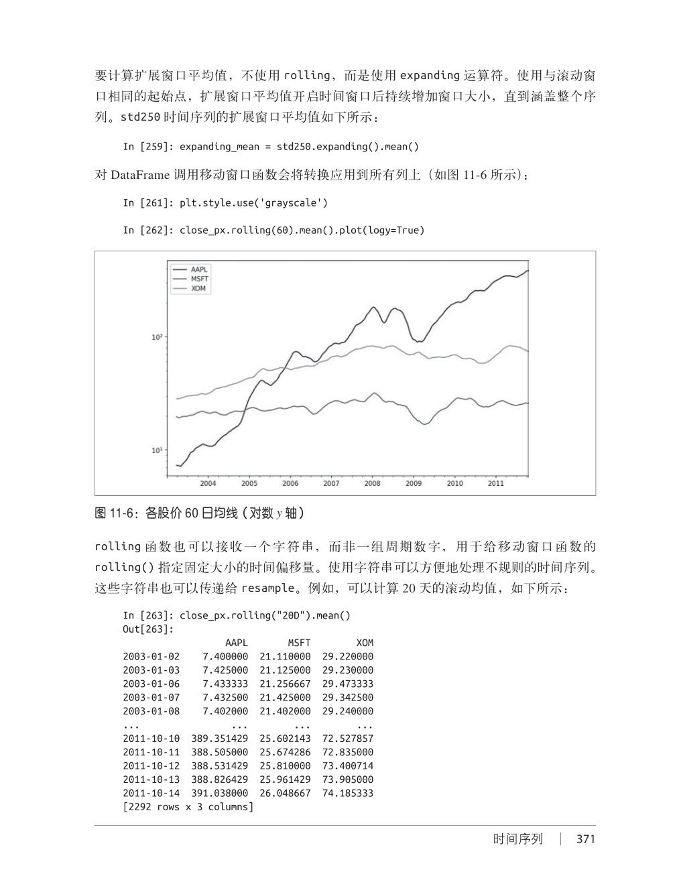

要计算扩展窗口平均值，不使用 `rolling`，而是使用 `expanding` 运算符。使用与滚动窗口相同的起始点，扩展窗口平均值开启时间窗口后持续增加窗口大小，直到涵盖整个序列。`std250` 时间序列的扩展窗口平均值如下所示：

```python
expanding_mean = std250.expanding().mean()  # In [259]
```

对 DataFrame 调用移动窗口函数会将转换应用到所有列上（如图 11-6 所示）：

```python
# In [261]–[262]
plt.style.use('grayscale')
close_px.rolling(60).mean().plot(logy=True)
```

**图 11-6：各股价 60 日均线（对数 y 轴）。** 图像见本页原页。

`rolling` 函数也可以接收一个字符串，而非一组周期数字，用于给移动窗口函数的 `rolling()` 指定固定大小的时间偏移量。使用字符串可以方便地处理不规则的时间序列。这些字符串也可以传递给 `resample`。例如，可以计算 20 天的滚动均值，如下所示：

```python
close_px.rolling("20D").mean()  # In [263]
```

原书输出：

```text
                  AAPL       MSFT        XOM
2003-01-02    7.400000  21.110000  29.220000
2003-01-03    7.425000  21.125000  29.230000
2003-01-06    7.433333  21.256667  29.473333
2003-01-07    7.432500  21.425000  29.342500
2003-01-08    7.402000  21.402000  29.240000
...                ...        ...        ...
2011-10-10  389.351429  25.602143  72.527857
2011-10-11  388.505000  25.674286  72.835000
2011-10-12  388.531429  25.810000  73.400714
2011-10-13  388.826429  25.961429  73.905000
2011-10-14  391.038000  26.048667  74.185333
[2292 rows x 3 columns]
```

## PDF 第 382 页

<!-- page-status: reviewed -->
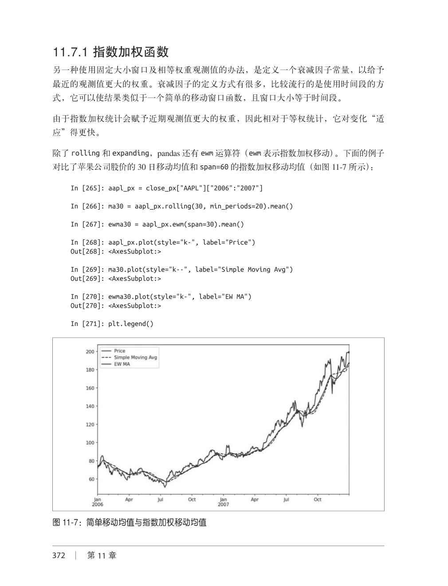

### 11.7.1 指数加权函数

另一种使用固定大小窗口及相等权重观测值的办法，是定义一个衰减因子常量，以给予最近的观测值更大的权重。衰减因子的定义方式有很多，比较流行的是使用时间段的方式，它可以使结果类似于一个简单的移动窗口函数，且窗口大小等于时间段。

由于指数加权统计会赋予近期观测值更大的权重，因此相对于等权统计，它对变化“适应”得更快。

除了 `rolling` 和 `expanding`，pandas 还有 `ewm` 运算符（ewm 表示指数加权移动）。下面的例子对比了苹果公司股价的 30 日移动均值和 span=60 的指数加权移动均值（如图 11-7 所示）：

```python
# In [265]–[271]
aapl_px = close_px["AAPL"]["2006":"2007"]
ma30 = aapl_px.rolling(30, min_periods=20).mean()
ewma30 = aapl_px.ewm(span=30).mean()
aapl_px.plot(style="k-", label="Price")
ma30.plot(style="k--", label="Simple Moving Avg")
ewma30.plot(style="k-", label="EW MA")
plt.legend()
```

原书 `In [268]`、`In [269]`、`In [270]` 的输出均为 `<AxesSubplot:>`。

> 校对注：原书正文写 `span=60`，而同页代码实际是 `span=30`；上述代码按原页保留，阅读时注意两者不一致。

**图 11-7：简单移动均值与指数加权移动均值。** 图像见本页原页。

## PDF 第 383 页

<!-- page-status: reviewed -->
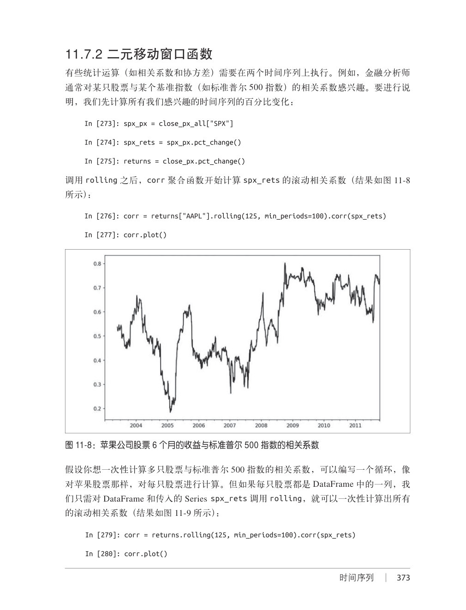

### 11.7.2 二元移动窗口函数

有些统计运算（如相关系数和协方差）需要在两个时间序列上执行。例如，金融分析师通常对某只股票与某个基准指数（如标准普尔 500 指数）的相关系数感兴趣。要进行说明，我们先计算所有我们感兴趣的时间序列的百分比变化：

```python
# In [273]–[275]
spx_px = close_px_all["SPX"]
spx_rets = spx_px.pct_change()
returns = close_px.pct_change()
```

调用 `rolling` 之后，`corr` 聚合函数开始计算 `spx_rets` 的滚动相关系数（结果如图 11-8 所示）：

```python
# In [276]–[277]
corr = returns["AAPL"].rolling(125, min_periods=100).corr(spx_rets)
corr.plot()
```

**图 11-8：苹果公司股票 6 个月的收益与标准普尔 500 指数的相关系数。** 图像见本页原页。

假设你想一次性计算多只股票与标准普尔 500 指数的相关系数，可以编写一个循环，像对苹果股票那样，对每只股票进行计算。但如果每只股票都是 DataFrame 中的一列，我们只需对 DataFrame 和传入的 Series `spx_rets` 调用 `rolling`，就可以一次性计算出所有的滚动相关系数（结果如图 11-9 所示）：

```python
# In [279]–[280]
corr = returns.rolling(125, min_periods=100).corr(spx_rets)
corr.plot()
```

## PDF 第 384 页

<!-- page-status: reviewed -->
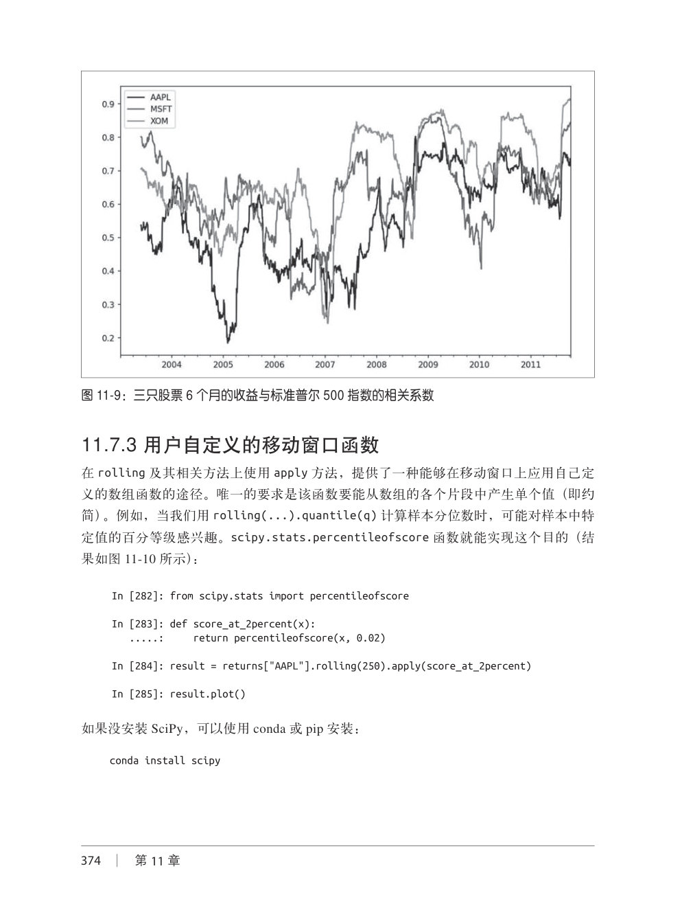

**图 11-9：三只股票 6 个月的收益与标准普尔 500 指数的相关系数。** 图像见本页原页。

### 11.7.3 用户自定义的移动窗口函数

在 `rolling` 及其相关方法上使用 `apply` 方法，提供了一种能够在移动窗口上应用自己定义的数组函数的途径。唯一的要求是该函数要能从数组的各个片段中产生单个值（即约简）。例如，当我们用 `rolling(...).quantile(q)` 计算样本分位数时，可能对样本中特定值的百分等级感兴趣。`scipy.stats.percentileofscore` 函数就能实现这个目的（结果如图 11-10 所示）：

```python
# In [282]–[285]
from scipy.stats import percentileofscore

def score_at_2percent(x):
    return percentileofscore(x, 0.02)

result = returns["AAPL"].rolling(250).apply(score_at_2percent)
result.plot()
```

如果没安装 SciPy，可以使用 conda 或 pip 安装：

```bash
conda install scipy
```

## PDF 第 385 页

<!-- page-status: reviewed -->
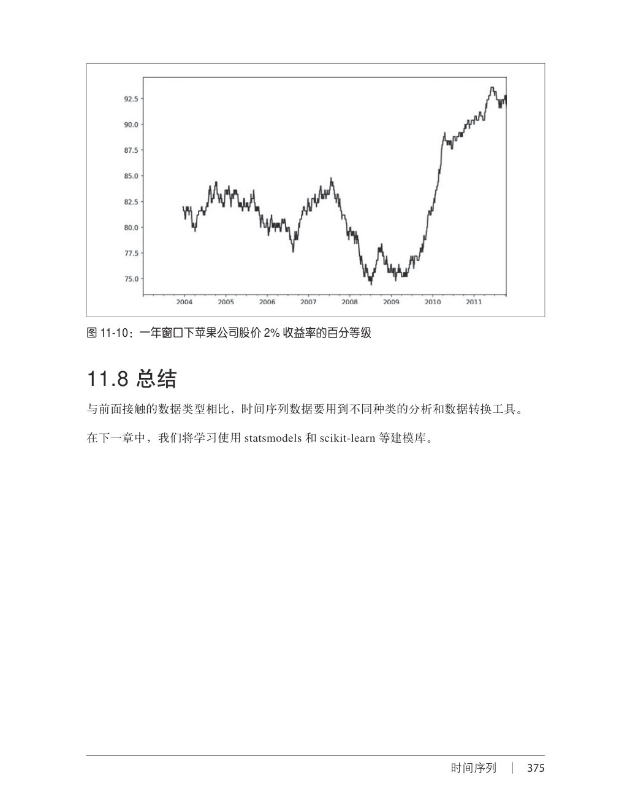

**图 11-10：一年窗口下苹果公司股价 2% 收益率的百分等级。** 图像见本页原页。

### 11.8 总结

与前面接触的数据类型相比，时间序列数据要用到不同种类的分析和数据转换工具。

在下一章中，我们将学习使用 statsmodels 和 scikit-learn 等建模库。

