# 第 12 章 Python 建模库介绍

[返回目录](../README.md)

> 本章各页已由 AI 对照原页整理，页面图像保留供复核。校对标记不表示所有示例都已运行；涉及 Patsy、statsmodels、scikit-learn 与配套数据的示例尚未复现。

## PDF 第 386 页

<!-- page-status: reviewed -->
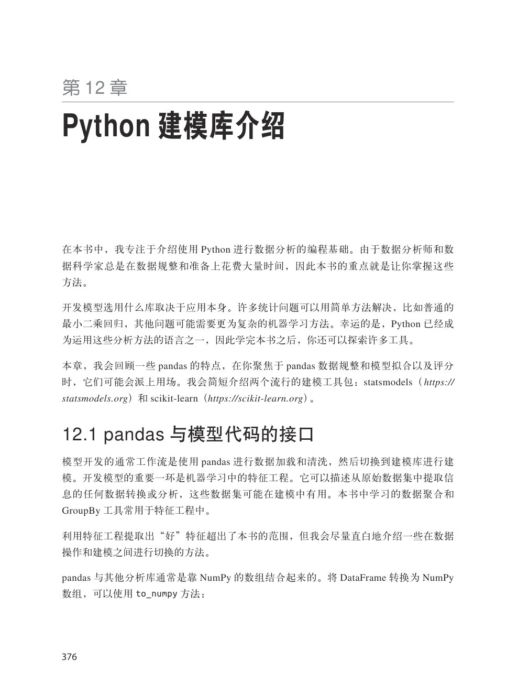

# 第 12 章 Python 建模库介绍

在本书中，我专注于介绍使用 Python 进行数据分析的编程基础。由于数据分析师和数据科学家总是在数据规整和准备上花费大量时间，因此本书的重点就是让你掌握这些方法。

开发模型选用什么库取决于应用本身。许多统计问题可以用简单方法解决，比如普通的最小二乘回归，其他问题可能需要更为复杂的机器学习方法。幸运的是，Python 已经成为运用这些分析方法的语言之一，因此学完本书之后，你还可以探索许多工具。

本章，我会回顾一些 pandas 的特点，在你聚焦于 pandas 数据规整和模型拟合以及评分时，它们可能会派上用场。我会简短介绍两个流行的建模工具包：statsmodels（https://statsmodels.org）和 scikit-learn（https://scikit-learn.org）。

### 12.1 pandas 与模型代码的接口

模型开发的通常工作流是使用 pandas 进行数据加载和清洗，然后切换到建模库进行建模。开发模型的重要一环是机器学习中的特征工程。它可以描述从原始数据集中提取信息的任何数据转换或分析，这些数据集可能在建模中有用。本书中学习的数据聚合和 GroupBy 工具常用于特征工程中。

利用特征工程提取出“好”特征超出了本书的范围，但我会尽量直白地介绍一些在数据操作和建模之间进行切换的方法。

pandas 与其他分析库通常是靠 NumPy 的数组结合起来的。将 DataFrame 转换为 NumPy 数组，可以使用 `to_numpy` 方法：

## PDF 第 387 页

<!-- page-status: reviewed -->
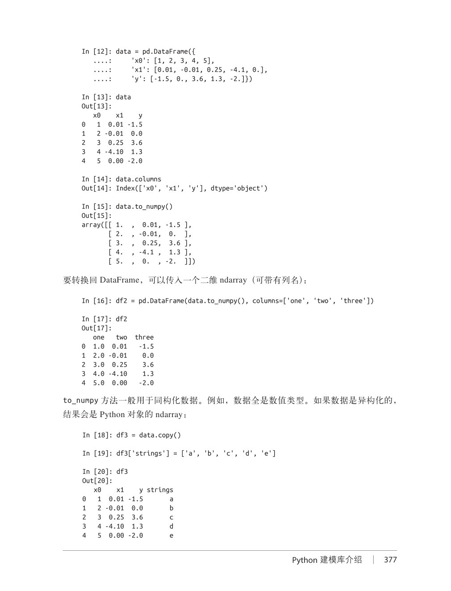

```python
data = pd.DataFrame({
    'x0': [1, 2, 3, 4, 5],
    'x1': [0.01, -0.01, 0.25, -4.1, 0.],
    'y': [-1.5, 0., 3.6, 1.3, -2.]})
data
```

原书输出：

```text
   x0    x1    y
0   1  0.01 -1.5
1   2 -0.01  0.0
2   3  0.25  3.6
3   4 -4.10  1.3
4   5  0.00 -2.0
```

```python
data.columns
```

原书输出：`Index(['x0', 'x1', 'y'], dtype='object')`。

```python
data.to_numpy()
```

原书输出：

```text
array([[ 1.  ,  0.01, -1.5 ],
       [ 2.  , -0.01,  0.  ],
       [ 3.  ,  0.25,  3.6 ],
       [ 4.  , -4.1 ,  1.3 ],
       [ 5.  ,  0.  , -2.  ]])
```

要转换回 DataFrame，可以传入一个二维 ndarray（可带有列名）：

```python
df2 = pd.DataFrame(data.to_numpy(), columns=['one', 'two', 'three'])
df2
```

原书输出：

```text
   one   two  three
0  1.0  0.01   -1.5
1  2.0 -0.01    0.0
2  3.0  0.25    3.6
3  4.0 -4.10    1.3
4  5.0  0.00   -2.0
```

`to_numpy` 方法一般用于同构化数据。例如，数据全是数值类型。如果数据是异构化的，结果会是 Python 对象的 ndarray：

```python
df3 = data.copy()
df3['strings'] = ['a', 'b', 'c', 'd', 'e']
df3
```

原书输出：

```text
   x0    x1    y strings
0   1  0.01 -1.5       a
1   2 -0.01  0.0       b
2   3  0.25  3.6       c
3   4 -4.10  1.3       d
4   5  0.00 -2.0       e
```

## PDF 第 388 页

<!-- page-status: reviewed -->
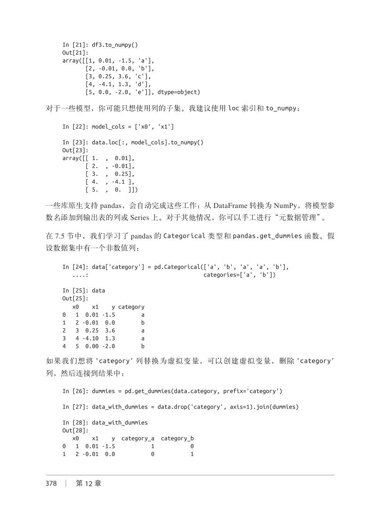

```python
df3.to_numpy()
```

原书输出：

```text
array([[1, 0.01, -1.5, 'a'],
       [2, -0.01, 0.0, 'b'],
       [3, 0.25, 3.6, 'c'],
       [4, -4.1, 1.3, 'd'],
       [5, 0.0, -2.0, 'e']], dtype=object)
```

对于一些模型，你可能只想使用列的子集。我建议使用 `loc` 索引和 `to_numpy`：

```python
model_cols = ['x0', 'x1']
data.loc[:, model_cols].to_numpy()
```

原书输出：

```text
array([[ 1.  ,  0.01],
       [ 2.  , -0.01],
       [ 3.  ,  0.25],
       [ 4.  , -4.1 ],
       [ 5.  ,  0.  ]])
```

一些库原生支持 pandas，会自动完成这些工作：从 DataFrame 转换为 NumPy，将模型参数名添加到输出表的列或 Series 上。对于其他情况，你可以手工进行“元数据管理”。

在 7.5 节中，我们学习了 pandas 的 Categorical 类型和 `pandas.get_dummies` 函数。假设数据集中有一个非数值列：

```python
data['category'] = pd.Categorical(['a', 'b', 'a', 'a', 'b'],
                                  categories=['a', 'b'])
data
```

原书输出：

```text
   x0    x1    y category
0   1  0.01 -1.5        a
1   2 -0.01  0.0        b
2   3  0.25  3.6        a
3   4 -4.10  1.3        a
4   5  0.00 -2.0        b
```

如果我们想将 `'category'` 列替换为虚拟变量，可以创建虚拟变量，删除 `'category'` 列，然后连接到结果中：

```python
dummies = pd.get_dummies(data.category, prefix='category')
data_with_dummies = data.drop('category', axis=1).join(dummies)
data_with_dummies
```

原书输出前两行（余下续下一页）：

```text
   x0    x1    y  category_a  category_b
0   1  0.01 -1.5           1           0
1   2 -0.01  0.0           0           1
```

> 版本说明：本机 pandas 2.2.3 的 `get_dummies` 默认生成布尔值，而原书展示 0 和 1；需要数值输出可显式传入 `dtype=int`。

## PDF 第 389 页

<!-- page-status: reviewed -->
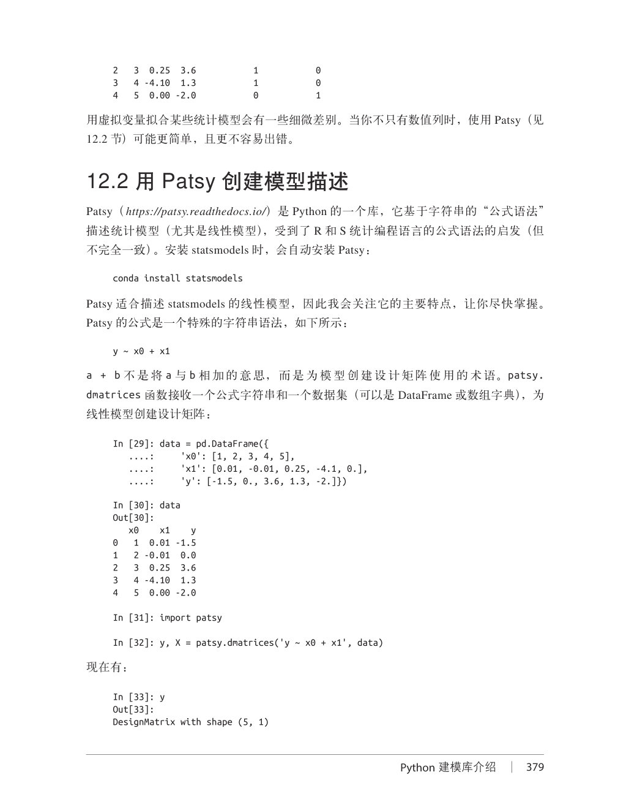

上一页 `data_with_dummies` 输出续：

```text
   x0    x1    y  category_a  category_b
2   3  0.25  3.6           1           0
3   4 -4.10  1.3           1           0
4   5  0.00 -2.0           0           1
```

用虚拟变量拟合某些统计模型会有一些细微差别。当你不只有数值列时，使用 Patsy（见 12.2 节）可能更简单，且更不容易出错。

### 12.2 用 Patsy 创建模型描述

Patsy（https://patsy.readthedocs.io/）是 Python 的一个库，它基于字符串的“公式语法”描述统计模型（尤其是线性模型），受到了 R 和 S 统计编程语言的公式语法的启发（但不完全一致）。安装 statsmodels 时，会自动安装 Patsy：

```sh
conda install statsmodels
```

Patsy 适合描述 statsmodels 的线性模型，因此我会关注它的主要特点，让你尽快掌握。Patsy 的公式是一个特殊的字符串语法，如下所示：

```text
y ~ x0 + x1
```

`a + b` 不是将 `a` 与 `b` 相加的意思，而是为模型创建设计矩阵使用的术语。`patsy.dmatrices` 函数接收一个公式字符串和一个数据集（可以是 DataFrame 或数组字典），为线性模型创建设计矩阵：

```python
data = pd.DataFrame({
    'x0': [1, 2, 3, 4, 5],
    'x1': [0.01, -0.01, 0.25, -4.1, 0.],
    'y': [-1.5, 0., 3.6, 1.3, -2.]})
data
```

原书输出：

```text
   x0    x1    y
0   1  0.01 -1.5
1   2 -0.01  0.0
2   3  0.25  3.6
3   4 -4.10  1.3
4   5  0.00 -2.0
```

```python
import patsy
y, X = patsy.dmatrices('y ~ x0 + x1', data)
```

现在有：

```python
y
```

原书输出从此处开始，续下一页：

```text
DesignMatrix with shape (5, 1)
```

## PDF 第 390 页

<!-- page-status: reviewed -->
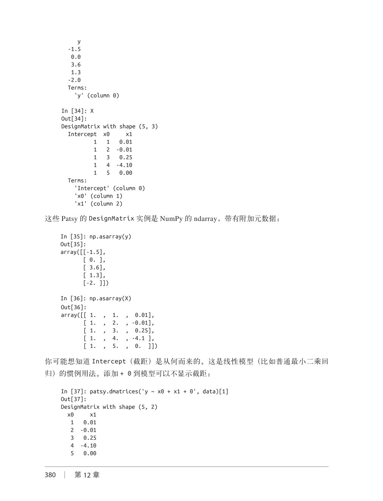

上一页 `y` 的输出续：

```text
       y
    -1.5
     0.0
     3.6
     1.3
    -2.0
Terms:
    'y' (column 0)
```

```python
X
```

原书输出：

```text
DesignMatrix with shape (5, 3)
  Intercept  x0     x1
          1   1   0.01
          1   2  -0.01
          1   3   0.25
          1   4  -4.10
          1   5   0.00
  Terms:
    'Intercept' (column 0)
    'x0' (column 1)
    'x1' (column 2)
```

这些 Patsy 的 `DesignMatrix` 实例是 NumPy 的 ndarray，带有附加元数据：

```python
np.asarray(y)
```

原书输出：

```text
array([[-1.5],
       [ 0. ],
       [ 3.6],
       [ 1.3],
       [-2. ]])
```

```python
np.asarray(X)
```

原书输出：

```text
array([[ 1.  ,  1.  ,  0.01],
       [ 1.  ,  2.  , -0.01],
       [ 1.  ,  3.  ,  0.25],
       [ 1.  ,  4.  , -4.1 ],
       [ 1.  ,  5.  ,  0.  ]])
```

你可能想知道 `Intercept`（截距）是从何而来的。这是线性模型（比如普通最小二乘回归）的惯例用法。添加 `+ 0` 到模型可以不显示截距：

```python
patsy.dmatrices('y ~ x0 + x1 + 0', data)[1]
```

原书输出（`Terms` 部分续下一页）：

```text
DesignMatrix with shape (5, 2)
  x0     x1
   1   0.01
   2  -0.01
   3   0.25
   4  -4.10
   5   0.00
```

## PDF 第 391 页

<!-- page-status: reviewed -->
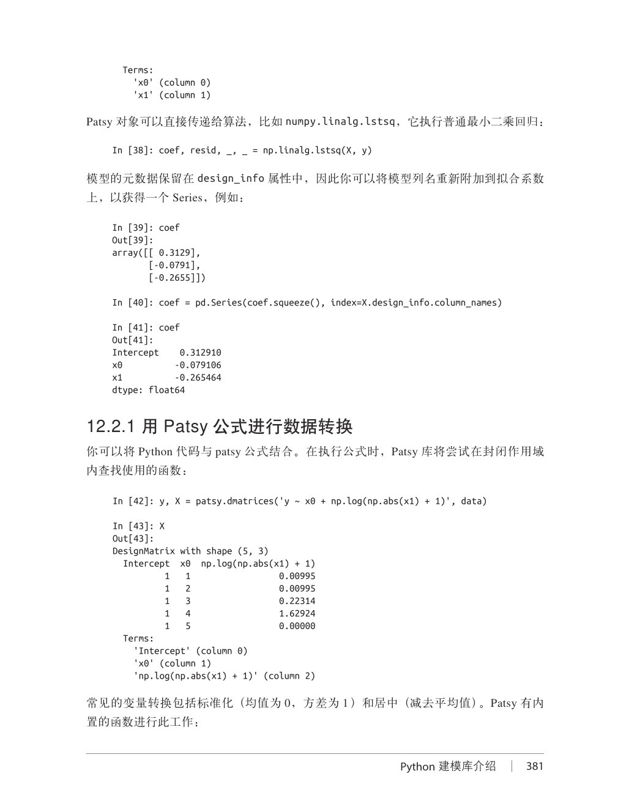

上一页设计矩阵输出续：

```text
  Terms:
    'x0' (column 0)
    'x1' (column 1)
```

Patsy 对象可以直接传递给算法，比如 `numpy.linalg.lstsq`，它执行普通最小二乘回归：

```python
coef, resid, _, _ = np.linalg.lstsq(X, y)
```

模型的元数据保留在 `design_info` 属性中，因此你可以将模型列名重新附加到拟合系数上，以获得一个 Series，例如：

```python
coef
```

原书输出：

```text
array([[ 0.3129],
       [-0.0791],
       [-0.2655]])
```

```python
coef = pd.Series(coef.squeeze(), index=X.design_info.column_names)
coef
```

原书输出：

```text
Intercept    0.312910
x0          -0.079106
x1          -0.265464
dtype: float64
```

### 12.2.1 用 Patsy 公式进行数据转换

你可以将 Python 代码与 patsy 公式结合。在执行公式时，Patsy 库将尝试在封闭作用域内查找使用的函数：

```python
y, X = patsy.dmatrices('y ~ x0 + np.log(np.abs(x1) + 1)', data)
X
```

原书输出：

```text
DesignMatrix with shape (5, 3)
  Intercept  x0  np.log(np.abs(x1) + 1)
          1   1                  0.00995
          1   2                  0.00995
          1   3                  0.22314
          1   4                  1.62924
          1   5                  0.00000
  Terms:
    'Intercept' (column 0)
    'x0' (column 1)
    'np.log(np.abs(x1) + 1)' (column 2)
```

常见的变量转换包括标准化（均值为 0，方差为 1）和居中（减去平均值）。Patsy 有内置的函数进行此工作：

## PDF 第 392 页

<!-- page-status: reviewed -->
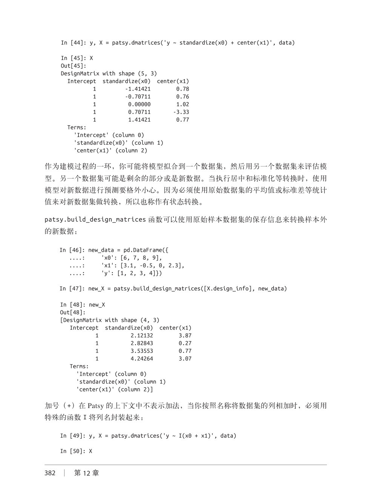

```python
# In [44]–[45]
y, X = patsy.dmatrices('y ~ standardize(x0) + center(x1)', data)
X
```

原书输出：

```text
DesignMatrix with shape (5, 3)
  Intercept  standardize(x0)  center(x1)
          1          -1.41421        0.78
          1          -0.70711        0.76
          1           0.00000        1.02
          1           0.70711       -3.33
          1           1.41421        0.77
  Terms:
    'Intercept' (column 0)
    'standardize(x0)' (column 1)
    'center(x1)' (column 2)
```

作为建模过程的一环，你可能将模型拟合到一个数据集，然后用另一个数据集来评估模型。另一个数据集可能是剩余的部分或是新数据。当执行居中和标准化等转换时，使用模型对新数据进行预测要格外小心。因为必须使用原始数据集的平均值或标准差等统计值来对新数据集做转换，所以也称作有状态转换。

`patsy.build_design_matrices` 函数可以使用原始样本数据集的保存信息来转换样本外的新数据：

```python
# In [46]–[48]
new_data = pd.DataFrame({
    'x0': [6, 7, 8, 9],
    'x1': [3.1, -0.5, 0, 2.3],
    'y': [1, 2, 3, 4]})
new_X = patsy.build_design_matrices([X.design_info], new_data)
new_X
```

原书输出：

```text
[DesignMatrix with shape (4, 3)
  Intercept  standardize(x0)  center(x1)
          1           2.12132         3.87
          1           2.82843         0.27
          1           3.53553         0.77
          1           4.24264         3.07
  Terms:
    'Intercept' (column 0)
    'standardize(x0)' (column 1)
    'center(x1)' (column 2)]
```

加号（`+`）在 Patsy 的上下文中不表示加法，当你按照名称将数据集的列相加时，必须用特殊的函数 `I` 将列名封装起来：

```python
# In [49]–[50]
y, X = patsy.dmatrices('y ~ I(x0 + x1)', data)
X
```

输出续下一页。

## PDF 第 393 页

<!-- page-status: reviewed -->
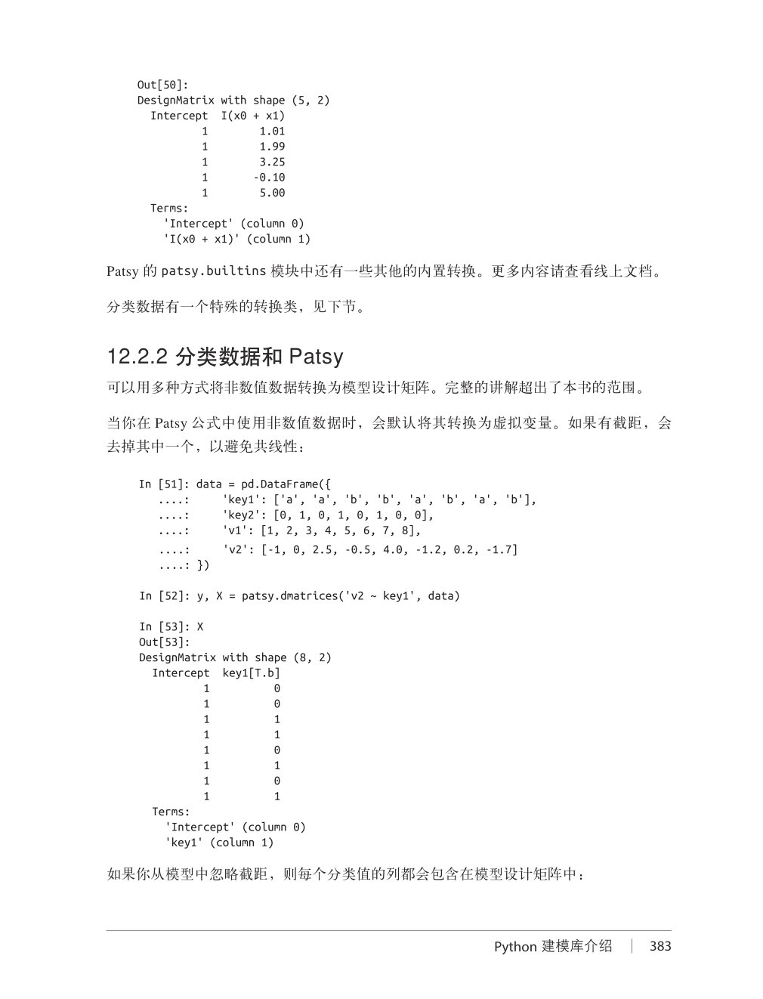

```text
Out[50]:
DesignMatrix with shape (5, 2)
  Intercept  I(x0 + x1)
          1        1.01
          1        1.99
          1        3.25
          1       -0.10
          1        5.00
  Terms:
    'Intercept' (column 0)
    'I(x0 + x1)' (column 1)
```

Patsy 的 `patsy.builtins` 模块中还有一些其他的内置转换。更多内容请查看线上文档。

分类数据有一个特殊的转换类，见下节。

### 12.2.2 分类数据和 Patsy

可以用多种方式将非数值数据转换为模型设计矩阵。完整的讲解超出了本书的范围。

当你在 Patsy 公式中使用非数值数据时，会默认将其转换为虚拟变量。如果有截距，会去掉其中一个，以避免共线性：

```python
# In [51]–[53]
data = pd.DataFrame({
    'key1': ['a', 'a', 'b', 'b', 'a', 'b', 'a', 'b'],
    'key2': [0, 1, 0, 1, 0, 1, 0, 0],
    'v1': [1, 2, 3, 4, 5, 6, 7, 8],
    'v2': [-1, 0, 2.5, -0.5, 4.0, -1.2, 0.2, -1.7]})
y, X = patsy.dmatrices('v2 ~ key1', data)
X
```

原书输出：

```text
DesignMatrix with shape (8, 2)
  Intercept  key1[T.b]
          1          0
          1          0
          1          1
          1          1
          1          0
          1          1
          1          0
          1          1
  Terms:
    'Intercept' (column 0)
    'key1' (column 1)
```

如果你从模型中忽略截距，则每个分类值的列都会包含在模型设计矩阵中：

## PDF 第 394 页

<!-- page-status: reviewed -->
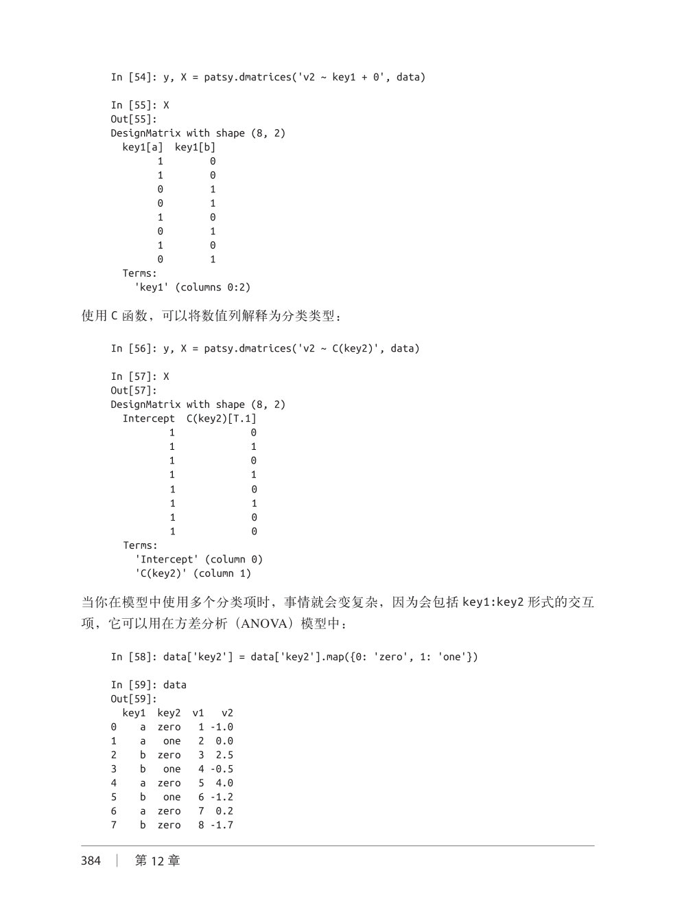

```python
# In [54]–[55]
y, X = patsy.dmatrices('v2 ~ key1 + 0', data)
X
```

原书输出：

```text
DesignMatrix with shape (8, 2)
  key1[a]  key1[b]
        1        0
        1        0
        0        1
        0        1
        1        0
        0        1
        1        0
        0        1
  Terms:
    'key1' (columns 0:2)
```

使用 `C` 函数，可以将数值列解释为分类类型：

```python
# In [56]–[57]
y, X = patsy.dmatrices('v2 ~ C(key2)', data)
X
```

原书输出：

```text
DesignMatrix with shape (8, 2)
  Intercept  C(key2)[T.1]
          1             0
          1             1
          1             0
          1             1
          1             0
          1             1
          1             0
          1             0
  Terms:
    'Intercept' (column 0)
    'C(key2)' (column 1)
```

当你在模型中使用多个分类项时，事情就会变复杂，因为会包括 `key1:key2` 形式的交互项，它可以用在方差分析（ANOVA）模型中：

```python
# In [58]–[59]
data['key2'] = data['key2'].map({0: 'zero', 1: 'one'})
data
```

原书输出：

```text
  key1  key2  v1   v2
0    a  zero   1 -1.0
1    a   one   2  0.0
2    b  zero   3  2.5
3    b   one   4 -0.5
4    a  zero   5  4.0
5    b   one   6 -1.2
6    a  zero   7  0.2
7    b  zero   8 -1.7
```

## PDF 第 395 页

<!-- page-status: reviewed -->
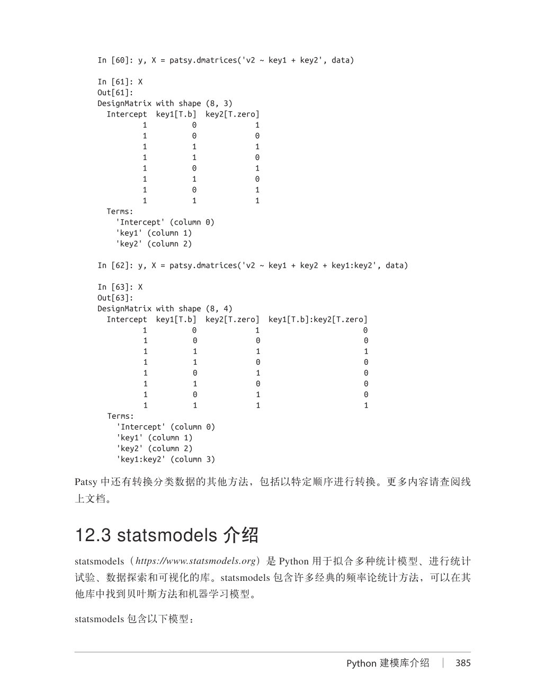

```python
# In [60]–[61]
y, X = patsy.dmatrices('v2 ~ key1 + key2', data)
X
```

原书输出：

```text
DesignMatrix with shape (8, 3)
  Intercept  key1[T.b]  key2[T.zero]
          1          0             1
          1          0             0
          1          1             1
          1          1             0
          1          0             1
          1          1             0
          1          0             1
          1          1             1
  Terms:
    'Intercept' (column 0)
    'key1' (column 1)
    'key2' (column 2)
```

```python
# In [62]–[63]
y, X = patsy.dmatrices('v2 ~ key1 + key2 + key1:key2', data)
X
```

原书输出：

```text
DesignMatrix with shape (8, 4)
  Intercept  key1[T.b]  key2[T.zero]  key1[T.b]:key2[T.zero]
          1          0             1                      0
          1          0             0                      0
          1          1             1                      1
          1          1             0                      0
          1          0             1                      0
          1          1             0                      0
          1          0             1                      0
          1          1             1                      1
  Terms:
    'Intercept' (column 0)
    'key1' (column 1)
    'key2' (column 2)
    'key1:key2' (column 3)
```

Patsy 中还有转换分类数据的其他方法，包括以特定顺序进行转换。更多内容请查阅线上文档。

### 12.3 statsmodels 介绍

statsmodels（https://www.statsmodels.org）是 Python 用于拟合多种统计模型、进行统计试验、数据探索和可视化的库。statsmodels 包含许多经典的频率论统计方法，可以在其他库中找到贝叶斯方法和机器学习模型。

statsmodels 包含以下模型（续下一页）：

## PDF 第 396 页

<!-- page-status: reviewed -->
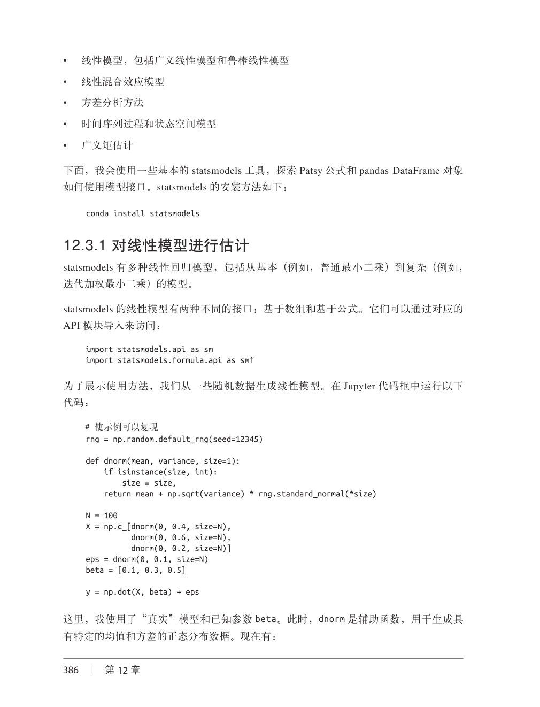

- 线性模型，包括广义线性模型和鲁棒线性模型
- 线性混合效应模型
- 方差分析方法
- 时间序列过程和状态空间模型
- 广义矩估计

下面，我会使用一些基本的 statsmodels 工具，探索 Patsy 公式和 pandas DataFrame 对象如何使用模型接口。statsmodels 的安装方法如下：

```bash
conda install statsmodels
```

### 12.3.1 对线性模型进行估计

statsmodels 有多种线性回归模型，包括从基本（例如，普通最小二乘）到复杂（例如，迭代加权最小二乘）的模型。

statsmodels 的线性模型有两种不同的接口：基于数组和基于公式。它们可以通过对应的 API 模块导入来访问：

```python
import statsmodels.api as sm
import statsmodels.formula.api as smf
```

为了展示使用方法，我们从一些随机数据生成线性模型。在 Jupyter 代码框中运行以下代码：

```python
# 使示例可以复现
rng = np.random.default_rng(seed=12345)

def dnorm(mean, variance, size=1):
    if isinstance(size, int):
        size = size,
    return mean + np.sqrt(variance) * rng.standard_normal(*size)

N = 100
X = np.c_[dnorm(0, 0.4, size=N),
          dnorm(0, 0.6, size=N),
          dnorm(0, 0.2, size=N)]
eps = dnorm(0, 0.1, size=N)
beta = [0.1, 0.3, 0.5]
y = np.dot(X, beta) + eps
```

这里，我使用了“真实”模型和已知参数 `beta`。此时，`dnorm` 是辅助函数，用于生成具有特定的均值和方差的正态分布数据。现在有：

## PDF 第 397 页

<!-- page-status: reviewed -->
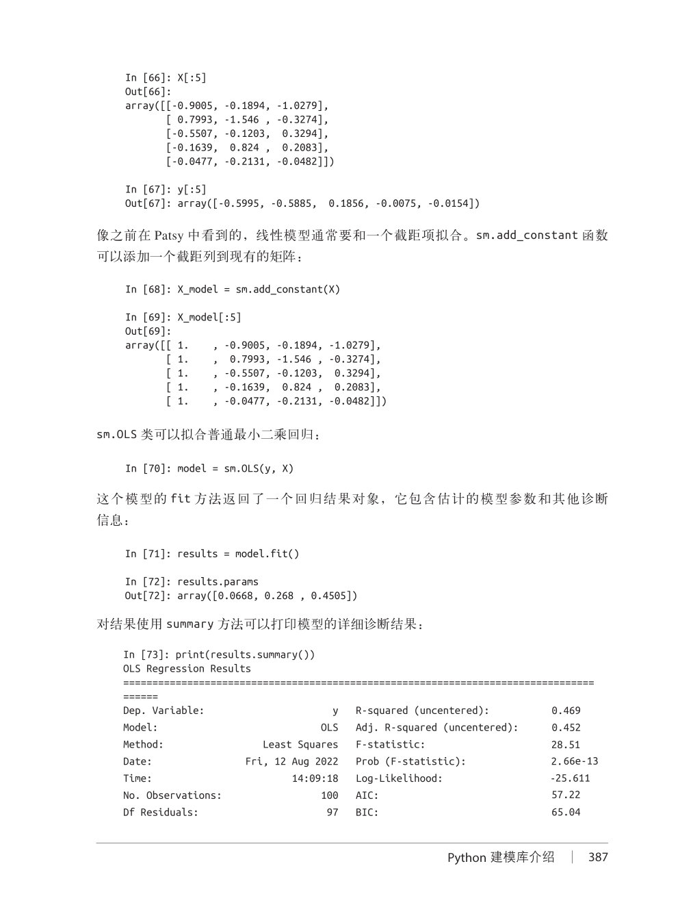

```python
# In [66]–[67]
X[:5]
y[:5]
```

原书输出：

```text
Out[66]:
array([[-0.9005, -0.1894, -1.0279],
       [ 0.7993, -1.546 , -0.3274],
       [-0.5507, -0.1203,  0.3294],
       [-0.1639,  0.824 ,  0.2083],
       [-0.0477, -0.2131, -0.0482]])
Out[67]: array([-0.5995, -0.5885,  0.1856, -0.0075, -0.0154])
```

像之前在 Patsy 中看到的，线性模型通常要和一个截距项拟合。`sm.add_constant` 函数可以添加一个截距列到现有的矩阵：

```python
# In [68]–[69]
X_model = sm.add_constant(X)
X_model[:5]
```

原书输出：

```text
array([[ 1.    , -0.9005, -0.1894, -1.0279],
       [ 1.    ,  0.7993, -1.546 , -0.3274],
       [ 1.    , -0.5507, -0.1203,  0.3294],
       [ 1.    , -0.1639,  0.824 ,  0.2083],
       [ 1.    , -0.0477, -0.2131, -0.0482]])
```

`sm.OLS` 类可以拟合普通最小二乘回归：

```python
model = sm.OLS(y, X)  # In [70]
```

> 校对注：这里忠实保留原书的 `X`。尽管上面新建了含截距列的 `X_model`，此处实际传入的是原始 `X`，因此该模型没有使用新加的截距列；若要拟合截距，需使用 `sm.OLS(y, X_model)`。

这个模型的 `fit` 方法返回了一个回归结果对象，它包含估计的模型参数和其他诊断信息：

```python
# In [71]–[72]
results = model.fit()
results.params
```

原书输出：

```text
array([0.0668, 0.268 , 0.4505])
```

对结果使用 `summary` 方法可以打印模型的详细诊断结果：

```python
print(results.summary())  # In [73]
```

原书输出跨页，本页部分：

```text
                            OLS Regression Results
==============================================================================
Dep. Variable:                      y   R-squared (uncentered):                   0.469
Model:                            OLS   Adj. R-squared (uncentered):              0.452
Method:                 Least Squares   F-statistic:                              28.51
Date:                Fri, 12 Aug 2022   Prob (F-statistic):                    2.66e-13
Time:                        14:09:18   Log-Likelihood:                         -25.611
No. Observations:                 100   AIC:                                      57.22
Df Residuals:                      97   BIC:                                      65.04
```

## PDF 第 398 页

<!-- page-status: reviewed -->
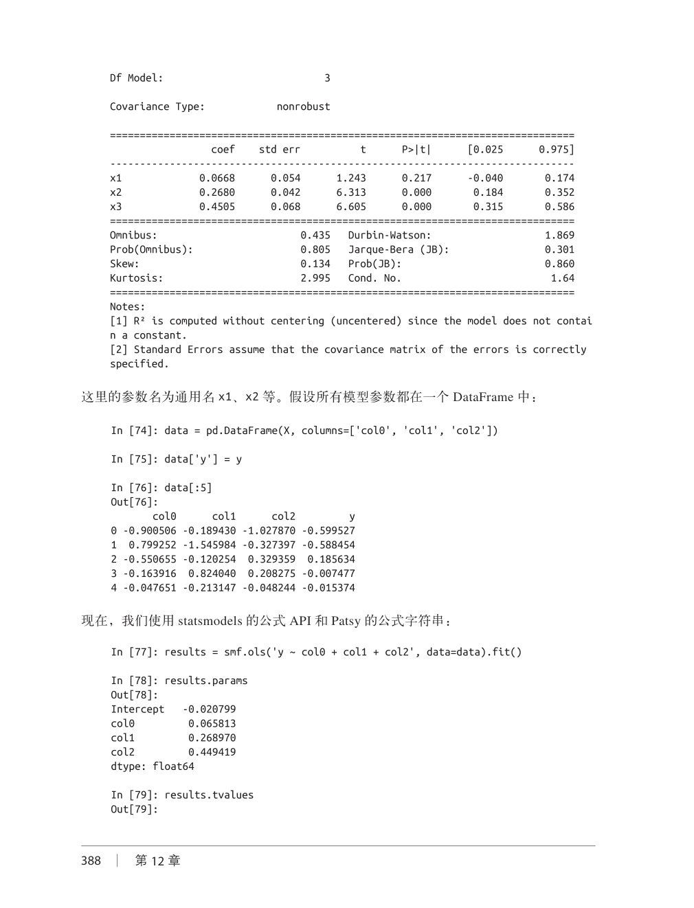

上页线性回归结果输出续：

```text
Df Model:                           3
Covariance Type:            nonrobust
==============================================================================
                 coef    std err          t      P>|t|      [0.025      0.975]
------------------------------------------------------------------------------
x1             0.0668      0.054      1.243      0.217      -0.040       0.174
x2             0.2680      0.042      6.313      0.000       0.184       0.352
x3             0.4505      0.068      6.605      0.000       0.315       0.586
==============================================================================
Omnibus:                        0.435   Durbin-Watson:                   1.869
Prob(Omnibus):                  0.805   Jarque-Bera (JB):                0.301
Skew:                           0.134   Prob(JB):                        0.860
Kurtosis:                       2.995   Cond. No.                         1.64
==============================================================================
Notes:
[1] R² is computed without centering (uncentered) since the model does not contain a constant.
[2] Standard Errors assume that the covariance matrix of the errors is correctly specified.
```

这里的参数名为通用名 `x1`、`x2` 等。假设所有模型参数都在一个 DataFrame 中：

```python
data = pd.DataFrame(X, columns=['col0', 'col1', 'col2'])
data['y'] = y
data[:5]
```

```text
       col0      col1      col2         y
0 -0.900506 -0.189430 -1.027870 -0.599527
1  0.799252 -1.545984 -0.327397 -0.588454
2 -0.550655 -0.120254  0.329359  0.185634
3 -0.163916  0.824040  0.208275 -0.007477
4 -0.047651 -0.213147 -0.048244 -0.015374
```

现在，我们使用 statsmodels 的公式 API 和 Patsy 的公式字符串：

```python
results = smf.ols('y ~ col0 + col1 + col2', data=data).fit()
results.params
```

```text
Intercept   -0.020799
col0         0.065813
col1         0.268970
col2         0.449419
dtype: float64
```

```python
results.tvalues
```

原书输出续下一页。

## PDF 第 399 页

<!-- page-status: reviewed -->
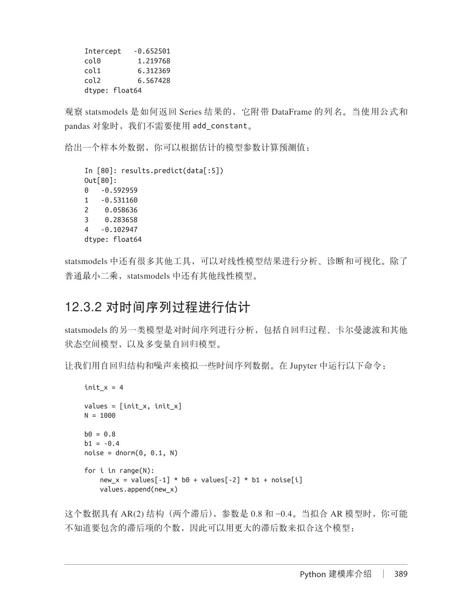

上页 `results.tvalues` 的输出：

```text
Intercept   -0.652501
col0         1.219768
col1         6.312369
col2         6.567428
dtype: float64
```

观察 statsmodels 是如何返回 Series 结果的，它附带 DataFrame 的列名。当使用公式和 pandas 对象时，我们不需要使用 `add_constant`。

给出一个样本外数据，你可以根据估计的模型参数计算预测值：

```python
results.predict(data[:5])
```

```text
0   -0.592959
1   -0.531160
2    0.058636
3    0.283658
4   -0.102947
dtype: float64
```

statsmodels 中还有很多其他工具，可以对线性模型结果进行分析、诊断和可视化。除了普通最小二乘，statsmodels 中还有其他线性模型。

### 12.3.2 对时间序列过程进行估计

statsmodels 的另一类模型是对时间序列进行分析，包括自回归过程、卡尔曼滤波和其他状态空间模型，以及多变量自回归模型。

让我们用自回归结构和噪声来模拟一些时间序列数据。在 Jupyter 中运行以下命令：

```python
init_x = 4
values = [init_x, init_x]
N = 1000
b0 = 0.8
b1 = -0.4
noise = dnorm(0, 0.1, N)
for i in range(N):
    new_x = values[-1] * b0 + values[-2] * b1 + noise[i]
    values.append(new_x)
```

这个数据具有 AR(2) 结构（两个滞后），参数是 0.8 和 -0.4。当拟合 AR 模型时，你可能不知道要包含的滞后项的个数，因此可以用更大的滞后数来拟合这个模型：

## PDF 第 400 页

<!-- page-status: reviewed -->
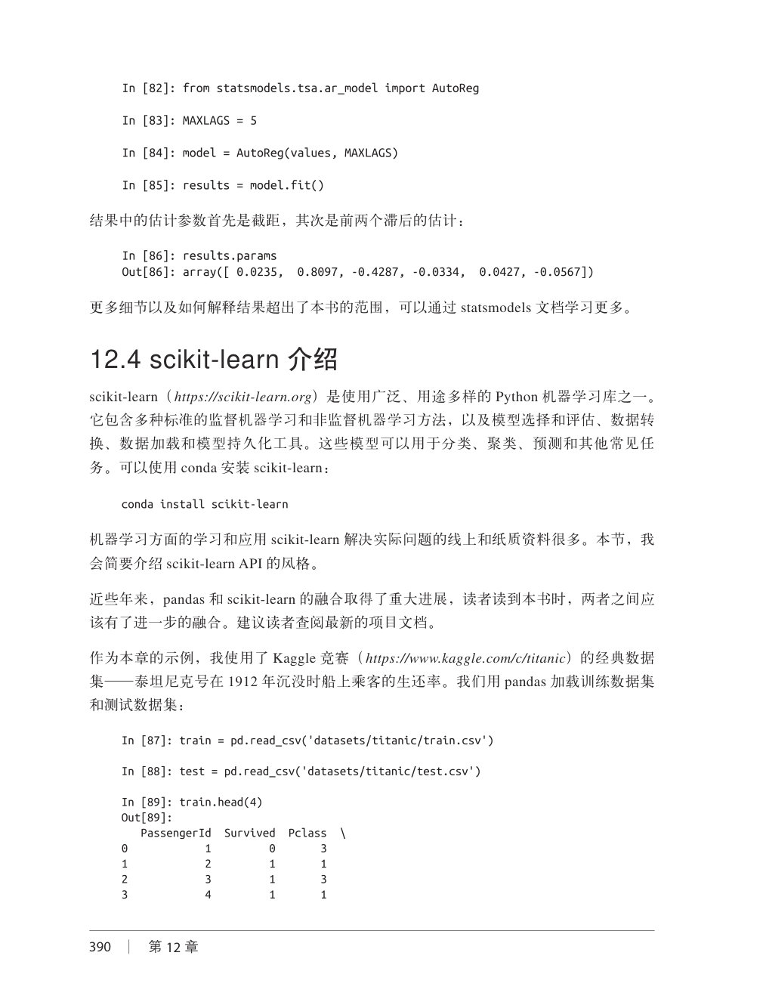

```python
from statsmodels.tsa.ar_model import AutoReg
MAXLAGS = 5
model = AutoReg(values, MAXLAGS)
results = model.fit()
```

结果中的估计参数首先是截距，其次是前两个滞后的估计：

```python
results.params
```

```text
array([ 0.0235,  0.8097, -0.4287, -0.0334,  0.0427, -0.0567])
```

更多细节以及如何解释结果超出了本书的范围，可以通过 statsmodels 文档学习更多。

### 12.4 scikit-learn 介绍

scikit-learn（https://scikit-learn.org）是使用广泛、用途多样的 Python 机器学习库之一。它包含多种标准的监督机器学习和非监督机器学习方法，以及模型选择和评估、数据转换、数据加载和模型持久化工具。这些模型可以用于分类、聚类、预测和其他常见任务。可以使用 conda 安装 scikit-learn：

```bash
conda install scikit-learn
```

机器学习方面的学习和应用 scikit-learn 解决实际问题的线上和纸质资料很多。本节，我会简要介绍 scikit-learn API 的风格。

近些年来，pandas 和 scikit-learn 的融合取得了重大进展，读者读到本书时，两者之间应该有了进一步的融合。建议读者查阅最新的项目文档。

作为本章的示例，我使用了 Kaggle 竞赛（https://www.kaggle.com/c/titanic）的经典数据集——泰坦尼克号在 1912 年沉没时船上乘客的生存率。我们用 pandas 加载训练数据集和测试数据集：

```python
train = pd.read_csv('datasets/titanic/train.csv')
test = pd.read_csv('datasets/titanic/test.csv')
train.head(4)
```

原书输出第一部分，续下一页：

```text
   PassengerId  Survived  Pclass  \\
0            1         0       3
1            2         1       1
2            3         1       3
3            4         1       1
```

## PDF 第 401 页

<!-- page-status: reviewed -->
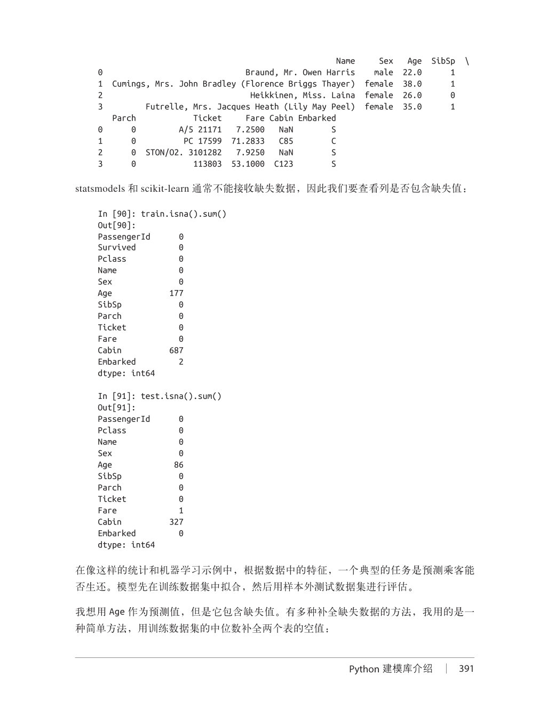

上一页表格输出续：

```text
                                             Name     Sex   Age  SibSp  \
0                         Braund, Mr. Owen Harris    male  22.0      1
1  Cumings, Mrs. John Bradley (Florence Briggs Thayer)  female  38.0  1
2                          Heikkinen, Miss. Laina  female  26.0      0
3    Futrelle, Mrs. Jacques Heath (Lily May Peel)  female  35.0      1
   Parch            Ticket     Fare Cabin Embarked
0      0         A/5 21171   7.2500   NaN        S
1      0          PC 17599  71.2833   C85        C
2      0  STON/O2. 3101282   7.9250   NaN        S
3      0            113803  53.1000  C123        S
```

statsmodels 和 scikit-learn 通常不能接收缺失数据，因此我们要查看列是否包含缺失值：

```python
train.isna().sum()  # In [90]
```

原书输出：

```text
PassengerId      0
Survived         0
Pclass           0
Name             0
Sex              0
Age            177
SibSp            0
Parch            0
Ticket           0
Fare             0
Cabin          687
Embarked         2
dtype: int64
```

```python
test.isna().sum()  # In [91]
```

原书输出：

```text
PassengerId      0
Pclass           0
Name             0
Sex              0
Age             86
SibSp            0
Parch            0
Ticket           0
Fare             1
Cabin          327
Embarked         0
dtype: int64
```

在像这样的统计和机器学习示例中，根据数据中的特征，一个典型的任务是预测乘客能否生还。模型先在训练数据集中拟合，然后用样本外测试数据集进行评估。

我想用 `Age` 作为预测值，但是它包含缺失值。有多种补全缺失数据的方法，我用的是一种简单方法，用训练数据集的中位数补全两个表的空值（代码见下一页）：

## PDF 第 402 页

<!-- page-status: reviewed -->
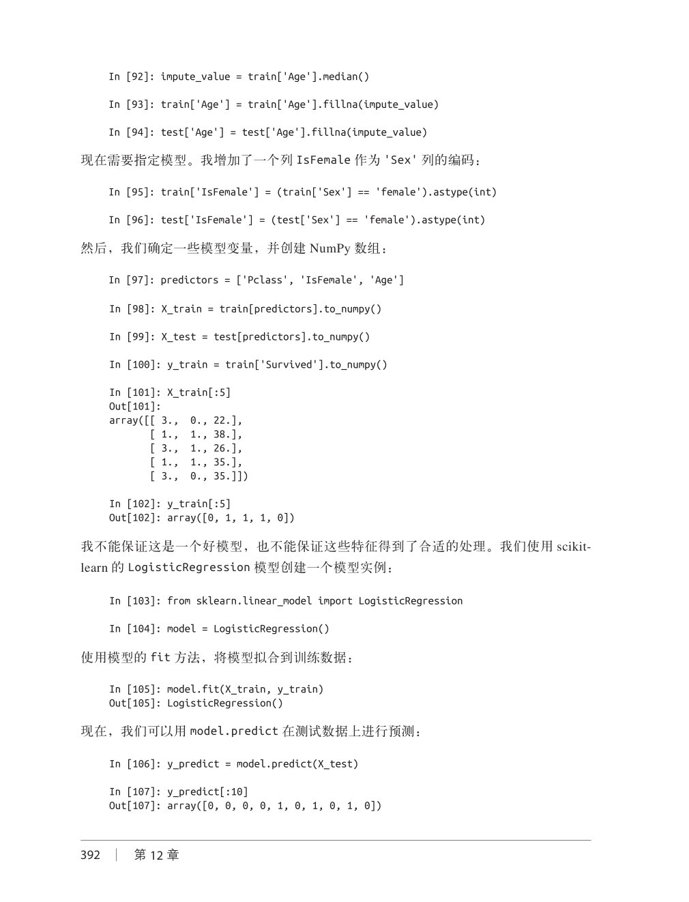

```python
# In [92]–[94]
impute_value = train['Age'].median()
train['Age'] = train['Age'].fillna(impute_value)
test['Age'] = test['Age'].fillna(impute_value)
```

现在需要指定模型。我增加了一个列 `IsFemale` 作为 `'Sex'` 列的编码：

```python
# In [95]–[96]
train['IsFemale'] = (train['Sex'] == 'female').astype(int)
test['IsFemale'] = (test['Sex'] == 'female').astype(int)
```

然后，我们确定一些模型变量，并创建 NumPy 数组：

```python
# In [97]–[102]
predictors = ['Pclass', 'IsFemale', 'Age']
X_train = train[predictors].to_numpy()
X_test = test[predictors].to_numpy()
y_train = train['Survived'].to_numpy()
X_train[:5]
y_train[:5]
```

原书输出：

```text
Out[101]:
array([[ 3.,  0., 22.],
       [ 1.,  1., 38.],
       [ 3.,  1., 26.],
       [ 1.,  1., 35.],
       [ 3.,  0., 35.]])
Out[102]: array([0, 1, 1, 1, 0])
```

我不能保证这是一个好模型，也不能保证这些特征得到了合适的处理。我们使用 scikit-learn 的 `LogisticRegression` 模型创建一个模型实例：

```python
# In [103]–[104]
from sklearn.linear_model import LogisticRegression
model = LogisticRegression()
```

使用模型的 `fit` 方法，将模型拟合到训练数据：

```python
model.fit(X_train, y_train)  # In [105]
```

原书输出：`LogisticRegression()`。

现在，我们可以用 `model.predict` 在测试数据上进行预测：

```python
# In [106]–[107]
y_predict = model.predict(X_test)
y_predict[:10]
```

原书输出：`array([0, 0, 0, 0, 1, 0, 1, 0, 1, 0])`。

## PDF 第 403 页

<!-- page-status: reviewed -->
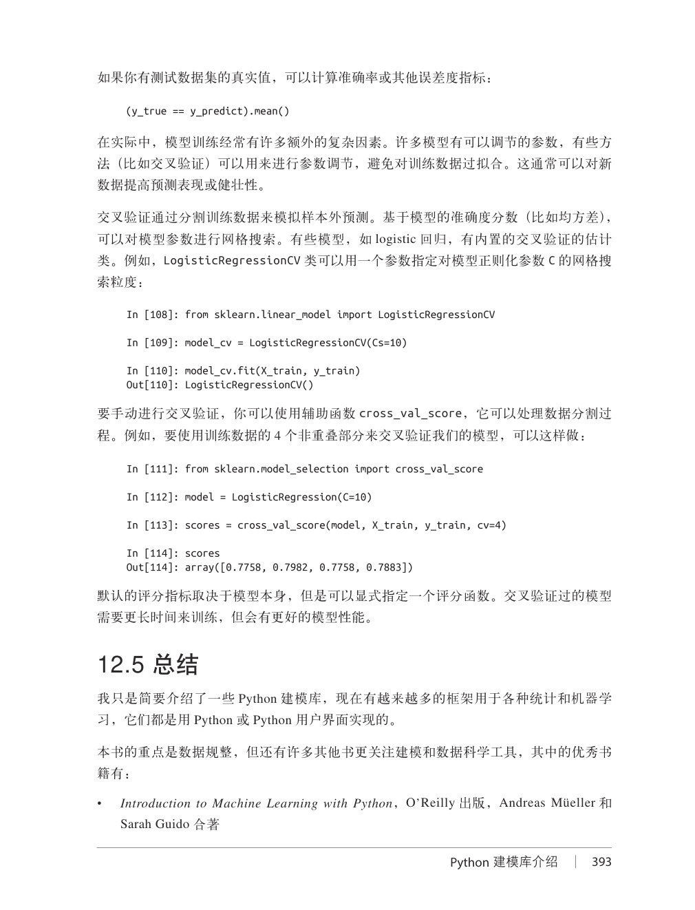

如果你有测试数据集的真实值，可以计算准确率或其他误差度指标：

```python
(y_true == y_predict).mean()
```

在实际中，模型训练经常有许多额外的复杂因素。许多模型有可以调节的参数，有些方法（比如交叉验证）可以用来进行参数调节，避免对训练数据过拟合。这通常可以对新数据提高预测表现或健壮性。

交叉验证通过分割训练数据来模拟样本外预测。基于模型的准确度分数（比如均方差），可以对模型参数进行网格搜索。有些模型，如 logistic 回归，有内置的交叉验证的估计类。例如，`LogisticRegressionCV` 类可以用一个参数指定对模型正则化参数 `C` 的网格搜索粒度：

```python
# In [108]–[110]
from sklearn.linear_model import LogisticRegressionCV
model_cv = LogisticRegressionCV(Cs=10)
model_cv.fit(X_train, y_train)
```

原书输出：`LogisticRegressionCV()`。

要手动进行交叉验证，你可以使用辅助函数 `cross_val_score`，它可以处理数据分割过程。例如，要使用训练数据的 4 个非重叠部分来交叉验证我们的模型，可以这样做：

```python
# In [111]–[114]
from sklearn.model_selection import cross_val_score
model = LogisticRegression(C=10)
scores = cross_val_score(model, X_train, y_train, cv=4)
scores
```

原书输出：`array([0.7758, 0.7982, 0.7758, 0.7883])`。

默认的评分指标取决于模型本身，但是可以显式指定一个评分函数。交叉验证过的模型需要更长时间来训练，但会有更好的模型性能。

> 校对注：原书最后一句的“会有更好的模型性能”不能保证；交叉验证可以帮助选择和评估模型，是否提升泛化性能仍需验证。此外，此例在交叉验证之前用整个训练集计算了填补中位数；严格评估时，可将缺失值填补放入交叉验证的流水线，使每一折仅用其训练部分计算中位数。

### 12.5 总结

我只是简要介绍了一些 Python 建模库，现在有越来越多的框架用于各种统计和机器学习，它们都是用 Python 或 Python 用户界面实现的。

本书的重点是数据规整，但还有许多其他书更关注建模和数据科学工具，其中的优秀书籍有：

- *Introduction to Machine Learning with Python*，O’Reilly 出版，Andreas Müeller 和 Sarah Guido 合著。

## PDF 第 404 页

<!-- page-status: reviewed -->
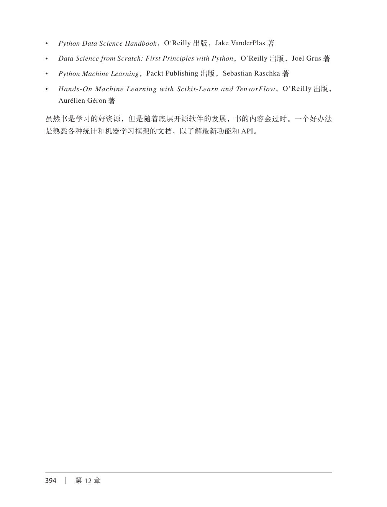

- *Python Data Science Handbook*，O’Reilly 出版，Jake VanderPlas 著。
- *Data Science from Scratch: First Principles with Python*，O’Reilly 出版，Joel Grus 著。
- *Python Machine Learning*，Packt Publishing 出版，Sebastian Raschka 著。
- *Hands-On Machine Learning with Scikit-Learn and TensorFlow*，O’Reilly 出版，Aurélien Géron 著。

虽然书是学习的好资源，但是随着底层开源软件的发展，书的内容会过时。一个好办法是熟悉各种统计和机器学习框架的文档，以了解最新功能和 API。

