# 第 13 章 数据分析案例

[返回目录](../README.md)

> 本章各页已由 AI 对照原页图转写代码、公式和正文；尚未经人工复核。代码块已做语法检查，示例和书中输出未逐一运行；原书历史版本行为可能与当前环境不同。

## PDF 第 405 页

<!-- page-status: reviewed -->

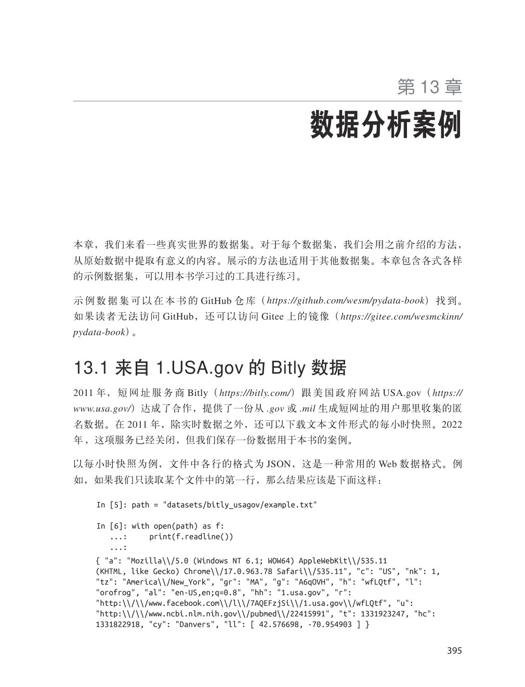

# 第 13 章 数据分析案例

本章，我们来看一些真实世界的数据集。对于每个数据集，我们会用之前介绍的方法，从原始数据中提取有意义的内容。展示的方法也适用于其他数据集。本章包含各式各样的示例数据集，可以用本书学习过的工具进行练习。

示例数据集可以在本书的 GitHub 仓库（https://github.com/wesm/pydata-book）找到。如果读者无法访问 GitHub，还可以访问 Gitee 上的镜像（https://gitee.com/wesmckinn/pydata-book）。

## 13.1 来自 1.USA.gov 的 Bitly 数据

2011 年，短网址服务商 Bitly（https://bitly.com/）跟美国政府网站 USA.gov（https://www.usa.gov/）达成了合作，提供了一份从 `.gov` 或 `.mil` 生成短网址的用户那里收集的匿名数据。在 2011 年，除实时数据之外，还可以下载文本文件形式的每小时快照。2022 年，这项服务已经关闭，但我们保存一份数据用于本书的案例。

以每小时快照为例，文件中各行的格式为 JSON，这是一种常用的 Web 数据格式。例如，如果我们只读取某个文件中的第一行，那么结果应该是下面这样：

```python
path = "datasets/bitly_usagov/example.txt"
with open(path) as f:
    print(f.readline())
```

```text
{ "a": "Mozilla\\/5.0 (Windows NT 6.1; WOW64) AppleWebKit\\/535.11
(KHTML, like Gecko) Chrome\\/17.0.963.78 Safari\\/535.11", "c": "US", "nk": 1,
"tz": "America\\/New_York", "gr": "MA", "g": "A6qOVH", "h": "wfLQtf", "l":
"orofrog", "al": "en-US,en;q=0.8", "hh": "1.usa.gov", "r":
"http:\\/\\/www.facebook.com\\/l\\/7AQEFzjSi\\/1.usa.gov\\/wfLQtf", "u":
"http:\\/\\/www.ncbi.nlm.nih.gov\\/pubmed\\/22415991", "t": 1331923247, "hc":
1331822918, "cy": "Danvers", "ll": [ 42.576698, -70.954903 ] }
```

> 此处按原页显示保留双反斜线和换行；源页为打印结果，换行不代表源数据文件中的行边界。

## PDF 第 406 页

<!-- page-status: reviewed -->

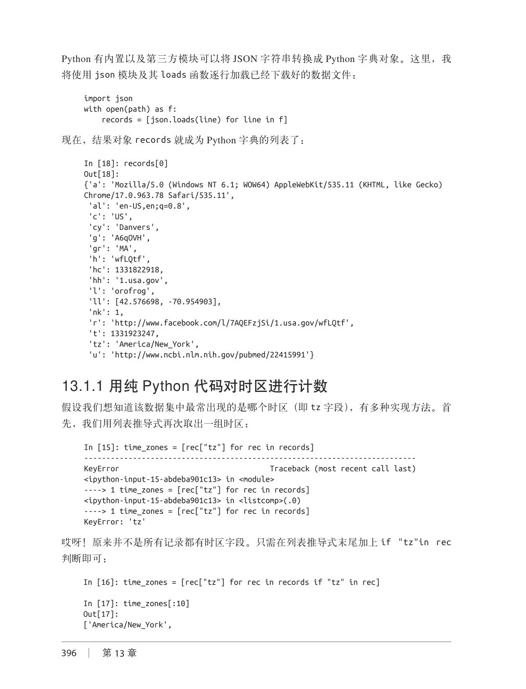

Python 有内置以及第三方模块可以将 JSON 字符串转换成 Python 字典对象。这里，我将使用 `json` 模块及其 `loads` 函数逐行加载已经下载好的数据文件：

```python
import json
with open(path) as f:
    records = [json.loads(line) for line in f]
```

现在，结果对象 `records` 就成为 Python 字典的列表了：

```python
records[0]
```

```text
{'a': 'Mozilla/5.0 (Windows NT 6.1; WOW64) AppleWebKit/535.11 (KHTML, like Gecko)
Chrome/17.0.963.78 Safari/535.11',
 'al': 'en-US,en;q=0.8',
 'c': 'US',
 'cy': 'Danvers',
 'g': 'A6qOVH',
 'gr': 'MA',
 'h': 'wfLQtf',
 'hc': 1331822918,
 'hh': '1.usa.gov',
 'l': 'orofrog',
 'll': [42.576698, -70.954903],
 'nk': 1,
 'r': 'http://www.facebook.com/l/7AQEFzjSi/1.usa.gov/wfLQtf',
 't': 1331923247,
 'tz': 'America/New_York',
 'u': 'http://www.ncbi.nlm.nih.gov/pubmed/22415991'}
```

### 13.1.1 用纯 Python 代码对时区进行计数

假设我们想知道该数据集中最常出现的是哪个时区（即 `tz` 字段），有多种实现方法。首先，我们用列表推导式再次取出一组时区：

```python
time_zones = [rec["tz"] for rec in records]
```

```text
KeyError                                  Traceback (most recent call last)
<ipython-input-15-abdeba901c13> in <module>
----> 1 time_zones = [rec["tz"] for rec in records]
<ipython-input-15-abdeba901c13> in <listcomp>(.0)
----> 1 time_zones = [rec["tz"] for rec in records]
KeyError: 'tz'
```

哎呀！原来并不是所有记录都有时区字段。只需在列表推导式末尾加上 `if "tz" in rec` 判断即可：

```python
time_zones = [rec["tz"] for rec in records if "tz" in rec]
time_zones[:10]
```

```text
['America/New_York',
```

（输出续下页。）

## PDF 第 407 页

<!-- page-status: reviewed -->

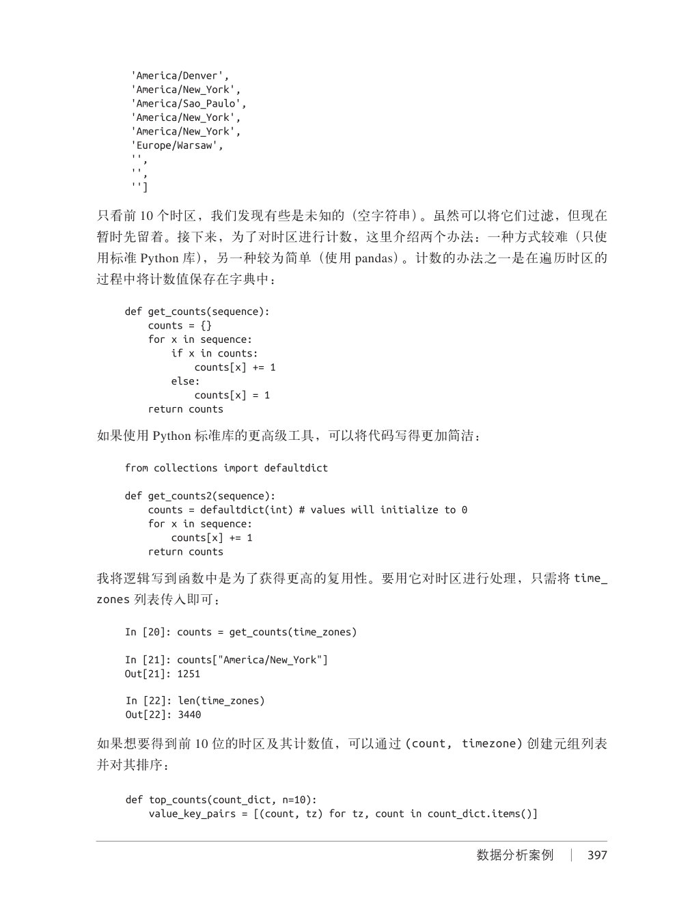

（上页输出续）

```text
 'America/Denver',
 'America/New_York',
 'America/Sao_Paulo',
 'America/New_York',
 'America/New_York',
 'Europe/Warsaw',
 '',
 '',
 '']
```

只看前 10 个时区，我们发现有些是未知的（空字符串）。虽然可以将它们过滤，但现在暂时先留着。接下来，为了对时区进行计数，这里介绍两个办法：一种方式较难（只使用标准 Python 库），另一种较为简单（使用 pandas）。计数的办法之一是在遍历时区的过程中将计数值保存在字典中：

```python
def get_counts(sequence):
    counts = {}
    for x in sequence:
        if x in counts:
            counts[x] += 1
        else:
            counts[x] = 1
    return counts
```

如果使用 Python 标准库的更高级工具，可以将代码写得更加简洁：

```python
from collections import defaultdict

def get_counts2(sequence):
    counts = defaultdict(int)  # values will initialize to 0
    for x in sequence:
        counts[x] += 1
    return counts
```

我将逻辑写到函数中是为了获得更高的复用性。要用它对时区进行处理，只需将 `time_zones` 列表传入即可：

```python
counts = get_counts(time_zones)
counts["America/New_York"]
```

```text
1251
```

```python
len(time_zones)
```

```text
3440
```

如果想要得到前 10 位的时区及其计数值，可以通过 `(count, timezone)` 创建元组列表并对其排序：

以下函数的定义跨越本页和下一页，完整代码如下：

```python
def top_counts(count_dict, n=10):
    value_key_pairs = [(count, tz) for tz, count in count_dict.items()]
    value_key_pairs.sort()
    return value_key_pairs[-n:]
```

## PDF 第 408 页

<!-- page-status: reviewed -->

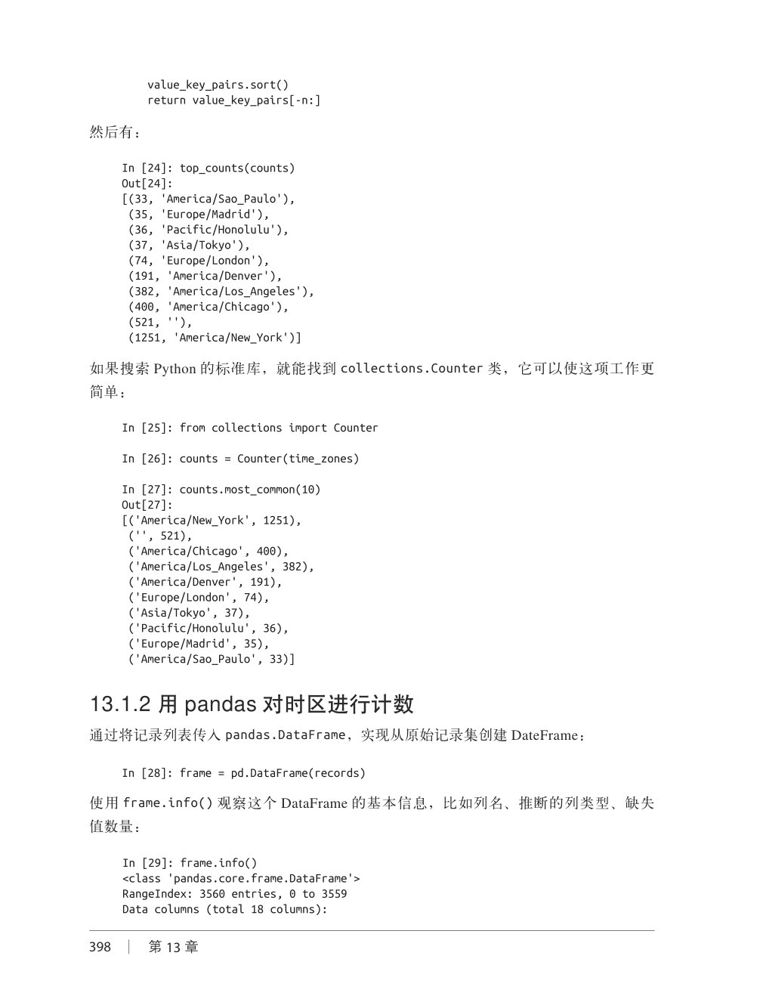

上页的 `top_counts` 函数在本页继续：

```text
    value_key_pairs.sort()
    return value_key_pairs[-n:]
```

然后有：

```python
top_counts(counts)
```

```text
[(33, 'America/Sao_Paulo'),
 (35, 'Europe/Madrid'),
 (36, 'Pacific/Honolulu'),
 (37, 'Asia/Tokyo'),
 (74, 'Europe/London'),
 (191, 'America/Denver'),
 (382, 'America/Los_Angeles'),
 (400, 'America/Chicago'),
 (521, ''),
 (1251, 'America/New_York')]
```

如果搜索 Python 的标准库，就能找到 `collections.Counter` 类，它可以使这项工作更简单：

```python
from collections import Counter
counts = Counter(time_zones)
counts.most_common(10)
```

```text
[('America/New_York', 1251),
 ('', 521),
 ('America/Chicago', 400),
 ('America/Los_Angeles', 382),
 ('America/Denver', 191),
 ('Europe/London', 74),
 ('Asia/Tokyo', 37),
 ('Pacific/Honolulu', 36),
 ('Europe/Madrid', 35),
 ('America/Sao_Paulo', 33)]
```

### 13.1.2 用 pandas 对时区进行计数

通过将记录列表传入 `pandas.DataFrame`，实现从原始记录集创建 DataFrame：

```python
frame = pd.DataFrame(records)
```

使用 `frame.info()` 观察这个 DataFrame 的基本信息，比如列名、推断的列类型、缺失值数量：

```python
frame.info()
```

```text
<class 'pandas.core.frame.DataFrame'>
RangeIndex: 3560 entries, 0 to 3559
Data columns (total 18 columns):
```

（输出续下页。）

## PDF 第 409 页

<!-- page-status: reviewed -->

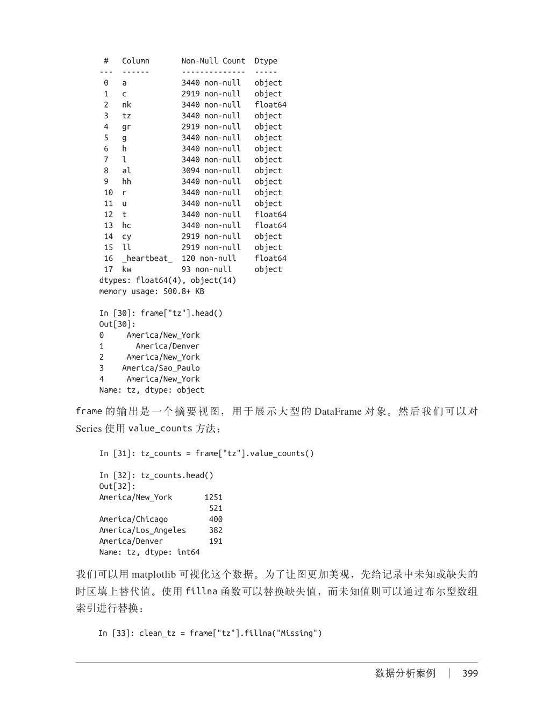

（上页 `frame.info()` 输出续）

```text
 #   Column       Non-Null Count  Dtype
---  ------       --------------  -----
 0   a            3440 non-null   object
 1   c            2919 non-null   object
 2   nk           3440 non-null   float64
 3   tz           3440 non-null   object
 4   gr           2919 non-null   object
 5   g            3440 non-null   object
 6   h            3440 non-null   object
 7   l            3440 non-null   object
 8   al           3094 non-null   object
 9   hh           3440 non-null   object
 10  r            3440 non-null   object
 11  u            3440 non-null   object
 12  t            3440 non-null   float64
 13  hc           3440 non-null   float64
 14  cy           2919 non-null   object
 15  ll           2919 non-null   object
 16  _heartbeat_  120 non-null    float64
 17  kw           93 non-null     object
dtypes: float64(4), object(14)
memory usage: 500.8+ KB
```

```python
frame["tz"].head()
```

```text
0     America/New_York
1       America/Denver
2     America/New_York
3    America/Sao_Paulo
4     America/New_York
Name: tz, dtype: object
```

`frame` 的输出是一个摘要视图，用于展示大型的 DataFrame 对象。然后我们可以对 Series 使用 `value_counts` 方法：

```python
tz_counts = frame["tz"].value_counts()
tz_counts.head()
```

```text
America/New_York     1251
                      521
America/Chicago      400
America/Los_Angeles  382
America/Denver       191
Name: tz, dtype: int64
```

我们可以用 matplotlib 可视化这个数据。为了让图更加美观，先给记录中未知或缺失的时区填上替代值。使用 `fillna` 函数可以替换缺失值，而未知值则可以通过布尔型数组索引进行替换：

```python
clean_tz = frame["tz"].fillna("Missing")
```

## PDF 第 410 页

<!-- page-status: reviewed -->

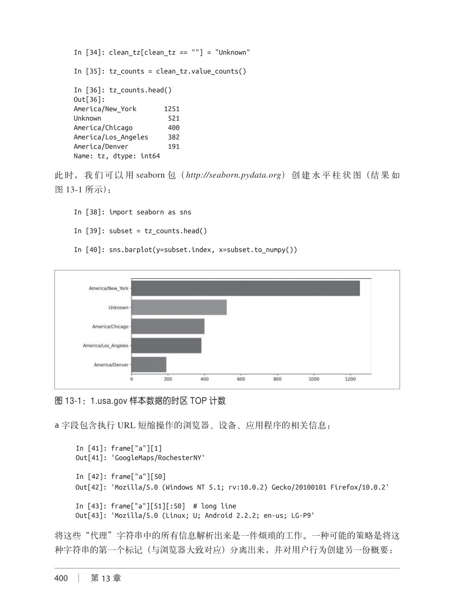

```python
clean_tz[clean_tz == ""] = "Unknown"
tz_counts = clean_tz.value_counts()
tz_counts.head()
```

```text
America/New_York     1251
Unknown               521
America/Chicago       400
America/Los_Angeles   382
America/Denver        191
Name: tz, dtype: int64
```

此时，我们可以用 seaborn 包（http://seaborn.pydata.org）创建水平柱状图（结果如图 13-1 所示）：

```python
import seaborn as sns
subset = tz_counts.head()
sns.barplot(y=subset.index, x=subset.to_numpy())
```

图 13-1：1.usa.gov 样本数据的时区 TOP 计数。图见本页原图。

`a` 字段包含执行 URL 短缩操作的浏览器、设备、应用程序的相关信息：

```python
frame["a"][1]
```

```text
'GoogleMaps/RochesterNY'
```

```python
frame["a"][50]
```

```text
'Mozilla/5.0 (Windows NT 5.1; rv:10.0.2) Gecko/20100101 Firefox/10.0.2'
```

```python
frame["a"][51][:50]  # long line
```

```text
'Mozilla/5.0 (Linux; U; Android 2.2.2; en-us; LG-P9'
```

将这些“代理”字符串中的所有信息解析出来是一件烦琐的工作。一种可能的策略是将这种字符串的第一个标记（与浏览器大致对应）分离出来，并对用户行为创建另一份概要：

## PDF 第 411 页

<!-- page-status: reviewed -->

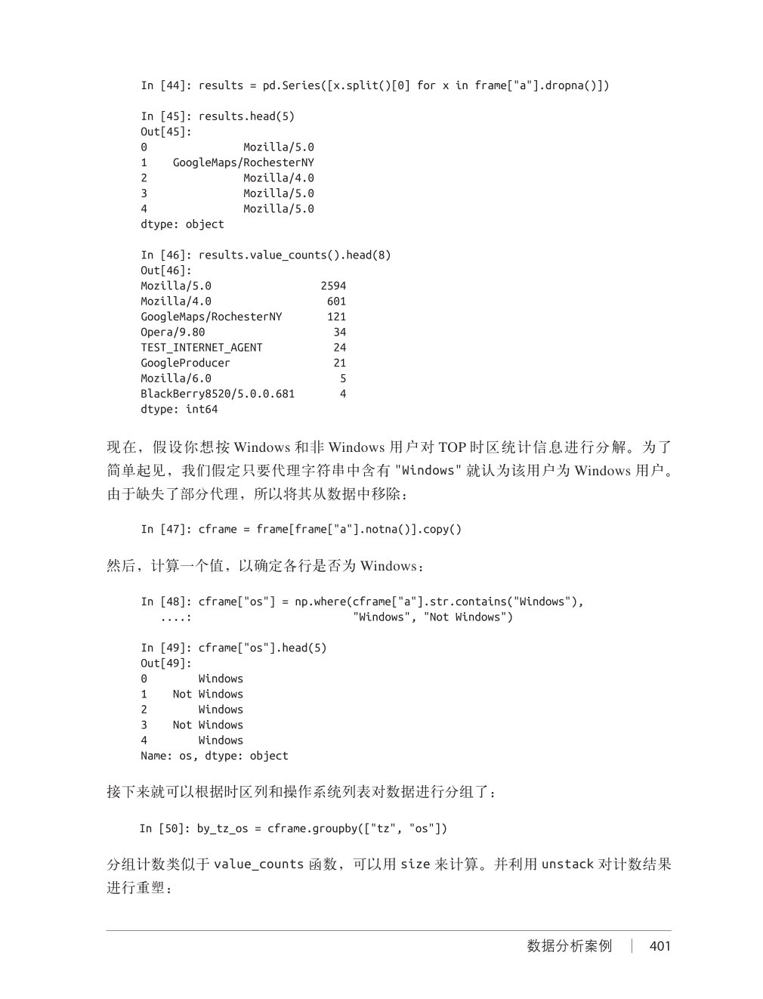

```python
results = pd.Series([x.split()[0] for x in frame["a"].dropna()])
results.head(5)
```

```text
Out[45]:
0               Mozilla/5.0
1    GoogleMaps/RochesterNY
2               Mozilla/4.0
3               Mozilla/5.0
4               Mozilla/5.0
dtype: object
```

```python
results.value_counts().head(8)
```

```text
Out[46]:
Mozilla/5.0                 2594
Mozilla/4.0                  601
GoogleMaps/RochesterNY       121
Opera/9.80                    34
TEST_INTERNET_AGENT           24
GoogleProducer                21
Mozilla/6.0                    5
BlackBerry8520/5.0.0.681       4
dtype: int64
```

现在，假设你想按 Windows 和非 Windows 用户对 TOP 时区统计信息进行分解。为了简单起见，我们假定只要代理字符串中含有 `"Windows"` 就认为该用户为 Windows 用户。由于缺失了部分代理，所以将其从数据中移除：

```python
cframe = frame[frame["a"].notna()].copy()
```

然后，计算一个值，以确定各行是否为 Windows：

```python
cframe["os"] = np.where(cframe["a"].str.contains("Windows"),
                        "Windows", "Not Windows")
cframe["os"].head(5)
```

```text
Out[49]:
0        Windows
1    Not Windows
2        Windows
3    Not Windows
4        Windows
Name: os, dtype: object
```

接下来就可以根据时区列和操作系统列表对数据进行分组了：

```python
by_tz_os = cframe.groupby(["tz", "os"])
```

分组计数类似于 `value_counts` 函数，可以用 `size` 来计算。并利用 `unstack` 对计数结果进行重塑：

## PDF 第 412 页

<!-- page-status: reviewed -->

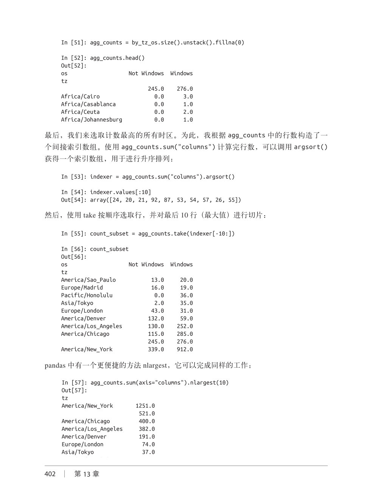

```python
agg_counts = by_tz_os.size().unstack().fillna(0)
agg_counts.head()
```

```text
Out[52]:
os                   Not Windows  Windows
tz
                           245.0    276.0
Africa/Cairo                 0.0      3.0
Africa/Casablanca            0.0      1.0
Africa/Ceuta                 0.0      2.0
Africa/Johannesburg          0.0      1.0
```

最后，我们来选取计数最高的所有时区。为此，我根据 `agg_counts` 中的行数构造了一个间接索引数组。使用 `agg_counts.sum("columns")` 计算完行数，可以调用 `argsort()` 获得一个索引数组，用于进行升序排列：

```python
indexer = agg_counts.sum("columns").argsort()
indexer.values[:10]
```

```text
Out[54]: array([24, 20, 21, 92, 87, 53, 54, 57, 26, 55])
```

然后，使用 `take` 按顺序选取行，并对最后 10 行（最大值）进行切片：

```python
count_subset = agg_counts.take(indexer[-10:])
count_subset
```

```text
Out[56]:
os                    Not Windows  Windows
tz
America/Sao_Paulo            13.0     20.0
Europe/Madrid                16.0     19.0
Pacific/Honolulu              0.0     36.0
Asia/Tokyo                    2.0     35.0
Europe/London                43.0     31.0
America/Denver              132.0     59.0
America/Los_Angeles         130.0    252.0
America/Chicago             115.0    285.0
                            245.0    276.0
America/New_York            339.0    912.0
```

pandas 中有一个更便捷的方法 `nlargest`，它可以完成同样的工作：

```python
agg_counts.sum(axis="columns").nlargest(10)
```

```text
Out[57]:
tz
America/New_York       1251.0
                        521.0
America/Chicago         400.0
America/Los_Angeles     382.0
America/Denver          191.0
Europe/London            74.0
Asia/Tokyo               37.0
```

输出续见下页。

## PDF 第 413 页

<!-- page-status: reviewed -->

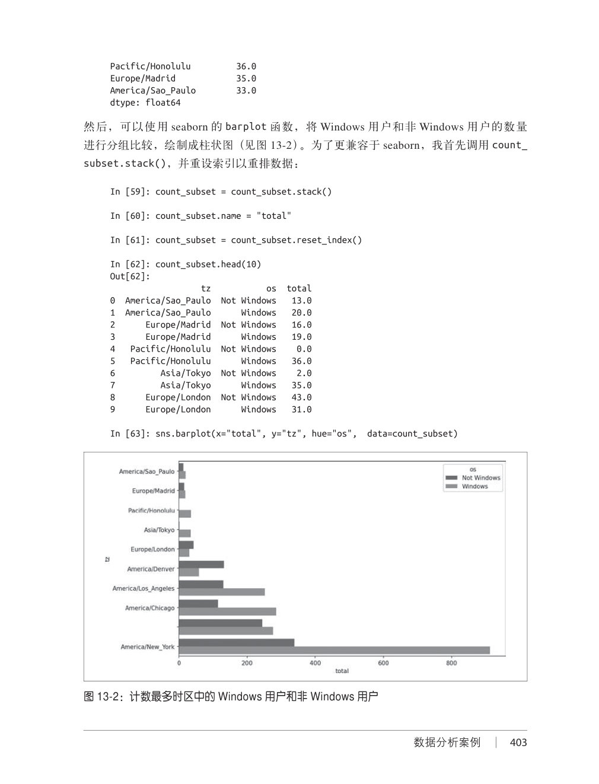

上一页输出续：

```text
Pacific/Honolulu         36.0
Europe/Madrid            35.0
America/Sao_Paulo        33.0
dtype: float64
```

然后，可以使用 seaborn 的 `barplot` 函数，将 Windows 用户和非 Windows 用户的数量进行分组比较，绘制成柱状图（见图 13-2）。为了更兼容于 seaborn，我首先调用 `count_subset.stack()`，并重设索引以重排数据：

```python
count_subset = count_subset.stack()
count_subset.name = "total"
count_subset = count_subset.reset_index()
count_subset.head(10)
```

```text
Out[62]:
                  tz           os  total
0  America/Sao_Paulo  Not Windows   13.0
1  America/Sao_Paulo      Windows   20.0
2      Europe/Madrid  Not Windows   16.0
3      Europe/Madrid      Windows   19.0
4   Pacific/Honolulu  Not Windows    0.0
5   Pacific/Honolulu      Windows   36.0
6         Asia/Tokyo  Not Windows    2.0
7         Asia/Tokyo      Windows   35.0
8      Europe/London  Not Windows   43.0
9      Europe/London      Windows   31.0
```

```python
sns.barplot(x="total", y="tz", hue="os", data=count_subset)
```

**图 13-2：计数最多时区中的 Windows 用户和非 Windows 用户**（见本页原页图）。

## PDF 第 414 页

<!-- page-status: reviewed -->

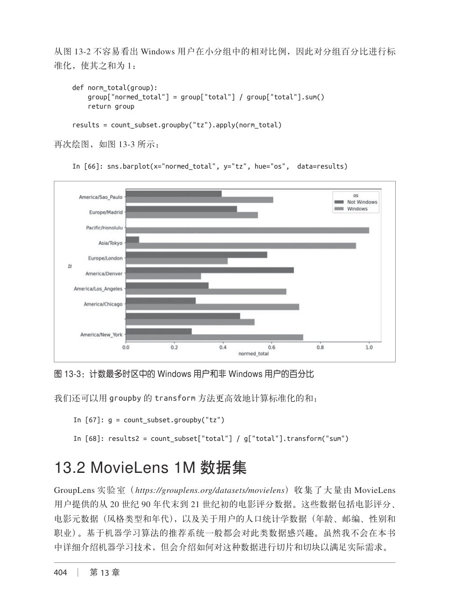

从图 13-2 不容易看出 Windows 用户在小分组中的相对比例，因此对分组百分比进行标准化，使其之和为 1：

```python
def norm_total(group):
    group["normed_total"] = group["total"] / group["total"].sum()
    return group

results = count_subset.groupby("tz").apply(norm_total)
```

再次绘图，如图 13-3 所示：

```python
sns.barplot(x="normed_total", y="tz", hue="os", data=results)
```

**图 13-3：计数最多时区中的 Windows 用户和非 Windows 用户的百分比**（见本页原页图）。

我们还可以用 `groupby` 的 `transform` 方法更高效地计算标准化的和：

```python
g = count_subset.groupby("tz")
results2 = count_subset["total"] / g["total"].transform("sum")
```

### 13.2 MovieLens 1M 数据集

GroupLens 实验室（https://grouplens.org/datasets/movielens）收集了大量由 MovieLens 用户提供的从 20 世纪 90 年代末到 21 世纪初的电影评分数据。这些数据包括电影评分、电影元数据（风格类型和年代），以及关于用户的人口统计学数据（年龄、邮编、性别和职业）。基于机器学习算法的推荐系统一般都会对此类数据感兴趣。虽然我不会在本书中详细介绍机器学习技术，但会介绍如何对这种数据进行切片和切块以满足实际需求。

## PDF 第 415 页

<!-- page-status: reviewed -->

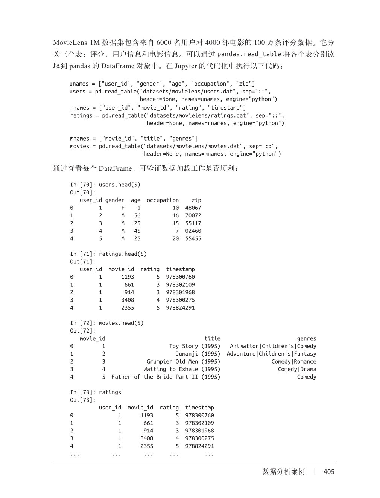

MovieLens 1M 数据集包含来自 6000 名用户对 4000 部电影的 100 万条评分数据。它分为三个表：评分、用户信息和电影信息。可以通过 `pandas.read_table` 将各个表分别读取到 pandas 的 DataFrame 对象中。在 Jupyter 的代码框中执行以下代码：

```python
unames = ["user_id", "gender", "age", "occupation", "zip"]
users = pd.read_table("datasets/movielens/users.dat", sep="::",
                      header=None, names=unames, engine="python")
rnames = ["user_id", "movie_id", "rating", "timestamp"]
ratings = pd.read_table("datasets/movielens/ratings.dat", sep="::",
                        header=None, names=rnames, engine="python")

mnames = ["movie_id", "title", "genres"]
movies = pd.read_table("datasets/movielens/movies.dat", sep="::",
                       header=None, names=mnames, engine="python")
```

通过查看每个 DataFrame，可验证数据加载工作是否顺利：

```python
users.head(5)
```

```text
Out[70]:
   user_id gender  age  occupation    zip
0        1      F    1          10  48067
1        2      M   56          16  70072
2        3      M   25          15  55117
3        4      M   45           7  02460
4        5      M   25          20  55455
```

```python
ratings.head(5)
```

```text
Out[71]:
   user_id  movie_id  rating  timestamp
0        1      1193       5  978300760
1        1       661       3  978302109
2        1       914       3  978301968
3        1      3408       4  978300275
4        1      2355       5  978824291
```

```python
movies.head(5)
```

```text
Out[72]:
   movie_id                               title                        genres
0         1                    Toy Story (1995)   Animation|Children's|Comedy
1         2                      Jumanji (1995)  Adventure|Children's|Fantasy
2         3             Grumpier Old Men (1995)                Comedy|Romance
3         4            Waiting to Exhale (1995)                  Comedy|Drama
4         5  Father of the Bride Part II (1995)                        Comedy
```

```python
ratings
```

```text
Out[73]:
         user_id  movie_id  rating  timestamp
0              1      1193       5  978300760
1              1       661       3  978302109
2              1       914       3  978301968
3              1      3408       4  978300275
4              1      2355       5  978824291
...          ...       ...     ...        ...
```

输出续见下页。

## PDF 第 416 页

<!-- page-status: reviewed -->

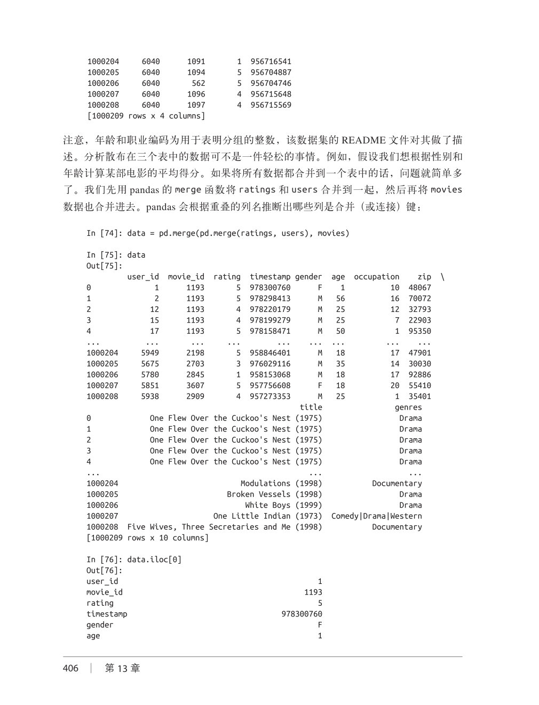

上一页输出续：

```text
1000204     6040      1091       1  956716541
1000205     6040      1094       5  956704887
1000206     6040       562       5  956704746
1000207     6040      1096       4  956715648
1000208     6040      1097       4  956715569
[1000209 rows x 4 columns]
```

注意，年龄和职业编码为用于表明分组的整数，该数据集的 README 文件对其做了描述。分析散布在三个表中的数据可不是一件轻松的事情。例如，假设我们想根据性别和年龄计算某部电影的平均得分。如果将所有数据都合并到一个表中的话，问题就简单多了。我们先用 pandas 的 `merge` 函数将 `ratings` 和 `users` 合并到一起，然后再将 `movies` 数据也合并进去。pandas 会根据重叠的列名推断出哪些列是合并（或连接）键：

```python
data = pd.merge(pd.merge(ratings, users), movies)
data
```

```text
Out[75]:
         user_id  movie_id  rating  timestamp gender  age  occupation    zip  \
0              1      1193       5  978300760      F    1          10  48067
1              2      1193       5  978298413      M   56          16  70072
2             12      1193       4  978220179      M   25          12  32793
3             15      1193       4  978199279      M   25           7  22903
4             17      1193       5  978158471      M   50           1  95350
...          ...       ...     ...        ...    ...  ...         ...    ...
1000204     5949      2198       5  958846401      M   18          17  47901
1000205     5675      2703       3  976029116      M   35          14  30030
1000206     5780      2845       1  958153068      M   18          17  92886
1000207     5851      3607       5  957756608      F   18          20  55410
1000208     5938      2909       4  957273353      M   25           1  35401
                                            title                  genres
0              One Flew Over the Cuckoo's Nest (1975)             Drama
1              One Flew Over the Cuckoo's Nest (1975)             Drama
2              One Flew Over the Cuckoo's Nest (1975)             Drama
3              One Flew Over the Cuckoo's Nest (1975)             Drama
4              One Flew Over the Cuckoo's Nest (1975)             Drama
...                                              ...               ...
1000204                          Modulations (1998)        Documentary
1000205                        Broken Vessels (1998)              Drama
1000206                            White Boys (1999)              Drama
1000207                      One Little Indian (1973)  Comedy|Drama|Western
1000208    Five Wives, Three Secretaries and Me (1998)        Documentary
[1000209 rows x 10 columns]
```

```python
data.iloc[0]
```

```text
Out[76]:
user_id                1
movie_id            1193
rating                 5
timestamp      978300760
gender                 F
age                    1
```

输出续见下页。

## PDF 第 417 页

<!-- page-status: reviewed -->

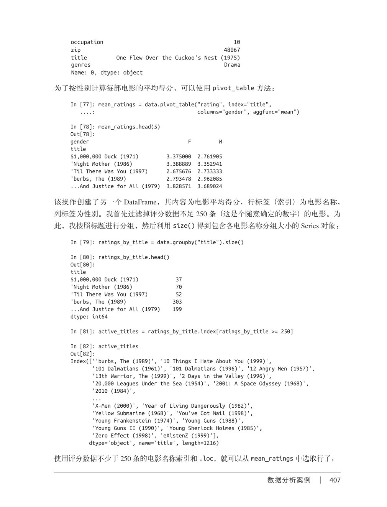

（上页输出续）

```text
occupation                                  10
zip                                      48067
title         One Flew Over the Cuckoo's Nest (1975)
genres                                   Drama
Name: 0, dtype: object
```

为了按性别计算每部电影的平均得分，可以使用 `pivot_table` 方法：

```python
mean_ratings = data.pivot_table("rating", index="title",
                                columns="gender", aggfunc="mean")
mean_ratings.head(5)
```

```text
gender                                F         M
title
$1,000,000 Duck (1971)          3.375000  2.761905
'Night Mother (1986)            3.388889  3.352941
'Til There Was You (1997)       2.675676  2.733333
'burbs, The (1989)              2.793478  2.962085
...And Justice for All (1979)   3.828571  3.689024
```

该操作创建了另一个 DataFrame，其内容为电影平均得分，行标签（索引）为电影名称，列标签为性别。我首先过滤掉评分数据不足 250 条（这是个随意确定的数字）的电影。为此，我按照标题进行分组，然后利用 `size()` 得到包含各电影名称分组大小的 Series 对象：

```python
ratings_by_title = data.groupby("title").size()
ratings_by_title.head()
```

```text
title
$1,000,000 Duck (1971)             37
'Night Mother (1986)               70
'Til There Was You (1997)          52
'burbs, The (1989)                303
...And Justice for All (1979)     199
dtype: int64
```

```python
active_titles = ratings_by_title.index[ratings_by_title >= 250]
active_titles
```

```text
Index([''burbs, The (1989)', '10 Things I Hate About You (1999)',
       '101 Dalmatians (1961)', '101 Dalmatians (1996)', '12 Angry Men (1957)',
       '13th Warrior, The (1999)', '2 Days in the Valley (1996)',
       '20,000 Leagues Under the Sea (1954)', '2001: A Space Odyssey (1968)',
       '2010 (1984)',
       ...
       'X-Men (2000)', 'Year of Living Dangerously (1982)',
       'Yellow Submarine (1968)', "You've Got Mail (1998)",
       'Young Frankenstein (1974)', 'Young Guns (1988)',
       'Young Guns II (1990)', 'Young Sherlock Holmes (1985)',
       'Zero Effect (1998)', 'eXistenZ (1999)'],
      dtype='object', name='title', length=1216)
```

使用评分数据不少于 250 条的电影名称索引和 `.loc`，就可以从 `mean_ratings` 中选取行了：

## PDF 第 418 页

<!-- page-status: reviewed -->

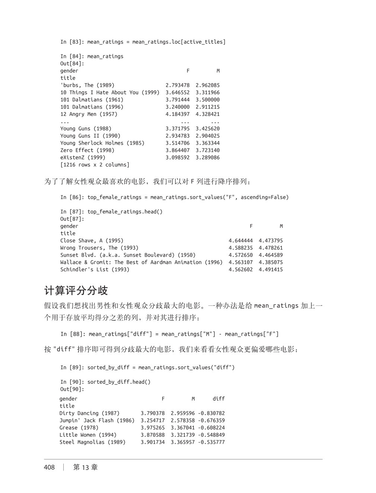

```python
mean_ratings = mean_ratings.loc[active_titles]
mean_ratings
```

```text
gender                                         F         M
title
'burbs, The (1989)                      2.793478  2.962085
10 Things I Hate About You (1999)        3.646552  3.311966
101 Dalmatians (1961)                   3.791444  3.500000
101 Dalmatians (1996)                   3.240000  2.911215
12 Angry Men (1957)                     4.184397  4.328421
...                                          ...       ...
Young Guns (1988)                       3.371795  3.425620
Young Guns II (1990)                    2.934783  2.904025
Young Sherlock Holmes (1985)            3.514706  3.363344
Zero Effect (1998)                      3.864407  3.723140
eXistenZ (1999)                         3.098592  3.289086
[1216 rows x 2 columns]
```

为了了解女性观众最喜欢的电影，我们可以对 `F` 列进行降序排列：

```python
top_female_ratings = mean_ratings.sort_values("F", ascending=False)
top_female_ratings.head()
```

```text
gender                                                       F         M
title
Close Shave, A (1995)                                 4.644444  4.473795
Wrong Trousers, The (1993)                            4.588235  4.478261
Sunset Blvd. (a.k.a. Sunset Boulevard) (1950)         4.572650  4.464589
Wallace & Gromit: The Best of Aardman Animation (1996) 4.563107  4.385075
Schindler's List (1993)                               4.562602  4.491415
```

### 计算评分分歧

假设我们想找出男性和女性观众分歧最大的电影。一种办法是给 `mean_ratings` 加上一个用于存放平均得分之差的列，并对其进行排序：

```python
mean_ratings["diff"] = mean_ratings["M"] - mean_ratings["F"]
```

按 `"diff"` 排序即可得到分歧最大的电影，我们来看看女性观众更偏爱哪些电影：

```python
sorted_by_diff = mean_ratings.sort_values("diff")
sorted_by_diff.head()
```

```text
gender                            F         M      diff
title
Dirty Dancing (1987)       3.790378  2.959596 -0.830782
Jumpin' Jack Flash (1986)  3.254717  2.578358 -0.676359
Grease (1978)              3.975265  3.367041 -0.608224
Little Women (1994)        3.870588  3.321739 -0.548849
Steel Magnolias (1989)     3.901734  3.365957 -0.535777
```

## PDF 第 419 页

<!-- page-status: reviewed -->

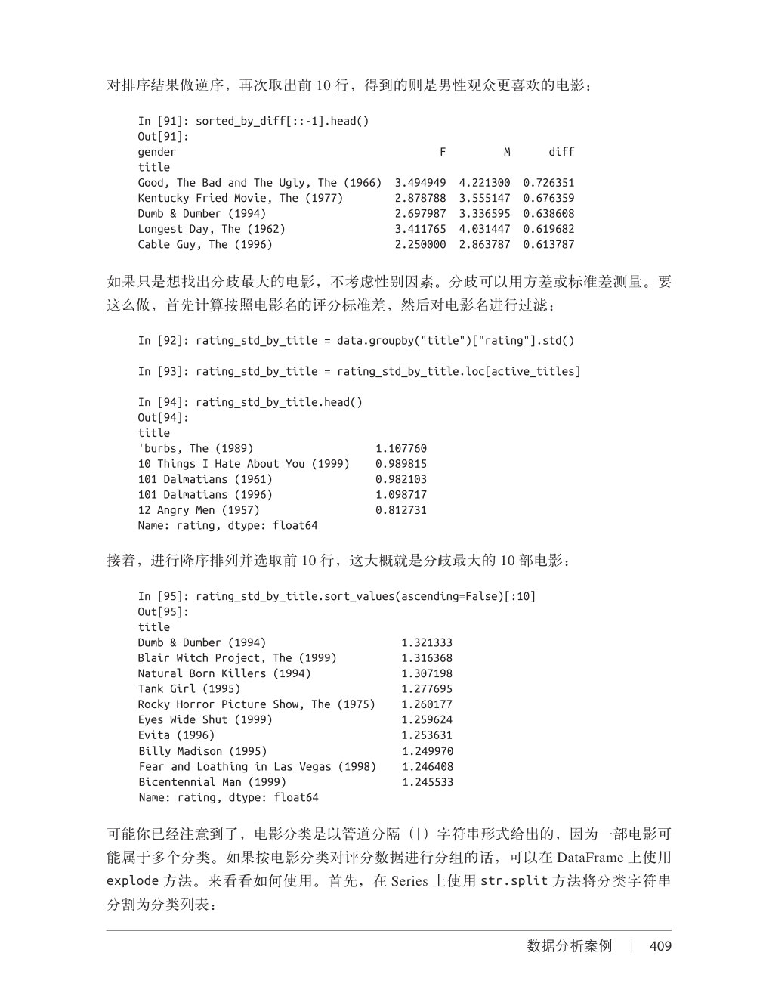

对排序结果做逆序，再次取出前 10 行，得到的则是男性观众更喜欢的电影：

```python
sorted_by_diff[::-1].head()
```

```text
gender                                        F         M      diff
title
Good, The Bad and The Ugly, The (1966)  3.494949  4.221300  0.726351
Kentucky Fried Movie, The (1977)        2.878788  3.555147  0.676359
Dumb & Dumber (1994)                    2.697987  3.336595  0.638608
Longest Day, The (1962)                 3.411765  4.031447  0.619682
Cable Guy, The (1996)                   2.250000  2.863787  0.613787
```

如果只是想找出分歧最大的电影，不考虑性别因素。分歧可以用方差或标准差测量。要这么做，首先计算按照电影名的评分标准差，然后对电影名进行过滤：

```python
rating_std_by_title = data.groupby("title")["rating"].std()
rating_std_by_title = rating_std_by_title.loc[active_titles]
rating_std_by_title.head()
```

```text
title
'burbs, The (1989)                   1.107760
10 Things I Hate About You (1999)    0.989815
101 Dalmatians (1961)                0.982103
101 Dalmatians (1996)                1.098717
12 Angry Men (1957)                  0.812731
Name: rating, dtype: float64
```

接着，进行降序排列并选取前 10 行，这大概就是分歧最大的 10 部电影：

```python
rating_std_by_title.sort_values(ascending=False)[:10]
```

```text
title
Dumb & Dumber (1994)                         1.321333
Blair Witch Project, The (1999)              1.316368
Natural Born Killers (1994)                  1.307198
Tank Girl (1995)                             1.277695
Rocky Horror Picture Show, The (1975)        1.260177
Eyes Wide Shut (1999)                        1.259624
Evita (1996)                                 1.253631
Billy Madison (1995)                         1.249970
Fear and Loathing in Las Vegas (1998)        1.246408
Bicentennial Man (1999)                      1.245533
Name: rating, dtype: float64
```

可能你已经注意到了，电影分类是以管道分隔（`|`）字符串形式给出的，因为一部电影可能属于多个分类。如果按电影分类对评分数据进行分组的话，可以在 DataFrame 上使用 `explode` 方法。来看看如何使用。首先，在 Series 上使用 `str.split` 方法将分类字符串分割为分类列表：

## PDF 第 420 页

<!-- page-status: reviewed -->

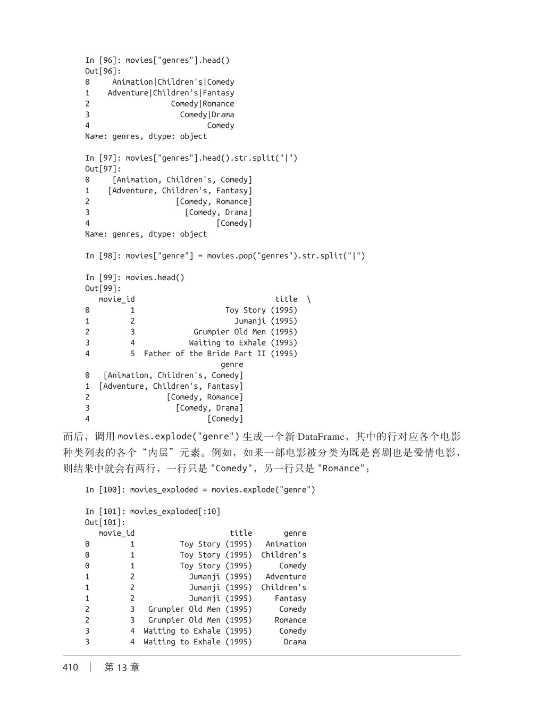

```python
movies["genres"].head()
```

```text
0        Animation|Children's|Comedy
1       Adventure|Children's|Fantasy
2                     Comedy|Romance
3                       Comedy|Drama
4                             Comedy
Name: genres, dtype: object
```

```python
movies["genres"].head().str.split("|")
```

```text
0        [Animation, Children's, Comedy]
1       [Adventure, Children's, Fantasy]
2                      [Comedy, Romance]
3                        [Comedy, Drama]
4                               [Comedy]
Name: genres, dtype: object
```

```python
movies["genre"] = movies.pop("genres").str.split("|")
movies.head()
```

```text
   movie_id                               title  \
0         1                    Toy Story (1995)
1         2                      Jumanji (1995)
2         3             Grumpier Old Men (1995)
3         4            Waiting to Exhale (1995)
4         5  Father of the Bride Part II (1995)

                            genre
0    [Animation, Children's, Comedy]
1   [Adventure, Children's, Fantasy]
2                  [Comedy, Romance]
3                    [Comedy, Drama]
4                           [Comedy]
```

而后，调用 `movies.explode("genre")` 生成一个新 DataFrame，其中的行对应各个电影种类列表的各个“内层”元素。例如，如果一部电影被分类为既是喜剧也是爱情电影，则结果中就会有两行，一行只是 `"Comedy"`，另一行只是 `"Romance"`：

```python
movies_exploded = movies.explode("genre")
movies_exploded[:10]
```

```text
   movie_id                       title       genre
0         1            Toy Story (1995)   Animation
0         1            Toy Story (1995)  Children's
0         1            Toy Story (1995)      Comedy
1         2              Jumanji (1995)   Adventure
1         2              Jumanji (1995)  Children's
1         2              Jumanji (1995)     Fantasy
2         3     Grumpier Old Men (1995)      Comedy
2         3     Grumpier Old Men (1995)     Romance
3         4    Waiting to Exhale (1995)      Comedy
3         4    Waiting to Exhale (1995)       Drama
```

## PDF 第 421 页

<!-- page-status: reviewed -->

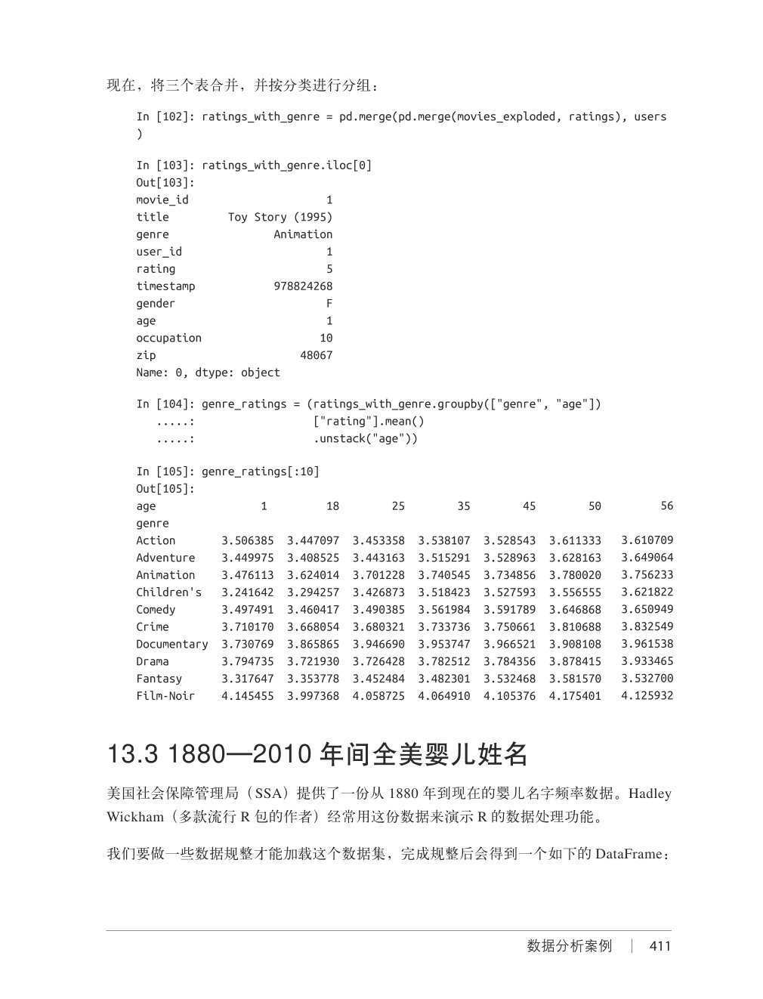

现在，将三个表合并，并按分类进行分组：

```python
ratings_with_genre = pd.merge(pd.merge(movies_exploded, ratings), users)
ratings_with_genre.iloc[0]
```

```text
movie_id                    1
title        Toy Story (1995)
genre               Animation
user_id                     1
rating                      5
timestamp           978824268
gender                      F
age                         1
occupation                 10
zip                     48067
Name: 0, dtype: object
```

```python
genre_ratings = (ratings_with_genre.groupby(["genre", "age"])
                 ["rating"].mean()
                 .unstack("age"))
genre_ratings[:10]
```

```text
age               1        18        25        35        45        50        56
genre
Action       3.506385  3.447097  3.453358  3.538107  3.528543  3.611333  3.610709
Adventure    3.449975  3.408525  3.443163  3.515291  3.528963  3.628163  3.649064
Animation    3.476113  3.624014  3.701228  3.740545  3.734856  3.780020  3.756233
Children's   3.241642  3.294257  3.426873  3.518423  3.527593  3.556555  3.621822
Comedy       3.497491  3.460417  3.490385  3.561984  3.591789  3.646868  3.650949
Crime        3.710170  3.668054  3.680321  3.733736  3.750661  3.810688  3.832549
Documentary  3.730769  3.865865  3.946690  3.953747  3.966521  3.908108  3.961538
Drama        3.794735  3.721930  3.726428  3.782512  3.784356  3.878415  3.933465
Fantasy      3.317647  3.353778  3.452484  3.482301  3.532468  3.581570  3.532700
Film-Noir    4.145455  3.997368  4.058725  4.064910  4.105376  4.175401  4.125932
```

## 13.3 1880—2010 年间全美婴儿姓名

美国社会保障管理局（SSA）提供了一份从 1880 年到现在的婴儿名字频率数据。Hadley Wickham（多款流行 R 包的作者）经常用这份数据来演示 R 的数据处理功能。

我们要做一些数据规整才能加载这个数据集，完成规整后会得到一个如下的 DataFrame：

## PDF 第 422 页

<!-- page-status: reviewed -->

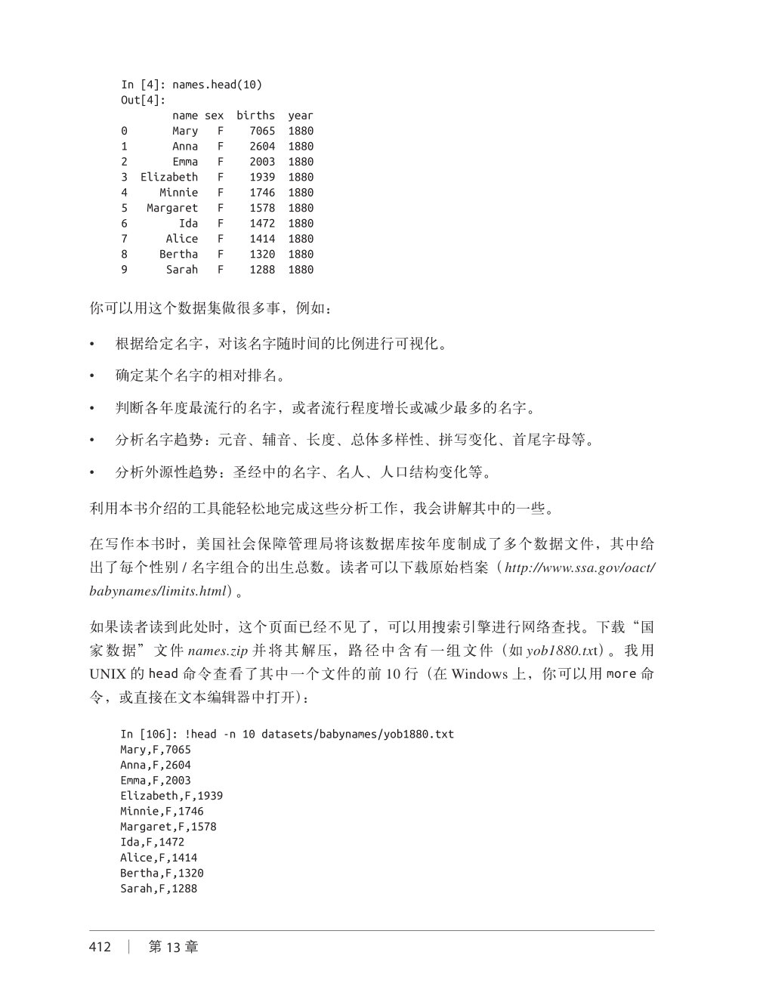

```python
names.head(10)
```

```text
        name sex  births  year
0       Mary   F    7065  1880
1       Anna   F    2604  1880
2       Emma   F    2003  1880
3  Elizabeth   F    1939  1880
4     Minnie   F    1746  1880
5   Margaret   F    1578  1880
6        Ida   F    1472  1880
7      Alice   F    1414  1880
8     Bertha   F    1320  1880
9      Sarah   F    1288  1880
```

你可以用这个数据集做很多事，例如：

- 根据给定名字，对该名字随时间的比例进行可视化。
- 确定某个名字的相对排名。
- 判断各年度最流行的名字，或者流行程度增长或减少最多的名字。
- 分析名字趋势：元音、辅音、长度、总体多样性、拼写变化、首尾字母等。
- 分析外源性趋势：圣经中的名字、名人、人口结构变化等。

利用本书介绍的工具能轻松地完成这些分析工作，我会讲解其中的一些。

在写作本书时，美国社会保障管理局将该数据库按年度制成了多个数据文件，其中给出了每个性别/名字组合的出生总数。读者可以下载原始档案（http://www.ssa.gov/oact/babynames/limits.html）。

如果读者读到此处时，这个页面已经不见了，可以用搜索引擎进行网络查找。下载“国家数据”文件 `names.zip` 并将其解压，路径中含有一组文件（如 `yob1880.txt`）。我用 UNIX 的 `head` 命令查看了其中一个文件的前 10 行（在 Windows 上，你可以用 `more` 命令，或直接在文本编辑器中打开）：

```text
!head -n 10 datasets/babynames/yob1880.txt
Mary,F,7065
Anna,F,2604
Emma,F,2003
Elizabeth,F,1939
Minnie,F,1746
Margaret,F,1578
Ida,F,1472
Alice,F,1414
Bertha,F,1320
Sarah,F,1288
```

## PDF 第 423 页

<!-- page-status: reviewed -->

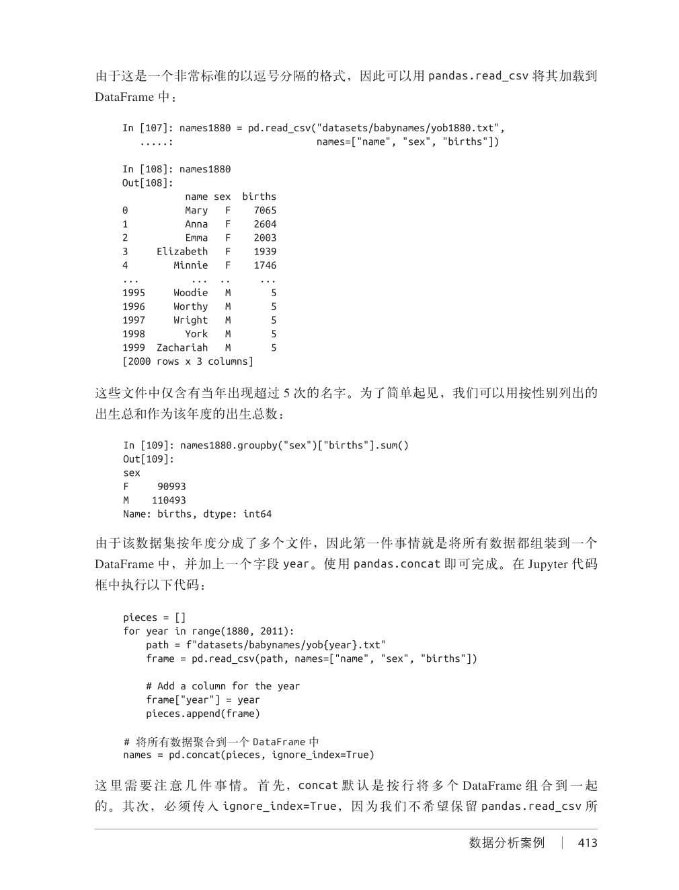

由于这是一个非常标准的以逗号分隔的格式，因此可以用 `pandas.read_csv` 将其加载到 DataFrame 中：

```python
names1880 = pd.read_csv("datasets/babynames/yob1880.txt",
                        names=["name", "sex", "births"])
names1880
```

```text
           name sex  births
0          Mary   F    7065
1          Anna   F    2604
2          Emma   F    2003
3     Elizabeth   F    1939
4        Minnie   F    1746
...         ...  ..     ...
1995     Woodie   M       5
1996     Worthy   M       5
1997     Wright   M       5
1998       York   M       5
1999  Zachariah   M       5
[2000 rows x 3 columns]
```

这些文件中仅含有当年出现超过 5 次的名字。为了简单起见，我们可以用按性别列出的出生总和作为该年度的出生总数：

```python
names1880.groupby("sex")["births"].sum()
```

```text
sex
F     90993
M    110493
Name: births, dtype: int64
```

由于该数据集按年度分成了多个文件，因此第一件事情就是将所有数据都组装到一个 DataFrame 中，并加上一个字段 `year`。使用 `pandas.concat` 即可完成。在 Jupyter 代码框中执行以下代码：

```python
pieces = []
for year in range(1880, 2011):
    path = f"datasets/babynames/yob{year}.txt"
    frame = pd.read_csv(path, names=["name", "sex", "births"])

    # Add a column for the year
    frame["year"] = year
    pieces.append(frame)

# 将所有数据聚合到一个 DataFrame 中
names = pd.concat(pieces, ignore_index=True)
```

这里需要注意几件事情。首先，`concat` 默认是按行将多个 DataFrame 组合到一起的。其次，必须传入 `ignore_index=True`，因为我们不希望保留 `pandas.read_csv` 所

## PDF 第 424 页

<!-- page-status: reviewed -->

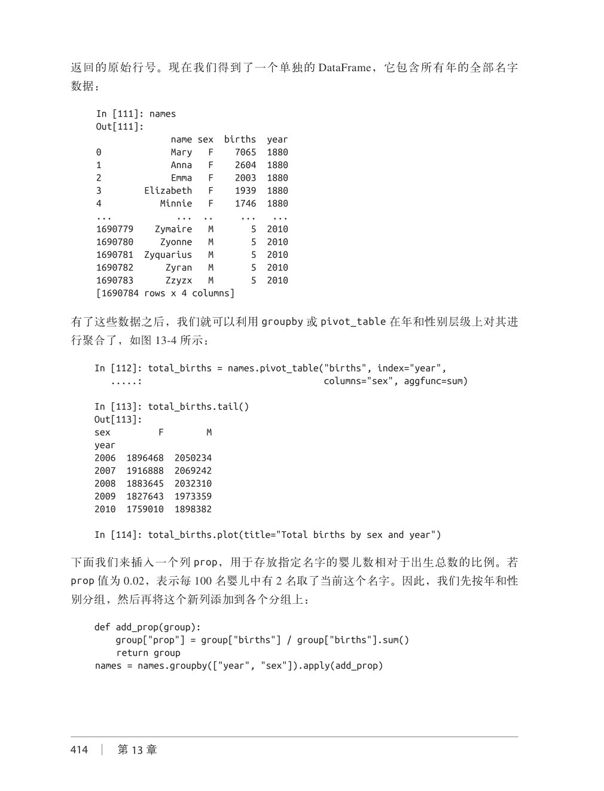

返回的原始行号。现在我们得到了一个单独的 DataFrame，它包含所有年的全部名字数据：

```python
names
```

```text
              name sex  births  year
0             Mary   F    7065  1880
1             Anna   F    2604  1880
2             Emma   F    2003  1880
3        Elizabeth   F    1939  1880
4           Minnie   F    1746  1880
...            ...  ..     ...   ...
1690779    Zymaire   M       5  2010
1690780     Zyonne   M       5  2010
1690781   Zyquarius   M       5  2010
1690782      Zyran   M       5  2010
1690783      Zzyzx   M       5  2010
[1690784 rows x 4 columns]
```

有了这些数据之后，我们就可以利用 `groupby` 或 `pivot_table` 在年和性别层级上对其进行聚合了，如图 13-4 所示：

```python
total_births = names.pivot_table("births", index="year",
                                 columns="sex", aggfunc=sum)
total_births.tail()
```

```text
sex         F        M
year
2006  1896468  2050234
2007  1916888  2069242
2008  1883645  2032310
2009  1827643  1973359
2010  1759010  1898382
```

```python
total_births.plot(title="Total births by sex and year")
```

下面我们来插入一个列 `prop`，用于存放指定名字的婴儿数相对于出生总数的比例。若 `prop` 值为 0.02，表示每 100 名婴儿中有 2 名取了当前这个名字。因此，我们先按年和性别分组，然后再将这个新列添加到各个分组上：

```python
def add_prop(group):
    group["prop"] = group["births"] / group["births"].sum()
    return group

names = names.groupby(["year", "sex"]).apply(add_prop)
```

## PDF 第 425 页

<!-- page-status: reviewed -->

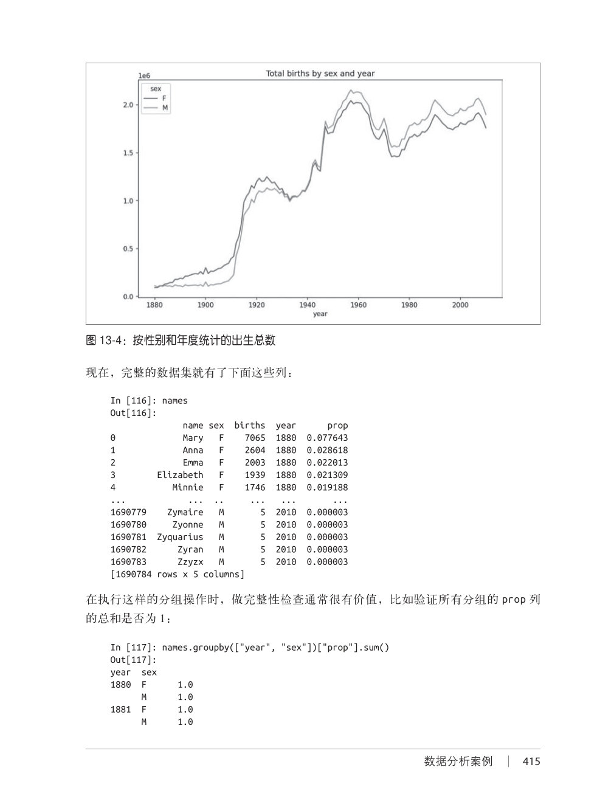

图 13-4：按性别和年度统计的出生总数（见原页图）。

现在，完整的数据集就有了下面这些列：

```python
names
```

```text
              name sex  births  year      prop
0             Mary   F    7065  1880  0.077643
1             Anna   F    2604  1880  0.028618
2             Emma   F    2003  1880  0.022013
3        Elizabeth   F    1939  1880  0.021309
4           Minnie   F    1746  1880  0.019188
...            ...  ..     ...   ...       ...
1690779    Zymaire   M       5  2010  0.000003
1690780     Zyonne   M       5  2010  0.000003
1690781   Zyquarius   M       5  2010  0.000003
1690782      Zyran   M       5  2010  0.000003
1690783      Zzyzx   M       5  2010  0.000003
[1690784 rows x 5 columns]
```

在执行这样的分组操作时，做完整性检查通常很有价值，比如验证所有分组的 `prop` 列的总和是否为 1：

```python
names.groupby(["year", "sex"])["prop"].sum()
```

```text
year  sex
1880  F      1.0
      M      1.0
1881  F      1.0
      M      1.0
```

（输出接下页。）

## PDF 第 426 页

<!-- page-status: reviewed -->

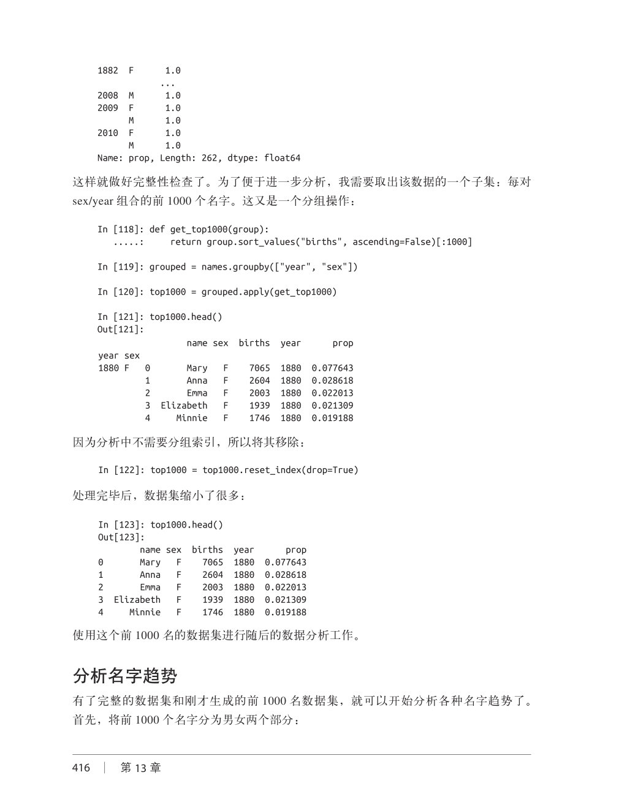

```text
1882  F      1.0
          ...
2008  M      1.0
2009  F      1.0
      M      1.0
2010  F      1.0
      M      1.0
Name: prop, Length: 262, dtype: float64
```

这样就做好完整性检查了。为了便于进一步分析，我需要取出该数据的一个子集：每对 sex/year 组合的前 1000 个名字。这又是一个分组操作：

```python
def get_top1000(group):
    return group.sort_values("births", ascending=False)[:1000]

grouped = names.groupby(["year", "sex"])
top1000 = grouped.apply(get_top1000)
top1000.head()
```

```text
                name sex  births  year      prop
year sex
1880 F   0       Mary   F    7065  1880  0.077643
         1       Anna   F    2604  1880  0.028618
         2       Emma   F    2003  1880  0.022013
         3  Elizabeth   F    1939  1880  0.021309
         4     Minnie   F    1746  1880  0.019188
```

因为分析中不需要分组索引，所以将其移除：

```python
top1000 = top1000.reset_index(drop=True)
```

处理完毕后，数据集缩小了很多：

```python
top1000.head()
```

```text
        name sex  births  year      prop
0       Mary   F    7065  1880  0.077643
1       Anna   F    2604  1880  0.028618
2       Emma   F    2003  1880  0.022013
3  Elizabeth   F    1939  1880  0.021309
4     Minnie   F    1746  1880  0.019188
```

使用这个前 1000 名的数据集进行随后的数据分析工作。

### 分析名字趋势

有了完整的数据集和刚才生成的前 1000 名数据集，就可以开始分析各种名字趋势了。首先，将前 1000 个名字分为男女两个部分：

## PDF 第 427 页

<!-- page-status: reviewed -->

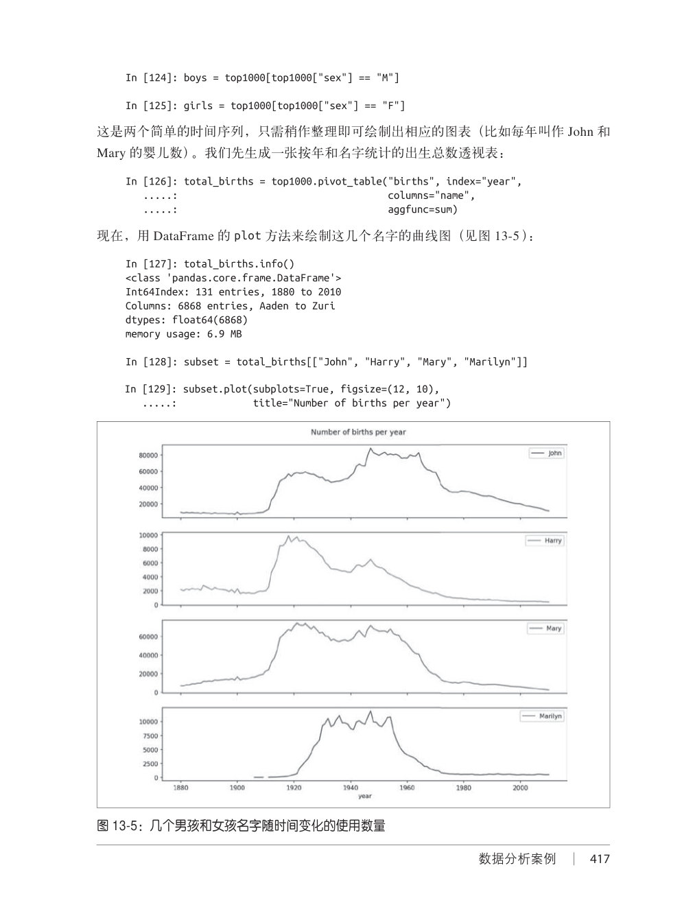

```python
boys = top1000[top1000["sex"] == "M"]
girls = top1000[top1000["sex"] == "F"]
```

这是两个简单的时间序列，只需稍作整理即可绘制出相应的图表（比如每年叫作 John 和 Mary 的婴儿数）。我们先生成一张按年和名字统计的出生总数透视表：

```python
total_births = top1000.pivot_table("births", index="year",
                                   columns="name",
                                   aggfunc=sum)
```

现在，用 DataFrame 的 `plot` 方法来绘制这几个名字的曲线图（见图 13-5）：

```python
total_births.info()
```

```text
<class 'pandas.core.frame.DataFrame'>
Int64Index: 131 entries, 1880 to 2010
Columns: 6868 entries, Aaden to Zuri
dtypes: float64(6868)
memory usage: 6.9 MB
```

```python
subset = total_births[["John", "Harry", "Mary", "Marilyn"]]
subset.plot(subplots=True, figsize=(12, 10),
            title="Number of births per year")
```

图 13-5：几个男孩和女孩名字随时间变化的使用数量（见原页图）。

## PDF 第 428 页

<!-- page-status: reviewed -->

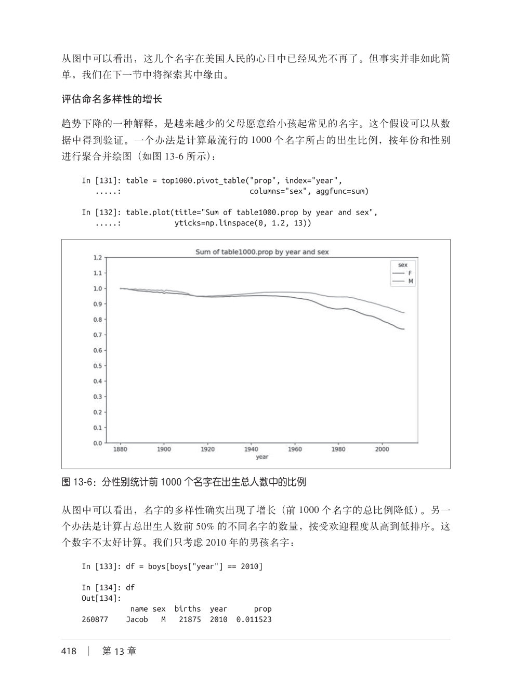

从图中可以看出，这几个名字在美国人民的心目中已经风光不再了。但事实并非如此简单，我们在下一节中将探索其中缘由。

### 评估命名多样性的增长

趋势下降的一种解释，是越来越少的父母愿意给小孩起常见的名字。这个假设可以从数据中得到验证。一个办法是计算最流行的 1000 个名字所占的出生比例，按年份和性别进行聚合并绘图（如图 13-6 所示）：

```python
table = top1000.pivot_table("prop", index="year",
                            columns="sex", aggfunc=sum)
table.plot(title="Sum of table1000.prop by year and sex",
           yticks=np.linspace(0, 1.2, 13))
```

图 13-6：分性别统计前 1000 个名字在出生总人数中的比例（见原页图）。

从图中可以看出，名字的多样性确实出现了增长（前 1000 个名字的总比例降低）。另一个办法是计算占总出生人数前 50% 的不同名字的数量，按受欢迎程度从高到低排序。这个数字不太好计算。我们只考虑 2010 年的男孩名字：

```python
df = boys[boys["year"] == 2010]
df
```

```text
          name sex  births  year      prop
260877   Jacob   M   21875  2010  0.011523
```

（输出接下页。）

## PDF 第 429 页

<!-- page-status: reviewed -->

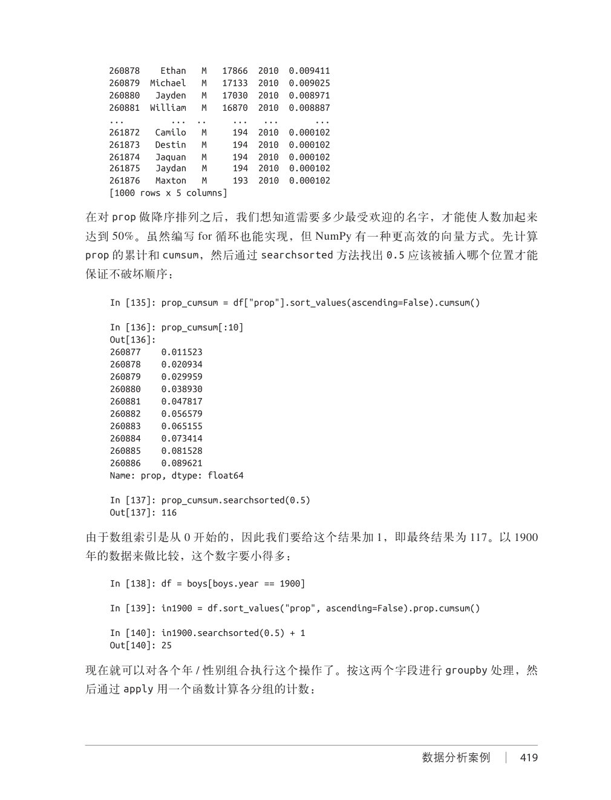

上一页表格输出续：

```text
260878     Ethan   M   17866  2010  0.009411
260879   Michael   M   17133  2010  0.009025
260880    Jayden   M   17030  2010  0.008971
260881   William   M   16870  2010  0.008887
...          ...  ..     ...   ...       ...
261872    Camilo   M     194  2010  0.000102
261873    Destin   M     194  2010  0.000102
261874    Jaquan   M     194  2010  0.000102
261875    Jaydan   M     194  2010  0.000102
261876    Maxton   M     193  2010  0.000102
[1000 rows x 5 columns]
```

在对 `prop` 做降序排列之后，我们想知道需要多少最受欢迎的名字，才能使人数加起来达到 50%。虽然编写 `for` 循环也能实现，但 NumPy 有一种更高效的向量方式。先计算 `prop` 的累计和 `cumsum`，然后通过 `searchsorted` 方法找出 `0.5` 应该被插入哪个位置才能保证不破坏顺序：

```python
# In [135]–[136]
prop_cumsum = df["prop"].sort_values(ascending=False).cumsum()
prop_cumsum[:10]
```

```text
Out[136]:
260877    0.011523
260878    0.020934
260879    0.029959
260880    0.038930
260881    0.047817
260882    0.056579
260883    0.065155
260884    0.073414
260885    0.081528
260886    0.089621
Name: prop, dtype: float64
```

```python
# In [137]
prop_cumsum.searchsorted(0.5)
```

```text
Out[137]: 116
```

由于数组索引是从 0 开始的，因此我们要给这个结果加 1，即最终结果为 117。以 1900 年的数据来做比较，这个数字要小得多：

```python
# In [138]–[140]
df = boys[boys.year == 1900]
in1900 = df.sort_values("prop", ascending=False).prop.cumsum()
in1900.searchsorted(0.5) + 1
```

```text
Out[140]: 25
```

现在就可以对各个年 / 性别组合执行这个操作了。按这两个字段进行 `groupby` 处理，然后通过 `apply` 用一个函数计算各分组的计数：

## PDF 第 430 页

<!-- page-status: reviewed -->

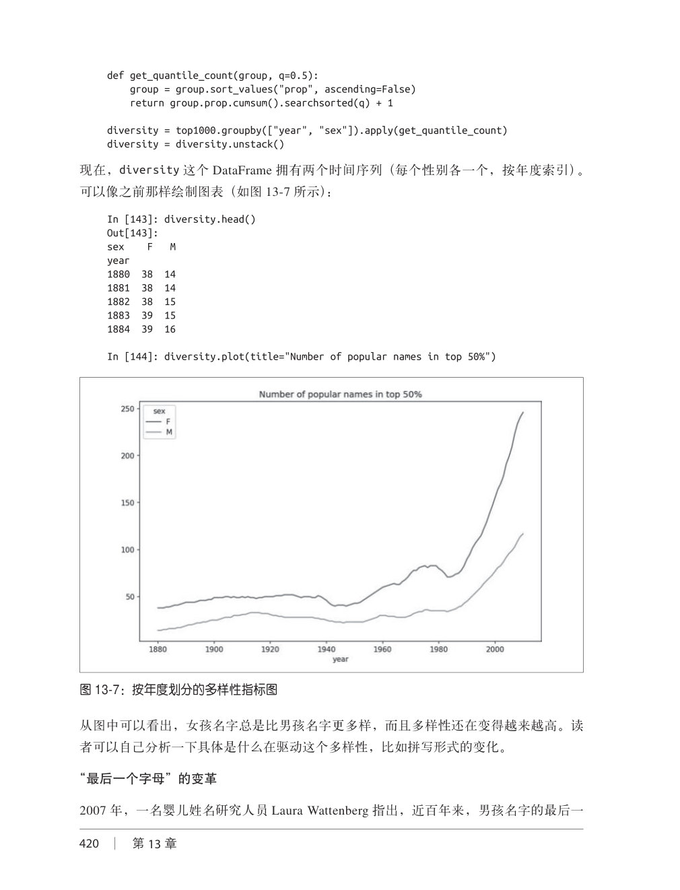

```python
def get_quantile_count(group, q=0.5):
    group = group.sort_values("prop", ascending=False)
    return group.prop.cumsum().searchsorted(q) + 1

diversity = top1000.groupby(["year", "sex"]).apply(get_quantile_count)
diversity = diversity.unstack()
```

现在，`diversity` 这个 DataFrame 拥有两个时间序列（每个性别各一个，按年度索引）。可以像之前那样绘制图表（如图 13-7 所示）：

```python
# In [143]
diversity.head()
```

```text
Out[143]:
sex    F   M
year
1880  38  14
1881  38  14
1882  38  15
1883  39  15
1884  39  16
```

```python
# In [144]
diversity.plot(title="Number of popular names in top 50%")
```

图 13-7：按年度划分的多样性指标图。图见本页原图。

从图中可以看出，女孩名字总是比男孩名字更多样，而且多样性还在变得越来越高。读者可以自己分析一下具体是什么在驱动这个多样性，比如拼写形式的变化。

#### “最后一个字母”的变革

2007 年，一名婴儿姓名研究人员 Laura Wattenberg 指出，近百年来，男孩名字的最后一

## PDF 第 431 页

<!-- page-status: reviewed -->

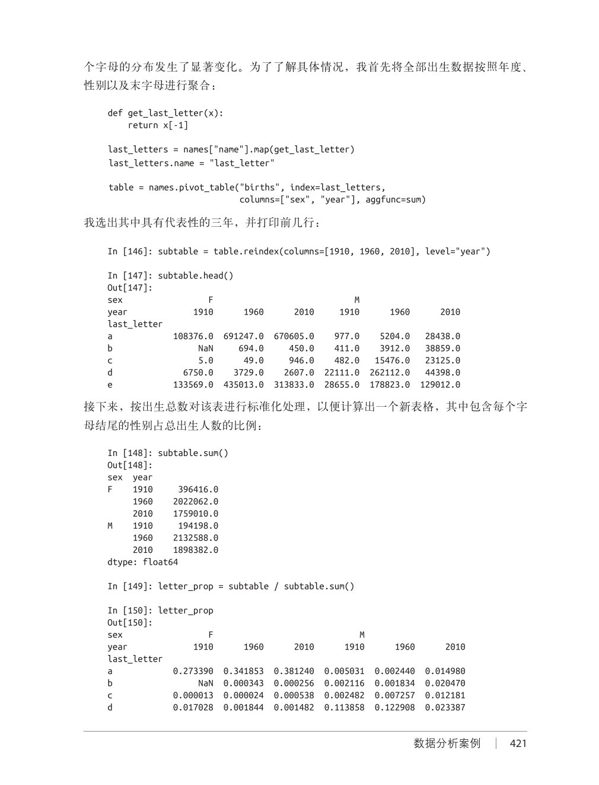

个字母的分布发生了显著变化。为了了解具体情况，我首先将全部出生数据按照年度、性别以及末字母进行聚合：

```python
def get_last_letter(x):
    return x[-1]

last_letters = names["name"].map(get_last_letter)
last_letters.name = "last_letter"

table = names.pivot_table("births", index=last_letters,
                          columns=["sex", "year"], aggfunc=sum)
```

我选出其中具有代表性的三年，并打印前几行：

```python
# In [146]–[147]
subtable = table.reindex(columns=[1910, 1960, 2010], level="year")
subtable.head()
```

```text
Out[147]:
sex                   F                          M
year               1910      1960      2010    1910      1960      2010
last_letter
a              108376.0  691247.0  670605.0   977.0    5204.0   28438.0
b                   NaN     694.0     450.0   411.0    3912.0   38859.0
c                   5.0      49.0     946.0   482.0   15476.0   23125.0
d                6750.0    3729.0    2607.0  22111.0  262112.0   44398.0
e              133569.0  435013.0  313833.0  28655.0  178823.0  129012.0
```

接下来，按出生总数对该表进行标准化处理，以便计算出一个新表格，其中包含每个字母结尾的性别占总出生人数的比例：

```python
# In [148]
subtable.sum()
```

```text
Out[148]:
sex  year
F    1910     396416.0
     1960    2022062.0
     2010    1759010.0
M    1910     194198.0
     1960    2132588.0
     2010    1898382.0
dtype: float64
```

```python
# In [149]–[150]
letter_prop = subtable / subtable.sum()
letter_prop
```

```text
Out[150]:
sex                   F                             M
year               1910      1960      2010      1910      1960      2010
last_letter
a              0.273390  0.341853  0.381240  0.005031  0.002440  0.014980
b                   NaN  0.000343  0.000256  0.002116  0.001834  0.020470
c              0.000013  0.000024  0.000538  0.002482  0.007257  0.012181
d              0.017028  0.001844  0.001482  0.113858  0.122908  0.023387
```

输出续见下一页。

## PDF 第 432 页

<!-- page-status: reviewed -->

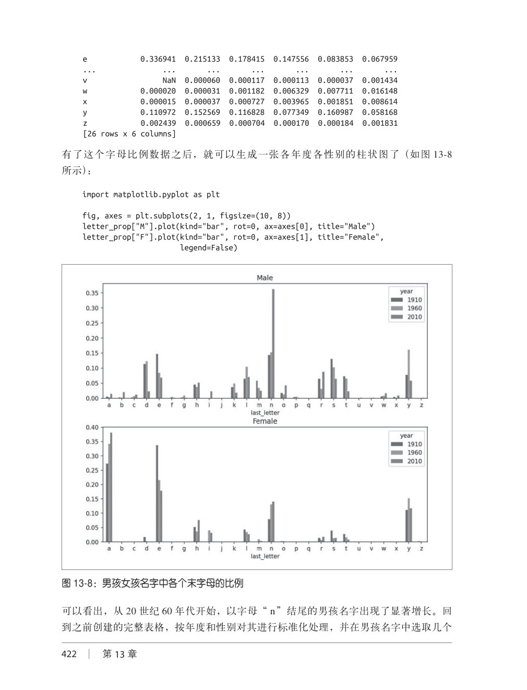

```text
Out[150] 续：
e              0.336941  0.215133  0.178415  0.147556  0.083853  0.067959
...                 ...       ...       ...       ...       ...       ...
v                   NaN  0.000060  0.000117  0.000113  0.000037  0.001434
w              0.000020  0.000031  0.001182  0.006329  0.007711  0.016148
x              0.000015  0.000037  0.000727  0.003965  0.001851  0.008614
y              0.110972  0.152569  0.116828  0.077349  0.160987  0.058168
z              0.002439  0.000659  0.000704  0.000170  0.000184  0.001831
[26 rows x 6 columns]
```

有了这个字母比例数据之后，就可以生成一张各年度各性别的柱状图了（如图 13-8 所示）：

```python
import matplotlib.pyplot as plt

fig, axes = plt.subplots(2, 1, figsize=(10, 8))
letter_prop["M"].plot(kind="bar", rot=0, ax=axes[0], title="Male")
letter_prop["F"].plot(kind="bar", rot=0, ax=axes[1], title="Female",
                      legend=False)
```

图 13-8：男孩女孩名字中各个末字母的比例。图见本页原图。

可以看出，从 20 世纪 60 年代开始，以字母“n”结尾的男孩名字出现了显著增长。回到之前创建的完整表格，按年度和性别对其进行标准化处理，并在男孩名字中选取几个

## PDF 第 433 页

<!-- page-status: reviewed -->

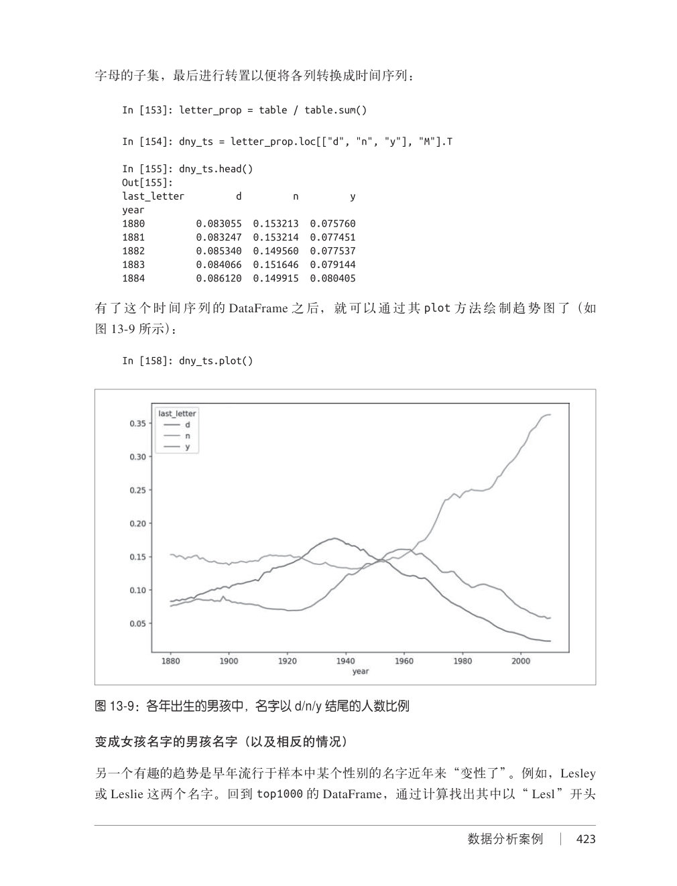

字母的子集，最后进行转置以便将各列转换成时间序列：

```python
# In [153]–[155]
letter_prop = table / table.sum()
dny_ts = letter_prop.loc[["d", "n", "y"], "M"].T
dny_ts.head()
```

```text
Out[155]:
last_letter         d         n         y
year
1880         0.083055  0.153213  0.075760
1881         0.083247  0.153214  0.077451
1882         0.085340  0.149560  0.077537
1883         0.084066  0.151646  0.079144
1884         0.086120  0.149915  0.080405
```

有了这个时间序列的 DataFrame 之后，就可以通过其 `plot` 方法绘制趋势图了（如图 13-9 所示）：

```python
# In [158]
dny_ts.plot()
```

图 13-9：各年出生的男孩中，名字以 d/n/y 结尾的人数比例。图见本页原图。

#### 变成女孩名字的男孩名字（以及相反的情况）

另一个有趣的趋势是早年流行于样本中某个性别的名字近年来“变性了”。例如，Lesley 或 Leslie 这两个名字。回到 `top1000` 的 DataFrame，通过计算找出其中以“Lesl”开头

## PDF 第 434 页

<!-- page-status: reviewed -->

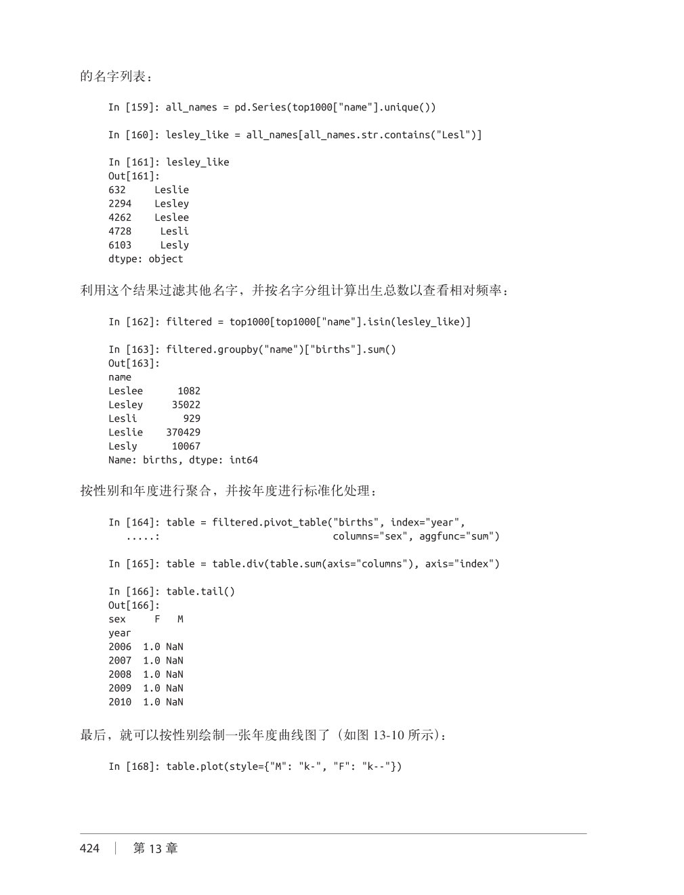

的名字列表：

```python
# In [159]–[161]
all_names = pd.Series(top1000["name"].unique())
lesley_like = all_names[all_names.str.contains("Lesl")]
lesley_like
```

```text
Out[161]:
632     Leslie
2294    Lesley
4262    Leslee
4728     Lesli
6103     Lesly
dtype: object
```

利用这个结果过滤其他名字，并按名字分组计算出生总数以查看相对频率：

```python
# In [162]–[163]
filtered = top1000[top1000["name"].isin(lesley_like)]
filtered.groupby("name")["births"].sum()
```

```text
Out[163]:
name
Leslee      1082
Lesley     35022
Lesli        929
Leslie    370429
Lesly      10067
Name: births, dtype: int64
```

按性别和年度进行聚合，并按年度进行标准化处理：

```python
# In [164]–[166]
table = filtered.pivot_table("births", index="year",
                             columns="sex", aggfunc="sum")
table = table.div(table.sum(axis="columns"), axis="index")
table.tail()
```

```text
Out[166]:
sex     F   M
year
2006  1.0 NaN
2007  1.0 NaN
2008  1.0 NaN
2009  1.0 NaN
2010  1.0 NaN
```

最后，就可以按性别绘制一张年度曲线图了（如图 13-10 所示）：

```python
# In [168]
table.plot(style={"M": "k-", "F": "k--"})
```

## PDF 第 435 页

<!-- page-status: reviewed -->

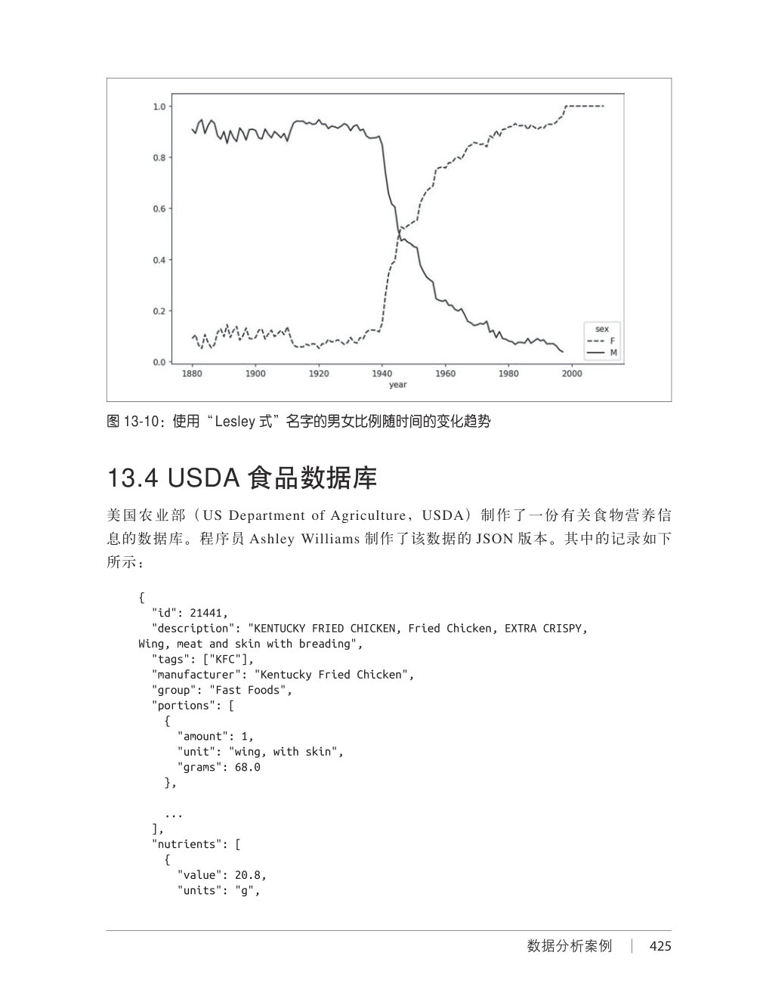

**图 13-10：使用“Lesley 式”名字的男女比例随时间的变化趋势**（见本页原页图）。

### 13.4 USDA 食品数据库

美国农业部（US Department of Agriculture，USDA）制作了一份有关食物营养信息的数据库。程序员 Ashley Williams 制作了该数据的 JSON 版本。其中的记录如下所示：

```text
{
  "id": 21441,
  "description": "KENTUCKY FRIED CHICKEN, Fried Chicken, EXTRA CRISPY,
Wing, meat and skin with breading",
  "tags": ["KFC"],
  "manufacturer": "Kentucky Fried Chicken",
  "group": "Fast Foods",
  "portions": [
    {
      "amount": 1,
      "unit": "wing, with skin",
      "grams": 68.0
    },
    ...
  ],
  "nutrients": [
    {
      "value": 20.8,
      "units": "g",
```

原书示例省略部分字段，续见下页；其中长字符串为原书版面换行。

## PDF 第 436 页

<!-- page-status: reviewed -->

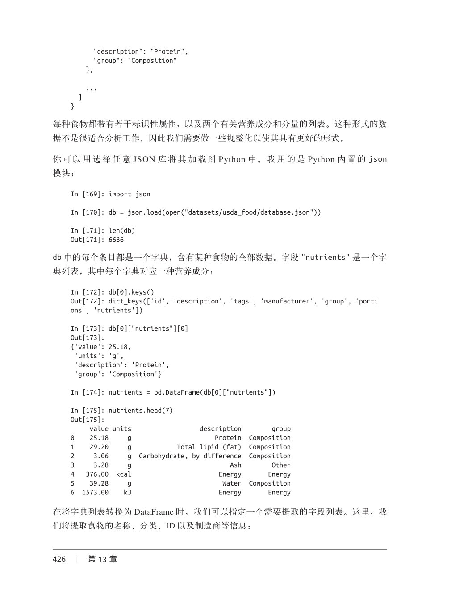

上一页 JSON 摘录续：

```text
      "description": "Protein",
      "group": "Composition"
    },
    ...
  ]
}
```

每种食物都带有若干标识性属性，以及两个有关营养成分和分量的列表。这种形式的数据不是很适合分析工作，因此我们需要做一些规整化以使其具有更好的形式。

你可以用选择任意 JSON 库将其加载到 Python 中。我用的是 Python 内置的 `json` 模块：

```python
import json

db = json.load(open("datasets/usda_food/database.json"))
len(db)
```

```text
Out[171]: 6636
```

`db` 中的每个条目都是一个字典，含有某种食物的全部数据。字段 `"nutrients"` 是一个字典列表，其中每个字典对应一种营养成分：

```python
db[0].keys()
```

```text
Out[172]: dict_keys(['id', 'description', 'tags', 'manufacturer', 'group', 'portions', 'nutrients'])
```

```python
db[0]["nutrients"][0]
```

```text
Out[173]:
{'value': 25.18,
 'units': 'g',
 'description': 'Protein',
 'group': 'Composition'}
```

```python
nutrients = pd.DataFrame(db[0]["nutrients"])
nutrients.head(7)
```

```text
Out[175]:
    value units                  description        group
0   25.18     g                      Protein  Composition
1   29.20     g            Total lipid (fat)  Composition
2    3.06     g  Carbohydrate, by difference  Composition
3    3.28     g                          Ash        Other
4  376.00  kcal                       Energy       Energy
5   39.28     g                        Water  Composition
6 1573.00    kJ                       Energy       Energy
```

在将字典列表转换为 DataFrame 时，我们可以指定一个需要提取的字段列表。这里，我们将提取食物的名称、分类、ID 以及制造商等信息：

## PDF 第 437 页

<!-- page-status: reviewed -->

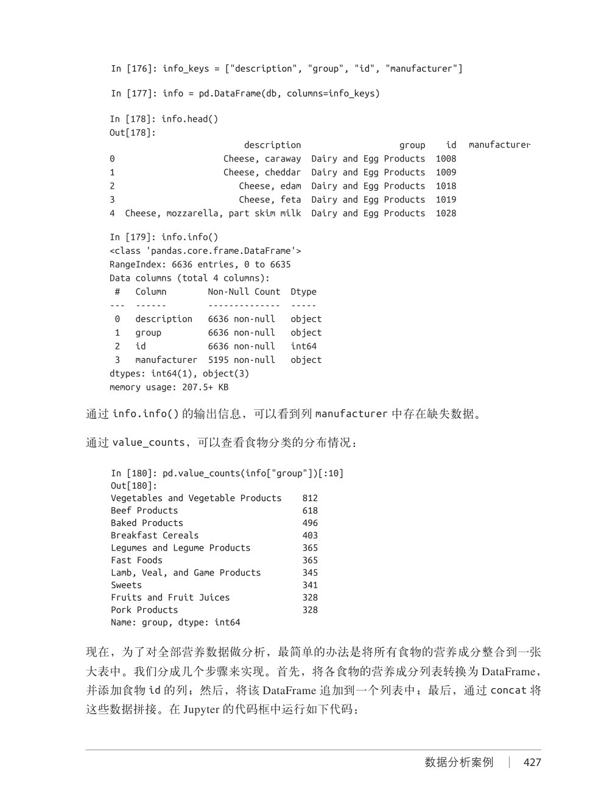

```python
info_keys = ["description", "group", "id", "manufacturer"]
info = pd.DataFrame(db, columns=info_keys)
info.head()
```

```text
Out[178]:
                              description                 group    id manufacturer
0                        Cheese, caraway   Dairy and Egg Products  1008
1                        Cheese, cheddar   Dairy and Egg Products  1009
2                           Cheese, edam   Dairy and Egg Products  1018
3                           Cheese, feta   Dairy and Egg Products  1019
4  Cheese, mozzarella, part skim milk       Dairy and Egg Products  1028
```

```python
info.info()
```

```text
<class 'pandas.core.frame.DataFrame'>
RangeIndex: 6636 entries, 0 to 6635
Data columns (total 4 columns):
 #   Column        Non-Null Count  Dtype
---  ------        --------------  -----
 0   description   6636 non-null   object
 1   group         6636 non-null   object
 2   id            6636 non-null   int64
 3   manufacturer  5195 non-null   object
dtypes: int64(1), object(3)
memory usage: 207.5+ KB
```

通过 `info.info()` 的输出信息，可以看到列 `manufacturer` 中存在缺失数据。

通过 `value_counts`，可以查看食物分类的分布情况：

```python
pd.value_counts(info["group"])[:10]
```

```text
Out[180]:
Vegetables and Vegetable Products    812
Beef Products                        618
Baked Products                       496
Breakfast Cereals                    403
Legumes and Legume Products          365
Fast Foods                           365
Lamb, Veal, and Game Products        345
Sweets                               341
Fruits and Fruit Juices               328
Pork Products                        328
Name: group, dtype: int64
```

现在，为了对全部营养数据做分析，最简单的办法是将所有食物的营养成分整合到一张大表中。我们分成几个步骤来实现。首先，将各食物的营养成分列表转换为 DataFrame，并添加食物 `id` 的列；然后，将该 DataFrame 追加到一个列表中；最后，通过 `concat` 将这些数据拼接。在 Jupyter 的代码框中运行如下代码：

## PDF 第 438 页

<!-- page-status: reviewed -->

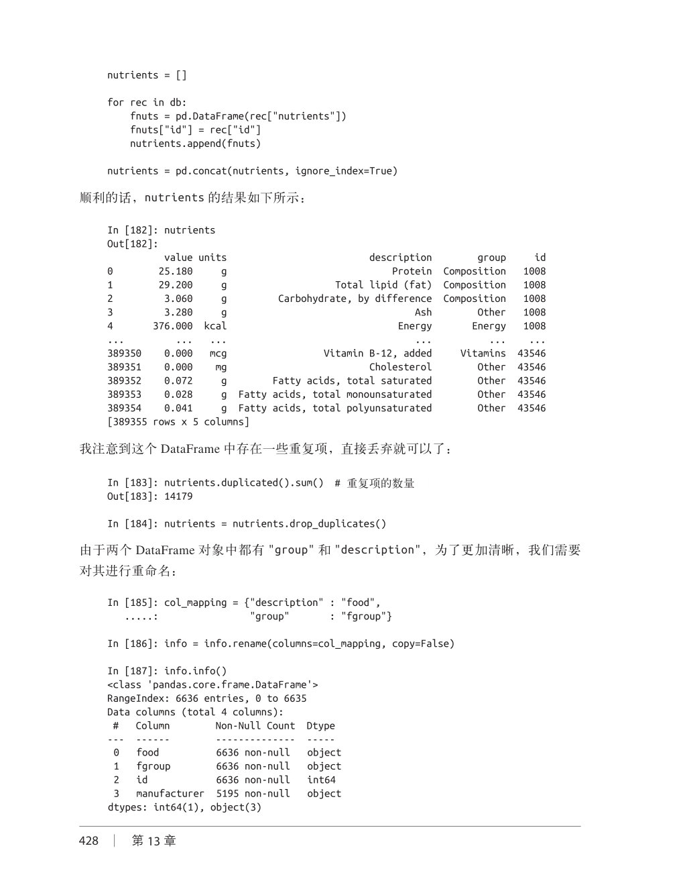

```python
nutrients = []

for rec in db:
    fnuts = pd.DataFrame(rec["nutrients"])
    fnuts["id"] = rec["id"]
    nutrients.append(fnuts)

nutrients = pd.concat(nutrients, ignore_index=True)
```

顺利的话，`nutrients` 的结果如下所示：

```python
nutrients
```

```text
Out[182]:
          value units                        description        group     id
0        25.180     g                            Protein  Composition   1008
1        29.200     g                  Total lipid (fat)  Composition   1008
2         3.060     g        Carbohydrate, by difference  Composition   1008
3         3.280     g                                Ash        Other   1008
4       376.000  kcal                             Energy       Energy   1008
...         ...   ...                                ...          ...    ...
389350    0.000   mcg                Vitamin B-12, added     Vitamins  43546
389351    0.000    mg                        Cholesterol        Other  43546
389352    0.072     g         Fatty acids, total saturated       Other  43546
389353    0.028     g    Fatty acids, total monounsaturated       Other  43546
389354    0.041     g    Fatty acids, total polyunsaturated       Other  43546
[389355 rows x 5 columns]
```

我注意到这个 DataFrame 中存在一些重复项，直接丢弃就可以了：

```python
nutrients.duplicated().sum()  # 重复项的数量
```

```text
Out[183]: 14179
```

```python
nutrients = nutrients.drop_duplicates()
```

由于两个 DataFrame 对象中都有 `"group"` 和 `"description"`，为了更加清晰，我们需要对其进行重命名：

```python
col_mapping = {"description": "food",
               "group": "fgroup"}
info = info.rename(columns=col_mapping, copy=False)
info.info()
```

```text
<class 'pandas.core.frame.DataFrame'>
RangeIndex: 6636 entries, 0 to 6635
Data columns (total 4 columns):
 #   Column        Non-Null Count  Dtype
---  ------        --------------  -----
 0   food          6636 non-null   object
 1   fgroup        6636 non-null   object
 2   id            6636 non-null   int64
 3   manufacturer  5195 non-null   object
dtypes: int64(1), object(3)
```

输出续见下页。

## PDF 第 439 页

<!-- page-status: reviewed -->

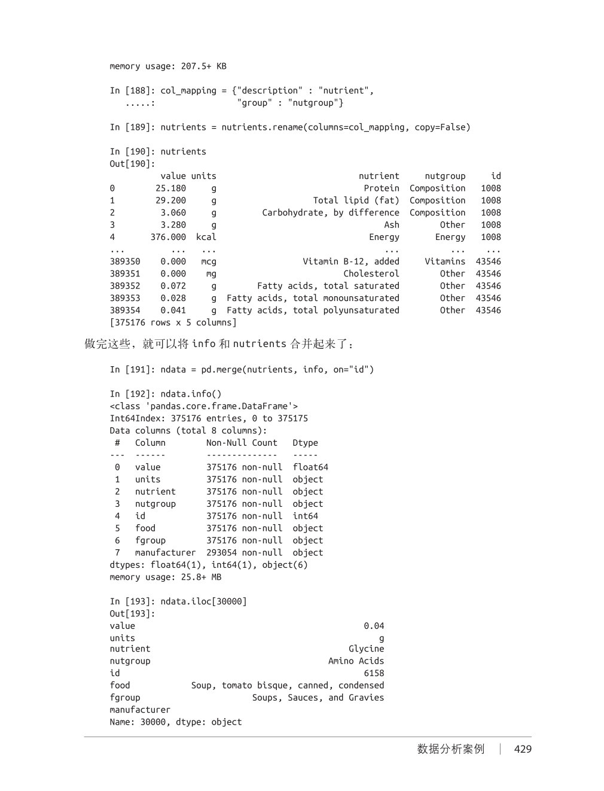

上一页输出续：

```text
memory usage: 207.5+ KB
```

```python
col_mapping = {"description": "nutrient",
               "group": "nutgroup"}
nutrients = nutrients.rename(columns=col_mapping, copy=False)
nutrients
```

```text
Out[190]:
          value units                         nutrient     nutgroup     id
0        25.180     g                          Protein  Composition   1008
1        29.200     g                Total lipid (fat)  Composition   1008
2         3.060     g      Carbohydrate, by difference  Composition   1008
3         3.280     g                              Ash        Other   1008
4       376.000  kcal                           Energy       Energy   1008
...         ...   ...                              ...          ...    ...
389350    0.000   mcg              Vitamin B-12, added     Vitamins  43546
389351    0.000    mg                      Cholesterol        Other  43546
389352    0.072     g        Fatty acids, total saturated      Other  43546
389353    0.028     g   Fatty acids, total monounsaturated      Other  43546
389354    0.041     g   Fatty acids, total polyunsaturated      Other  43546
[375176 rows x 5 columns]
```

做完这些，就可以将 `info` 和 `nutrients` 合并起来了：

```python
ndata = pd.merge(nutrients, info, on="id")
ndata.info()
```

```text
<class 'pandas.core.frame.DataFrame'>
Int64Index: 375176 entries, 0 to 375175
Data columns (total 8 columns):
 #   Column        Non-Null Count  Dtype
---  ------        --------------  -----
 0   value         375176 non-null  float64
 1   units         375176 non-null  object
 2   nutrient      375176 non-null  object
 3   nutgroup      375176 non-null  object
 4   id            375176 non-null  int64
 5   food          375176 non-null  object
 6   fgroup        375176 non-null  object
 7   manufacturer  293054 non-null  object
dtypes: float64(1), int64(1), object(6)
memory usage: 25.8+ MB
```

```python
ndata.iloc[30000]
```

```text
Out[193]:
value                                   0.04
units                                      g
nutrient                             Glycine
nutgroup                         Amino Acids
id                                      6158
food              Soup, tomato bisque, canned, condensed
fgroup                    Soups, Sauces, and Gravies
manufacturer
Name: 30000, dtype: object
```

## PDF 第 440 页

<!-- page-status: reviewed -->

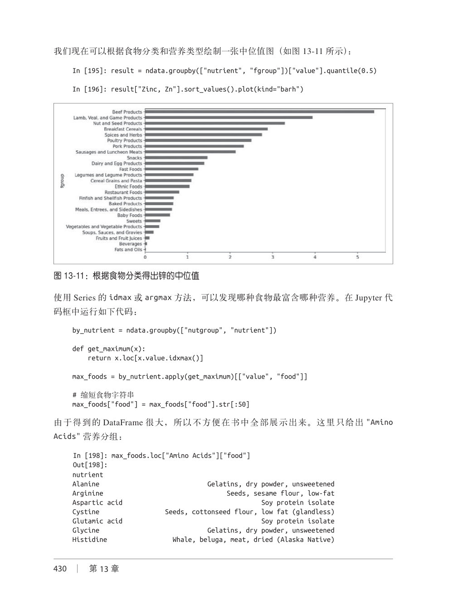

我们现在可以根据食物分类和营养类型绘制一张中位值图（如图 13-11 所示）：

```python
result = ndata.groupby(["nutrient", "fgroup"])["value"].quantile(0.5)
result["Zinc, Zn"].sort_values().plot(kind="barh")
```

**图 13-11：根据食物分类得出锌的中位值**（见本页原页图）。

使用 Series 的 `idxmax` 或 `argmax` 方法，可以发现哪种食物最富含哪种营养。在 Jupyter 代码框中运行如下代码：

```python
by_nutrient = ndata.groupby(["nutgroup", "nutrient"])

def get_maximum(x):
    return x.loc[x.value.idxmax()]

max_foods = by_nutrient.apply(get_maximum)[["value", "food"]]

# 缩短食物字符串
max_foods["food"] = max_foods["food"].str[:50]
```

由于得到的 DataFrame 很大，所以不方便在书中全部展示出来。这里只给出 `"Amino Acids"` 营养分组：

```python
max_foods.loc["Amino Acids"]["food"]
```

```text
Out[198]:
nutrient
Alanine                    Gelatins, dry powder, unsweetened
Arginine                     Seeds, sesame flour, low-fat
Aspartic acid                          Soy protein isolate
Cystine                Seeds, cottonseed flour, low fat (glandless)
Glutamic acid                          Soy protein isolate
Glycine                    Gelatins, dry powder, unsweetened
Histidine            Whale, beluga, meat, dried (Alaska Native)
```

输出续见下页。

## PDF 第 441 页

<!-- page-status: reviewed -->

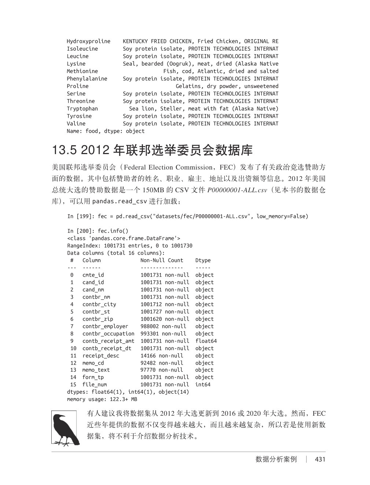

接上页输出：

```text
Hydroxyproline    KENTUCKY FRIED CHICKEN, Fried Chicken, ORIGINAL RE
Isoleucine        Soy protein isolate, PROTEIN TECHNOLOGIES INTERNAT
Leucine           Soy protein isolate, PROTEIN TECHNOLOGIES INTERNAT
Lysine            Seal, bearded (Oogruk), meat, dried (Alaska Native
Methionine                    Fish, cod, Atlantic, dried and salted
Phenylalanine     Soy protein isolate, PROTEIN TECHNOLOGIES INTERNAT
Proline                          Gelatins, dry powder, unsweetened
Serine            Soy protein isolate, PROTEIN TECHNOLOGIES INTERNAT
Threonine         Soy protein isolate, PROTEIN TECHNOLOGIES INTERNAT
Tryptophan          Sea lion, Steller, meat with fat (Alaska Native)
Tyrosine          Soy protein isolate, PROTEIN TECHNOLOGIES INTERNAT
Valine            Soy protein isolate, PROTEIN TECHNOLOGIES INTERNAT
Name: food, dtype: object
```

### 13.5 2012 年联邦选举委员会数据库

美国联邦选举委员会（Federal Election Commission，FEC）发布了有关政治竞选赞助方面的数据。其中包括赞助者的姓名、职业、雇主、地址以及出资额等信息。2012 年美国总统大选的赞助数据是一个 150MB 的 CSV 文件 P00000001-ALL.csv（见本书的数据仓库），可以用 pandas.read_csv 进行加载：

```python
fec = pd.read_csv("datasets/fec/P00000001-ALL.csv", low_memory=False)
fec.info()
```

```text
<class 'pandas.core.frame.DataFrame'>
RangeIndex: 1001731 entries, 0 to 1001730
Data columns (total 16 columns):
 #   Column             Non-Null Count    Dtype
---  ------             --------------    -----
 0   cmte_id            1001731 non-null  object
 1   cand_id            1001731 non-null  object
 2   cand_nm            1001731 non-null  object
 3   contbr_nm          1001731 non-null  object
 4   contbr_city        1001712 non-null  object
 5   contbr_st          1001727 non-null  object
 6   contbr_zip         1001620 non-null  object
 7   contbr_employer    988002 non-null   object
 8   contbr_occupation  993301 non-null   object
 9   contb_receipt_amt  1001731 non-null  float64
 10  contb_receipt_dt   1001731 non-null  object
 11  receipt_desc       14166 non-null    object
 12  memo_cd            92482 non-null    object
 13  memo_text          97770 non-null    object
 14  form_tp            1001731 non-null  object
 15  file_num           1001731 non-null  int64
dtypes: float64(1), int64(1), object(14)
memory usage: 122.3+ MB
```

> 有人建议我将数据集从 2012 年大选更新到 2016 或 2020 年大选。然而，FEC 近些年提供的数据不仅变得越来越大，而且越来越复杂，所以若是使用新数据集，将不利于介绍数据分析技术。

## PDF 第 442 页

<!-- page-status: reviewed -->

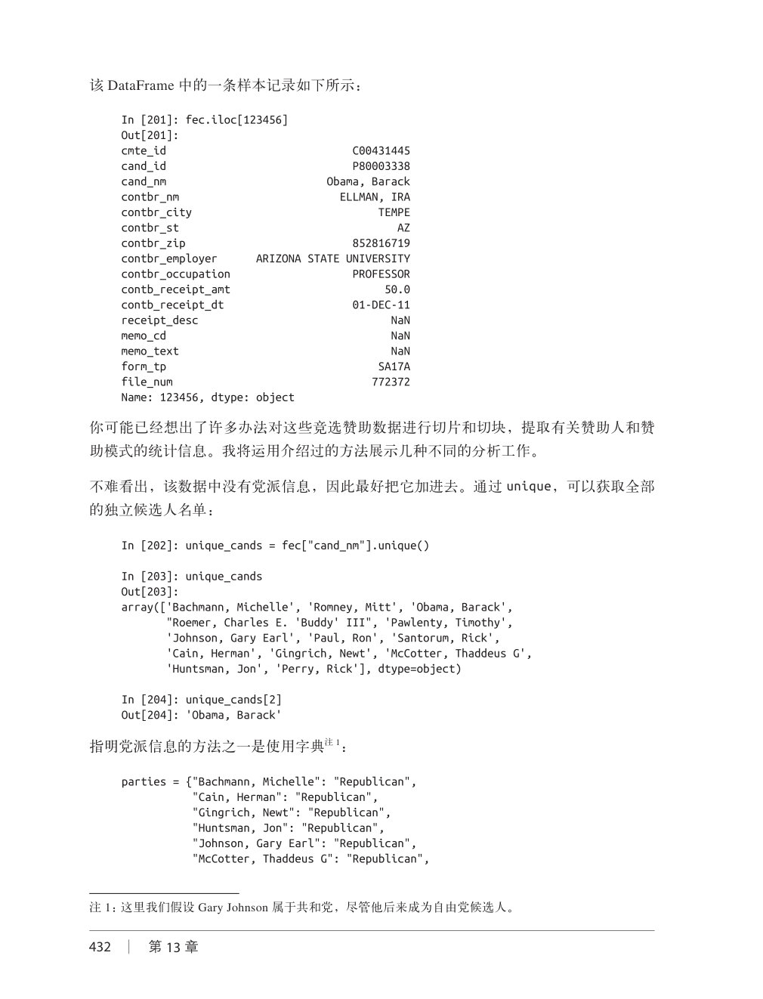

该 DataFrame 中的一条样本记录如下所示：

```python
fec.iloc[123456]
```

```text
cmte_id                            C00431445
cand_id                            P80003338
cand_nm                        Obama, Barack
contbr_nm                        ELLMAN, IRA
contbr_city                            TEMPE
contbr_st                                 AZ
contbr_zip                         852816719
contbr_employer     ARIZONA STATE UNIVERSITY
contbr_occupation                  PROFESSOR
contb_receipt_amt                       50.0
contb_receipt_dt                   01-DEC-11
receipt_desc                             NaN
memo_cd                                  NaN
memo_text                                NaN
form_tp                                SA17A
file_num                              772372
Name: 123456, dtype: object
```

你可能已经想出了许多办法对这些竞选赞助数据进行切片和切块，提取有关赞助人和赞助模式的统计信息。我将运用介绍过的方法展示几种不同的分析工作。

不难看出，该数据中没有党派信息，因此最好把它加进去。通过 unique，可以获取全部的独立候选人名单：

```python
unique_cands = fec["cand_nm"].unique()
unique_cands
```

```text
array(['Bachmann, Michelle', 'Romney, Mitt', 'Obama, Barack',
       "Roemer, Charles E. 'Buddy' III", 'Pawlenty, Timothy',
       'Johnson, Gary Earl', 'Paul, Ron', 'Santorum, Rick',
       'Cain, Herman', 'Gingrich, Newt', 'McCotter, Thaddeus G',
       'Huntsman, Jon', 'Perry, Rick'], dtype=object)
```

```python
unique_cands[2]
```

```text
'Obama, Barack'
```

指明党派信息的方法之一是使用字典（该字典在原书中跨本页与下一页）：

```python
parties = {"Bachmann, Michelle": "Republican",
           "Cain, Herman": "Republican",
           "Gingrich, Newt": "Republican",
           "Huntsman, Jon": "Republican",
           "Johnson, Gary Earl": "Republican",
           "McCotter, Thaddeus G": "Republican",
           "Obama, Barack": "Democrat",
           "Paul, Ron": "Republican",
           "Pawlenty, Timothy": "Republican",
           "Perry, Rick": "Republican",
           "Roemer, Charles E. 'Buddy' III": "Republican",
           "Romney, Mitt": "Republican",
           "Santorum, Rick": "Republican"}
```

注 1：这里我们假设 Gary Johnson 属于共和党，尽管他后来成为自由党候选人。

## PDF 第 443 页

<!-- page-status: reviewed -->

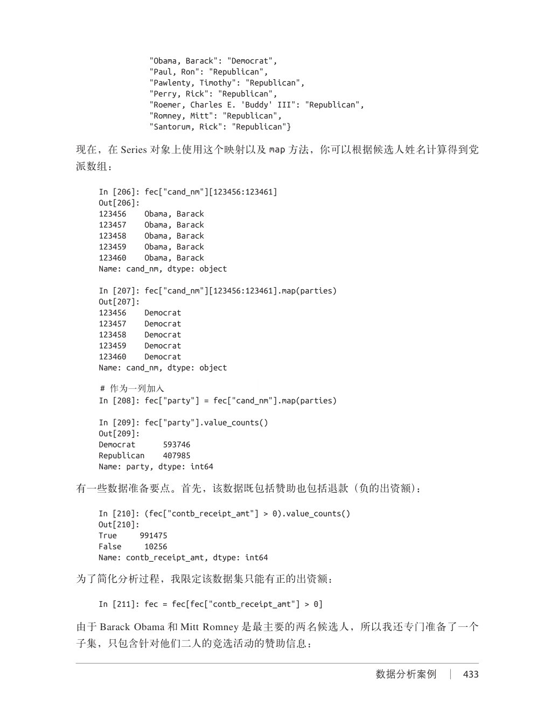

接上页字典的后半部分已合并至上页代码块。

现在，在 Series 对象上使用这个映射以及 map 方法，你可以根据候选人姓名计算得到党派数组：

```python
fec["cand_nm"][123456:123461]
```

```text
123456    Obama, Barack
123457    Obama, Barack
123458    Obama, Barack
123459    Obama, Barack
123460    Obama, Barack
Name: cand_nm, dtype: object
```

```python
fec["cand_nm"][123456:123461].map(parties)
```

```text
123456    Democrat
123457    Democrat
123458    Democrat
123459    Democrat
123460    Democrat
Name: cand_nm, dtype: object
```

```python
# 作为一列加入
fec["party"] = fec["cand_nm"].map(parties)
fec["party"].value_counts()
```

```text
Democrat      593746
Republican    407985
Name: party, dtype: int64
```

有一些数据准备要点。首先，该数据既包括赞助也包括退款（负的出资额）：

```python
(fec["contb_receipt_amt"] > 0).value_counts()
```

```text
True     991475
False     10256
Name: contb_receipt_amt, dtype: int64
```

为了简化分析过程，我限定该数据集只能有正的出资额：

```python
fec = fec[fec["contb_receipt_amt"] > 0]
```

由于 Barack Obama 和 Mitt Romney 是最主要的两名候选人，所以我还专门准备了一个子集，只包含针对他们二人的竞选活动的赞助信息：

## PDF 第 444 页

<!-- page-status: reviewed -->

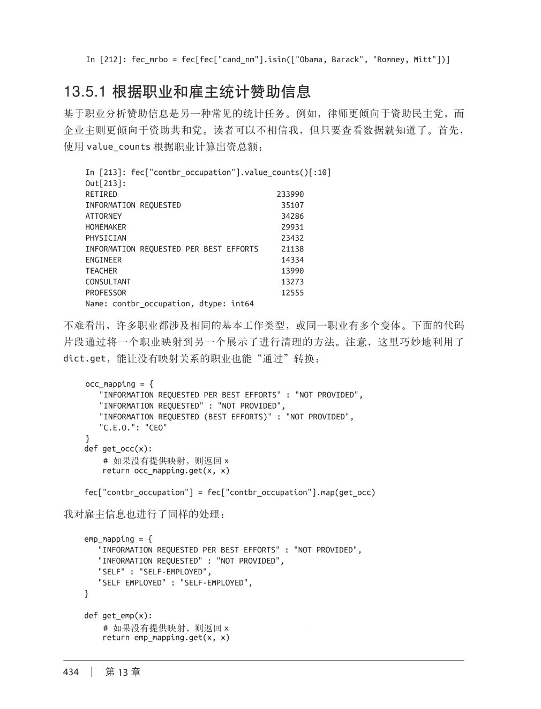

```python
fec_mrbo = fec[fec["cand_nm"].isin(["Obama, Barack", "Romney, Mitt"])]
```

### 13.5.1 根据职业和雇主统计赞助信息

基于职业分析赞助信息是另一种常见的统计任务。例如，律师更倾向于资助民主党，而企业主则更倾向于资助共和党。读者可以不相信我，但只要查看数据就知道了。首先，使用 value_counts 根据职业计算出资总额：

```python
fec["contbr_occupation"].value_counts()[:10]
```

```text
RETIRED                          233990
INFORMATION REQUESTED             35107
ATTORNEY                          34286
HOMEMAKER                         29931
PHYSICIAN                         23432
INFORMATION REQUESTED PER BEST EFFORTS  21138
ENGINEER                          14334
TEACHER                           13990
CONSULTANT                        13273
PROFESSOR                         12555
Name: contbr_occupation, dtype: int64
```

不难看出，许多职业都涉及相同的基本工作类型，或同一职业有多个变体。下面的代码片段通过将一个职业映射到另一个展示了进行清理的方法。注意，这里巧妙地利用了 dict.get，能让没有映射关系的职业也能“通过”转换：

```python
occ_mapping = {
    "INFORMATION REQUESTED PER BEST EFFORTS": "NOT PROVIDED",
    "INFORMATION REQUESTED": "NOT PROVIDED",
    "INFORMATION REQUESTED (BEST EFFORTS)": "NOT PROVIDED",
    "C.E.O.": "CEO"
}
def get_occ(x):
    # 如果没有提供映射，则返回 x
    return occ_mapping.get(x, x)

fec["contbr_occupation"] = fec["contbr_occupation"].map(get_occ)
```

我对雇主信息也进行了同样的处理：

```python
emp_mapping = {
    "INFORMATION REQUESTED PER BEST EFFORTS": "NOT PROVIDED",
    "INFORMATION REQUESTED": "NOT PROVIDED",
    "SELF": "SELF-EMPLOYED",
    "SELF EMPLOYED": "SELF-EMPLOYED",
}

def get_emp(x):
    # 如果没有提供映射，则返回 x
    return emp_mapping.get(x, x)
```

## PDF 第 445 页

<!-- page-status: reviewed -->

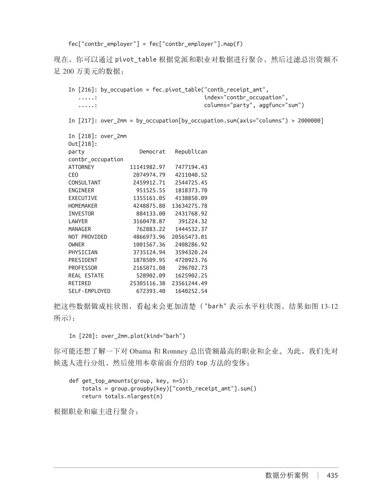

```python
fec["contbr_employer"] = fec["contbr_employer"].map(f)
```

> 校对注：原书此处使用 `f`，而上一页定义的是处理雇主名称的 `get_emp`。若按上述示例独立运行，应核对 `f` 的定义；根据上下文可使用 `.map(get_emp)`。

现在，你可以通过 pivot_table 根据党派和职业对数据进行聚合，然后过滤总出资额不足 200 万美元的数据：

```python
by_occupation = fec.pivot_table("contb_receipt_amt",
                                index="contbr_occupation",
                                columns="party", aggfunc="sum")
over_2mm = by_occupation[by_occupation.sum(axis="columns") > 2000000]
over_2mm
```

```text
party                     Democrat    Republican
contbr_occupation
ATTORNEY               11141982.97    7477194.43
CEO                     2074974.79    4211040.52
CONSULTANT              2459912.71    2544725.45
ENGINEER                 951525.55    1818373.70
EXECUTIVE               1355161.05    4138850.09
HOMEMAKER               4248875.80   13634275.78
INVESTOR                 884133.00    2431768.92
LAWYER                  3160478.87     391224.32
MANAGER                  762883.22    1444532.37
NOT PROVIDED            4866973.96   20565473.01
OWNER                   1001567.36    2408286.92
PHYSICIAN               3735124.94    3594320.24
PRESIDENT               1878509.95    4720923.76
PROFESSOR               2165071.08     296702.73
REAL ESTATE              528902.09    1625902.25
RETIRED                25305116.38   23561244.49
SELF-EMPLOYED            672393.40    1640252.54
```

把这些数据做成柱状图，看起来会更加清楚（"barh" 表示水平柱状图，结果如图 13-12 所示）：

```python
over_2mm.plot(kind="barh")
```

你可能还想了解一下对 Obama 和 Romney 总出资额最高的职业和企业。为此，我们先对候选人进行分组，然后使用本章前面介绍的 top 方法的变体：

```python
def get_top_amounts(group, key, n=5):
    totals = group.groupby(key)["contb_receipt_amt"].sum()
    return totals.nlargest(n)
```

根据职业和雇主进行聚合：

## PDF 第 446 页

<!-- page-status: reviewed -->

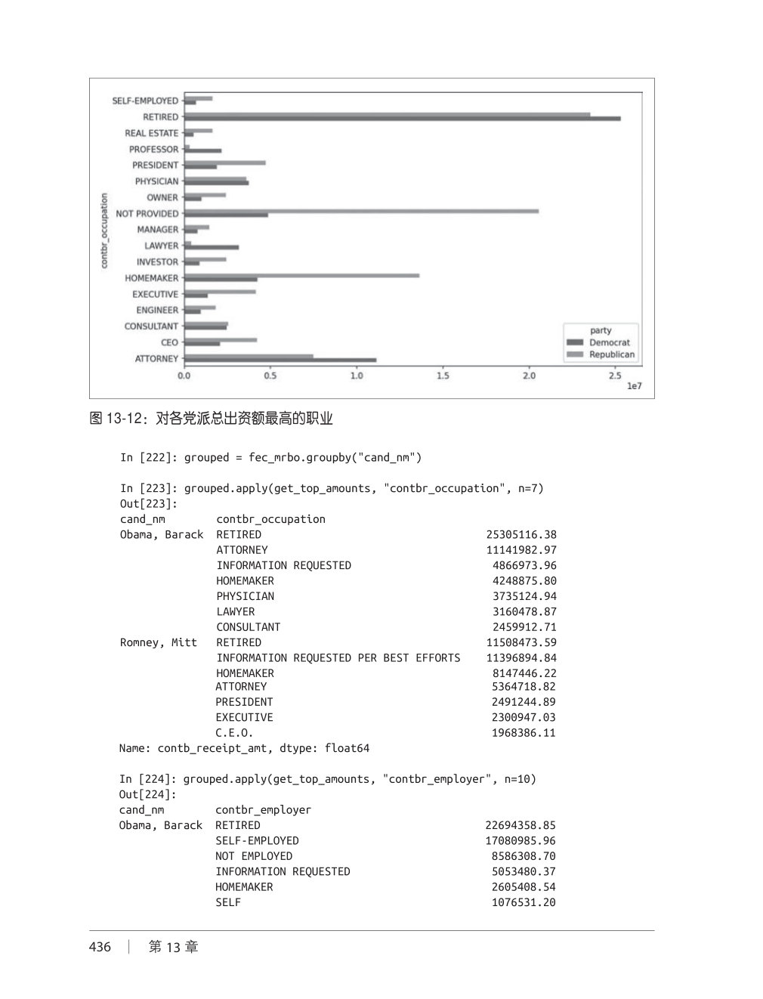

图 13-12：对各党派总出资额最高的职业（见上方原页图）。

```python
grouped = fec_mrbo.groupby("cand_nm")
grouped.apply(get_top_amounts, "contbr_occupation", n=7)
```

```text
cand_nm        contbr_occupation
Obama, Barack  RETIRED                               25305116.38
               ATTORNEY                              11141982.97
               INFORMATION REQUESTED                   4866973.96
               HOMEMAKER                               4248875.80
               PHYSICIAN                               3735124.94
               LAWYER                                  3160478.87
               CONSULTANT                              2459912.71
Romney, Mitt   RETIRED                               11508473.59
               INFORMATION REQUESTED PER BEST EFFORTS  11396894.84
               HOMEMAKER                               8147446.22
               ATTORNEY                                5364718.82
               PRESIDENT                               2491244.89
               EXECUTIVE                               2300947.03
               C.E.O.                                  1968386.11
Name: contb_receipt_amt, dtype: float64
```

```python
grouped.apply(get_top_amounts, "contbr_employer", n=10)
```

```text
cand_nm        contbr_employer
Obama, Barack  RETIRED               22694358.85
               SELF-EMPLOYED         17080985.96
               NOT EMPLOYED           8586308.70
               INFORMATION REQUESTED  5053480.37
               HOMEMAKER              2605408.54
               SELF                   1076531.20
```

其余输出见下一页。

## PDF 第 447 页

<!-- page-status: reviewed -->

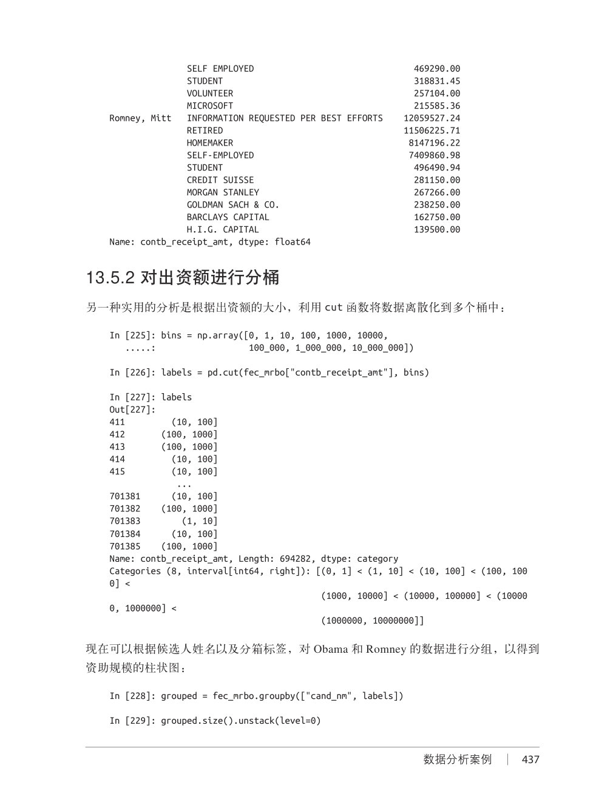

接上页输出：

```text
               SELF EMPLOYED                            469290.00
               STUDENT                                  318831.45
               VOLUNTEER                                257104.00
               MICROSOFT                                215585.36
Romney, Mitt   INFORMATION REQUESTED PER BEST EFFORTS 12059527.24
               RETIRED                                11506225.71
               HOMEMAKER                               8147196.22
               SELF-EMPLOYED                           7409860.98
               STUDENT                                  496490.94
               CREDIT SUISSE                            281150.00
               MORGAN STANLEY                           267266.00
               GOLDMAN SACH & CO.                       238250.00
               BARCLAYS CAPITAL                         162750.00
               H.I.G. CAPITAL                           139500.00
Name: contb_receipt_amt, dtype: float64
```

### 13.5.2 对出资额进行分桶

另一种实用的分析是根据出资额的大小，利用 cut 函数将数据离散化到多个桶中：

```python
bins = np.array([0, 1, 10, 100, 1000, 10000,
                 100_000, 1_000_000, 10_000_000])
labels = pd.cut(fec_mrbo["contb_receipt_amt"], bins)
labels
```

```text
411            (10, 100]
412          (100, 1000]
413          (100, 1000]
414            (10, 100]
415            (10, 100]
                 ...
701381         (10, 100]
701382       (100, 1000]
701383           (1, 10]
701384         (10, 100]
701385       (100, 1000]
Name: contb_receipt_amt, Length: 694282, dtype: category
Categories (8, interval[int64, right]): [(0, 1] < (1, 10] < (10, 100] < (100, 1000] <
                                          (1000, 10000] < (10000, 100000] < (100000, 1000000] <
                                          (1000000, 10000000]]
```

现在可以根据候选人姓名以及分箱标签，对 Obama 和 Romney 的数据进行分组，以得到资助规模的柱状图：

```python
grouped = fec_mrbo.groupby(["cand_nm", labels])
grouped.size().unstack(level=0)
```

输出见下一页。

## PDF 第 448 页

<!-- page-status: reviewed -->

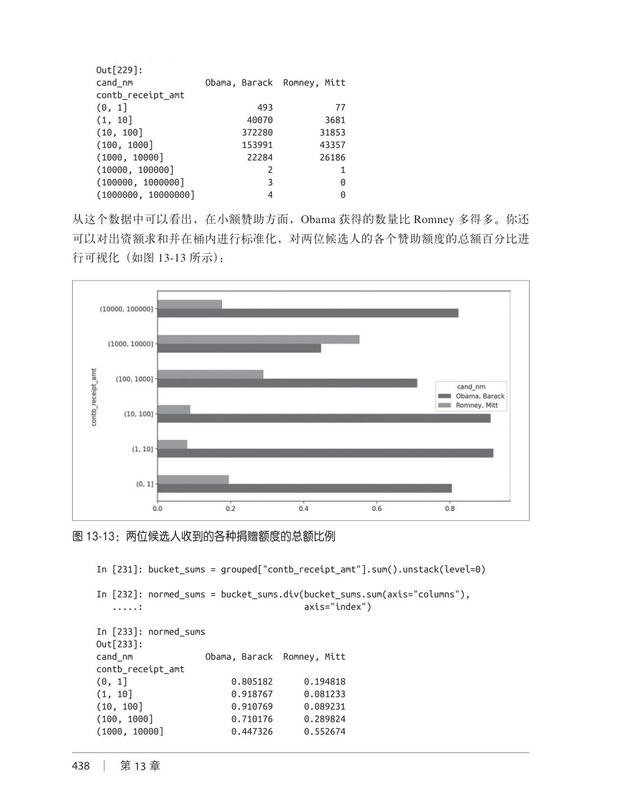

```text
cand_nm                 Obama, Barack  Romney, Mitt
contb_receipt_amt
(0, 1]                            493            77
(1, 10]                         40070          3681
(10, 100]                      372280         31853
(100, 1000]                    153991         43357
(1000, 10000]                   22284         26186
(10000, 100000]                     2             1
(100000, 1000000]                   3             0
(1000000, 10000000]                 4             0
```

从这个数据中可以看出，在小额赞助方面，Obama 获得的数量比 Romney 多得多。你还可以对出资额求和并在桶内进行标准化，对两位候选人的各个赞助额度的总额百分比进行可视化（如图 13-13 所示）：

图 13-13：两位候选人收到的各种捐赠额度的总额比例（见上方原页图）。

```python
bucket_sums = grouped["contb_receipt_amt"].sum().unstack(level=0)
normed_sums = bucket_sums.div(bucket_sums.sum(axis="columns"),
                              axis="index")
normed_sums
```

```text
cand_nm                 Obama, Barack  Romney, Mitt
contb_receipt_amt
(0, 1]                       0.805182      0.194818
(1, 10]                      0.918767      0.081233
(10, 100]                    0.910769      0.089231
(100, 1000]                  0.710176      0.289824
(1000, 10000]                0.447326      0.552674
```

其余输出见下一页。

## PDF 第 449 页

<!-- page-status: reviewed -->

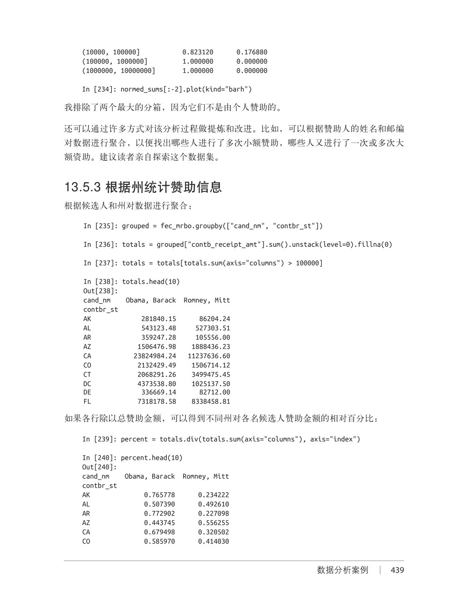

接上页输出：

```text
(10000, 100000]        0.823120      0.176880
(100000, 1000000]      1.000000      0.000000
(1000000, 10000000]    1.000000      0.000000
```

```python
normed_sums[:-2].plot(kind="barh")
```

我排除了两个最大的分箱，因为它们不是由个人赞助的。

还可以通过许多方式对该分析过程做提炼和改进。比如，可以根据赞助人的姓名和邮编对数据进行聚合，以便找出哪些人进行了多次小额赞助，哪些人又进行了一次或多次大额资助。建议读者亲自探索这个数据集。

### 13.5.3 根据州统计赞助信息

根据候选人和州对数据进行聚合：

```python
grouped = fec_mrbo.groupby(["cand_nm", "contbr_st"])
totals = grouped["contb_receipt_amt"].sum().unstack(level=0).fillna(0)
totals = totals[totals.sum(axis="columns") > 100000]
totals.head(10)
```

```text
cand_nm     Obama, Barack  Romney, Mitt
contbr_st
AK              281840.15      86204.24
AL              543123.48     527303.51
AR              359247.28     105556.00
AZ             1506476.98    1888436.23
CA            23824984.24   11237636.60
CO             2132429.49    1506714.12
CT             2068291.26    3499475.45
DC             4373538.80    1025137.50
DE              336669.14      82712.00
FL             7318178.58    8338458.81
```

如果各行除以总赞助金额，可以得到不同州对各名候选人赞助金额的相对百分比：

```python
percent = totals.div(totals.sum(axis="columns"), axis="index")
percent.head(10)
```

```text
cand_nm     Obama, Barack  Romney, Mitt
contbr_st
AK               0.765778      0.234222
AL               0.507390      0.492610
AR               0.772902      0.227098
AZ               0.443745      0.556255
CA               0.679498      0.320502
CO               0.585970      0.414030
```

其余输出见下一页。

## PDF 第 450 页

<!-- page-status: reviewed -->

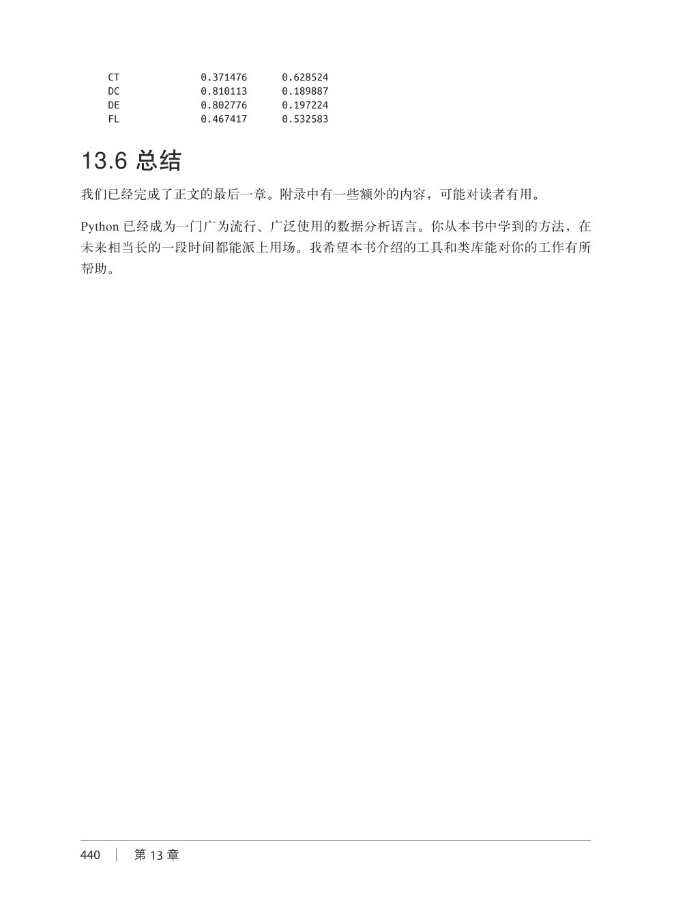

接上页输出：

```text
CT               0.371476      0.628524
DC               0.810113      0.189887
DE               0.802776      0.197224
FL               0.467417      0.532583
```

### 13.6 总结

我们已经完成了正文的最后一章。附录中有一些额外的内容，可能对读者有用。

Python 已经成为一门广为流行、广泛使用的数据分析语言。你从本书中学到的方法，在未来相当长的一段时间都能派上用场。我希望本书介绍的工具和类库能对你的工作有所帮助。

